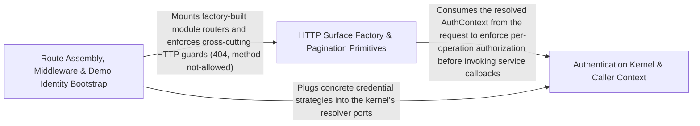

---
tags:
  - 2brain
  - 2brain/arch
  - project/boilerplate-node-backend
type: architecture
component: App_Assembly_Authentication_Kernel
---

## Details

The production application surface the scenario runner boots and the flows exercise: Express route installation (src/app/routes), security middleware, system routes, the kernel's authentication resolvers (AuthResolver, CredentialResolver, resolveBearer, resolveCookie, watchCookie), and the OAuth fake used by the demo profile.

### Authentication Kernel & Caller Context [[Expand]](./Authentication_Kernel_Caller_Context.md)
The identity-resolution core of the subsystem. AuthResolver is the primary entry point that, given an incoming request, produces a fully-typed AuthContext (platform caller, tenant caller, or anonymous). CredentialResolver abstracts the source of credentials (JWT bearer, session cookie, API key) and returns a ResolvedCredential. watchCookie implements a stream-based subscription so that long-lived connections (SSE, WebSocket) can react to cookie rotation without re-handshaking. The AuthContext / CallerContext / TenantCaller type family encodes the multi-tenant, multi-platform caller model that every downstream handler consumes. StaffReadTarget extends the model with staff-level read scoping.

**Related Classes/Methods**:

- `src.kernel.authentication.AuthResolver`:38-61
- `src.kernel.authentication.watchCookie`:145-146

**Source Files:**

- `src/app/security.ts`
  - `src.app.security.installSecurity.origin` (L147-L166) - Method
- `src/app/system-routes.ts`
  - `src.app.system-routes.router.get('/') callback` (L21-L23) - Function
  - `src.app.system-routes.router.get('/livez') callback` (L31-L33) - Function
- `src/infrastructure/observability/analytics/index.ts`
  - `src.infrastructure.observability.analytics.index.AnalyticsEventMap` (L27-L27) - Interface
  - `src.infrastructure.observability.analytics.index.AnalyticsEvent` (L44-L65) - Interface
- `src/kernel/authentication.ts`
  - `src.kernel.authentication.StreamWatch` (L23-L31) - Interface
  - `src.kernel.authentication.AuthResolver` (L38-L61) - Interface
  - `src.kernel.authentication.ResolvedCredential` (L83-L86) - Interface
  - `src.kernel.authentication.CredentialResolver` (L89-L91) - Interface
  - `src.kernel.authentication.watchCookie` (L145-L146) - Class
  - `src.kernel.authentication.watchCookie.then() callback` (L146-L146) - Function
- `src/kernel/staff-read.ts`
  - `src.kernel.staff-read.StaffReadTarget` (L18-L29) - Interface
- `src/modules/account/controllers/get-refresh-token.ts`
  - `src.modules.account.controllers.get-refresh-token.getRefreshToken.then() callback.then() callback` (L42-L54) - Function
- `src/modules/account/oauth/config.ts`
  - `src.modules.account.oauth.config.OAuthCredentials` (L40-L43) - Interface
- `src/modules/account/presenter.ts`
  - `src.modules.account.presenter.presentOAuthLinks.links.links.map() callback` (L82-L85) - Function
- `src/modules/account/services/email-change.ts`
  - `src.modules.account.services.email-change.applyEmailChangeRequest` (L62-L79) - Class
  - `src.modules.account.services.email-change.applyEmailChangeRequest.then() callback` (L74-L78) - Function
- `src/modules/account/services/logout.ts`
  - `src.modules.account.services.logout.isOwnFamily` (L35-L47) - Class
  - `src.modules.account.services.logout.isOwnFamily.then() callback` (L44-L45) - Function
  - `src.modules.account.services.logout.sessionRevoke` (L58-L74) - Class
  - `src.modules.account.services.logout.sessionRevoke.then() callback` (L65-L73) - Function
  - `src.modules.account.services.logout.sessionRevoke.then() callback.then() callback` (L66-L73) - Function
- `src/modules/account/services/oauth.ts`
  - `src.modules.account.services.oauth.listOAuthLinks` (L398-L407) - Class
  - `src.modules.account.services.oauth.listOAuthLinks.then() callback` (L402-L406) - Function
  - `src.modules.account.services.oauth.listOAuthLinks.then() callback.map() callback` (L403-L406) - Function
- `src/modules/account/services/refresh.ts`
  - `src.modules.account.services.refresh.MissingRefreshTokenError` (L22-L28) - Class
  - `src.modules.account.services.refresh.MissingRefreshTokenError.constructor` (L24-L27) - Constructor
  - `src.modules.account.services.refresh.refreshAccessToken` (L48-L87) - Class
  - `src.modules.account.services.refresh.refreshAccessToken.then() callback` (L56-L62) - Function
  - `src.modules.account.services.refresh.refreshAccessToken.catch() callback` (L63-L87) - Function
- `src/modules/account/services/sessions.ts`
  - `src.modules.account.services.sessions.sessionGet` (L38-L43) - Class
  - `src.modules.account.services.sessions.sessionGet.then() callback` (L43-L43) - Function
  - `src.modules.account.services.sessions.sessionGet.then() callback.rows.find() callback` (L43-L43) - Function
- `src/modules/account/services/two-factor-challenge.ts`
  - `src.modules.account.services.two-factor-challenge.buildLoginChallenge.ttlMs.armed.some() callback` (L67-L67) - Function
  - `src.modules.account.services.two-factor-challenge.buildLoginChallenge.ttlMs` (L67-L69) - Class
- `src/modules/account/services/two-factor-enrollment.ts`
  - `src.modules.account.services.two-factor-enrollment.entryFor.existing` (L54-L54) - Class
  - `src.modules.account.services.two-factor-enrollment.entryFor.existing.user.twoFactorMethods.find() callback` (L54-L54) - Function
- `src/modules/account/session/account-view.ts`
  - `src.modules.account.session.account-view.abilitiesOfUser` (L120-L124) - Class
  - `src.modules.account.session.account-view.abilitiesOfUser.then() callback` (L122-L123) - Function
- `src/modules/account/session/activity.ts`
  - `src.modules.account.session.activity.recordActivity` (L16-L20) - Class
  - `src.modules.account.session.activity.recordActivity.catch() callback` (L17-L20) - Function
- `src/modules/account/session/auth-context.ts`
  - `src.modules.account.session.auth-context.SessionProof` (L16-L21) - Interface
  - `src.modules.account.session.auth-context.resolveProof` (L36-L74) - Class
  - `src.modules.account.session.auth-context.resolveProof.then() callback` (L40-L74) - Function
  - `src.modules.account.session.auth-context.resolveProof.then() callback.then() callback` (L44-L72) - Function
- `src/modules/account/session/cookie-strategy.ts`
  - `src.modules.account.session.cookie-strategy.rememberOf` (L51-L52) - Class
  - `src.modules.account.session.cookie-strategy.rememberOf.find() callback` (L52-L52) - Function
  - `src.modules.account.session.cookie-strategy.storeSession` (L66-L93) - Class
  - `src.modules.account.session.cookie-strategy.storeSession.then() callback` (L92-L92) - Function
  - `src.modules.account.session.cookie-strategy.snapshotOf` (L134-L149) - Class
  - `src.modules.account.session.cookie-strategy.snapshotOf.then() callback` (L137-L146) - Function
  - `src.modules.account.session.cookie-strategy.replaceSession` (L155-L172) - Class
  - `src.modules.account.session.cookie-strategy.replaceSession.then() callback` (L164-L170) - Function
  - `src.modules.account.session.cookie-strategy.replaceSession.then() callback.then() callback` (L166-L166) - Function
  - `src.modules.account.session.cookie-strategy.replaceSession.then() callback.catch() callback` (L167-L170) - Function
  - `src.modules.account.session.cookie-strategy.retirePresentedSession` (L179-L188) - Class
  - `src.modules.account.session.cookie-strategy.retirePresentedSession.then() callback` (L184-L184) - Function
  - `src.modules.account.session.cookie-strategy.retirePresentedSession.catch() callback` (L185-L187) - Function
  - `src.modules.account.session.cookie-strategy.findLiveRow` (L200-L210) - Class
  - `src.modules.account.session.cookie-strategy.findLiveRow.then() callback` (L205-L209) - Function
  - `src.modules.account.session.cookie-strategy.resolveSession` (L230-L266) - Class
  - `src.modules.account.session.cookie-strategy.resolveSession.then() callback` (L234-L266) - Function
  - `src.modules.account.session.cookie-strategy.resolveSession.then() callback.then() callback` (L239-L264) - Function
  - `src.modules.account.session.cookie-strategy.resolveSession.then() callback.then() callback.then() callback` (L259-L259) - Function
  - `src.modules.account.session.cookie-strategy.resolveSession.then() callback.then() callback.catch() callback` (L260-L262) - Function
  - `src.modules.account.session.cookie-strategy.watchSession` (L272-L293) - Class
  - `src.modules.account.session.cookie-strategy.watchSession.then() callback` (L273-L293) - Function
  - `src.modules.account.session.cookie-strategy.watchSession.then() callback.then() callback` (L278-L291) - Function
  - `src.modules.account.session.cookie-strategy.watchSession.then() callback.then() callback.ok.recheck` (L282-L289) - Method
  - `src.modules.account.session.cookie-strategy.watchSession.then() callback.then() callback.ok.recheck.resolveInLiveFamily('cookie') callback` (L287-L287) - Function
  - `src.modules.account.session.cookie-strategy.cookieStrategy` (L296-L351) - Class
  - `src.modules.account.session.cookie-strategy.cookieStrategy.issue` (L301-L315) - Method
  - `src.modules.account.session.cookie-strategy.cookieStrategy.issue.then() callback` (L303-L314) - Function
  - `src.modules.account.session.cookie-strategy.cookieStrategy.issue.then() callback.then() callback` (L309-L312) - Function
  - `src.modules.account.session.cookie-strategy.cookieStrategy.issue.then() callback.then() callback.then() callback` (L310-L311) - Function
  - `src.modules.account.session.cookie-strategy.cookieStrategy.reissue` (L319-L325) - Method
  - `src.modules.account.session.cookie-strategy.cookieStrategy.reissue.then() callback` (L321-L324) - Function
  - `src.modules.account.session.cookie-strategy.cookieStrategy.reissue.then() callback.then() callback` (L322-L323) - Function
  - `src.modules.account.session.cookie-strategy.cookieStrategy.remint` (L327-L342) - Method
  - `src.modules.account.session.cookie-strategy.cookieStrategy.remint.then() callback` (L329-L333) - Function
  - `src.modules.account.session.cookie-strategy.cookieStrategy.remint.then() callback.then() callback` (L330-L332) - Function
  - `src.modules.account.session.cookie-strategy.cookieStrategy.remint.catch() callback` (L335-L342) - Function
  - `src.modules.account.session.cookie-strategy.cookieStrategy.list` (L350-L350) - Method
- `src/modules/account/session/device-cookie.ts`
  - `src.modules.account.session.device-cookie.rememberDevice.tokens.filter() callback` (L113-L113) - Function
  - `src.modules.account.session.device-cookie.rememberDevice.tokens` (L113-L116) - Class
- `src/modules/account/session/family-liveness.ts`
  - `src.modules.account.session.family-liveness.resolveInLiveFamily` (L32-L69) - Class
  - `src.modules.account.session.family-liveness.resolveInLiveFamily.then() callback` (L44-L67) - Function
  - `src.modules.account.session.family-liveness.then() callback.then() callback` (L51-L51) - Function
  - `src.modules.account.session.family-liveness.resolveInLiveFamily.then() callback.then() callback` (L55-L55) - Function
  - `src.modules.account.session.family-liveness.resolveInLiveFamily.then() callback.catch() callback` (L65-L65) - Function
- `src/modules/account/session/jwt-strategy.ts`
  - `src.modules.account.session.jwt-strategy.mintSession` (L50-L70) - Class
  - `src.modules.account.session.jwt-strategy.mintSession.then() callback` (L63-L70) - Function
  - `src.modules.account.session.jwt-strategy.mintSession.then() callback.then() callback` (L66-L69) - Function
  - `src.modules.account.session.jwt-strategy.retireRefreshToken` (L92-L100) - Class
  - `src.modules.account.session.jwt-strategy.retireRefreshToken.then() callback` (L96-L96) - Function
  - `src.modules.account.session.jwt-strategy.retireRefreshToken.catch() callback` (L97-L99) - Function
  - `src.modules.account.session.jwt-strategy.retireRestOfFamily` (L106-L116) - Class
  - `src.modules.account.session.jwt-strategy.retireRestOfFamily.then() callback` (L113-L113) - Function
  - `src.modules.account.session.jwt-strategy.retireRestOfFamily.catch() callback` (L114-L116) - Function
  - `src.modules.account.session.jwt-strategy.retirePresentedSession` (L124-L135) - Class
  - `src.modules.account.session.jwt-strategy.retirePresentedSession.then() callback` (L128-L128) - Function
  - `src.modules.account.session.jwt-strategy.retirePresentedSession.catch() callback` (L129-L134) - Function
  - `src.modules.account.session.jwt-strategy.snapshotOf` (L142-L159) - Class
  - `src.modules.account.session.jwt-strategy.snapshotOf.then() callback` (L148-L157) - Function
  - `src.modules.account.session.jwt-strategy.snapshotOf.then() callback.then() callback` (L149-L157) - Function
  - `src.modules.account.session.jwt-strategy.sessionRowOf` (L173-L198) - Class
  - `src.modules.account.session.jwt-strategy.sessionRowOf.then() callback` (L187-L190) - Function
  - `src.modules.account.session.jwt-strategy.sessionRowOf.catch() callback` (L193-L196) - Function
  - `src.modules.account.session.jwt-strategy.resolveWith` (L205-L218) - Class
  - `src.modules.account.session.jwt-strategy.resolveWith.<function>` (L207-L218) - Function
  - `src.modules.account.session.jwt-strategy.<function>.then() callback` (L209-L210) - Function
  - `src.modules.account.session.jwt-strategy.resolveWith.<function>.then() callback` (L214-L217) - Function
  - `src.modules.account.session.jwt-strategy.resolveBearer` (L224-L241) - Class
  - `src.modules.account.session.jwt-strategy.resolveBearer.then() callback.resolveInLiveFamily('jwt') callback` (L234-L234) - Function
  - `src.modules.account.session.jwt-strategy.resolveBearer.then() callback` (L237-L240) - Function
  - `src.modules.account.session.jwt-strategy.watchRefreshCookie` (L248-L275) - Class
  - `src.modules.account.session.jwt-strategy.watchRefreshCookie.then() callback.then() callback` (L252-L269) - Function
  - `src.modules.account.session.jwt-strategy.watchRefreshCookie.then() callback.then() callback.ok.recheck` (L255-L267) - Method
  - `src.modules.account.session.jwt-strategy.watchRefreshCookie.then() callback.then() callback.ok.recheck.resolveInLiveFamily('jwt') callback` (L260-L264) - Function
  - `src.modules.account.session.jwt-strategy.watchRefreshCookie.then() callback` (L271-L274) - Function
  - `src.modules.account.session.jwt-strategy.unlessOtherMode` (L281-L284) - Class
  - `src.modules.account.session.jwt-strategy.unlessOtherMode.<function>` (L283-L284) - Function
  - `src.modules.account.session.jwt-strategy.jwtStrategy` (L287-L353) - Class
  - `src.modules.account.session.jwt-strategy.jwtStrategy.issue` (L293-L298) - Method
  - `src.modules.account.session.jwt-strategy.jwtStrategy.issue.mintSession() callback` (L294-L295) - Function
  - `src.modules.account.session.jwt-strategy.jwtStrategy.issue.then() callback` (L296-L297) - Function
  - `src.modules.account.session.jwt-strategy.jwtStrategy.issue.then() callback.then() callback` (L297-L297) - Function
  - `src.modules.account.session.jwt-strategy.jwtStrategy.snapshot` (L300-L300) - Method
  - `src.modules.account.session.jwt-strategy.jwtStrategy.reissue` (L302-L323) - Method
  - `src.modules.account.session.jwt-strategy.jwtStrategy.reissue.ready.then() callback` (L307-L321) - Function
  - `src.modules.account.session.jwt-strategy.jwtStrategy.reissue.ready.then() callback.then() callback` (L315-L320) - Function
  - `src.modules.account.session.jwt-strategy.jwtStrategy.reissue.ready.then() callback.then() callback.then() callback` (L320-L320) - Function
  - `src.modules.account.session.jwt-strategy.jwtStrategy.remint` (L325-L344) - Method
  - `src.modules.account.session.jwt-strategy.jwtStrategy.remint.then() callback` (L327-L336) - Function
  - `src.modules.account.session.jwt-strategy.jwtStrategy.remint.then() callback.then() callback` (L331-L334) - Function
  - `src.modules.account.session.jwt-strategy.jwtStrategy.remint.catch() callback` (L337-L344) - Function
  - `src.modules.account.session.jwt-strategy.jwtStrategy.list` (L352-L352) - Method
- `src/modules/account/session/jwt.ts`
  - `src.modules.account.session.jwt.TokenData` (L46-L81) - Interface
  - `src.modules.account.session.jwt.RotatedSession` (L97-L102) - Interface
  - `src.modules.account.session.jwt.TokenRejection` (L145-L154) - Class
  - `src.modules.account.session.jwt.TokenRejection.constructor` (L147-L153) - Constructor
  - `src.modules.account.session.jwt.ringKeyLookup` (L204-L211) - Class
  - `src.modules.account.session.jwt.ringKeyLookup.<function>` (L206-L211) - Function
  - `src.modules.account.session.jwt.verifyAgainstRing` (L229-L244) - Class
  - `src.modules.account.session.jwt.verifyAgainstRing.then() callback` (L240-L244) - Function
  - `src.modules.account.session.jwt.verifyAccessToken` (L252-L257) - Class
  - `src.modules.account.session.jwt.verifyAccessToken.then() callback` (L253-L257) - Function
  - `src.modules.account.session.jwt.verifyRefreshWithRow` (L267-L284) - Class
  - `src.modules.account.session.jwt.verifyRefreshWithRow.then() callback` (L270-L283) - Function
  - `src.modules.account.session.jwt.verifyRefreshWithRow.then() callback.then() callback` (L271-L283) - Function
  - `src.modules.account.session.jwt.verifyRefreshWithRow.then() callback.then() callback.then() callback` (L278-L282) - Function
  - `src.modules.account.session.jwt.verifyRefreshToken` (L292-L293) - Class
  - `src.modules.account.session.jwt.verifyRefreshToken.then() callback` (L293-L293) - Function
  - `src.modules.account.session.jwt.mintRefreshToken` (L357-L409) - Class
  - `src.modules.account.session.jwt.mintRefreshToken.then() callback` (L364-L409) - Function
  - `src.modules.account.session.jwt.mintRefreshToken.then() callback.then() callback` (L389-L408) - Function
  - `src.modules.account.session.jwt.then() callback.then() callback.then() callback` (L406-L406) - Function
  - `src.modules.account.session.jwt.mintRefreshToken.then() callback.then() callback.then() callback` (L407-L407) - Function
  - `src.modules.account.session.jwt.startSession` (L428-L437) - Class
  - `src.modules.account.session.jwt.startSession.mintRefreshToken() callback` (L434-L437) - Function
  - `src.modules.account.session.jwt.continueSession` (L449-L457) - Class
  - `src.modules.account.session.jwt.continueSession.mintRefreshToken() callback` (L457-L457) - Function
  - `src.modules.account.session.jwt.createAccessToken` (L471-L474) - Class
  - `src.modules.account.session.jwt.createAccessToken.then() callback` (L472-L473) - Function
  - `src.modules.account.session.jwt.TokenReuseError` (L482-L488) - Class
  - `src.modules.account.session.jwt.TokenReuseError.constructor` (L484-L487) - Constructor
  - `src.modules.account.session.jwt.storeSuccessor` (L500-L529) - Class
  - `src.modules.account.session.jwt.storeSuccessor.then() callback` (L522-L528) - Function
  - `src.modules.account.session.jwt.reissueRotated` (L542-L572) - Class
  - `src.modules.account.session.jwt.reissueRotated.then() callback` (L547-L572) - Function
  - `src.modules.account.session.jwt.reissueRotated.then() callback.then() callback` (L554-L571) - Function
  - `src.modules.account.session.jwt.reissueRotated.then() callback.then() callback.liveness` (L559-L565) - Class
  - `src.modules.account.session.jwt.reissueRotated.then() callback.then() callback.liveness.resolveInLiveFamily('jwt') callback` (L563-L563) - Function
  - `src.modules.account.session.jwt.reissueRotated.then() callback.then() callback.then() callback` (L568-L569) - Function
  - `src.modules.account.session.jwt.resolveLostRotation` (L586-L619) - Class
  - `src.modules.account.session.jwt.resolveLostRotation.then() callback` (L591-L619) - Function
  - `src.modules.account.session.jwt.resolveLostRotation.then() callback.then() callback` (L616-L618) - Function
  - `src.modules.account.session.jwt.rotateRefreshToken` (L634-L649) - Class
  - `src.modules.account.session.jwt.rotateRefreshToken.then() callback` (L636-L649) - Function
  - `src.modules.account.session.jwt.rotateRefreshToken.then() callback.then() callback` (L644-L647) - Function
  - `src.modules.account.session.jwt.rememberOfRefreshToken` (L663-L672) - Class
  - `src.modules.account.session.jwt.rememberOfRefreshToken.then() callback` (L669-L669) - Function
  - `src.modules.account.session.jwt.rememberOfRefreshToken.catch() callback` (L671-L671) - Function
- `src/modules/account/session/key-ring.ts`
  - `src.modules.account.session.key-ring.keyForId` (L30-L31) - Class
  - `src.modules.account.session.key-ring.keyForId.ring.find() callback` (L31-L31) - Function
- `src/modules/account/session/listing.ts`
  - `src.modules.account.session.listing.listSessions` (L59-L86) - Class
  - `src.modules.account.session.listing.listSessions.then() callback` (L68-L86) - Function
  - `src.modules.account.session.listing.listSessions.then() callback.rows` (L72-L78) - Class
  - `src.modules.account.session.listing.listSessions.then() callback.rows.allRows.filter() callback` (L73-L77) - Function
  - `src.modules.account.session.listing.listSessions.then() callback.current` (L80-L82) - Class
  - `src.modules.account.session.listing.listSessions.then() callback.current.map() callback` (L81-L81) - Function
  - `src.modules.account.session.listing.listSessions.then() callback.current.rows.filter() callback` (L81-L81) - Function
  - `src.modules.account.session.listing.listSessions.then() callback.map() callback` (L83-L84) - Function
- `src/modules/account/session/mint-guard.ts`
  - `src.modules.account.session.mint-guard.SecondFactorRequiredError` (L20-L26) - Class
  - `src.modules.account.session.mint-guard.SecondFactorRequiredError.constructor` (L22-L25) - Constructor
  - `src.modules.account.session.mint-guard.StaleProofError` (L49-L55) - Class
  - `src.modules.account.session.mint-guard.StaleProofError.constructor` (L51-L54) - Constructor
- `src/modules/account/session/resolver.ts`
  - `src.modules.account.session.resolver.accountAuthResolver` (L24-L32) - Class
  - `src.modules.account.session.resolver.accountAuthResolver.fromBearer` (L25-L25) - Method
  - `src.modules.account.session.resolver.accountAuthResolver.fromCookie` (L26-L26) - Method
  - `src.modules.account.session.resolver.accountAuthResolver.watchCookie` (L27-L27) - Method
  - `src.modules.account.session.resolver.accountAuthResolver.cookieAuthenticates` (L28-L28) - Method
  - `src.modules.account.session.resolver.accountAuthResolver.clearDeadCookie` (L29-L31) - Method
- `src/modules/account/session/strategy.ts`
  - `src.modules.account.session.strategy.IssueOptions` (L42-L55) - Interface
  - `src.modules.account.session.strategy.SessionSnapshot` (L62-L68) - Interface
  - `src.modules.account.session.strategy.IssuedSession` (L71-L76) - Interface
  - `src.modules.account.session.strategy.ReissueOptions` (L79-L83) - Interface
  - `src.modules.account.session.strategy.SessionStrategy` (L86-L152) - Interface
  - `src.modules.account.session.strategy.SessionStrategy.issue` (L98-L103) - Method
  - `src.modules.account.session.strategy.SessionStrategy.snapshot` (L106-L106) - Method
  - `src.modules.account.session.strategy.SessionStrategy.reissue` (L109-L114) - Method
  - `src.modules.account.session.strategy.SessionStrategy.remint` (L122-L127) - Method
  - `src.modules.account.session.strategy.SessionStrategy.resolveBearer` (L130-L133) - Method
  - `src.modules.account.session.strategy.SessionStrategy.resolveCookie` (L136-L139) - Method
  - `src.modules.account.session.strategy.SessionStrategy.watchCookie` (L145-L145) - Method
  - `src.modules.account.session.strategy.SessionStrategy.credentialOf` (L148-L148) - Method
  - `src.modules.account.session.strategy.SessionStrategy.list` (L151-L151) - Method
- `src/modules/addresses/controllers/get-addresses.ts`
  - `src.modules.addresses.controllers.get-addresses.getAddresses` (L19-L29) - Class
  - `src.modules.addresses.controllers.get-addresses.getAddresses.then() callback` (L25-L27) - Function
- `src/modules/addresses/controllers/post-address.ts`
  - `src.modules.addresses.controllers.post-address.postAddress` (L20-L38) - Class
  - `src.modules.addresses.controllers.post-address.postAddress.then() callback` (L32-L36) - Function
- `src/modules/addresses/presenter.ts`
  - `src.modules.addresses.presenter.presentAddressOf.item` (L40-L40) - Class
  - `src.modules.addresses.presenter.presentAddressOf.item.book.items.find() callback` (L40-L40) - Function
- `src/modules/analytics/controllers/post-analytics-event.ts`
  - `src.modules.analytics.controllers.post-analytics-event.postAnalyticsEvent` (L22-L35) - Class
  - `src.modules.analytics.controllers.post-analytics-event.postAnalyticsEvent.then() callback` (L30-L33) - Function
- `src/modules/cart/controllers/delete-cart-items.ts`
  - `src.modules.cart.controllers.delete-cart-items.clearCart` (L19-L28) - Class
  - `src.modules.cart.controllers.delete-cart-items.clearCart.then() callback` (L24-L26) - Function
- `src/modules/cart/controllers/get-cart-summary.ts`
  - `src.modules.cart.controllers.get-cart-summary.getCartSummary` (L17-L24) - Class
  - `src.modules.cart.controllers.get-cart-summary.getCartSummary.then() callback` (L20-L22) - Function
- `src/modules/cart/controllers/get-cart.ts`
  - `src.modules.cart.controllers.get-cart.getCart` (L18-L25) - Class
  - `src.modules.cart.controllers.get-cart.getCart.then() callback` (L21-L23) - Function
- `src/modules/cart/controllers/post-cart-items.ts`
  - `src.modules.cart.controllers.post-cart-items.postCartItems` (L22-L42) - Class
  - `src.modules.cart.controllers.post-cart-items.postCartItems.then() callback` (L36-L40) - Function
- `src/modules/cart/controllers/post-cart-merge.ts`
  - `src.modules.cart.controllers.post-cart-merge.postCartMerge` (L19-L32) - Class
  - `src.modules.cart.controllers.post-cart-merge.postCartMerge.then() callback` (L28-L30) - Function
- `src/modules/cart/controllers/post-reorder.ts`
  - `src.modules.cart.controllers.post-reorder.postReorder` (L20-L36) - Class
  - `src.modules.cart.controllers.post-reorder.postReorder.then() callback` (L30-L34) - Function
- `src/modules/cart/controllers/put-cart-shipping-method.ts`
  - `src.modules.cart.controllers.put-cart-shipping-method.putCartShippingMethod` (L19-L36) - Class
  - `src.modules.cart.controllers.put-cart-shipping-method.putCartShippingMethod.then() callback` (L30-L34) - Function
- `src/modules/delivery/services/notice.ts`
  - `src.modules.delivery.services.notice.NoticeInput` (L22-L27) - Interface
  - `src.modules.delivery.services.notice.SentNotice` (L30-L32) - Interface
  - `src.modules.delivery.services.notice.payloadOf.titles.fulfillmentOrder.lines.map() callback` (L52-L52) - Function
- `src/modules/locales/controllers/delete-locale.ts`
  - `src.modules.locales.controllers.delete-locale.deleteLocale` (L19-L27) - Class
  - `src.modules.locales.controllers.delete-locale.deleteLocale.then() callback` (L22-L26) - Function
- `src/modules/locales/controllers/get-entity-translations.ts`
  - `src.modules.locales.controllers.get-entity-translations.getEntityTranslations` (L18-L36) - Class
  - `src.modules.locales.controllers.get-entity-translations.getEntityTranslations.then() callback` (L30-L34) - Function
- `src/modules/locales/controllers/get-locale-messages.ts`
  - `src.modules.locales.controllers.get-locale-messages.getLocaleMessages` (L21-L45) - Class
  - `src.modules.locales.controllers.get-locale-messages.getLocaleMessages.then() callback` (L39-L42) - Function
- `src/modules/locales/controllers/get-locales.ts`
  - `src.modules.locales.controllers.get-locales.getLocales` (L21-L29) - Class
  - `src.modules.locales.controllers.get-locales.getLocales.then() callback` (L28-L28) - Function
- `src/modules/locales/controllers/update-entity-translations.ts`
  - `src.modules.locales.controllers.update-entity-translations.writeEntityTranslations` (L37-L72) - Class
  - `src.modules.locales.controllers.update-entity-translations.writeEntityTranslations.<function>` (L48-L72) - Function
  - `src.modules.locales.controllers.update-entity-translations.writeEntityTranslations.<function>.then() callback` (L66-L70) - Function
- `src/modules/locales/repository.ts`
  - `src.modules.locales.repository.listKeys` (L157-L163) - Class
  - `src.modules.locales.repository.listKeys.then() callback` (L163-L163) - Function
  - `src.modules.locales.repository.listKeys.then() callback.rows.map() callback` (L163-L163) - Function
  - `src.modules.locales.repository.importEntries.incoming` (L256-L260) - Class
  - `src.modules.locales.repository.importEntries.incoming.inputs.flatMap() callback` (L257-L258) - Function
  - `src.modules.locales.repository.importEntries.nulled` (L261-L261) - Class
  - `src.modules.locales.repository.importEntries.nulled.inputs.filter() callback` (L261-L261) - Function
  - `src.modules.locales.repository.importEntries.nulled.map() callback` (L261-L261) - Function
  - `src.modules.locales.repository.importEntries.removedKeys` (L263-L266) - Class
  - `src.modules.locales.repository.importEntries.removedKeys.filter() callback` (L264-L264) - Function
  - `src.modules.locales.repository.importEntries.removedKeys.nulled.filter() callback` (L265-L265) - Function
  - `src.modules.locales.repository.importEntries.changedEntries` (L269-L269) - Class
  - `src.modules.locales.repository.importEntries.changedEntries.filter() callback` (L269-L269) - Function
  - `src.modules.locales.repository.importEntries.created` (L292-L292) - Class
  - `src.modules.locales.repository.importEntries.created.changedEntries.filter() callback` (L292-L292) - Function
  - `src.modules.locales.repository.deleteLocaleCascade` (L327-L333) - Class
  - `src.modules.locales.repository.deleteLocaleCascade.then() callback` (L331-L332) - Function
  - `src.modules.locales.repository.deleteLocaleCascade.then() callback.then() callback` (L332-L332) - Function
  - `src.modules.locales.repository.forgetTranslator` (L550-L558) - Class
  - `src.modules.locales.repository.forgetTranslator.then() callback` (L558-L558) - Function
  - `src.modules.locales.repository.removeEntityLocale` (L561-L571) - Class
  - `src.modules.locales.repository.removeEntityLocale.then() callback` (L571-L571) - Function
  - `src.modules.locales.repository.removeEntityTranslations` (L580-L589) - Class
  - `src.modules.locales.repository.removeEntityTranslations.then() callback` (L589-L589) - Function
- `src/modules/notifications/controllers/get-notifications.ts`
  - `src.modules.notifications.controllers.get-notifications.getNotifications` (L16-L23) - Class
  - `src.modules.notifications.controllers.get-notifications.getNotifications.then() callback` (L19-L21) - Function
- `src/modules/notifications/repository.ts`
  - `src.modules.notifications.repository.notificationRepository.deleteByAudience.then() callback.ids` (L187-L187) - Class
  - `src.modules.notifications.repository.notificationRepository.deleteByAudience.then() callback.ids.rows.map() callback` (L187-L187) - Function
  - `src.modules.notifications.repository.notificationRepository.trimToNewest.ids` (L228-L228) - Class
  - `src.modules.notifications.repository.notificationRepository.trimToNewest.ids.excess.map() callback` (L228-L228) - Function
- `src/modules/observability/services/process-snapshot.ts`
  - `src.modules.observability.services.process-snapshot.ProcessMemorySnapshot` (L11-L23) - Interface
  - `src.modules.observability.services.process-snapshot.ProcessSnapshot` (L26-L33) - Interface
- `src/modules/payments/services/intent.ts`
  - `src.modules.payments.services.intent.then() callback.then() callback` (L194-L195) - Function
  - `src.modules.payments.services.intent.then() callback.catch() callback` (L200-L207) - Function
- `src/modules/shop-tasks/controllers/get-shop-work-summary.ts`
  - `src.modules.shop-tasks.controllers.get-shop-work-summary.getShopWorkSummary` (L14-L18) - Class
  - `src.modules.shop-tasks.controllers.get-shop-work-summary.getShopWorkSummary.then() callback` (L17-L17) - Function
- `src/modules/shop-tasks/services/work-summary.ts`
  - `src.modules.shop-tasks.services.work-summary.count.then() callback` (L57-L57) - Function
  - `src.modules.shop-tasks.services.work-summary.workSummary` (L92-L98) - Class
  - `src.modules.shop-tasks.services.work-summary.workSummary.BADGES.filter() callback` (L94-L94) - Function
  - `src.modules.shop-tasks.services.work-summary.workSummary.map() callback` (L94-L95) - Function
  - `src.modules.shop-tasks.services.work-summary.workSummary.map() callback.then() callback` (L95-L95) - Function
  - `src.modules.shop-tasks.services.work-summary.workSummary.then() callback` (L98-L98) - Function
- `src/modules/shop/controllers/get-shop.ts`
  - `src.modules.shop.controllers.get-shop.getShop` (L18-L21) - Class
  - `src.modules.shop.controllers.get-shop.getShop.then() callback` (L20-L20) - Function
- `src/modules/stats/services/range.ts`
  - `src.modules.stats.services.range.Period` (L22-L31) - Interface
- `src/modules/stock-alerts/controllers/get-stock-alerts.ts`
  - `src.modules.stock-alerts.controllers.get-stock-alerts.getStockAlerts` (L13-L19) - Class
  - `src.modules.stock-alerts.controllers.get-stock-alerts.getStockAlerts.then() callback` (L16-L18) - Function
- `src/modules/webhooks/services/attempt.ts`
  - `src.modules.webhooks.services.attempt.then() callback.then() callback` (L258-L258) - Function
- `src/modules/wishlist/controllers/get-wishlist.ts`
  - `src.modules.wishlist.controllers.get-wishlist.getWishlist` (L18-L25) - Class
  - `src.modules.wishlist.controllers.get-wishlist.getWishlist.then() callback` (L21-L23) - Function
- `src/modules/wishlist/factories.ts`
  - `src.modules.wishlist.factories.WishlistOverrides` (L14-L22) - Interface
- `src/types/auth-context.ts`
  - `src.types.auth-context.AuthContext` (L22-L90) - Interface
  - `src.types.auth-context.TenantCaller` (L120-L143) - Interface
  - `src.types.auth-context.PlatformCaller` (L146-L158) - Interface
  - `src.types.auth-context.CallerContext` (L169-L222) - Interface
  - `src.types.auth-context.TenantCallerContext` (L233-L235) - Interface
  - `src.types.auth-context.ResolveOptions` (L245-L251) - Interface

### HTTP Surface Factory & Pagination Primitives [[Expand]](./HTTP_Surface_Factory_Pagination_Primitives.md)
The generic REST controller construction layer. Rather than each domain module hand-writing Express handlers, this group provides factory functions (createListController, createItemController, createDeleteController, createRestoreController) that accept a spec object (route path, service method, validation schema, auth requirement) and return a fully-wired Express handler. namedHandler is the low-level wrapper that binds a named function to a route with consistent error propagation. PaginationResult / PaginationInput / PaginatedMeta standardize the cursor/offset pagination contract across all list endpoints. writeWithUploadedImage handles the multipart upload to image-store to record-update pipeline.

**Related Classes/Methods**:

- `src.infrastructure.surfaces.create-list-controller.createListController`:49-76
- `src.infrastructure.surfaces.create-item-controller.createItemController`:42-63
- `src.infrastructure.surfaces.create-delete-controller.createDeleteController`:50-80
- `src.infrastructure.http.controller.namedHandler`:46-54

**Source Files:**

- `src/infrastructure/http/controller.ts`
  - `src.infrastructure.http.controller.namedHandler` (L46-L54) - Class
  - `src.infrastructure.http.controller.namedHandler.[operation]` (L52-L52) - Method
- `src/infrastructure/http/ids.ts`
  - `src.infrastructure.http.ids.RequiredId` (L68-L79) - Interface
- `src/infrastructure/http/uploads.ts`
  - `src.infrastructure.http.uploads.writeWithUploadedImage` (L142-L157) - Class
  - `src.infrastructure.http.uploads.writeWithUploadedImage.then() callback` (L153-L156) - Function
- `src/infrastructure/persistence/search.ts`
  - `src.infrastructure.persistence.search.PaginationInput` (L11-L17) - Interface
  - `src.infrastructure.persistence.search.PaginationResult` (L20-L24) - Interface
  - `src.infrastructure.persistence.search.PaginatedMeta` (L27-L32) - Interface
- `src/infrastructure/surfaces/create-delete-controller.ts`
  - `src.infrastructure.surfaces.create-delete-controller.DeleteControllerSpec` (L27-L42) - Interface
  - `src.infrastructure.surfaces.create-delete-controller.createDeleteController` (L50-L80) - Class
  - `src.infrastructure.surfaces.create-delete-controller.createDeleteController.namedHandler() callback` (L54-L79) - Function
  - `src.infrastructure.surfaces.create-delete-controller.createDeleteController.namedHandler() callback.withIfMatch() callback` (L71-L71) - Function
  - `src.infrastructure.surfaces.create-delete-controller.createDeleteController.namedHandler() callback.then() callback` (L72-L77) - Function
- `src/infrastructure/surfaces/create-item-controller.ts`
  - `src.infrastructure.surfaces.create-item-controller.ItemControllerSpec` (L18-L34) - Interface
  - `src.infrastructure.surfaces.create-item-controller.createItemController` (L42-L63) - Class
  - `src.infrastructure.surfaces.create-item-controller.createItemController.namedHandler() callback` (L46-L62) - Function
  - `src.infrastructure.surfaces.create-item-controller.createItemController.namedHandler() callback.then() callback` (L52-L60) - Function
- `src/infrastructure/surfaces/create-list-controller.ts`
  - `src.infrastructure.surfaces.create-list-controller.ListControllerSpec` (L17-L41) - Interface
  - `src.infrastructure.surfaces.create-list-controller.createListController` (L49-L76) - Class
  - `src.infrastructure.surfaces.create-list-controller.createListController.namedHandler() callback` (L58-L75) - Function
  - `src.infrastructure.surfaces.create-list-controller.createListController.namedHandler() callback.then() callback` (L71-L73) - Function
- `src/infrastructure/surfaces/create-restore-controller.ts`
  - `src.infrastructure.surfaces.create-restore-controller.RestoreControllerSpec` (L22-L39) - Interface
  - `src.infrastructure.surfaces.create-restore-controller.createRestoreController` (L47-L71) - Class
  - `src.infrastructure.surfaces.create-restore-controller.createRestoreController.namedHandler() callback` (L55-L70) - Function
  - `src.infrastructure.surfaces.create-restore-controller.createRestoreController.namedHandler() callback.then() callback` (L61-L68) - Function
  - `src.infrastructure.surfaces.create-restore-controller.createRestoreController.namedHandler() callback.then() callback.then() callback` (L65-L67) - Function
- `src/infrastructure/surfaces/create-search-controller.ts`
  - `src.infrastructure.surfaces.create-search-controller.SearchControllerSpec` (L17-L34) - Interface
  - `src.infrastructure.surfaces.create-search-controller.createSearchController` (L73-L97) - Class
  - `src.infrastructure.surfaces.create-search-controller.createSearchController.namedHandler() callback` (L82-L96) - Function
  - `src.infrastructure.surfaces.create-search-controller.createSearchController.namedHandler() callback.then() callback` (L92-L94) - Function
- `src/infrastructure/surfaces/create-update-controller.ts`
  - `src.infrastructure.surfaces.create-update-controller.clearableFields` (L115-L119) - Class
  - `src.infrastructure.surfaces.create-update-controller.clearableFields.filter() callback` (L118-L118) - Function
  - `src.infrastructure.surfaces.create-update-controller.clearableFields.map() callback` (L119-L119) - Function
  - `src.infrastructure.surfaces.create-update-controller.pipelineOf` (L141-L189) - Class
  - `src.infrastructure.surfaces.create-update-controller.pipelineOf.<function>` (L143-L189) - Function
  - `src.infrastructure.surfaces.create-update-controller.pipelineOf.<function>.<function>` (L149-L189) - Function
  - `src.infrastructure.surfaces.create-update-controller.<function>.<function>.then() callback` (L173-L176) - Function
  - `src.infrastructure.surfaces.create-update-controller.pipelineOf.<function>.<function>.then() callback.withIfMatch() callback` (L175-L175) - Function
  - `src.infrastructure.surfaces.create-update-controller.pipelineOf.<function>.<function>.then() callback` (L178-L186) - Function
  - `src.infrastructure.surfaces.create-update-controller.pipelineOf.<function>.<function>.then() callback.then() callback` (L183-L185) - Function
  - `src.infrastructure.surfaces.create-update-controller.createUpdateController.replaceFills` (L221-L223) - Class
  - `src.infrastructure.surfaces.create-update-controller.createUpdateController.replaceFills.filter() callback` (L222-L222) - Function
- `src/modules/account/controllers/delete-session.ts`
  - `src.modules.account.controllers.delete-session.deleteSession` (L25-L49) - Class
  - `src.modules.account.controllers.delete-session.deleteSession.then() callback` (L36-L47) - Function
- `src/modules/account/controllers/get-session.ts`
  - `src.modules.account.controllers.get-session.getSession` (L19-L38) - Class
  - `src.modules.account.controllers.get-session.getSession.then() callback` (L30-L36) - Function
- `src/modules/addresses/controllers/delete-address.ts`
  - `src.modules.addresses.controllers.delete-address.deleteAddress` (L17-L34) - Class
  - `src.modules.addresses.controllers.delete-address.deleteAddress.then() callback` (L28-L32) - Function
- `src/modules/addresses/controllers/get-address.ts`
  - `src.modules.addresses.controllers.get-address.getAddress` (L17-L33) - Class
  - `src.modules.addresses.controllers.get-address.getAddress.then() callback` (L28-L31) - Function
- `src/modules/addresses/controllers/put-address-default.ts`
  - `src.modules.addresses.controllers.put-address-default.putAddressDefault` (L19-L38) - Class
  - `src.modules.addresses.controllers.put-address-default.putAddressDefault.then() callback` (L31-L36) - Function
- `src/modules/api-keys/controllers/delete-api-key.ts`
  - `src.modules.api-keys.controllers.delete-api-key.revokeApiKey` (L20-L32) - Class
  - `src.modules.api-keys.controllers.delete-api-key.revokeApiKey.then() callback` (L27-L30) - Function
- `src/modules/api-keys/controllers/get-api-key.ts`
  - `src.modules.api-keys.controllers.get-api-key.getApiKey` (L19-L30) - Class
  - `src.modules.api-keys.controllers.get-api-key.getApiKey.then() callback` (L25-L28) - Function
- `src/modules/api-keys/controllers/get-api-keys.ts`
  - `src.modules.api-keys.controllers.get-api-keys.listApiKeys` (L17-L25) - Class
  - `src.modules.api-keys.controllers.get-api-keys.listApiKeys.runList` (L23-L24) - Method
- `src/modules/api-keys/controllers/post-api-key.ts`
  - `src.modules.api-keys.controllers.post-api-key.mintApiKey` (L19-L37) - Class
  - `src.modules.api-keys.controllers.post-api-key.mintApiKey.then() callback` (L28-L35) - Function
- `src/modules/api-keys/repository.ts`
  - `src.modules.api-keys.repository.touchLastUsed` (L61-L65) - Class
  - `src.modules.api-keys.repository.touchLastUsed.then() callback` (L65-L65) - Function
  - `src.modules.api-keys.repository.deleteByUserId` (L72-L78) - Class
  - `src.modules.api-keys.repository.deleteByUserId.then() callback` (L76-L78) - Function
  - `src.modules.api-keys.repository.revokeMany` (L102-L106) - Class
  - `src.modules.api-keys.repository.revokeMany.then() callback` (L106-L106) - Function
  - `src.modules.api-keys.repository.mintersOf` (L115-L119) - Class
  - `src.modules.api-keys.repository.mintersOf.then() callback` (L119-L119) - Function
  - `src.modules.api-keys.repository.mintersOf.then() callback.rows.map() callback` (L119-L119) - Function
- `src/modules/audit-logs/controllers/get-audit.ts`
  - `src.modules.audit-logs.controllers.get-audit.getAudit` (L16-L32) - Class
  - `src.modules.audit-logs.controllers.get-audit.getAudit.runList` (L27-L31) - Method
- `src/modules/audit-logs/repository.ts`
  - `src.modules.audit-logs.repository.AuditLogSearchFilters` (L23-L34) - Interface
  - `src.modules.audit-logs.repository.OwnEntriesCursor` (L89-L92) - Interface
  - `src.modules.audit-logs.repository.OwnEntriesPage` (L95-L99) - Interface
  - `src.modules.audit-logs.repository.cursorAfter.atEdge` (L113-L113) - Class
  - `src.modules.audit-logs.repository.cursorAfter.atEdge.rows.filter() callback` (L113-L113) - Function
  - `src.modules.audit-logs.repository.cursorAfter.seen.atEdge.map() callback` (L115-L115) - Function
  - `src.modules.audit-logs.repository.ownEntriesPage` (L129-L148) - Class
  - `src.modules.audit-logs.repository.ownEntriesPage.then() callback` (L143-L148) - Function
- `src/modules/audit-logs/service.ts`
  - `src.modules.audit-logs.service.searchIncidents` (L112-L121) - Class
  - `src.modules.audit-logs.service.searchIncidents.then() callback` (L121-L121) - Function
  - `src.modules.audit-logs.service.searchIncidents.then() callback.items.page.items.map() callback` (L121-L121) - Function
  - `src.modules.audit-logs.service.findOwnAuditEntries.readFrom` (L137-L141) - Class
  - `src.modules.audit-logs.service.findOwnAuditEntries.readFrom.then() callback` (L138-L141) - Function
- `src/modules/cart/controllers/delete-cart-item.ts`
  - `src.modules.cart.controllers.delete-cart-item.deleteCartItem` (L20-L38) - Class
  - `src.modules.cart.controllers.delete-cart-item.deleteCartItem.then() callback` (L33-L36) - Function
- `src/modules/cart/controllers/patch-cart-item.ts`
  - `src.modules.cart.controllers.patch-cart-item.patchCartItem` (L21-L49) - Class
  - `src.modules.cart.controllers.patch-cart-item.patchCartItem.then() callback` (L43-L47) - Function
- `src/modules/delivery/controllers/get-date-impact.ts`
  - `src.modules.delivery.controllers.get-date-impact.dateImpactController` (L29-L67) - Class
  - `src.modules.delivery.controllers.get-date-impact.dateImpactController.<function>` (L36-L67) - Function
  - `src.modules.delivery.controllers.get-date-impact.dateImpactController.<function>.then() callback` (L62-L65) - Function
- `src/modules/delivery/controllers/get-fulfillment-order.ts`
  - `src.modules.delivery.controllers.get-fulfillment-order.getFulfillmentOrder` (L15-L26) - Class
  - `src.modules.delivery.controllers.get-fulfillment-order.getFulfillmentOrder.then() callback` (L21-L24) - Function
- `src/modules/delivery/controllers/get-order-fulfillment-lists.ts`
  - `src.modules.delivery.controllers.get-order-fulfillment-lists.getOrderFulfillmentOrders` (L17-L31) - Class
  - `src.modules.delivery.controllers.get-order-fulfillment-lists.getOrderFulfillmentOrders.then() callback` (L26-L29) - Function
  - `src.modules.delivery.controllers.get-order-fulfillment-lists.getOrderShipments` (L34-L45) - Class
  - `src.modules.delivery.controllers.get-order-fulfillment-lists.getOrderShipments.then() callback` (L40-L43) - Function
- `src/modules/delivery/controllers/get-preorder-fulfillment-orders.ts`
  - `src.modules.delivery.controllers.get-preorder-fulfillment-orders.getPreorderFulfillmentOrders` (L16-L26) - Class
  - `src.modules.delivery.controllers.get-preorder-fulfillment-orders.getPreorderFulfillmentOrders.runList` (L24-L25) - Method
  - `src.modules.delivery.controllers.get-preorder-fulfillment-orders.getPreorderSummary` (L29-L36) - Class
  - `src.modules.delivery.controllers.get-preorder-fulfillment-orders.getPreorderSummary.runList` (L35-L35) - Method
- `src/modules/delivery/controllers/get-shipment.ts`
  - `src.modules.delivery.controllers.get-shipment.getShipment` (L15-L26) - Class
  - `src.modules.delivery.controllers.get-shipment.getShipment.then() callback` (L21-L24) - Function
- `src/modules/delivery/controllers/patch-shipment.ts`
  - `src.modules.delivery.controllers.patch-shipment.patchShipment` (L17-L31) - Class
  - `src.modules.delivery.controllers.patch-shipment.patchShipment.then() callback` (L26-L29) - Function
- `src/modules/delivery/controllers/post-deliver-shipment.ts`
  - `src.modules.delivery.controllers.post-deliver-shipment.postDeliverShipment` (L17-L28) - Class
  - `src.modules.delivery.controllers.post-deliver-shipment.postDeliverShipment.then() callback` (L23-L26) - Function
- `src/modules/delivery/controllers/post-fulfill-fulfillment-order.ts`
  - `src.modules.delivery.controllers.post-fulfill-fulfillment-order.postFulfillFulfillmentOrder` (L16-L34) - Class
  - `src.modules.delivery.controllers.post-fulfill-fulfillment-order.postFulfillFulfillmentOrder.then() callback` (L25-L32) - Function
- `src/modules/delivery/controllers/post-hold-fulfillment-order.ts`
  - `src.modules.delivery.controllers.post-hold-fulfillment-order.postHoldFulfillmentOrder` (L17-L31) - Class
  - `src.modules.delivery.controllers.post-hold-fulfillment-order.postHoldFulfillmentOrder.then() callback` (L26-L29) - Function
  - `src.modules.delivery.controllers.post-hold-fulfillment-order.postReleaseFulfillmentOrder` (L34-L48) - Class
  - `src.modules.delivery.controllers.post-hold-fulfillment-order.postReleaseFulfillmentOrder.then() callback` (L43-L46) - Function
- `src/modules/delivery/controllers/post-mark-shipment-lost.ts`
  - `src.modules.delivery.controllers.post-mark-shipment-lost.postMarkShipmentLost` (L17-L31) - Class
  - `src.modules.delivery.controllers.post-mark-shipment-lost.postMarkShipmentLost.then() callback` (L26-L29) - Function
- `src/modules/delivery/controllers/post-process-order.ts`
  - `src.modules.delivery.controllers.post-process-order.postProcessOrder` (L17-L30) - Class
  - `src.modules.delivery.controllers.post-process-order.postProcessOrder.then() callback` (L25-L28) - Function
- `src/modules/delivery/controllers/post-ship-fulfillment-order.ts`
  - `src.modules.delivery.controllers.post-ship-fulfillment-order.postShipFulfillmentOrder` (L17-L35) - Class
  - `src.modules.delivery.controllers.post-ship-fulfillment-order.postShipFulfillmentOrder.then() callback` (L26-L33) - Function
- `src/modules/delivery/services/board.ts`
  - `src.modules.delivery.services.board.BoardQuery` (L38-L44) - Interface
  - `src.modules.delivery.services.board.isDelivered` (L66-L72) - Class
  - `src.modules.delivery.services.board.isDelivered.shipped.every() callback` (L72-L72) - Function
  - `src.modules.delivery.services.board.listPreorderFulfillmentOrders.items.items.map() callback` (L101-L112) - Function
  - `src.modules.delivery.services.board.summarizePreorders.items.items.map() callback` (L140-L140) - Function
- `src/modules/delivery/services/deliver.ts`
  - `src.modules.delivery.services.deliver.deliverShipment.then() callback.shelf` (L112-L114) - Class
  - `src.modules.delivery.services.deliver.deliverShipment.then() callback.shelf.shipment.lines.map() callback` (L113-L113) - Function
  - `src.modules.delivery.services.deliver.deliverShipment.then() callback.shelf.then() callback` (L115-L118) - Function
  - `src.modules.delivery.services.deliver.deliverShipment.then() callback.shelf.then() callback.then() callback` (L116-L117) - Function
- `src/modules/delivery/services/digest.ts`
  - `src.modules.delivery.services.digest.DeliveryDigest` (L22-L31) - Interface
  - `src.modules.delivery.services.digest.DeliveryDigestAllowance` (L34-L38) - Interface
  - `src.modules.delivery.services.digest.countAwaitingTracking.methodOf` (L57-L59) - Class
  - `src.modules.delivery.services.digest.countAwaitingTracking.methodOf.shipments.map() callback` (L58-L58) - Function
  - `src.modules.delivery.services.digest.then() callback` (L78-L78) - Function
- `src/modules/delivery/services/found.ts`
  - `src.modules.delivery.services.found.restorableIds.lost` (L67-L67) - Class
  - `src.modules.delivery.services.found.restorableIds.lost.shipments.filter() callback` (L67-L67) - Function
  - `src.modules.delivery.services.found.restoreLostShipment.facts.lines.flatMap() callback.owed` (L176-L176) - Class
  - `src.modules.delivery.services.found.restoreLostShipment.facts.lines.flatMap() callback.owed.restoration.owed.find() callback` (L176-L176) - Function
- `src/modules/delivery/services/lost.ts`
  - `src.modules.delivery.services.lost.markShipmentLost.then() callback.productIds` (L187-L187) - Class
  - `src.modules.delivery.services.lost.markShipmentLost.then() callback.productIds.shipment.lines.map() callback` (L187-L187) - Function
- `src/modules/delivery/services/release-date-impact.ts`
  - `src.modules.delivery.services.release-date-impact.Judged` (L33-L36) - Interface
  - `src.modules.delivery.services.release-date-impact.verdictsFor.otherIds` (L72-L74) - Class
  - `src.modules.delivery.services.release-date-impact.verdictsFor.otherIds.waiting.flatMap() callback` (L73-L73) - Function
  - `src.modules.delivery.services.release-date-impact.verdictsFor.otherIds.waiting.flatMap() callback.lines.map() callback` (L73-L73) - Function
  - `src.modules.delivery.services.release-date-impact.verdictsFor.otherIds.filter() callback` (L74-L74) - Function
  - `src.modules.delivery.services.release-date-impact.verdictsFor.then() callback.dateOf.other` (L78-L78) - Class
  - `src.modules.delivery.services.release-date-impact.verdictsFor.then() callback.dateOf.other.products.find() callback` (L78-L78) - Function
  - `src.modules.delivery.services.release-date-impact.tally.notify.judged.filter() callback` (L99-L99) - Function
  - `src.modules.delivery.services.release-date-impact.tally.notify.map() callback` (L99-L99) - Function
  - `src.modules.delivery.services.release-date-impact.then() callback.then() callback` (L124-L124) - Function
- `src/modules/delivery/services/reship.ts`
  - `src.modules.delivery.services.reship.reopenLines.origin` (L40-L40) - Class
  - `src.modules.delivery.services.reship.reopenLines.origin.orders.find() callback` (L40-L40) - Function
- `src/modules/delivery/services/slip.ts`
  - `src.modules.delivery.services.slip.expectedFrom.then() callback.expectedDateOfWaiting() callback.product` (L44-L44) - Class
  - `src.modules.delivery.services.slip.expectedFrom.then() callback.expectedDateOfWaiting() callback.product.products.find() callback` (L44-L44) - Function
- `src/modules/delivery/services/split.ts`
  - `src.modules.delivery.services.split.withoutAllocated` (L40-L57) - Class
  - `src.modules.delivery.services.split.withoutAllocated.moved` (L44-L44) - Class
  - `src.modules.delivery.services.split.withoutAllocated.moved.allocated.map() callback` (L44-L44) - Function
  - `src.modules.delivery.services.split.withoutAllocated.lines.map() callback` (L47-L53) - Function
  - `src.modules.delivery.services.split.withoutAllocated.filter() callback` (L55-L55) - Function
  - `src.modules.delivery.services.split.allocatedLines` (L64-L74) - Class
  - `src.modules.delivery.services.split.allocatedLines.allocated.map() callback` (L68-L74) - Function
  - `src.modules.delivery.services.split.allocatedLines.allocated.map() callback.title.held.lines.find() callback` (L70-L70) - Function
  - `src.modules.delivery.services.split.splitAct.covers.held.lines.every() callback.taken` (L101-L101) - Class
  - `src.modules.delivery.services.split.splitAct.covers.held.lines.every() callback.taken.units.find() callback` (L101-L101) - Function
- `src/modules/example/controllers/delete-example.ts`
  - `src.modules.example.controllers.delete-example.deleteExample` (L21-L32) - Class
  - `src.modules.example.controllers.delete-example.deleteExample.then() callback` (L27-L30) - Function
- `src/modules/example/controllers/get-example.ts`
  - `src.modules.example.controllers.get-example.getExample` (L15-L19) - Class
  - `src.modules.example.controllers.get-example.getExample.fetch` (L18-L18) - Method
- `src/modules/example/controllers/get-examples.ts`
  - `src.modules.example.controllers.get-examples.getExamples` (L27-L31) - Class
  - `src.modules.example.controllers.get-examples.getExamples.runSearch` (L30-L30) - Method
- `src/modules/example/controllers/post-example-event.ts`
  - `src.modules.example.controllers.post-example-event.eventHandler` (L32-L43) - Class
  - `src.modules.example.controllers.post-example-event.eventHandler.namedHandler() callback` (L33-L43) - Function
  - `src.modules.example.controllers.post-example-event.eventHandler.namedHandler() callback.then() callback` (L38-L41) - Function
- `src/modules/example/controllers/post-example.ts`
  - `src.modules.example.controllers.post-example.postExample` (L24-L35) - Class
  - `src.modules.example.controllers.post-example.postExample.namedHandler('postExample') callback` (L24-L35) - Function
  - `src.modules.example.controllers.post-example.postExample.namedHandler('postExample') callback.then() callback` (L30-L33) - Function
- `src/modules/example/controllers/put-example-cover.ts`
  - `src.modules.example.controllers.put-example-cover.putExampleCover` (L20-L45) - Class
  - `src.modules.example.controllers.put-example-cover.putExampleCover.namedHandler('putExampleCover') callback` (L22-L44) - Function
  - `src.modules.example.controllers.put-example-cover.putExampleCover.namedHandler('putExampleCover') callback.then() callback` (L38-L42) - Function
- `src/modules/inventory/controllers/get-inventory-level.ts`
  - `src.modules.inventory.controllers.get-inventory-level.getInventoryLevel` (L15-L29) - Class
  - `src.modules.inventory.controllers.get-inventory-level.getInventoryLevel.then() callback` (L24-L27) - Function
- `src/modules/inventory/controllers/get-inventory-levels.ts`
  - `src.modules.inventory.controllers.get-inventory-levels.getInventoryLevels` (L13-L22) - Class
  - `src.modules.inventory.controllers.get-inventory-levels.getInventoryLevels.runList` (L21-L21) - Method
- `src/modules/inventory/controllers/get-preorder-levels.ts`
  - `src.modules.inventory.controllers.get-preorder-levels.getPreorderLevels` (L14-L21) - Class
  - `src.modules.inventory.controllers.get-preorder-levels.getPreorderLevels.runList` (L20-L20) - Method
- `src/modules/inventory/controllers/get-stock-movements.ts`
  - `src.modules.inventory.controllers.get-stock-movements.getStockMovements` (L13-L21) - Class
  - `src.modules.inventory.controllers.get-stock-movements.getStockMovements.runList` (L20-L20) - Method
- `src/modules/inventory/controllers/patch-inventory-level.ts`
  - `src.modules.inventory.controllers.patch-inventory-level.patchInventoryLevel` (L18-L47) - Class
  - `src.modules.inventory.controllers.patch-inventory-level.patchInventoryLevel.edit.then() callback` (L42-L45) - Function
- `src/modules/inventory/controllers/post-adjustment.ts`
  - `src.modules.inventory.controllers.post-adjustment.postAdjustment` (L20-L45) - Class
  - `src.modules.inventory.controllers.post-adjustment.postAdjustment.then() callback` (L40-L43) - Function
- `src/modules/inventory/controllers/post-receipt.ts`
  - `src.modules.inventory.controllers.post-receipt.postReceipt` (L18-L36) - Class
  - `src.modules.inventory.controllers.post-receipt.postReceipt.then() callback` (L31-L34) - Function
- `src/modules/inventory/controllers/post-reservations-sweep.ts`
  - `src.modules.inventory.controllers.post-reservations-sweep.postReservationsSweep` (L19-L25) - Class
  - `src.modules.inventory.controllers.post-reservations-sweep.postReservationsSweep.then() callback` (L22-L24) - Function
- `src/modules/inventory/metrics.ts`
  - `src.modules.inventory.metrics._productsLowStockTotal` (L24-L31) - Class
  - `src.modules.inventory.metrics._productsLowStockTotal.collect` (L28-L30) - Method
- `src/modules/inventory/repository.ts`
  - `src.modules.inventory.repository.stockLevelRepository.preorderBoard.then() callback.ids` (L442-L442) - Class
  - `src.modules.inventory.repository.stockLevelRepository.preorderBoard.then() callback.ids.rows.map() callback` (L442-L442) - Function
- `src/modules/inventory/services/types.ts`
  - `src.modules.inventory.services.types.StockLine` (L16-L25) - Interface
  - `src.modules.inventory.services.types.StockShortfall` (L31-L36) - Interface
  - `src.modules.inventory.services.types.TopUp` (L57-L63) - Interface
  - `src.modules.inventory.services.types.StockPosition` (L70-L73) - Interface
  - `src.modules.inventory.services.types.LevelFilters` (L76-L78) - Interface
  - `src.modules.inventory.services.types.MovementFilters` (L81-L84) - Interface
- `src/modules/invoicing/controllers/get-order-credit-note.ts`
  - `src.modules.invoicing.controllers.get-order-credit-note.getOrderCreditNote` (L19-L51) - Class
  - `src.modules.invoicing.controllers.get-order-credit-note.getOrderCreditNote.then() callback` (L33-L49) - Function
  - `src.modules.invoicing.controllers.get-order-credit-note.getOrderCreditNote.then() callback.then() callback` (L48-L48) - Function
- `src/modules/invoicing/controllers/get-order-credit-notes.ts`
  - `src.modules.invoicing.controllers.get-order-credit-notes.getOrderCreditNotes` (L17-L32) - Class
  - `src.modules.invoicing.controllers.get-order-credit-notes.getOrderCreditNotes.then() callback` (L23-L30) - Function
  - `src.modules.invoicing.controllers.get-order-credit-notes.getOrderCreditNotes.then() callback.items.result.data.map() callback` (L27-L27) - Function
- `src/modules/invoicing/controllers/get-order-invoice.ts`
  - `src.modules.invoicing.controllers.get-order-invoice.getOrderInvoice` (L20-L46) - Class
  - `src.modules.invoicing.controllers.get-order-invoice.getOrderInvoice.then() callback` (L27-L44) - Function
  - `src.modules.invoicing.controllers.get-order-invoice.getOrderInvoice.then() callback.then() callback` (L43-L43) - Function
- `src/modules/locales/controllers/delete-locale-entry.ts`
  - `src.modules.locales.controllers.delete-locale-entry.deleteLocaleEntry` (L20-L38) - Class
  - `src.modules.locales.controllers.delete-locale-entry.deleteLocaleEntry.then() callback` (L32-L36) - Function
- `src/modules/locales/controllers/get-entity-translations.ts`
  - `src.modules.locales.controllers.get-entity-translations.getEntityTranslations.id` (L23-L25) - Class
  - `src.modules.locales.controllers.get-entity-translations.getEntityTranslations.id.notFound` (L24-L24) - Method
- `src/modules/locales/controllers/get-locale-entries.ts`
  - `src.modules.locales.controllers.get-locale-entries.getLocaleEntry` (L100-L117) - Class
  - `src.modules.locales.controllers.get-locale-entries.getLocaleEntry.then() callback` (L112-L115) - Function
- `src/modules/locales/controllers/put-locale-entry.ts`
  - `src.modules.locales.controllers.put-locale-entry.replaceLocaleEntry` (L22-L53) - Class
  - `src.modules.locales.controllers.put-locale-entry.replaceLocaleEntry.then() callback` (L47-L51) - Function
- `src/modules/locales/controllers/update-entity-translations.ts`
  - `src.modules.locales.controllers.update-entity-translations.writeEntityTranslations.<function>.id` (L57-L59) - Class
  - `src.modules.locales.controllers.update-entity-translations.writeEntityTranslations.<function>.id.notFound` (L58-L58) - Method
- `src/modules/notifications/controllers/delete-notification.ts`
  - `src.modules.notifications.controllers.delete-notification.deleteNotification` (L17-L29) - Class
  - `src.modules.notifications.controllers.delete-notification.deleteNotification.then() callback` (L23-L27) - Function
- `src/modules/notifications/controllers/get-notification.ts`
  - `src.modules.notifications.controllers.get-notification.getNotification` (L18-L30) - Class
  - `src.modules.notifications.controllers.get-notification.getNotification.then() callback` (L24-L28) - Function
- `src/modules/observability/controllers/get-observability-audit.ts`
  - `src.modules.observability.controllers.get-observability-audit.getObservabilityAuditLogs` (L21-L35) - Class
  - `src.modules.observability.controllers.get-observability-audit.getObservabilityAuditLogs.runList` (L30-L34) - Method
- `src/modules/observability/controllers/get-observability-health.ts`
  - `src.modules.observability.controllers.get-observability-health.getObservabilityHealth` (L24-L30) - Class
  - `src.modules.observability.controllers.get-observability-health.getObservabilityHealth.then() callback` (L27-L29) - Function
- `src/modules/observability/controllers/get-observability-metrics-overview.ts`
  - `src.modules.observability.controllers.get-observability-metrics-overview.MetricSample` (L21-L24) - Interface
  - `src.modules.observability.controllers.get-observability-metrics-overview.readCounter` (L40-L50) - Class
  - `src.modules.observability.controllers.get-observability-metrics-overview.readCounter.then() callback` (L47-L48) - Function
  - `src.modules.observability.controllers.get-observability-metrics-overview.hasShopMetrics` (L64-L65) - Class
  - `src.modules.observability.controllers.get-observability-metrics-overview.hasShopMetrics.SHOP_METRIC_NAMES.some() callback` (L65-L65) - Function
  - `src.modules.observability.controllers.get-observability-metrics-overview.histogramCounts` (L71-L72) - Class
  - `src.modules.observability.controllers.get-observability-metrics-overview.histogramCounts.values.filter() callback` (L72-L72) - Function
  - `src.modules.observability.controllers.get-observability-metrics-overview.sumByLabels` (L77-L80) - Class
  - `src.modules.observability.controllers.get-observability-metrics-overview.sumByLabels.values.filter() callback` (L79-L79) - Function
  - `src.modules.observability.controllers.get-observability-metrics-overview.sumByLabels.values.filter() callback.every() callback` (L79-L79) - Function
  - `src.modules.observability.controllers.get-observability-metrics-overview.sumByLabels.reduce() callback` (L80-L80) - Function
  - `src.modules.observability.controllers.get-observability-metrics-overview.getObservabilityMetricsOverview` (L86-L155) - Class
  - `src.modules.observability.controllers.get-observability-metrics-overview.getObservabilityMetricsOverview.then() callback` (L102-L153) - Function
  - `src.modules.observability.controllers.get-observability-metrics-overview.getObservabilityMetricsOverview.then() callback.data.database.errorsTotal.databaseCommands.filter() callback` (L142-L142) - Function
- `src/modules/observability/http-readback.ts`
  - `src.modules.observability.http-readback.sumMetricValues` (L23-L24) - Class
  - `src.modules.observability.http-readback.sumMetricValues.values.reduce() callback` (L24-L24) - Function
  - `src.modules.observability.http-readback.LatencyBucket` (L27-L31) - Interface
  - `src.modules.observability.http-readback.aggregateLatencyBuckets.buckets.toSorted() callback` (L70-L70) - Function
  - `src.modules.observability.http-readback.aggregateLatencyBuckets.buckets.map() callback` (L71-L71) - Function
  - `src.modules.observability.http-readback.getHttpRequestCounters` (L110-L116) - Class
  - `src.modules.observability.http-readback.getHttpRequestCounters.then() callback` (L112-L115) - Function
  - `src.modules.observability.http-readback.getLatencyPercentiles` (L126-L135) - Class
  - `src.modules.observability.http-readback.getLatencyPercentiles.then() callback` (L127-L135) - Function
- `src/modules/observability/services/stream.ts`
  - `src.modules.observability.services.stream.buildObservabilityPayload` (L57-L80) - Class
  - `src.modules.observability.services.stream.buildObservabilityPayload.then() callback` (L61-L79) - Function
  - `src.modules.observability.services.stream.writeMetricsEvent` (L88-L95) - Class
  - `src.modules.observability.services.stream.writeMetricsEvent.then() callback` (L91-L93) - Function
  - `src.modules.observability.services.stream.writeMetricsEvent.catch() callback` (L94-L94) - Function
  - `src.modules.observability.services.stream.streamObservabilityMetrics.updatesInterval` (L120-L122) - Class
  - `src.modules.observability.services.stream.streamObservabilityMetrics.updatesInterval.setInterval() callback` (L120-L122) - Function
  - `src.modules.observability.services.stream.streamObservabilityMetrics.heartbeatInterval` (L126-L128) - Class
  - `src.modules.observability.services.stream.streamObservabilityMetrics.heartbeatInterval.setInterval() callback` (L126-L128) - Function
- `src/modules/orders/controllers/delete-orders.ts`
  - `src.modules.orders.controllers.delete-orders.deleteOrders` (L17-L22) - Class
  - `src.modules.orders.controllers.delete-orders.deleteOrders.remove` (L19-L20) - Method
- `src/modules/orders/controllers/get-order-timeline.ts`
  - `src.modules.orders.controllers.get-order-timeline.getOrderTimeline` (L20-L39) - Class
  - `src.modules.orders.controllers.get-order-timeline.getOrderTimeline.then() callback` (L29-L37) - Function
  - `src.modules.orders.controllers.get-order-timeline.getOrderTimeline.then() callback.then() callback` (L34-L36) - Function
- `src/modules/orders/controllers/get-order.ts`
  - `src.modules.orders.controllers.get-order.getOrderItem` (L25-L53) - Class
  - `src.modules.orders.controllers.get-order.getOrderItem.then() callback` (L34-L51) - Function
- `src/modules/orders/controllers/get-orders-export.ts`
  - `src.modules.orders.controllers.get-orders-export.getOrdersExport` (L30-L71) - Class
  - `src.modules.orders.controllers.get-orders-export.getOrdersExport.namedHandler('getOrdersExport') callback` (L32-L70) - Function
  - `src.modules.orders.controllers.get-orders-export.getOrdersExport.namedHandler('getOrdersExport') callback.then() callback` (L42-L60) - Function
  - `src.modules.orders.controllers.get-orders-export.getOrdersExport.namedHandler('getOrdersExport') callback.catch() callback` (L61-L69) - Function
- `src/modules/orders/controllers/get-orders.ts`
  - `src.modules.orders.controllers.get-orders.getOrders` (L53-L61) - Class
  - `src.modules.orders.controllers.get-orders.getOrders.runSearch` (L57-L60) - Method
  - `src.modules.orders.controllers.get-orders.getOrders.runSearch.then() callback` (L60-L60) - Function
- `src/modules/orders/controllers/order-notes.ts`
  - `src.modules.orders.controllers.order-notes.postOrderNote` (L20-L41) - Class
  - `src.modules.orders.controllers.order-notes.postOrderNote.then() callback` (L32-L39) - Function
  - `src.modules.orders.controllers.order-notes.deleteOrderNote` (L46-L62) - Class
  - `src.modules.orders.controllers.order-notes.deleteOrderNote.then() callback` (L57-L60) - Function
- `src/modules/orders/controllers/post-cancel-order.ts`
  - `src.modules.orders.controllers.post-cancel-order.postCancelOrder` (L23-L50) - Class
  - `src.modules.orders.controllers.post-cancel-order.postCancelOrder.then() callback` (L44-L48) - Function
- `src/modules/orders/controllers/post-order-restore.ts`
  - `src.modules.orders.controllers.post-order-restore.restoreOrders` (L15-L20) - Class
  - `src.modules.orders.controllers.post-order-restore.restoreOrders.restore` (L17-L17) - Method
  - `src.modules.orders.controllers.post-order-restore.restoreOrders.present` (L18-L18) - Method
- `src/modules/orders/controllers/post-order-status-override.ts`
  - `src.modules.orders.controllers.post-order-status-override.postOrderStatusOverride` (L20-L43) - Class
  - `src.modules.orders.controllers.post-order-status-override.postOrderStatusOverride.then() callback` (L32-L41) - Function
- `src/modules/orders/controllers/post-order.ts`
  - `src.modules.orders.controllers.post-order.createOrder` (L18-L38) - Class
  - `src.modules.orders.controllers.post-order.createOrder.then() callback` (L29-L36) - Function
- `src/modules/orders/controllers/put-shipping-address.ts`
  - `src.modules.orders.controllers.put-shipping-address.putShippingAddress` (L17-L40) - Class
  - `src.modules.orders.controllers.put-shipping-address.putShippingAddress.then() callback` (L29-L38) - Function
- `src/modules/orders/controllers/respond.ts`
  - `src.modules.orders.controllers.respond.respondWithOrder` (L35-L48) - Class
  - `src.modules.orders.controllers.respond.respondWithOrder.then() callback` (L44-L47) - Function
- `src/modules/payments/controllers/get-order-payments.ts`
  - `src.modules.payments.controllers.get-order-payments.getOrderPayments` (L17-L28) - Class
  - `src.modules.payments.controllers.get-order-payments.getOrderPayments.then() callback` (L23-L26) - Function
- `src/modules/payments/controllers/get-payment-attention.ts`
  - `src.modules.payments.controllers.get-payment-attention.getPaymentAttention` (L13-L19) - Class
  - `src.modules.payments.controllers.get-payment-attention.getPaymentAttention.then() callback` (L16-L18) - Function
- `src/modules/payments/controllers/get-payment.ts`
  - `src.modules.payments.controllers.get-payment.getPayment` (L16-L27) - Class
  - `src.modules.payments.controllers.get-payment.getPayment.then() callback` (L22-L25) - Function
- `src/modules/payments/controllers/get-payments.ts`
  - `src.modules.payments.controllers.get-payments.getPayments` (L32-L36) - Class
  - `src.modules.payments.controllers.get-payments.getPayments.runSearch` (L35-L35) - Method
- `src/modules/payments/controllers/get-refund.ts`
  - `src.modules.payments.controllers.get-refund.getRefund` (L16-L36) - Class
  - `src.modules.payments.controllers.get-refund.getRefund.then() callback` (L31-L34) - Function
- `src/modules/payments/controllers/get-refunds.ts`
  - `src.modules.payments.controllers.get-refunds.getRefunds` (L18-L31) - Class
  - `src.modules.payments.controllers.get-refunds.getRefunds.runSearch` (L21-L30) - Method
- `src/modules/payments/controllers/post-order-payment.ts`
  - `src.modules.payments.controllers.post-order-payment.postOrderPayment` (L19-L39) - Class
  - `src.modules.payments.controllers.post-order-payment.postOrderPayment.then() callback` (L30-L37) - Function
- `src/modules/payments/controllers/post-payment-confirm.ts`
  - `src.modules.payments.controllers.post-payment-confirm.postPaymentConfirm` (L23-L63) - Class
  - `src.modules.payments.controllers.post-payment-confirm.postPaymentConfirm.then() callback` (L37-L61) - Function
  - `src.modules.payments.controllers.post-payment-confirm.postPaymentConfirm.then() callback.then() callback` (L58-L60) - Function
- `src/modules/payments/controllers/post-payment-refund-cancel.ts`
  - `src.modules.payments.controllers.post-payment-refund-cancel.postPaymentRefundCancel` (L18-L42) - Class
  - `src.modules.payments.controllers.post-payment-refund-cancel.postPaymentRefundCancel.then() callback` (L34-L40) - Function
- `src/modules/payments/controllers/post-payment-refund-settle.ts`
  - `src.modules.payments.controllers.post-payment-refund-settle.postPaymentRefundSettle` (L17-L39) - Class
  - `src.modules.payments.controllers.post-payment-refund-settle.postPaymentRefundSettle.then() callback` (L31-L37) - Function
- `src/modules/payments/controllers/post-payment-refund.ts`
  - `src.modules.payments.controllers.post-payment-refund.postPaymentRefund` (L19-L37) - Class
  - `src.modules.payments.controllers.post-payment-refund.postPaymentRefund.then() callback` (L28-L35) - Function
- `src/modules/payments/controllers/post-payment-sync.ts`
  - `src.modules.payments.controllers.post-payment-sync.postPaymentSync` (L19-L35) - Class
  - `src.modules.payments.controllers.post-payment-sync.postPaymentSync.then() callback` (L25-L33) - Function
  - `src.modules.payments.controllers.post-payment-sync.postPaymentSync.then() callback.then() callback` (L30-L32) - Function
- `src/modules/payments/controllers/post-payment.ts`
  - `src.modules.payments.controllers.post-payment.postPayment` (L21-L40) - Class
  - `src.modules.payments.controllers.post-payment.postPayment.then() callback` (L27-L38) - Function
- `src/modules/products/config.ts`
  - `src.modules.products.config.productPagePath` (L73-L75) - Class
  - `src.modules.products.config.productPagePath.NODE_FRONTEND_LINK_PRODUCT.replaceAll('{id}') callback` (L75-L75) - Function
- `src/modules/products/controllers/delete-products.ts`
  - `src.modules.products.controllers.delete-products.deleteProducts` (L17-L22) - Class
  - `src.modules.products.controllers.delete-products.deleteProducts.remove` (L19-L20) - Method
- `src/modules/products/controllers/get-catalog-facets.ts`
  - `src.modules.products.controllers.get-catalog-facets.getCatalogFacets` (L19-L25) - Class
  - `src.modules.products.controllers.get-catalog-facets.getCatalogFacets.then() callback` (L22-L24) - Function
- `src/modules/products/controllers/get-product.ts`
  - `src.modules.products.controllers.get-product.getProductItem` (L16-L26) - Class
  - `src.modules.products.controllers.get-product.getProductItem.fetch` (L20-L25) - Method
- `src/modules/products/controllers/get-products.ts`
  - `src.modules.products.controllers.get-products.getProducts` (L86-L96) - Class
  - `src.modules.products.controllers.get-products.getProducts.runSearch` (L90-L95) - Method
- `src/modules/products/controllers/post-product-restore.ts`
  - `src.modules.products.controllers.post-product-restore.restoreProducts` (L15-L20) - Class
  - `src.modules.products.controllers.post-product-restore.restoreProducts.restore` (L17-L17) - Method
- `src/modules/products/controllers/post-product.ts`
  - `src.modules.products.controllers.post-product.createProduct` (L23-L88) - Class
  - `src.modules.products.controllers.post-product.createProduct.writeWithUploadedImage() callback` (L72-L73) - Function
  - `src.modules.products.controllers.post-product.createProduct.catch() callback` (L85-L87) - Function
- `src/modules/returns/controllers/get-return-options.ts`
  - `src.modules.returns.controllers.get-return-options.getReturnOptions` (L15-L29) - Class
  - `src.modules.returns.controllers.get-return-options.getReturnOptions.then() callback` (L24-L27) - Function
- `src/modules/returns/controllers/get-return.ts`
  - `src.modules.returns.controllers.get-return.getReturnById` (L17-L36) - Class
  - `src.modules.returns.controllers.get-return.getReturnById.then() callback` (L25-L34) - Function
- `src/modules/returns/controllers/get-returns.ts`
  - `src.modules.returns.controllers.get-returns.getReturns` (L13-L21) - Class
  - `src.modules.returns.controllers.get-returns.getReturns.runList` (L20-L20) - Method
- `src/modules/returns/controllers/post-return-cancel.ts`
  - `src.modules.returns.controllers.post-return-cancel.postReturnCancel` (L17-L37) - Class
  - `src.modules.returns.controllers.post-return-cancel.postReturnCancel.then() callback` (L28-L35) - Function
- `src/modules/returns/controllers/post-return-close.ts`
  - `src.modules.returns.controllers.post-return-close.postReturnClose` (L17-L37) - Class
  - `src.modules.returns.controllers.post-return-close.postReturnClose.then() callback` (L28-L35) - Function
- `src/modules/returns/controllers/post-return-decision.ts`
  - `src.modules.returns.controllers.post-return-decision.postReturnApprove` (L17-L34) - Class
  - `src.modules.returns.controllers.post-return-decision.postReturnApprove.then() callback` (L25-L32) - Function
  - `src.modules.returns.controllers.post-return-decision.postReturnDecline` (L37-L56) - Class
  - `src.modules.returns.controllers.post-return-decision.postReturnDecline.then() callback` (L47-L54) - Function
- `src/modules/returns/controllers/post-return-receive.ts`
  - `src.modules.returns.controllers.post-return-receive.postReturnReceive` (L18-L38) - Class
  - `src.modules.returns.controllers.post-return-receive.postReturnReceive.then() callback` (L29-L36) - Function
- `src/modules/returns/controllers/post-return.ts`
  - `src.modules.returns.controllers.post-return.postReturn` (L18-L39) - Class
  - `src.modules.returns.controllers.post-return.postReturn.then() callback` (L33-L37) - Function
- `src/modules/sitemap/controllers/get-sitemap-index.ts`
  - `src.modules.sitemap.controllers.get-sitemap-index.getSitemapIndex` (L13-L19) - Class
  - `src.modules.sitemap.controllers.get-sitemap-index.getSitemapIndex.then() callback` (L16-L18) - Function
- `src/modules/sitemap/controllers/get-sitemap-pages.ts`
  - `src.modules.sitemap.controllers.get-sitemap-pages.getSitemapPages` (L13-L19) - Class
  - `src.modules.sitemap.controllers.get-sitemap-pages.getSitemapPages.then() callback` (L16-L18) - Function
- `src/modules/sitemap/controllers/get-sitemap-products.ts`
  - `src.modules.sitemap.controllers.get-sitemap-products.getSitemapProducts` (L17-L33) - Class
  - `src.modules.sitemap.controllers.get-sitemap-products.getSitemapProducts.then() callback` (L25-L31) - Function
- `src/modules/sitemap/controllers/send-xml.ts`
  - `src.modules.sitemap.controllers.send-xml.sendXml` (L24-L34) - Class
  - `src.modules.sitemap.controllers.send-xml.sendXml.pipeline() callback` (L30-L33) - Function
- `src/modules/sitemap/service.ts`
  - `src.modules.sitemap.service.entriesFor` (L57-L67) - Class
  - `src.modules.sitemap.service.entriesFor.languages.tags.map() callback` (L62-L66) - Function
  - `src.modules.sitemap.service.sitemapService` (L79-L121) - Class
  - `src.modules.sitemap.service.sitemapService.listFiles` (L84-L96) - Method
  - `src.modules.sitemap.service.sitemapService.listFiles.Array.from() callback` (L93-L93) - Function
  - `src.modules.sitemap.service.sitemapService.listPages` (L99-L102) - Method
  - `src.modules.sitemap.service.sitemapService.listPages.STATIC_PAGES.flatMap() callback` (L101-L101) - Function
  - `src.modules.sitemap.service.sitemapService.listProducts` (L111-L120) - Method
  - `src.modules.sitemap.service.sitemapService.listProducts.products.flatMap() callback` (L117-L118) - Function
- `src/modules/stats/controllers/get-stats.ts`
  - `src.modules.stats.controllers.get-stats.getSalesStats` (L17-L21) - Class
  - `src.modules.stats.controllers.get-stats.getSalesStats.statsHandler('getSalesStats') callback` (L20-L20) - Function
  - `src.modules.stats.controllers.get-stats.getProductStats` (L24-L31) - Class
  - `src.modules.stats.controllers.get-stats.getProductStats.statsHandler('getProductStats') callback` (L30-L30) - Function
  - `src.modules.stats.controllers.get-stats.productSeries` (L34-L39) - Class
  - `src.modules.stats.controllers.get-stats.productSeries.statsHandler('getProductSalesSeries') callback` (L37-L38) - Function
  - `src.modules.stats.controllers.get-stats.getProductSalesSeries` (L42-L48) - Class
  - `src.modules.stats.controllers.get-stats.getProductSalesSeries.namedHandler('getProductSalesSeries') callback` (L44-L47) - Function
  - `src.modules.stats.controllers.get-stats.getCategoryStats` (L51-L55) - Class
  - `src.modules.stats.controllers.get-stats.getCategoryStats.statsHandler('getCategoryStats') callback` (L54-L54) - Function
  - `src.modules.stats.controllers.get-stats.getPaymentMixStats` (L58-L62) - Class
  - `src.modules.stats.controllers.get-stats.getPaymentMixStats.statsHandler('getPaymentMixStats') callback` (L61-L61) - Function
  - `src.modules.stats.controllers.get-stats.getOperationsStats` (L65-L69) - Class
  - `src.modules.stats.controllers.get-stats.getOperationsStats.statsHandler('getOperationsStats') callback` (L68-L68) - Function
  - `src.modules.stats.controllers.get-stats.getCustomerStats` (L72-L76) - Class
  - `src.modules.stats.controllers.get-stats.getCustomerStats.statsHandler('getCustomerStats') callback` (L75-L75) - Function
  - `src.modules.stats.controllers.get-stats.getPipelineStats` (L79-L85) - Class
  - `src.modules.stats.controllers.get-stats.getPipelineStats.then() callback` (L82-L84) - Function
- `src/modules/stats/controllers/respond.ts`
  - `src.modules.stats.controllers.respond.statsHandler` (L38-L65) - Class
  - `src.modules.stats.controllers.respond.statsHandler.namedHandler() callback` (L49-L65) - Function
  - `src.modules.stats.controllers.respond.statsHandler.namedHandler() callback.then() callback` (L61-L63) - Function
- `src/modules/stats/services/breakdowns.ts`
  - `src.modules.stats.services.breakdowns.getProductSeries.then() callback.reversed` (L85-L85) - Class
  - `src.modules.stats.services.breakdowns.getProductSeries.then() callback.reversed.returned.map() callback` (L85-L85) - Function
  - `src.modules.stats.services.breakdowns.getOperationsStats.then() callback.unitsOrdered` (L125-L125) - Class
  - `src.modules.stats.services.breakdowns.getOperationsStats.then() callback.unitsOrdered.paid.reduce() callback` (L125-L125) - Function
  - `src.modules.stats.services.breakdowns.getOperationsStats.then() callback.unitsReturned` (L126-L126) - Class
  - `src.modules.stats.services.breakdowns.getOperationsStats.then() callback.unitsReturned.returned.reduce() callback` (L126-L126) - Function
  - `src.modules.stats.services.breakdowns.getOperationsStats.then() callback.currencies` (L127-L127) - Class
  - `src.modules.stats.services.breakdowns.getOperationsStats.then() callback.currencies.money.map() callback` (L127-L127) - Function
  - `src.modules.stats.services.breakdowns.getOperationsStats.then() callback.refunds.currencies.map() callback.rows` (L133-L133) - Class
  - `src.modules.stats.services.breakdowns.getOperationsStats.then() callback.refunds.currencies.map() callback.rows.money.filter() callback` (L133-L133) - Function
- `src/modules/stock-alerts/controllers/delete-stock-alert.ts`
  - `src.modules.stock-alerts.controllers.delete-stock-alert.deleteStockAlert` (L14-L28) - Class
  - `src.modules.stock-alerts.controllers.delete-stock-alert.deleteStockAlert.then() callback` (L23-L26) - Function
- `src/modules/tasks/access.ts`
  - `src.modules.tasks.access.Jurisdiction` (L15-L18) - Interface
- `src/modules/tasks/audit.ts`
  - `src.modules.tasks.audit.'@infrastructure/observability/audit'.AuditActionMap` (L25-L27) - Interface
- `src/modules/tasks/controllers/delete-task-assignee.ts`
  - `src.modules.tasks.controllers.delete-task-assignee.deleteTaskAssignee` (L17-L28) - Class
  - `src.modules.tasks.controllers.delete-task-assignee.deleteTaskAssignee.then() callback` (L23-L26) - Function
- `src/modules/tasks/controllers/delete-task.ts`
  - `src.modules.tasks.controllers.delete-task.deleteTask` (L21-L32) - Class
  - `src.modules.tasks.controllers.delete-task.deleteTask.then() callback` (L27-L30) - Function
- `src/modules/tasks/controllers/get-task-summary.ts`
  - `src.modules.tasks.controllers.get-task-summary.getTaskSummary` (L15-L19) - Class
  - `src.modules.tasks.controllers.get-task-summary.getTaskSummary.then() callback` (L18-L18) - Function
- `src/modules/tasks/controllers/get-task.ts`
  - `src.modules.tasks.controllers.get-task.getTaskById` (L23-L42) - Class
  - `src.modules.tasks.controllers.get-task.getTaskById.then() callback` (L29-L40) - Function
- `src/modules/tasks/controllers/get-tasks.ts`
  - `src.modules.tasks.controllers.get-tasks.getTasks` (L30-L35) - Class
  - `src.modules.tasks.controllers.get-tasks.getTasks.runSearch` (L33-L34) - Method
- `src/modules/tasks/controllers/post-task-doors.ts`
  - `src.modules.tasks.controllers.post-task-doors.doorController` (L23-L35) - Class
  - `src.modules.tasks.controllers.post-task-doors.doorController.<function>` (L25-L35) - Function
  - `src.modules.tasks.controllers.post-task-doors.doorController.<function>.then() callback` (L30-L33) - Function
- `src/modules/tasks/controllers/post-task-note.ts`
  - `src.modules.tasks.controllers.post-task-note.postTaskNote` (L24-L40) - Class
  - `src.modules.tasks.controllers.post-task-note.postTaskNote.then() callback` (L35-L38) - Function
- `src/modules/tasks/controllers/post-task.ts`
  - `src.modules.tasks.controllers.post-task.postTask` (L35-L54) - Class
  - `src.modules.tasks.controllers.post-task.postTask.then() callback` (L52-L52) - Function
- `src/modules/tasks/controllers/put-task-assignee.ts`
  - `src.modules.tasks.controllers.put-task-assignee.putTaskAssignee` (L18-L34) - Class
  - `src.modules.tasks.controllers.put-task-assignee.putTaskAssignee.then() callback` (L29-L32) - Function
- `src/modules/tasks/emails.ts`
  - `src.modules.tasks.emails.ContactRequest` (L16-L28) - Interface
  - `src.modules.tasks.emails.erasureNoticeEmail.references` (L113-L113) - Class
  - `src.modules.tasks.emails.erasureNoticeEmail.references.ids.map() callback` (L113-L113) - Function
- `src/modules/tasks/events.ts`
  - `src.modules.tasks.events.'@kernel/events'.DomainEventMap` (L15-L75) - Interface
- `src/modules/tasks/model.ts`
  - `src.modules.tasks.model.TaskNoteDocument` (L36-L40) - Interface
  - `src.modules.tasks.model.TaskDocument` (L44-L88) - Interface
  - `src.modules.tasks.model.taskSchema.routeSet.default` (L149-L149) - Method
- `src/modules/tasks/module.ts`
  - `src.modules.tasks.module.default.subscribe` (L47-L52) - Method
- `src/modules/tasks/presenter.ts`
  - `src.modules.tasks.presenter.TaskView` (L16-L20) - Interface
- `src/modules/tasks/repository.ts`
  - `src.modules.tasks.repository.TaskRepository` (L43-L82) - Interface
  - `src.modules.tasks.repository.NewSystemTask` (L85-L99) - Interface
  - `src.modules.tasks.repository.taskRepository` (L108-L321) - Class
  - `src.modules.tasks.repository.taskRepository.moveFrom` (L111-L125) - Method
  - `src.modules.tasks.repository.taskRepository.assign` (L127-L145) - Method
  - `src.modules.tasks.repository.taskRepository.assign.then() callback` (L136-L144) - Function
  - `src.modules.tasks.repository.taskRepository.unassign` (L147-L162) - Method
  - `src.modules.tasks.repository.taskRepository.unassign.then() callback` (L154-L161) - Function
  - `src.modules.tasks.repository.taskRepository.appendNote` (L164-L171) - Method
  - `src.modules.tasks.repository.taskRepository.claimOverdue` (L173-L189) - Method
  - `src.modules.tasks.repository.taskRepository.claimDueSoon` (L191-L210) - Method
  - `src.modules.tasks.repository.taskRepository.sawEvent` (L212-L216) - Method
  - `src.modules.tasks.repository.taskRepository.sawEvent.then() callback` (L216-L216) - Function
  - `src.modules.tasks.repository.taskRepository.insertSystem` (L218-L236) - Method
  - `src.modules.tasks.repository.taskRepository.touchOpen` (L238-L253) - Method
  - `src.modules.tasks.repository.taskRepository.touchOpen.then() callback` (L253-L253) - Function
  - `src.modules.tasks.repository.taskRepository.findOpenSystem` (L255-L256) - Method
  - `src.modules.tasks.repository.taskRepository.findOpenByKey` (L258-L258) - Method
  - `src.modules.tasks.repository.taskRepository.deleteOwned` (L260-L276) - Method
  - `src.modules.tasks.repository.deleteOwned.then() callback` (L270-L270) - Function
  - `src.modules.tasks.repository.taskRepository.deleteOwned.then() callback.rows.map() callback` (L270-L270) - Function
  - `src.modules.tasks.repository.taskRepository.deleteOwned.then() callback` (L271-L275) - Function
  - `src.modules.tasks.repository.taskRepository.deleteOwned.then() callback.then() callback` (L275-L275) - Function
  - `src.modules.tasks.repository.taskRepository.deleteSystemAbout` (L278-L289) - Method
  - `src.modules.tasks.repository.taskRepository.deleteSystemAbout.then() callback` (L289-L289) - Function
  - `src.modules.tasks.repository.taskRepository.detachSubject` (L291-L299) - Method
  - `src.modules.tasks.repository.taskRepository.detachSubject.then() callback` (L299-L299) - Function
  - `src.modules.tasks.repository.taskRepository.forgetStaff` (L301-L320) - Method
  - `src.modules.tasks.repository.taskRepository.forgetStaff.then() callback` (L320-L320) - Function
- `src/modules/tasks/service.ts`
  - `src.modules.tasks.service.findOwnTasks` (L385-L393) - Class
  - `src.modules.tasks.service.findOwnTasks.readAll() callback` (L387-L391) - Function
  - `src.modules.tasks.service.exportNotesOf` (L401-L402) - Class
  - `src.modules.tasks.service.exportNotesOf.task.notes.map() callback` (L402-L402) - Function
  - `src.modules.tasks.service.findOwnTasksForExport` (L429-L430) - Class
  - `src.modules.tasks.service.findOwnTasksForExport.then() callback` (L430-L430) - Function
  - `src.modules.tasks.service.findOwnTasksForExport.then() callback.tasks.map() callback` (L430-L430) - Function
- `src/modules/tasks/services/overdue.ts`
  - `src.modules.tasks.services.overdue.claimAndAnnounce` (L25-L33) - Class
  - `src.modules.tasks.services.overdue.claimAndAnnounce.announceInTransaction() callback` (L29-L33) - Function
  - `src.modules.tasks.services.overdue.claimAndAnnounce.then() callback` (L33-L33) - Function
  - `src.modules.tasks.services.overdue.remindOverdue` (L63-L64) - Class
  - `src.modules.tasks.services.overdue.remindOverdue.announceAll() callback` (L64-L64) - Function
  - `src.modules.tasks.services.overdue.remindDueSoon` (L74-L75) - Class
  - `src.modules.tasks.services.overdue.remindDueSoon.announceAll() callback` (L75-L75) - Function
- `src/modules/tasks/services/system.ts`
  - `src.modules.tasks.services.system.openSystemTask` (L37-L89) - Class
  - `src.modules.tasks.services.system.openSystemTask.touch` (L40-L40) - Class
  - `src.modules.tasks.services.system.openSystemTask.touch.then() callback` (L40-L40) - Function
  - `src.modules.tasks.services.system.openSystemTask.open` (L45-L85) - Class
  - `src.modules.tasks.services.system.openSystemTask.open.announceInTransaction() callback` (L65-L69) - Function
  - `src.modules.tasks.services.system.openSystemTask.open.then() callback` (L71-L79) - Function
  - `src.modules.tasks.services.system.openSystemTask.open.catch() callback` (L82-L85) - Function
  - `src.modules.tasks.services.system.openSystemTask.seen.then() callback` (L88-L88) - Function
  - `src.modules.tasks.services.system.clearMatching` (L98-L127) - Class
  - `src.modules.tasks.services.system.clearMatching.then() callback.open.map() callback` (L104-L122) - Function
  - `src.modules.tasks.services.system.clearMatching.then() callback.open.map() callback.then() callback` (L107-L122) - Function
  - `src.modules.tasks.services.system.clearMatching.then() callback` (L126-L126) - Function
  - `src.modules.tasks.services.system.clearSystemTasks.openKey.$in.kinds.map() callback` (L144-L144) - Function
  - `src.modules.tasks.services.system.guarded` (L153-L157) - Class
  - `src.modules.tasks.services.system.guarded.catch() callback` (L154-L157) - Function
  - `src.modules.tasks.services.system.systemTasks` (L164-L200) - Class
  - `src.modules.tasks.services.system.systemTasks.onReviewFlagged` (L166-L175) - Method
  - `src.modules.tasks.services.system.systemTasks.onReviewFlagged.guarded('user.review_flagged') callback` (L167-L174) - Function
  - `src.modules.tasks.services.system.systemTasks.onReviewCleared` (L178-L181) - Method
  - `src.modules.tasks.services.system.systemTasks.onReviewCleared.guarded('user.review_cleared') callback` (L179-L180) - Function
  - `src.modules.tasks.services.system.systemTasks.onExportFailed` (L184-L190) - Method
  - `src.modules.tasks.services.system.systemTasks.onExportFailed.guarded('account.export_failed') callback` (L185-L189) - Function
  - `src.modules.tasks.services.system.systemTasks.onExportReady` (L193-L199) - Method
  - `src.modules.tasks.services.system.systemTasks.onExportReady.guarded('account.export_ready') callback` (L194-L198) - Function
- `src/modules/tasks/services/workflow.ts`
  - `src.modules.tasks.services.workflow.DOORS.resolve.rule` (L53-L53) - Method
  - `src.modules.tasks.services.workflow.DOORS.markSpam.rule` (L54-L54) - Method
  - `src.modules.tasks.services.workflow.DOORS.reopen.rule` (L55-L55) - Method
  - `src.modules.tasks.services.workflow.superseded` (L127-L138) - Class
  - `src.modules.tasks.services.workflow.superseded.then() callback` (L130-L137) - Function
  - `src.modules.tasks.services.workflow.move` (L150-L192) - Class
  - `src.modules.tasks.services.workflow.move.then() callback` (L156-L192) - Function
  - `src.modules.tasks.services.workflow.move.then() callback.then() callback.then() callback` (L186-L186) - Function
  - `src.modules.tasks.services.workflow.move.then() callback.catch() callback` (L188-L191) - Function
  - `src.modules.tasks.services.workflow.assignAndAnnounce` (L222-L244) - Class
  - `src.modules.tasks.services.workflow.assignAndAnnounce.announceInTransaction() callback` (L229-L243) - Function
  - `src.modules.tasks.services.workflow.workflow` (L382-L390) - Class
  - `src.modules.tasks.services.workflow.workflow.resolve` (L383-L383) - Method
  - `src.modules.tasks.services.workflow.workflow.markSpam` (L384-L384) - Method
  - `src.modules.tasks.services.workflow.workflow.reopen` (L385-L385) - Method
- `src/modules/tasks/views.ts`
  - `src.modules.tasks.views.Viewable` (L16-L21) - Interface
  - `src.modules.tasks.views.assigneeNamesOf.wanted` (L32-L32) - Class
  - `src.modules.tasks.views.assigneeNamesOf.wanted.ids.filter() callback` (L32-L32) - Function
- `src/modules/users/controllers/delete-purchase-hold.ts`
  - `src.modules.users.controllers.delete-purchase-hold.deletePurchaseHold` (L19-L38) - Class
  - `src.modules.users.controllers.delete-purchase-hold.deletePurchaseHold.namedHandler('liftUserPurchaseHold') callback` (L21-L37) - Function
  - `src.modules.users.controllers.delete-purchase-hold.deletePurchaseHold.namedHandler('liftUserPurchaseHold') callback.then() callback` (L27-L35) - Function
  - `src.modules.users.controllers.delete-purchase-hold.deletePurchaseHold.namedHandler('liftUserPurchaseHold') callback.then() callback.then() callback` (L32-L34) - Function
- `src/modules/users/controllers/delete-users.ts`
  - `src.modules.users.controllers.delete-users.deleteUsers` (L22-L27) - Class
  - `src.modules.users.controllers.delete-users.deleteUsers.remove` (L24-L25) - Method
- `src/modules/users/controllers/get-user.ts`
  - `src.modules.users.controllers.get-user.getUserItem` (L22-L37) - Class
  - `src.modules.users.controllers.get-user.getUserItem.fetch` (L25-L36) - Method
  - `src.modules.users.controllers.get-user.getUserItem.fetch.then() callback` (L26-L36) - Function
- `src/modules/users/controllers/get-users.ts`
  - `src.modules.users.controllers.get-users.getUsers` (L42-L53) - Class
  - `src.modules.users.controllers.get-users.getUsers.runSearch` (L45-L52) - Method
  - `src.modules.users.controllers.get-users.getUsers.runSearch.then() callback` (L48-L51) - Function
  - `src.modules.users.controllers.get-users.getUsers.runSearch.then() callback.then() callback` (L51-L51) - Function
- `src/modules/users/controllers/post-user-activation.ts`
  - `src.modules.users.controllers.post-user-activation.switchHandler` (L23-L38) - Class
  - `src.modules.users.controllers.post-user-activation.switchHandler.namedHandler() callback` (L24-L38) - Function
  - `src.modules.users.controllers.post-user-activation.switchHandler.namedHandler() callback.then() callback` (L30-L36) - Function
  - `src.modules.users.controllers.post-user-activation.switchHandler.namedHandler() callback.then() callback.then() callback` (L33-L35) - Function
  - `src.modules.users.controllers.post-user-activation.postActivate.switchHandler('activateUserById') callback` (L41-L42) - Function
  - `src.modules.users.controllers.post-user-activation.postActivate` (L41-L43) - Class
  - `src.modules.users.controllers.post-user-activation.postDeactivate.switchHandler('deactivateUserById') callback` (L46-L47) - Function
  - `src.modules.users.controllers.post-user-activation.postDeactivate` (L46-L48) - Class
- `src/modules/users/controllers/post-user-restore.ts`
  - `src.modules.users.controllers.post-user-restore.restoreUsers` (L16-L21) - Class
  - `src.modules.users.controllers.post-user-restore.restoreUsers.restore` (L18-L18) - Method
  - `src.modules.users.controllers.post-user-restore.restoreUsers.present` (L19-L19) - Method
- `src/modules/users/controllers/post-user.ts`
  - `src.modules.users.controllers.post-user.createUser` (L21-L71) - Class
  - `src.modules.users.controllers.post-user.createUser.writeWithUploadedImage() callback` (L51-L52) - Function
  - `src.modules.users.controllers.post-user.createUser.then() callback` (L54-L67) - Function
  - `src.modules.users.controllers.post-user.createUser.then() callback.then() callback` (L64-L66) - Function
  - `src.modules.users.controllers.post-user.createUser.catch() callback` (L68-L70) - Function
- `src/modules/users/controllers/put-purchase-hold.ts`
  - `src.modules.users.controllers.put-purchase-hold.putPurchaseHold` (L20-L46) - Class
  - `src.modules.users.controllers.put-purchase-hold.putPurchaseHold.namedHandler('setUserPurchaseHold') callback` (L22-L45) - Function
  - `src.modules.users.controllers.put-purchase-hold.putPurchaseHold.namedHandler('setUserPurchaseHold') callback.then() callback` (L35-L43) - Function
  - `src.modules.users.controllers.put-purchase-hold.putPurchaseHold.namedHandler('setUserPurchaseHold') callback.then() callback.then() callback` (L40-L42) - Function
- `src/modules/users/model.ts`
  - `src.modules.users.model.UserRecord` (L25-L190) - Interface
  - `src.modules.users.model.PurchaseHoldRecord` (L196-L204) - Interface
  - `src.modules.users.model.DeliveredCodeState` (L219-L231) - Interface
  - `src.modules.users.model.TwoFactorMethodRecord` (L247-L262) - Interface
  - `src.modules.users.model.MfaReservation` (L268-L274) - Interface
  - `src.modules.users.model.OAuthAccount` (L281-L288) - Interface
  - `src.modules.users.model.UserDocument` (L293-L303) - Interface
  - `src.modules.users.model.userSchema.pre('save') callback.then() callback` (L728-L730) - Function
- `src/modules/users/two-factor-write.ts`
  - `src.modules.users.two-factor-write.EntryChange` (L37-L44) - Interface
  - `src.modules.users.two-factor-write.TwoFactorWrite` (L49-L64) - Interface
  - `src.modules.users.two-factor-write.MintedBackupCodes` (L67-L72) - Interface
  - `src.modules.users.two-factor-write.TwoFactorWriteOutcome` (L75-L82) - Interface
  - `src.modules.users.two-factor-write.TwoFactorWriteOptions` (L85-L92) - Interface
  - `src.modules.users.two-factor-write.accountChanges.paths` (L172-L177) - Class
  - `src.modules.users.two-factor-write.accountChanges.paths.filter() callback` (L175-L176) - Function
  - `src.modules.users.two-factor-write.added` (L200-L202) - Class
  - `src.modules.users.two-factor-write.planTwoFactorWrite.added.entries.filter() callback` (L201-L201) - Function
  - `src.modules.users.two-factor-write.planTwoFactorWrite.added.map() callback` (L202-L202) - Function
  - `src.modules.users.two-factor-write.changed` (L203-L205) - Class
  - `src.modules.users.two-factor-write.planTwoFactorWrite.changed.entries.flatMap() callback` (L204-L204) - Function
  - `src.modules.users.two-factor-write.planTwoFactorWrite.changed.filter() callback` (L205-L205) - Function
  - `src.modules.users.two-factor-write.patched.entry.$mergeObjects.map() callback` (L265-L265) - Function
  - `src.modules.users.two-factor-write.methodsAfter.addedMethods` (L279-L279) - Class
  - `src.modules.users.two-factor-write.methodsAfter.addedMethods.write.added.map() callback` (L279-L279) - Function
  - `src.modules.users.two-factor-write.methodsAfter.patchedKept.$map.in.$switch.branches.write.changed.map() callback` (L300-L304) - Function
- `src/modules/webhooks/controllers/delete-subscription-secret.ts`
  - `src.modules.webhooks.controllers.delete-subscription-secret.deleteWebhookSubscriptionSecret` (L21-L39) - Class
  - `src.modules.webhooks.controllers.delete-subscription-secret.deleteWebhookSubscriptionSecret.then() callback` (L31-L37) - Function
- `src/modules/webhooks/controllers/delete-subscription.ts`
  - `src.modules.webhooks.controllers.delete-subscription.deleteWebhookSubscription` (L19-L31) - Class
  - `src.modules.webhooks.controllers.delete-subscription.deleteWebhookSubscription.then() callback` (L26-L29) - Function
- `src/modules/webhooks/controllers/get-deliveries.ts`
  - `src.modules.webhooks.controllers.get-deliveries.listWebhookDeliveries` (L17-L28) - Class
  - `src.modules.webhooks.controllers.get-deliveries.listWebhookDeliveries.runList` (L26-L27) - Method
- `src/modules/webhooks/controllers/get-delivery.ts`
  - `src.modules.webhooks.controllers.get-delivery.getWebhookDelivery` (L18-L29) - Class
  - `src.modules.webhooks.controllers.get-delivery.getWebhookDelivery.then() callback` (L24-L27) - Function
- `src/modules/webhooks/controllers/get-subscription.ts`
  - `src.modules.webhooks.controllers.get-subscription.getWebhookSubscription` (L15-L19) - Class
  - `src.modules.webhooks.controllers.get-subscription.getWebhookSubscription.fetch` (L18-L18) - Method
- `src/modules/webhooks/controllers/get-subscriptions.ts`
  - `src.modules.webhooks.controllers.get-subscriptions.listWebhookSubscriptions` (L17-L29) - Class
  - `src.modules.webhooks.controllers.get-subscriptions.listWebhookSubscriptions.runList` (L27-L28) - Method
- `src/modules/webhooks/controllers/post-delivery-replay.ts`
  - `src.modules.webhooks.controllers.post-delivery-replay.replayWebhookDelivery` (L19-L31) - Class
  - `src.modules.webhooks.controllers.post-delivery-replay.replayWebhookDelivery.then() callback` (L26-L29) - Function
- `src/modules/webhooks/controllers/post-subscription-disable.ts`
  - `src.modules.webhooks.controllers.post-subscription-disable.disableWebhookSubscription` (L19-L37) - Class
  - `src.modules.webhooks.controllers.post-subscription-disable.disableWebhookSubscription.then() callback` (L29-L35) - Function
- `src/modules/webhooks/controllers/post-subscription-enable.ts`
  - `src.modules.webhooks.controllers.post-subscription-enable.enableWebhookSubscription` (L19-L34) - Class
  - `src.modules.webhooks.controllers.post-subscription-enable.enableWebhookSubscription.then() callback` (L26-L32) - Function
- `src/modules/webhooks/controllers/post-subscription-secret.ts`
  - `src.modules.webhooks.controllers.post-subscription-secret.createWebhookSubscriptionSecret` (L20-L38) - Class
  - `src.modules.webhooks.controllers.post-subscription-secret.createWebhookSubscriptionSecret.then() callback` (L30-L36) - Function
- `src/modules/webhooks/controllers/post-subscription.ts`
  - `src.modules.webhooks.controllers.post-subscription.createWebhookSubscription` (L22-L42) - Class
  - `src.modules.webhooks.controllers.post-subscription.createWebhookSubscription.then() callback` (L32-L40) - Function
- `src/modules/webhooks/metrics.ts`
  - `src.modules.webhooks.metrics._webhookDeliveriesOverdue` (L50-L62) - Class
  - `src.modules.webhooks.metrics._webhookDeliveriesOverdue.collect` (L54-L61) - Method
- `src/modules/webhooks/repository.ts`
  - `src.modules.webhooks.repository.forgetOwner` (L142-L146) - Class
  - `src.modules.webhooks.repository.forgetOwner.then() callback` (L146-L146) - Function
- `src/modules/webhooks/services/catalog.ts`
  - `src.modules.webhooks.services.catalog.AsyncApiChannelsDocument` (L22-L24) - Interface
  - `src.modules.webhooks.services.catalog.eventsOf` (L34-L45) - Class
  - `src.modules.webhooks.services.catalog.eventsOf.map() callback` (L39-L44) - Function
  - `src.modules.webhooks.services.catalog.registerWebhookCatalog` (L53-L55) - Class
  - `src.modules.webhooks.services.catalog.registerWebhookCatalog.moduleNames.flatMap() callback` (L54-L54) - Function
  - `src.modules.webhooks.services.catalog.unknownEventTypes` (L67-L70) - Class
  - `src.modules.webhooks.services.catalog.unknownEventTypes.known` (L68-L68) - Class
  - `src.modules.webhooks.services.catalog.unknownEventTypes.known.catalogue.map() callback` (L68-L68) - Function
  - `src.modules.webhooks.services.catalog.unknownEventTypes.filter() callback` (L69-L69) - Function
- `src/modules/webhooks/services/publish.ts`
  - `src.modules.webhooks.services.publish.fanOut.then() callback.matches.subscriptions.filter() callback` (L88-L89) - Function
  - `src.modules.webhooks.services.publish.fanOut.then() callback.matches` (L88-L90) - Class
  - `src.modules.webhooks.services.publish.fanOut.then() callback.matches.map() callback` (L92-L92) - Function
  - `src.modules.webhooks.services.publish.fanOut.then() callback.then() callback.failures` (L94-L94) - Class
  - `src.modules.webhooks.services.publish.fanOut.then() callback.then() callback.failures.outcomes.filter() callback` (L94-L94) - Function
- `src/modules/webhooks/services/subscriptions.ts`
  - `src.modules.webhooks.services.subscriptions.SubscriptionWithMintedSecrets` (L42-L48) - Interface
  - `src.modules.webhooks.services.subscriptions.SubscriptionListFilters` (L96-L102) - Interface
  - `src.modules.webhooks.services.subscriptions.getById` (L141-L149) - Class
  - `src.modules.webhooks.services.subscriptions.getById.then() callback` (L147-L148) - Function
- `src/modules/wishlist/controllers/delete-wishlist-item.ts`
  - `src.modules.wishlist.controllers.delete-wishlist-item.deleteWishlistItem` (L19-L35) - Class
  - `src.modules.wishlist.controllers.delete-wishlist-item.deleteWishlistItem.then() callback` (L29-L33) - Function
- `src/modules/wishlist/controllers/post-move-to-cart.ts`
  - `src.modules.wishlist.controllers.post-move-to-cart.postMoveToCart` (L21-L37) - Class
  - `src.modules.wishlist.controllers.post-move-to-cart.postMoveToCart.then() callback` (L31-L35) - Function

### Route Assembly, Middleware & Demo Identity Bootstrap [[Expand]](./Route_Assembly_Middleware_Demo_Identity_Bootstrap.md)
The assembly layer that the scenario runner invokes to bring the application to life. installRoutes is the single entry point that registers all domain-module routes, system routes (health, metrics, docs), and cross-cutting middleware (idempotency key enforcement, rate-limit budget via RateLimitBudget, method-not-allowed guard) onto the Express app in the correct order. resolveBearer and resolveCookie are the concrete credential-extraction strategies that plug into the CredentialResolver from Group 1, bridging the kernel abstraction to the actual HTTP header/cookie parsing. fakeOAuthProvider is the deterministic OAuth 2.0 provider used by the demo profile so that scenario flows can exercise the full auth-code to token to bearer cycle without an external IdP. namedUsers / customerUsers define the fixed persona set that flows reference by name, giving the scenario runner stable identities to assert against.

**Related Classes/Methods**:

- `src.app.routes.installRoutes`:27-81
- `src.kernel.authentication.resolveBearer`:138-142
- `src.kernel.authentication.resolveCookie`:149-153
- `scenarios.support.doubles.oauth-fake.fakeOAuthProvider`:32-53
- `scenarios.users.namedUsers`

**Source Files:**

- `scenarios/support/doubles/oauth-fake.ts`
  - `scenarios.support.doubles.oauth-fake.fakeOAuthProvider` (L32-L53) - Class
  - `scenarios.support.doubles.oauth-fake.fakeOAuthProvider.authorizeUrl` (L38-L39) - Method
  - `scenarios.support.doubles.oauth-fake.fakeOAuthProvider.exchangeCode` (L41-L52) - Method
- `scenarios/users.ts`
  - `scenarios.users.namedUsers` (L147-L147) - Class
  - `scenarios.users.namedUsers.PERSONA_NAMES.map() callback` (L147-L147) - Function
  - `scenarios.users.customerUsers.CUSTOMER_NAMES.map() callback` (L188-L199) - Function
  - `scenarios.users.customerUsers` (L188-L200) - Class
- `src/app/routes.ts`
  - `src.app.routes.installRoutes` (L27-L81) - Class
  - `src.app.routes.installRoutes.app.use() callback` (L78-L80) - Function
- `src/infrastructure/adapters/antibot-providers/index.ts`
  - `src.infrastructure.adapters.antibot-providers.index.IssuedChallenge` (L24-L28) - Interface
  - `src.infrastructure.adapters.antibot-providers.index.ChallengeParameters` (L31-L45) - Interface
  - `src.infrastructure.adapters.antibot-providers.index.HumanChallengeProvider.issueChallenge` (L80-L80) - Method
- `src/infrastructure/adapters/logger.ts`
  - `src.infrastructure.adapters.logger.isSensitiveKey` (L105-L107) - Class
  - `src.infrastructure.adapters.logger.isSensitiveKey.SENSITIVE_KEY_FRAGMENTS.some() callback` (L107-L107) - Function
  - `src.infrastructure.adapters.logger.redactSensitiveFields.result` (L192-L194) - Class
  - `src.infrastructure.adapters.logger.redactSensitiveFields.result.input.map() callback` (L193-L193) - Function
  - `src.infrastructure.adapters.logger.redactFormat` (L261-L284) - Class
  - `src.infrastructure.adapters.logger.redactFormat.winston.format() callback` (L261-L284) - Function
  - `src.infrastructure.adapters.logger.semanticNamesFormat` (L294-L298) - Class
  - `src.infrastructure.adapters.logger.semanticNamesFormat.winston.format() callback` (L294-L298) - Function
  - `src.infrastructure.adapters.logger.prettyFormat` (L333-L347) - Class
  - `src.infrastructure.adapters.logger.prettyFormat.winston.format.printf() callback` (L340-L346) - Function
- `src/infrastructure/config/fields.ts`
  - `src.infrastructure.config.fields.versionedKeyRing` (L524-L528) - Class
  - `src.infrastructure.config.fields.versionedKeyRing.transform() callback` (L526-L526) - Function
- `src/infrastructure/http/frontend-link.ts`
  - `src.infrastructure.http.frontend-link.fillPath` (L46-L52) - Class
  - `src.infrastructure.http.frontend-link.fillPath.path.replaceAll(`{${name}}`) callback` (L50-L50) - Function
- `src/infrastructure/http/middlewares/idempotency.ts`
  - `src.infrastructure.http.middlewares.idempotency.hasPrototypeKey` (L57-L62) - Class
  - `src.infrastructure.http.middlewares.idempotency.hasPrototypeKey.value.some() callback` (L58-L58) - Function
  - `src.infrastructure.http.middlewares.idempotency.hasPrototypeKey.some() callback` (L61-L61) - Function
  - `src.infrastructure.http.middlewares.idempotency.replayedHeadersOf` (L128-L134) - Class
  - `src.infrastructure.http.middlewares.idempotency.replayedHeadersOf.REPLAYED_HEADERS.flatMap() callback` (L130-L133) - Function
  - `src.infrastructure.http.middlewares.idempotency.reclaimAbandoned` (L162-L188) - Class
  - `src.infrastructure.http.middlewares.idempotency.reclaimAbandoned.then() callback` (L176-L188) - Function
  - `src.infrastructure.http.middlewares.idempotency.armOutcomeCapture` (L228-L282) - Class
  - `src.infrastructure.http.middlewares.idempotency.armOutcomeCapture.record` (L232-L265) - Class
  - `src.infrastructure.http.middlewares.idempotency.armOutcomeCapture.record.catch() callback` (L252-L264) - Function
  - `src.infrastructure.http.middlewares.idempotency.onDuplicateKey` (L338-L373) - Class
  - `src.infrastructure.http.middlewares.idempotency.onDuplicateKey.then() callback` (L350-L366) - Function
  - `src.infrastructure.http.middlewares.idempotency.onDuplicateKey.catch() callback` (L367-L373) - Function
  - `src.infrastructure.http.middlewares.idempotency.claimIdempotencyKey` (L380-L402) - Class
  - `src.infrastructure.http.middlewares.idempotency.claimIdempotencyKey.then() callback` (L390-L393) - Function
  - `src.infrastructure.http.middlewares.idempotency.claimIdempotencyKey.catch() callback` (L394-L401) - Function
- `src/infrastructure/http/middlewares/method-not-allowed.ts`
  - `src.infrastructure.http.middlewares.method-not-allowed.methodNotAllowed` (L59-L80) - Class
  - `src.infrastructure.http.middlewares.method-not-allowed.methodNotAllowed.<function>` (L64-L79) - Function
- `src/infrastructure/http/middlewares/rate-limit.ts`
  - `src.infrastructure.http.middlewares.rate-limit.refuseRateLimited` (L157-L180) - Class
  - `src.infrastructure.http.middlewares.rate-limit.refuseRateLimited.<function>` (L159-L180) - Function
  - `src.infrastructure.http.middlewares.rate-limit.buildRateLimiter` (L220-L258) - Class
  - `src.infrastructure.http.middlewares.rate-limit.buildRateLimiter.<function>` (L253-L257) - Function
  - `src.infrastructure.http.middlewares.rate-limit.buildRateLimiter.<function>.limiter() callback` (L254-L257) - Function
  - `src.infrastructure.http.middlewares.rate-limit.GLOBAL_RATE_LIMIT_BUDGET` (L430-L442) - Class
  - `src.infrastructure.http.middlewares.rate-limit.GLOBAL_RATE_LIMIT_BUDGET.requestWasSuccessful` (L437-L437) - Method
  - `src.infrastructure.http.middlewares.rate-limit.GLOBAL_RATE_LIMIT_BUDGET.skip` (L440-L441) - Method
  - `src.infrastructure.http.middlewares.rate-limit.API_KEY_RATE_LIMIT_BUDGET` (L453-L459) - Class
  - `src.infrastructure.http.middlewares.rate-limit.API_KEY_RATE_LIMIT_BUDGET.keyGenerator` (L458-L458) - Method
- `src/infrastructure/http/read-capped-body.ts`
  - `src.infrastructure.http.read-capped-body.readCappedJson` (L67-L68) - Class
  - `src.infrastructure.http.read-capped-body.readCappedJson.then() callback` (L68-L68) - Function
- `src/infrastructure/http/request.ts`
  - `src.infrastructure.http.request.parseFormCsvList` (L74-L82) - Class
  - `src.infrastructure.http.request.parseFormCsvList.entries.every() callback` (L76-L76) - Function
- `src/infrastructure/http/schemas.ts`
  - `src.infrastructure.http.schemas.optionalBooleanSchema` (L121-L124) - Class
  - `src.infrastructure.http.schemas.optionalBooleanSchema.z.preprocess() callback` (L122-L122) - Function
- `src/infrastructure/http/sse.ts`
  - `src.infrastructure.http.sse.SseStream` (L21-L27) - Interface
  - `src.infrastructure.http.sse.openSseStream` (L38-L81) - Class
  - `src.infrastructure.http.sse.openSseStream.onClose` (L77-L79) - Method
- `src/infrastructure/security/versioned-secret.ts`
  - `src.infrastructure.security.versioned-secret.VersionedKey` (L18-L21) - Interface
  - `src.infrastructure.security.versioned-secret.parseVersionedKeyRing` (L32-L41) - Class
  - `src.infrastructure.security.versioned-secret.parseVersionedKeyRing.filter() callback` (L35-L35) - Function
  - `src.infrastructure.security.versioned-secret.parseVersionedKeyRing.map() callback` (L36-L41) - Function
  - `src.infrastructure.security.versioned-secret.SecretBinding` (L57-L60) - Interface
  - `src.infrastructure.security.versioned-secret.decryptVersionedSecret.configured` (L117-L117) - Class
  - `src.infrastructure.security.versioned-secret.decryptVersionedSecret.configured.ring.find() callback` (L117-L117) - Function
- `src/kernel/authentication.ts`
  - `src.kernel.authentication.resolveBearer` (L138-L142) - Class
  - `src.kernel.authentication.resolveBearer.then() callback` (L142-L142) - Function
  - `src.kernel.authentication.resolveCookie` (L149-L153) - Class
  - `src.kernel.authentication.resolveCookie.then() callback` (L153-L153) - Function
  - `src.kernel.authentication.resolveCredential` (L174-L177) - Class
  - `src.kernel.authentication.resolveCredential.then() callback` (L176-L176) - Function
- `src/kernel/middlewares/authorizations.ts`
  - `src.kernel.middlewares.authorizations.continueWithSession` (L188-L210) - Class
  - `src.kernel.middlewares.authorizations.continueWithSession.resolution.then() callback` (L197-L208) - Function
  - `src.kernel.middlewares.authorizations.takesNoSignIn.operation` (L225-L227) - Class
  - `src.kernel.middlewares.authorizations.takesNoSignIn.operation.OPERATION_ROUTES.find() callback` (L226-L226) - Function
  - `src.kernel.middlewares.authorizations.continueWithCookie.resolveFromCookie` (L278-L290) - Class
  - `src.kernel.middlewares.authorizations.continueWithCookie.resolveFromCookie.continueWithSession('cookie') callback` (L286-L288) - Function
  - `src.kernel.middlewares.authorizations.getAuth` (L338-L383) - Class
  - `src.kernel.middlewares.authorizations.getAuth.then() callback` (L361-L370) - Function
  - `src.kernel.middlewares.authorizations.getAuth.continueWithSession('bearer') callback` (L381-L381) - Function
  - `src.kernel.middlewares.authorizations.requireSessionViaCookie` (L835-L842) - Class
  - `src.kernel.middlewares.authorizations.requireSessionViaCookie.cookieGuard('requireSessionViaCookieGuard') callback` (L836-L842) - Function
  - `src.kernel.middlewares.authorizations.stillSignedInViaCookie` (L876-L880) - Class
  - `src.kernel.middlewares.authorizations.stillSignedInViaCookie.then() callback` (L879-L879) - Function
  - `src.kernel.middlewares.authorizations.stillSignedInViaCookie.catch() callback` (L880-L880) - Function
  - `src.kernel.middlewares.authorizations.requireFreshAuth.<function>.hasRequiredMethods.every() callback` (L936-L937) - Function
  - `src.kernel.middlewares.authorizations.requireFreshAuth.<function>.hasRequiredMethods` (L936-L938) - Class
- `src/modules/account/controllers/delete-account.ts`
  - `src.modules.account.controllers.delete-account.deleteAccount` (L22-L50) - Class
  - `src.modules.account.controllers.delete-account.deleteAccount.then() callback` (L28-L48) - Function
  - `src.modules.account.controllers.delete-account.deleteAccount.then() callback.then() callback` (L37-L47) - Function
- `src/modules/account/controllers/delete-email-change.ts`
  - `src.modules.account.controllers.delete-email-change.cancelPendingEmail` (L18-L28) - Class
  - `src.modules.account.controllers.delete-email-change.cancelPendingEmail.then() callback` (L23-L26) - Function
- `src/modules/account/controllers/delete-oauth-link.ts`
  - `src.modules.account.controllers.delete-oauth-link.deleteOAuthLink` (L22-L40) - Class
  - `src.modules.account.controllers.delete-oauth-link.deleteOAuthLink.then() callback` (L29-L39) - Function
  - `src.modules.account.controllers.delete-oauth-link.deleteOAuthLink.then() callback.then() callback` (L36-L37) - Function
- `src/modules/account/controllers/get-2fa.ts`
  - `src.modules.account.controllers.get-2fa.get2fa` (L17-L31) - Class
  - `src.modules.account.controllers.get-2fa.get2fa.then() callback` (L22-L29) - Function
- `src/modules/account/controllers/get-account-export.ts`
  - `src.modules.account.controllers.get-account-export.getAccountExportStatus` (L22-L34) - Class
  - `src.modules.account.controllers.get-account-export.getAccountExportStatus.then() callback` (L27-L32) - Function
  - `src.modules.account.controllers.get-account-export.getAccountExport` (L44-L78) - Class
  - `src.modules.account.controllers.get-account-export.getAccountExport.then() callback` (L49-L68) - Function
  - `src.modules.account.controllers.get-account-export.getAccountExport.catch() callback` (L69-L77) - Function
- `src/modules/account/controllers/get-account.ts`
  - `src.modules.account.controllers.get-account.getAccount` (L21-L43) - Class
  - `src.modules.account.controllers.get-account.getAccount.then() callback` (L29-L41) - Function
- `src/modules/account/controllers/get-oauth-callback.ts`
  - `src.modules.account.controllers.get-oauth-callback.signedInUserId` (L81-L88) - Class
  - `src.modules.account.controllers.get-oauth-callback.signedInUserId.then() callback` (L85-L86) - Function
  - `src.modules.account.controllers.get-oauth-callback.getOAuthCallback` (L97-L329) - Class
  - `src.modules.account.controllers.get-oauth-callback.then() callback` (L176-L185) - Function
  - `src.modules.account.controllers.get-oauth-callback.then() callback.then() callback` (L177-L184) - Function
  - `src.modules.account.controllers.get-oauth-callback.catch() callback` (L195-L217) - Function
  - `src.modules.account.controllers.get-oauth-callback.getOAuthCallback.then() callback` (L226-L293) - Function
  - `src.modules.account.controllers.get-oauth-callback.getOAuthCallback.then() callback.then() callback.then() callback` (L273-L280) - Function
  - `src.modules.account.controllers.get-oauth-callback.getOAuthCallback.then() callback.then() callback` (L284-L292) - Function
  - `src.modules.account.controllers.get-oauth-callback.getOAuthCallback.catch() callback` (L294-L328) - Function
- `src/modules/account/controllers/get-oauth-links.ts`
  - `src.modules.account.controllers.get-oauth-links.getOAuthLinks` (L17-L21) - Class
  - `src.modules.account.controllers.get-oauth-links.getOAuthLinks.then() callback` (L20-L20) - Function
- `src/modules/account/controllers/get-reauth-methods.ts`
  - `src.modules.account.controllers.get-reauth-methods.getReauthMethods` (L17-L27) - Class
  - `src.modules.account.controllers.get-reauth-methods.getReauthMethods.then() callback` (L22-L25) - Function
- `src/modules/account/controllers/get-refresh-token.ts`
  - `src.modules.account.controllers.get-refresh-token.getRefreshToken` (L28-L76) - Class
  - `src.modules.account.controllers.get-refresh-token.getRefreshToken.then() callback` (L41-L54) - Function
  - `src.modules.account.controllers.get-refresh-token.getRefreshToken.catch() callback` (L59-L74) - Function
- `src/modules/account/controllers/get-sessions.ts`
  - `src.modules.account.controllers.get-sessions.getSessions` (L17-L27) - Class
  - `src.modules.account.controllers.get-sessions.getSessions.then() callback` (L23-L25) - Function
- `src/modules/account/controllers/post-2fa-backup-codes.ts`
  - `src.modules.account.controllers.post-2fa-backup-codes.post2faBackupCodes` (L20-L44) - Class
  - `src.modules.account.controllers.post-2fa-backup-codes.post2faBackupCodes.then() callback` (L34-L42) - Function
- `src/modules/account/controllers/post-2fa-confirm.ts`
  - `src.modules.account.controllers.post-2fa-confirm.post2faConfirm` (L22-L67) - Class
  - `src.modules.account.controllers.post-2fa-confirm.post2faConfirm.then() callback` (L40-L64) - Function
  - `src.modules.account.controllers.post-2fa-confirm.post2faConfirm.then() callback.then() callback` (L43-L64) - Function
  - `src.modules.account.controllers.post-2fa-confirm.post2faConfirm.then() callback.then() callback.then() callback` (L57-L63) - Function
- `src/modules/account/controllers/post-2fa-disable.ts`
  - `src.modules.account.controllers.post-2fa-disable.post2faDisable` (L22-L58) - Class
  - `src.modules.account.controllers.post-2fa-disable.post2faDisable.then() callback` (L36-L55) - Function
  - `src.modules.account.controllers.post-2fa-disable.post2faDisable.then() callback.then() callback` (L39-L55) - Function
  - `src.modules.account.controllers.post-2fa-disable.post2faDisable.then() callback.then() callback.then() callback` (L52-L54) - Function
- `src/modules/account/controllers/post-2fa-method-remove.ts`
  - `src.modules.account.controllers.post-2fa-method-remove.post2faMethodRemove` (L23-L63) - Class
  - `src.modules.account.controllers.post-2fa-method-remove.post2faMethodRemove.then() callback` (L41-L60) - Function
  - `src.modules.account.controllers.post-2fa-method-remove.post2faMethodRemove.then() callback.then() callback` (L44-L60) - Function
  - `src.modules.account.controllers.post-2fa-method-remove.post2faMethodRemove.then() callback.then() callback.then() callback` (L57-L59) - Function
- `src/modules/account/controllers/post-2fa-method-send.ts`
  - `src.modules.account.controllers.post-2fa-method-send.post2faMethodSend` (L20-L33) - Class
  - `src.modules.account.controllers.post-2fa-method-send.post2faMethodSend.then() callback` (L28-L31) - Function
- `src/modules/account/controllers/post-2fa-setup.ts`
  - `src.modules.account.controllers.post-2fa-setup.post2faSetup` (L21-L41) - Class
  - `src.modules.account.controllers.post-2fa-setup.post2faSetup.then() callback` (L33-L39) - Function
- `src/modules/account/controllers/post-account-export.ts`
  - `src.modules.account.controllers.post-account-export.postAccountExport` (L19-L31) - Class
  - `src.modules.account.controllers.post-account-export.postAccountExport.then() callback` (L24-L29) - Function
- `src/modules/account/controllers/post-account-restore.ts`
  - `src.modules.account.controllers.post-account-restore.postAccountRestore` (L20-L38) - Class
  - `src.modules.account.controllers.post-account-restore.postAccountRestore.then() callback` (L29-L33) - Function
  - `src.modules.account.controllers.post-account-restore.postAccountRestore.catch() callback` (L34-L37) - Function
- `src/modules/account/controllers/post-email-change-confirm.ts`
  - `src.modules.account.controllers.post-email-change-confirm.postEmailChangeConfirm` (L24-L52) - Class
  - `src.modules.account.controllers.post-email-change-confirm.postEmailChangeConfirm.then() callback` (L36-L43) - Function
  - `src.modules.account.controllers.post-email-change-confirm.postEmailChangeConfirm.catch() callback` (L44-L51) - Function
- `src/modules/account/controllers/post-email-change-resend.ts`
  - `src.modules.account.controllers.post-email-change-resend.postPendingEmailResend` (L18-L29) - Class
  - `src.modules.account.controllers.post-email-change-resend.postPendingEmailResend.then() callback` (L24-L27) - Function
- `src/modules/account/controllers/post-email-change-undo.ts`
  - `src.modules.account.controllers.post-email-change-undo.postEmailChangeUndo` (L22-L48) - Class
  - `src.modules.account.controllers.post-email-change-undo.postEmailChangeUndo.then() callback` (L35-L42) - Function
  - `src.modules.account.controllers.post-email-change-undo.postEmailChangeUndo.catch() callback` (L43-L47) - Function
- `src/modules/account/controllers/post-login-2fa-send.ts`
  - `src.modules.account.controllers.post-login-2fa-send.postLoginTwoFactorSend` (L23-L54) - Class
  - `src.modules.account.controllers.post-login-2fa-send.postLoginTwoFactorSend.then() callback` (L42-L49) - Function
  - `src.modules.account.controllers.post-login-2fa-send.postLoginTwoFactorSend.catch() callback` (L50-L53) - Function
- `src/modules/account/controllers/post-login-2fa.ts`
  - `src.modules.account.controllers.post-login-2fa.postLoginTwoFactor` (L34-L100) - Class
  - `src.modules.account.controllers.post-login-2fa.postLoginTwoFactor.then() callback` (L57-L95) - Function
  - `src.modules.account.controllers.post-login-2fa.then() callback.then() callback` (L71-L75) - Function
  - `src.modules.account.controllers.post-login-2fa.postLoginTwoFactor.then() callback.then() callback` (L84-L93) - Function
  - `src.modules.account.controllers.post-login-2fa.then() callback.then() callback.then() callback` (L86-L86) - Function
  - `src.modules.account.controllers.post-login-2fa.postLoginTwoFactor.then() callback.then() callback.then() callback` (L87-L93) - Function
  - `src.modules.account.controllers.post-login-2fa.postLoginTwoFactor.catch() callback` (L96-L99) - Function
- `src/modules/account/controllers/post-login-restore.ts`
  - `src.modules.account.controllers.post-login-restore.postLoginRestore` (L31-L71) - Class
  - `src.modules.account.controllers.post-login-restore.postLoginRestore.then() callback` (L47-L67) - Function
  - `src.modules.account.controllers.post-login-restore.postLoginRestore.then() callback.then() callback` (L58-L65) - Function
  - `src.modules.account.controllers.post-login-restore.then() callback.then() callback.then() callback` (L60-L60) - Function
  - `src.modules.account.controllers.post-login-restore.postLoginRestore.then() callback.then() callback.then() callback` (L61-L65) - Function
  - `src.modules.account.controllers.post-login-restore.postLoginRestore.catch() callback` (L68-L70) - Function
- `src/modules/account/controllers/post-login.ts`
  - `src.modules.account.controllers.post-login.postLogin` (L35-L134) - Class
  - `src.modules.account.controllers.post-login.postLogin.then() callback` (L79-L128) - Function
  - `src.modules.account.controllers.post-login.then() callback.then() callback` (L96-L98) - Function
  - `src.modules.account.controllers.post-login.postLogin.then() callback.then() callback` (L118-L126) - Function
  - `src.modules.account.controllers.post-login.then() callback.then() callback.then() callback` (L120-L120) - Function
  - `src.modules.account.controllers.post-login.postLogin.then() callback.then() callback.then() callback` (L121-L126) - Function
  - `src.modules.account.controllers.post-login.postLogin.catch() callback` (L129-L133) - Function
- `src/modules/account/controllers/post-logout-everywhere.ts`
  - `src.modules.account.controllers.post-logout-everywhere.postLogoutEverywhere` (L19-L35) - Class
  - `src.modules.account.controllers.post-logout-everywhere.postLogoutEverywhere.then() callback` (L22-L33) - Function
- `src/modules/account/controllers/post-logout.ts`
  - `src.modules.account.controllers.post-logout.postLogout` (L20-L31) - Class
  - `src.modules.account.controllers.post-logout.postLogout.then() callback` (L25-L29) - Function
- `src/modules/account/controllers/post-oauth-link-start.ts`
  - `src.modules.account.controllers.post-oauth-link-start.postOAuthLinkStart` (L37-L66) - Class
  - `src.modules.account.controllers.post-oauth-link-start.postOAuthLinkStart.then() callback` (L46-L64) - Function
- `src/modules/account/controllers/post-password-change.ts`
  - `src.modules.account.controllers.post-password-change.postPasswordChange` (L26-L91) - Class
  - `src.modules.account.controllers.post-password-change.then() callback` (L46-L55) - Function
  - `src.modules.account.controllers.post-password-change.then() callback.then() callback` (L55-L55) - Function
  - `src.modules.account.controllers.post-password-change.postPasswordChange.then() callback` (L57-L86) - Function
  - `src.modules.account.controllers.post-password-change.postPasswordChange.then() callback.then() callback` (L71-L74) - Function
  - `src.modules.account.controllers.post-password-change.postPasswordChange.then() callback.catch() callback` (L75-L85) - Function
  - `src.modules.account.controllers.post-password-change.postPasswordChange.catch() callback` (L87-L90) - Function
- `src/modules/account/controllers/post-password-check.ts`
  - `src.modules.account.controllers.post-password-check.postPasswordCheck` (L16-L25) - Class
  - `src.modules.account.controllers.post-password-check.postPasswordCheck.then() callback` (L21-L23) - Function
- `src/modules/account/controllers/post-reauth-method-send.ts`
  - `src.modules.account.controllers.post-reauth-method-send.postReauthMethodSend` (L20-L33) - Class
  - `src.modules.account.controllers.post-reauth-method-send.postReauthMethodSend.then() callback` (L28-L31) - Function
- `src/modules/account/controllers/post-reauth.ts`
  - `src.modules.account.controllers.post-reauth.postReauth` (L25-L65) - Class
  - `src.modules.account.controllers.post-reauth.postReauth.then() callback` (L40-L60) - Function
  - `src.modules.account.controllers.post-reauth.postReauth.then() callback.then() callback` (L55-L58) - Function
  - `src.modules.account.controllers.post-reauth.postReauth.catch() callback` (L61-L64) - Function
- `src/modules/account/controllers/post-reset-confirm.ts`
  - `src.modules.account.controllers.post-reset-confirm.postResetConfirm` (L21-L49) - Class
  - `src.modules.account.controllers.post-reset-confirm.postResetConfirm.then() callback` (L35-L44) - Function
  - `src.modules.account.controllers.post-reset-confirm.postResetConfirm.catch() callback` (L45-L48) - Function
- `src/modules/account/controllers/post-session-touch.ts`
  - `src.modules.account.controllers.post-session-touch.postSessionTouch` (L18-L23) - Class
  - `src.modules.account.controllers.post-session-touch.postSessionTouch.then() callback` (L20-L22) - Function
- `src/modules/account/controllers/post-signup.ts`
  - `src.modules.account.controllers.post-signup.postSignup` (L31-L140) - Class
  - `src.modules.account.controllers.post-signup.postSignup.then() callback` (L72-L135) - Function
  - `src.modules.account.controllers.post-signup.postSignup.then() callback.catch() callback` (L107-L113) - Function
  - `src.modules.account.controllers.post-signup.postSignup.then() callback.then() callback` (L127-L134) - Function
  - `src.modules.account.controllers.post-signup.postSignup.catch() callback` (L136-L139) - Function
- `src/modules/account/controllers/post-verify-confirm.ts`
  - `src.modules.account.controllers.post-verify-confirm.postVerifyConfirm` (L21-L45) - Class
  - `src.modules.account.controllers.post-verify-confirm.postVerifyConfirm.then() callback` (L33-L40) - Function
  - `src.modules.account.controllers.post-verify-confirm.postVerifyConfirm.catch() callback` (L41-L44) - Function
- `src/modules/account/controllers/post-verify-request.ts`
  - `src.modules.account.controllers.post-verify-request.postVerifyRequest` (L18-L29) - Class
  - `src.modules.account.controllers.post-verify-request.postVerifyRequest.then() callback` (L24-L27) - Function
- `src/modules/account/mail-budget.ts`
  - `src.modules.account.mail-budget.mailRecipientLimiter` (L89-L104) - Class
  - `src.modules.account.mail-budget.mailRecipientLimiter.then() callback` (L96-L103) - Function
- `src/modules/account/oauth/providers/github.ts`
  - `src.modules.account.oauth.providers.github.GithubUser` (L30-L35) - Interface
  - `src.modules.account.oauth.providers.github.GithubEmail` (L38-L42) - Interface
  - `src.modules.account.oauth.providers.github.githubApiGet` (L48-L62) - Class
  - `src.modules.account.oauth.providers.github.githubApiGet.then() callback` (L58-L62) - Function
  - `src.modules.account.oauth.providers.github.githubOAuthProvider` (L98-L121) - Class
  - `src.modules.account.oauth.providers.github.githubOAuthProvider.authorizeUrl` (L104-L110) - Method
  - `src.modules.account.oauth.providers.github.githubOAuthProvider.exchangeCode` (L112-L120) - Method
  - `src.modules.account.oauth.providers.github.exchangeCode.then() callback` (L114-L118) - Function
  - `src.modules.account.oauth.providers.github.githubOAuthProvider.exchangeCode.then() callback` (L120-L120) - Function
- `src/modules/account/oauth/providers/google.ts`
  - `src.modules.account.oauth.providers.google.googleOAuthProvider` (L62-L79) - Class
  - `src.modules.account.oauth.providers.google.googleOAuthProvider.authorizeUrl` (L67-L73) - Method
  - `src.modules.account.oauth.providers.google.googleOAuthProvider.exchangeCode` (L75-L78) - Method
  - `src.modules.account.oauth.providers.google.googleOAuthProvider.exchangeCode.then() callback` (L76-L77) - Function
- `src/modules/account/oauth/providers/index.ts`
  - `src.modules.account.oauth.providers.index.registry` (L25-L28) - Class
  - `src.modules.account.oauth.providers.index.registry.google` (L26-L26) - Method
  - `src.modules.account.oauth.providers.index.registry.github` (L27-L27) - Method
- `src/modules/account/oauth/providers/port.ts`
  - `src.modules.account.oauth.providers.port.OAuthIdentity` (L13-L27) - Interface
  - `src.modules.account.oauth.providers.port.OAuthExpectation` (L30-L38) - Interface
  - `src.modules.account.oauth.providers.port.OAuthProvider` (L41-L69) - Interface
  - `src.modules.account.oauth.providers.port.OAuthProvider.authorizeUrl` (L55-L55) - Method
  - `src.modules.account.oauth.providers.port.OAuthProvider.exchangeCode` (L68-L68) - Method
- `src/modules/account/rate-limits.ts`
  - `src.modules.account.rate-limits.CREDENTIAL_IDENTITY_BUDGET` (L65-L73) - Class
  - `src.modules.account.rate-limits.CREDENTIAL_IDENTITY_BUDGET.skip` (L72-L72) - Method
  - `src.modules.account.rate-limits.CREDENTIAL_DEVICE_BUDGET` (L94-L99) - Class
  - `src.modules.account.rate-limits.CREDENTIAL_DEVICE_BUDGET.skip` (L98-L98) - Method
- `src/modules/account/session/account-view.ts`
  - `src.modules.account.session.account-view.withAccountView` (L134-L144) - Class
  - `src.modules.account.session.account-view.withAccountView.then() callback` (L142-L143) - Function
- `src/modules/account/session/config.ts`
  - `src.modules.account.session.config.sessionConfig` (L53-L114) - Class
  - `src.modules.account.session.config.sessionConfig.check` (L106-L113) - Method
- `src/modules/account/session/device-cookie.ts`
  - `src.modules.account.session.device-cookie.holdsDeviceCookie` (L78-L85) - Class
  - `src.modules.account.session.device-cookie.holdsDeviceCookie.some() callback` (L83-L83) - Function
- `src/modules/account/session/login-observability.ts`
  - `src.modules.account.session.login-observability.recordLoginSuccess` (L55-L83) - Class
  - `src.modules.account.session.login-observability.recordLoginSuccess.then() callback` (L61-L82) - Function
- `src/modules/antibot/controllers/get-antibot-challenge.ts`
  - `src.modules.antibot.controllers.get-antibot-challenge.getAntibotChallenge` (L20-L38) - Class
  - `src.modules.antibot.controllers.get-antibot-challenge.then() callback` (L22-L22) - Function
  - `src.modules.antibot.controllers.get-antibot-challenge.getAntibotChallenge.then() callback` (L23-L37) - Function
  - `src.modules.antibot.controllers.get-antibot-challenge.getAntibotChallenge.then() callback.then() callback` (L36-L36) - Function
- `src/modules/cart/controllers/post-checkout.ts`
  - `src.modules.cart.controllers.post-checkout.postCheckout` (L23-L50) - Class
  - `src.modules.cart.controllers.post-checkout.postCheckout.then() callback` (L32-L44) - Function
  - `src.modules.cart.controllers.post-checkout.postCheckout.then() callback.then() callback` (L39-L43) - Function
  - `src.modules.cart.controllers.post-checkout.postCheckout.catch() callback` (L45-L49) - Function
- `src/modules/locales/controllers/get-locale-entries.ts`
  - `src.modules.locales.controllers.get-locale-entries.listEntries` (L52-L72) - Class
  - `src.modules.locales.controllers.get-locale-entries.listEntries.then() callback` (L65-L70) - Function
- `src/modules/locales/controllers/get-locales.ts`
  - `src.modules.locales.controllers.get-locales.getLocale` (L35-L47) - Class
  - `src.modules.locales.controllers.get-locales.getLocale.then() callback` (L42-L46) - Function
- `src/modules/locales/controllers/post-locale-activation.ts`
  - `src.modules.locales.controllers.post-locale-activation.switchLanguage` (L23-L34) - Class
  - `src.modules.locales.controllers.post-locale-activation.switchLanguage.<function>` (L25-L34) - Function
  - `src.modules.locales.controllers.post-locale-activation.switchLanguage.<function>.then() callback` (L27-L33) - Function
  - `src.modules.locales.controllers.post-locale-activation.switchLanguage.<function>.then() callback.then() callback` (L32-L32) - Function
- `src/modules/locales/controllers/post-locale-entry.ts`
  - `src.modules.locales.controllers.post-locale-entry.createLocaleEntry` (L25-L45) - Class
  - `src.modules.locales.controllers.post-locale-entry.createLocaleEntry.then() callback` (L34-L43) - Function
- `src/modules/locales/controllers/post-locale.ts`
  - `src.modules.locales.controllers.post-locale.createLocale` (L24-L50) - Class
  - `src.modules.locales.controllers.post-locale.createLocale.then() callback` (L40-L48) - Function
  - `src.modules.locales.controllers.post-locale.createLocale.then() callback.then() callback` (L45-L46) - Function
- `src/modules/locales/controllers/update-locale-entries.ts`
  - `src.modules.locales.controllers.update-locale-entries.importEntries` (L28-L57) - Class
  - `src.modules.locales.controllers.update-locale-entries.importEntries.<function>` (L30-L57) - Function
  - `src.modules.locales.controllers.update-locale-entries.importEntries.<function>.then() callback` (L49-L53) - Function
- `src/modules/notifications/controllers/delete-notifications.ts`
  - `src.modules.notifications.controllers.delete-notifications.deleteNotifications` (L16-L26) - Class
  - `src.modules.notifications.controllers.delete-notifications.deleteNotifications.then() callback` (L22-L24) - Function
- `src/modules/notifications/controllers/post-read-all.ts`
  - `src.modules.notifications.controllers.post-read-all.postReadAll` (L15-L22) - Class
  - `src.modules.notifications.controllers.post-read-all.postReadAll.then() callback` (L18-L20) - Function
- `src/modules/notifications/services/staff.ts`
  - `src.modules.notifications.services.staff.StaffNoticeFacts` (L29-L38) - Interface
- `src/modules/notifications/services/stream.ts`
  - `src.modules.notifications.services.stream.streamNotifications` (L67-L91) - Class
  - `src.modules.notifications.services.stream.streamNotifications.stream.onClose() callback` (L86-L90) - Function
- `src/modules/observability/services/stream.ts`
  - `src.modules.observability.services.stream.streamObservabilityMetrics` (L107-L138) - Class
  - `src.modules.observability.services.stream.streamObservabilityMetrics.stream.onClose() callback` (L133-L137) - Function
- `src/modules/payments/rate-limits.ts`
  - `src.modules.payments.rate-limits.CONFIRM_DECLINE_BUDGET` (L81-L88) - Class
  - `src.modules.payments.rate-limits.CONFIRM_DECLINE_BUDGET.requestWasSuccessful` (L86-L86) - Method
  - `src.modules.payments.rate-limits.CONFIRM_DECLINE_BLOCK_BUDGET` (L125-L132) - Class
  - `src.modules.payments.rate-limits.CONFIRM_DECLINE_BLOCK_BUDGET.requestWasSuccessful` (L130-L130) - Method
- `src/modules/shop-tasks/emails.ts`
  - `src.modules.shop-tasks.emails.DigestItem` (L15-L18) - Interface
- `src/modules/shop-tasks/services/digest.ts`
  - `src.modules.shop-tasks.services.digest.Figures` (L33-L39) - Interface
  - `src.modules.shop-tasks.services.digest.then() callback` (L103-L104) - Function
  - `src.modules.shop-tasks.services.digest.DigestResult` (L120-L127) - Interface
- `src/modules/sitemap/service.ts`
  - `src.modules.sitemap.service.entriesFor.links` (L58-L61) - Class
  - `src.modules.sitemap.service.entriesFor.links.languages.tags.map() callback` (L59-L59) - Function
- `src/modules/stock-alerts/controllers/post-stock-alerts.ts`
  - `src.modules.stock-alerts.controllers.post-stock-alerts.postStockAlerts` (L18-L33) - Class
  - `src.modules.stock-alerts.controllers.post-stock-alerts.postStockAlerts.then() callback` (L28-L31) - Function
- `src/modules/wishlist/controllers/post-wishlist-items.ts`
  - `src.modules.wishlist.controllers.post-wishlist-items.postWishlistItems` (L20-L38) - Class
  - `src.modules.wishlist.controllers.post-wishlist-items.postWishlistItems.then() callback` (L32-L36) - Function
- `src/types/rate-limit-budget.ts`
  - `src.types.rate-limit-budget.RateLimitBudget` (L22-L93) - Interface
