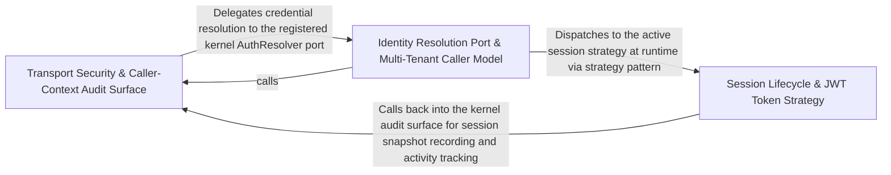

---
tags:
  - 2brain
  - 2brain/arch
  - project/boilerplate-node-backend
type: architecture
component: Authentication_Kernel_Caller_Context
---

## Details

The identity-resolution core of the subsystem. AuthResolver is the primary entry point that, given an incoming request, produces a fully-typed AuthContext (platform caller, tenant caller, or anonymous). CredentialResolver abstracts the source of credentials (JWT bearer, session cookie, API key) and returns a ResolvedCredential. watchCookie implements a stream-based subscription so that long-lived connections (SSE, WebSocket) can react to cookie rotation without re-handshaking. The AuthContext / CallerContext / TenantCaller type family encodes the multi-tenant, multi-platform caller model that every downstream handler consumes. StaffReadTarget extends the model with staff-level read scoping.

### Transport Security & Caller-Context Audit Surface
The application-level security policy and the consumer-facing surface of the caller model. This component installs the ordered chain of transport protections (trust-proxy → rate limiter → body parsers → content-type enforcement) that every authenticated request passes through before reaching a handler. installSecurity configures helmet, CORS origin allow-listing, and cookie parsing; applyServerTimeouts bounds slowloris-class attacks at the socket level. system-routes exposes the liveness/readiness endpoints (/, /livez) that operate outside the auth boundary. StaffReadTarget and recordStaffRead extend the caller model with staff-level read scoping: when a caller holding a wide-read permission key (display:Order, read:Ticket) views another person's record, the read is audited as admin.<resource>.viewed. StreamWatch (from authentication.ts) is the kernel's contract for long-lived connections to re-resolve identity across cookie rotations. This component is where the auth context meets the HTTP wire: it decides which protections apply and how the resolved caller is consumed at the boundary.

**Related Classes/Methods**:

- `src.kernel.authentication.StreamWatch`:23-31

**Source Files:**

- `src/app/security.ts`
  - `src.app.security.installSecurity.origin` (L157-L176) - Method
- `src/app/system-routes.ts`
  - `src.app.system-routes.router.get('/') callback` (L21-L23) - Function
  - `src.app.system-routes.router.get('/livez') callback` (L31-L33) - Function
- `src/infrastructure/observability/analytics/index.ts`
  - `src.infrastructure.observability.analytics.index.AnalyticsEventMap` (L27-L27) - Interface
  - `src.infrastructure.observability.analytics.index.AnalyticsEvent` (L44-L65) - Interface
- `src/kernel/authentication.ts`
  - `src.kernel.authentication.StreamWatch` (L23-L31) - Interface
- `src/kernel/staff-read.ts`
  - `src.kernel.staff-read.StaffReadTarget` (L20-L36) - Interface
- `src/modules/account/oauth/config.ts`
  - `src.modules.account.oauth.config.OAuthCredentials` (L40-L43) - Interface
- `src/modules/account/presenter.ts`
  - `src.modules.account.presenter.presentOAuthLinks.links.links.map() callback` (L82-L85) - Function
- `src/modules/account/services/logout.ts`
  - `src.modules.account.services.logout.isOwnFamily` (L36-L48) - Class
  - `src.modules.account.services.logout.isOwnFamily.then() callback` (L45-L46) - Function
  - `src.modules.account.services.logout.sessionRevoke` (L59-L75) - Class
  - `src.modules.account.services.logout.sessionRevoke.then() callback` (L66-L74) - Function
  - `src.modules.account.services.logout.sessionRevoke.then() callback.then() callback` (L67-L74) - Function
- `src/modules/account/services/oauth.ts`
  - `src.modules.account.services.oauth.listOAuthLinks` (L414-L423) - Class
  - `src.modules.account.services.oauth.listOAuthLinks.then() callback` (L418-L422) - Function
  - `src.modules.account.services.oauth.listOAuthLinks.then() callback.map() callback` (L419-L422) - Function
- `src/modules/account/services/refresh.ts`
  - `src.modules.account.services.refresh.MissingRefreshTokenError` (L22-L28) - Class
  - `src.modules.account.services.refresh.MissingRefreshTokenError.constructor` (L24-L27) - Constructor
  - `src.modules.account.services.refresh.refreshAccessToken` (L48-L87) - Class
  - `src.modules.account.services.refresh.refreshAccessToken.then() callback` (L56-L62) - Function
  - `src.modules.account.services.refresh.refreshAccessToken.catch() callback` (L63-L87) - Function
- `src/modules/account/services/sessions.ts`
  - `src.modules.account.services.sessions.sessionGet` (L38-L43) - Class
  - `src.modules.account.services.sessions.sessionGet.then() callback` (L43-L43) - Function
  - `src.modules.account.services.sessions.sessionGet.then() callback.rows.find() callback` (L43-L43) - Function
- `src/modules/account/services/two-factor-challenge.ts`
  - `src.modules.account.services.two-factor-challenge.buildLoginChallenge.ttlMs.armed.some() callback` (L69-L69) - Function
  - `src.modules.account.services.two-factor-challenge.buildLoginChallenge.ttlMs` (L69-L71) - Class
- `src/modules/account/services/two-factor-enrollment.ts`
  - `src.modules.account.services.two-factor-enrollment.entryFor.existing` (L55-L55) - Class
  - `src.modules.account.services.two-factor-enrollment.entryFor.existing.user.twoFactorMethods.find() callback` (L55-L55) - Function
- `src/modules/account/session/account-view.ts`
  - `src.modules.account.session.account-view.abilitiesOfUser` (L123-L127) - Class
  - `src.modules.account.session.account-view.abilitiesOfUser.then() callback` (L125-L126) - Function
- `src/modules/account/session/activity.ts`
  - `src.modules.account.session.activity.recordActivity` (L16-L20) - Class
  - `src.modules.account.session.activity.recordActivity.catch() callback` (L17-L20) - Function
- `src/modules/account/session/auth-context.ts`
  - `src.modules.account.session.auth-context.SessionProof` (L16-L21) - Interface
  - `src.modules.account.session.auth-context.resolveProof` (L36-L74) - Class
  - `src.modules.account.session.auth-context.resolveProof.then() callback` (L40-L74) - Function
  - `src.modules.account.session.auth-context.resolveProof.then() callback.then() callback` (L44-L72) - Function
- `src/modules/account/session/cookie-strategy.ts`
  - `src.modules.account.session.cookie-strategy.storeSession` (L66-L93) - Class
  - `src.modules.account.session.cookie-strategy.storeSession.then() callback` (L92-L92) - Function
  - `src.modules.account.session.cookie-strategy.retirePresentedSession` (L179-L188) - Class
  - `src.modules.account.session.cookie-strategy.retirePresentedSession.then() callback` (L184-L184) - Function
  - `src.modules.account.session.cookie-strategy.retirePresentedSession.catch() callback` (L185-L187) - Function
  - `src.modules.account.session.cookie-strategy.findLiveRow` (L200-L210) - Class
  - `src.modules.account.session.cookie-strategy.findLiveRow.then() callback` (L205-L209) - Function
  - `src.modules.account.session.cookie-strategy.resolveSession` (L230-L266) - Class
  - `src.modules.account.session.cookie-strategy.resolveSession.then() callback` (L234-L266) - Function
  - `src.modules.account.session.cookie-strategy.resolveSession.then() callback.then() callback` (L239-L264) - Function
  - `src.modules.account.session.cookie-strategy.resolveSession.then() callback.then() callback.then() callback` (L259-L259) - Function
  - `src.modules.account.session.cookie-strategy.resolveSession.then() callback.then() callback.catch() callback` (L260-L262) - Function
  - `src.modules.account.session.cookie-strategy.watchSession` (L272-L293) - Class
  - `src.modules.account.session.cookie-strategy.watchSession.then() callback` (L273-L293) - Function
  - `src.modules.account.session.cookie-strategy.watchSession.then() callback.then() callback` (L278-L291) - Function
  - `src.modules.account.session.cookie-strategy.watchSession.then() callback.then() callback.ok.recheck` (L282-L289) - Method
  - `src.modules.account.session.cookie-strategy.watchSession.then() callback.then() callback.ok.recheck.resolveInLiveFamily('cookie') callback` (L287-L287) - Function
  - `src.modules.account.session.cookie-strategy.cookieStrategy.issue` (L301-L315) - Method
- `src/modules/account/session/family-liveness.ts`
  - `src.modules.account.session.family-liveness.resolveInLiveFamily` (L32-L69) - Class
  - `src.modules.account.session.family-liveness.resolveInLiveFamily.then() callback` (L44-L67) - Function
  - `src.modules.account.session.family-liveness.then() callback.then() callback` (L51-L51) - Function
  - `src.modules.account.session.family-liveness.resolveInLiveFamily.then() callback.then() callback` (L55-L55) - Function
  - `src.modules.account.session.family-liveness.resolveInLiveFamily.then() callback.catch() callback` (L65-L65) - Function
- `src/modules/account/session/jwt-strategy.ts`
  - `src.modules.account.session.jwt-strategy.snapshotOf` (L142-L159) - Class
  - `src.modules.account.session.jwt-strategy.snapshotOf.then() callback` (L148-L157) - Function
  - `src.modules.account.session.jwt-strategy.snapshotOf.then() callback.then() callback` (L149-L157) - Function
  - `src.modules.account.session.jwt-strategy.sessionRowOf` (L173-L198) - Class
  - `src.modules.account.session.jwt-strategy.sessionRowOf.then() callback` (L187-L190) - Function
  - `src.modules.account.session.jwt-strategy.sessionRowOf.catch() callback` (L193-L196) - Function
  - `src.modules.account.session.jwt-strategy.resolveBearer` (L224-L241) - Class
  - `src.modules.account.session.jwt-strategy.resolveBearer.then() callback.resolveInLiveFamily('jwt') callback` (L234-L234) - Function
  - `src.modules.account.session.jwt-strategy.resolveBearer.then() callback` (L237-L240) - Function
  - `src.modules.account.session.jwt-strategy.watchRefreshCookie` (L248-L275) - Class
  - `src.modules.account.session.jwt-strategy.watchRefreshCookie.then() callback.then() callback` (L252-L269) - Function
  - `src.modules.account.session.jwt-strategy.watchRefreshCookie.then() callback.then() callback.ok.recheck` (L255-L267) - Method
  - `src.modules.account.session.jwt-strategy.watchRefreshCookie.then() callback.then() callback.ok.recheck.resolveInLiveFamily('jwt') callback` (L260-L264) - Function
  - `src.modules.account.session.jwt-strategy.watchRefreshCookie.then() callback` (L271-L274) - Function
  - `src.modules.account.session.jwt-strategy.jwtStrategy.snapshot` (L300-L300) - Method
- `src/modules/account/session/jwt.ts`
  - `src.modules.account.session.jwt.TokenData` (L46-L81) - Interface
  - `src.modules.account.session.jwt.RotatedSession` (L97-L102) - Interface
  - `src.modules.account.session.jwt.TokenRejection` (L145-L154) - Class
  - `src.modules.account.session.jwt.TokenRejection.constructor` (L147-L153) - Constructor
  - `src.modules.account.session.jwt.ringKeyLookup` (L204-L211) - Class
  - `src.modules.account.session.jwt.ringKeyLookup.<function>` (L206-L211) - Function
  - `src.modules.account.session.jwt.verifyAgainstRing` (L229-L244) - Class
  - `src.modules.account.session.jwt.verifyAgainstRing.then() callback` (L240-L244) - Function
  - `src.modules.account.session.jwt.verifyAccessToken` (L252-L257) - Class
  - `src.modules.account.session.jwt.verifyAccessToken.then() callback` (L253-L257) - Function
  - `src.modules.account.session.jwt.verifyRefreshWithRow` (L267-L284) - Class
  - `src.modules.account.session.jwt.verifyRefreshWithRow.then() callback` (L270-L283) - Function
  - `src.modules.account.session.jwt.verifyRefreshWithRow.then() callback.then() callback` (L271-L283) - Function
  - `src.modules.account.session.jwt.verifyRefreshWithRow.then() callback.then() callback.then() callback` (L278-L282) - Function
  - `src.modules.account.session.jwt.verifyRefreshToken` (L292-L293) - Class
  - `src.modules.account.session.jwt.verifyRefreshToken.then() callback` (L293-L293) - Function
  - `src.modules.account.session.jwt.then() callback.then() callback.then() callback` (L406-L406) - Function
  - `src.modules.account.session.jwt.TokenReuseError` (L482-L488) - Class
  - `src.modules.account.session.jwt.TokenReuseError.constructor` (L484-L487) - Constructor
  - `src.modules.account.session.jwt.storeSuccessor` (L500-L529) - Class
  - `src.modules.account.session.jwt.storeSuccessor.then() callback` (L522-L528) - Function
  - `src.modules.account.session.jwt.reissueRotated` (L542-L572) - Class
  - `src.modules.account.session.jwt.reissueRotated.then() callback` (L547-L572) - Function
  - `src.modules.account.session.jwt.reissueRotated.then() callback.then() callback` (L554-L571) - Function
  - `src.modules.account.session.jwt.reissueRotated.then() callback.then() callback.liveness` (L559-L565) - Class
  - `src.modules.account.session.jwt.reissueRotated.then() callback.then() callback.liveness.resolveInLiveFamily('jwt') callback` (L563-L563) - Function
  - `src.modules.account.session.jwt.reissueRotated.then() callback.then() callback.then() callback` (L568-L569) - Function
  - `src.modules.account.session.jwt.resolveLostRotation` (L586-L619) - Class
  - `src.modules.account.session.jwt.resolveLostRotation.then() callback` (L591-L619) - Function
  - `src.modules.account.session.jwt.resolveLostRotation.then() callback.then() callback` (L616-L618) - Function
  - `src.modules.account.session.jwt.rotateRefreshToken` (L634-L649) - Class
  - `src.modules.account.session.jwt.rotateRefreshToken.then() callback` (L636-L649) - Function
  - `src.modules.account.session.jwt.rotateRefreshToken.then() callback.then() callback` (L644-L647) - Function
  - `src.modules.account.session.jwt.rememberOfRefreshToken` (L663-L672) - Class
  - `src.modules.account.session.jwt.rememberOfRefreshToken.then() callback` (L669-L669) - Function
  - `src.modules.account.session.jwt.rememberOfRefreshToken.catch() callback` (L671-L671) - Function
- `src/modules/account/session/key-ring.ts`
  - `src.modules.account.session.key-ring.keyForId` (L30-L31) - Class
  - `src.modules.account.session.key-ring.keyForId.ring.find() callback` (L31-L31) - Function
- `src/modules/delivery/services/notice.ts`
  - `src.modules.delivery.services.notice.NoticeInput` (L22-L27) - Interface
  - `src.modules.delivery.services.notice.SentNotice` (L30-L32) - Interface
  - `src.modules.delivery.services.notice.payloadOf.titles.fulfillmentOrder.lines.map() callback` (L53-L53) - Function
- `src/modules/observability/services/process-snapshot.ts`
  - `src.modules.observability.services.process-snapshot.ProcessMemorySnapshot` (L11-L23) - Interface
  - `src.modules.observability.services.process-snapshot.ProcessSnapshot` (L26-L33) - Interface
- `src/modules/payments/services/intent.ts`
  - `src.modules.payments.services.intent.then() callback.then() callback` (L201-L202) - Function
  - `src.modules.payments.services.intent.then() callback.catch() callback` (L207-L214) - Function
- `src/modules/stats/services/range.ts`
  - `src.modules.stats.services.range.Period` (L22-L31) - Interface
- `src/modules/webhooks/services/attempt.ts`
  - `src.modules.webhooks.services.attempt.then() callback.then() callback` (L263-L263) - Function
- `src/modules/wishlist/factories.ts`
  - `src.modules.wishlist.factories.WishlistOverrides` (L14-L22) - Interface

### Identity Resolution Port & Multi-Tenant Caller Model
The architectural heart of the subsystem. This component defines the kernel's authentication port (AuthResolver, CredentialResolver) and the complete type family that encodes the multi-tenant, multi-platform caller model. AuthResolver is the primary entry point: given a bearer token, session cookie, or stream cookie, it produces a fully-typed AuthContext (or a typed miss). CredentialResolver abstracts machine credentials (API keys) into a ResolvedCredential carrying a scope-floored Caller. The type family — AuthContext, Caller (discriminated union of TenantCaller | PlatformCaller), CallerContext, TenantCallerContext, ResolveOptions — is the contract every downstream handler reads. The SessionStrategy interface and cookie-strategy / jwt-strategy type definitions establish the seam between the kernel's credential-agnostic port and the account module's token-specific implementation. This component is pure kernel: it declares what resolution must produce, never how.

**Related Classes/Methods**:

- `src.kernel.authentication.AuthResolver`:38-61
- `src.modules.account.session.strategy.SessionStrategy`:86-152

**Source Files:**

- `src/kernel/authentication.ts`
  - `src.kernel.authentication.AuthResolver` (L38-L61) - Interface
  - `src.kernel.authentication.ResolvedCredential` (L83-L86) - Interface
  - `src.kernel.authentication.CredentialResolver` (L89-L91) - Interface
  - `src.kernel.authentication.watchCookie` (L132-L133) - Class
  - `src.kernel.authentication.watchCookie.then() callback` (L133-L133) - Function
- `src/modules/account/session/cookie-strategy.ts`
  - `src.modules.account.session.cookie-strategy.rememberOf` (L51-L52) - Class
  - `src.modules.account.session.cookie-strategy.rememberOf.find() callback` (L52-L52) - Function
  - `src.modules.account.session.cookie-strategy.snapshotOf` (L134-L149) - Class
  - `src.modules.account.session.cookie-strategy.snapshotOf.then() callback` (L137-L146) - Function
  - `src.modules.account.session.cookie-strategy.replaceSession` (L155-L172) - Class
  - `src.modules.account.session.cookie-strategy.replaceSession.then() callback` (L164-L170) - Function
  - `src.modules.account.session.cookie-strategy.replaceSession.then() callback.then() callback` (L166-L166) - Function
  - `src.modules.account.session.cookie-strategy.replaceSession.then() callback.catch() callback` (L167-L170) - Function
  - `src.modules.account.session.cookie-strategy.cookieStrategy` (L296-L351) - Class
  - `src.modules.account.session.cookie-strategy.cookieStrategy.issue.then() callback` (L303-L314) - Function
  - `src.modules.account.session.cookie-strategy.cookieStrategy.issue.then() callback.then() callback` (L309-L312) - Function
  - `src.modules.account.session.cookie-strategy.cookieStrategy.issue.then() callback.then() callback.then() callback` (L310-L311) - Function
  - `src.modules.account.session.cookie-strategy.cookieStrategy.reissue` (L319-L325) - Method
  - `src.modules.account.session.cookie-strategy.cookieStrategy.reissue.then() callback` (L321-L324) - Function
  - `src.modules.account.session.cookie-strategy.cookieStrategy.reissue.then() callback.then() callback` (L322-L323) - Function
  - `src.modules.account.session.cookie-strategy.cookieStrategy.remint` (L327-L342) - Method
  - `src.modules.account.session.cookie-strategy.cookieStrategy.remint.then() callback` (L329-L333) - Function
  - `src.modules.account.session.cookie-strategy.cookieStrategy.remint.then() callback.then() callback` (L330-L332) - Function
  - `src.modules.account.session.cookie-strategy.cookieStrategy.remint.catch() callback` (L335-L342) - Function
  - `src.modules.account.session.cookie-strategy.cookieStrategy.list` (L350-L350) - Method
- `src/modules/account/session/jwt-strategy.ts`
  - `src.modules.account.session.jwt-strategy.resolveWith` (L205-L218) - Class
  - `src.modules.account.session.jwt-strategy.resolveWith.<function>` (L207-L218) - Function
  - `src.modules.account.session.jwt-strategy.<function>.then() callback` (L209-L210) - Function
  - `src.modules.account.session.jwt-strategy.resolveWith.<function>.then() callback` (L214-L217) - Function
  - `src.modules.account.session.jwt-strategy.unlessOtherMode` (L281-L284) - Class
  - `src.modules.account.session.jwt-strategy.unlessOtherMode.<function>` (L283-L284) - Function
  - `src.modules.account.session.jwt-strategy.jwtStrategy` (L287-L353) - Class
  - `src.modules.account.session.jwt-strategy.jwtStrategy.issue.mintSession() callback` (L294-L295) - Function
  - `src.modules.account.session.jwt-strategy.jwtStrategy.issue.then() callback` (L296-L297) - Function
  - `src.modules.account.session.jwt-strategy.jwtStrategy.issue.then() callback.then() callback` (L297-L297) - Function
  - `src.modules.account.session.jwt-strategy.jwtStrategy.reissue.ready.then() callback` (L307-L321) - Function
  - `src.modules.account.session.jwt-strategy.jwtStrategy.reissue.ready.then() callback.then() callback` (L315-L320) - Function
  - `src.modules.account.session.jwt-strategy.jwtStrategy.reissue.ready.then() callback.then() callback.then() callback` (L320-L320) - Function
  - `src.modules.account.session.jwt-strategy.jwtStrategy.remint.then() callback` (L327-L336) - Function
  - `src.modules.account.session.jwt-strategy.jwtStrategy.remint.then() callback.then() callback` (L331-L334) - Function
  - `src.modules.account.session.jwt-strategy.jwtStrategy.remint.catch() callback` (L337-L344) - Function
  - `src.modules.account.session.jwt-strategy.jwtStrategy.list` (L352-L352) - Method
- `src/modules/account/session/listing.ts`
  - `src.modules.account.session.listing.listSessions` (L59-L86) - Class
  - `src.modules.account.session.listing.listSessions.then() callback` (L68-L86) - Function
  - `src.modules.account.session.listing.listSessions.then() callback.map() callback` (L83-L84) - Function
- `src/modules/account/session/resolver.ts`
  - `src.modules.account.session.resolver.accountAuthResolver` (L24-L32) - Class
  - `src.modules.account.session.resolver.accountAuthResolver.fromBearer` (L25-L25) - Method
  - `src.modules.account.session.resolver.accountAuthResolver.fromCookie` (L26-L26) - Method
  - `src.modules.account.session.resolver.accountAuthResolver.watchCookie` (L27-L27) - Method
  - `src.modules.account.session.resolver.accountAuthResolver.cookieAuthenticates` (L28-L28) - Method
  - `src.modules.account.session.resolver.accountAuthResolver.clearDeadCookie` (L29-L31) - Method
- `src/modules/account/session/strategy.ts`
  - `src.modules.account.session.strategy.IssueOptions` (L42-L55) - Interface
  - `src.modules.account.session.strategy.SessionSnapshot` (L62-L68) - Interface
  - `src.modules.account.session.strategy.IssuedSession` (L71-L76) - Interface
  - `src.modules.account.session.strategy.ReissueOptions` (L79-L83) - Interface
  - `src.modules.account.session.strategy.SessionStrategy` (L86-L152) - Interface
  - `src.modules.account.session.strategy.SessionStrategy.issue` (L98-L103) - Method
  - `src.modules.account.session.strategy.SessionStrategy.snapshot` (L106-L106) - Method
  - `src.modules.account.session.strategy.SessionStrategy.reissue` (L109-L114) - Method
  - `src.modules.account.session.strategy.SessionStrategy.remint` (L122-L127) - Method
  - `src.modules.account.session.strategy.SessionStrategy.resolveBearer` (L130-L133) - Method
  - `src.modules.account.session.strategy.SessionStrategy.resolveCookie` (L136-L139) - Method
  - `src.modules.account.session.strategy.SessionStrategy.watchCookie` (L145-L145) - Method
  - `src.modules.account.session.strategy.SessionStrategy.credentialOf` (L148-L148) - Method
  - `src.modules.account.session.strategy.SessionStrategy.list` (L151-L151) - Method
- `src/modules/cart/controllers/delete-cart-items.ts`
  - `src.modules.cart.controllers.delete-cart-items.clearCart` (L19-L28) - Class
  - `src.modules.cart.controllers.delete-cart-items.clearCart.then() callback` (L24-L26) - Function
- `src/modules/cart/controllers/get-cart.ts`
  - `src.modules.cart.controllers.get-cart.getCart` (L18-L25) - Class
  - `src.modules.cart.controllers.get-cart.getCart.then() callback` (L21-L23) - Function
- `src/modules/cart/controllers/post-cart-merge.ts`
  - `src.modules.cart.controllers.post-cart-merge.postCartMerge` (L19-L32) - Class
  - `src.modules.cart.controllers.post-cart-merge.postCartMerge.then() callback` (L28-L30) - Function
- `src/modules/cart/controllers/put-cart-shipping-method.ts`
  - `src.modules.cart.controllers.put-cart-shipping-method.putCartShippingMethod` (L20-L37) - Class
  - `src.modules.cart.controllers.put-cart-shipping-method.putCartShippingMethod.then() callback` (L31-L35) - Function
- `src/modules/locales/controllers/get-entity-translations.ts`
  - `src.modules.locales.controllers.get-entity-translations.getEntityTranslations` (L19-L39) - Class
  - `src.modules.locales.controllers.get-entity-translations.getEntityTranslations.then() callback` (L31-L37) - Function
- `src/modules/locales/controllers/get-locales.ts`
  - `src.modules.locales.controllers.get-locales.getLocales` (L22-L30) - Class
  - `src.modules.locales.controllers.get-locales.getLocales.then() callback` (L29-L29) - Function
- `src/modules/locales/repository.ts`
  - `src.modules.locales.repository.removeEntityTranslations` (L660-L669) - Class
  - `src.modules.locales.repository.removeEntityTranslations.then() callback` (L669-L669) - Function
- `src/modules/notifications/controllers/get-notifications.ts`
  - `src.modules.notifications.controllers.get-notifications.getNotifications` (L16-L23) - Class
  - `src.modules.notifications.controllers.get-notifications.getNotifications.then() callback` (L19-L21) - Function
- `src/modules/shop-tasks/controllers/get-shop-work-summary.ts`
  - `src.modules.shop-tasks.controllers.get-shop-work-summary.getShopWorkSummary` (L14-L18) - Class
  - `src.modules.shop-tasks.controllers.get-shop-work-summary.getShopWorkSummary.then() callback` (L17-L17) - Function
- `src/modules/shop-tasks/services/outcome-unknown.ts`
  - `src.modules.shop-tasks.services.outcome-unknown.NamedSubject` (L27-L32) - Interface
  - `src.modules.shop-tasks.services.outcome-unknown.orderNamed` (L49-L55) - Class
  - `src.modules.shop-tasks.services.outcome-unknown.orderNamed.then() callback` (L52-L55) - Function
  - `src.modules.shop-tasks.services.outcome-unknown.productNamed` (L62-L66) - Class
  - `src.modules.shop-tasks.services.outcome-unknown.productNamed.then() callback` (L63-L66) - Function
- `src/modules/shop-tasks/services/work-summary.ts`
  - `src.modules.shop-tasks.services.work-summary.workSummary` (L87-L93) - Class
  - `src.modules.shop-tasks.services.work-summary.workSummary.BADGES.filter() callback` (L89-L89) - Function
  - `src.modules.shop-tasks.services.work-summary.workSummary.map() callback` (L89-L90) - Function
  - `src.modules.shop-tasks.services.work-summary.workSummary.map() callback.then() callback` (L90-L90) - Function
  - `src.modules.shop-tasks.services.work-summary.workSummary.then() callback` (L93-L93) - Function
- `src/modules/stock-alerts/controllers/get-stock-alerts.ts`
  - `src.modules.stock-alerts.controllers.get-stock-alerts.getStockAlerts` (L13-L19) - Class
  - `src.modules.stock-alerts.controllers.get-stock-alerts.getStockAlerts.then() callback` (L16-L18) - Function
- `src/types/auth-context.ts`
  - `src.types.auth-context.AuthContext` (L22-L90) - Interface
  - `src.types.auth-context.TenantCaller` (L120-L143) - Interface
  - `src.types.auth-context.PlatformCaller` (L146-L158) - Interface
  - `src.types.auth-context.CallerContext` (L169-L222) - Interface
  - `src.types.auth-context.TenantCallerContext` (L233-L235) - Interface
  - `src.types.auth-context.ResolveOptions` (L245-L251) - Interface

### Session Lifecycle & JWT Token Strategy
The concrete implementation of session creation, rotation, and retirement behind the SessionStrategy port. This component owns the full JWT lifecycle: startSession mints a refresh token and access token pair at login; continueSession re-mints after re-proof; createAccessToken issues a short-lived access token bound to a session family (sid); mintRefreshToken produces the rotating refresh credential. The jwt-strategy adapter wires these into the SessionStrategy interface, exposing mintSession, retirePresentedSession, retireRefreshToken, and retireRestOfFamily for the account service layer. mint-guard enforces second-factor and proof-freshness assertions before any token is issued. device-cookie manages per-device session binding. listing provides the session inventory for the account UI. This component is the account module's fulfillment of the kernel's AuthResolver port — it knows tokens, families, and rotation; the kernel does not.

**Related Classes/Methods**:

- `src.modules.account.session.jwt.startSession`:428-437
- `src.modules.account.session.jwt-strategy.mintSession`:50-70
- `src.modules.account.session.jwt.createAccessToken`:471-474

**Source Files:**

- `src/modules/account/controllers/get-refresh-token.ts`
  - `src.modules.account.controllers.get-refresh-token.getRefreshToken.then() callback.then() callback` (L42-L54) - Function
- `src/modules/account/session/device-cookie.ts`
  - `src.modules.account.session.device-cookie.rememberDevice.tokens.filter() callback` (L113-L113) - Function
  - `src.modules.account.session.device-cookie.rememberDevice.tokens` (L113-L116) - Class
- `src/modules/account/session/jwt-strategy.ts`
  - `src.modules.account.session.jwt-strategy.mintSession` (L50-L70) - Class
  - `src.modules.account.session.jwt-strategy.mintSession.then() callback` (L63-L70) - Function
  - `src.modules.account.session.jwt-strategy.mintSession.then() callback.then() callback` (L66-L69) - Function
  - `src.modules.account.session.jwt-strategy.retireRefreshToken` (L92-L100) - Class
  - `src.modules.account.session.jwt-strategy.retireRefreshToken.then() callback` (L96-L96) - Function
  - `src.modules.account.session.jwt-strategy.retireRefreshToken.catch() callback` (L97-L99) - Function
  - `src.modules.account.session.jwt-strategy.retireRestOfFamily` (L106-L116) - Class
  - `src.modules.account.session.jwt-strategy.retireRestOfFamily.then() callback` (L113-L113) - Function
  - `src.modules.account.session.jwt-strategy.retireRestOfFamily.catch() callback` (L114-L116) - Function
  - `src.modules.account.session.jwt-strategy.retirePresentedSession` (L124-L135) - Class
  - `src.modules.account.session.jwt-strategy.retirePresentedSession.then() callback` (L128-L128) - Function
  - `src.modules.account.session.jwt-strategy.retirePresentedSession.catch() callback` (L129-L134) - Function
  - `src.modules.account.session.jwt-strategy.jwtStrategy.issue` (L293-L298) - Method
  - `src.modules.account.session.jwt-strategy.jwtStrategy.reissue` (L302-L323) - Method
  - `src.modules.account.session.jwt-strategy.jwtStrategy.remint` (L325-L344) - Method
- `src/modules/account/session/jwt.ts`
  - `src.modules.account.session.jwt.mintRefreshToken` (L357-L409) - Class
  - `src.modules.account.session.jwt.mintRefreshToken.then() callback` (L364-L409) - Function
  - `src.modules.account.session.jwt.mintRefreshToken.then() callback.then() callback` (L389-L408) - Function
  - `src.modules.account.session.jwt.mintRefreshToken.then() callback.then() callback.then() callback` (L407-L407) - Function
  - `src.modules.account.session.jwt.startSession` (L428-L437) - Class
  - `src.modules.account.session.jwt.startSession.mintRefreshToken() callback` (L434-L437) - Function
  - `src.modules.account.session.jwt.continueSession` (L449-L457) - Class
  - `src.modules.account.session.jwt.continueSession.mintRefreshToken() callback` (L457-L457) - Function
  - `src.modules.account.session.jwt.createAccessToken` (L471-L474) - Class
  - `src.modules.account.session.jwt.createAccessToken.then() callback` (L472-L473) - Function
- `src/modules/account/session/listing.ts`
  - `src.modules.account.session.listing.listSessions.then() callback.rows` (L72-L78) - Class
  - `src.modules.account.session.listing.listSessions.then() callback.rows.allRows.filter() callback` (L73-L77) - Function
  - `src.modules.account.session.listing.listSessions.then() callback.current` (L80-L82) - Class
  - `src.modules.account.session.listing.listSessions.then() callback.current.map() callback` (L81-L81) - Function
  - `src.modules.account.session.listing.listSessions.then() callback.current.rows.filter() callback` (L81-L81) - Function
- `src/modules/account/session/mint-guard.ts`
  - `src.modules.account.session.mint-guard.SecondFactorRequiredError` (L20-L26) - Class
  - `src.modules.account.session.mint-guard.SecondFactorRequiredError.constructor` (L22-L25) - Constructor
  - `src.modules.account.session.mint-guard.StaleProofError` (L49-L55) - Class
  - `src.modules.account.session.mint-guard.StaleProofError.constructor` (L51-L54) - Constructor
- `src/modules/addresses/controllers/get-addresses.ts`
  - `src.modules.addresses.controllers.get-addresses.getAddresses` (L19-L29) - Class
  - `src.modules.addresses.controllers.get-addresses.getAddresses.then() callback` (L25-L27) - Function
- `src/modules/addresses/controllers/post-address.ts`
  - `src.modules.addresses.controllers.post-address.postAddress` (L20-L38) - Class
  - `src.modules.addresses.controllers.post-address.postAddress.then() callback` (L32-L36) - Function
- `src/modules/addresses/presenter.ts`
  - `src.modules.addresses.presenter.presentAddressOf.item` (L40-L40) - Class
  - `src.modules.addresses.presenter.presentAddressOf.item.book.items.find() callback` (L40-L40) - Function
- `src/modules/analytics/controllers/post-analytics-event.ts`
  - `src.modules.analytics.controllers.post-analytics-event.postAnalyticsEvent` (L22-L35) - Class
  - `src.modules.analytics.controllers.post-analytics-event.postAnalyticsEvent.then() callback` (L30-L33) - Function
- `src/modules/cart/controllers/get-cart-summary.ts`
  - `src.modules.cart.controllers.get-cart-summary.getCartSummary` (L17-L24) - Class
  - `src.modules.cart.controllers.get-cart-summary.getCartSummary.then() callback` (L20-L22) - Function
- `src/modules/cart/controllers/post-cart-items.ts`
  - `src.modules.cart.controllers.post-cart-items.postCartItems` (L22-L42) - Class
  - `src.modules.cart.controllers.post-cart-items.postCartItems.then() callback` (L36-L40) - Function
- `src/modules/cart/controllers/post-reorder.ts`
  - `src.modules.cart.controllers.post-reorder.postReorder` (L20-L36) - Class
  - `src.modules.cart.controllers.post-reorder.postReorder.then() callback` (L30-L34) - Function
- `src/modules/locales/controllers/delete-locale.ts`
  - `src.modules.locales.controllers.delete-locale.deleteLocale` (L19-L27) - Class
  - `src.modules.locales.controllers.delete-locale.deleteLocale.then() callback` (L22-L26) - Function
- `src/modules/locales/controllers/get-locale-messages.ts`
  - `src.modules.locales.controllers.get-locale-messages.getLocaleMessages` (L21-L45) - Class
  - `src.modules.locales.controllers.get-locale-messages.getLocaleMessages.then() callback` (L39-L42) - Function
- `src/modules/locales/controllers/update-entity-translations.ts`
  - `src.modules.locales.controllers.update-entity-translations.writeEntityTranslations` (L37-L74) - Class
  - `src.modules.locales.controllers.update-entity-translations.writeEntityTranslations.<function>` (L48-L74) - Function
  - `src.modules.locales.controllers.update-entity-translations.writeEntityTranslations.<function>.then() callback` (L66-L72) - Function
- `src/modules/locales/repository.ts`
  - `src.modules.locales.repository.listKeys` (L163-L169) - Class
  - `src.modules.locales.repository.listKeys.then() callback` (L169-L169) - Function
  - `src.modules.locales.repository.listKeys.then() callback.rows.map() callback` (L169-L169) - Function
  - `src.modules.locales.repository.deleteLocaleCascade` (L397-L403) - Class
  - `src.modules.locales.repository.deleteLocaleCascade.then() callback` (L401-L402) - Function
  - `src.modules.locales.repository.deleteLocaleCascade.then() callback.then() callback` (L402-L402) - Function
  - `src.modules.locales.repository.forgetTranslator` (L630-L638) - Class
  - `src.modules.locales.repository.forgetTranslator.then() callback` (L638-L638) - Function
  - `src.modules.locales.repository.removeEntityLocale` (L641-L651) - Class
  - `src.modules.locales.repository.removeEntityLocale.then() callback` (L651-L651) - Function
- `src/modules/notifications/repository.ts`
  - `src.modules.notifications.repository.notificationRepository.deleteByAudience.then() callback.ids` (L187-L187) - Class
  - `src.modules.notifications.repository.notificationRepository.deleteByAudience.then() callback.ids.rows.map() callback` (L187-L187) - Function
  - `src.modules.notifications.repository.notificationRepository.trimToNewest.ids` (L228-L228) - Class
  - `src.modules.notifications.repository.notificationRepository.trimToNewest.ids.excess.map() callback` (L228-L228) - Function
- `src/modules/shop/controllers/get-shop.ts`
  - `src.modules.shop.controllers.get-shop.getShop` (L18-L21) - Class
  - `src.modules.shop.controllers.get-shop.getShop.then() callback` (L20-L20) - Function
- `src/modules/tasks/presenter.ts`
  - `src.modules.tasks.presenter.previewOf.characters` (L69-L69) - Class
  - `src.modules.tasks.presenter.previewOf.characters.Array.from() callback` (L69-L69) - Function
- `src/modules/wishlist/controllers/get-wishlist.ts`
  - `src.modules.wishlist.controllers.get-wishlist.getWishlist` (L18-L25) - Class
  - `src.modules.wishlist.controllers.get-wishlist.getWishlist.then() callback` (L21-L23) - Function
