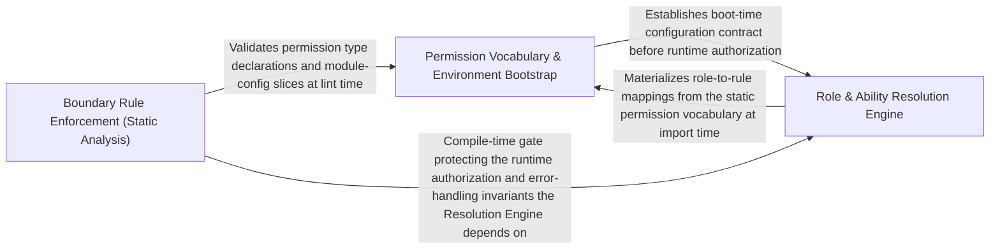

---
tags:
  - 2brain
  - 2brain/arch
  - project/boilerplate-node-backend
type: architecture
component: Boundary_Enforcement_Permission_Primitives
---

## Details

The mechanical enforcement layer that keeps module boundaries and controller-chain invariants honest. It comprises two custom ESLint rules — controllerChainMustCatch (every promise chain in a controller must end in .catch()) and friendMembers (a friends-only service member is callable only by its named modules) — plus the kernel's permission and ability primitives (PermissionRule, PRESET_ROLES, PERMISSION_SUBJECTS, DeclaredRule) that define the authorization vocabulary the rules reference. The setup/environment-file module provides the pure text-level operations (placeholder filling, value reading) that the dev-setup script uses to bootstrap a .env from .env-example. App-level security constants (RAW_BODY_PATHS) and kernel module-config slices round out the boundary surface.

### Permission Vocabulary & Environment Bootstrap
The foundational data structures and bootstrap utilities that define what can be authorized and how the system is configured. PERMISSION_SUBJECTS is the closed catalog of subject identifiers (e.g., product, order, cart) that every PermissionRule must reference — it is the vocabulary's noun list. byId provides lookup into the rule catalog. The environment-file module (readEnvironmentValue, placeholder-filling) provides pure text-level operations that the dev-setup script uses to bootstrap a working .env from .env-example — a boundary-surface concern because it ensures the configuration contract (which modules are enabled, which secrets exist) is established before any permission resolution can occur. The access module's GrantRefusal and grantableRoles define the role-granting boundary: which roles can be assigned to which subjects, and what the refusal response looks like. Cluster supervision (scheduleRespawn) and translation planning (planTranslations) round out the kernel's operational vocabulary that the permission system must coexist with.

**Related Classes/Methods**:

- `src.kernel.permissions.byId`
- `scripts.setup.environment-file.readEnvironmentValue`:51-55
- `src.modules.access.services.grants.grantableRoles`:147-150

**Source Files:**

- `scripts/setup/environment-file.ts`
  - `scripts.setup.environment-file.readEnvironmentValue` (L51-L55) - Class
  - `scripts.setup.environment-file.readEnvironmentValue.find() callback` (L54-L54) - Function
- `src/cluster.ts`
  - `src.cluster.supervise.scheduleRespawn.timer` (L72-L75) - Class
  - `src.cluster.supervise.scheduleRespawn.timer.setTimeout() callback` (L72-L75) - Function
- `src/kernel/permissions.ts`
  - `src.kernel.permissions.byId` (L297-L297) - Class
  - `src.kernel.permissions.byId.PERMISSION_RULES.map() callback` (L297-L297) - Function
- `src/kernel/translation.ts`
  - `src.kernel.translation.planTranslations.otherLocale` (L279-L279) - Class
  - `src.kernel.translation.planTranslations.otherLocale.find() callback` (L279-L279) - Function
- `src/modules/access/services/grants.ts`
  - `src.modules.access.services.grants.GrantRefusal` (L43-L48) - Interface
  - `src.modules.access.services.grants.grantableRoles` (L147-L150) - Class
  - `src.modules.access.services.grants.grantableRoles.PRESET_ROLES.filter() callback` (L149-L149) - Function
  - `src.modules.access.services.grants.grantableRoles.map() callback` (L150-L150) - Function
- `src/modules/cart/repository.ts`
  - `src.modules.cart.repository.unchangedOrMissing.then() callback.current` (L101-L101) - Class
  - `src.modules.cart.repository.unchangedOrMissing.then() callback.current.existing.items.find() callback` (L101-L101) - Function
- `src/modules/cart/services/items.ts`
  - `src.modules.cart.services.items.cartShippingMethodSet.then() callback.joined` (L283-L283) - Class
  - `src.modules.cart.services.items.cartShippingMethodSet.then() callback.joined.lines.filter() callback` (L283-L283) - Function
- `src/modules/cart/services/shelf.ts`
  - `src.modules.cart.services.shelf.readShelf.then() callback.lines` (L40-L40) - Class
  - `src.modules.cart.services.shelf.readShelf.then() callback.lines.ids.map() callback` (L40-L40) - Function
- `src/modules/delivery/domain/fulfillment.ts`
  - `src.modules.delivery.domain.fulfillment.groupOrderLines.nowBespoke` (L178-L178) - Class
  - `src.modules.delivery.domain.fulfillment.groupOrderLines.nowBespoke.now.filter() callback` (L178-L178) - Function
  - `src.modules.delivery.domain.fulfillment.summarize.live` (L378-L381) - Class
  - `src.modules.delivery.domain.fulfillment.summarize.live.fulfillmentOrders.filter() callback` (L379-L380) - Function
  - `src.modules.delivery.domain.fulfillment.summarize.arrivals` (L385-L387) - Class
  - `src.modules.delivery.domain.fulfillment.summarize.arrivals.shipments.map() callback` (L386-L386) - Function
  - `src.modules.delivery.domain.fulfillment.summarize.arrivals.filter() callback` (L387-L387) - Function
- `src/modules/delivery/domain/lost.ts`
  - `src.modules.delivery.domain.lost.withLoss.owedBy` (L84-L84) - Class
  - `src.modules.delivery.domain.lost.withLoss.owedBy.owed.map() callback` (L84-L84) - Function
- `src/modules/orders/domain/tax.ts`
  - `src.modules.orders.domain.tax.TaxableLineItem` (L23-L27) - Interface
  - `src.modules.orders.domain.tax.LineTaxBreakdown` (L37-L41) - Interface
  - `src.modules.orders.domain.tax.TaxRateSummary` (L48-L54) - Interface
  - `src.modules.orders.domain.tax.OrderTaxBreakdown` (L57-L89) - Interface
  - `src.modules.orders.domain.tax.OrderTaxInput` (L92-L103) - Interface
  - `src.modules.orders.domain.tax.RateGroup` (L127-L133) - Interface
  - `src.modules.orders.domain.tax.allocateLineTax.indexes` (L186-L186) - Class
  - `src.modules.orders.domain.tax.allocateLineTax.indexes.rates.flatMap() callback` (L186-L186) - Function
  - `src.modules.orders.domain.tax.lineTaxFromRateTotals` (L204-L221) - Class
  - `src.modules.orders.domain.tax.lineTaxFromRateTotals.grossByLine` (L210-L210) - Class
  - `src.modules.orders.domain.tax.lineTaxFromRateTotals.grossByLine.items.map() callback` (L210-L210) - Function
  - `src.modules.orders.domain.tax.lineTaxFromRateTotals.grossByLine.map() callback` (L216-L220) - Function
  - `src.modules.orders.domain.tax.orderTaxBreakdown.rates` (L234-L234) - Class
  - `src.modules.orders.domain.tax.orderTaxBreakdown.rates.items.map() callback` (L234-L234) - Function
  - `src.modules.orders.domain.tax.lines` (L251-L255) - Class
  - `src.modules.orders.domain.tax.orderTaxBreakdown.lines.items.map() callback` (L251-L255) - Function
  - `src.modules.orders.domain.tax.orderTaxBreakdown.taxSummary.sortedGroups.map() callback` (L269-L270) - Function
  - `src.modules.orders.domain.tax.taxSummary` (L269-L271) - Class
  - `src.modules.orders.domain.tax.shippingByRate` (L273-L281) - Class
  - `src.modules.orders.domain.tax.orderTaxBreakdown.shippingByRate.sortedGroups.map() callback` (L274-L275) - Function
  - `src.modules.orders.domain.tax.orderTaxBreakdown.shippingByRate.filter() callback` (L278-L280) - Function
  - `src.modules.orders.domain.tax.shippingNetTotal.sumOf() callback` (L284-L284) - Function
  - `src.modules.orders.domain.tax.orderTaxBreakdown.netTotal.sumOf() callback` (L289-L289) - Function
  - `src.modules.orders.domain.tax.orderTaxBreakdown.taxTotal.sumOf() callback` (L296-L296) - Function
  - `src.modules.orders.domain.tax.orderTaxBreakdown.shippingTaxAmount.sumOf() callback` (L301-L301) - Function
- `src/modules/orders/repository.ts`
  - `src.modules.orders.repository.announceInTransaction() callback.then() callback.then() callback` (L722-L729) - Function
- `src/modules/orders/services/guarantee.ts`
  - `src.modules.orders.services.guarantee.extendGuarantee` (L21-L30) - Class
  - `src.modules.orders.services.guarantee.extendGuarantee.then() callback` (L22-L30) - Function
- `src/modules/payments/repository.ts`
  - `src.modules.payments.repository.paymentRepository.findByOrderId` (L473-L477) - Method
- `src/modules/payments/services/effects.ts`
  - `src.modules.payments.services.effects.retryOneRefund` (L75-L76) - Class
  - `src.modules.payments.services.effects.retryOneRefund.then() callback` (L76-L76) - Function
- `src/modules/payments/services/notify.ts`
  - `src.modules.payments.services.notify.mailRefundIssued` (L80-L113) - Class
  - `src.modules.payments.services.notify.mailRefundIssued.then() callback` (L85-L105) - Function
  - `src.modules.payments.services.notify.mailRefundIssued.then() callback.refund` (L86-L86) - Class
  - `src.modules.payments.services.notify.mailRefundIssued.then() callback.refund.payment.refunds.find() callback` (L86-L86) - Function
  - `src.modules.payments.services.notify.mailRefundIssued.then() callback.orderService.mailBuyer() callback` (L90-L104) - Function
  - `src.modules.payments.services.notify.mailRefundIssued.catch() callback` (L106-L113) - Function
  - `src.modules.payments.services.notify.mailRefundUndeliverable` (L124-L158) - Class
  - `src.modules.payments.services.notify.mailRefundUndeliverable.then() callback` (L131-L150) - Function
  - `src.modules.payments.services.notify.mailRefundUndeliverable.then() callback.orderService.mailBuyer() callback` (L134-L149) - Function
  - `src.modules.payments.services.notify.mailRefundUndeliverable.catch() callback` (L151-L158) - Function
- `src/modules/payments/services/refund-settlement.ts`
  - `src.modules.payments.services.refund-settlement.isFullyRefunded` (L71-L73) - Class
  - `src.modules.payments.services.refund-settlement.isFullyRefunded.payment.refunds.every() callback` (L73-L73) - Function
- `src/modules/payments/services/refunds.ts`
  - `src.modules.payments.services.refunds.leaveForOperator` (L204-L223) - Class
  - `src.modules.payments.services.refunds.leaveForOperator.then() callback` (L209-L223) - Function
  - `src.modules.payments.services.refunds.openRefund` (L272-L354) - Class
  - `src.modules.payments.services.refunds.openRefund.write` (L308-L332) - Class
  - `src.modules.payments.services.refunds.openRefund.write.then() callback` (L317-L331) - Function
  - `src.modules.payments.services.refunds.openRefund.write.then() callback.then() callback` (L330-L330) - Function
  - `src.modules.payments.services.refunds.openRefund.then() callback` (L341-L353) - Function
  - `src.modules.payments.services.refunds.openRefund.then() callback.then() callback` (L348-L351) - Function
  - `src.modules.payments.services.refunds.attemptKeepingGoing` (L540-L565) - Class
  - `src.modules.payments.services.refunds.attemptKeepingGoing.then() callback` (L557-L560) - Function
  - `src.modules.payments.services.refunds.attemptKeepingGoing.catch() callback` (L561-L564) - Function
  - `src.modules.payments.services.refunds.settledElsewhere` (L611-L621) - Class
  - `src.modules.payments.services.refunds.settledElsewhere.then() callback` (L614-L620) - Function
  - `src.modules.payments.services.refunds.settledElsewhere.then() callback.fresh.refunds.some() callback` (L616-L617) - Function
  - `src.modules.payments.services.refunds.openAtProvider` (L632-L641) - Class
  - `src.modules.payments.services.refunds.openAtProvider.then() callback` (L635-L640) - Function
  - `src.modules.payments.services.refunds.openAtProvider.then() callback.fresh.refunds.some() callback` (L637-L637) - Function
  - `src.modules.payments.services.refunds.performCardRefund` (L655-L688) - Class
  - `src.modules.payments.services.refunds.performCardRefund.then() callback` (L662-L687) - Function
  - `src.modules.payments.services.refunds.performCardRefund.then() callback.then() callback` (L672-L686) - Function
  - `src.modules.payments.services.refunds.performCardRefund.then() callback.then() callback.then() callback` (L677-L684) - Function
  - `src.modules.payments.services.refunds.performRefund` (L707-L720) - Class
  - `src.modules.payments.services.refunds.performRefund.then() callback` (L712-L720) - Function
  - `src.modules.payments.services.refunds.openReturnRefund` (L1182-L1231) - Class
  - `src.modules.payments.services.refunds.openReturnRefund.then() callback` (L1194-L1231) - Function
  - `src.modules.payments.services.refunds.openReturnRefund.then() callback.then() callback` (L1224-L1230) - Function
  - `src.modules.payments.services.refunds.sendOpenedRefund` (L1243-L1272) - Class
  - `src.modules.payments.services.refunds.sendOpenedRefund.then() callback` (L1250-L1263) - Function
  - `src.modules.payments.services.refunds.sendOpenedRefund.then() callback.then() callback` (L1262-L1262) - Function
  - `src.modules.payments.services.refunds.sendOpenedRefund.catch() callback` (L1264-L1272) - Function
  - `src.modules.payments.services.refunds.settledRefundPayloads` (L1283-L1293) - Class
  - `src.modules.payments.services.refunds.settledRefundPayloads.then() callback` (L1286-L1292) - Function
  - `src.modules.payments.services.refunds.settledRefundPayloads.then() callback.payment.refunds.filter() callback` (L1289-L1289) - Function
  - `src.modules.payments.services.refunds.settledRefundPayloads.then() callback.toSorted() callback` (L1290-L1290) - Function
  - `src.modules.payments.services.refunds.settledRefundPayloads.then() callback.map() callback` (L1291-L1291) - Function
- `src/modules/payments/services/settlement.ts`
  - `src.modules.payments.services.settlement.afterSettlement` (L306-L350) - Class
  - `src.modules.payments.services.settlement.afterSettlement.catch() callback` (L334-L342) - Function
  - `src.modules.payments.services.settlement.afterSettlement.then() callback` (L343-L347) - Function
  - `src.modules.payments.services.settlement.reportAttempt.declined` (L488-L489) - Class
  - `src.modules.payments.services.settlement.reportAttempt.declined.result.errors.some() callback` (L489-L489) - Function
- `src/modules/payments/services/stats.ts`
  - `src.modules.payments.services.stats.MixRow` (L12-L18) - Interface
  - `src.modules.payments.services.stats.methodMix` (L25-L34) - Class
  - `src.modules.payments.services.stats.methodMix.then() callback` (L26-L33) - Function
  - `src.modules.payments.services.stats.methodMix.then() callback.rows.map() callback` (L27-L33) - Function
- `src/modules/returns/domain/status-projection.ts`
  - `src.modules.returns.domain.status-projection.ProjectedReturn` (L13-L20) - Interface
  - `src.modules.returns.domain.status-projection.holding.some() callback` (L53-L53) - Function
  - `src.modules.returns.domain.status-projection.projectReturnStatus.everything` (L58-L60) - Class
  - `src.modules.returns.domain.status-projection.projectReturnStatus.everything.every() callback` (L59-L59) - Function
- `src/modules/returns/services/receive.ts`
  - `src.modules.returns.services.receive.claimAndRestock.announceInTransaction() callback.others` (L246-L246) - Class
  - `src.modules.returns.services.receive.claimAndRestock.announceInTransaction() callback.others.everyReturn.filter() callback` (L246-L246) - Function
- `src/modules/stats/services/breakdowns.ts`
  - `src.modules.stats.services.breakdowns.getProductSeries` (L76-L96) - Class
  - `src.modules.stats.services.breakdowns.getProductSeries.then() callback` (L83-L96) - Function
  - `src.modules.stats.services.breakdowns.getProductSeries.then() callback.buckets.period.bucketStarts.map() callback` (L90-L94) - Function

### Role & Ability Resolution Engine
The runtime authorization resolution machinery that translates the static permission vocabulary into actionable checks. PRESET_ROLES materializes the role→permission-set mapping at boot; expandSets and setsByName resolve named permission sets into concrete rule identifiers; byRoleName provides O(1) role lookup. The ability.holdsSet primitive performs the actual 'does this caller hold this permission set?' check that controllers invoke. RAW_BODY_PATHS (app-level security constant) aggregates per-module raw-body path declarations into a flat list consumed by the HTTP adapter to skip body-parsing on those routes — a boundary-surface concern that keeps the security middleware aware of which modules opt out of standard request handling. Domain primitives like money.apportion and module models (CartItem, delivery events) appear here because they are the subjects the permission rules act upon — the resolution engine must understand the shape of what it authorizes.

**Related Classes/Methods**:

- `src.kernel.permissions.PRESET_ROLES`:378-381
- `src.kernel.permissions.expandSets`:339-353
- `src.app.security.RAW_BODY_PATHS`:40-44
- `src.kernel.permissions.byRoleName`

**Source Files:**

- `src/app/security.ts`
  - `src.app.security.RAW_BODY_PATHS.enabledModules.flatMap() callback` (L40-L43) - Function
  - `src.app.security.RAW_BODY_PATHS` (L40-L44) - Class
  - `src.app.security.RAW_BODY_PATHS.enabledModules.flatMap() callback.map() callback` (L41-L42) - Function
- `src/domain-primitives/money.ts`
  - `src.domain-primitives.money.apportion.shares` (L262-L262) - Class
  - `src.domain-primitives.money.apportion.shares.weights.map() callback` (L262-L262) - Function
- `src/kernel/ability.ts`
  - `src.kernel.ability.holdsSet.set` (L185-L185) - Class
  - `src.kernel.ability.holdsSet.set.PERMISSION_SETS.find() callback` (L185-L185) - Function
  - `src.kernel.ability.holdsSet.set.rules.every() callback` (L190-L193) - Function
- `src/kernel/permissions.ts`
  - `src.kernel.permissions.setsByName` (L309-L309) - Class
  - `src.kernel.permissions.setsByName.PERMISSION_SETS.map() callback` (L309-L309) - Function
  - `src.kernel.permissions.expandSets` (L339-L353) - Class
  - `src.kernel.permissions.expandSets.names.flatMap() callback` (L341-L351) - Function
  - `src.kernel.permissions.PRESET_ROLES` (L378-L381) - Class
  - `src.kernel.permissions.PRESET_ROLES.rolesDocument.roles.map() callback` (L378-L381) - Function
  - `src.kernel.permissions.byRoleName` (L430-L430) - Class
  - `src.kernel.permissions.byRoleName.PRESET_ROLES.map() callback` (L430-L430) - Function
- `src/modules/cart/model.ts`
  - `src.modules.cart.model.CartItem` (L25-L28) - Interface
- `src/modules/cart/services/checkout.ts`
  - `src.modules.cart.services.checkout.refuseOverLimit.overLimit` (L415-L415) - Class
  - `src.modules.cart.services.checkout.refuseOverLimit.overLimit.joined.filter() callback` (L415-L415) - Function
- `src/modules/cart/services/reorder.ts`
  - `src.modules.cart.services.reorder.reorderIntoCart.then() callback.requested` (L57-L60) - Class
  - `src.modules.cart.services.reorder.reorderIntoCart.then() callback.requested.order.items.map() callback` (L57-L60) - Function
- `src/modules/cart/services/view.ts`
  - `src.modules.cart.services.view.CartLine` (L39-L42) - Interface
  - `src.modules.cart.services.view.readCartLines.productIds` (L63-L63) - Class
  - `src.modules.cart.services.view.readCartLines.productIds.cart.items.map() callback` (L63-L63) - Function
- `src/modules/delivery/domain/fulfillment.ts`
  - `src.modules.delivery.domain.fulfillment.groupOrderLines.parts` (L174-L174) - Class
  - `src.modules.delivery.domain.fulfillment.groupOrderLines.parts.lines.map() callback` (L174-L174) - Function
- `src/modules/delivery/domain/lost.ts`
  - `src.modules.delivery.domain.lost.withRestoration.owedBy` (L145-L147) - Class
  - `src.modules.delivery.domain.lost.withRestoration.owedBy.restoration.owed.map() callback` (L146-L146) - Function
  - `src.modules.delivery.domain.lost.owedDateOf.ahead` (L198-L200) - Class
  - `src.modules.delivery.domain.lost.owedDateOf.ahead.restockDates.filter() callback` (L199-L199) - Function
- `src/modules/delivery/domain/preorder.ts`
  - `src.modules.delivery.domain.preorder.expectedDateOf.known` (L75-L75) - Class
  - `src.modules.delivery.domain.preorder.expectedDateOf.known.dates.filter() callback` (L75-L75) - Function
  - `src.modules.delivery.domain.preorder.expectedDateOf.known.map() callback` (L78-L78) - Function
- `src/modules/delivery/events.ts`
  - `src.modules.delivery.events.ShipmentEventLine` (L13-L16) - Interface
  - `src.modules.delivery.events.ShipmentEventPayload` (L19-L24) - Interface
  - `src.modules.delivery.events.ShipmentLostOwedLine` (L27-L30) - Interface
  - `src.modules.delivery.events.ShipmentLostPayload` (L36-L47) - Interface
  - `src.modules.delivery.events.ShipmentShippedPayload` (L50-L56) - Interface
  - `src.modules.delivery.events.FulfillmentOrderDelayed` (L59-L79) - Interface
  - `src.modules.delivery.events.FulfillmentOrderHoldNoticed` (L85-L94) - Interface
  - `src.modules.delivery.events.'@kernel/events'.DomainEventMap` (L98-L140) - Interface
- `src/modules/orders/domain/rules.ts`
  - `src.modules.orders.domain.rules.checkOrderLines` (L25-L30) - Class
  - `src.modules.orders.domain.rules.checkOrderLines.lines.some() callback` (L27-L27) - Function
- `src/modules/orders/domain/tax.ts`
  - `src.modules.orders.domain.tax.lineTaxFromRateTotals.rates` (L209-L209) - Class
  - `src.modules.orders.domain.tax.lineTaxFromRateTotals.rates.items.map() callback` (L209-L209) - Function
- `src/modules/orders/services/actions.ts`
  - `src.modules.orders.services.actions.withListActions.then() callback.byId` (L240-L242) - Class
  - `src.modules.orders.services.actions.withListActions.then() callback.byId.documents.map() callback` (L241-L241) - Function
- `src/modules/orders/services/place.ts`
  - `src.modules.orders.services.place.placeOrder.verdict` (L145-L147) - Class
  - `src.modules.orders.services.place.placeOrder.verdict.input.lines.map() callback` (L146-L146) - Function
  - `src.modules.orders.services.place.placeOrder.outcome` (L168-L182) - Class
  - `src.modules.orders.services.place.placeOrder.outcome.input.lines.map() callback` (L172-L180) - Function
- `src/modules/orders/services/stats.ts`
  - `src.modules.orders.services.stats.paidBuckets` (L50-L73) - Class
  - `src.modules.orders.services.stats.paidBuckets.then() callback` (L66-L72) - Function
  - `src.modules.orders.services.stats.paidBuckets.then() callback.rows.map() callback` (L67-L72) - Function
- `src/modules/payments/domain/display-status.ts`
  - `src.modules.payments.domain.display-status.displayStatusOf` (L35-L53) - Class
  - `src.modules.payments.domain.display-status.displayStatusOf.refunds.some() callback` (L42-L42) - Function
  - `src.modules.payments.domain.display-status.displayStatusOf.refunds.every() callback` (L44-L44) - Function
- `src/modules/payments/domain/disputes.ts`
  - `src.modules.payments.domain.disputes.DisputeFacts` (L17-L22) - Interface
  - `src.modules.payments.domain.disputes.DisputablePayment` (L25-L27) - Interface
  - `src.modules.payments.domain.disputes.hasOpenDispute` (L60-L61) - Class
  - `src.modules.payments.domain.disputes.hasOpenDispute.some() callback` (L61-L61) - Function
  - `src.modules.payments.domain.disputes.hasOpenChargeback` (L68-L71) - Class
  - `src.modules.payments.domain.disputes.hasOpenChargeback.some() callback` (L70-L70) - Function
  - `src.modules.payments.domain.disputes.lostToChargebacks` (L79-L88) - Class
  - `src.modules.payments.domain.disputes.lostToChargebacks.filter() callback` (L83-L85) - Function
  - `src.modules.payments.domain.disputes.lostToChargebacks.map() callback` (L87-L87) - Function
- `src/modules/payments/domain/lifecycle.ts`
  - `src.modules.payments.domain.lifecycle.MONEY_DID_NOT_MOVE_FAILURES` (L166-L169) - Class
  - `src.modules.payments.domain.lifecycle.MONEY_DID_NOT_MOVE_FAILURES.FINAL_REFUND_FAILURES.filter() callback` (L167-L167) - Function
  - `src.modules.payments.domain.lifecycle.RefundFacts` (L191-L202) - Interface
  - `src.modules.payments.domain.lifecycle.RefundablePayment` (L205-L210) - Interface
- `src/modules/payments/repository.ts`
  - `src.modules.payments.repository.paymentRepository.findByIdScoped` (L462-L463) - Method
- `src/modules/payments/services/refund-settlement.ts`
  - `src.modules.payments.services.refund-settlement.writeSettlement` (L173-L194) - Class
  - `src.modules.payments.services.refund-settlement.writeSettlement.then() callback` (L182-L193) - Function
  - `src.modules.payments.services.refund-settlement.writeSettlement.then() callback.then() callback` (L192-L192) - Function
  - `src.modules.payments.services.refund-settlement.settleRefund` (L209-L226) - Class
  - `src.modules.payments.services.refund-settlement.settleRefund.announceInTransaction() callback` (L218-L222) - Function
  - `src.modules.payments.services.refund-settlement.settleRefund.then() callback` (L223-L226) - Function
- `src/modules/payments/services/refunds.ts`
  - `src.modules.payments.services.refunds.refusedRefundAnswer` (L784-L795) - Class
  - `src.modules.payments.services.refunds.refusedRefundAnswer.then() callback` (L791-L794) - Function
  - `src.modules.payments.services.refunds.refundFoundPayment` (L808-L838) - Class
  - `src.modules.payments.services.refunds.refundFoundPayment.then() callback` (L831-L836) - Function
  - `src.modules.payments.services.refunds.refundPayment` (L851-L861) - Class
  - `src.modules.payments.services.refunds.refundPayment.then() callback` (L859-L860) - Function
  - `src.modules.payments.services.refunds.lostSettleRace` (L893-L903) - Class
  - `src.modules.payments.services.refunds.lostSettleRace.then() callback` (L896-L902) - Function
  - `src.modules.payments.services.refunds.lostSettleRace.then() callback.fresh.refunds.some() callback` (L898-L899) - Function
  - `src.modules.payments.services.refunds.settleRefundByHand` (L925-L953) - Class
  - `src.modules.payments.services.refunds.settleRefundByHand.then() callback` (L931-L953) - Function
  - `src.modules.payments.services.refunds.settleRefundByHand.then() callback.refund` (L933-L933) - Class
  - `src.modules.payments.services.refunds.settleRefundByHand.then() callback.refund.payment.refunds.find() callback` (L933-L933) - Function
  - `src.modules.payments.services.refunds.settleRefundByHand.then() callback.then() callback` (L948-L951) - Function
  - `src.modules.payments.services.refunds.cancelRefund.then() callback.refund` (L1065-L1065) - Class
  - `src.modules.payments.services.refunds.cancelRefund.then() callback.refund.payment.refunds.find() callback` (L1065-L1065) - Function
- `src/modules/payments/services/view.ts`
  - `src.modules.payments.services.view.getForOrder` (L43-L53) - Class
  - `src.modules.payments.services.view.getForOrder.then() callback` (L49-L52) - Function
  - `src.modules.payments.services.view.getForOrder.then() callback.then() callback` (L51-L51) - Function
  - `src.modules.payments.services.view.getById` (L84-L94) - Class
  - `src.modules.payments.services.view.getById.then() callback` (L90-L93) - Function
  - `src.modules.payments.services.view.getById.then() callback.then() callback` (L92-L92) - Function
  - `src.modules.payments.services.view.getRefund.then() callback.refund` (L110-L114) - Class
  - `src.modules.payments.services.view.getRefund.then() callback.refund.refunds.find() callback` (L112-L112) - Function
  - `src.modules.payments.services.view.presentWithActions` (L261-L267) - Class
  - `src.modules.payments.services.view.presentWithActions.then() callback` (L267-L267) - Function
- `src/modules/returns/services/cancellation-refund.ts`
  - `src.modules.returns.services.cancellation-refund.cancellationRefundOn.ordered` (L32-L35) - Class
  - `src.modules.returns.services.cancellation-refund.cancellationRefundOn.ordered.order.items.map() callback` (L32-L35) - Function
  - `src.modules.returns.services.cancellation-refund.cancellationRefundOn.lines.lines.map() callback` (L41-L44) - Function
- `src/modules/stats/services/breakdowns.ts`
  - `src.modules.stats.services.breakdowns.getProductSeries.then() callback.ordered` (L84-L84) - Class
  - `src.modules.stats.services.breakdowns.getProductSeries.then() callback.ordered.sold.buckets.map() callback` (L84-L84) - Function

### Boundary Rule Enforcement (Static Analysis)
The two custom ESLint rules that mechanically enforce module-boundary invariants at lint time. controllerChainMustCatch walks the AST to detect promise chains in exported controller functions that lack a terminal .catch(), ensuring the global error handler is never the sole safety net. friendMembers enforces the friends-only visibility contract: a service member marked as callable only by named 'friend' modules is rejected when invoked from any other module, with a diagnostic that names the owner, the allowed friends, and the public alternative. Together they form the compile-time gate that keeps the layered controller→service→repository dependency direction and the module isolation boundary honest without runtime cost.

**Related Classes/Methods**:

- `scripts.eslint.controller-chain-must-catch.controllerChainMustCatch`:125-164
- `scripts.eslint.friend-members.friendMembers`:56-139
- `src.kernel.permissions.DeclaredRule`:283-286
- `src.kernel.permissions.PermissionRule`:89-131
- `src.kernel.module-config.moduleConfigSlices`:39-40

**Source Files:**

- `scripts/eslint/controller-chain-must-catch.ts`
  - `scripts.eslint.controller-chain-must-catch.controllerChainMustCatch` (L125-L164) - Class
  - `scripts.eslint.controller-chain-must-catch.controllerChainMustCatch.create` (L137-L163) - Method
  - `scripts.eslint.controller-chain-must-catch.controllerChainMustCatch.create.CallExpression` (L139-L161) - Method
- `scripts/eslint/friend-members.ts`
  - `scripts.eslint.friend-members.friendMembers` (L56-L139) - Class
  - `scripts.eslint.friend-members.friendMembers.create` (L92-L138) - Method
  - `scripts.eslint.friend-members.friendMembers.create.MemberExpression` (L124-L127) - Method
  - `scripts.eslint.friend-members.friendMembers.create.VariableDeclarator` (L128-L136) - Method
- `scripts/mutation/run-shards.ts`
  - `scripts.mutation.run-shards.main.recorded` (L201-L201) - Class
  - `scripts.mutation.run-shards.main.recorded.shards.filter() callback` (L201-L201) - Function
  - `scripts.mutation.run-shards.then() callback` (L223-L223) - Function
- `src/kernel/module-config.ts`
  - `src.kernel.module-config.moduleConfigSlices` (L39-L40) - Class
  - `src.kernel.module-config.moduleConfigSlices.appModules.flatMap() callback` (L40-L40) - Function
- `src/kernel/permissions.ts`
  - `src.kernel.permissions.PermissionRule` (L89-L131) - Interface
  - `src.kernel.permissions.DeclaredRule` (L283-L286) - Interface
  - `src.kernel.permissions.undeclared` (L312-L312) - Class
  - `src.kernel.permissions.undeclared.set.rules.filter() callback` (L312-L312) - Function
  - `src.kernel.permissions.declaredRulesOfScope` (L652-L660) - Class
  - `src.kernel.permissions.declaredRulesOfScope.AUTHORIZATION_SCOPES.map() callback` (L653-L659) - Function
  - `src.kernel.permissions.declaredRulesOfScope.AUTHORIZATION_SCOPES.map() callback.PERMISSION_RULES.filter() callback` (L656-L657) - Function
  - `src.kernel.permissions.declaredRulesOfScope.AUTHORIZATION_SCOPES.map() callback.map() callback` (L658-L658) - Function
- `src/kernel/registry.ts`
  - `src.kernel.registry.BrowserEventTarget` (L224-L230) - Interface
- `src/modules/cart/repository.ts`
  - `src.modules.cart.repository.resolveAddMiss.then() callback.currentQuantity.existing.items.find() callback` (L127-L128) - Function
  - `src.modules.cart.repository.resolveAddMiss.then() callback.currentQuantity` (L127-L129) - Class
- `src/modules/cart/services/checkout.ts`
  - `src.modules.cart.services.checkout.runCheckout.joined` (L606-L606) - Class
  - `src.modules.cart.services.checkout.runCheckout.joined.lines.filter() callback` (L606-L606) - Function
- `src/modules/cart/services/merge.ts`
  - `src.modules.cart.services.merge.announceRemoved.removed` (L146-L146) - Class
  - `src.modules.cart.services.merge.announceRemoved.removed.results.filter() callback` (L146-L146) - Function
  - `src.modules.cart.services.merge.announceRemoved.removed.map() callback` (L150-L153) - Function
  - `src.modules.cart.services.merge.announceRemoved.removed.map() callback.then() callback` (L153-L153) - Function
- `src/modules/cart/services/shelf.ts`
  - `src.modules.cart.services.shelf.readShelf.then() callback.byId` (L37-L37) - Class
  - `src.modules.cart.services.shelf.readShelf.then() callback.byId.products.map() callback` (L37-L37) - Function
- `src/modules/delivery/domain/fulfillment.ts`
  - `src.modules.delivery.domain.fulfillment.checkShipLines.all` (L277-L279) - Class
  - `src.modules.delivery.domain.fulfillment.checkShipLines.all.filter() callback` (L278-L278) - Function
  - `src.modules.delivery.domain.fulfillment.checkShipLines.all.map() callback` (L279-L279) - Function
  - `src.modules.delivery.domain.fulfillment.summarize.held` (L382-L382) - Class
  - `src.modules.delivery.domain.fulfillment.summarize.held.live.filter() callback` (L382-L382) - Function
- `src/modules/delivery/domain/lost.ts`
  - `src.modules.delivery.domain.lost.planRestoration.origin` (L111-L111) - Class
  - `src.modules.delivery.domain.lost.planRestoration.origin.orders.find() callback` (L111-L111) - Function
- `src/modules/delivery/domain/reship.ts`
  - `src.modules.delivery.domain.reship.ReopenableFulfillmentOrder` (L14-L21) - Interface
  - `src.modules.delivery.domain.reship.Reopening` (L24-L27) - Interface
  - `src.modules.delivery.domain.reship.planReopening.shipped` (L48-L50) - Class
  - `src.modules.delivery.domain.reship.planReopening.shipped.order.lines.filter() callback` (L49-L49) - Function
  - `src.modules.delivery.domain.reship.planReopening.shipped.reduce() callback` (L50-L50) - Function
  - `src.modules.delivery.domain.reship.shareOwed.left` (L73-L73) - Class
  - `src.modules.delivery.domain.reship.shareOwed.left.owed.map() callback` (L73-L73) - Function
- `src/modules/delivery/emails.ts`
  - `src.modules.delivery.emails.EmailLine` (L17-L20) - Interface
  - `src.modules.delivery.emails.ShippedEmailInput` (L26-L38) - Interface
  - `src.modules.delivery.emails.DeliveredEmailInput` (L41-L46) - Interface
  - `src.modules.delivery.emails.LostEmailInput` (L49-L62) - Interface
  - `src.modules.delivery.emails.FulfillmentDelayedEmailInput` (L65-L76) - Interface
  - `src.modules.delivery.emails.lineTexts` (L93-L94) - Class
  - `src.modules.delivery.emails.lineTexts.lines.map() callback` (L94-L94) - Function
  - `src.modules.delivery.emails.HoldNoticeEmailInput` (L219-L226) - Interface
- `src/modules/orders/domain/tax.ts`
  - `src.modules.orders.domain.tax.orderTaxBreakdown.grossAmounts` (L236-L236) - Class
  - `src.modules.orders.domain.tax.orderTaxBreakdown.grossAmounts.items.map() callback` (L236-L236) - Function
- `src/modules/orders/services/current.ts`
  - `src.modules.orders.services.current.resolveCurrentImages.then() callback.byId` (L57-L57) - Class
  - `src.modules.orders.services.current.resolveCurrentImages.then() callback.byId.products.map() callback` (L57-L57) - Function
- `src/modules/orders/services/stats.ts`
  - `src.modules.orders.services.stats.productTotals` (L89-L118) - Class
  - `src.modules.orders.services.stats.productTotals.then() callback` (L110-L117) - Function
  - `src.modules.orders.services.stats.productTotals.then() callback.rows.map() callback` (L111-L117) - Function
  - `src.modules.orders.services.stats.customerCounts` (L199-L226) - Class
  - `src.modules.orders.services.stats.customerCounts.then() callback` (L223-L226) - Function
- `src/modules/payments/domain/lifecycle.ts`
  - `src.modules.payments.domain.lifecycle.exceedsBy` (L244-L253) - Class
  - `src.modules.payments.domain.lifecycle.exceedsBy.payment.refunds.filter() callback` (L248-L248) - Function
  - `src.modules.payments.domain.lifecycle.exceedsBy.map() callback` (L249-L249) - Function
- `src/modules/payments/services/list.ts`
  - `src.modules.payments.services.list.exceedingRows` (L190-L206) - Class
  - `src.modules.payments.services.list.exceedingRows.payments.flatMap() callback` (L191-L205) - Function
  - `src.modules.payments.services.list.exceedingRows.payments.flatMap() callback.payment.refunds.filter() callback` (L193-L193) - Function
  - `src.modules.payments.services.list.exceedingRows.payments.flatMap() callback.map() callback` (L195-L204) - Function
  - `src.modules.payments.services.list.refundedForGood` (L212-L220) - Class
  - `src.modules.payments.services.list.refundedForGood.payment.refunds.filter() callback` (L216-L216) - Function
  - `src.modules.payments.services.list.refundedForGood.map() callback` (L217-L217) - Function
  - `src.modules.payments.services.list.disputeRows` (L229-L251) - Class
  - `src.modules.payments.services.list.disputeRows.payments.flatMap() callback` (L230-L250) - Function
  - `src.modules.payments.services.list.disputeRows.payments.flatMap() callback.payment.disputes.filter() callback` (L232-L232) - Function
  - `src.modules.payments.services.list.disputeRows.payments.flatMap() callback.map() callback` (L233-L250) - Function
  - `src.modules.payments.services.list.listAttention.then() callback.held` (L285-L285) - Class
  - `src.modules.payments.services.list.listAttention.then() callback.held.exceeding.map() callback` (L285-L285) - Function
- `src/modules/payments/services/refund-settlement.ts`
  - `src.modules.payments.services.refund-settlement.stampAfterReversal` (L326-L329) - Class
  - `src.modules.payments.services.refund-settlement.stampAfterReversal.payment.refunds.some() callback` (L327-L327) - Function
  - `src.modules.payments.services.refund-settlement.writeReversal` (L342-L378) - Class
  - `src.modules.payments.services.refund-settlement.writeReversal.then() callback` (L356-L377) - Function
  - `src.modules.payments.services.refund-settlement.writeReversal.then() callback.stamp.then() callback` (L366-L374) - Function
  - `src.modules.payments.services.refund-settlement.writeReversal.then() callback.then() callback` (L376-L376) - Function
  - `src.modules.payments.services.refund-settlement.reverseRefund` (L394-L422) - Class
  - `src.modules.payments.services.refund-settlement.reverseRefund.announceInTransaction() callback` (L402-L420) - Function
- `src/modules/payments/services/refunds.ts`
  - `src.modules.payments.services.refunds.attemptKeepingGoing.then() callback.taken` (L558-L558) - Class
  - `src.modules.payments.services.refunds.attemptKeepingGoing.then() callback.taken.claimed.refunds.find() callback` (L558-L558) - Function
  - `src.modules.payments.services.refunds.writeCancel` (L999-L1036) - Class
  - `src.modules.payments.services.refunds.writeCancel.then() callback` (L1022-L1035) - Function
  - `src.modules.payments.services.refunds.writeCancel.then() callback.then() callback` (L1034-L1034) - Function
  - `src.modules.payments.services.refunds.cancelRefund` (L1055-L1100) - Class
  - `src.modules.payments.services.refunds.cancelRefund.then() callback` (L1063-L1100) - Function
  - `src.modules.payments.services.refunds.cancelRefund.then() callback.announceInTransaction() callback` (L1074-L1078) - Function
  - `src.modules.payments.services.refunds.cancelRefund.then() callback.then() callback` (L1080-L1098) - Function
- `src/modules/payments/services/view.ts`
  - `src.modules.payments.services.view.refundOf` (L126-L129) - Class
  - `src.modules.payments.services.view.refundOf.refunds.find() callback` (L128-L128) - Function
- `src/modules/products/browser-events.ts`
  - `src.modules.products.browser-events.productsBrowserEvents.[productsAnalyticsEvents.PRODUCT_VIEWED].toReport` (L20-L23) - Method
  - `src.modules.products.browser-events.productsBrowserEvents.[productsAnalyticsEvents.PRODUCTS_SEARCHED].toReport` (L26-L29) - Method
- `src/modules/returns/services/create.ts`
  - `src.modules.returns.services.create.writeReturn.byProduct` (L141-L141) - Class
  - `src.modules.returns.services.create.writeReturn.byProduct.order.items.map() callback` (L141-L141) - Function
- `src/modules/stats/services/breakdowns.ts`
  - `src.modules.stats.services.breakdowns.getCategoryStats` (L60-L69) - Class
  - `src.modules.stats.services.breakdowns.getCategoryStats.then() callback` (L61-L69) - Function
  - `src.modules.stats.services.breakdowns.getCategoryStats.then() callback.categories.rows.map() callback` (L63-L68) - Function
  - `src.modules.stats.services.breakdowns.getOperationsStats` (L118-L144) - Class
  - `src.modules.stats.services.breakdowns.getOperationsStats.then() callback` (L124-L144) - Function
  - `src.modules.stats.services.breakdowns.getOperationsStats.then() callback.refunds.currencies.map() callback` (L132-L142) - Function
  - `src.modules.stats.services.breakdowns.getOperationsStats.then() callback.refunds.currencies.map() callback.invoiced.rows.map() callback` (L134-L134) - Function
  - `src.modules.stats.services.breakdowns.getOperationsStats.then() callback.refunds.currencies.map() callback.credited.rows.map() callback` (L135-L135) - Function
