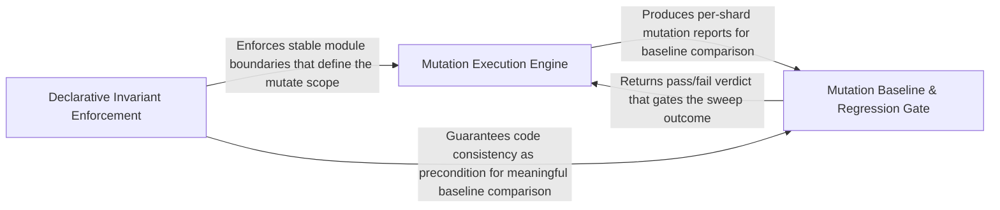

---
tags:
  - 2brain
  - 2brain/arch
  - project/boilerplate-node-backend
type: architecture
component: Build_Quality_Tooling
---

## Details

The build-time guardrails that keep the scenario/contract layer honest. It owns the custom ESLint boundary rules (no-persistence-imports, barrel-allowed-sources, controller-chain-must-catch, no-hardcoded-user-text) that enforce the sacred dependency direction the scenario layer relies on, the mutation-testing baseline, and the artifact-regeneration steps. This is the enforcement axis: it does not define personas or guarantees, but it makes the declarative invariants of Group 2 structurally impossible to violate silently.

### Mutation Execution Engine
The runtime engine that turns a set of mutable files into a parallelizable, resumable mutation-testing workload. It owns scope selection, bin-packing of files into balanced shards, wave planning across CI runs, shard execution via Stryker, and merging of per-shard reports. It is the only sub-component that talks to Stryker and to the CI runner.

**Related Classes/Methods**:

- `scripts.mutation.sharding.packIntoShards`:42-66
- `scripts.mutation.ci.cli.planWave`:110-124
- `scripts.mutation.mutate-scope.mutableFiles`:55-70
- `scripts.mutation.run-shards.listArgument`:48-52

**Source Files:**

- `scripts/mutation/ci/cli.ts`
  - `scripts.mutation.ci.cli.scope` (L86-L91) - Class
  - `scripts.mutation.ci.cli.scope.map() callback` (L87-L91) - Function
  - `scripts.mutation.ci.cli.readOutcomes` (L94-L107) - Class
  - `scripts.mutation.ci.cli.readOutcomes.filter() callback` (L98-L98) - Function
  - `scripts.mutation.ci.cli.readOutcomes.map() callback` (L99-L105) - Function
  - `scripts.mutation.ci.cli.planWave` (L110-L124) - Class
  - `scripts.mutation.ci.cli.planWave.plan.shards.map() callback` (L122-L122) - Function
  - `scripts.mutation.ci.cli.showShard.shard` (L129-L129) - Class
  - `scripts.mutation.ci.cli.showShard.shard.shards.find() callback` (L129-L129) - Function
  - `scripts.mutation.ci.cli.readFinished` (L148-L162) - Class
  - `scripts.mutation.ci.cli.readFinished.shards` (L149-L151) - Class
  - `scripts.mutation.ci.cli.readFinished.shards.plans.flatMap() callback` (L150-L150) - Function
  - `scripts.mutation.ci.cli.readFinished.shards.plans.flatMap() callback.each.map() callback` (L150-L150) - Function
  - `scripts.mutation.ci.cli.readFinished.flatMap() callback` (L155-L161) - Function
  - `scripts.mutation.ci.cli.merge.plans` (L167-L170) - Class
  - `scripts.mutation.ci.cli.merge.plans.filter() callback` (L168-L168) - Function
  - `scripts.mutation.ci.cli.merge.plans.map() callback` (L169-L169) - Function
  - `scripts.mutation.ci.cli.merge.plans.toSorted() callback` (L170-L170) - Function
  - `scripts.mutation.ci.cli.weakest` (L188-L190) - Class
  - `scripts.mutation.ci.cli.merge.weakest.toSorted() callback` (L189-L189) - Function
- `scripts/mutation/ci/merge.ts`
  - `scripts.mutation.ci.merge.ReportMutant` (L21-L31) - Interface
  - `scripts.mutation.ci.merge.ReportTest` (L34-L39) - Interface
  - `scripts.mutation.ci.merge.StrykerReport` (L42-L46) - Interface
  - `scripts.mutation.ci.merge.ShardReport` (L49-L52) - Interface
  - `scripts.mutation.ci.merge.MergeResult` (L55-L58) - Interface
  - `scripts.mutation.ci.merge.incompleteFiles` (L74-L94) - Class
  - `scripts.mutation.ci.merge.incompleteFiles.finished.flatMap() callback` (L79-L79) - Function
  - `scripts.mutation.ci.merge.incompleteFiles.scope.filter() callback` (L83-L92) - Function
  - `scripts.mutation.ci.merge.incompleteFiles.scope.filter() callback.toSorted() callback` (L86-L86) - Function
  - `scripts.mutation.ci.merge.incompleteFiles.map() callback` (L93-L93) - Function
  - `scripts.mutation.ci.merge.mergeTests.idMaps.reports.map() callback` (L103-L119) - Function
  - `scripts.mutation.ci.merge.FileMutants` (L125-L132) - Interface
  - `scripts.mutation.ci.merge.mergeReports.incomplete.finished.map() callback` (L168-L168) - Function
  - `scripts.mutation.ci.merge.mergeReports.top` (L199-L201) - Class
  - `scripts.mutation.ci.merge.mergeReports.top.filter() callback` (L200-L200) - Function
  - `scripts.mutation.ci.merge.overlayReport.remap` (L221-L221) - Class
  - `scripts.mutation.ci.merge.overlayReport.remap.ids.map() callback` (L221-L221) - Function
  - `scripts.mutation.ci.merge.overlayReport.kept` (L222-L222) - Class
  - `scripts.mutation.ci.merge.overlayReport.kept.filter() callback` (L222-L222) - Function
  - `scripts.mutation.ci.merge.overlayReport.files.kept.map() callback` (L227-L227) - Function
  - `scripts.mutation.ci.merge.overlayReport.files.map() callback` (L229-L240) - Function
  - `scripts.mutation.ci.merge.overlayReport.files.map() callback.mutants.entry.mutants.map() callback` (L233-L238) - Function
  - `scripts.mutation.ci.merge.renderHtml.at` (L255-L255) - Class
  - `scripts.mutation.ci.merge.renderHtml.at.lines.findIndex() callback` (L255-L255) - Function
  - `scripts.mutation.ci.merge.formatSummary` (L272-L324) - Class
  - `scripts.mutation.ci.merge.formatSummary.toSorted() callback` (L297-L297) - Function
  - `scripts.mutation.ci.merge.formatSummary.map() callback` (L298-L298) - Function
  - `scripts.mutation.ci.merge.formatSummary.weakest.map() callback` (L308-L308) - Function
  - `scripts.mutation.ci.merge.formatSummary.incomplete.map() callback` (L320-L320) - Function
- `scripts/mutation/ci/waves.ts`
  - `scripts.mutation.ci.waves.ScopeFile` (L43-L49) - Interface
  - `scripts.mutation.ci.waves.Unit` (L52-L54) - Interface
  - `scripts.mutation.ci.waves.CiShard` (L57-L63) - Interface
  - `scripts.mutation.ci.waves.WavePlan` (L69-L79) - Interface
  - `scripts.mutation.ci.waves.cut` (L89-L103) - Class
  - `scripts.mutation.ci.waves.cut.bounds` (L92-L95) - Class
  - `scripts.mutation.ci.waves.cut.bounds.Array.from() callback` (L94-L94) - Function
  - `scripts.mutation.ci.waves.cut.Array.from() callback` (L97-L102) - Function
  - `scripts.mutation.ci.waves.packUnits` (L123-L136) - Class
  - `scripts.mutation.ci.waves.packUnits.slices` (L124-L124) - Class
  - `scripts.mutation.ci.waves.packUnits.slices.map() callback` (L124-L124) - Function
  - `scripts.mutation.ci.waves.packUnits.slices.units.filter() callback` (L124-L124) - Function
  - `scripts.mutation.ci.waves.packUnits.toSorted() callback` (L127-L127) - Function
  - `scripts.mutation.ci.waves.packUnits.units.filter() callback` (L127-L127) - Function
  - `scripts.mutation.ci.waves.packUnits.bin` (L128-L128) - Class
  - `scripts.mutation.ci.waves.packUnits.bin.bins.find() callback` (L128-L128) - Function
  - `scripts.mutation.ci.waves.packUnits.bins.map() callback` (L135-L135) - Function
  - `scripts.mutation.ci.waves.scheduleWave.named` (L144-L147) - Class
  - `scripts.mutation.ci.waves.scheduleWave.named.queue.map() callback` (L144-L147) - Function
  - `scripts.mutation.ci.waves.firstWave` (L158-L163) - Class
  - `scripts.mutation.ci.waves.firstWave.map() callback` (L161-L161) - Function
  - `scripts.mutation.ci.waves.firstWave.scope.flatMap() callback` (L161-L161) - Function
  - `scripts.mutation.ci.waves.retryOf.retry.shard.units.map() callback` (L178-L178) - Function
  - `scripts.mutation.ci.waves.retryOf.retry.pieces.map() callback` (L181-L181) - Function
  - `scripts.mutation.ci.waves.nextWave` (L194-L206) - Class
  - `scripts.mutation.ci.waves.nextWave.abandoned.results.flatMap() callback` (L199-L199) - Function
  - `scripts.mutation.ci.waves.strykerArguments.mutate.shard.units.map() callback` (L226-L226) - Function
- `scripts/mutation/mutate-scope.ts`
  - `scripts.mutation.mutate-scope.isMutable` (L41-L52) - Class
  - `scripts.mutation.mutate-scope.mutableFiles` (L55-L70) - Class
  - `scripts.mutation.mutate-scope.mutableFiles.files.map() callback` (L68-L68) - Function
  - `scripts.mutation.mutate-scope.mutableFiles.filter() callback` (L69-L69) - Function
  - `scripts.mutation.mutate-scope.lineCount` (L73-L76) - Class
  - `scripts.mutation.mutate-scope.lineCount.filter() callback` (L76-L76) - Function
  - `scripts.mutation.mutate-scope.scopeWithLines` (L79-L80) - Class
  - `scripts.mutation.mutate-scope.scopeWithLines.map() callback` (L80-L80) - Function
  - `scripts.mutation.mutate-scope.changedMutable` (L93-L96) - Class
  - `scripts.mutation.mutate-scope.changedMutable.changed.filter() callback` (L95-L95) - Function
- `scripts/mutation/run-shards.ts`
  - `scripts.mutation.run-shards.listArgument` (L48-L52) - Class
  - `scripts.mutation.run-shards.listArgument.map() callback` (L51-L51) - Function
- `scripts/mutation/sharding.ts`
  - `scripts.mutation.sharding.packIntoShards` (L42-L66) - Class
  - `scripts.mutation.sharding.packIntoShards.files.toSorted() callback` (L53-L53) - Function
- `scripts/mutation/stryker-run.ts`
  - `scripts.mutation.stryker-run.StrykerOutcome` (L79-L82) - Interface
  - `scripts.mutation.stryker-run.runStryker.passedConcurrency` (L100-L100) - Class
  - `scripts.mutation.stryker-run.runStryker.passedConcurrency.args.some() callback` (L100-L100) - Function

### Mutation Baseline & Regression Gate
The decision layer that turns raw mutation outcomes into a pass/fail verdict. It owns the baseline model, the comparison logic that classifies each file as new/removed/regressed/improved/held against a stored baseline, the CI artifact plumbing that fetches and diffs reports across runs, and the local shard-selection policy that decides which shards to run vs. skip on a developer's machine.

**Related Classes/Methods**:

- `scripts.mutation.baseline.compareToBaseline`:166-185
- `scripts.mutation.github-artifacts.newestReport`:44-53
- `scripts.mutation.check-baseline.printProgress`:104-114

**Source Files:**

- `scripts/audit/code-shape/scripts/shallow-candidates.ts`
  - `scripts.audit.code-shape.scripts.shallow-candidates.forwardTarget.passed` (L282-L287) - Class
  - `scripts.audit.code-shape.scripts.shallow-candidates.forwardTarget.passed.call.arguments.map() callback` (L282-L287) - Function
  - `scripts.audit.code-shape.scripts.shallow-candidates.publishedFiles.queue` (L369-L369) - Class
  - `scripts.audit.code-shape.scripts.shallow-candidates.publishedFiles.queue.filter() callback` (L369-L369) - Function
  - `scripts.audit.code-shape.scripts.shallow-candidates.findShallowCandidates.inScope` (L447-L449) - Class
  - `scripts.audit.code-shape.scripts.shallow-candidates.findShallowCandidates.inScope.scope.some() callback` (L449-L449) - Function
- `scripts/hooks/stale-generated-files.ts`
  - `scripts.hooks.stale-generated-files.paths` (L58-L58) - Class
  - `scripts.hooks.stale-generated-files.paths.filter() callback` (L58-L58) - Function
- `scripts/mutation/baseline.ts`
  - `scripts.mutation.baseline.MutationReport` (L41-L43) - Interface
  - `scripts.mutation.baseline.MutationBaseline` (L46-L51) - Interface
  - `scripts.mutation.baseline.FileComparison` (L57-L62) - Interface
  - `scripts.mutation.baseline.scoresFromReport.scored` (L82-L82) - Class
  - `scripts.mutation.baseline.scoresFromReport.scored.mutants.filter() callback` (L82-L82) - Function
  - `scripts.mutation.baseline.scoresFromReport.killed` (L90-L90) - Class
  - `scripts.mutation.baseline.scoresFromReport.killed.scored.filter() callback` (L90-L90) - Function
  - `scripts.mutation.baseline.compareToBaseline` (L166-L185) - Class
  - `scripts.mutation.baseline.compareToBaseline.files.map() callback` (L173-L184) - Function
  - `scripts.mutation.baseline.compareMerged` (L193-L197) - Class
  - `scripts.mutation.baseline.compareMerged.filter() callback` (L197-L197) - Function
  - `scripts.mutation.baseline.missingFromReport` (L230-L236) - Class
  - `scripts.mutation.baseline.missingFromReport.filter() callback` (L235-L235) - Function
  - `scripts.mutation.baseline.formatRegressions.regressed` (L262-L262) - Class
  - `scripts.mutation.baseline.formatRegressions.regressed.comparisons.filter() callback` (L262-L262) - Function
  - `scripts.mutation.baseline.formatRegressions.lines` (L265-L268) - Class
  - `scripts.mutation.baseline.formatRegressions.lines.regressed.map() callback` (L266-L267) - Function
- `scripts/mutation/check-baseline.ts`
  - `scripts.mutation.check-baseline.printProgress` (L104-L114) - Class
  - `scripts.mutation.check-baseline.printProgress.comparisons.filter() callback` (L109-L109) - Function
  - `scripts.mutation.check-baseline.map() callback` (L158-L158) - Function
  - `scripts.mutation.check-baseline.counts.held.comparisons.filter() callback` (L173-L173) - Function
  - `scripts.mutation.check-baseline.counts.improved.comparisons.filter() callback` (L174-L174) - Function
  - `scripts.mutation.check-baseline.counts.added.comparisons.filter() callback` (L175-L175) - Function
  - `scripts.mutation.check-baseline.counts.removed.comparisons.filter() callback` (L176-L176) - Function
  - `scripts.mutation.check-baseline.comparisons.filter() callback` (L182-L182) - Function
- `scripts/mutation/github-artifacts.ts`
  - `scripts.mutation.github-artifacts.GitHubArtifact` (L20-L34) - Interface
  - `scripts.mutation.github-artifacts.newestReport` (L44-L53) - Class
  - `scripts.mutation.github-artifacts.newestReport.artifacts.filter() callback` (L47-L50) - Function
  - `scripts.mutation.github-artifacts.newestReport.toSorted() callback` (L52-L52) - Function
- `scripts/mutation/local-policy.ts`
  - `scripts.mutation.local-policy.ShardSelection` (L14-L19) - Interface
  - `scripts.mutation.local-policy.selectShards.asked` (L47-L47) - Class
  - `scripts.mutation.local-policy.selectShards.asked.shards.filter() callback` (L47-L47) - Function
  - `scripts.mutation.local-policy.done` (L48-L48) - Class
  - `scripts.mutation.local-policy.selectShards.done.asked.filter() callback` (L48-L48) - Function
  - `scripts.mutation.local-policy.selectShards.outstanding` (L49-L49) - Class
  - `scripts.mutation.local-policy.selectShards.outstanding.asked.filter() callback` (L49-L49) - Function
  - `scripts.mutation.local-policy.selectShards.outstanding.asked.filter() callback.done.every() callback` (L49-L49) - Function
- `scripts/mutation/mutate-scope.ts`
  - `scripts.mutation.mutate-scope.isMutable.include` (L42-L42) - Class
  - `scripts.mutation.mutate-scope.isMutable.include.patterns.filter() callback` (L42-L42) - Function
  - `scripts.mutation.mutate-scope.isMutable.include.some() callback` (L49-L49) - Function
- `scripts/mutation/pull-report.ts`
  - `scripts.mutation.pull-report.listArtifacts` (L35-L39) - Class
  - `scripts.mutation.pull-report.listArtifacts.then() callback` (L39-L39) - Function
  - `scripts.mutation.pull-report.install` (L54-L72) - Class
  - `scripts.mutation.pull-report.install.then() callback` (L55-L71) - Function
  - `scripts.mutation.pull-report.then() callback.then() callback` (L57-L57) - Function
  - `scripts.mutation.pull-report.install.then() callback.then() callback.PULLED_FILES.map() callback` (L60-L61) - Function
  - `scripts.mutation.pull-report.install.then() callback.finally() callback` (L65-L65) - Function
  - `scripts.mutation.pull-report.install.then() callback.then() callback` (L66-L71) - Function
  - `scripts.mutation.pull-report.then() callback` (L95-L100) - Function
  - `scripts.mutation.pull-report.catch() callback` (L101-L104) - Function
- `scripts/mutation/run-diff.ts`
  - `scripts.mutation.run-diff.changedFiles` (L36-L43) - Class
  - `scripts.mutation.run-diff.changedFiles.map() callback` (L42-L42) - Function
  - `scripts.mutation.run-diff.changedFiles.filter() callback` (L43-L43) - Function
  - `scripts.mutation.run-diff.then() callback` (L123-L129) - Function
- `scripts/mutation/run-shards.ts`
  - `scripts.mutation.run-shards.runShard.written` (L141-L141) - Class
  - `scripts.mutation.run-shards.runShard.written.catch() callback` (L141-L141) - Function
- `scripts/mutation/sharding.ts`
  - `scripts.mutation.sharding.Shard` (L16-L20) - Interface
  - `scripts.mutation.sharding.packIntoShards.totalLines` (L46-L46) - Class
  - `scripts.mutation.sharding.packIntoShards.totalLines.files.reduce() callback` (L46-L46) - Function
  - `scripts.mutation.sharding.packIntoShards.bins` (L48-L51) - Class
  - `scripts.mutation.sharding.packIntoShards.bins.Array.from() callback` (L48-L51) - Function
  - `scripts.mutation.sharding.packIntoShards.bins.map() callback` (L61-L65) - Function
- `scripts/pairing/sync-to-frontend.ts`
  - `scripts.pairing.sync-to-frontend.Outcome` (L113-L120) - Interface
  - `scripts.pairing.sync-to-frontend.outcomes` (L123-L139) - Class
  - `scripts.pairing.sync-to-frontend.outcomes.SHARED_FILES.map() callback` (L123-L139) - Function

### Declarative Invariant Enforcement
The static, edit-time and commit-time guardrails that make the scenario layer's invariants structurally unviolable. It owns the custom ESLint rules encoding the sacred dependency direction and module-public-surface contract, the ordered artifact-regeneration chain that rebuilds api/, openapi.yaml, asyncapi bundles, permission actions, shared rule schemas and docs, and the paired-repo spec-identity check that hashes shared contract files against the sibling repo to catch cross-repo drift.

**Related Classes/Methods**:

- `scripts.eslint.no-persistence-imports.noPersistenceImports`:55-116
- `scripts.eslint.barrel-allowed-sources.barrelAllowedSources`:80-279
- `scripts.regenerate-artifacts.steps`
- `scripts.pairing.spec-identity.compareSharedFiles`:151-180
- `scripts.eslint.no-hardcoded-user-text.noHardcodedUserText`:32-84

**Source Files:**

- `scripts/audit/code-shape/scripts/generate-shallow-candidates.ts`
  - `scripts.audit.code-shape.scripts.generate-shallow-candidates.rawConfig.ts.readConfigFile() callback` (L27-L28) - Function
  - `scripts.audit.code-shape.scripts.generate-shallow-candidates.rawConfig` (L27-L29) - Class
- `scripts/audit/code-shape/scripts/shallow-candidates.ts`
  - `scripts.audit.code-shape.scripts.shallow-candidates.FunctionFacts` (L40-L58) - Interface
  - `scripts.audit.code-shape.scripts.shallow-candidates.FileFacts` (L63-L72) - Interface
  - `scripts.audit.code-shape.scripts.shallow-candidates.ShallowReport` (L77-L86) - Interface
  - `scripts.audit.code-shape.scripts.shallow-candidates.Usage` (L91-L96) - Interface
  - `scripts.audit.code-shape.scripts.shallow-candidates.NamedFunction` (L101-L106) - Interface
  - `scripts.audit.code-shape.scripts.shallow-candidates.projectFiles` (L158-L165) - Class
  - `scripts.audit.code-shape.scripts.shallow-candidates.projectFiles.filter() callback` (L162-L164) - Function
  - `scripts.audit.code-shape.scripts.shallow-candidates.forwardTarget.own.declared.parameters.map() callback` (L277-L280) - Function
  - `scripts.audit.code-shape.scripts.shallow-candidates.forwardTarget.own` (L277-L281) - Class
  - `scripts.audit.code-shape.scripts.shallow-candidates.optionalNeverPassed` (L299-L310) - Class
  - `scripts.audit.code-shape.scripts.shallow-candidates.optionalNeverPassed.declared.parameters.filter() callback` (L304-L307) - Function
  - `scripts.audit.code-shape.scripts.shallow-candidates.optionalNeverPassed.map() callback` (L309-L309) - Function
  - `scripts.audit.code-shape.scripts.shallow-candidates.findShallowCandidates.smallAndRare.functions.filter() callback` (L481-L481) - Function
  - `scripts.audit.code-shape.scripts.shallow-candidates.findShallowCandidates.passThroughs.functions.filter() callback` (L483-L483) - Function
  - `scripts.audit.code-shape.scripts.shallow-candidates.findShallowCandidates.optionalNeverPassed.functions.filter() callback` (L485-L485) - Function
  - `scripts.audit.code-shape.scripts.shallow-candidates.findShallowCandidates.lazyFiles.files.filter() callback` (L489-L492) - Function
  - `scripts.audit.code-shape.scripts.shallow-candidates.findShallowCandidates.lazyFiles.toSorted() callback` (L495-L495) - Function
- `scripts/docker/generate-dockerfile-dockerignore.ts`
  - `scripts.docker.generate-dockerfile-dockerignore.derive.kept` (L58-L58) - Class
  - `scripts.docker.generate-dockerfile-dockerignore.derive.kept.filter() callback` (L58-L58) - Function
- `scripts/eslint/barrel-allowed-sources.ts`
  - `scripts.eslint.barrel-allowed-sources.barrelAllowedSources` (L80-L279) - Class
  - `scripts.eslint.barrel-allowed-sources.barrelAllowedSources.create` (L122-L278) - Method
  - `scripts.eslint.barrel-allowed-sources.barrelAllowedSources.create.Program` (L173-L181) - Method
  - `scripts.eslint.barrel-allowed-sources.barrelAllowedSources.create.ExportAllDeclaration` (L183-L214) - Method
  - `scripts.eslint.barrel-allowed-sources.barrelAllowedSources.create.ExportNamedDeclaration` (L216-L276) - Method
- `scripts/eslint/comment-links.ts`
  - `scripts.eslint.comment-links.commentLinks` (L86-L119) - Class
  - `scripts.eslint.comment-links.commentLinks.create` (L101-L118) - Method
  - `scripts.eslint.comment-links.commentLinks.create.Program` (L103-L116) - Method
- `scripts/eslint/controller-chain-must-catch.ts`
  - `scripts.eslint.controller-chain-must-catch.controllerChainMustCatch.create.CallExpression.parents` (L144-L146) - Class
  - `scripts.eslint.controller-chain-must-catch.controllerChainMustCatch.create.CallExpression.parents.map() callback` (L145-L145) - Function
- `scripts/eslint/friend-members.ts`
  - `scripts.eslint.friend-members.FriendEntry` (L23-L32) - Interface
  - `scripts.eslint.friend-members.friendMembers.create.check.entry` (L103-L108) - Class
  - `scripts.eslint.friend-members.friendMembers.create.check.entry.entries.find() callback` (L104-L107) - Function
- `scripts/eslint/no-hardcoded-user-text.ts`
  - `scripts.eslint.no-hardcoded-user-text.noHardcodedUserText` (L32-L84) - Class
  - `scripts.eslint.no-hardcoded-user-text.noHardcodedUserText.create` (L44-L83) - Method
  - `scripts.eslint.no-hardcoded-user-text.noHardcodedUserText.create.CallExpression` (L46-L81) - Method
  - `scripts.eslint.no-hardcoded-user-text.noHardcodedUserText.create.CallExpression.errors` (L51-L54) - Class
  - `scripts.eslint.no-hardcoded-user-text.noHardcodedUserText.create.CallExpression.errors.node.arguments.find() callback` (L52-L53) - Function
- `scripts/eslint/no-persistence-imports.ts`
  - `scripts.eslint.no-persistence-imports.RuleOptions` (L18-L21) - Interface
  - `scripts.eslint.no-persistence-imports.noPersistenceImports` (L55-L116) - Class
  - `scripts.eslint.no-persistence-imports.noPersistenceImports.create` (L87-L115) - Method
  - `scripts.eslint.no-persistence-imports.noPersistenceImports.create.ImportDeclaration` (L93-L113) - Method
  - `scripts.eslint.no-persistence-imports.noPersistenceImports.create.ImportDeclaration.name.find() callback` (L107-L108) - Function
  - `scripts.eslint.no-persistence-imports.noPersistenceImports.create.ImportDeclaration.name` (L107-L109) - Class
  - `scripts.eslint.no-persistence-imports.noPersistenceImports.create.ImportDeclaration.name.find() callback.bindings.some() callback` (L108-L108) - Function
- `scripts/hooks/check-generated-fresh.ts`
  - `scripts.hooks.check-generated-fresh.stale.map() callback` (L44-L44) - Function
- `scripts/hooks/stale-generated-files.ts`
  - `scripts.hooks.stale-generated-files.StaleGeneratedOptions` (L23-L37) - Interface
- `scripts/ops/reapply-erasures.ts`
  - `scripts.ops.reapply-erasures.drainAuditSink` (L58-L61) - Class
  - `scripts.ops.reapply-erasures.drainAuditSink.<function>` (L59-L61) - Function
  - `scripts.ops.reapply-erasures.drainAuditSink.<function>.setTimeout() callback` (L60-L60) - Function
  - `scripts.ops.reapply-erasures.replay.then() callback` (L76-L76) - Function
  - `scripts.ops.reapply-erasures.main` (L81-L93) - Class
  - `scripts.ops.reapply-erasures.main.then() callback` (L83-L92) - Function
- `scripts/ops/run-job.ts`
  - `scripts.ops.run-job.requestedJob` (L64-L78) - Class
  - `scripts.ops.run-job.requestedJob.found` (L68-L68) - Class
  - `scripts.ops.run-job.requestedJob.found.find() callback` (L68-L68) - Function
  - `scripts.ops.run-job.requestedJob.map() callback` (L72-L72) - Function
- `scripts/pairing/spec-identity.ts`
  - `scripts.pairing.spec-identity.SharedFile` (L33-L36) - Interface
  - `scripts.pairing.spec-identity.SpecComparison` (L119-L129) - Interface
  - `scripts.pairing.spec-identity.compareSharedFiles` (L151-L180) - Class
  - `scripts.pairing.spec-identity.compareSharedFiles.SHARED_FILES.map() callback` (L156-L180) - Function
  - `scripts.pairing.spec-identity.sharedFileProblems` (L183-L184) - Class
  - `scripts.pairing.spec-identity.sharedFileProblems.comparisons.filter() callback` (L184-L184) - Function
  - `scripts.pairing.spec-identity.formatSharedFileProblems.lines` (L201-L217) - Class
  - `scripts.pairing.spec-identity.formatSharedFileProblems.lines.problems.map() callback` (L201-L217) - Function
- `scripts/pairing/sync-to-frontend.ts`
  - `scripts.pairing.sync-to-frontend.of` (L149-L149) - Class
  - `scripts.pairing.sync-to-frontend.of.outcomes.filter() callback` (L149-L149) - Function
  - `scripts.pairing.sync-to-frontend.list` (L157-L158) - Class
  - `scripts.pairing.sync-to-frontend.list.items.map() callback` (L158-L158) - Function
- `scripts/regenerate-artifacts.ts`
  - `scripts.regenerate-artifacts.Step` (L39-L48) - Interface
  - `scripts.regenerate-artifacts.steps` (L175-L175) - Class
  - `scripts.regenerate-artifacts.steps.STEPS.filter() callback` (L175-L175) - Function
- `src/kernel/permissions.ts`
  - `src.kernel.permissions.rolesDocumentSchema.audience.AUDIENCE_NAMES.map() callback` (L244-L244) - Function
- `src/kernel/registry.ts`
  - `src.kernel.registry.resolveJobs` (L719-L720) - Class
  - `src.kernel.registry.resolveJobs.appModules.flatMap() callback` (L720-L720) - Function
- `src/modules/account/model.ts`
  - `src.modules.account.model.ErasureLedgerDocument` (L213-L230) - Interface
- `src/modules/account/services/erasure-ledger.ts`
  - `src.modules.account.services.erasure-ledger.ReapplyOptions` (L101-L108) - Interface
  - `src.modules.account.services.erasure-ledger.reapplyOne` (L158-L178) - Class
  - `src.modules.account.services.erasure-ledger.then() callback` (L166-L166) - Function
  - `src.modules.account.services.erasure-ledger.reapplyOne.then() callback` (L173-L177) - Function
  - `src.modules.account.services.erasure-ledger.outcome` (L203-L210) - Class
  - `src.modules.account.services.erasure-ledger.reapplyErasures.outcome.catch() callback` (L203-L210) - Function
