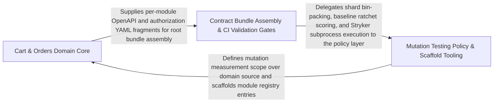

---
tags:
  - 2brain
  - 2brain/arch
  - project/boilerplate-node-backend
type: architecture
component: Contract_Bundle_Assembly_CI_Validation_Gates
---

## Details

The higher-level assembly and validation layer that consumes the compiled bundles and produces the downstream artifacts: the authorization-keys bundle (text-spliced from per-module authorization.yaml fragments + root residual), the four API client collections (Bruno/Insomnia/Mockoon/Postman) generated on demand, the AsyncAPI TypeScript types (payload interfaces, channel constants, SSE event maps, Zod validators), and the root OpenAPI document assembly. It also provides the CI gates that protect contract stability: the AsyncAPI breaking-change detector (diffs against origin/main's merge-base), the mutation-testing baseline checker, and the shard-based mutation runner.

### Cart & Orders Domain Core
The bounded-context core that the contract tooling validates against: the cart module registration, its repository, and the checkout/cleanup/items/merge/view services, plus the orders PII encryption/decryption helpers and the orders repository's effect/projection primitives. This is the primary domain surface whose openapi.yaml/authorization.yaml fragments feed the bundle assembly.

**Related Classes/Methods**:

- `src.modules.cart.module.default`:24-50
- `src.modules.cart.repository.cartRepository`:184-343
- `src.modules.orders.pii.encryptOrderPii`:75-87
- `src.modules.orders.repository.findByIdScoped`:148-155

**Source Files:**

- `src/modules/cart/module.ts`
  - `src.modules.cart.module.default` (L24-L50) - Class
  - `src.modules.cart.module.default.personalData.collect` (L36-L39) - Method
  - `src.modules.cart.module.default.personalData.collect.then() callback` (L37-L38) - Function
  - `src.modules.cart.module.default.personalData.collect.then() callback.lines.map() callback` (L38-L38) - Function
  - `src.modules.cart.module.default.subscribe` (L44-L48) - Method
  - `src.modules.cart.module.default.subscribe.onDomainEvent() callback` (L45-L46) - Function
- `src/modules/cart/repository.ts`
  - `src.modules.cart.repository.cartRepository` (L184-L343) - Class
  - `src.modules.cart.repository.cartRepository.findByUserId` (L214-L214) - Method
  - `src.modules.cart.repository.cartRepository.removeLine` (L227-L234) - Method
  - `src.modules.cart.repository.cartRepository.clearLines` (L242-L249) - Method
  - `src.modules.cart.repository.cartRepository.clearLinesIfUnchanged` (L268-L287) - Method
  - `src.modules.cart.repository.cartRepository.setShippingMethod` (L296-L305) - Method
  - `src.modules.cart.repository.cartRepository.deleteByUserId` (L314-L320) - Method
  - `src.modules.cart.repository.cartRepository.deleteByUserId.then() callback` (L318-L320) - Function
  - `src.modules.cart.repository.cartRepository.removeProductFromAll` (L332-L342) - Method
- `src/modules/cart/services/checkout.ts`
  - `src.modules.cart.services.checkout.runCheckout.outcome` (L526-L561) - Class
  - `src.modules.cart.services.checkout.runCheckout.outcome.lines.joined.map() callback` (L531-L536) - Function
  - `src.modules.cart.services.checkout.runCheckout.outcome.commitWith` (L557-L560) - Method
  - `src.modules.cart.services.checkout.runCheckout.outcome.commitWith.then() callback` (L560-L560) - Function
- `src/modules/cart/services/cleanup.ts`
  - `src.modules.cart.services.cleanup.productRemoveFromCartsById` (L39-L48) - Class
  - `src.modules.cart.services.cleanup.productRemoveFromCartsById.then() callback` (L43-L48) - Function
  - `src.modules.cart.services.cleanup.productRemoveFromCartsById.then() callback.then() callback` (L46-L46) - Function
- `src/modules/cart/services/items.ts`
  - `src.modules.cart.services.items.cartGet` (L34-L35) - Class
  - `src.modules.cart.services.items.cartGet.then() callback` (L35-L35) - Function
- `src/modules/cart/services/merge.ts`
  - `src.modules.cart.services.merge.heldIn` (L41-L42) - Class
  - `src.modules.cart.services.merge.heldIn.cart.items.find() callback` (L42-L42) - Function
  - `src.modules.cart.services.merge.writeAdd` (L70-L81) - Class
  - `src.modules.cart.services.merge.writeAdd.then() callback` (L76-L81) - Function
  - `src.modules.cart.services.merge.writeAdd.then() callback.then() callback` (L78-L78) - Function
  - `src.modules.cart.services.merge.mergeLine` (L89-L125) - Class
  - `src.modules.cart.services.merge.mergeLine.written.then() callback` (L108-L124) - Function
- `src/modules/cart/services/view.ts`
  - `src.modules.cart.services.view.readCartLines` (L75-L90) - Class
  - `src.modules.cart.services.view.readCartLines.then() callback` (L81-L89) - Function
  - `src.modules.cart.services.view.readCartLines.then() callback.cart.items.map() callback` (L84-L88) - Function
  - `src.modules.cart.services.view.buildView.items.lines.map() callback` (L165-L172) - Function
- `src/modules/orders/domain/transfer-reference.ts`
  - `src.modules.orders.domain.transfer-reference.numericStringFor` (L39-L40) - Class
  - `src.modules.orders.domain.transfer-reference.numericStringFor.value.replaceAll() callback` (L40-L40) - Function
- `src/modules/orders/pii.ts`
  - `src.modules.orders.pii.AddressText` (L24-L31) - Interface
  - `src.modules.orders.pii.OrderPiiFields` (L34-L38) - Interface
  - `src.modules.orders.pii.encryptOrderPii` (L75-L87) - Class
  - `src.modules.orders.pii.encryptOrderPii.mapAddress() callback` (L81-L82) - Function
  - `src.modules.orders.pii.decryptOrderAddress` (L94-L101) - Class
  - `src.modules.orders.pii.decryptOrderAddress.mapAddress() callback` (L99-L100) - Function
- `src/modules/orders/repository.ts`
  - `src.modules.orders.repository.findByIdScoped` (L148-L155) - Class
  - `src.modules.orders.repository.findByIdScoped.then() callback` (L155-L155) - Function
  - `src.modules.orders.repository.setProjection` (L274-L292) - Class
  - `src.modules.orders.repository.setProjection.then() callback` (L291-L291) - Function
  - `src.modules.orders.repository.clearPendingEffect` (L359-L367) - Class
  - `src.modules.orders.repository.clearPendingEffect.then() callback` (L367-L367) - Function
  - `src.modules.orders.repository.addPendingEffect` (L383-L387) - Class
  - `src.modules.orders.repository.addPendingEffect.then() callback` (L387-L387) - Function
  - `src.modules.orders.repository.findOpenUnpaidIdsOf` (L399-L411) - Class
  - `src.modules.orders.repository.findOpenUnpaidIdsOf.then() callback` (L411-L411) - Function
  - `src.modules.orders.repository.findOpenUnpaidIdsOf.then() callback.orders.map() callback` (L411-L411) - Function
  - `src.modules.orders.repository.detachUserId` (L429-L477) - Class
  - `src.modules.orders.repository.detachUserId.then() callback` (L476-L476) - Function
- `src/modules/orders/services/order-numbering.ts`
  - `src.modules.orders.services.order-numbering.allocateOrderNumber` (L29-L35) - Class
  - `src.modules.orders.services.order-numbering.allocateOrderNumber.then() callback` (L34-L34) - Function
- `src/modules/orders/services/place.ts`
  - `src.modules.orders.services.place.PlaceOrderLine` (L39-L42) - Interface
  - `src.modules.orders.services.place.PlaceOrderAddress` (L45-L52) - Interface
  - `src.modules.orders.services.place.PlaceOrderShipping` (L63-L68) - Interface
  - `src.modules.orders.services.place.PlaceOrderInput` (L71-L90) - Interface
  - `src.modules.orders.services.place.OrderSuperseded` (L101-L101) - Class
  - `src.modules.orders.services.place.placeOrder` (L120-L226) - Class
  - `src.modules.orders.services.place.orderItems.input.lines.map() callback` (L129-L129) - Function
  - `src.modules.orders.services.place.placeOrder.order.announceInTransaction() callback.then() callback` (L199-L206) - Function
  - `src.modules.orders.services.place.placeOrder.order.announceInTransaction() callback.then() callback.then() callback` (L202-L205) - Function
  - `src.modules.orders.services.place.placeOrder.order.announceInTransaction() callback` (L208-L208) - Function
  - `src.modules.orders.services.place.placeOrder.catch() callback` (L215-L222) - Function
- `src/modules/orders/services/reencrypt.ts`
  - `src.modules.orders.services.reencrypt.fieldsOf.addresses.ADDRESS_PATHS.flatMap() callback` (L16-L29) - Function
  - `src.modules.orders.services.reencrypt.fieldsOf.addresses` (L16-L30) - Class
  - `src.modules.orders.services.reencrypt.fieldsOf.addresses.ADDRESS_PATHS.flatMap() callback.ADDRESS_FIELDS.flatMap() callback` (L17-L29) - Function

### Contract Bundle Assembly & CI Validation Gates
The subsystem's namesake: assembles the downstream contract artifacts and enforces the CI gates that protect contract stability. It splices the authorization-keys bundle from per-module fragments + root residual, generates the four API client collections on demand, emits the AsyncAPI TypeScript types, and assembles the root OpenAPI document. It also hosts the AsyncAPI breaking-change detector (merge-base diff vs origin/main), the mutation baseline checker, and the shard-based mutation runner entry points.

**Related Classes/Methods**:

- `scripts.contracts.check-asyncapi-breaking.baseArgument`

**Source Files:**

- `scripts/contracts/authorization-bundle.ts`
  - `scripts.contracts.authorization-bundle.FragmentKey` (L69-L71) - Interface
  - `scripts.contracts.authorization-bundle.FragmentDocument` (L74-L76) - Interface
  - `scripts.contracts.authorization-bundle.fragmentKeysBlock.misattributed` (L100-L100) - Class
  - `scripts.contracts.authorization-bundle.fragmentKeysBlock.misattributed.parsed.keys.filter() callback` (L100-L100) - Function
  - `scripts.contracts.authorization-bundle.fragmentKeysBlock.misattributed.map() callback` (L104-L104) - Function
  - `scripts.contracts.authorization-bundle.filter() callback` (L114-L114) - Function
- `scripts/contracts/check-asyncapi-breaking.ts`
  - `scripts.contracts.check-asyncapi-breaking.baseArgument` (L32-L32) - Class
  - `scripts.contracts.check-asyncapi-breaking.baseArgument.process.argv.find() callback` (L32-L32) - Function
- `scripts/contracts/client-collections-bundle.ts`
  - `scripts.contracts.client-collections-bundle.values` (L79-L156) - Class
  - `scripts.contracts.client-collections-bundle.values.pathParam` (L126-L135) - Method
  - `scripts.contracts.client-collections-bundle.filter() callback` (L170-L170) - Function
- `scripts/contracts/generate-asyncapi-types.ts`
  - `scripts.contracts.generate-asyncapi-types.then() callback.modelBlocks` (L588-L591) - Class
  - `scripts.contracts.generate-asyncapi-types.then() callback.modelBlocks.models.map() callback` (L589-L590) - Function
- `scripts/contracts/root-assembly.ts`
  - `scripts.contracts.root-assembly.pruneStaleReferences.stale` (L62-L67) - Class
  - `scripts.contracts.root-assembly.pruneStaleReferences.stale.paths.items.filter() callback` (L62-L67) - Function
  - `scripts.contracts.root-assembly.readModuleFragments.map() callback.operations` (L164-L164) - Class
  - `scripts.contracts.root-assembly.readModuleFragments.map() callback.operations.flatMap() callback` (L164-L164) - Function
- `scripts/docker/generate-dockerfile-dockerignore.ts`
  - `scripts.docker.generate-dockerfile-dockerignore.derive.kept` (L62-L62) - Class
  - `scripts.docker.generate-dockerfile-dockerignore.derive.kept.filter() callback` (L62-L62) - Function
- `scripts/mutation/check-baseline.ts`
  - `scripts.mutation.check-baseline.mergeDirectoryArgument` (L42-L42) - Class
  - `scripts.mutation.check-baseline.mergeDirectoryArgument.process.argv.find() callback` (L42-L42) - Function
  - `scripts.mutation.check-baseline.map() callback` (L147-L147) - Function
  - `scripts.mutation.check-baseline.counts.held.comparisons.filter() callback` (L162-L162) - Function
  - `scripts.mutation.check-baseline.counts.improved.comparisons.filter() callback` (L163-L163) - Function
  - `scripts.mutation.check-baseline.counts.added.comparisons.filter() callback` (L164-L164) - Function
  - `scripts.mutation.check-baseline.counts.removed.comparisons.filter() callback` (L165-L165) - Function
  - `scripts.mutation.check-baseline.comparisons.filter() callback` (L184-L184) - Function
- `scripts/mutation/ci/waves.ts`
  - `scripts.mutation.ci.waves.nextWave.results` (L207-L207) - Class
  - `scripts.mutation.ci.waves.nextWave.results.previous.shards.map() callback` (L207-L207) - Function
  - `scripts.mutation.ci.waves.nextWave.results.flatMap() callback` (L212-L212) - Function
- `scripts/mutation/local-policy.ts`
  - `scripts.mutation.local-policy.selectShards.asked` (L47-L47) - Class
  - `scripts.mutation.local-policy.selectShards.asked.shards.filter() callback` (L47-L47) - Function
- `scripts/mutation/run-diff.ts`
  - `scripts.mutation.run-diff.baseArgument` (L47-L47) - Class
  - `scripts.mutation.run-diff.baseArgument.process.argv.find() callback` (L47-L47) - Function
- `scripts/mutation/run-shards.ts`
  - `scripts.mutation.run-shards.runShard.written` (L141-L141) - Class
  - `scripts.mutation.run-shards.runShard.written.catch() callback` (L141-L141) - Function
  - `scripts.mutation.run-shards.then() callback` (L222-L222) - Function
- `scripts/mutation/sharding.ts`
  - `scripts.mutation.sharding.packIntoShards.bins` (L48-L51) - Class
  - `scripts.mutation.sharding.packIntoShards.bins.Array.from() callback` (L48-L51) - Function
  - `scripts.mutation.sharding.packIntoShards.bins.map() callback` (L61-L65) - Function
- `scripts/mutation/stryker-run.ts`
  - `scripts.mutation.stryker-run.StrykerOutcome` (L80-L83) - Interface
  - `scripts.mutation.stryker-run.runStryker.passedConcurrency` (L101-L101) - Class
  - `scripts.mutation.stryker-run.runStryker.passedConcurrency.args.some() callback` (L101-L101) - Function
- `scripts/ops/demo-remove-authorization.ts`
  - `scripts.ops.demo-remove-authorization.readRemovedAuthorization.stillUsed` (L57-L57) - Class
  - `scripts.ops.demo-remove-authorization.readRemovedAuthorization.stillUsed.map() callback` (L57-L57) - Function
  - `scripts.ops.demo-remove-authorization.stripRoleGrants.lines` (L75-L77) - Class
  - `scripts.ops.demo-remove-authorization.stripRoleGrants.lines.filter() callback` (L77-L77) - Function
  - `scripts.ops.demo-remove-authorization.pruneCase.emptied` (L113-L115) - Class
  - `scripts.ops.demo-remove-authorization.pruneCase.emptied.lists.some() callback` (L114-L114) - Function
  - `scripts.ops.demo-remove-authorization.pruneCase.emptied.lists.some() callback.all.every() callback` (L114-L114) - Function
- `scripts/ops/demo-remove-registry.ts`
  - `scripts.ops.demo-remove-registry.removeCrontabEntries.escaped.scriptNames.map() callback` (L172-L173) - Function
  - `scripts.ops.demo-remove-registry.removeCrontabEntries.escaped` (L172-L174) - Class
- `scripts/ops/reencrypt.ts`
  - `scripts.ops.reencrypt.runAll` (L53-L60) - Class
  - `scripts.ops.reencrypt.runAll.then() callback` (L59-L59) - Function
  - `scripts.ops.reencrypt.then() callback` (L65-L65) - Function
- `scripts/ops/sweep-order-effects.ts`
  - `scripts.ops.sweep-order-effects.main` (L42-L48) - Class
  - `scripts.ops.sweep-order-effects.then() callback` (L44-L46) - Function
  - `scripts.ops.sweep-order-effects.main.then() callback` (L48-L48) - Function
- `scripts/pairing/spec-identity.ts`
  - `scripts.pairing.spec-identity.formatSharedFileProblems.lines` (L210-L226) - Class
  - `scripts.pairing.spec-identity.formatSharedFileProblems.lines.problems.map() callback` (L210-L226) - Function
- `scripts/scaffold/central-edits.ts`
  - `scripts.scaffold.central-edits.addParityEntry.opens.lines.findIndex() callback` (L69-L70) - Function
  - `scripts.scaffold.central-edits.addParityEntry.opens` (L69-L71) - Class
- `scripts/scaffold/names.ts`
  - `scripts.scaffold.names.pascal` (L57-L61) - Class
  - `scripts.scaffold.names.pascal.map() callback` (L60-L60) - Function
- `scripts/scaffold/registry.ts`
  - `scripts.scaffold.registry.splitAfter.at` (L99-L99) - Class
  - `scripts.scaffold.registry.splitAfter.at.lines.findIndex() callback` (L99-L99) - Function
- `src/modules/cart/repository.ts`
  - `src.modules.cart.repository.pushNewLine` (L46-L58) - Class
  - `src.modules.cart.repository.pushNewLine.then() callback` (L58-L58) - Function
  - `src.modules.cart.repository.unchangedOrPushed` (L66-L76) - Class
  - `src.modules.cart.repository.unchangedOrPushed.then() callback` (L74-L75) - Function
  - `src.modules.cart.repository.upsertLine` (L97-L176) - Class
  - `src.modules.cart.repository.upsertLine.then() callback` (L143-L170) - Function
  - `src.modules.cart.repository.upsertLine.then() callback.then() callback` (L150-L169) - Function
  - `src.modules.cart.repository.upsertLine.catch() callback` (L171-L174) - Function

### Mutation Testing Policy & Scaffold Tooling
The supporting tooling layer around the mutation gates and repo scaffolding: the local shard-selection policy and baseline scoring that drive the shard-based mutation runner, the CI CLI that reads finished shards, and the scaffold central-edits/options/registry machinery used to keep generated artifacts and module registries in sync. It also carries the cart domain model/rules and webhooks failure-recording hooks that the tooling references.

**Related Classes/Methods**: _None_

**Source Files:**

- `scripts/mutation/baseline.ts`
  - `scripts.mutation.baseline.scoresFromReport.killed` (L90-L90) - Class
  - `scripts.mutation.baseline.scoresFromReport.killed.scored.filter() callback` (L90-L90) - Function
- `scripts/mutation/ci/cli.ts`
  - `scripts.mutation.ci.cli.readFinished.shards` (L150-L152) - Class
  - `scripts.mutation.ci.cli.readFinished.shards.plans.flatMap() callback` (L151-L151) - Function
  - `scripts.mutation.ci.cli.readFinished.shards.plans.flatMap() callback.each.map() callback` (L151-L151) - Function
- `scripts/mutation/local-policy.ts`
  - `scripts.mutation.local-policy.ShardSelection` (L14-L19) - Interface
  - `scripts.mutation.local-policy.done` (L48-L48) - Class
  - `scripts.mutation.local-policy.selectShards.done.asked.filter() callback` (L48-L48) - Function
  - `scripts.mutation.local-policy.selectShards.outstanding` (L49-L49) - Class
  - `scripts.mutation.local-policy.selectShards.outstanding.asked.filter() callback` (L49-L49) - Function
  - `scripts.mutation.local-policy.selectShards.outstanding.asked.filter() callback.done.every() callback` (L49-L49) - Function
- `scripts/scaffold/central-edits.ts`
  - `scripts.scaffold.central-edits.appendToList.opens` (L38-L38) - Class
  - `scripts.scaffold.central-edits.appendToList.opens.lines.findIndex() callback` (L38-L38) - Function
  - `scripts.scaffold.central-edits.addParityEntry.at` (L77-L77) - Class
  - `scripts.scaffold.central-edits.addParityEntry.at.rows.findIndex() callback` (L77-L77) - Function
- `scripts/scaffold/options.ts`
  - `scripts.scaffold.options.parseArguments.positional` (L59-L65) - Class
  - `scripts.scaffold.options.parseArguments.positional.argv.filter() callback` (L59-L65) - Function
- `scripts/scaffold/registry.ts`
  - `scripts.scaffold.registry.insertInRun.first` (L27-L27) - Class
  - `scripts.scaffold.registry.insertInRun.first.lines.findIndex() callback` (L27-L27) - Function
- `src/modules/cart/domain/rules.ts`
  - `src.modules.cart.domain.rules.CartLineCandidate` (L16-L32) - Interface
  - `src.modules.cart.domain.rules.UnavailableCartLine` (L35-L39) - Interface
  - `src.modules.cart.domain.rules.CheckoutShortfall` (L45-L49) - Interface
  - `src.modules.cart.domain.rules.WeighedCartLine` (L52-L55) - Interface
  - `src.modules.cart.domain.rules.evaluateCheckout.unavailable` (L156-L160) - Class
  - `src.modules.cart.domain.rules.evaluateCheckout.unavailable.lines.filter() callback` (L158-L158) - Function
  - `src.modules.cart.domain.rules.evaluateCheckout.unavailable.map() callback` (L160-L160) - Function
  - `src.modules.cart.domain.rules.shortfalls` (L167-L173) - Class
  - `src.modules.cart.domain.rules.evaluateCheckout.shortfalls.lines.filter() callback` (L168-L168) - Function
  - `src.modules.cart.domain.rules.evaluateCheckout.shortfalls.map() callback` (L169-L173) - Function
- `src/modules/cart/model.ts`
  - `src.modules.cart.model.CartItem` (L24-L27) - Interface
- `src/modules/cart/services/checkout.ts`
  - `src.modules.cart.services.checkout.runCheckout.joined` (L412-L412) - Class
  - `src.modules.cart.services.checkout.runCheckout.joined.lines.filter() callback` (L412-L412) - Function
  - `src.modules.cart.services.checkout.runCheckout.availableByProduct` (L441-L443) - Class
  - `src.modules.cart.services.checkout.runCheckout.availableByProduct.lines.map() callback` (L442-L442) - Function
  - `src.modules.cart.services.checkout.runCheckout.verdict` (L444-L454) - Class
  - `src.modules.cart.services.checkout.runCheckout.verdict.lines.map() callback` (L445-L453) - Function
  - `src.modules.cart.services.checkout.runCheckout.overLimit` (L471-L471) - Class
  - `src.modules.cart.services.checkout.runCheckout.overLimit.joined.filter() callback` (L471-L471) - Function
- `src/modules/cart/services/items.ts`
  - `src.modules.cart.services.items.cartShippingMethodSet.then() callback.then() callback.joined` (L268-L268) - Class
  - `src.modules.cart.services.items.cartShippingMethodSet.then() callback.then() callback.joined.lines.filter() callback` (L268-L268) - Function
- `src/modules/cart/services/merge.ts`
  - `src.modules.cart.services.merge.MergeResult` (L29-L32) - Interface
  - `src.modules.cart.services.merge.MergeStep` (L35-L38) - Interface
  - `src.modules.cart.services.merge.mergeLines.shelves` (L139-L139) - Class
  - `src.modules.cart.services.merge.mergeLines.shelves.lines.map() callback` (L139-L139) - Function
  - `src.modules.cart.services.merge.announceUnavailable.unavailable` (L164-L164) - Class
  - `src.modules.cart.services.merge.announceUnavailable.unavailable.results.filter() callback` (L164-L164) - Function
  - `src.modules.cart.services.merge.announceUnavailable.unavailable.map() callback` (L168-L171) - Function
  - `src.modules.cart.services.merge.announceUnavailable.unavailable.map() callback.then() callback` (L171-L171) - Function
- `src/modules/cart/services/reorder.ts`
  - `src.modules.cart.services.reorder.resolveReorderLines.requested` (L51-L54) - Class
  - `src.modules.cart.services.reorder.resolveReorderLines.requested.order.items.map() callback` (L51-L54) - Function
  - `src.modules.cart.services.reorder.resolveReorderLines.requested.map() callback` (L58-L61) - Function
  - `src.modules.cart.services.reorder.resolveReorderLines.requested.map() callback.then() callback` (L61-L61) - Function
  - `src.modules.cart.services.reorder.addLinesToCart.quantities` (L77-L79) - Class
  - `src.modules.cart.services.reorder.addLinesToCart.quantities.map() callback` (L78-L78) - Function
- `src/modules/cart/services/shelf.ts`
  - `src.modules.cart.services.shelf.Shelf` (L15-L20) - Interface
  - `src.modules.cart.services.shelf.readShelf` (L28-L39) - Class
  - `src.modules.cart.services.shelf.readShelf.then() callback` (L33-L38) - Function
  - `src.modules.cart.services.shelf.readShelf.then() callback.byId` (L34-L34) - Class
  - `src.modules.cart.services.shelf.readShelf.then() callback.byId.products.map() callback` (L34-L34) - Function
  - `src.modules.cart.services.shelf.readShelf.then() callback.ids.map() callback` (L36-L36) - Function
- `src/modules/cart/services/view.ts`
  - `src.modules.cart.services.view.CartLine` (L35-L38) - Interface
  - `src.modules.cart.services.view.readCartLines.productIds` (L79-L79) - Class
  - `src.modules.cart.services.view.readCartLines.productIds.cart.items.map() callback` (L79-L79) - Function
  - `src.modules.cart.services.view.readCartLines.then() callback.byId` (L82-L82) - Class
  - `src.modules.cart.services.view.readCartLines.then() callback.byId.products.map() callback` (L82-L82) - Function
  - `src.modules.cart.services.view.buildView.joined` (L160-L160) - Class
  - `src.modules.cart.services.view.buildView.joined.lines.filter() callback` (L160-L160) - Function
  - `src.modules.cart.services.view.buildView.shippingCost` (L163-L163) - Class
  - `src.modules.cart.services.view.buildView.shippingCost.options.find() callback` (L163-L163) - Function
- `src/modules/webhooks/repository.ts`
  - `src.modules.webhooks.repository.recordFailure` (L66-L81) - Class
  - `src.modules.webhooks.repository.recordFailure.then() callback` (L73-L80) - Function
