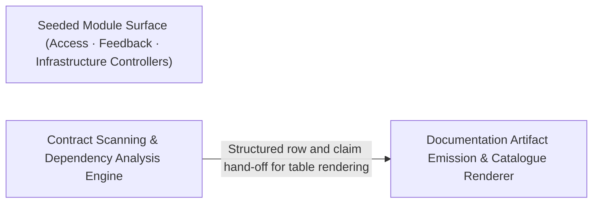

---
tags:
  - 2brain
  - 2brain/arch
  - project/boilerplate-node-backend
type: architecture
component: Contract_Documentation_Artifact_Generators
---

## Details

The scripts/docs toolchain that keeps the contract-first artifacts (OpenAPI/AsyncAPI fragments, module catalogue, dependency map, role matrix, rate-limit budgets, audit-action tables) in lockstep with the seeded modules and the shopModules registry. It scans the scenario/module surface (check-references, module-catalogue, generate-module-graph, generate-dependency-map) and emits the docs tables (generate-audit-actions, generate-role-matrix, generate-rate-limit-budgets). In the seed-flow representation this is the 'contract/registry consistency' band that validates the module set the fixtures seed against the declared contract.

### Documentation Artifact Emission & Catalogue Renderer
The output/emission layer that renders the final documentation artifacts. It consumes the structured rows and claims produced by the scanning engine and writes: the rate-limit budget table (budgetTable), the role-matrix effective table (effectiveTable + roles), the module catalogue (CatalogueEntry, CataloguePage, SidebarItem — the navigable docs sidebar), and the dependency-map rows (PackageManifest, packageFor). Each emitter is a pure function from structured input to Markdown/HTML table or JSON catalogue page. This component is the 'hands' of the subsystem — it owns the final formatting, column layout, and page assembly that developers and reviewers see in the docs site.

**Related Classes/Methods**:

- `scripts.docs.generate-rate-limit-budgets.budgetTable`:45-55
- `scripts.docs.generate-role-matrix.effectiveTable`:131-142
- `scripts.docs.generate-role-matrix.roles`
- `scripts.docs.generate-dependency-map.packageFor`:120-121

**Source Files:**

- `scripts/docs/check-references.ts`
  - `scripts.docs.check-references.run.roots` (L242-L242) - Class
  - `scripts.docs.check-references.run.roots.ALLOWED.map() callback` (L242-L242) - Function
- `scripts/docs/generate-audit-actions.ts`
  - `scripts.docs.generate-audit-actions.collectDeclaredActions.infrastructureActions` (L89-L94) - Class
  - `scripts.docs.generate-audit-actions.collectDeclaredActions.infrastructureActions.map() callback` (L89-L94) - Function
- `scripts/docs/generate-dependency-map.ts`
  - `scripts.docs.generate-dependency-map.PackageManifest` (L70-L73) - Interface
  - `scripts.docs.generate-dependency-map.packageFor` (L120-L121) - Class
  - `scripts.docs.generate-dependency-map.packageFor.packages.find() callback` (L121-L121) - Function
  - `scripts.docs.generate-dependency-map.Row` (L184-L189) - Interface
  - `scripts.docs.generate-dependency-map.moduleOwnedRow.packages.owned.map() callback` (L229-L229) - Function
  - `scripts.docs.generate-dependency-map.moduleOwnedRow.readMore.owned.map() callback` (L233-L233) - Function
  - `scripts.docs.generate-dependency-map.moduleOwnedRow.readMore.map() callback` (L234-L234) - Function
  - `scripts.docs.generate-dependency-map.then() callback` (L320-L322) - Function
- `scripts/docs/generate-module-graph.ts`
  - `scripts.docs.generate-module-graph.renderNeighbourhood.reached` (L201-L201) - Class
  - `scripts.docs.generate-module-graph.renderNeighbourhood.reached.edges.filter() callback` (L201-L201) - Function
  - `scripts.docs.generate-module-graph.renderNeighbourhood.byKind` (L218-L219) - Class
  - `scripts.docs.generate-module-graph.renderNeighbourhood.byKind.map() callback` (L219-L219) - Function
  - `scripts.docs.generate-module-graph.renderNeighbourhood.byKind.neighbours.filter() callback` (L219-L219) - Function
  - `scripts.docs.generate-module-graph.renderNeighbourhood.reached.map() callback` (L233-L233) - Function
  - `scripts.docs.generate-module-graph.render.isolated` (L256-L256) - Class
  - `scripts.docs.generate-module-graph.render.isolated.map() callback` (L256-L256) - Function
  - `scripts.docs.generate-module-graph.render.isolated.names.filter() callback` (L256-L256) - Function
- `scripts/docs/generate-rate-limit-budgets.ts`
  - `scripts.docs.generate-rate-limit-budgets.budgetTable` (L45-L55) - Class
  - `scripts.docs.generate-rate-limit-budgets.budgetTable.rows.map() callback` (L50-L53) - Function
  - `scripts.docs.generate-rate-limit-budgets.then() callback` (L65-L67) - Function
- `scripts/docs/generate-role-matrix.ts`
  - `scripts.docs.generate-role-matrix.roles` (L56-L56) - Class
  - `scripts.docs.generate-role-matrix.roles.PRESET_ROLES.filter() callback` (L56-L56) - Function
  - `scripts.docs.generate-role-matrix.cell` (L109-L128) - Class
  - `scripts.docs.generate-role-matrix.cell.held` (L111-L113) - Class
  - `scripts.docs.generate-role-matrix.cell.held.PERMISSION_KEYS.filter() callback` (L112-L112) - Function
  - `scripts.docs.generate-role-matrix.cell.held.map() callback` (L121-L121) - Function
  - `scripts.docs.generate-role-matrix.cell.map() callback` (L122-L126) - Function
  - `scripts.docs.generate-role-matrix.effectiveTable` (L131-L142) - Class
  - `scripts.docs.generate-role-matrix.effectiveTable.roles.map() callback` (L135-L141) - Function
  - `scripts.docs.generate-role-matrix.effectiveTable.roles.map() callback.modules.map() callback` (L139-L139) - Function
- `scripts/docs/module-catalogue.ts`
  - `scripts.docs.module-catalogue.CataloguePage` (L21-L26) - Interface
  - `scripts.docs.module-catalogue.CatalogueEntry` (L29-L36) - Interface
  - `scripts.docs.module-catalogue.readCatalogue.stems` (L92-L97) - Class
  - `scripts.docs.module-catalogue.readCatalogue.stems.filter() callback` (L94-L94) - Function
  - `scripts.docs.module-catalogue.readCatalogue.stems.map() callback` (L95-L95) - Function
  - `scripts.docs.module-catalogue.SidebarItem` (L144-L148) - Interface
  - `scripts.docs.module-catalogue.SidebarSection` (L151-L155) - Interface
- `scripts/docs/repo-references.ts`
  - `scripts.docs.repo-references.readAliases` (L177-L189) - Class
  - `scripts.docs.repo-references.readAliases.map() callback` (L185-L188) - Function
  - `scripts.docs.repo-references.throughAliases.alias.aliases.find() callback` (L203-L204) - Function
  - `scripts.docs.repo-references.throughAliases.alias` (L203-L205) - Class
- `src/kernel/ability.ts`
  - `src.kernel.ability.heldKeys` (L151-L152) - Class
  - `src.kernel.ability.heldKeys.map() callback` (L152-L152) - Function
- `src/kernel/access/query.ts`
  - `src.kernel.access.query.toStorage` (L58-L82) - Class
  - `src.kernel.access.query.toStorage.query.map() callback` (L60-L60) - Function
  - `src.kernel.access.query.collapse` (L102-L114) - Class
  - `src.kernel.access.query.collapse.branches.some() callback` (L109-L109) - Function
- `src/kernel/authentication.ts`
  - `src.kernel.authentication.resolveBearer` (L131-L135) - Class
  - `src.kernel.authentication.resolveBearer.then() callback` (L135-L135) - Function
  - `src.kernel.authentication.watchCookie` (L138-L139) - Class
  - `src.kernel.authentication.watchCookie.then() callback` (L139-L139) - Function
  - `src.kernel.authentication.resolveCookie` (L142-L146) - Class
  - `src.kernel.authentication.resolveCookie.then() callback` (L146-L146) - Function
  - `src.kernel.authentication.resolveCredential` (L167-L170) - Class
  - `src.kernel.authentication.resolveCredential.then() callback` (L169-L169) - Function
- `src/kernel/middlewares/authorizations.ts`
  - `src.kernel.middlewares.authorizations.continueWithSession` (L198-L220) - Class
  - `src.kernel.middlewares.authorizations.continueWithSession.resolution.then() callback` (L206-L216) - Function
  - `src.kernel.middlewares.authorizations.continueWithSession.catch() callback` (L217-L219) - Function
  - `src.kernel.middlewares.authorizations.continueWithCookie.resolveFromCookie` (L242-L254) - Class
  - `src.kernel.middlewares.authorizations.continueWithCookie.resolveFromCookie.continueWithSession('cookie') callback` (L250-L252) - Function
  - `src.kernel.middlewares.authorizations.getAuth` (L284-L324) - Class
  - `src.kernel.middlewares.authorizations.getAuth.then() callback` (L307-L316) - Function
  - `src.kernel.middlewares.authorizations.getAuth.catch() callback` (L317-L319) - Function
  - `src.kernel.middlewares.authorizations.requirePermission` (L485-L595) - Class
  - `src.kernel.middlewares.authorizations.requirePermission.requirePermissionGuard` (L503-L586) - Function
  - `src.kernel.middlewares.authorizations.requirePermissionViaCookie` (L650-L688) - Class
  - `src.kernel.middlewares.authorizations.requirePermissionViaCookie.requirePermissionViaCookieGuard` (L654-L687) - Function
  - `src.kernel.middlewares.authorizations.requirePermissionViaCookie.requirePermissionViaCookieGuard.then() callback` (L668-L683) - Function
  - `src.kernel.middlewares.authorizations.requirePermissionViaCookie.requirePermissionViaCookieGuard.catch() callback` (L684-L686) - Function
  - `src.kernel.middlewares.authorizations.requireFreshAuth` (L736-L767) - Class
  - `src.kernel.middlewares.authorizations.requireFreshAuth.<function>` (L738-L767) - Function
- `src/kernel/permissions.ts`
  - `src.kernel.permissions.callerInScope` (L543-L552) - Function
  - `src.kernel.permissions.scopeOfSubject` (L561-L562) - Class
  - `src.kernel.permissions.scopeOfSubject.PERMISSION_KEYS.find() callback` (L562-L562) - Function
  - `src.kernel.permissions.holdsEveryDeclaredKey` (L588-L597) - Class
  - `src.kernel.permissions.holdsEveryDeclaredKey.declared.every() callback` (L596-L596) - Function
- `src/modules/access/service.ts`
  - `src.modules.access.service.revokeRole` (L387-L438) - Class
  - `src.modules.access.service.revokeAllOf` (L446-L451) - Class
  - `src.modules.access.service.revokeAllOf.then() callback` (L447-L450) - Function
  - `src.modules.access.service.revokeAllOf.then() callback.memberships.map() callback` (L448-L448) - Function
  - `src.modules.access.service.revokeAllOf.then() callback.then() callback` (L449-L449) - Function
  - `src.modules.access.service.rolesOf` (L476-L485) - Class
  - `src.modules.access.service.rolesOf.then() callback` (L480-L485) - Function
  - `src.modules.access.service.rolesOf.then() callback.tenant.memberships.find() callback` (L482-L482) - Function
  - `src.modules.access.service.rolesOf.then() callback.platform.memberships.find() callback` (L484-L484) - Function
  - `src.modules.access.service.canActOn` (L556-L567) - Class
  - `src.modules.access.service.canActOn.then() callback` (L564-L565) - Function
  - `src.modules.access.service.outrankedRefusal` (L579-L599) - Class
  - `src.modules.access.service.outrankedRefusal.then() callback` (L585-L599) - Function
- `src/modules/account/controllers/delete-2fa-method.ts`
  - `src.modules.account.controllers.delete-2fa-method.delete2faMethod` (L24-L69) - Class
  - `src.modules.account.controllers.delete-2fa-method.delete2faMethod.then() callback` (L42-L66) - Function
  - `src.modules.account.controllers.delete-2fa-method.delete2faMethod.then() callback.then() callback` (L45-L66) - Function
- `src/modules/account/controllers/delete-2fa.ts`
  - `src.modules.account.controllers.delete-2fa.delete2fa` (L23-L64) - Class
  - `src.modules.account.controllers.delete-2fa.delete2fa.then() callback` (L37-L61) - Function
  - `src.modules.account.controllers.delete-2fa.delete2fa.then() callback.then() callback` (L40-L61) - Function
- `src/modules/account/controllers/post-2fa-confirm.ts`
  - `src.modules.account.controllers.post-2fa-confirm.post2faConfirm` (L23-L69) - Class
  - `src.modules.account.controllers.post-2fa-confirm.post2faConfirm.then() callback` (L41-L66) - Function
  - `src.modules.account.controllers.post-2fa-confirm.post2faConfirm.then() callback.then() callback` (L44-L66) - Function
- `src/modules/account/controllers/post-password-change.ts`
  - `src.modules.account.controllers.post-password-change.then() callback` (L47-L56) - Function
  - `src.modules.account.controllers.post-password-change.then() callback.then() callback` (L56-L56) - Function
- `src/modules/account/oauth/providers/client.ts`
  - `src.modules.account.oauth.providers.client.providerFetch` (L25-L44) - Class
  - `src.modules.account.oauth.providers.client.providerFetch.signal.filter() callback` (L31-L31) - Function
  - `src.modules.account.oauth.providers.client.providerFetch.then() callback` (L35-L43) - Function
  - `src.modules.account.oauth.providers.client.providerFetch.then() callback.then() callback` (L37-L42) - Function
- `src/modules/account/oauth/providers/github.ts`
  - `src.modules.account.oauth.providers.github.identityOf.primary` (L80-L80) - Class
  - `src.modules.account.oauth.providers.github.identityOf.primary.emails.find() callback` (L80-L80) - Function
- `src/modules/account/oauth/providers/port.ts`
  - `src.modules.account.oauth.providers.port.OAuthExpectation` (L30-L38) - Interface
- `src/modules/account/services/caller.ts`
  - `src.modules.account.services.caller.recordAccountAudit` (L48-L59) - Class
  - `src.modules.account.services.caller.recordAccountAudit.then() callback` (L53-L59) - Function
- `src/modules/account/services/oauth.ts`
  - `src.modules.account.services.oauth.OAuthAccountUnavailableError` (L65-L71) - Class
  - `src.modules.account.services.oauth.OAuthAccountUnavailableError.constructor` (L67-L70) - Constructor
  - `src.modules.account.services.oauth.signupFromOAuth.then() callback.withTransaction() callback` (L151-L189) - Function
  - `src.modules.account.services.oauth.signupFromOAuth.then() callback.withTransaction() callback.then() callback` (L179-L188) - Function
  - `src.modules.account.services.oauth.signupFromOAuth.then() callback.withTransaction() callback.then() callback.then() callback` (L188-L188) - Function
- `src/modules/account/session/login-observability.ts`
  - `src.modules.account.session.login-observability.recordLoginSuccess` (L54-L76) - Class
  - `src.modules.account.session.login-observability.recordLoginSuccess.then() callback` (L59-L76) - Function
- `src/modules/account/session/resolver.ts`
  - `src.modules.account.session.resolver.accountAuthResolver.clearDeadCookie` (L29-L31) - Method
- `src/modules/api-keys/services/resolver.ts`
  - `src.modules.api-keys.services.resolver.currentCallerOf` (L37-L52) - Class
  - `src.modules.api-keys.services.resolver.currentCallerOf.then() callback` (L38-L52) - Function
  - `src.modules.api-keys.services.resolver.currentCallerOf.then() callback.then() callback` (L41-L51) - Function
  - `src.modules.api-keys.services.resolver.missFor` (L59-L63) - Class
  - `src.modules.api-keys.services.resolver.missFor.then() callback` (L60-L63) - Function
  - `src.modules.api-keys.services.resolver.fromBearerToken` (L71-L132) - Class
  - `src.modules.api-keys.services.resolver.fromBearerToken.then() callback` (L75-L131) - Function
  - `src.modules.api-keys.services.resolver.fromBearerToken.then() callback.then() callback` (L79-L130) - Function
  - `src.modules.api-keys.services.resolver.fromBearerToken.then() callback.then() callback.catch() callback` (L94-L100) - Function
- `src/modules/orders/services/crud.ts`
  - `src.modules.orders.services.crud.lineLimitRefusal` (L37-L57) - Class
  - `src.modules.orders.services.crud.lineLimitRefusal.items.some() callback` (L48-L48) - Function
  - `src.modules.orders.services.crud.resolveItemProducts` (L88-L97) - Class
  - `src.modules.orders.services.crud.resolveItemProducts.items.map() callback` (L94-L95) - Function
  - `src.modules.orders.services.crud.resolveItemProducts.items.map() callback.then() callback` (L95-L95) - Function
  - `src.modules.orders.services.crud.create` (L109-L191) - Class
  - `src.modules.orders.services.crud.create.mailBuyer() callback` (L188-L188) - Function
- `src/modules/orders/services/remove.ts`
  - `src.modules.orders.services.remove.hardDeleteCancelled` (L55-L65) - Class
  - `src.modules.orders.services.remove.hardDeleteCancelled.then() callback` (L56-L65) - Function
  - `src.modules.orders.services.remove.then() callback.then() callback` (L58-L58) - Function
  - `src.modules.orders.services.remove.hardDeleteCancelled.then() callback.then() callback` (L62-L63) - Function
- `src/modules/orders/services/scope.ts`
  - `src.modules.orders.services.scope.startAndOverrideActions.override.filter() callback` (L212-L212) - Function
- `src/modules/orders/services/status.ts`
  - `src.modules.orders.services.status.markFulfilmentComplete.then() callback` (L246-L273) - Function
- `src/modules/orders/services/timeline.ts`
  - `src.modules.orders.services.timeline.readTimeline` (L109-L117) - Class
  - `src.modules.orders.services.timeline.readTimeline.then() callback` (L115-L116) - Function
- `src/modules/users/presenter.ts`
  - `src.modules.users.presenter.presentUserWithCurrentRole` (L102-L109) - Class
  - `src.modules.users.presenter.presentUserWithCurrentRole.then() callback` (L103-L108) - Function
- `src/modules/users/services/remove.ts`
  - `src.modules.users.services.remove.remove` (L85-L127) - Class
  - `src.modules.users.services.remove.remove.withTransaction() callback` (L91-L91) - Function
  - `src.modules.users.services.remove.then() callback` (L92-L92) - Function
  - `src.modules.users.services.remove.remove.then() callback` (L115-L126) - Function
  - `src.modules.users.services.remove.restoreById` (L138-L160) - Class
  - `src.modules.users.services.remove.restoreById.then() callback` (L142-L160) - Function
  - `src.modules.users.services.remove.restoreById.then() callback.then() callback` (L145-L159) - Function
  - `src.modules.users.services.remove.restoreById.then() callback.then() callback.then() callback` (L150-L158) - Function
  - `src.modules.users.services.remove.removeById` (L167-L178) - Class
  - `src.modules.users.services.remove.removeById.then() callback` (L172-L178) - Function
  - `src.modules.users.services.remove.removeById.then() callback.then() callback` (L176-L176) - Function
- `src/modules/users/services/update.ts`
  - `src.modules.users.services.update.finishUpdate` (L175-L197) - Class
  - `src.modules.users.services.update.refusalFor` (L300-L319) - Class
  - `src.modules.users.services.update.refusalFor.then() callback` (L313-L317) - Function
  - `src.modules.users.services.update.applyUpdate` (L354-L380) - Class
  - `src.modules.users.services.update.applyUpdate.then() callback` (L361-L380) - Function
  - `src.modules.users.services.update.updateById` (L390-L409) - Class
  - `src.modules.users.services.update.updateById.then() callback` (L395-L409) - Function
  - `src.modules.users.services.update.updateById.then() callback.then() callback` (L404-L407) - Function
  - `src.modules.users.services.update.updateById.then() callback.then() callback.then() callback` (L406-L406) - Function

### Seeded Module Surface (Access · Feedback · Infrastructure Controllers)
The target surface that the contract generators scan and validate against. It comprises the seeded business modules (access: membership repository + role/level service; feedback: search + status-update service) and the infrastructure surface controllers (createSearchController, createUpdateController) that expose those services over HTTP. In the seed-flow representation this is the 'module set the fixtures seed' — the concrete, runnable code whose routes, roles, rate-limit scopes, and audit actions must be reflected in the generated documentation. The contract generators do not modify this surface; they read it to verify that every declared action, role binding, and dependency edge has a corresponding implementation.

**Related Classes/Methods**:

- `src.modules.access.repository.membershipRepository`:39-94
- `src.modules.access.service.levelsOfMany`:526-541
- `src.modules.access.service.rolesOfMany`:493-505
- `src.modules.feedback.service.search`:138-163
- `src.modules.feedback.service.updateStatus`:175-186
- `src.infrastructure.surfaces.create-search-controller.createSearchController`:73-97

**Source Files:**

- `src/infrastructure/surfaces/create-search-controller.ts`
  - `src.infrastructure.surfaces.create-search-controller.SearchControllerSpec` (L17-L34) - Interface
  - `src.infrastructure.surfaces.create-search-controller.createSearchController` (L73-L97) - Class
  - `src.infrastructure.surfaces.create-search-controller.createSearchController.namedHandler() callback` (L82-L96) - Function
  - `src.infrastructure.surfaces.create-search-controller.createSearchController.namedHandler() callback.then() callback` (L92-L94) - Function
- `src/infrastructure/surfaces/create-update-controller.ts`
  - `src.infrastructure.surfaces.create-update-controller.createUpdateController.run` (L179-L224) - Class
  - `src.infrastructure.surfaces.create-update-controller.createUpdateController.run.<function>` (L186-L224) - Function
  - `src.infrastructure.surfaces.create-update-controller.run.<function>.then() callback` (L208-L211) - Function
  - `src.infrastructure.surfaces.create-update-controller.createUpdateController.run.<function>.then() callback.withIfMatch() callback` (L210-L210) - Function
  - `src.infrastructure.surfaces.create-update-controller.createUpdateController.run.<function>.then() callback` (L213-L221) - Function
  - `src.infrastructure.surfaces.create-update-controller.createUpdateController.run.<function>.then() callback.then() callback` (L218-L220) - Function
- `src/modules/access/repository.ts`
  - `src.modules.access.repository.membershipRepository` (L39-L94) - Class
  - `src.modules.access.repository.membershipRepository.findByUserId` (L41-L42) - Method
  - `src.modules.access.repository.membershipRepository.findOne` (L45-L50) - Method
  - `src.modules.access.repository.membershipRepository.upsertRole` (L57-L72) - Method
  - `src.modules.access.repository.membershipRepository.deleteById` (L75-L76) - Method
  - `src.modules.access.repository.membershipRepository.deleteByUserId` (L83-L85) - Method
  - `src.modules.access.repository.membershipRepository.findByUserIds` (L88-L93) - Method
- `src/modules/access/service.ts`
  - `src.modules.access.service.assignRole.attempt` (L316-L320) - Class
  - `src.modules.access.service.assignRole.attempt.then() callback` (L329-L340) - Function
  - `src.modules.access.service.revokeRole.attempt` (L398-L405) - Class
  - `src.modules.access.service.revokeRole.attempt.then() callback.then() callback` (L404-L404) - Function
  - `src.modules.access.service.revokeRole.attempt.then() callback` (L425-L436) - Function
  - `src.modules.access.service.eraseMemberships` (L464-L465) - Class
  - `src.modules.access.service.eraseMemberships.then() callback` (L465-L465) - Function
  - `src.modules.access.service.rolesOfMany` (L493-L505) - Class
  - `src.modules.access.service.rolesOfMany.then() callback` (L503-L504) - Function
  - `src.modules.access.service.rolesOfMany.then() callback.memberships.map() callback` (L504-L504) - Function
  - `src.modules.access.service.levelsOfMany` (L526-L541) - Class
  - `src.modules.access.service.levelsOfMany.then() callback` (L531-L540) - Function
  - `src.modules.access.service.levelsOfMany.then() callback.userIds.map() callback` (L533-L539) - Function
- `src/modules/example/controllers/get-examples.ts`
  - `src.modules.example.controllers.get-examples.getExamples` (L26-L30) - Class
  - `src.modules.example.controllers.get-examples.getExamples.runSearch` (L29-L29) - Method
- `src/modules/example/services/crud.ts`
  - `src.modules.example.services.crud.publishAndAnnounce` (L190-L220) - Class
  - `src.modules.example.services.crud.publishAndAnnounce.announceInTransaction() callback` (L208-L216) - Function
  - `src.modules.example.services.crud.publishAndAnnounce.then() callback` (L217-L220) - Function
  - `src.modules.example.services.crud.applyUpdate.finish` (L247-L258) - Class
  - `src.modules.example.services.crud.applyUpdate.finish.then() callback` (L255-L256) - Function
- `src/modules/feedback/controllers/get-feedback.ts`
  - `src.modules.feedback.controllers.get-feedback.getFeedback` (L29-L34) - Class
  - `src.modules.feedback.controllers.get-feedback.getFeedback.runSearch` (L32-L33) - Method
- `src/modules/feedback/controllers/post-feedback-contact.ts`
  - `src.modules.feedback.controllers.post-feedback-contact.postFeedbackContact` (L34-L56) - Class
  - `src.modules.feedback.controllers.post-feedback-contact.postFeedbackContact.then() callback` (L47-L54) - Function
- `src/modules/feedback/service.ts`
  - `src.modules.feedback.service.search` (L138-L163) - Class
  - `src.modules.feedback.service.search.then() callback` (L157-L163) - Function
  - `src.modules.feedback.service.updateStatus` (L175-L186) - Class
  - `src.modules.feedback.service.updateStatus.then() callback` (L185-L185) - Function
  - `src.modules.feedback.service.updateStatusById` (L194-L211) - Class
  - `src.modules.feedback.service.updateStatusById.then() callback` (L199-L211) - Function
  - `src.modules.feedback.service.updateStatusById.then() callback.then() callback` (L201-L210) - Function
- `src/modules/locales/services/translations.ts`
  - `src.modules.locales.services.translations.applyTranslationBatch` (L303-L347) - Class
  - `src.modules.locales.services.translations.applyTranslationBatch.withTransaction() callback` (L321-L331) - Function
- `src/modules/orders/controllers/get-orders.ts`
  - `src.modules.orders.controllers.get-orders.getOrders` (L53-L63) - Class
  - `src.modules.orders.controllers.get-orders.getOrders.runSearch` (L57-L62) - Method
- `src/modules/products/controllers/get-catalogue-facets.ts`
  - `src.modules.products.controllers.get-catalogue-facets.getCatalogueFacets` (L19-L25) - Class
  - `src.modules.products.controllers.get-catalogue-facets.getCatalogueFacets.then() callback` (L22-L24) - Function
- `src/modules/products/controllers/get-products.ts`
  - `src.modules.products.controllers.get-products.getProducts` (L95-L105) - Class
  - `src.modules.products.controllers.get-products.getProducts.runSearch` (L99-L104) - Method
- `src/modules/products/services/remove.ts`
  - `src.modules.products.services.remove.remove` (L62-L105) - Class
  - `src.modules.products.services.remove.remove.then() callback` (L101-L104) - Function
  - `src.modules.products.services.remove.removeById` (L114-L125) - Class
  - `src.modules.products.services.remove.removeById.then() callback` (L121-L124) - Function
- `src/modules/returns/services/cancel-remainder.ts`
  - `src.modules.returns.services.cancel-remainder.refuseCaller` (L243-L271) - Class
  - `src.modules.returns.services.cancel-remainder.refuseCaller.excluded` (L254-L258) - Class
  - `src.modules.returns.services.cancel-remainder.refuseCaller.excluded.order.items.filter() callback` (L256-L256) - Function
  - `src.modules.returns.services.cancel-remainder.refuseCaller.excluded.map() callback` (L257-L257) - Function
  - `src.modules.returns.services.cancel-remainder.refuseCaller.remainder.some() callback` (L260-L260) - Function
  - `src.modules.returns.services.cancel-remainder.refuseCaller.then() callback` (L270-L270) - Function
  - `src.modules.returns.services.cancel-remainder.createCancellation` (L281-L325) - Class
  - `src.modules.returns.services.cancel-remainder.createCancellation.then() callback` (L289-L324) - Function
  - `src.modules.returns.services.cancel-remainder.createCancellation.then() callback.then() callback` (L293-L322) - Function
  - `src.modules.returns.services.cancel-remainder.createCancellation.then() callback.then() callback.then() callback` (L299-L320) - Function
  - `src.modules.returns.services.cancel-remainder.createCancellation.then() callback.then() callback.then() callback.then() callback` (L309-L314) - Function
  - `src.modules.returns.services.cancel-remainder.createCancellation.then() callback.then() callback.then() callback.catch() callback` (L316-L319) - Function
- `src/modules/returns/services/create.ts`
  - `src.modules.returns.services.create.openReturn` (L317-L359) - Class
  - `src.modules.returns.services.create.openReturn.then() callback` (L322-L359) - Function
  - `src.modules.returns.services.create.openReturn.then() callback.excluded` (L331-L335) - Class
  - `src.modules.returns.services.create.openReturn.then() callback.excluded.order.items.filter() callback` (L333-L333) - Function
  - `src.modules.returns.services.create.openReturn.then() callback.excluded.map() callback` (L334-L334) - Function
  - `src.modules.returns.services.create.openReturn.then() callback.then() callback` (L343-L358) - Function
  - `src.modules.returns.services.create.openReturn.then() callback.then() callback.input.lines.some() callback` (L346-L346) - Function
  - `src.modules.returns.services.create.openReturn.then() callback.then() callback.then() callback` (L353-L357) - Function
- `src/modules/returns/services/options.ts`
  - `src.modules.returns.services.options.getReturnOptions.then() callback.then() callback.excluded` (L82-L86) - Class
  - `src.modules.returns.services.options.getReturnOptions.then() callback.then() callback.excluded.order.items.filter() callback` (L84-L84) - Function
  - `src.modules.returns.services.options.getReturnOptions.then() callback.then() callback.excluded.map() callback` (L85-L85) - Function
- `src/modules/users/controllers/get-users.ts`
  - `src.modules.users.controllers.get-users.getUsers` (L37-L48) - Class
  - `src.modules.users.controllers.get-users.getUsers.runSearch` (L40-L47) - Method
  - `src.modules.users.controllers.get-users.getUsers.runSearch.then() callback` (L43-L46) - Function
  - `src.modules.users.controllers.get-users.getUsers.runSearch.then() callback.then() callback` (L46-L46) - Function
- `src/modules/users/presenter.ts`
  - `src.modules.users.presenter.presentUsersWithCurrentRoles` (L120-L136) - Class
  - `src.modules.users.presenter.presentUsersWithCurrentRoles.then() callback` (L127-L134) - Function
  - `src.modules.users.presenter.presentUsersWithCurrentRoles.then() callback.rows.map() callback` (L128-L133) - Function
- `src/modules/users/services/create.ts`
  - `src.modules.users.services.create.then() callback.announceInTransaction() callback` (L72-L95) - Function
  - `src.modules.users.services.create.create.then() callback.announceInTransaction() callback.then() callback` (L85-L94) - Function
  - `src.modules.users.services.create.create.then() callback.announceInTransaction() callback.then() callback.then() callback` (L94-L94) - Function
  - `src.modules.users.services.create.create.then() callback.announceInTransaction() callback` (L96-L100) - Function
- `src/modules/users/services/credentials.ts`
  - `src.modules.users.services.credentials.persistTwoFactorWrite` (L159-L177) - Class
  - `src.modules.users.services.credentials.persistTwoFactorWrite.then() callback` (L171-L176) - Function
  - `src.modules.users.services.credentials.persistTwoFactorMethods` (L196-L199) - Class
  - `src.modules.users.services.credentials.persistTwoFactorMethods.then() callback` (L199-L199) - Function
  - `src.modules.users.services.credentials.spendDeliveredCode` (L244-L254) - Class
  - `src.modules.users.services.credentials.spendDeliveredCode.then() callback` (L251-L254) - Function
- `src/modules/users/services/reaper.ts`
  - `src.modules.users.services.reaper.customersOnly` (L19-L22) - Class
  - `src.modules.users.services.reaper.customersOnly.accounts.map() callback` (L20-L20) - Function
  - `src.modules.users.services.reaper.customersOnly.then() callback` (L20-L21) - Function
  - `src.modules.users.services.reaper.customersOnly.then() callback.accounts.filter() callback` (L21-L21) - Function

### Contract Scanning & Dependency Analysis Engine
The input/analysis layer of the toolchain. It walks the module descriptor surface, extracts DeclaredAction entries via recursive walk, classifies imports into DependencyGroup buckets via matchesGroup, and produces Claim/Finding/Scan records for reference integrity. It also resolves importSpecifiers and builds groupRows that feed the dependency-map emitter. This component is the 'eyes' of the subsystem — it reads the codebase and the module registry, normalises the raw surface into structured rows and claims, and hands them to the emission layer. It owns the module-descriptor.ts parsing and the check-references validation logic that flags stale or missing contract entries.

**Related Classes/Methods**:

- `scripts.docs.dependency-groups.matchesGroup`:218-223
- `scripts.docs.generate-audit-actions.DeclaredAction`:43-52
- `scripts.docs.generate-audit-actions.walk`:60-65
- `scripts.docs.generate-dependency-map.importSpecifiers`:108-117
- `scripts.docs.generate-dependency-map.groupRows`:192-203

**Source Files:**

- `scripts/docs/check-references.ts`
  - `scripts.docs.check-references.Finding` (L70-L73) - Interface
  - `scripts.docs.check-references.Scan` (L133-L136) - Interface
  - `scripts.docs.check-references.Claim` (L170-L173) - Interface
  - `scripts.docs.check-references.run.pages` (L249-L255) - Class
  - `scripts.docs.check-references.run.pages.filter() callback` (L255-L255) - Function
- `scripts/docs/dependency-groups.ts`
  - `scripts.docs.dependency-groups.DependencyGroup` (L18-L23) - Interface
  - `scripts.docs.dependency-groups.matchesGroup` (L218-L223) - Class
  - `scripts.docs.dependency-groups.matchesGroup.patterns.some() callback` (L219-L222) - Function
- `scripts/docs/generate-audit-actions.ts`
  - `scripts.docs.generate-audit-actions.DeclaredAction` (L43-L52) - Interface
  - `scripts.docs.generate-audit-actions.AuditActionRow` (L55-L57) - Interface
  - `scripts.docs.generate-audit-actions.walk` (L60-L65) - Class
  - `scripts.docs.generate-audit-actions.walk.flatMap() callback` (L61-L65) - Function
  - `scripts.docs.generate-audit-actions.readModuleActions.entry` (L78-L83) - Class
  - `scripts.docs.generate-audit-actions.readModuleActions.entry.find() callback` (L79-L82) - Function
  - `scripts.docs.generate-audit-actions.readModuleActions.entry.find() callback.every() callback` (L82-L82) - Function
  - `scripts.docs.generate-audit-actions.collectDeclaredActions.moduleActions` (L96-L107) - Class
  - `scripts.docs.generate-audit-actions.collectDeclaredActions.moduleActions.map() callback` (L97-L106) - Function
  - `scripts.docs.generate-audit-actions.collectDeclaredActions.moduleActions.map() callback.map() callback` (L100-L105) - Function
  - `scripts.docs.generate-audit-actions.targetTypeCell` (L150-L157) - Class
  - `scripts.docs.generate-audit-actions.targetTypeCell.map() callback` (L155-L155) - Function
  - `scripts.docs.generate-audit-actions.actionTable` (L160-L170) - Class
  - `scripts.docs.generate-audit-actions.actionTable.rows.toSorted() callback` (L165-L165) - Function
  - `scripts.docs.generate-audit-actions.actionTable.map() callback` (L167-L168) - Function
  - `scripts.docs.generate-audit-actions.main.sources` (L175-L175) - Class
  - `scripts.docs.generate-audit-actions.main.sources.map() callback` (L175-L175) - Function
  - `scripts.docs.generate-audit-actions.main.rows` (L176-L179) - Class
  - `scripts.docs.generate-audit-actions.main.rows.declared.map() callback` (L176-L179) - Function
- `scripts/docs/generate-dependency-map.ts`
  - `scripts.docs.generate-dependency-map.walk` (L79-L86) - Class
  - `scripts.docs.generate-dependency-map.walk.flatMap() callback` (L80-L86) - Function
  - `scripts.docs.generate-dependency-map.importSpecifiers` (L108-L117) - Class
  - `scripts.docs.generate-dependency-map.importSpecifiers.map() callback` (L110-L110) - Function
  - `scripts.docs.generate-dependency-map.importSpecifiers.filter() callback` (L112-L116) - Function
  - `scripts.docs.generate-dependency-map.importSpecifiers.filter() callback.ALIAS_PREFIXES.every() callback` (L115-L115) - Function
  - `scripts.docs.generate-dependency-map.readOwnership.files` (L149-L152) - Class
  - `scripts.docs.generate-dependency-map.readOwnership.files.SCAN_DIRECTORIES.flatMap() callback` (L150-L150) - Function
  - `scripts.docs.generate-dependency-map.readOwnership.files.SCAN_FILES.map() callback` (L151-L151) - Function
  - `scripts.docs.generate-dependency-map.groupRows` (L192-L203) - Class
  - `scripts.docs.generate-dependency-map.groupRows.groups.map() callback` (L194-L202) - Function
  - `scripts.docs.generate-dependency-map.groupRows.groups.map() callback.packages.packages.filter() callback` (L197-L197) - Function
  - `scripts.docs.generate-dependency-map.groupRows.groups.map() callback.packages.map() callback` (L198-L198) - Function
  - `scripts.docs.generate-dependency-map.groupRows.filter() callback` (L203-L203) - Function
  - `scripts.docs.generate-dependency-map.moduleOwnedRow.owned` (L211-L222) - Class
  - `scripts.docs.generate-dependency-map.moduleOwnedRow.owned.packages.filter() callback` (L212-L212) - Function
  - `scripts.docs.generate-dependency-map.moduleOwnedRow.owned.packages.filter() callback.groups.every() callback` (L212-L212) - Function
  - `scripts.docs.generate-dependency-map.moduleOwnedRow.owned.map() callback` (L213-L216) - Function
  - `scripts.docs.generate-dependency-map.moduleOwnedRow.owned.filter() callback` (L218-L218) - Function
  - `scripts.docs.generate-dependency-map.moduleOwnedRow.owned.toSorted() callback` (L221-L221) - Function
  - `scripts.docs.generate-dependency-map.ungroupedTable` (L240-L268) - Class
  - `scripts.docs.generate-dependency-map.ungroupedTable.leftover` (L245-L249) - Class
  - `scripts.docs.generate-dependency-map.ungroupedTable.leftover.packages.filter() callback` (L246-L248) - Function
  - `scripts.docs.generate-dependency-map.ungroupedTable.leftover.packages.filter() callback.groups.every() callback` (L247-L247) - Function
  - `scripts.docs.generate-dependency-map.ungroupedTable.map() callback` (L264-L265) - Function
  - `scripts.docs.generate-dependency-map.renderTable` (L271-L289) - Class
  - `scripts.docs.generate-dependency-map.renderTable.map() callback` (L283-L283) - Function
  - `scripts.docs.generate-dependency-map.renderTable.filter() callback` (L287-L287) - Function
- `scripts/docs/generate-module-graph.ts`
  - `scripts.docs.generate-module-graph.EventEdge` (L54-L58) - Interface
  - `scripts.docs.generate-module-graph.Target` (L61-L66) - Interface
  - `scripts.docs.generate-module-graph.SUBDOMAIN` (L76-L78) - Class
  - `scripts.docs.generate-module-graph.SUBDOMAIN.map() callback` (L77-L77) - Function
  - `scripts.docs.generate-module-graph.readEdges` (L81-L114) - Class
  - `scripts.docs.generate-module-graph.readEdges.labels` (L101-L103) - Class
  - `scripts.docs.generate-module-graph.readEdges.labels.map() callback` (L102-L102) - Function
  - `scripts.docs.generate-module-graph.readEdges.edges.toSorted() callback` (L113-L113) - Function
  - `scripts.docs.generate-module-graph.moduleSourceFiles.rest` (L137-L144) - Class
  - `scripts.docs.generate-module-graph.rest.filter() callback` (L142-L142) - Function
  - `scripts.docs.generate-module-graph.moduleSourceFiles.rest.map() callback` (L143-L143) - Function
  - `scripts.docs.generate-module-graph.moduleSourceFiles.rest.filter() callback` (L144-L144) - Function
  - `scripts.docs.generate-module-graph.readEventEdges` (L179-L192) - Class
  - `scripts.docs.generate-module-graph.readEventEdges.edges.toSorted() callback` (L187-L190) - Function
  - `scripts.docs.generate-module-graph.renderNeighbourhood` (L195-L248) - Class
  - `scripts.docs.generate-module-graph.renderNeighbourhood.reaches` (L200-L200) - Class
  - `scripts.docs.generate-module-graph.renderNeighbourhood.reaches.edges.filter() callback` (L200-L200) - Function
  - `scripts.docs.generate-module-graph.renderNeighbourhood.announces` (L202-L202) - Class
  - `scripts.docs.generate-module-graph.renderNeighbourhood.announces.events.filter() callback` (L202-L202) - Function
  - `scripts.docs.generate-module-graph.renderNeighbourhood.listens` (L203-L203) - Class
  - `scripts.docs.generate-module-graph.renderNeighbourhood.listens.events.filter() callback` (L203-L203) - Function
  - `scripts.docs.generate-module-graph.renderNeighbourhood.neighbours` (L205-L212) - Class
  - `scripts.docs.generate-module-graph.renderNeighbourhood.neighbours.announces.map() callback` (L209-L209) - Function
  - `scripts.docs.generate-module-graph.renderNeighbourhood.neighbours.listens.map() callback` (L210-L210) - Function
  - `scripts.docs.generate-module-graph.renderNeighbourhood.neighbours.map() callback` (L231-L231) - Function
  - `scripts.docs.generate-module-graph.renderNeighbourhood.reaches.map() callback` (L234-L234) - Function
  - `scripts.docs.generate-module-graph.renderNeighbourhood.listens.map() callback` (L235-L235) - Function
  - `scripts.docs.generate-module-graph.renderNeighbourhood.announces.map() callback` (L236-L236) - Function
  - `scripts.docs.generate-module-graph.render` (L250-L294) - Class
  - `scripts.docs.generate-module-graph.render.declare` (L253-L253) - Class
  - `scripts.docs.generate-module-graph.render.declare.names.map() callback` (L253-L253) - Function
  - `scripts.docs.generate-module-graph.render.byKind` (L254-L255) - Class
  - `scripts.docs.generate-module-graph.render.byKind.map() callback` (L255-L255) - Function
  - `scripts.docs.generate-module-graph.render.byKind.names.filter() callback` (L255-L255) - Function
  - `scripts.docs.generate-module-graph.render.edges.map() callback` (L264-L264) - Function
  - `scripts.docs.generate-module-graph.render.names.map() callback` (L283-L287) - Function
  - `scripts.docs.generate-module-graph.names.map() callback.reaches` (L284-L284) - Class
  - `scripts.docs.generate-module-graph.render.names.map() callback.reaches.edges.filter() callback` (L284-L284) - Function
  - `scripts.docs.generate-module-graph.render.names.map() callback.reaches.map() callback` (L284-L284) - Function
  - `scripts.docs.generate-module-graph.names.map() callback.reached` (L285-L285) - Class
  - `scripts.docs.generate-module-graph.render.names.map() callback.reached.edges.filter() callback` (L285-L285) - Function
  - `scripts.docs.generate-module-graph.render.names.map() callback.reached.map() callback` (L285-L285) - Function
  - `scripts.docs.generate-module-graph.render.toSorted() callback` (L288-L288) - Function
  - `scripts.docs.generate-module-graph.render.map() callback` (L290-L291) - Function
  - `scripts.docs.generate-module-graph.targets` (L316-L338) - Class
  - `scripts.docs.generate-module-graph.targets.filter() callback` (L330-L330) - Function
  - `scripts.docs.generate-module-graph.targets.map() callback` (L331-L336) - Function
  - `scripts.docs.generate-module-graph.then() callback` (L349-L351) - Function
- `scripts/docs/generate-role-matrix.ts`
  - `scripts.docs.generate-role-matrix.modules` (L59-L59) - Class
  - `scripts.docs.generate-role-matrix.modules.PERMISSION_KEYS.map() callback` (L59-L59) - Function
  - `scripts.docs.generate-role-matrix.cell.wide` (L117-L119) - Class
  - `scripts.docs.generate-role-matrix.cell.wide.held.filter() callback` (L118-L118) - Function
  - `scripts.docs.generate-role-matrix.cell.wide.map() callback` (L118-L118) - Function
- `scripts/docs/module-catalogue.ts`
  - `scripts.docs.module-catalogue.readCatalogue` (L89-L108) - Class
  - `scripts.docs.module-catalogue.readCatalogue.map() callback` (L99-L107) - Function
  - `scripts.docs.module-catalogue.readCatalogue.map() callback.pages.stems.filter() callback` (L105-L105) - Function
  - `scripts.docs.module-catalogue.readCatalogue.map() callback.pages.map() callback` (L106-L106) - Function
  - `scripts.docs.module-catalogue.inGroup` (L111-L117) - Class
  - `scripts.docs.module-catalogue.inGroup.entries.filter() callback` (L116-L116) - Function
  - `scripts.docs.module-catalogue.inGroup.toSorted() callback` (L117-L117) - Function
  - `scripts.docs.module-catalogue.bullet.deeper` (L121-L124) - Class
  - `scripts.docs.module-catalogue.bullet.deeper.entry.pages.map() callback` (L123-L123) - Function
  - `scripts.docs.module-catalogue.renderModuleList` (L134-L141) - Class
  - `scripts.docs.module-catalogue.renderModuleList.GROUPS.flatMap() callback` (L135-L139) - Function
  - `scripts.docs.module-catalogue.renderModuleList.GROUPS.flatMap() callback.members.map() callback` (L138-L138) - Function
  - `scripts.docs.module-catalogue.moduleSidebar` (L162-L189) - Class
  - `scripts.docs.module-catalogue.moduleSidebar.GROUPS.flatMap() callback` (L164-L188) - Function
  - `scripts.docs.module-catalogue.moduleSidebar.GROUPS.flatMap() callback.items.members.map() callback` (L171-L185) - Function
- `scripts/docs/module-descriptor.ts`
  - `scripts.docs.module-descriptor.readAllModuleDescriptors` (L73-L79) - Class
  - `scripts.docs.module-descriptor.readAllModuleDescriptors.map() callback` (L75-L78) - Function
- `scripts/docs/repo-references.ts`
  - `scripts.docs.repo-references.allowed` (L75-L76) - Class
  - `scripts.docs.repo-references.allowed.ALLOWED.some() callback` (L76-L76) - Function
  - `scripts.docs.repo-references.trackedTargets.files` (L101-L109) - Class
  - `scripts.docs.repo-references.trackedTargets.files.filter() callback` (L109-L109) - Function
  - `scripts.docs.repo-references.trackedTargets.roots.files.map() callback` (L113-L113) - Function
  - `scripts.docs.repo-references.resolves` (L153-L154) - Class
  - `scripts.docs.repo-references.resolves.SPELLINGS.some() callback` (L154-L154) - Function
- `scripts/eslint/comment-links.ts`
  - `scripts.eslint.comment-links.commentLinks` (L86-L119) - Class
  - `scripts.eslint.comment-links.commentLinks.create` (L101-L118) - Method
  - `scripts.eslint.comment-links.commentLinks.create.Program` (L103-L116) - Method
