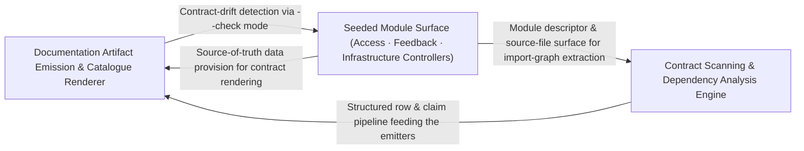

---
tags:
  - 2brain
  - 2brain/arch
  - project/boilerplate-node-backend
type: architecture
component: Contract_Documentation_Artifact_Generators
---

## Details

The scripts/docs toolchain that keeps the contract-first artifacts (OpenAPI/AsyncAPI fragments, module catalogue, dependency map, role matrix, rate-limit budgets, audit-action tables) in lockstep with the seeded modules and the shopModules registry. It scans the scenario/module surface (check-references, module-catalogue, generate-module-graph, generate-dependency-map) and emits the docs tables (generate-audit-actions, generate-role-matrix, generate-rate-limit-budgets). In the seed-flow representation this is the 'contract/registry consistency' band that validates the module set the fixtures seed against the declared contract.

### Documentation Artifact Emission & Catalogue Renderer
The output/emission layer that renders the final documentation artifacts. It consumes the structured rows and claims produced by the scanning engine and writes: the rate-limit budget table (budgetTable), the role-matrix effective table (effectiveTable + roles), the module catalogue (CatalogueEntry, CataloguePage, SidebarItem — the navigable docs sidebar), and the dependency-map rows (PackageManifest, packageFor). Each emitter is a pure function from structured input to Markdown/HTML table or JSON catalogue page. This component is the 'hands' of the subsystem — it owns the final formatting, column layout, and page assembly that developers and reviewers see in the docs site.

**Related Classes/Methods**:

- `scripts.docs.generate-rate-limit-budgets.budgetTable`:47-57
- `scripts.docs.generate-role-matrix.effectiveTable`:133-144
- `scripts.docs.generate-role-matrix.roles`
- `scripts.docs.generate-dependency-map.packageFor`:120-121

**Source Files:**

- `scripts/docs/check-references.ts`
  - `scripts.docs.check-references.run.roots` (L242-L242) - Class
  - `scripts.docs.check-references.run.roots.ALLOWED.map() callback` (L242-L242) - Function
- `scripts/docs/generate-audit-actions.ts`
  - `scripts.docs.generate-audit-actions.collectDeclaredActions.infrastructureActions` (L91-L96) - Class
  - `scripts.docs.generate-audit-actions.collectDeclaredActions.infrastructureActions.map() callback` (L91-L96) - Function
- `scripts/docs/generate-dependency-map.ts`
  - `scripts.docs.generate-dependency-map.PackageManifest` (L71-L74) - Interface
  - `scripts.docs.generate-dependency-map.packageFor` (L120-L121) - Class
  - `scripts.docs.generate-dependency-map.packageFor.packages.find() callback` (L121-L121) - Function
  - `scripts.docs.generate-dependency-map.Row` (L184-L189) - Interface
  - `scripts.docs.generate-dependency-map.moduleOwnedRow.packages.owned.map() callback` (L229-L229) - Function
  - `scripts.docs.generate-dependency-map.moduleOwnedRow.readMore.owned.map() callback` (L233-L233) - Function
  - `scripts.docs.generate-dependency-map.moduleOwnedRow.readMore.map() callback` (L234-L234) - Function
  - `scripts.docs.generate-dependency-map.then() callback` (L320-L322) - Function
- `scripts/docs/generate-module-graph.ts`
  - `scripts.docs.generate-module-graph.renderNeighbourhood.reached` (L208-L208) - Class
  - `scripts.docs.generate-module-graph.renderNeighbourhood.reached.edges.filter() callback` (L208-L208) - Function
  - `scripts.docs.generate-module-graph.renderNeighbourhood.byKind` (L225-L226) - Class
  - `scripts.docs.generate-module-graph.renderNeighbourhood.byKind.map() callback` (L226-L226) - Function
  - `scripts.docs.generate-module-graph.renderNeighbourhood.byKind.neighbours.filter() callback` (L226-L226) - Function
  - `scripts.docs.generate-module-graph.renderNeighbourhood.reached.map() callback` (L240-L240) - Function
  - `scripts.docs.generate-module-graph.render.isolated` (L263-L263) - Class
  - `scripts.docs.generate-module-graph.render.isolated.map() callback` (L263-L263) - Function
  - `scripts.docs.generate-module-graph.render.isolated.names.filter() callback` (L263-L263) - Function
- `scripts/docs/generate-rate-limit-budgets.ts`
  - `scripts.docs.generate-rate-limit-budgets.budgetTable` (L47-L57) - Class
  - `scripts.docs.generate-rate-limit-budgets.budgetTable.rows.map() callback` (L52-L55) - Function
  - `scripts.docs.generate-rate-limit-budgets.then() callback` (L67-L69) - Function
- `scripts/docs/generate-role-matrix.ts`
  - `scripts.docs.generate-role-matrix.roles` (L58-L58) - Class
  - `scripts.docs.generate-role-matrix.roles.PRESET_ROLES.filter() callback` (L58-L58) - Function
  - `scripts.docs.generate-role-matrix.cell` (L111-L130) - Class
  - `scripts.docs.generate-role-matrix.cell.held` (L113-L115) - Class
  - `scripts.docs.generate-role-matrix.cell.held.PERMISSION_KEYS.filter() callback` (L114-L114) - Function
  - `scripts.docs.generate-role-matrix.cell.held.map() callback` (L123-L123) - Function
  - `scripts.docs.generate-role-matrix.cell.map() callback` (L124-L128) - Function
  - `scripts.docs.generate-role-matrix.effectiveTable` (L133-L144) - Class
  - `scripts.docs.generate-role-matrix.effectiveTable.roles.map() callback` (L137-L143) - Function
  - `scripts.docs.generate-role-matrix.effectiveTable.roles.map() callback.modules.map() callback` (L141-L141) - Function
- `scripts/docs/module-catalogue.ts`
  - `scripts.docs.module-catalogue.CataloguePage` (L21-L26) - Interface
  - `scripts.docs.module-catalogue.CatalogueEntry` (L29-L36) - Interface
  - `scripts.docs.module-catalogue.readCatalogue.stems` (L92-L97) - Class
  - `scripts.docs.module-catalogue.readCatalogue.stems.filter() callback` (L94-L94) - Function
  - `scripts.docs.module-catalogue.readCatalogue.stems.map() callback` (L95-L95) - Function
  - `scripts.docs.module-catalogue.SidebarItem` (L144-L148) - Interface
  - `scripts.docs.module-catalogue.SidebarSection` (L151-L155) - Interface
- `scripts/docs/repo-references.ts`
  - `scripts.docs.repo-references.readAliases` (L175-L187) - Class
  - `scripts.docs.repo-references.readAliases.map() callback` (L183-L186) - Function
  - `scripts.docs.repo-references.throughAliases.alias.aliases.find() callback` (L201-L202) - Function
  - `scripts.docs.repo-references.throughAliases.alias` (L201-L203) - Class
- `src/kernel/ability.ts`
  - `src.kernel.ability.heldKeys` (L150-L151) - Class
  - `src.kernel.ability.heldKeys.map() callback` (L151-L151) - Function
- `src/kernel/access/query.ts`
  - `src.kernel.access.query.toStorage` (L58-L82) - Class
  - `src.kernel.access.query.toStorage.query.map() callback` (L60-L60) - Function
  - `src.kernel.access.query.collapse` (L102-L114) - Class
  - `src.kernel.access.query.collapse.branches.some() callback` (L109-L109) - Function
- `src/kernel/authentication.ts`
  - `src.kernel.authentication.resolveAccessToken` (L95-L96) - Class
  - `src.kernel.authentication.resolveAccessToken.then() callback` (L96-L96) - Function
  - `src.kernel.authentication.resolveRefreshToken` (L99-L100) - Class
  - `src.kernel.authentication.resolveRefreshToken.then() callback` (L100-L100) - Function
  - `src.kernel.authentication.resolveCredential` (L110-L113) - Class
  - `src.kernel.authentication.resolveCredential.then() callback` (L112-L112) - Function
- `src/kernel/middlewares/authorizations.ts`
  - `src.kernel.middlewares.authorizations.getAuth` (L163-L227) - Class
  - `src.kernel.middlewares.authorizations.getAuth.then() callback` (L203-L223) - Function
  - `src.kernel.middlewares.authorizations.getAuth.catch() callback` (L224-L226) - Function
  - `src.kernel.middlewares.authorizations.requirePermission` (L381-L488) - Class
  - `src.kernel.middlewares.authorizations.requirePermission.requirePermissionGuard` (L399-L482) - Function
  - `src.kernel.middlewares.authorizations.resolveKeyHolderViaCookie` (L506-L524) - Class
  - `src.kernel.middlewares.authorizations.resolveKeyHolderViaCookie.then() callback` (L507-L524) - Function
  - `src.kernel.middlewares.authorizations.requirePermissionViaCookie` (L537-L571) - Class
  - `src.kernel.middlewares.authorizations.requirePermissionViaCookie.requirePermissionViaCookieGuard` (L541-L570) - Function
  - `src.kernel.middlewares.authorizations.requirePermissionViaCookie.requirePermissionViaCookieGuard.then() callback` (L555-L566) - Function
  - `src.kernel.middlewares.authorizations.requirePermissionViaCookie.requirePermissionViaCookieGuard.catch() callback` (L567-L569) - Function
  - `src.kernel.middlewares.authorizations.requireFreshAuth` (L634-L663) - Class
  - `src.kernel.middlewares.authorizations.requireFreshAuth.<function>` (L636-L663) - Function
- `src/kernel/permissions.ts`
  - `src.kernel.permissions.callerInScope` (L543-L552) - Function
  - `src.kernel.permissions.scopeOfSubject` (L561-L562) - Class
  - `src.kernel.permissions.scopeOfSubject.PERMISSION_KEYS.find() callback` (L562-L562) - Function
  - `src.kernel.permissions.holdsEveryDeclaredKey` (L588-L597) - Class
  - `src.kernel.permissions.holdsEveryDeclaredKey.declared.every() callback` (L596-L596) - Function
- `src/modules/access/service.ts`
  - `src.modules.access.service.revokeRole` (L322-L373) - Class
  - `src.modules.access.service.revokeAllOf` (L381-L386) - Class
  - `src.modules.access.service.revokeAllOf.then() callback` (L382-L385) - Function
  - `src.modules.access.service.revokeAllOf.then() callback.memberships.map() callback` (L383-L383) - Function
  - `src.modules.access.service.revokeAllOf.then() callback.then() callback` (L384-L384) - Function
  - `src.modules.access.service.rolesOf` (L397-L406) - Class
  - `src.modules.access.service.rolesOf.then() callback` (L401-L406) - Function
  - `src.modules.access.service.rolesOf.then() callback.tenant.memberships.find() callback` (L403-L403) - Function
  - `src.modules.access.service.rolesOf.then() callback.platform.memberships.find() callback` (L405-L405) - Function
  - `src.modules.access.service.canActOn` (L477-L488) - Class
  - `src.modules.access.service.canActOn.then() callback` (L485-L486) - Function
  - `src.modules.access.service.outrankedRefusal` (L500-L520) - Class
  - `src.modules.access.service.outrankedRefusal.then() callback` (L506-L520) - Function
- `src/modules/account/controllers/delete-2fa-method.ts`
  - `src.modules.account.controllers.delete-2fa-method.delete2faMethod` (L23-L58) - Class
  - `src.modules.account.controllers.delete-2fa-method.delete2faMethod.then() callback` (L41-L56) - Function
  - `src.modules.account.controllers.delete-2fa-method.delete2faMethod.then() callback.then() callback` (L48-L55) - Function
- `src/modules/account/controllers/delete-2fa.ts`
  - `src.modules.account.controllers.delete-2fa.delete2fa` (L22-L53) - Class
  - `src.modules.account.controllers.delete-2fa.delete2fa.then() callback` (L36-L51) - Function
  - `src.modules.account.controllers.delete-2fa.delete2fa.then() callback.then() callback` (L43-L50) - Function
- `src/modules/account/controllers/post-2fa-confirm.ts`
  - `src.modules.account.controllers.post-2fa-confirm.post2faConfirm` (L22-L58) - Class
  - `src.modules.account.controllers.post-2fa-confirm.post2faConfirm.then() callback` (L40-L56) - Function
  - `src.modules.account.controllers.post-2fa-confirm.post2faConfirm.then() callback.then() callback` (L48-L55) - Function
- `src/modules/account/session/resolver.ts`
  - `src.modules.account.session.resolver.resolveClaims` (L26-L102) - Class
  - `src.modules.account.session.resolver.resolveClaims.<function>` (L28-L102) - Function
  - `src.modules.account.session.resolver.<function>.then() callback.then() callback` (L40-L46) - Function
  - `src.modules.account.session.resolver.resolveClaims.<function>.then() callback.then() callback` (L63-L63) - Function
  - `src.modules.account.session.resolver.resolveClaims.<function>.then() callback` (L66-L101) - Function
  - `src.modules.account.session.resolver.resolve` (L109-L118) - Class
  - `src.modules.account.session.resolver.resolve.<function>` (L111-L118) - Function
  - `src.modules.account.session.resolver.<function>.then() callback` (L113-L113) - Function
  - `src.modules.account.session.resolver.resolve.<function>.then() callback` (L114-L117) - Function
- `src/modules/account/session/session.ts`
  - `src.modules.account.session.session.remintRefreshCookie` (L97-L117) - Class
  - `src.modules.account.session.session.remintRefreshCookie.then() callback` (L104-L109) - Function
  - `src.modules.account.session.session.remintRefreshCookie.then() callback.then() callback` (L105-L109) - Function
  - `src.modules.account.session.session.remintRefreshCookie.catch() callback` (L111-L117) - Function
- `src/modules/api-keys/services/resolver.ts`
  - `src.modules.api-keys.services.resolver.currentCallerOf` (L37-L52) - Class
  - `src.modules.api-keys.services.resolver.currentCallerOf.then() callback` (L38-L52) - Function
  - `src.modules.api-keys.services.resolver.currentCallerOf.then() callback.then() callback` (L41-L51) - Function
  - `src.modules.api-keys.services.resolver.missFor` (L59-L63) - Class
  - `src.modules.api-keys.services.resolver.missFor.then() callback` (L60-L63) - Function
  - `src.modules.api-keys.services.resolver.fromBearerToken` (L71-L122) - Class
  - `src.modules.api-keys.services.resolver.fromBearerToken.then() callback` (L75-L121) - Function
  - `src.modules.api-keys.services.resolver.fromBearerToken.then() callback.then() callback` (L79-L120) - Function
  - `src.modules.api-keys.services.resolver.fromBearerToken.then() callback.then() callback.catch() callback` (L84-L90) - Function
- `src/modules/orders/services/crud.ts`
  - `src.modules.orders.services.crud.resolveItemProducts` (L61-L68) - Class
  - `src.modules.orders.services.crud.resolveItemProducts.items.map() callback` (L65-L66) - Function
  - `src.modules.orders.services.crud.resolveItemProducts.items.map() callback.then() callback` (L66-L66) - Function
  - `src.modules.orders.services.crud.create` (L80-L154) - Class
  - `src.modules.orders.services.crud.create.mailBuyer() callback` (L151-L151) - Function
- `src/modules/users/presenter.ts`
  - `src.modules.users.presenter.presentUserWithCurrentRole` (L96-L103) - Class
  - `src.modules.users.presenter.presentUserWithCurrentRole.then() callback` (L97-L102) - Function
- `src/modules/users/services/remove.ts`
  - `src.modules.users.services.remove.remove` (L88-L136) - Class
  - `src.modules.users.services.remove.remove.then() callback.withTransaction() callback` (L95-L95) - Function
  - `src.modules.users.services.remove.then() callback` (L95-L95) - Function
  - `src.modules.users.services.remove.remove.then() callback` (L116-L134) - Function
  - `src.modules.users.services.remove.remove.then() callback.catch() callback` (L121-L121) - Function
  - `src.modules.users.services.remove.remove.then() callback.then() callback` (L122-L134) - Function
  - `src.modules.users.services.remove.restoreById` (L147-L169) - Class
  - `src.modules.users.services.remove.restoreById.then() callback` (L151-L169) - Function
  - `src.modules.users.services.remove.restoreById.then() callback.then() callback` (L154-L168) - Function
  - `src.modules.users.services.remove.restoreById.then() callback.then() callback.then() callback` (L158-L167) - Function
  - `src.modules.users.services.remove.removeById` (L176-L187) - Class
  - `src.modules.users.services.remove.removeById.then() callback` (L181-L187) - Function
  - `src.modules.users.services.remove.removeById.then() callback.then() callback` (L185-L185) - Function
- `src/modules/users/services/update.ts`
  - `src.modules.users.services.update.refusalFor` (L263-L283) - Class
  - `src.modules.users.services.update.refusalFor.then() callback` (L275-L281) - Function
  - `src.modules.users.services.update.refusalFor.then() callback.then() callback` (L278-L279) - Function
  - `src.modules.users.services.update.applyUpdate` (L317-L342) - Class
  - `src.modules.users.services.update.applyUpdate.then() callback` (L323-L342) - Function
  - `src.modules.users.services.update.updateById` (L352-L368) - Class
  - `src.modules.users.services.update.updateById.then() callback` (L357-L368) - Function
  - `src.modules.users.services.update.updateById.then() callback.then() callback` (L366-L366) - Function

### Seeded Module Surface (Access · Feedback · Infrastructure Controllers)
The target surface that the contract generators scan and validate against. It comprises the seeded business modules (access: membership repository + role/level service; feedback: search + status-update service) and the infrastructure surface controllers (createSearchController, createUpdateController) that expose those services over HTTP. In the seed-flow representation this is the 'module set the fixtures seed' — the concrete, runnable code whose routes, roles, rate-limit scopes, and audit actions must be reflected in the generated documentation. The contract generators do not modify this surface; they read it to verify that every declared action, role binding, and dependency edge has a corresponding implementation.

**Related Classes/Methods**:

- `src.modules.access.repository.membershipRepository`:39-80
- `src.modules.access.service.levelsOfMany`:447-462
- `src.modules.access.service.rolesOfMany`:414-426
- `src.modules.feedback.service.search`:138-163
- `src.modules.feedback.service.updateStatus`:175-186
- `src.infrastructure.surfaces.create-search-controller.createSearchController`:71-95

**Source Files:**

- `src/infrastructure/surfaces/create-search-controller.ts`
  - `src.infrastructure.surfaces.create-search-controller.SearchControllerSpec` (L18-L35) - Interface
  - `src.infrastructure.surfaces.create-search-controller.createSearchController` (L71-L95) - Class
  - `src.infrastructure.surfaces.create-search-controller.createSearchController.namedHandler() callback` (L80-L94) - Function
  - `src.infrastructure.surfaces.create-search-controller.createSearchController.namedHandler() callback.then() callback` (L90-L92) - Function
- `src/infrastructure/surfaces/create-update-controller.ts`
  - `src.infrastructure.surfaces.create-update-controller.createUpdateController.run` (L172-L214) - Class
  - `src.infrastructure.surfaces.create-update-controller.createUpdateController.run.<function>` (L179-L214) - Function
  - `src.infrastructure.surfaces.create-update-controller.run.<function>.then() callback` (L200-L201) - Function
  - `src.infrastructure.surfaces.create-update-controller.createUpdateController.run.<function>.then() callback.withIfMatch() callback` (L201-L201) - Function
  - `src.infrastructure.surfaces.create-update-controller.createUpdateController.run.<function>.then() callback` (L203-L211) - Function
  - `src.infrastructure.surfaces.create-update-controller.createUpdateController.run.<function>.then() callback.then() callback` (L208-L210) - Function
- `src/modules/access/repository.ts`
  - `src.modules.access.repository.membershipRepository` (L39-L80) - Class
  - `src.modules.access.repository.membershipRepository.findByUserId` (L41-L42) - Method
  - `src.modules.access.repository.membershipRepository.findOne` (L45-L50) - Method
  - `src.modules.access.repository.membershipRepository.upsertRole` (L53-L67) - Method
  - `src.modules.access.repository.membershipRepository.deleteById` (L70-L71) - Method
  - `src.modules.access.repository.membershipRepository.findByUserIds` (L74-L79) - Method
- `src/modules/access/service.ts`
  - `src.modules.access.service.assignRole.attempt` (L249-L251) - Class
  - `src.modules.access.service.assignRole.attempt.then() callback` (L268-L279) - Function
  - `src.modules.access.service.revokeRole.attempt` (L333-L340) - Class
  - `src.modules.access.service.revokeRole.attempt.then() callback.then() callback` (L339-L339) - Function
  - `src.modules.access.service.revokeRole.attempt.then() callback` (L360-L371) - Function
  - `src.modules.access.service.rolesOfMany` (L414-L426) - Class
  - `src.modules.access.service.rolesOfMany.then() callback` (L424-L425) - Function
  - `src.modules.access.service.rolesOfMany.then() callback.memberships.map() callback` (L425-L425) - Function
  - `src.modules.access.service.levelsOfMany` (L447-L462) - Class
  - `src.modules.access.service.levelsOfMany.then() callback` (L452-L461) - Function
  - `src.modules.access.service.levelsOfMany.then() callback.userIds.map() callback` (L454-L460) - Function
- `src/modules/example/controllers/get-examples.ts`
  - `src.modules.example.controllers.get-examples.getExamples` (L26-L30) - Class
  - `src.modules.example.controllers.get-examples.getExamples.runSearch` (L29-L29) - Method
- `src/modules/feedback/controllers/get-feedback.ts`
  - `src.modules.feedback.controllers.get-feedback.getFeedback` (L29-L34) - Class
  - `src.modules.feedback.controllers.get-feedback.getFeedback.runSearch` (L32-L33) - Method
- `src/modules/feedback/controllers/post-feedback-contact.ts`
  - `src.modules.feedback.controllers.post-feedback-contact.postFeedbackContact` (L42-L64) - Class
  - `src.modules.feedback.controllers.post-feedback-contact.postFeedbackContact.then() callback` (L55-L62) - Function
- `src/modules/feedback/service.ts`
  - `src.modules.feedback.service.search` (L138-L163) - Class
  - `src.modules.feedback.service.search.then() callback` (L157-L163) - Function
  - `src.modules.feedback.service.updateStatus` (L175-L186) - Class
  - `src.modules.feedback.service.updateStatus.then() callback` (L185-L185) - Function
  - `src.modules.feedback.service.updateStatusById` (L194-L211) - Class
  - `src.modules.feedback.service.updateStatusById.then() callback` (L199-L211) - Function
  - `src.modules.feedback.service.updateStatusById.then() callback.then() callback` (L201-L210) - Function
- `src/modules/orders/controllers/get-orders.ts`
  - `src.modules.orders.controllers.get-orders.getOrders` (L32-L51) - Class
  - `src.modules.orders.controllers.get-orders.getOrders.extendInput` (L38-L44) - Method
  - `src.modules.orders.controllers.get-orders.getOrders.runSearch` (L45-L50) - Method
- `src/modules/products/controllers/get-catalogue-facets.ts`
  - `src.modules.products.controllers.get-catalogue-facets.getCatalogueFacets` (L19-L25) - Class
  - `src.modules.products.controllers.get-catalogue-facets.getCatalogueFacets.then() callback` (L22-L24) - Function
- `src/modules/products/controllers/get-products.ts`
  - `src.modules.products.controllers.get-products.getProducts` (L94-L104) - Class
  - `src.modules.products.controllers.get-products.getProducts.runSearch` (L98-L103) - Method
- `src/modules/products/services/remove.ts`
  - `src.modules.products.services.remove.remove` (L38-L100) - Class
  - `src.modules.products.services.remove.then() callback` (L65-L75) - Function
  - `src.modules.products.services.remove.then() callback.then() callback` (L68-L68) - Function
  - `src.modules.products.services.remove.remove.then() callback.then() callback` (L88-L93) - Function
  - `src.modules.products.services.remove.remove.then() callback.then() callback.then() callback` (L93-L93) - Function
  - `src.modules.products.services.remove.remove.then() callback` (L96-L99) - Function
  - `src.modules.products.services.remove.removeById` (L109-L120) - Class
  - `src.modules.products.services.remove.removeById.then() callback` (L116-L119) - Function
- `src/modules/users/controllers/get-users.ts`
  - `src.modules.users.controllers.get-users.getUsers` (L42-L69) - Class
  - `src.modules.users.controllers.get-users.getUsers.runSearch` (L45-L68) - Method
  - `src.modules.users.controllers.get-users.getUsers.runSearch.then() callback` (L46-L68) - Function
  - `src.modules.users.controllers.get-users.getUsers.runSearch.then() callback.ids` (L47-L47) - Class
  - `src.modules.users.controllers.get-users.getUsers.runSearch.then() callback.ids.items.map() callback` (L47-L47) - Function
  - `src.modules.users.controllers.get-users.getUsers.runSearch.then() callback.then() callback` (L50-L66) - Function
  - `src.modules.users.controllers.get-users.getUsers.runSearch.then() callback.then() callback.items.items.map() callback` (L53-L63) - Function
- `src/modules/users/services/reaper.ts`
  - `src.modules.users.services.reaper.customersOnly` (L17-L20) - Class
  - `src.modules.users.services.reaper.customersOnly.accounts.map() callback` (L18-L18) - Function
  - `src.modules.users.services.reaper.customersOnly.then() callback` (L18-L19) - Function
  - `src.modules.users.services.reaper.customersOnly.then() callback.accounts.filter() callback` (L19-L19) - Function

### Contract Scanning & Dependency Analysis Engine
The input/analysis layer of the toolchain. It walks the module descriptor surface, extracts DeclaredAction entries via recursive walk, classifies imports into DependencyGroup buckets via matchesGroup, and produces Claim/Finding/Scan records for reference integrity. It also resolves importSpecifiers and builds groupRows that feed the dependency-map emitter. This component is the 'eyes' of the subsystem — it reads the codebase and the module registry, normalises the raw surface into structured rows and claims, and hands them to the emission layer. It owns the module-descriptor.ts parsing and the check-references validation logic that flags stale or missing contract entries.

**Related Classes/Methods**:

- `scripts.docs.dependency-groups.matchesGroup`:208-213
- `scripts.docs.generate-audit-actions.DeclaredAction`:45-54
- `scripts.docs.generate-audit-actions.walk`:62-67
- `scripts.docs.generate-dependency-map.importSpecifiers`:108-117
- `scripts.docs.generate-dependency-map.groupRows`:192-203

**Source Files:**

- `scripts/docs/check-references.ts`
  - `scripts.docs.check-references.Finding` (L70-L73) - Interface
  - `scripts.docs.check-references.Scan` (L133-L136) - Interface
  - `scripts.docs.check-references.Claim` (L170-L173) - Interface
  - `scripts.docs.check-references.run.pages` (L249-L255) - Class
  - `scripts.docs.check-references.run.pages.filter() callback` (L255-L255) - Function
- `scripts/docs/dependency-groups.ts`
  - `scripts.docs.dependency-groups.DependencyGroup` (L18-L23) - Interface
  - `scripts.docs.dependency-groups.matchesGroup` (L208-L213) - Class
  - `scripts.docs.dependency-groups.matchesGroup.patterns.some() callback` (L209-L212) - Function
- `scripts/docs/generate-audit-actions.ts`
  - `scripts.docs.generate-audit-actions.DeclaredAction` (L45-L54) - Interface
  - `scripts.docs.generate-audit-actions.AuditActionRow` (L57-L59) - Interface
  - `scripts.docs.generate-audit-actions.walk` (L62-L67) - Class
  - `scripts.docs.generate-audit-actions.walk.flatMap() callback` (L63-L67) - Function
  - `scripts.docs.generate-audit-actions.readModuleActions.entry` (L80-L85) - Class
  - `scripts.docs.generate-audit-actions.readModuleActions.entry.find() callback` (L81-L84) - Function
  - `scripts.docs.generate-audit-actions.readModuleActions.entry.find() callback.every() callback` (L84-L84) - Function
  - `scripts.docs.generate-audit-actions.collectDeclaredActions.moduleActions` (L98-L110) - Class
  - `scripts.docs.generate-audit-actions.collectDeclaredActions.moduleActions.map() callback` (L99-L109) - Function
  - `scripts.docs.generate-audit-actions.collectDeclaredActions.moduleActions.map() callback.map() callback` (L103-L108) - Function
  - `scripts.docs.generate-audit-actions.targetTypeCell` (L153-L160) - Class
  - `scripts.docs.generate-audit-actions.targetTypeCell.map() callback` (L158-L158) - Function
  - `scripts.docs.generate-audit-actions.actionTable` (L163-L173) - Class
  - `scripts.docs.generate-audit-actions.actionTable.rows.toSorted() callback` (L168-L168) - Function
  - `scripts.docs.generate-audit-actions.actionTable.map() callback` (L170-L171) - Function
  - `scripts.docs.generate-audit-actions.main.sources` (L178-L178) - Class
  - `scripts.docs.generate-audit-actions.main.sources.map() callback` (L178-L178) - Function
  - `scripts.docs.generate-audit-actions.main.rows` (L179-L182) - Class
  - `scripts.docs.generate-audit-actions.main.rows.declared.map() callback` (L179-L182) - Function
- `scripts/docs/generate-dependency-map.ts`
  - `scripts.docs.generate-dependency-map.walk` (L80-L87) - Class
  - `scripts.docs.generate-dependency-map.walk.flatMap() callback` (L81-L87) - Function
  - `scripts.docs.generate-dependency-map.importSpecifiers` (L108-L117) - Class
  - `scripts.docs.generate-dependency-map.importSpecifiers.map() callback` (L110-L110) - Function
  - `scripts.docs.generate-dependency-map.importSpecifiers.filter() callback` (L112-L116) - Function
  - `scripts.docs.generate-dependency-map.importSpecifiers.filter() callback.ALIAS_PREFIXES.every() callback` (L115-L115) - Function
  - `scripts.docs.generate-dependency-map.readOwnership.files` (L149-L152) - Class
  - `scripts.docs.generate-dependency-map.readOwnership.files.SCAN_DIRECTORIES.flatMap() callback` (L150-L150) - Function
  - `scripts.docs.generate-dependency-map.readOwnership.files.SCAN_FILES.map() callback` (L151-L151) - Function
  - `scripts.docs.generate-dependency-map.groupRows` (L192-L203) - Class
  - `scripts.docs.generate-dependency-map.groupRows.groups.map() callback` (L194-L202) - Function
  - `scripts.docs.generate-dependency-map.groupRows.groups.map() callback.packages.packages.filter() callback` (L197-L197) - Function
  - `scripts.docs.generate-dependency-map.groupRows.groups.map() callback.packages.map() callback` (L198-L198) - Function
  - `scripts.docs.generate-dependency-map.groupRows.filter() callback` (L203-L203) - Function
  - `scripts.docs.generate-dependency-map.moduleOwnedRow.owned` (L211-L222) - Class
  - `scripts.docs.generate-dependency-map.moduleOwnedRow.owned.packages.filter() callback` (L212-L212) - Function
  - `scripts.docs.generate-dependency-map.moduleOwnedRow.owned.packages.filter() callback.groups.every() callback` (L212-L212) - Function
  - `scripts.docs.generate-dependency-map.moduleOwnedRow.owned.map() callback` (L213-L216) - Function
  - `scripts.docs.generate-dependency-map.moduleOwnedRow.owned.filter() callback` (L218-L218) - Function
  - `scripts.docs.generate-dependency-map.moduleOwnedRow.owned.toSorted() callback` (L221-L221) - Function
  - `scripts.docs.generate-dependency-map.ungroupedTable` (L240-L268) - Class
  - `scripts.docs.generate-dependency-map.ungroupedTable.leftover` (L245-L249) - Class
  - `scripts.docs.generate-dependency-map.ungroupedTable.leftover.packages.filter() callback` (L246-L248) - Function
  - `scripts.docs.generate-dependency-map.ungroupedTable.leftover.packages.filter() callback.groups.every() callback` (L247-L247) - Function
  - `scripts.docs.generate-dependency-map.ungroupedTable.map() callback` (L264-L265) - Function
  - `scripts.docs.generate-dependency-map.renderTable` (L271-L289) - Class
  - `scripts.docs.generate-dependency-map.renderTable.map() callback` (L283-L283) - Function
  - `scripts.docs.generate-dependency-map.renderTable.filter() callback` (L287-L287) - Function
- `scripts/docs/generate-module-graph.ts`
  - `scripts.docs.generate-module-graph.EventEdge` (L57-L61) - Interface
  - `scripts.docs.generate-module-graph.Target` (L64-L69) - Interface
  - `scripts.docs.generate-module-graph.SUBDOMAIN` (L76-L85) - Class
  - `scripts.docs.generate-module-graph.SUBDOMAIN.filter() callback` (L78-L78) - Function
  - `scripts.docs.generate-module-graph.SUBDOMAIN.map() callback` (L79-L79) - Function
  - `scripts.docs.generate-module-graph.SUBDOMAIN.flatMap() callback` (L80-L84) - Function
  - `scripts.docs.generate-module-graph.readEdges` (L88-L121) - Class
  - `scripts.docs.generate-module-graph.readEdges.labels` (L108-L110) - Class
  - `scripts.docs.generate-module-graph.readEdges.labels.map() callback` (L109-L109) - Function
  - `scripts.docs.generate-module-graph.readEdges.edges.toSorted() callback` (L120-L120) - Function
  - `scripts.docs.generate-module-graph.moduleSourceFiles.rest` (L144-L151) - Class
  - `scripts.docs.generate-module-graph.rest.filter() callback` (L149-L149) - Function
  - `scripts.docs.generate-module-graph.moduleSourceFiles.rest.map() callback` (L150-L150) - Function
  - `scripts.docs.generate-module-graph.moduleSourceFiles.rest.filter() callback` (L151-L151) - Function
  - `scripts.docs.generate-module-graph.readEventEdges` (L186-L199) - Class
  - `scripts.docs.generate-module-graph.readEventEdges.edges.toSorted() callback` (L194-L197) - Function
  - `scripts.docs.generate-module-graph.renderNeighbourhood` (L202-L255) - Class
  - `scripts.docs.generate-module-graph.renderNeighbourhood.reaches` (L207-L207) - Class
  - `scripts.docs.generate-module-graph.renderNeighbourhood.reaches.edges.filter() callback` (L207-L207) - Function
  - `scripts.docs.generate-module-graph.renderNeighbourhood.announces` (L209-L209) - Class
  - `scripts.docs.generate-module-graph.renderNeighbourhood.announces.events.filter() callback` (L209-L209) - Function
  - `scripts.docs.generate-module-graph.renderNeighbourhood.listens` (L210-L210) - Class
  - `scripts.docs.generate-module-graph.renderNeighbourhood.listens.events.filter() callback` (L210-L210) - Function
  - `scripts.docs.generate-module-graph.renderNeighbourhood.neighbours` (L212-L219) - Class
  - `scripts.docs.generate-module-graph.renderNeighbourhood.neighbours.announces.map() callback` (L216-L216) - Function
  - `scripts.docs.generate-module-graph.renderNeighbourhood.neighbours.listens.map() callback` (L217-L217) - Function
  - `scripts.docs.generate-module-graph.renderNeighbourhood.neighbours.map() callback` (L238-L238) - Function
  - `scripts.docs.generate-module-graph.renderNeighbourhood.reaches.map() callback` (L241-L241) - Function
  - `scripts.docs.generate-module-graph.renderNeighbourhood.listens.map() callback` (L242-L242) - Function
  - `scripts.docs.generate-module-graph.renderNeighbourhood.announces.map() callback` (L243-L243) - Function
  - `scripts.docs.generate-module-graph.render` (L257-L301) - Class
  - `scripts.docs.generate-module-graph.render.declare` (L260-L260) - Class
  - `scripts.docs.generate-module-graph.render.declare.names.map() callback` (L260-L260) - Function
  - `scripts.docs.generate-module-graph.render.byKind` (L261-L262) - Class
  - `scripts.docs.generate-module-graph.render.byKind.map() callback` (L262-L262) - Function
  - `scripts.docs.generate-module-graph.render.byKind.names.filter() callback` (L262-L262) - Function
  - `scripts.docs.generate-module-graph.render.edges.map() callback` (L271-L271) - Function
  - `scripts.docs.generate-module-graph.render.names.map() callback` (L290-L294) - Function
  - `scripts.docs.generate-module-graph.names.map() callback.reaches` (L291-L291) - Class
  - `scripts.docs.generate-module-graph.render.names.map() callback.reaches.edges.filter() callback` (L291-L291) - Function
  - `scripts.docs.generate-module-graph.render.names.map() callback.reaches.map() callback` (L291-L291) - Function
  - `scripts.docs.generate-module-graph.names.map() callback.reached` (L292-L292) - Class
  - `scripts.docs.generate-module-graph.render.names.map() callback.reached.edges.filter() callback` (L292-L292) - Function
  - `scripts.docs.generate-module-graph.render.names.map() callback.reached.map() callback` (L292-L292) - Function
  - `scripts.docs.generate-module-graph.render.toSorted() callback` (L295-L295) - Function
  - `scripts.docs.generate-module-graph.render.map() callback` (L297-L298) - Function
  - `scripts.docs.generate-module-graph.targets` (L324-L346) - Class
  - `scripts.docs.generate-module-graph.targets.filter() callback` (L338-L338) - Function
  - `scripts.docs.generate-module-graph.targets.map() callback` (L339-L344) - Function
  - `scripts.docs.generate-module-graph.then() callback` (L357-L359) - Function
- `scripts/docs/generate-role-matrix.ts`
  - `scripts.docs.generate-role-matrix.modules` (L61-L61) - Class
  - `scripts.docs.generate-role-matrix.modules.PERMISSION_KEYS.map() callback` (L61-L61) - Function
  - `scripts.docs.generate-role-matrix.cell.wide` (L119-L121) - Class
  - `scripts.docs.generate-role-matrix.cell.wide.held.filter() callback` (L120-L120) - Function
  - `scripts.docs.generate-role-matrix.cell.wide.map() callback` (L120-L120) - Function
- `scripts/docs/module-catalogue.ts`
  - `scripts.docs.module-catalogue.readCatalogue` (L89-L108) - Class
  - `scripts.docs.module-catalogue.readCatalogue.map() callback` (L99-L107) - Function
  - `scripts.docs.module-catalogue.readCatalogue.map() callback.pages.stems.filter() callback` (L105-L105) - Function
  - `scripts.docs.module-catalogue.readCatalogue.map() callback.pages.map() callback` (L106-L106) - Function
  - `scripts.docs.module-catalogue.inGroup` (L111-L117) - Class
  - `scripts.docs.module-catalogue.inGroup.entries.filter() callback` (L116-L116) - Function
  - `scripts.docs.module-catalogue.inGroup.toSorted() callback` (L117-L117) - Function
  - `scripts.docs.module-catalogue.bullet.deeper` (L121-L124) - Class
  - `scripts.docs.module-catalogue.bullet.deeper.entry.pages.map() callback` (L123-L123) - Function
  - `scripts.docs.module-catalogue.renderModuleList` (L134-L141) - Class
  - `scripts.docs.module-catalogue.renderModuleList.GROUPS.flatMap() callback` (L135-L139) - Function
  - `scripts.docs.module-catalogue.renderModuleList.GROUPS.flatMap() callback.members.map() callback` (L138-L138) - Function
  - `scripts.docs.module-catalogue.moduleSidebar` (L162-L189) - Class
  - `scripts.docs.module-catalogue.moduleSidebar.GROUPS.flatMap() callback` (L164-L188) - Function
  - `scripts.docs.module-catalogue.moduleSidebar.GROUPS.flatMap() callback.items.members.map() callback` (L171-L185) - Function
- `scripts/docs/module-descriptor.ts`
  - `scripts.docs.module-descriptor.readAllModuleDescriptors` (L72-L83) - Class
  - `scripts.docs.module-descriptor.filter() callback` (L75-L75) - Function
  - `scripts.docs.module-descriptor.map() callback` (L76-L76) - Function
  - `scripts.docs.module-descriptor.readAllModuleDescriptors.filter() callback` (L77-L77) - Function
  - `scripts.docs.module-descriptor.readAllModuleDescriptors.map() callback` (L79-L82) - Function
- `scripts/docs/repo-references.ts`
  - `scripts.docs.repo-references.allowed` (L73-L74) - Class
  - `scripts.docs.repo-references.allowed.ALLOWED.some() callback` (L74-L74) - Function
  - `scripts.docs.repo-references.trackedTargets.files` (L99-L107) - Class
  - `scripts.docs.repo-references.trackedTargets.files.filter() callback` (L107-L107) - Function
  - `scripts.docs.repo-references.trackedTargets.roots.files.map() callback` (L111-L111) - Function
  - `scripts.docs.repo-references.resolves` (L151-L152) - Class
  - `scripts.docs.repo-references.resolves.SPELLINGS.some() callback` (L152-L152) - Function
- `scripts/eslint/comment-links.ts`
  - `scripts.eslint.comment-links.commentLinks` (L86-L119) - Class
  - `scripts.eslint.comment-links.commentLinks.create` (L101-L118) - Method
  - `scripts.eslint.comment-links.commentLinks.create.Program` (L103-L116) - Method
