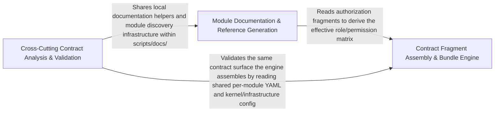

---
tags:
  - 2brain
  - 2brain/arch
  - project/boilerplate-node-backend
type: architecture
component: Contract_Generation_Assembly
---

## Details

The contract-first generation layer that turns shared rule fragments and module declarations into the OpenAPI/AsyncAPI bundles the API and event contracts are built from. It owns the fragment model (AuthorizationFragment, DeclaredSection), the browser-event and webhook-event fragment emitters, the shared-rule JSON-Schema export, and the root assembly that stitches per-module fragments into a single document. This is the upstream of implementation: the contracts it emits are the source of truth that the scenario layer (Group 2) and the generated client both consume.

### Contract Fragment Assembly & Bundle Engine
The core generation engine that reads per-module contract fragments (OpenAPI paths/tags/schemas, AsyncAPI channels/operations, authorization rules) from disk, assembles them into unified root documents, and emits the final OpenAPI/AsyncAPI bundles plus derived artifacts (JSON Schemas, TypeScript types, permission actions, error codes). It owns the fragment model (OpenApiFragment, AuthorizationFragment, DeclaredSection), the browser-event and webhook-event fragment emitters, the shared-rule JSON-Schema export, and the root assembly that stitches per-module $ref entries into a single document. This is the upstream of all implementation: the contracts it emits are consumed by the scenario layer, the generated client, and the runtime validation.

**Related Classes/Methods**:

- `scripts.contracts.analytics-browser-events.withBrowserEvents`:96-137
- `scripts.contracts.asyncapi-webhook-events.webhookEventFragments`

**Source Files:**

- `scenarios/personas-schema.ts`
  - `scenarios.personas-schema.personasSchema.accounts.PERSONA_NAMES.map() callback` (L63-L63) - Function
- `scripts/contracts/analytics-browser-events.ts`
  - `scripts.contracts.analytics-browser-events.browserEventFragments` (L44-L49) - Class
  - `scripts.contracts.analytics-browser-events.browserEventFragments.map() callback` (L46-L47) - Function
  - `scripts.contracts.analytics-browser-events.localiseReferences` (L57-L68) - Class
  - `scripts.contracts.analytics-browser-events.localiseReferences.node.map() callback` (L58-L58) - Function
  - `scripts.contracts.analytics-browser-events.localiseReferences.map() callback` (L61-L66) - Function
  - `scripts.contracts.analytics-browser-events.withBrowserEvents` (L96-L137) - Class
  - `scripts.contracts.analytics-browser-events.withBrowserEvents.flatMap() callback` (L122-L134) - Function
  - `scripts.contracts.analytics-browser-events.withBrowserEvents.flatMap() callback.oneOf.map() callback` (L128-L128) - Function
- `scripts/contracts/asyncapi-bundles.ts`
  - `scripts.contracts.asyncapi-bundles.internalSections` (L65-L68) - Class
  - `scripts.contracts.asyncapi-bundles.internalSections.map() callback` (L67-L67) - Function
- `scripts/contracts/asyncapi-webhook-events.ts`
  - `scripts.contracts.asyncapi-webhook-events.webhookEventFragments` (L26-L26) - Class
- `scripts/contracts/fragments.ts`
  - `scripts.contracts.fragments.DeclaredTag` (L16-L21) - Interface
  - `scripts.contracts.fragments.DeclaredSection` (L34-L37) - Interface
  - `scripts.contracts.fragments.OpenApiFragment` (L43-L49) - Interface
  - `scripts.contracts.fragments.AuthorizationRule` (L71-L75) - Interface
  - `scripts.contracts.fragments.AuthorizationSet` (L78-L82) - Interface
  - `scripts.contracts.fragments.AuthorizationFragment` (L85-L88) - Interface
- `scripts/contracts/generate-shared-rule-schemas.ts`
  - `scripts.contracts.generate-shared-rule-schemas.loadModuleSource` (L74-L81) - Class
  - `scripts.contracts.generate-shared-rule-schemas.loadModuleSource.then() callback` (L76-L80) - Function
  - `scripts.contracts.generate-shared-rule-schemas.camelCaseOf` (L84-L85) - Class
  - `scripts.contracts.generate-shared-rule-schemas.camelCaseOf.name.replaceAll() callback` (L85-L85) - Function
  - `scripts.contracts.generate-shared-rule-schemas.ModuleBlock` (L88-L99) - Interface
  - `scripts.contracts.generate-shared-rule-schemas.MODULE_BLOCKS` (L105-L122) - Class
  - `scripts.contracts.generate-shared-rule-schemas.MODULE_BLOCKS.exportName` (L118-L118) - Method
  - `scripts.contracts.generate-shared-rule-schemas.MODULE_BLOCKS.description` (L119-L120) - Method
  - `scripts.contracts.generate-shared-rule-schemas.collectBlockSources` (L130-L155) - Class
  - `scripts.contracts.generate-shared-rule-schemas.collectBlockSources.flatMap() callback` (L131-L155) - Function
  - `scripts.contracts.generate-shared-rule-schemas.collectSources` (L179-L197) - Class
  - `scripts.contracts.generate-shared-rule-schemas.collectSources.map() callback` (L181-L181) - Function
  - `scripts.contracts.generate-shared-rule-schemas.collectSources.then() callback` (L182-L197) - Function
  - `scripts.contracts.generate-shared-rule-schemas.collectSources.then() callback.flatMap() callback` (L183-L192) - Function
  - `scripts.contracts.generate-shared-rule-schemas.collectSources.then() callback.MODULE_BLOCKS.flatMap() callback` (L196-L196) - Function
- `scripts/contracts/root-assembly.ts`
  - `scripts.contracts.root-assembly.readModuleFragments` (L236-L254) - Class
  - `scripts.contracts.root-assembly.readModuleFragments.map() callback` (L242-L253) - Function
  - `scripts.contracts.root-assembly.readModuleFragments.map() callback.tags.operations.flatMap() callback` (L249-L249) - Function
- `scripts/docs/generate-audit-actions.ts`
  - `scripts.docs.generate-audit-actions.collectDeclaredActions.moduleActions` (L98-L109) - Class
  - `scripts.docs.generate-audit-actions.collectDeclaredActions.moduleActions.map() callback` (L99-L108) - Function
  - `scripts.docs.generate-audit-actions.collectDeclaredActions.moduleActions.map() callback.map() callback` (L102-L107) - Function
- `scripts/docs/generate-jobs.ts`
  - `scripts.docs.generate-jobs.then() callback` (L74-L76) - Function
- `scripts/docs/generate-scenario-registries.ts`
  - `scripts.docs.generate-scenario-registries.then() callback` (L29-L31) - Function
  - `scripts.docs.generate-scenario-registries.catch() callback` (L32-L35) - Function
- `scripts/docs/marker-block.ts`
  - `scripts.docs.marker-block.MarkerBlock` (L19-L23) - Interface
  - `scripts.docs.marker-block.MarkerPageOptions` (L26-L39) - Interface
- `scripts/modules-on-disk.ts`
  - `scripts.modules-on-disk.modulesWith` (L26-L31) - Class
  - `scripts.modules-on-disk.filter() callback` (L28-L28) - Function
  - `scripts.modules-on-disk.modulesWith.map() callback` (L29-L29) - Function
  - `scripts.modules-on-disk.modulesWith.filter() callback` (L30-L30) - Function
- `scripts/mutation/ci/slice-ignorer.ts`
  - `scripts.mutation.ci.slice-ignorer.LineSlice` (L17-L20) - Interface
  - `scripts.mutation.ci.slice-ignorer.NodeLocation` (L23-L26) - Interface
  - `scripts.mutation.ci.slice-ignorer.IgnorerPath` (L29-L31) - Interface
  - `scripts.mutation.ci.slice-ignorer.strykerPlugins.value.shouldIgnore` (L84-L87) - Method
- `scripts/scaffold/apply.ts`
  - `scripts.scaffold.apply.takenSchemaNames.names.flatMap() callback` (L29-L30) - Function
  - `scripts.scaffold.apply.takenSchemaNames.names` (L29-L31) - Class
  - `scripts.scaffold.apply.applyScaffold.edits` (L99-L107) - Class
  - `scripts.scaffold.apply.applyScaffold.edits.map() callback` (L100-L106) - Function
- `scripts/scaffold/central-edits.ts`
  - `scripts.scaffold.central-edits.CentralEdit` (L21-L26) - Interface
  - `scripts.scaffold.central-edits.appendToList` (L36-L51) - Class
  - `scripts.scaffold.central-edits.appendToList.opens` (L38-L38) - Class
  - `scripts.scaffold.central-edits.appendToList.opens.lines.findIndex() callback` (L38-L38) - Function
  - `scripts.scaffold.central-edits.appendToList.blank` (L41-L41) - Class
  - `scripts.scaffold.central-edits.appendToList.blank.lines.findIndex() callback` (L41-L41) - Function
  - `scripts.scaffold.central-edits.appendToList.items.map() callback` (L48-L48) - Function
  - `scripts.scaffold.central-edits.addParityEntry` (L67-L85) - Class
  - `scripts.scaffold.central-edits.addParityEntry.opens.lines.findIndex() callback` (L69-L70) - Function
  - `scripts.scaffold.central-edits.addParityEntry.opens` (L69-L71) - Class
  - `scripts.scaffold.central-edits.addParityEntry.closes` (L74-L74) - Class
  - `scripts.scaffold.central-edits.addParityEntry.closes.lines.findIndex() callback` (L74-L74) - Function
  - `scripts.scaffold.central-edits.addParityEntry.rows` (L75-L75) - Class
  - `scripts.scaffold.central-edits.addParityEntry.rows.map() callback` (L75-L75) - Function
  - `scripts.scaffold.central-edits.addParityEntry.at` (L77-L77) - Class
  - `scripts.scaffold.central-edits.addParityEntry.at.rows.findIndex() callback` (L77-L77) - Function
  - `scripts.scaffold.central-edits.addParityEntry.sorted.map() callback` (L82-L82) - Function
  - `scripts.scaffold.central-edits.centralEdits` (L92-L107) - Class
  - `scripts.scaffold.central-edits.centralEdits.apply` (L105-L105) - Method
- `scripts/scaffold/demo-remove-alert-rules.ts`
  - `scripts.scaffold.demo-remove-alert-rules.sourceFiles` (L34-L39) - Class
  - `scripts.scaffold.demo-remove-alert-rules.sourceFiles.flatMap() callback` (L35-L39) - Function
  - `scripts.scaffold.demo-remove-alert-rules.metricsIn` (L45-L50) - Class
  - `scripts.scaffold.demo-remove-alert-rules.metricsIn.files.flatMap() callback` (L47-L48) - Function
  - `scripts.scaffold.demo-remove-alert-rules.metricsIn.files.flatMap() callback.map() callback` (L48-L48) - Function
  - `scripts.scaffold.demo-remove-alert-rules.readRemovedMetrics` (L57-L72) - Class
  - `scripts.scaffold.demo-remove-alert-rules.readRemovedMetrics.removedRoots` (L61-L61) - Class
  - `scripts.scaffold.demo-remove-alert-rules.readRemovedMetrics.removedRoots.names.map() callback` (L61-L61) - Function
  - `scripts.scaffold.demo-remove-alert-rules.readRemovedMetrics.isRemoved` (L62-L63) - Class
  - `scripts.scaffold.demo-remove-alert-rules.readRemovedMetrics.isRemoved.removedRoots.some() callback` (L63-L63) - Function
  - `scripts.scaffold.demo-remove-alert-rules.readRemovedMetrics.surviving` (L66-L66) - Class
  - `scripts.scaffold.demo-remove-alert-rules.readRemovedMetrics.surviving.files.filter() callback` (L66-L66) - Function
  - `scripts.scaffold.demo-remove-alert-rules.readRemovedMetrics.files.filter() callback` (L68-L68) - Function
  - `scripts.scaffold.demo-remove-alert-rules.readRemovedMetrics.filter() callback` (L69-L69) - Function
  - `scripts.scaffold.demo-remove-alert-rules.stripRules` (L100-L115) - Class
  - `scripts.scaffold.demo-remove-alert-rules.stripRules.reads` (L102-L103) - Class
  - `scripts.scaffold.demo-remove-alert-rules.stripRules.reads.some() callback` (L103-L103) - Function
  - `scripts.scaffold.demo-remove-alert-rules.stripRules.dropped` (L106-L106) - Class
  - `scripts.scaffold.demo-remove-alert-rules.stripRules.dropped.chunks.filter() callback` (L106-L106) - Function
  - `scripts.scaffold.demo-remove-alert-rules.stripRules.kept` (L107-L107) - Class
  - `scripts.scaffold.demo-remove-alert-rules.stripRules.kept.chunks.filter() callback` (L107-L107) - Function
  - `scripts.scaffold.demo-remove-alert-rules.stripRules.nonEmpty` (L109-L111) - Class
  - `scripts.scaffold.demo-remove-alert-rules.stripRules.nonEmpty.kept.filter() callback` (L110-L110) - Function
  - `scripts.scaffold.demo-remove-alert-rules.stripRules.dropped.map() callback` (L114-L114) - Function
  - `scripts.scaffold.demo-remove-alert-rules.stripRuleTests` (L122-L133) - Class
  - `scripts.scaffold.demo-remove-alert-rules.stripRuleTests.asksAboutDropped` (L124-L125) - Class
  - `scripts.scaffold.demo-remove-alert-rules.stripRuleTests.asksAboutDropped.some() callback` (L125-L125) - Function
  - `scripts.scaffold.demo-remove-alert-rules.stripRuleTests.filter() callback` (L130-L130) - Function
- `scripts/scaffold/demo-remove-authorization.ts`
  - `scripts.scaffold.demo-remove-authorization.RemovedAuthorization` (L22-L29) - Interface
  - `scripts.scaffold.demo-remove-authorization.readRemovedAuthorization.survivors` (L42-L44) - Class
  - `scripts.scaffold.demo-remove-authorization.readRemovedAuthorization.survivors.filter() callback` (L43-L43) - Function
  - `scripts.scaffold.demo-remove-authorization.readRemovedAuthorization.survivors.flatMap() callback` (L44-L44) - Function
  - `scripts.scaffold.demo-remove-authorization.readRemovedAuthorization.removedFragments` (L48-L48) - Class
  - `scripts.scaffold.demo-remove-authorization.readRemovedAuthorization.removedFragments.names.map() callback` (L48-L48) - Function
  - `scripts.scaffold.demo-remove-authorization.readRemovedAuthorization.removed` (L49-L49) - Class
  - `scripts.scaffold.demo-remove-authorization.readRemovedAuthorization.removed.removedFragments.flatMap() callback` (L49-L49) - Function
  - `scripts.scaffold.demo-remove-authorization.readRemovedAuthorization.stillUsed` (L51-L51) - Class
  - `scripts.scaffold.demo-remove-authorization.readRemovedAuthorization.stillUsed.map() callback` (L51-L51) - Function
  - `scripts.scaffold.demo-remove-authorization.readRemovedAuthorization.rules.removed.map() callback` (L53-L53) - Function
  - `scripts.scaffold.demo-remove-authorization.readRemovedAuthorization.sets.removedFragments.flatMap() callback` (L54-L54) - Function
  - `scripts.scaffold.demo-remove-authorization.readRemovedAuthorization.sets.removedFragments.flatMap() callback.fragment.sets.map() callback` (L54-L54) - Function
  - `scripts.scaffold.demo-remove-authorization.readRemovedAuthorization.subjects.filter() callback` (L56-L56) - Function
  - `scripts.scaffold.demo-remove-authorization.readRemovedAuthorization.subjects.removed.map() callback` (L56-L56) - Function
  - `scripts.scaffold.demo-remove-authorization.stripRoleGrants.lines` (L70-L72) - Class
  - `scripts.scaffold.demo-remove-authorization.stripRoleGrants.lines.filter() callback` (L72-L72) - Function
  - `scripts.scaffold.demo-remove-authorization.stripRoleGrants.out` (L74-L79) - Class
  - `scripts.scaffold.demo-remove-authorization.stripRoleGrants.out.lines.map() callback` (L74-L79) - Function
  - `scripts.scaffold.demo-remove-authorization.stripRoleGrants.out.lines.map() callback.next` (L77-L77) - Class
  - `scripts.scaffold.demo-remove-authorization.stripRoleGrants.out.lines.map() callback.next.find() callback` (L77-L77) - Function
  - `scripts.scaffold.demo-remove-authorization.pruneCase` (L98-L120) - Class
  - `scripts.scaffold.demo-remove-authorization.pruneCase.lists.map() callback` (L102-L106) - Function
  - `scripts.scaffold.demo-remove-authorization.pruneCase.lists` (L102-L107) - Class
  - `scripts.scaffold.demo-remove-authorization.pruneCase.lists.map() callback.map() callback` (L105-L105) - Function
  - `scripts.scaffold.demo-remove-authorization.pruneCase.emptied` (L108-L110) - Class
  - `scripts.scaffold.demo-remove-authorization.pruneCase.emptied.lists.some() callback` (L109-L109) - Function
  - `scripts.scaffold.demo-remove-authorization.pruneCase.emptied.lists.some() callback.all.every() callback` (L109-L109) - Function
  - `scripts.scaffold.demo-remove-authorization.pruneCase.chunk.replaceAll() callback` (L113-L119) - Function
  - `scripts.scaffold.demo-remove-authorization.pruneCase.chunk.replaceAll() callback.kept` (L114-L117) - Class
  - `scripts.scaffold.demo-remove-authorization.pruneCase.chunk.replaceAll() callback.kept.map() callback` (L116-L116) - Function
  - `scripts.scaffold.demo-remove-authorization.pruneCase.chunk.replaceAll() callback.kept.filter() callback` (L117-L117) - Function
  - `scripts.scaffold.demo-remove-authorization.stripConformanceCases.headKept` (L134-L137) - Class
  - `scripts.scaffold.demo-remove-authorization.stripConformanceCases.headKept.filter() callback` (L136-L136) - Function
  - `scripts.scaffold.demo-remove-authorization.stripConformanceCases.casesKept` (L138-L141) - Class
  - `scripts.scaffold.demo-remove-authorization.stripConformanceCases.casesKept.map() callback` (L139-L139) - Function
  - `scripts.scaffold.demo-remove-authorization.stripConformanceCases.casesKept.filter() callback` (L140-L140) - Function
- `scripts/scaffold/demo-remove-registry.ts`
  - `scripts.scaffold.demo-remove-registry.RemovalNote` (L19-L22) - Interface
  - `scripts.scaffold.demo-remove-registry.removeModuleFolders` (L25-L29) - Class
  - `scripts.scaffold.demo-remove-registry.removeModuleFolders.names.map() callback` (L26-L29) - Function
  - `scripts.scaffold.demo-remove-registry.stripModuleLines` (L44-L60) - Class
  - `scripts.scaffold.demo-remove-registry.stripModuleLines.identifiers` (L46-L50) - Class
  - `scripts.scaffold.demo-remove-registry.stripModuleLines.identifiers.lines.filter() callback` (L48-L48) - Function
  - `scripts.scaffold.demo-remove-registry.stripModuleLines.identifiers.map() callback` (L49-L49) - Function
  - `scripts.scaffold.demo-remove-registry.stripModuleLines.lines.filter() callback` (L53-L57) - Function
- `scripts/scaffold/demo-remove-scenarios.ts`
  - `scripts.scaffold.demo-remove-scenarios.removeShopOnlyScenarioFiles` (L41-L45) - Class
  - `scripts.scaffold.demo-remove-scenarios.removeShopOnlyScenarioFiles.SHOP_ONLY_FILES.map() callback` (L42-L45) - Function
  - `scripts.scaffold.demo-remove-scenarios.removeScenarioModuleFiles` (L112-L125) - Class
  - `scripts.scaffold.demo-remove-scenarios.removeScenarioModuleFiles.names.flatMap() callback` (L116-L125) - Function
  - `scripts.scaffold.demo-remove-scenarios.removeScenarioModuleFiles.names.flatMap() callback.owned` (L117-L121) - Class
  - `scripts.scaffold.demo-remove-scenarios.removeScenarioModuleFiles.names.flatMap() callback.owned.filter() callback` (L121-L121) - Function
  - `scripts.scaffold.demo-remove-scenarios.removeScenarioModuleFiles.names.flatMap() callback.owned.map() callback` (L124-L124) - Function
- `scripts/scaffold/demo-remove-tests.ts`
  - `scripts.scaffold.demo-remove-tests.testRoots` (L18-L26) - Class
  - `scripts.scaffold.demo-remove-tests.testRoots.moduleTests` (L20-L24) - Class
  - `scripts.scaffold.demo-remove-tests.testRoots.moduleTests.map() callback` (L21-L22) - Function
  - `scripts.scaffold.demo-remove-tests.testRoots.filter() callback` (L25-L25) - Function
  - `scripts.scaffold.demo-remove-tests.walkTypeScript` (L29-L34) - Class
  - `scripts.scaffold.demo-remove-tests.walkTypeScript.flatMap() callback` (L30-L34) - Function
  - `scripts.scaffold.demo-remove-tests.requiredModules` (L59-L62) - Class
  - `scripts.scaffold.demo-remove-tests.requiredModules.flatMap() callback` (L60-L61) - Function
  - `scripts.scaffold.demo-remove-tests.requiredModules.flatMap() callback.map() callback` (L61-L61) - Function
  - `scripts.scaffold.demo-remove-tests.specifiersOf` (L68-L69) - Class
  - `scripts.scaffold.demo-remove-tests.specifiersOf.SPECIFIER_PATTERNS.flatMap() callback` (L69-L69) - Function
  - `scripts.scaffold.demo-remove-tests.specifiersOf.SPECIFIER_PATTERNS.flatMap() callback.map() callback` (L69-L69) - Function
  - `scripts.scaffold.demo-remove-tests.isGone` (L94-L100) - Class
  - `scripts.scaffold.demo-remove-tests.isGone.gone.some() callback` (L96-L99) - Function
  - `scripts.scaffold.demo-remove-tests.removeResidueTests` (L109-L142) - Class
  - `scripts.scaffold.demo-remove-tests.removeResidueTests.files` (L110-L110) - Class
  - `scripts.scaffold.demo-remove-tests.removeResidueTests.files.flatMap() callback` (L110-L110) - Function
  - `scripts.scaffold.demo-remove-tests.removeResidueTests.gone` (L114-L118) - Class
  - `scripts.scaffold.demo-remove-tests.removeResidueTests.gone.names.flatMap() callback` (L114-L118) - Function
  - `scripts.scaffold.demo-remove-tests.removeResidueTests.files.filter() callback` (L123-L123) - Function
  - `scripts.scaffold.demo-remove-tests.removeResidueTests.importsGone` (L125-L128) - Class
  - `scripts.scaffold.demo-remove-tests.removeResidueTests.importsGone.some() callback` (L125-L128) - Function
  - `scripts.scaffold.demo-remove-tests.removeResidueTests.requiresGone` (L129-L129) - Class
  - `scripts.scaffold.demo-remove-tests.removeResidueTests.requiresGone.some() callback` (L129-L129) - Function
  - `scripts.scaffold.demo-remove-tests.removeResidueTests.deleted.map() callback` (L138-L141) - Function
- `scripts/scaffold/demo-remove-validation-labels.ts`
  - `scripts.scaffold.demo-remove-validation-labels.readRemovedFields` (L120-L136) - Class
  - `scripts.scaffold.demo-remove-validation-labels.readRemovedFields.survivors` (L125-L127) - Class
  - `scripts.scaffold.demo-remove-validation-labels.readRemovedFields.survivors.filter() callback` (L126-L126) - Function
  - `scripts.scaffold.demo-remove-validation-labels.readRemovedFields.survivors.map() callback` (L127-L127) - Function
  - `scripts.scaffold.demo-remove-validation-labels.readRemovedFields.filter() callback` (L135-L135) - Function
  - `scripts.scaffold.demo-remove-validation-labels.stripValidationLabels` (L144-L170) - Class
  - `scripts.scaffold.demo-remove-validation-labels.stripValidationLabels.filter() callback` (L151-L151) - Function
  - `scripts.scaffold.demo-remove-validation-labels.stripValidationLabels.flatMap() callback` (L152-L169) - Function
  - `scripts.scaffold.demo-remove-validation-labels.stripValidationLabels.flatMap() callback.dropped` (L158-L158) - Class
  - `scripts.scaffold.demo-remove-validation-labels.stripValidationLabels.flatMap() callback.dropped.filter() callback` (L158-L158) - Function
- `scripts/scaffold/demo-remove.ts`
  - `scripts.scaffold.demo-remove.then() callback` (L52-L66) - Function
  - `scripts.scaffold.demo-remove.then() callback.written.map() callback` (L54-L54) - Function
- `scripts/scaffold/names.ts`
  - `scripts.scaffold.names.ModuleNames` (L8-L31) - Interface
  - `scripts.scaffold.names.pascal` (L58-L62) - Class
  - `scripts.scaffold.names.pascal.map() callback` (L61-L61) - Function
  - `scripts.scaffold.names.snake` (L76-L77) - Class
  - `scripts.scaffold.names.snake.replaceAll() callback` (L77-L77) - Function
  - `scripts.scaffold.names.permissionRules` (L143-L144) - Class
  - `scripts.scaffold.names.permissionRules.RULE_ACTIONS.map() callback` (L144-L144) - Function
- `scripts/scaffold/options.ts`
  - `scripts.scaffold.options.ScaffoldOptions` (L11-L24) - Interface
  - `scripts.scaffold.options.ParseRefusal` (L39-L41) - Interface
  - `scripts.scaffold.options.parseArguments.positional` (L60-L66) - Class
  - `scripts.scaffold.options.parseArguments.positional.argv.filter() callback` (L60-L66) - Function
- `scripts/scaffold/plan.ts`
  - `scripts.scaffold.plan.PlannedFile` (L16-L21) - Interface
  - `scripts.scaffold.plan.ScaffoldPlan` (L24-L29) - Interface
  - `scripts.scaffold.plan.collidingSchemas` (L171-L180) - Class
  - `scripts.scaffold.plan.collidingSchemas.filter() callback` (L180-L180) - Function
- `scripts/scaffold/registry.ts`
  - `scripts.scaffold.registry.insertInRun.first` (L27-L27) - Class
  - `scripts.scaffold.registry.insertInRun.first.lines.findIndex() callback` (L27-L27) - Function
  - `scripts.scaffold.registry.insertInRun.offset` (L33-L33) - Class
  - `scripts.scaffold.registry.insertInRun.offset.findIndex() callback` (L33-L33) - Function
  - `scripts.scaffold.registry.isRegistered` (L54-L55) - Class
  - `scripts.scaffold.registry.isRegistered.some() callback` (L55-L55) - Function
  - `scripts.scaffold.registry.retermRun` (L66-L81) - Class
  - `scripts.scaffold.registry.retermRun.first` (L72-L72) - Class
  - `scripts.scaffold.registry.retermRun.first.lines.findIndex() callback` (L72-L72) - Function
  - `scripts.scaffold.registry.retermRun.lines.map() callback` (L76-L79) - Function
  - `scripts.scaffold.registry.splitAfter.at` (L100-L100) - Class
  - `scripts.scaffold.registry.splitAfter.at.lines.findIndex() callback` (L100-L100) - Function
  - `scripts.scaffold.registry.registerModule.withImport` (L114-L120) - Class
  - `scripts.scaffold.registry.registerModule.withImport.insertInRun() callback` (L116-L116) - Function
- `scripts/scaffold/scaffold-module.ts`
  - `scripts.scaffold.scaffold-module.main.plan` (L37-L42) - Class
  - `scripts.scaffold.scaffold-module.main.plan.catch() callback` (L38-L41) - Function
  - `scripts.scaffold.scaffold-module.then() callback` (L66-L69) - Function
- `scripts/scaffold/scenario-registry.ts`
  - `scripts.scaffold.scenario-registry.GeneratedFile` (L28-L31) - Interface
  - `scripts.scaffold.scenario-registry.identifier` (L65-L66) - Class
  - `scripts.scaffold.scenario-registry.identifier.name.replaceAll() callback` (L66-L66) - Function
  - `scripts.scaffold.scenario-registry.namesIn` (L73-L78) - Class
  - `scripts.scaffold.scenario-registry.namesIn.flatMap() callback` (L76-L76) - Function
  - `scripts.scaffold.scenario-registry.renderCollection.imports.entries.map() callback` (L92-L93) - Function
  - `scripts.scaffold.scenario-registry.renderCollection.declaration.entries.map() callback` (L96-L96) - Function
  - `scripts.scaffold.scenario-registry.renderFixtureRegistry.modules` (L106-L108) - Class
  - `scripts.scaffold.scenario-registry.renderFixtureRegistry.modules.filter() callback` (L107-L107) - Function
  - `scripts.scaffold.scenario-registry.renderFixtureRegistry.modules.map() callback` (L108-L108) - Function
  - `scripts.scaffold.scenario-registry.renderScenarioRegistry.named` (L124-L128) - Class
  - `scripts.scaffold.scenario-registry.renderScenarioRegistry.named.map() callback` (L124-L128) - Function
  - `scripts.scaffold.scenario-registry.renderDoublesRegistry` (L146-L175) - Class
  - `scripts.scaffold.scenario-registry.renderDoublesRegistry.folders` (L148-L154) - Class
  - `scripts.scaffold.scenario-registry.folders.filter() callback` (L150-L150) - Function
  - `scripts.scaffold.scenario-registry.folders.map() callback` (L151-L151) - Function
  - `scripts.scaffold.scenario-registry.renderDoublesRegistry.folders.filter() callback` (L152-L152) - Function
  - `scripts.scaffold.scenario-registry.renderDoublesRegistry.folders.map() callback` (L164-L164) - Function
  - `scripts.scaffold.scenario-registry.renderLeversRegistry` (L181-L211) - Class
  - `scripts.scaffold.scenario-registry.renderLeversRegistry.folders` (L183-L189) - Class
  - `scripts.scaffold.scenario-registry.renderLeversRegistry.folders.filter() callback` (L187-L187) - Function
  - `scripts.scaffold.scenario-registry.renderLeversRegistry.folders.map() callback` (L199-L199) - Function
  - `scripts.scaffold.scenario-registry.renderScenarioRegistries` (L220-L239) - Class
  - `scripts.scaffold.scenario-registry.renderScenarioRegistries.then() callback` (L225-L238) - Function
  - `scripts.scaffold.scenario-registry.renderScenarioRegistries.then() callback.map() callback` (L232-L236) - Function
  - `scripts.scaffold.scenario-registry.renderScenarioRegistries.then() callback.map() callback.then() callback` (L233-L236) - Function
  - `scripts.scaffold.scenario-registry.writeScenarioRegistries` (L247-L256) - Class
  - `scripts.scaffold.scenario-registry.writeScenarioRegistries.then() callback` (L248-L255) - Function
  - `scripts.scaffold.scenario-registry.writeScenarioRegistries.then() callback.files.flatMap() callback` (L249-L255) - Function
  - `scripts.scaffold.scenario-registry.staleScenarioRegistries` (L264-L272) - Class
  - `scripts.scaffold.scenario-registry.staleScenarioRegistries.then() callback` (L265-L271) - Function
  - `scripts.scaffold.scenario-registry.staleScenarioRegistries.then() callback.files.filter() callback` (L267-L270) - Function
  - `scripts.scaffold.scenario-registry.staleScenarioRegistries.then() callback.map() callback` (L271-L271) - Function
- `scripts/scaffold/templates-code.ts`
  - `scripts.scaffold.templates-code.auditEntries` (L74-L83) - Class
  - `scripts.scaffold.templates-code.auditEntries.map() callback` (L80-L83) - Function
  - `scripts.scaffold.templates-code.rulesYaml` (L86-L99) - Class
  - `scripts.scaffold.templates-code.rulesYaml.flatMap() callback` (L94-L97) - Function
  - `scripts.scaffold.templates-code.authorizationYaml` (L162-L180) - Class
  - `scripts.scaffold.templates-code.authorizationYaml.RULE_ACTIONS.flatMap() callback` (L165-L171) - Function
  - `scripts.scaffold.templates-code.authorizationYaml.RULE_ACTIONS.map() callback` (L178-L178) - Function

### Module Documentation & Reference Generation
The documentation generation layer that produces the human-readable architectural artifacts derived from module descriptors and the contract fragments: the module dependency graph (import edges + event subscription edges rendered as Mermaid), the effective role/permission matrix (which role holds which rule per module), the module catalogue (grouped listing feeding both the docs index page and the VitePress sidebar), and the jobs schedule rendering. It reads module descriptors (module.yaml), the kernel's permission model, and dependency-cruiser output to generate marker-bounded blocks in documentation pages. This sub-component makes the contract-first architecture self-documenting: the docs are generated from the same source of truth as the contracts, so they cannot drift.

**Related Classes/Methods**:

- `scripts.docs.generate-module-graph.readEdges`:83-116
- `scripts.docs.generate-module-graph.render`:252-296
- `scripts.docs.module-descriptor.readAllModuleDescriptors`:70-76

**Source Files:**

- `scripts/docs/check-references.ts`
  - `scripts.docs.check-references.run.roots` (L216-L216) - Class
  - `scripts.docs.check-references.run.roots.ALLOWED.map() callback` (L216-L216) - Function
- `scripts/docs/generate-audit-actions.ts`
  - `scripts.docs.generate-audit-actions.walk` (L62-L67) - Class
  - `scripts.docs.generate-audit-actions.walk.flatMap() callback` (L63-L67) - Function
  - `scripts.docs.generate-audit-actions.collectDeclaredActions.infrastructureActions` (L91-L96) - Class
  - `scripts.docs.generate-audit-actions.collectDeclaredActions.infrastructureActions.map() callback` (L91-L96) - Function
  - `scripts.docs.generate-audit-actions.main.sources` (L177-L177) - Class
  - `scripts.docs.generate-audit-actions.main.sources.map() callback` (L177-L177) - Function
- `scripts/docs/generate-cookie-table.ts`
  - `scripts.docs.generate-cookie-table.then() callback` (L77-L79) - Function
- `scripts/docs/generate-module-graph.ts`
  - `scripts.docs.generate-module-graph.EventEdge` (L56-L60) - Interface
  - `scripts.docs.generate-module-graph.Target` (L63-L68) - Interface
  - `scripts.docs.generate-module-graph.SUBDOMAIN` (L78-L80) - Class
  - `scripts.docs.generate-module-graph.SUBDOMAIN.map() callback` (L79-L79) - Function
  - `scripts.docs.generate-module-graph.readEdges` (L83-L116) - Class
  - `scripts.docs.generate-module-graph.readEdges.labels` (L103-L105) - Class
  - `scripts.docs.generate-module-graph.readEdges.labels.map() callback` (L104-L104) - Function
  - `scripts.docs.generate-module-graph.readEdges.edges.toSorted() callback` (L115-L115) - Function
  - `scripts.docs.generate-module-graph.moduleSourceFiles.rest` (L139-L146) - Class
  - `scripts.docs.generate-module-graph.rest.filter() callback` (L144-L144) - Function
  - `scripts.docs.generate-module-graph.moduleSourceFiles.rest.map() callback` (L145-L145) - Function
  - `scripts.docs.generate-module-graph.moduleSourceFiles.rest.filter() callback` (L146-L146) - Function
  - `scripts.docs.generate-module-graph.readEventEdges` (L181-L194) - Class
  - `scripts.docs.generate-module-graph.readEventEdges.edges.toSorted() callback` (L189-L192) - Function
  - `scripts.docs.generate-module-graph.renderNeighbourhood` (L197-L250) - Class
  - `scripts.docs.generate-module-graph.renderNeighbourhood.reaches` (L202-L202) - Class
  - `scripts.docs.generate-module-graph.renderNeighbourhood.reaches.edges.filter() callback` (L202-L202) - Function
  - `scripts.docs.generate-module-graph.renderNeighbourhood.announces` (L204-L204) - Class
  - `scripts.docs.generate-module-graph.renderNeighbourhood.announces.events.filter() callback` (L204-L204) - Function
  - `scripts.docs.generate-module-graph.renderNeighbourhood.listens` (L205-L205) - Class
  - `scripts.docs.generate-module-graph.renderNeighbourhood.listens.events.filter() callback` (L205-L205) - Function
  - `scripts.docs.generate-module-graph.renderNeighbourhood.neighbours` (L207-L214) - Class
  - `scripts.docs.generate-module-graph.renderNeighbourhood.neighbours.announces.map() callback` (L211-L211) - Function
  - `scripts.docs.generate-module-graph.renderNeighbourhood.neighbours.listens.map() callback` (L212-L212) - Function
  - `scripts.docs.generate-module-graph.renderNeighbourhood.neighbours.map() callback` (L233-L233) - Function
  - `scripts.docs.generate-module-graph.renderNeighbourhood.reaches.map() callback` (L236-L236) - Function
  - `scripts.docs.generate-module-graph.renderNeighbourhood.listens.map() callback` (L237-L237) - Function
  - `scripts.docs.generate-module-graph.renderNeighbourhood.announces.map() callback` (L238-L238) - Function
  - `scripts.docs.generate-module-graph.render` (L252-L296) - Class
  - `scripts.docs.generate-module-graph.render.byKind` (L256-L257) - Class
  - `scripts.docs.generate-module-graph.render.byKind.map() callback` (L257-L257) - Function
  - `scripts.docs.generate-module-graph.render.byKind.names.filter() callback` (L257-L257) - Function
  - `scripts.docs.generate-module-graph.render.edges.map() callback` (L266-L266) - Function
  - `scripts.docs.generate-module-graph.render.names.map() callback` (L285-L289) - Function
  - `scripts.docs.generate-module-graph.names.map() callback.reaches` (L286-L286) - Class
  - `scripts.docs.generate-module-graph.render.names.map() callback.reaches.edges.filter() callback` (L286-L286) - Function
  - `scripts.docs.generate-module-graph.render.names.map() callback.reaches.map() callback` (L286-L286) - Function
  - `scripts.docs.generate-module-graph.names.map() callback.reached` (L287-L287) - Class
  - `scripts.docs.generate-module-graph.render.names.map() callback.reached.edges.filter() callback` (L287-L287) - Function
  - `scripts.docs.generate-module-graph.render.names.map() callback.reached.map() callback` (L287-L287) - Function
  - `scripts.docs.generate-module-graph.render.toSorted() callback` (L290-L290) - Function
  - `scripts.docs.generate-module-graph.render.map() callback` (L292-L293) - Function
  - `scripts.docs.generate-module-graph.targets` (L317-L339) - Class
  - `scripts.docs.generate-module-graph.targets.filter() callback` (L331-L331) - Function
  - `scripts.docs.generate-module-graph.targets.map() callback` (L332-L337) - Function
  - `scripts.docs.generate-module-graph.then() callback` (L351-L353) - Function
- `scripts/docs/generate-role-matrix.ts`
  - `scripts.docs.generate-role-matrix.modules` (L81-L81) - Class
  - `scripts.docs.generate-role-matrix.modules.PERMISSION_RULES.map() callback` (L81-L81) - Function
  - `scripts.docs.generate-role-matrix.cell.wide` (L134-L136) - Class
  - `scripts.docs.generate-role-matrix.cell.wide.flatMap() callback` (L135-L135) - Function
  - `scripts.docs.generate-role-matrix.cell.wide.held.filter() callback` (L135-L135) - Function
- `scripts/docs/jobs-render.ts`
  - `scripts.docs.jobs-render.describeSchedule` (L38-L46) - Class
  - `scripts.docs.jobs-render.describeSchedule.rest.every() callback` (L43-L43) - Function
  - `scripts.docs.jobs-render.renderJobsTable` (L81-L89) - Class
  - `scripts.docs.jobs-render.renderJobsTable.jobs.map() callback` (L86-L87) - Function
- `scripts/docs/module-catalog.ts`
  - `scripts.docs.module-catalog.CatalogPage` (L21-L26) - Interface
  - `scripts.docs.module-catalog.CatalogEntry` (L29-L36) - Interface
  - `scripts.docs.module-catalog.readCatalog` (L89-L108) - Class
  - `scripts.docs.module-catalog.readCatalog.stems` (L92-L97) - Class
  - `scripts.docs.module-catalog.readCatalog.stems.filter() callback` (L94-L94) - Function
  - `scripts.docs.module-catalog.readCatalog.stems.map() callback` (L95-L95) - Function
  - `scripts.docs.module-catalog.readCatalog.map() callback` (L99-L107) - Function
  - `scripts.docs.module-catalog.readCatalog.map() callback.pages.stems.filter() callback` (L105-L105) - Function
  - `scripts.docs.module-catalog.readCatalog.map() callback.pages.map() callback` (L106-L106) - Function
  - `scripts.docs.module-catalog.inGroup` (L111-L117) - Class
  - `scripts.docs.module-catalog.inGroup.entries.filter() callback` (L116-L116) - Function
  - `scripts.docs.module-catalog.inGroup.toSorted() callback` (L117-L117) - Function
  - `scripts.docs.module-catalog.bullet.deeper` (L121-L124) - Class
  - `scripts.docs.module-catalog.bullet.deeper.entry.pages.map() callback` (L123-L123) - Function
  - `scripts.docs.module-catalog.renderModuleList` (L134-L141) - Class
  - `scripts.docs.module-catalog.renderModuleList.GROUPS.flatMap() callback` (L135-L139) - Function
  - `scripts.docs.module-catalog.renderModuleList.GROUPS.flatMap() callback.members.map() callback` (L138-L138) - Function
  - `scripts.docs.module-catalog.SidebarSection` (L151-L155) - Interface
  - `scripts.docs.module-catalog.moduleSidebar` (L162-L189) - Class
  - `scripts.docs.module-catalog.moduleSidebar.GROUPS.flatMap() callback` (L164-L188) - Function
  - `scripts.docs.module-catalog.moduleSidebar.GROUPS.flatMap() callback.items.members.map() callback` (L171-L185) - Function
- `scripts/docs/module-descriptor.ts`
  - `scripts.docs.module-descriptor.readAllModuleDescriptors` (L70-L76) - Class
  - `scripts.docs.module-descriptor.readAllModuleDescriptors.map() callback` (L72-L75) - Function
- `scripts/docs/repo-references.ts`
  - `scripts.docs.repo-references.readAliases` (L192-L204) - Class
  - `scripts.docs.repo-references.readAliases.map() callback` (L200-L203) - Function
  - `scripts.docs.repo-references.throughAliases.alias.aliases.find() callback` (L218-L219) - Function
  - `scripts.docs.repo-references.throughAliases.alias` (L218-L220) - Class

### Cross-Cutting Contract Analysis & Validation
The cross-cutting analysis and validation layer that derives secondary contract artifacts and enforces consistency across the contract surface: the dependency map (which packages/modules depend on which, grouped by dependency group), the persona tables (concrete example callers for each audience/role combination), the rate-limit budget tables (per-module rate-limit data rendered for documentation), the audit-action tables (declared audit actions per module), and the reference checker (validates that all $ref targets, module names, and cross-file references resolve correctly). This sub-component ensures the contract bundle is internally consistent and that the derived documentation tables match the actual module declarations.

**Related Classes/Methods**:

- `scripts.docs.dependency-groups.matchesGroup`:222-227
- `scripts.docs.generate-dependency-map.groupRows`:194-205

**Source Files:**

- `scripts/docs/check-references.ts`
  - `scripts.docs.check-references.Finding` (L44-L47) - Interface
  - `scripts.docs.check-references.Scan` (L107-L110) - Interface
  - `scripts.docs.check-references.Claim` (L144-L147) - Interface
  - `scripts.docs.check-references.run.pages` (L223-L229) - Class
  - `scripts.docs.check-references.run.pages.filter() callback` (L229-L229) - Function
- `scripts/docs/dependency-groups.ts`
  - `scripts.docs.dependency-groups.DependencyGroup` (L18-L23) - Interface
  - `scripts.docs.dependency-groups.matchesGroup` (L222-L227) - Class
  - `scripts.docs.dependency-groups.matchesGroup.patterns.some() callback` (L223-L226) - Function
- `scripts/docs/generate-audit-actions.ts`
  - `scripts.docs.generate-audit-actions.DeclaredAction` (L45-L54) - Interface
  - `scripts.docs.generate-audit-actions.AuditActionRow` (L57-L59) - Interface
  - `scripts.docs.generate-audit-actions.readModuleActions.entry` (L80-L85) - Class
  - `scripts.docs.generate-audit-actions.readModuleActions.entry.find() callback` (L81-L84) - Function
  - `scripts.docs.generate-audit-actions.readModuleActions.entry.find() callback.every() callback` (L84-L84) - Function
  - `scripts.docs.generate-audit-actions.targetTypeCell` (L152-L159) - Class
  - `scripts.docs.generate-audit-actions.targetTypeCell.map() callback` (L157-L157) - Function
  - `scripts.docs.generate-audit-actions.actionTable` (L162-L172) - Class
  - `scripts.docs.generate-audit-actions.actionTable.rows.toSorted() callback` (L167-L167) - Function
  - `scripts.docs.generate-audit-actions.actionTable.map() callback` (L169-L170) - Function
  - `scripts.docs.generate-audit-actions.main.rows` (L178-L181) - Class
  - `scripts.docs.generate-audit-actions.main.rows.declared.map() callback` (L178-L181) - Function
- `scripts/docs/generate-dependency-map.ts`
  - `scripts.docs.generate-dependency-map.PackageManifest` (L72-L75) - Interface
  - `scripts.docs.generate-dependency-map.walk` (L81-L88) - Class
  - `scripts.docs.generate-dependency-map.walk.flatMap() callback` (L82-L88) - Function
  - `scripts.docs.generate-dependency-map.importSpecifiers` (L110-L119) - Class
  - `scripts.docs.generate-dependency-map.importSpecifiers.map() callback` (L112-L112) - Function
  - `scripts.docs.generate-dependency-map.importSpecifiers.filter() callback` (L114-L118) - Function
  - `scripts.docs.generate-dependency-map.importSpecifiers.filter() callback.ALIAS_PREFIXES.every() callback` (L117-L117) - Function
  - `scripts.docs.generate-dependency-map.packageFor` (L122-L123) - Class
  - `scripts.docs.generate-dependency-map.packageFor.packages.find() callback` (L123-L123) - Function
  - `scripts.docs.generate-dependency-map.readOwnership.files` (L151-L154) - Class
  - `scripts.docs.generate-dependency-map.readOwnership.files.SCAN_DIRECTORIES.flatMap() callback` (L152-L152) - Function
  - `scripts.docs.generate-dependency-map.readOwnership.files.SCAN_FILES.map() callback` (L153-L153) - Function
  - `scripts.docs.generate-dependency-map.Row` (L186-L191) - Interface
  - `scripts.docs.generate-dependency-map.groupRows` (L194-L205) - Class
  - `scripts.docs.generate-dependency-map.groupRows.groups.map() callback` (L196-L204) - Function
  - `scripts.docs.generate-dependency-map.groupRows.groups.map() callback.packages.packages.filter() callback` (L199-L199) - Function
  - `scripts.docs.generate-dependency-map.groupRows.groups.map() callback.packages.map() callback` (L200-L200) - Function
  - `scripts.docs.generate-dependency-map.groupRows.filter() callback` (L205-L205) - Function
  - `scripts.docs.generate-dependency-map.moduleOwnedRow.owned` (L213-L224) - Class
  - `scripts.docs.generate-dependency-map.moduleOwnedRow.owned.packages.filter() callback` (L214-L214) - Function
  - `scripts.docs.generate-dependency-map.moduleOwnedRow.owned.packages.filter() callback.groups.every() callback` (L214-L214) - Function
  - `scripts.docs.generate-dependency-map.moduleOwnedRow.owned.map() callback` (L215-L218) - Function
  - `scripts.docs.generate-dependency-map.moduleOwnedRow.owned.filter() callback` (L220-L220) - Function
  - `scripts.docs.generate-dependency-map.moduleOwnedRow.owned.toSorted() callback` (L223-L223) - Function
  - `scripts.docs.generate-dependency-map.moduleOwnedRow.packages.owned.map() callback` (L231-L231) - Function
  - `scripts.docs.generate-dependency-map.moduleOwnedRow.readMore.owned.map() callback` (L235-L235) - Function
  - `scripts.docs.generate-dependency-map.moduleOwnedRow.readMore.map() callback` (L236-L236) - Function
  - `scripts.docs.generate-dependency-map.ungroupedTable` (L242-L270) - Class
  - `scripts.docs.generate-dependency-map.ungroupedTable.leftover` (L247-L251) - Class
  - `scripts.docs.generate-dependency-map.ungroupedTable.leftover.packages.filter() callback` (L248-L250) - Function
  - `scripts.docs.generate-dependency-map.ungroupedTable.leftover.packages.filter() callback.groups.every() callback` (L249-L249) - Function
  - `scripts.docs.generate-dependency-map.ungroupedTable.map() callback` (L266-L267) - Function
  - `scripts.docs.generate-dependency-map.renderTable` (L273-L291) - Class
  - `scripts.docs.generate-dependency-map.renderTable.map() callback` (L285-L285) - Function
  - `scripts.docs.generate-dependency-map.renderTable.filter() callback` (L289-L289) - Function
  - `scripts.docs.generate-dependency-map.then() callback` (L322-L324) - Function
- `scripts/docs/generate-module-graph.ts`
  - `scripts.docs.generate-module-graph.renderNeighbourhood.reached` (L203-L203) - Class
  - `scripts.docs.generate-module-graph.renderNeighbourhood.reached.edges.filter() callback` (L203-L203) - Function
  - `scripts.docs.generate-module-graph.renderNeighbourhood.byKind` (L220-L221) - Class
  - `scripts.docs.generate-module-graph.renderNeighbourhood.byKind.map() callback` (L221-L221) - Function
  - `scripts.docs.generate-module-graph.renderNeighbourhood.byKind.neighbours.filter() callback` (L221-L221) - Function
  - `scripts.docs.generate-module-graph.renderNeighbourhood.reached.map() callback` (L235-L235) - Function
  - `scripts.docs.generate-module-graph.render.declare` (L255-L255) - Class
  - `scripts.docs.generate-module-graph.render.declare.names.map() callback` (L255-L255) - Function
  - `scripts.docs.generate-module-graph.render.isolated` (L258-L258) - Class
  - `scripts.docs.generate-module-graph.render.isolated.map() callback` (L258-L258) - Function
  - `scripts.docs.generate-module-graph.render.isolated.names.filter() callback` (L258-L258) - Function
- `scripts/docs/generate-persona-tables.ts`
  - `scripts.docs.generate-persona-tables.rolesOf` (L33-L36) - Class
  - `scripts.docs.generate-persona-tables.rolesOf.memberships.map() callback` (L36-L36) - Function
  - `scripts.docs.generate-persona-tables.table` (L57-L65) - Class
  - `scripts.docs.generate-persona-tables.table.names.map() callback` (L61-L64) - Function
  - `scripts.docs.generate-persona-tables.blocks.map() callback` (L70-L74) - Function
  - `scripts.docs.generate-persona-tables.then() callback` (L79-L81) - Function
- `scripts/docs/generate-rate-limit-budgets.ts`
  - `scripts.docs.generate-rate-limit-budgets.budgetTable` (L47-L57) - Class
  - `scripts.docs.generate-rate-limit-budgets.budgetTable.rows.map() callback` (L52-L55) - Function
- `scripts/docs/generate-role-matrix.ts`
  - `scripts.docs.generate-role-matrix.Persona` (L49-L54) - Interface
  - `scripts.docs.generate-role-matrix.personas` (L66-L78) - Class
  - `scripts.docs.generate-role-matrix.personas.AUDIENCE_NAMES.map() callback` (L68-L68) - Function
  - `scripts.docs.generate-role-matrix.personas.PRESET_ROLES.filter() callback` (L70-L70) - Function
  - `scripts.docs.generate-role-matrix.personas.map() callback` (L71-L76) - Function
  - `scripts.docs.generate-role-matrix.cell.held` (L124-L126) - Class
  - `scripts.docs.generate-role-matrix.cell.held.PERMISSION_RULES.filter() callback` (L125-L125) - Function
  - `scripts.docs.generate-role-matrix.cell.held.flatMap() callback` (L138-L138) - Function
  - `scripts.docs.generate-role-matrix.moduleBody.rows.map() callback.sets.PERMISSION_SETS.filter() callback` (L237-L237) - Function
  - `scripts.docs.generate-role-matrix.moduleBody.rows.map() callback.sets` (L237-L239) - Class
  - `scripts.docs.generate-role-matrix.moduleBody.rows.map() callback.sets.map() callback` (L238-L238) - Function
  - `scripts.docs.generate-role-matrix.then() callback` (L295-L297) - Function
- `scripts/docs/jobs-render.ts`
  - `scripts.docs.jobs-render.rest.every() callback` (L42-L42) - Function
  - `scripts.docs.jobs-render.renderCrontab` (L71-L74) - Class
  - `scripts.docs.jobs-render.renderCrontab.jobs.map() callback` (L73-L73) - Function
- `scripts/docs/module-catalog.ts`
  - `scripts.docs.module-catalog.SidebarItem` (L144-L148) - Interface
- `scripts/docs/repo-references.ts`
  - `scripts.docs.repo-references.allowed` (L90-L92) - Class
  - `scripts.docs.repo-references.allowed.GENERATED_SUFFIXES.some() callback` (L91-L91) - Function
  - `scripts.docs.repo-references.allowed.ALLOWED.some() callback` (L92-L92) - Function
  - `scripts.docs.repo-references.trackedTargets.files` (L116-L124) - Class
  - `scripts.docs.repo-references.trackedTargets.files.filter() callback` (L124-L124) - Function
  - `scripts.docs.repo-references.trackedTargets.roots.files.map() callback` (L128-L128) - Function
  - `scripts.docs.repo-references.resolves` (L168-L169) - Class
  - `scripts.docs.repo-references.resolves.SPELLINGS.some() callback` (L169-L169) - Function
