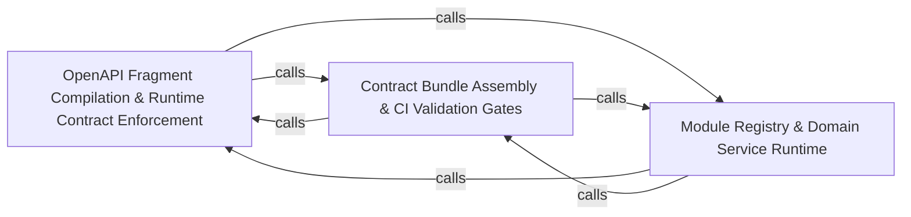

---
tags:
  - 2brain
  - 2brain/arch
  - project/boilerplate-node-backend
type: architecture
component: Contract_Generation_Pipeline
---

## Details

The build-time pipeline that compiles the per-module OpenAPI/AsyncAPI fragments into the published openapi.yaml/asyncapi.yaml bundles, generating error-code catalogues, authorization bundles, and client-collection bundles.

### OpenAPI Fragment Compilation & Runtime Contract Enforcement [[Expand]](./OpenAPI_Fragment_Compilation_Runtime_Contract_Enforcement.md)
The core compilation step that discovers per-module openapi.yaml fragments on disk, assembles the root document's path index and tag list, invokes redocly bundle to resolve $refs, then post-processes the bundle (merging app-level 429/400/413/415 responses, hanging ETag/If-Match/412 on versioned paths, stamping x-module on every operation, collecting x-error-codes into a single catalogue). It also emits the error-codes.ts constants file. At runtime, the infrastructure adapters (cache invalidation, idempotency keys, error mapping, Redis session store) enforce the contract's promises on every request.

**Related Classes/Methods**:

- `src.infrastructure.adapters.cache.invalidateCacheTagsLogged`:329-344

**Source Files:**

- `scripts/contracts/generate-error-codes.ts`
  - `scripts.contracts.generate-error-codes.ErrorCodeEntry` (L30-L33) - Interface
  - `scripts.contracts.generate-error-codes.OpenApiDocument` (L36-L38) - Interface
- `scripts/contracts/openapi-bundle.ts`
  - `scripts.contracts.openapi-bundle.AppLevelResponse` (L144-L147) - Interface
  - `scripts.contracts.openapi-bundle.Operation` (L150-L153) - Interface
  - `scripts.contracts.openapi-bundle.ErrorCodeEntry` (L156-L159) - Interface
  - `scripts.contracts.openapi-bundle.BundledDocument` (L162-L168) - Interface
- `src/infrastructure/adapters/cache.ts`
  - `src.infrastructure.adapters.cache.invalidateCacheTagsLogged` (L329-L344) - Class
  - `src.infrastructure.adapters.cache.invalidateCacheTagsLogged.then() callback` (L330-L344) - Function
- `src/infrastructure/adapters/logger.ts`
  - `src.infrastructure.adapters.logger.isSensitiveKey` (L131-L133) - Class
  - `src.infrastructure.adapters.logger.isSensitiveKey.SENSITIVE_KEY_FRAGMENTS.some() callback` (L133-L133) - Function
  - `src.infrastructure.adapters.logger.redactSensitiveFields.result` (L218-L220) - Class
  - `src.infrastructure.adapters.logger.redactSensitiveFields.result.input.map() callback` (L219-L219) - Function
  - `src.infrastructure.adapters.logger.redactFormat` (L287-L310) - Class
  - `src.infrastructure.adapters.logger.redactFormat.winston.format() callback` (L287-L310) - Function
  - `src.infrastructure.adapters.logger.semanticNamesFormat` (L320-L324) - Class
  - `src.infrastructure.adapters.logger.semanticNamesFormat.winston.format() callback` (L320-L324) - Function
  - `src.infrastructure.adapters.logger.prettyFormat` (L359-L373) - Class
  - `src.infrastructure.adapters.logger.prettyFormat.winston.format.printf() callback` (L366-L372) - Function
- `src/infrastructure/adapters/redis.ts`
  - `src.infrastructure.adapters.redis.isRedisConnectionError` (L149-L150) - Class
  - `src.infrastructure.adapters.redis.isRedisConnectionError.REDIS_CONNECTION_ERRORS.some() callback` (L150-L150) - Function
- `src/infrastructure/http/errors.ts`
  - `src.infrastructure.http.errors.databaseErrorInterpreter` (L60-L102) - Function
- `src/infrastructure/http/middlewares/cache.ts`
  - `src.infrastructure.http.middlewares.cache.invalidateCache` (L586-L596) - Class
  - `src.infrastructure.http.middlewares.cache.invalidateCache.<function>` (L587-L596) - Function
  - `src.infrastructure.http.middlewares.cache.invalidateCache.<function>.response.on('finish') callback` (L588-L593) - Function
- `src/infrastructure/http/middlewares/idempotency.ts`
  - `src.infrastructure.http.middlewares.idempotency.hasPrototypeKey` (L56-L61) - Class
  - `src.infrastructure.http.middlewares.idempotency.hasPrototypeKey.value.some() callback` (L57-L57) - Function
  - `src.infrastructure.http.middlewares.idempotency.hasPrototypeKey.some() callback` (L60-L60) - Function
  - `src.infrastructure.http.middlewares.idempotency.reclaimAbandoned` (L135-L161) - Class
  - `src.infrastructure.http.middlewares.idempotency.reclaimAbandoned.then() callback` (L149-L161) - Function
  - `src.infrastructure.http.middlewares.idempotency.armOutcomeCapture` (L175-L208) - Class
  - `src.infrastructure.http.middlewares.idempotency.armOutcomeCapture.<function>` (L177-L207) - Function
  - `src.infrastructure.http.middlewares.idempotency.armOutcomeCapture.<function>.catch() callback` (L192-L204) - Function
  - `src.infrastructure.http.middlewares.idempotency.onDuplicateKey` (L259-L294) - Class
  - `src.infrastructure.http.middlewares.idempotency.onDuplicateKey.then() callback` (L271-L287) - Function
  - `src.infrastructure.http.middlewares.idempotency.onDuplicateKey.catch() callback` (L288-L294) - Function
  - `src.infrastructure.http.middlewares.idempotency.claimIdempotencyKey` (L301-L323) - Class
  - `src.infrastructure.http.middlewares.idempotency.claimIdempotencyKey.then() callback` (L311-L314) - Function
  - `src.infrastructure.http.middlewares.idempotency.claimIdempotencyKey.catch() callback` (L315-L322) - Function
- `src/infrastructure/persistence/create-repository.ts`
  - `src.infrastructure.persistence.create-repository.buildWhere.ids` (L154-L156) - Class
  - `src.infrastructure.persistence.create-repository.buildWhere.ids.value.filter() callback` (L155-L155) - Function
  - `src.infrastructure.persistence.create-repository.buildWhere.ids.map() callback` (L156-L156) - Function
  - `src.infrastructure.persistence.create-repository.Repository` (L237-L300) - Interface
  - `src.infrastructure.persistence.create-repository.createRepository` (L337-L484) - Function
  - `src.infrastructure.persistence.create-repository.createRepository.buildWhere` (L482-L482) - Method
- `src/infrastructure/persistence/image-writeback.ts`
  - `src.infrastructure.persistence.image-writeback.imageWritebackFor` (L26-L51) - Class
  - `src.infrastructure.persistence.image-writeback.imageWritebackFor.<function>` (L28-L51) - Function
  - `src.infrastructure.persistence.image-writeback.imageWritebackFor.<function>.then() callback` (L41-L50) - Function
  - `src.infrastructure.persistence.image-writeback.imageWritebackFor.<function>.then() callback.then() callback` (L50-L50) - Function
- `src/infrastructure/persistence/lease.ts`
  - `src.infrastructure.persistence.lease.acquireLease` (L124-L139) - Class
  - `src.infrastructure.persistence.lease.acquireLease.then() callback` (L134-L134) - Function
  - `src.infrastructure.persistence.lease.acquireLease.catch() callback` (L135-L138) - Function
- `src/infrastructure/persistence/search.ts`
  - `src.infrastructure.persistence.search.PaginationInput` (L11-L17) - Interface
  - `src.infrastructure.persistence.search.readAll.collectFrom` (L98-L102) - Class
  - `src.infrastructure.persistence.search.readAll.collectFrom.then() callback` (L99-L102) - Function
- `src/infrastructure/persistence/translatable-columns.ts`
  - `src.infrastructure.persistence.translatable-columns.TranslatableColumns` (L17-L35) - Interface
  - `src.infrastructure.persistence.translatable-columns.translatableColumnsOf` (L42-L76) - Class
  - `src.infrastructure.persistence.translatable-columns.translatableColumnsOf.exists` (L46-L48) - Method
  - `src.infrastructure.persistence.translatable-columns.translatableColumnsOf.writeDerived` (L50-L65) - Method
  - `src.infrastructure.persistence.translatable-columns.translatableColumnsOf.writeDerived.$set.map() callback` (L58-L58) - Function
  - `src.infrastructure.persistence.translatable-columns.translatableColumnsOf.writeDerived.then() callback` (L65-L65) - Function
  - `src.infrastructure.persistence.translatable-columns.translatableColumnsOf.markEdited` (L67-L75) - Method
  - `src.infrastructure.persistence.translatable-columns.translatableColumnsOf.markEdited.then() callback` (L75-L75) - Function
- `src/infrastructure/persistence/versioning.ts`
  - `src.infrastructure.persistence.versioning.PreconditionFailedError` (L38-L40) - Class
  - `src.infrastructure.persistence.versioning.armed` (L159-L164) - Class
  - `src.infrastructure.persistence.versioning.armed.finally() callback` (L161-L163) - Function
  - `src.infrastructure.persistence.versioning.fencedSave` (L180-L192) - Class
  - `src.infrastructure.persistence.versioning.fencedSave.catch() callback` (L189-L191) - Function
  - `src.infrastructure.persistence.versioning.checkedDelete` (L211-L223) - Class
  - `src.infrastructure.persistence.versioning.checkedDelete.then() callback` (L220-L222) - Function
- `src/infrastructure/security/reencrypt.ts`
  - `src.infrastructure.security.reencrypt.reencryptOf` (L79-L82) - Class
  - `src.infrastructure.security.reencrypt.reencryptOf.<function>` (L81-L82) - Function
  - `src.infrastructure.security.reencrypt.reencryptCollection` (L146-L178) - Class
  - `src.infrastructure.security.reencrypt.reencryptCollection.then() callback` (L165-L177) - Function
  - `src.infrastructure.security.reencrypt.reencryptCollection.then() callback.apply.then() callback` (L171-L176) - Function
- `src/infrastructure/security/versioned-secret.ts`
  - `src.infrastructure.security.versioned-secret.decryptVersionedSecret.configured` (L117-L117) - Class
  - `src.infrastructure.security.versioned-secret.decryptVersionedSecret.configured.ring.find() callback` (L117-L117) - Function
- `src/infrastructure/surfaces/create-update-controller.ts`
  - `src.infrastructure.surfaces.create-update-controller.clearableFields` (L109-L113) - Class
  - `src.infrastructure.surfaces.create-update-controller.clearableFields.filter() callback` (L112-L112) - Function
  - `src.infrastructure.surfaces.create-update-controller.clearableFields.map() callback` (L113-L113) - Function
  - `src.infrastructure.surfaces.create-update-controller.createUpdateController.replaceFills` (L170-L172) - Class
  - `src.infrastructure.surfaces.create-update-controller.createUpdateController.replaceFills.filter() callback` (L171-L171) - Function
- `src/modules/addresses/repository.ts`
  - `src.modules.addresses.repository.addressBookRepository` (L105-L275) - Class
  - `src.modules.addresses.repository.addressBookRepository.create.items.map() callback` (L140-L141) - Function
  - `src.modules.addresses.repository.addressBookRepository.findByUserId` (L150-L154) - Method
  - `src.modules.addresses.repository.addressBookRepository.findByUserId.then() callback` (L154-L154) - Function
  - `src.modules.addresses.repository.addressBookRepository.addEntry` (L169-L198) - Method
  - `src.modules.addresses.repository.addressBookRepository.addEntry.catch() callback` (L184-L197) - Function
  - `src.modules.addresses.repository.addressBookRepository.addEntry.catch() callback.then() callback` (L189-L196) - Function
  - `src.modules.addresses.repository.addressBookRepository.updateEntry` (L205-L231) - Method
  - `src.modules.addresses.repository.addressBookRepository.setDefault` (L238-L248) - Method
  - `src.modules.addresses.repository.addressBookRepository.removeEntry` (L254-L263) - Method
  - `src.modules.addresses.repository.addressBookRepository.removeEntry.book.items.filter() callback` (L259-L259) - Function
  - `src.modules.addresses.repository.addressBookRepository.deleteByUserId` (L268-L274) - Method
  - `src.modules.addresses.repository.addressBookRepository.deleteByUserId.then() callback` (L272-L274) - Function
- `src/modules/addresses/service.ts`
  - `src.modules.addresses.service.addressForCheckout` (L97-L105) - Class
  - `src.modules.addresses.service.addressForCheckout.then() callback` (L101-L105) - Function
  - `src.modules.addresses.service.addressForCheckout.then() callback.book.items.find() callback` (L104-L104) - Function
- `src/modules/cart/domain/merge.ts`
  - `src.modules.cart.domain.merge.MergeLineFacts` (L12-L24) - Interface
  - `src.modules.cart.domain.merge.MergePlan` (L27-L32) - Interface
- `src/modules/delivery/repository.ts`
  - `src.modules.delivery.repository.shipmentRepository` (L498-L608) - Class
  - `src.modules.delivery.repository.shipmentRepository.findByOrderId` (L522-L527) - Method
  - `src.modules.delivery.repository.shipmentRepository.findByOrderIds` (L535-L539) - Method
  - `src.modules.delivery.repository.shipmentRepository.findByOrderIds.orderId.$in.orderIds.map() callback` (L537-L537) - Function
- `src/modules/example/repository.ts`
  - `src.modules.example.repository.exampleRepository.publishFrom` (L98-L107) - Method
- `src/modules/inventory/domain/hold-lines.ts`
  - `src.modules.inventory.domain.hold-lines.HoldLine` (L14-L18) - Interface
  - `src.modules.inventory.domain.hold-lines.HoldTake` (L21-L26) - Interface
  - `src.modules.inventory.domain.hold-lines.takeFromHold.toLines` (L77-L84) - Class
  - `src.modules.inventory.domain.hold-lines.takeFromHold.toLines.filter() callback` (L79-L79) - Function
  - `src.modules.inventory.domain.hold-lines.takeFromHold.toLines.map() callback` (L80-L84) - Function
- `src/modules/inventory/domain/transitions.ts`
  - `src.modules.inventory.domain.transitions.CounterDelta` (L29-L34) - Interface
- `src/modules/inventory/metrics.ts`
  - `src.modules.inventory.metrics._productsLowStockTotal` (L24-L31) - Class
  - `src.modules.inventory.metrics._productsLowStockTotal.collect` (L28-L30) - Method
  - `src.modules.inventory.metrics._inventoryReservedUnitsTotal` (L38-L45) - Class
  - `src.modules.inventory.metrics._inventoryReservedUnitsTotal.collect` (L42-L44) - Method
- `src/modules/inventory/module.ts`
  - `src.modules.inventory.module.default` (L30-L62) - Class
  - `src.modules.inventory.module.default.subscribe` (L44-L51) - Method
  - `src.modules.inventory.module.subscribe.onDomainEvent() callback` (L45-L45) - Function
  - `src.modules.inventory.module.default.subscribe.onDomainEvent() callback` (L48-L49) - Function
- `src/modules/inventory/repository.ts`
  - `src.modules.inventory.repository.StockLevelRow` (L102-L109) - Interface
  - `src.modules.inventory.repository.toReservationItems` (L130-L137) - Class
  - `src.modules.inventory.repository.toReservationItems.lines.map() callback` (L133-L137) - Function
  - `src.modules.inventory.repository.orderedByProduct` (L146-L155) - Class
  - `src.modules.inventory.repository.orderedByProduct.then() callback` (L155-L155) - Function
  - `src.modules.inventory.repository.orderedByProduct.then() callback.rows.map() callback` (L155-L155) - Function
  - `src.modules.inventory.repository.outstandingByProduct` (L164-L197) - Class
  - `src.modules.inventory.repository.outstandingByProduct.then() callback` (L187-L197) - Function
  - `src.modules.inventory.repository.stockLevelRepository` (L204-L468) - Class
  - `src.modules.inventory.repository.stockLevelRepository.insertIfAbsent` (L248-L264) - Method
  - `src.modules.inventory.repository.stockLevelRepository.insertIfAbsent.then() callback` (L264-L264) - Function
  - `src.modules.inventory.repository.stockLevelRepository.findManyByProductIds` (L272-L273) - Method
  - `src.modules.inventory.repository.stockLevelRepository.findManyByProductIds.productId.$in.productIds.map() callback` (L273-L273) - Function
  - `src.modules.inventory.repository.stockLevelRepository.findByProductId` (L280-L284) - Method
  - `src.modules.inventory.repository.stockLevelRepository.deleteByProductId` (L294-L298) - Method
  - `src.modules.inventory.repository.stockLevelRepository.deleteByProductId.then() callback` (L298-L298) - Function
  - `src.modules.inventory.repository.stockLevelRepository.applyDelta` (L315-L337) - Method
  - `src.modules.inventory.repository.stockLevelRepository.applyDelta.then() callback` (L337-L337) - Function
  - `src.modules.inventory.repository.stockLevelRepository.stockBoard` (L351-L375) - Method
  - `src.modules.inventory.repository.stockLevelRepository.stockBoard.then() callback` (L364-L374) - Function
  - `src.modules.inventory.repository.stockLevelRepository.stockBoard.then() callback.items.rows.map() callback` (L365-L372) - Function
  - `src.modules.inventory.repository.stockLevelRepository.setPreorderLimit` (L386-L397) - Method
  - `src.modules.inventory.repository.stockLevelRepository.setPreorderLimit.then() callback` (L397-L397) - Function
  - `src.modules.inventory.repository.stockLevelRepository.preorderBoard` (L407-L440) - Method
  - `src.modules.inventory.repository.stockLevelRepository.preorderBoard.then() callback` (L421-L439) - Function
  - `src.modules.inventory.repository.stockLevelRepository.preorderBoard.then() callback.then() callback` (L424-L437) - Function
  - `src.modules.inventory.repository.stockLevelRepository.preorderBoard.then() callback.then() callback.items.rows.map() callback` (L425-L435) - Function
  - `src.modules.inventory.repository.stockLevelRepository.lowAvailabilityProductIds` (L452-L457) - Method
  - `src.modules.inventory.repository.stockLevelRepository.lowAvailabilityProductIds.then() callback` (L457-L457) - Function
  - `src.modules.inventory.repository.stockLevelRepository.lowAvailabilityProductIds.then() callback.rows.map() callback` (L457-L457) - Function
  - `src.modules.inventory.repository.stockLevelRepository.sumReserved` (L464-L467) - Method
  - `src.modules.inventory.repository.stockLevelRepository.sumReserved.then() callback` (L467-L467) - Function
  - `src.modules.inventory.repository.reservationRepository` (L492-L702) - Class
  - `src.modules.inventory.repository.reservationRepository.insertHold` (L539-L551) - Method
  - `src.modules.inventory.repository.reservationRepository.insertHold.then() callback` (L547-L547) - Function
  - `src.modules.inventory.repository.reservationRepository.insertHold.catch() callback` (L548-L551) - Function
  - `src.modules.inventory.repository.reservationRepository.findByOrderId` (L559-L560) - Method
  - `src.modules.inventory.repository.reservationRepository.claimStatus` (L572-L588) - Method
  - `src.modules.inventory.repository.reservationRepository.findOpenByOrderId` (L598-L602) - Method
  - `src.modules.inventory.repository.reservationRepository.replaceItems` (L615-L627) - Method
  - `src.modules.inventory.repository.reservationRepository.findPaidPreorderHolds` (L638-L646) - Method
  - `src.modules.inventory.repository.reservationRepository.findExpired` (L656-L661) - Method
  - `src.modules.inventory.repository.reservationRepository.narrowToTaken` (L673-L683) - Method
  - `src.modules.inventory.repository.reservationRepository.narrowToTaken.then() callback` (L683-L683) - Function
  - `src.modules.inventory.repository.reservationRepository.extendExpiry` (L694-L701) - Method
- `src/modules/inventory/services/admin.ts`
  - `src.modules.inventory.services.admin.receiveAndAllocate` (L57-L74) - Class
  - `src.modules.inventory.services.admin.receiveAndAllocate.withTransaction() callback` (L62-L69) - Function
  - `src.modules.inventory.services.admin.receiveAndAllocate.withTransaction() callback.then() callback.then() callback` (L69-L69) - Function
  - `src.modules.inventory.services.admin.receiveAndAllocate.then() callback` (L70-L74) - Function
  - `src.modules.inventory.services.admin.receiveAndAllocate.then() callback.then() callback` (L73-L73) - Function
- `src/modules/inventory/services/holds.ts`
  - `src.modules.inventory.services.holds.claimAndApply` (L37-L57) - Class
  - `src.modules.inventory.services.holds.claimAndApply.claimAndMove` (L44-L50) - Class
  - `src.modules.inventory.services.holds.claimAndApply.claimAndMove.then() callback` (L45-L50) - Function
  - `src.modules.inventory.services.holds.claimAndApply.claimAndMove.then() callback.then() callback` (L48-L48) - Function
  - `src.modules.inventory.services.holds.claimAndApply.then() callback` (L54-L55) - Function
  - `src.modules.inventory.services.holds.claimAndApply.then() callback.then() callback` (L55-L55) - Function
  - `src.modules.inventory.services.holds.takeLines` (L190-L216) - Class
  - `src.modules.inventory.services.holds.takeLines.then() callback` (L197-L216) - Function
  - `src.modules.inventory.services.holds.takeLines.then() callback.then() callback` (L210-L215) - Function
  - `src.modules.inventory.services.holds.takeLines.then() callback.then() callback.then() callback` (L213-L213) - Function
  - `src.modules.inventory.services.holds.shipLinesForOrder` (L232-L245) - Class
  - `src.modules.inventory.services.holds.shipLinesForOrder.then() callback` (L237-L245) - Function
  - `src.modules.inventory.services.holds.shipLinesForOrder.then() callback.then() callback` (L240-L244) - Function
  - `src.modules.inventory.services.holds.refreshStockCacheForOrder` (L312-L319) - Class
  - `src.modules.inventory.services.holds.refreshStockCacheForOrder.then() callback` (L315-L318) - Function
  - `src.modules.inventory.services.holds.refreshStockCacheForOrder.then() callback.map() callback` (L317-L317) - Function
  - `src.modules.inventory.services.holds.extendHoldForOrder` (L331-L334) - Class
  - `src.modules.inventory.services.holds.extendHoldForOrder.then() callback` (L334-L334) - Function
  - `src.modules.inventory.services.holds.isHoldReleased` (L346-L347) - Class
  - `src.modules.inventory.services.holds.isHoldReleased.then() callback` (L347-L347) - Function
  - `src.modules.inventory.services.holds.isStockBoundToOrder` (L359-L362) - Class
  - `src.modules.inventory.services.holds.isStockBoundToOrder.then() callback` (L362-L362) - Function
- `src/modules/inventory/services/levels.ts`
  - `src.modules.inventory.services.levels.openLevel` (L37-L52) - Class
  - `src.modules.inventory.services.levels.openLevel.withTransaction() callback` (L38-L51) - Function
  - `src.modules.inventory.services.levels.openLevel.withTransaction() callback.then() callback` (L41-L50) - Function
  - `src.modules.inventory.services.levels.openLevel.then() callback` (L52-L52) - Function
  - `src.modules.inventory.services.levels.availableFor` (L79-L95) - Class
  - `src.modules.inventory.services.levels.availableFor.then() callback` (L86-L94) - Function
  - `src.modules.inventory.services.levels.availableFor.then() callback.levels.map() callback` (L88-L93) - Function
  - `src.modules.inventory.services.levels.listLevels.products` (L155-L155) - Class
  - `src.modules.inventory.services.levels.listLevels.products.items.map() callback` (L155-L155) - Function
  - `src.modules.inventory.services.levels.listLevels.titleOf` (L156-L156) - Class
  - `src.modules.inventory.services.levels.listLevels.titleOf.products.map() callback` (L156-L156) - Function
  - `src.modules.inventory.services.levels.listLevels.items.items.map() callback` (L159-L162) - Function
  - `src.modules.inventory.services.levels.lowStockCount` (L173-L177) - Class
  - `src.modules.inventory.services.levels.lowStockCount.then() callback` (L177-L177) - Function
- `src/modules/inventory/services/reserve.ts`
  - `src.modules.inventory.services.reserve.giveBackAndDeleteHold` (L30-L61) - Class
  - `src.modules.inventory.services.reserve.giveBackAndDeleteHold.taken.map() callback` (L38-L50) - Function
  - `src.modules.inventory.services.reserve.giveBackAndDeleteHold.taken.map() callback.catch() callback` (L43-L50) - Function
  - `src.modules.inventory.services.reserve.giveBackAndDeleteHold.catch() callback` (L53-L60) - Function
  - `src.modules.inventory.services.reserve.inLockOrder` (L74-L76) - Class
  - `src.modules.inventory.services.reserve.inLockOrder.lines.toSorted() callback` (L76-L76) - Function
- `src/modules/inventory/services/sweep.ts`
  - `src.modules.inventory.services.sweep.expireOne` (L38-L52) - Class
  - `src.modules.inventory.services.sweep.announceInTransaction() callback` (L40-L43) - Function
  - `src.modules.inventory.services.sweep.expireOne.announceInTransaction() callback.then() callback` (L41-L42) - Function
  - `src.modules.inventory.services.sweep.expireOne.announceInTransaction() callback` (L44-L48) - Function
  - `src.modules.inventory.services.sweep.expireOne.then() callback` (L49-L51) - Function
  - `src.modules.inventory.services.sweep.expireOne.then() callback.then() callback` (L51-L51) - Function
- `src/modules/inventory/services/transition.ts`
  - `src.modules.inventory.services.transition.syncStockCache` (L27-L41) - Class
  - `src.modules.inventory.services.transition.syncStockCache.then() callback` (L32-L32) - Function
  - `src.modules.inventory.services.transition.syncStockCache.catch() callback` (L33-L40) - Function
- `src/modules/inventory/services/types.ts`
  - `src.modules.inventory.services.types.StockLine` (L16-L20) - Interface
  - `src.modules.inventory.services.types.StockShortfall` (L26-L31) - Interface
  - `src.modules.inventory.services.types.LevelFilters` (L44-L46) - Interface
  - `src.modules.inventory.services.types.MovementFilters` (L49-L52) - Interface
- `src/modules/invoicing/services/render.ts`
  - `src.modules.invoicing.services.render.then() callback.then() callback.then() callback` (L78-L78) - Function
- `src/modules/notifications/presenter.ts`
  - `src.modules.notifications.presenter.NotificationsView` (L11-L13) - Interface
  - `src.modules.notifications.presenter.presentNotifications.items.notifications.map() callback` (L48-L48) - Function
- `src/modules/notifications/repository.ts`
  - `src.modules.notifications.repository.notificationRepository` (L31-L123) - Class
  - `src.modules.notifications.repository.notificationRepository.listByUserId` (L48-L52) - Method
  - `src.modules.notifications.repository.notificationRepository.insertMany` (L60-L61) - Method
  - `src.modules.notifications.repository.notificationRepository.deleteOwned` (L67-L71) - Method
  - `src.modules.notifications.repository.notificationRepository.deleteOwned.then() callback` (L71-L71) - Function
  - `src.modules.notifications.repository.notificationRepository.deleteAllOwned` (L74-L80) - Method
  - `src.modules.notifications.repository.notificationRepository.deleteAllOwned.then() callback` (L78-L80) - Function
  - `src.modules.notifications.repository.notificationRepository.deleteByUserId` (L83-L89) - Method
  - `src.modules.notifications.repository.notificationRepository.deleteByUserId.then() callback` (L87-L89) - Function
  - `src.modules.notifications.repository.notificationRepository.markAllRead` (L92-L101) - Method
  - `src.modules.notifications.repository.notificationRepository.markAllRead.then() callback` (L99-L101) - Function
  - `src.modules.notifications.repository.notificationRepository.trimToNewest` (L108-L122) - Method
- `src/modules/notifications/services/inbox.ts`
  - `src.modules.notifications.services.inbox.trimInbox` (L30-L36) - Class
  - `src.modules.notifications.services.inbox.trimInbox.then() callback` (L33-L36) - Function
  - `src.modules.notifications.services.inbox.notificationsCreate` (L46-L57) - Class
  - `src.modules.notifications.services.inbox.notificationsCreate.created.map() callback` (L55-L55) - Function
  - `src.modules.notifications.services.inbox.notificationsDismissAll` (L75-L79) - Class
  - `src.modules.notifications.services.inbox.notificationsReadAll` (L82-L88) - Class
  - `src.modules.notifications.services.inbox.notificationsReadAll.then() callback` (L84-L87) - Function
- `src/modules/notifications/services/stream.ts`
  - `src.modules.notifications.services.stream.openStreamCount` (L61-L62) - Class
  - `src.modules.notifications.services.stream.openStreamCount.reduce() callback` (L62-L62) - Function
  - `src.modules.notifications.services.stream.streamNotifications.heartbeat` (L92-L94) - Class
  - `src.modules.notifications.services.stream.streamNotifications.heartbeat.setInterval() callback` (L92-L94) - Function
  - `src.modules.notifications.services.stream.streamNotifications.reverifyTimer` (L97-L106) - Class
  - `src.modules.notifications.services.stream.streamNotifications.reverifyTimer.setInterval() callback` (L97-L106) - Function
  - `src.modules.notifications.services.stream.streamNotifications.reverifyTimer.setInterval() callback.catch() callback` (L99-L99) - Function
  - `src.modules.notifications.services.stream.streamNotifications.reverifyTimer.setInterval() callback.then() callback` (L100-L105) - Function
- `src/modules/notifications/services/subscribers.ts`
  - `src.modules.notifications.services.subscribers.removedFor` (L17-L26) - Class
  - `src.modules.notifications.services.subscribers.removedFor.userIds.map() callback` (L21-L26) - Function
- `src/modules/orders/repository.ts`
  - `src.modules.orders.repository.search` (L147-L178) - Class
  - `src.modules.orders.repository.search.then() callback` (L165-L176) - Function
  - `src.modules.orders.repository.search.then() callback.then() callback` (L172-L175) - Function
  - `src.modules.orders.repository.countMatching` (L187-L194) - Class
  - `src.modules.orders.repository.countMatching.then() callback` (L194-L194) - Function
  - `src.modules.orders.repository.streamMatching` (L204-L217) - Function
  - `src.modules.orders.repository.startPiiClock` (L629-L638) - Class
  - `src.modules.orders.repository.startPiiClock.then() callback` (L638-L638) - Function
  - `src.modules.orders.repository.deleteCancelledUnpaid` (L702-L722) - Class
  - `src.modules.orders.repository.deleteCancelledUnpaid.checkedDelete() callback` (L705-L721) - Function
  - `src.modules.orders.repository.deleteCancelledUnpaid.checkedDelete() callback.then() callback` (L714-L717) - Function
  - `src.modules.orders.repository.deleteCancelledUnpaid.checkedDelete() callback.finally() callback` (L718-L720) - Function
  - `src.modules.orders.repository.deleteCancelledUnpaid.then() callback` (L721-L721) - Function
  - `src.modules.orders.repository.orderEventRepository` (L838-L912) - Class
  - `src.modules.orders.repository.orderEventRepository.findByOrderId` (L858-L862) - Method
  - `src.modules.orders.repository.orderEventRepository.findByOrderIds` (L869-L873) - Method
  - `src.modules.orders.repository.orderEventRepository.findByOrderIds.orderId.$in.orderIds.map() callback` (L871-L871) - Function
  - `src.modules.orders.repository.orderEventRepository.clearActor` (L882-L886) - Method
  - `src.modules.orders.repository.orderEventRepository.clearActor.then() callback` (L886-L886) - Function
  - `src.modules.orders.repository.orderEventRepository.scrubTextBefore` (L895-L899) - Method
  - `src.modules.orders.repository.orderEventRepository.scrubTextBefore.then() callback` (L899-L899) - Function
  - `src.modules.orders.repository.orderEventRepository.deleteByOrderId` (L907-L911) - Method
  - `src.modules.orders.repository.orderEventRepository.deleteByOrderId.then() callback` (L911-L911) - Function
- `src/modules/orders/services/timeline.ts`
  - `src.modules.orders.services.timeline.deleteTimelineOf` (L168-L169) - Class
  - `src.modules.orders.services.timeline.deleteTimelineOf.then() callback` (L169-L169) - Function
- `src/modules/products/repository.ts`
  - `src.modules.products.repository.productRepository` (L37-L162) - Class
  - `src.modules.products.repository.productRepository.publicScope` (L73-L73) - Method
  - `src.modules.products.repository.productRepository.findByIdScoped` (L87-L88) - Method
  - `src.modules.products.repository.productRepository.findPublicById` (L97-L98) - Method
  - `src.modules.products.repository.productRepository.facets` (L107-L135) - Method
  - `src.modules.products.repository.productRepository.facets.then() callback` (L129-L135) - Function
  - `src.modules.products.repository.productRepository.facets.then() callback.categories.map() callback` (L130-L133) - Function
  - `src.modules.products.repository.productRepository.facets.then() callback.tags.map() callback` (L134-L134) - Function
  - `src.modules.products.repository.productRepository.syncStockCache` (L145-L149) - Method
  - `src.modules.products.repository.productRepository.syncStockCache.then() callback` (L149-L149) - Function
- `src/modules/products/services/lookups.ts`
  - `src.modules.products.services.lookups.findManyByIds` (L34-L37) - Class
  - `src.modules.products.services.lookups.findManyByIds.then() callback` (L35-L36) - Function
  - `src.modules.products.services.lookups.findManyByIds.then() callback._id.$in.ids.map() callback` (L36-L36) - Function
  - `src.modules.products.services.lookups.countPublic` (L51-L70) - Class
  - `src.modules.products.services.lookups.countPublic.then() callback` (L57-L69) - Function
  - `src.modules.products.services.lookups.countPublic.then() callback._id.$in.ids.map() callback` (L60-L60) - Function
- `src/modules/products/services/search.ts`
  - `src.modules.products.services.search.searchWithTranslatedText` (L66-L91) - Class
  - `src.modules.products.services.search.searchWithTranslatedText.then() callback` (L80-L90) - Function
  - `src.modules.products.services.search.searchWithTranslatedText.then() callback.union.$or._id.$in.translatedIds.map() callback` (L85-L85) - Function
- `src/modules/returns/repository.ts`
  - `src.modules.returns.repository.returnRepository` (L35-L172) - Class
  - `src.modules.returns.repository.returnRepository.claimStatus` (L74-L81) - Method
  - `src.modules.returns.repository.returnRepository.findByOrderId` (L88-L93) - Method
  - `src.modules.returns.repository.returnRepository.lockOrder` (L102-L110) - Method
  - `src.modules.returns.repository.returnRepository.lockOrder.then() callback` (L110-L110) - Function
  - `src.modules.returns.repository.returnRepository.findByOrderIds` (L143-L147) - Method
  - `src.modules.returns.repository.returnRepository.findByOrderIds.orderId.$in.orderIds.map() callback` (L145-L145) - Function
- `src/modules/returns/services/create.ts`
  - `src.modules.returns.services.create.writeReturn.lines.lines.map() callback` (L226-L235) - Function
  - `src.modules.returns.services.create.withTransaction() callback.then() callback` (L264-L264) - Function
- `src/modules/returns/services/decide.ts`
  - `src.modules.returns.services.decide.decide` (L79-L120) - Class
  - `src.modules.returns.services.decide.decide.then() callback` (L86-L119) - Function
  - `src.modules.returns.services.decide.decide.then() callback.then() callback` (L117-L118) - Function
  - `src.modules.returns.services.decide.refusalForDecision` (L132-L144) - Class
  - `src.modules.returns.services.decide.refusalForDecision.then() callback` (L137-L144) - Function
- `src/modules/users/repository.ts`
  - `src.modules.users.repository.stampDaily` (L76-L90) - Class
  - `src.modules.users.repository.stampDaily.then() callback` (L90-L90) - Function
  - `src.modules.users.repository.clearedCode` (L123-L124) - Class
  - `src.modules.users.repository.clearedCode.DELIVERED_CODE_FIELDS.map() callback` (L124-L124) - Function
  - `src.modules.users.repository.userRepository` (L131-L714) - Class
  - `src.modules.users.repository.userRepository.updateMany` (L202-L203) - Method
  - `src.modules.users.repository.userRepository.findByIdWithCredentials` (L208-L209) - Method
  - `src.modules.users.repository.userRepository.findOneWithCredentials` (L214-L215) - Method
  - `src.modules.users.repository.userRepository.findByIdWithPendingEmail` (L222-L222) - Method
  - `src.modules.users.repository.userRepository.emailOrPendingEmailTaken` (L234-L240) - Method
  - `src.modules.users.repository.userRepository.emailOrPendingEmailTaken.then() callback` (L240-L240) - Function
  - `src.modules.users.repository.userRepository.findAuthenticatableById` (L250-L253) - Method
  - `src.modules.users.repository.userRepository.findAuthenticatableByEmail` (L261-L265) - Method
  - `src.modules.users.repository.userRepository.clearLapsedPreviousEmail` (L277-L288) - Method
  - `src.modules.users.repository.userRepository.clearLapsedPreviousEmail._id.$nin.keepUserIds.map() callback` (L282-L282) - Function
  - `src.modules.users.repository.userRepository.clearLapsedPreviousEmail.then() callback` (L288-L288) - Function
  - `src.modules.users.repository.userRepository.linkOAuthAccount` (L300-L310) - Method
  - `src.modules.users.repository.userRepository.linkOAuthAccount.then() callback` (L310-L310) - Function
  - `src.modules.users.repository.userRepository.unlinkOAuthAccount` (L320-L328) - Method
  - `src.modules.users.repository.userRepository.unlinkOAuthAccount.then() callback` (L328-L328) - Function
  - `src.modules.users.repository.userRepository.reserveMfaAttempt` (L345-L394) - Method
  - `src.modules.users.repository.userRepository.reserveMfaAttempt.then() callback` (L389-L392) - Function
  - `src.modules.users.repository.userRepository.resetMfaAttempts` (L400-L411) - Method
  - `src.modules.users.repository.userRepository.resetMfaAttempts.then() callback` (L411-L411) - Function
  - `src.modules.users.repository.userRepository.bumpSessionEpoch` (L418-L430) - Method
  - `src.modules.users.repository.userRepository.bumpSessionEpoch.then() callback` (L430-L430) - Function
  - `src.modules.users.repository.userRepository.claimTotpStep` (L440-L456) - Method
  - `src.modules.users.repository.userRepository.claimTotpStep.then() callback` (L456-L456) - Function
  - `src.modules.users.repository.userRepository.spendBackupCode` (L468-L476) - Method
  - `src.modules.users.repository.userRepository.spendBackupCode.then() callback` (L476-L476) - Function
  - `src.modules.users.repository.userRepository.spendDeliveredCode` (L490-L505) - Method
  - `src.modules.users.repository.userRepository.spendDeliveredCode.codeSlotFilter() callback` (L493-L500) - Function
  - `src.modules.users.repository.userRepository.spendDeliveredCode.then() callback` (L505-L505) - Function
  - `src.modules.users.repository.userRepository.recordDeliveredMiss` (L517-L543) - Method
  - `src.modules.users.repository.userRepository.recordDeliveredMiss.codeSlotFilter() callback` (L520-L526) - Function
  - `src.modules.users.repository.recordDeliveredMiss.then() callback` (L531-L541) - Function
  - `src.modules.users.repository.userRepository.recordDeliveredMiss.then() callback.codeSlotFilter() callback` (L534-L537) - Function
  - `src.modules.users.repository.userRepository.recordDeliveredMiss.then() callback` (L543-L543) - Function
  - `src.modules.users.repository.userRepository.armReauthCode` (L553-L561) - Method
  - `src.modules.users.repository.userRepository.armReauthCode.then() callback` (L561-L561) - Function
  - `src.modules.users.repository.userRepository.writeTwoFactor` (L576-L606) - Method
  - `src.modules.users.repository.userRepository.writeTwoFactor.then() callback` (L598-L605) - Function
  - `src.modules.users.repository.userRepository.touchLastActive` (L624-L624) - Method
  - `src.modules.users.repository.userRepository.touchApiKeyUse` (L633-L633) - Method
  - `src.modules.users.repository.userRepository.markInactivityMinimised` (L642-L650) - Method
  - `src.modules.users.repository.userRepository.markInactivityMinimised.then() callback` (L650-L650) - Function
  - `src.modules.users.repository.userRepository.findInactiveUnminimised` (L659-L675) - Method
  - `src.modules.users.repository.userRepository.findInactiveUnwarned` (L681-L687) - Method
  - `src.modules.users.repository.userRepository.findWarnedStillInactive` (L694-L701) - Method
  - `src.modules.users.repository.userRepository.findReaperSoftDeletedPastGrace` (L704-L713) - Method
- `src/modules/users/services/credentials.ts`
  - `src.modules.users.services.credentials.armReauthCode` (L208-L216) - Class
  - `src.modules.users.services.credentials.armReauthCode.then() callback` (L212-L215) - Function
  - `src.modules.users.services.credentials.mirrorSpentCode.entry` (L228-L228) - Class
  - `src.modules.users.services.credentials.mirrorSpentCode.entry.user.twoFactorMethods.find() callback` (L228-L228) - Function
  - `src.modules.users.services.credentials.spendBackupCode` (L305-L314) - Class
  - `src.modules.users.services.credentials.spendBackupCode.then() callback` (L306-L314) - Function
  - `src.modules.users.services.credentials.spendBackupCode.then() callback.user.twoFactorBackupCodes.filter() callback` (L309-L309) - Function
- `src/modules/users/services/reaper.ts`
  - `src.modules.users.services.reaper.minimiseInactiveBefore` (L69-L84) - Class
  - `src.modules.users.services.reaper.minimiseInactiveBefore.then() callback` (L72-L84) - Function
  - `src.modules.users.services.reaper.minimiseInactiveBefore.then() callback.catch() callback` (L75-L82) - Function
- `src/modules/users/services/sign-in-methods.ts`
  - `src.modules.users.services.sign-in-methods.exportSignInMethods` (L24-L40) - Class
  - `src.modules.users.services.sign-in-methods.exportSignInMethods.then() callback` (L25-L39) - Function
  - `src.modules.users.services.sign-in-methods.exportSignInMethods.then() callback.providers.user.oauthAccounts.map() callback` (L28-L32) - Function
  - `src.modules.users.services.sign-in-methods.exportSignInMethods.then() callback.twoFactor.user.twoFactorMethods.flatMap() callback` (L35-L36) - Function
- `src/modules/wishlist/presenter.ts`
  - `src.modules.wishlist.presenter.savedProductIds` (L17-L18) - Class
  - `src.modules.wishlist.presenter.savedProductIds.map() callback` (L18-L18) - Function
- `src/modules/wishlist/service.ts`
  - `src.modules.wishlist.service.wishlistExportLines` (L48-L51) - Class
  - `src.modules.wishlist.service.wishlistExportLines.then() callback` (L51-L51) - Function
  - `src.modules.wishlist.service.wishlistExportLines.then() callback.map() callback` (L51-L51) - Function

### Module Registry & Domain Service Runtime [[Expand]](./Module_Registry_Domain_Service_Runtime.md)
The kernel's module registry that turns the explicit module list into a running application: each module declares its routes, consumers, image targets, translatables, and personal-data sections in a single typed AppModule manifest. This group also contains the domain module implementations (account, addresses, api-keys, audit-logs) with their repositories and services, plus the security infrastructure (JWT, OAuth, two-factor, re-encryption) that the contract's authorization keys reference. It is the runtime target that the contract describes.

**Related Classes/Methods**:

- `src.kernel.registry.AppModule`:364-526
- `src.kernel.registry.ModuleConsumer`:65-81
- `src.modules.account.module.default`:64-120
- `src.infrastructure.security.reencrypt.ReencryptJob`:54-65
- `src.modules.addresses.service.addressesGet`:31-32

**Source Files:**

- `src/infrastructure/security/reencrypt.ts`
  - `src.infrastructure.security.reencrypt.ReencryptJob` (L54-L65) - Interface
- `src/kernel/registry.ts`
  - `src.kernel.registry.ModuleConsumer` (L65-L81) - Interface
  - `src.kernel.registry.ModuleConsumer.handler` (L70-L70) - Method
  - `src.kernel.registry.PersonalDataSection` (L303-L333) - Interface
  - `src.kernel.registry.AppModule` (L364-L526) - Interface
- `src/modules/account/module.ts`
  - `src.modules.account.module.default` (L64-L120) - Class
  - `src.modules.account.module.personalData.collect` (L80-L80) - Method
  - `src.modules.account.module.default.personalData.collect` (L87-L87) - Method
  - `src.modules.account.module.default.subscribe` (L108-L117) - Method
  - `src.modules.account.module.default.subscribe.onDomainEvent() callback` (L114-L115) - Function
  - `src.modules.account.module.default.subscribe.onDomainEvent() callback.then() callback` (L115-L115) - Function
- `src/modules/account/repository.ts`
  - `src.modules.account.repository.deleteById` (L97-L101) - Class
  - `src.modules.account.repository.deleteById.then() callback` (L101-L101) - Function
  - `src.modules.account.repository.deleteByUserId` (L111-L121) - Class
  - `src.modules.account.repository.deleteByUserId.then() callback` (L116-L120) - Function
  - `src.modules.account.repository.deleteByUserId.then() callback.then() callback` (L120-L120) - Function
  - `src.modules.account.repository.deleteByUserId.then() callback.then() callback.rows.map() callback` (L120-L120) - Function
  - `src.modules.account.repository.removeSessionFamily` (L285-L289) - Class
  - `src.modules.account.repository.removeSessionFamily.then() callback` (L289-L289) - Function
  - `src.modules.account.repository.removeSessionFamilyExcept` (L299-L311) - Class
  - `src.modules.account.repository.removeSessionFamilyExcept.then() callback` (L311-L311) - Function
  - `src.modules.account.repository.sessionFamilyActivity` (L332-L363) - Class
  - `src.modules.account.repository.sessionFamilyActivity.then() callback` (L350-L363) - Function
  - `src.modules.account.repository.sessionFamilyActivity.then() callback.lastActiveAt.rows.map() callback` (L359-L359) - Function
  - `src.modules.account.repository.touchSessionFamily` (L375-L395) - Class
  - `src.modules.account.repository.touchSessionFamily.then() callback` (L395-L395) - Function
  - `src.modules.account.repository.removeSessionFamilyByHash` (L405-L408) - Class
  - `src.modules.account.repository.removeSessionFamilyByHash.then() callback` (L406-L407) - Function
  - `src.modules.account.repository.removeAllSessions` (L417-L421) - Class
  - `src.modules.account.repository.removeAllSessions.then() callback` (L421-L421) - Function
  - `src.modules.account.repository.upsertLiveToken` (L474-L499) - Class
  - `src.modules.account.repository.upsertLiveToken.catch() callback` (L492-L497) - Function
  - `src.modules.account.repository.upsertLiveToken.then() callback` (L498-L498) - Function
  - `src.modules.account.repository.issueVerificationToken` (L507-L512) - Class
  - `src.modules.account.repository.issueVerificationToken.then() callback` (L512-L512) - Function
  - `src.modules.account.repository.removeVerificationTokens` (L551-L558) - Class
  - `src.modules.account.repository.removeVerificationTokens.then() callback` (L558-L558) - Function
  - `src.modules.account.repository.lastVerificationTokenSentAt` (L567-L576) - Class
  - `src.modules.account.repository.lastVerificationTokenSentAt.then() callback` (L576-L576) - Function
  - `src.modules.account.repository.removeAllVerificationTokens` (L600-L604) - Class
  - `src.modules.account.repository.removeAllVerificationTokens.then() callback` (L604-L604) - Function
- `src/modules/account/services/oauth.ts`
  - `src.modules.account.services.oauth.listOAuthLinks` (L311-L320) - Class
  - `src.modules.account.services.oauth.listOAuthLinks.then() callback` (L315-L319) - Function
  - `src.modules.account.services.oauth.listOAuthLinks.then() callback.map() callback` (L316-L319) - Function
- `src/modules/account/services/sessions.ts`
  - `src.modules.account.services.sessions.exportSessions` (L34-L45) - Class
  - `src.modules.account.services.sessions.exportSessions.then() callback` (L35-L44) - Function
  - `src.modules.account.services.sessions.exportSessions.then() callback.map() callback` (L37-L43) - Function
- `src/modules/account/services/two-factor-outcomes.ts`
  - `src.modules.account.services.two-factor-outcomes.rejectWrongCode.catch() callback` (L106-L109) - Function
- `src/modules/account/session/jwt.ts`
  - `src.modules.account.session.jwt.TokenData` (L44-L79) - Interface
  - `src.modules.account.session.jwt.RotatedSession` (L94-L98) - Interface
  - `src.modules.account.session.jwt.then() callback.then() callback.then() callback` (L402-L402) - Function
- `src/modules/addresses/module.ts`
  - `src.modules.addresses.module.default.personalData.collect` (L37-L37) - Method
  - `src.modules.addresses.module.default.personalData.collect.then() callback` (L37-L37) - Function
- `src/modules/addresses/reencrypt.ts`
  - `src.modules.addresses.reencrypt.fieldsOf` (L17-L32) - Class
  - `src.modules.addresses.reencrypt.fieldsOf.book.items.flatMap() callback` (L18-L31) - Function
  - `src.modules.addresses.reencrypt.fieldsOf.book.items.flatMap() callback.ENTRY_FIELDS.flatMap() callback` (L19-L31) - Function
- `src/modules/addresses/service.ts`
  - `src.modules.addresses.service.addressesGet` (L31-L32) - Class
  - `src.modules.addresses.service.addressesGet.then() callback` (L32-L32) - Function
- `src/modules/api-keys/module.ts`
  - `src.modules.api-keys.module.default` (L34-L61) - Class
  - `src.modules.api-keys.module.default.subscribe` (L39-L46) - Method
  - `src.modules.api-keys.module.default.subscribe.onDomainEvent() callback` (L43-L44) - Function
  - `src.modules.api-keys.module.default.personalData.collect` (L52-L52) - Method
- `src/modules/api-keys/services/api-keys.ts`
  - `src.modules.api-keys.services.api-keys.findOwnApiKeys` (L116-L127) - Class
  - `src.modules.api-keys.services.api-keys.findOwnApiKeys.readAll() callback` (L118-L125) - Function
  - `src.modules.api-keys.services.api-keys.findOwnApiKeys.readAll() callback.then() callback` (L125-L125) - Function
- `src/modules/api-keys/services/resolver.ts`
  - `src.modules.api-keys.services.resolver.then() callback.then() callback.catch() callback` (L84-L90) - Function
  - `src.modules.api-keys.services.resolver.fromBearerToken.then() callback.then() callback.held` (L106-L108) - Class
  - `src.modules.api-keys.services.resolver.fromBearerToken.then() callback.then() callback.held.apiKey.permissions.filter() callback` (L107-L107) - Function
- `src/modules/audit-logs/module.ts`
  - `src.modules.audit-logs.module.default.personalData.collect` (L44-L44) - Method
- `src/modules/audit-logs/service.ts`
  - `src.modules.audit-logs.service.searchIncidents` (L118-L133) - Class
  - `src.modules.audit-logs.service.searchIncidents.then() callback` (L127-L133) - Function
  - `src.modules.audit-logs.service.searchIncidents.then() callback.items.page.items.map() callback` (L129-L132) - Function
  - `src.modules.audit-logs.service.findOwnAuditEntries.readFrom` (L149-L153) - Class
  - `src.modules.audit-logs.service.findOwnAuditEntries.readFrom.then() callback` (L150-L153) - Function
- `src/modules/cart/domain/availability.ts`
  - `src.modules.cart.domain.availability.AvailabilityProduct` (L21-L30) - Interface
- `src/modules/cart/domain/rules.ts`
  - `src.modules.cart.domain.rules.evaluateCheckout.judged` (L161-L168) - Class
  - `src.modules.cart.domain.rules.evaluateCheckout.judged.lines.map() callback` (L161-L168) - Function
  - `src.modules.cart.domain.rules.evaluateCheckout.unavailable.judged.filter() callback` (L171-L171) - Function
  - `src.modules.cart.domain.rules.evaluateCheckout.shortfalls.judged.flatMap() callback` (L177-L187) - Function
- `src/modules/cart/services/checkout.ts`
  - `src.modules.cart.services.checkout.runCheckout.shortfalls.outcome.shortfalls.map() callback` (L585-L590) - Function
- `src/modules/cart/services/merge.ts`
  - `src.modules.cart.services.merge.announceRemoved` (L163-L174) - Class
  - `src.modules.cart.services.merge.announceRemoved.removed` (L164-L164) - Class
  - `src.modules.cart.services.merge.announceRemoved.removed.results.filter() callback` (L164-L164) - Function
  - `src.modules.cart.services.merge.announceRemoved.removed.map() callback` (L168-L171) - Function
  - `src.modules.cart.services.merge.announceRemoved.removed.map() callback.then() callback` (L171-L171) - Function
  - `src.modules.cart.services.merge.announceRemoved.then() callback` (L173-L173) - Function
- `src/modules/cart/services/preorder.ts`
  - `src.modules.cart.services.preorder.preorderIdsOf` (L28-L35) - Class
  - `src.modules.cart.services.preorder.preorderIdsOf.lines.filter() callback` (L33-L33) - Function
  - `src.modules.cart.services.preorder.preorderIdsOf.map() callback` (L34-L34) - Function
- `src/modules/cart/services/shelf.ts`
  - `src.modules.cart.services.shelf.readShelf.then() callback.preorders` (L36-L38) - Class
  - `src.modules.cart.services.shelf.readShelf.then() callback.preorders.ids.map() callback` (L37-L37) - Function
  - `src.modules.cart.services.shelf.readShelf.then() callback.then() callback` (L42-L48) - Function
  - `src.modules.cart.services.shelf.readShelf.then() callback.then() callback.ids.map() callback` (L44-L47) - Function
  - `src.modules.cart.services.shelf.productAvailabilityFor` (L74-L80) - Class
  - `src.modules.cart.services.shelf.productAvailabilityFor.then() callback` (L78-L79) - Function
  - `src.modules.cart.services.shelf.productAvailabilityFor.then() callback.map() callback` (L79-L79) - Function
- `src/modules/delivery/domain/rates.ts`
  - `src.modules.delivery.domain.rates.cheapestStandardShipping.prices.SHIPPING_METHODS.filter() callback` (L84-L84) - Function
  - `src.modules.delivery.domain.rates.cheapestStandardShipping.prices.map() callback` (L84-L85) - Function
  - `src.modules.delivery.domain.rates.cheapestStandardShipping.prices` (L84-L86) - Class
- `src/modules/delivery/module.ts`
  - `src.modules.delivery.module.shipmentData.lines.payload.lines.map() callback` (L55-L55) - Function
  - `src.modules.delivery.module.default` (L80-L131) - Class
  - `src.modules.delivery.module.personalData.collect` (L94-L99) - Method
  - `src.modules.delivery.module.personalData.collect.then() callback` (L96-L96) - Function
  - `src.modules.delivery.module.default.personalData.collect.then() callback.shipments.map() callback` (L98-L98) - Function
  - `src.modules.delivery.module.default.personalData.collect` (L103-L106) - Method
  - `src.modules.delivery.module.default.personalData.collect.then() callback` (L106-L106) - Function
  - `src.modules.delivery.module.default.personalData.collect.then() callback.all.map() callback` (L106-L106) - Function
  - `src.modules.delivery.module.subscribe.onDomainEvent() callback` (L115-L116) - Function
  - `src.modules.delivery.module.default.subscribe.onDomainEvent() callback` (L125-L126) - Function
- `src/modules/example/module.ts`
  - `src.modules.example.module.default` (L50-L76) - Class
  - `src.modules.example.module.default.subscribe` (L58-L60) - Method
- `src/modules/example/repository.ts`
  - `src.modules.example.repository.exampleRepository` (L33-L116) - Class
  - `src.modules.example.repository.exampleRepository.deleteAllOf` (L74-L85) - Method
  - `src.modules.example.repository.exampleRepository.deleteAllOf.then() callback` (L80-L84) - Function
  - `src.modules.example.repository.exampleRepository.deleteAllOf.then() callback.then() callback` (L84-L84) - Function
  - `src.modules.example.repository.exampleRepository.deleteAllOf.then() callback.then() callback.withCover.flatMap() callback` (L84-L84) - Function
- `src/modules/example/services/crud.ts`
  - `src.modules.example.services.crud.search` (L156-L174) - Class
  - `src.modules.example.services.crud.search.then() callback` (L169-L173) - Function
  - `src.modules.example.services.crud.search.then() callback.items.map() callback` (L170-L170) - Function
  - `src.modules.example.services.crud.search.then() callback.then() callback` (L170-L173) - Function
  - `src.modules.example.services.crud.search.then() callback.then() callback.items.items.map() callback` (L171-L171) - Function
- `src/modules/example/services/owner.ts`
  - `src.modules.example.services.owner.ownerNameOf` (L22-L23) - Class
  - `src.modules.example.services.owner.ownerNameOf.then() callback` (L23-L23) - Function
  - `src.modules.example.services.owner.ownerNamesOf` (L31-L36) - Class
  - `src.modules.example.services.owner.ownerNamesOf.map() callback` (L33-L34) - Function
  - `src.modules.example.services.owner.ownerNamesOf.map() callback.then() callback` (L34-L34) - Function
  - `src.modules.example.services.owner.ownerNamesOf.then() callback` (L36-L36) - Function
- `src/modules/example/services/personal-data.ts`
  - `src.modules.example.services.personal-data.collectPersonalData` (L25-L42) - Class
  - `src.modules.example.services.personal-data.collectPersonalData.readAll() callback` (L28-L36) - Function
  - `src.modules.example.services.personal-data.collectPersonalData.then() callback` (L40-L41) - Function
  - `src.modules.example.services.personal-data.collectPersonalData.then() callback.map() callback` (L41-L41) - Function
- `src/modules/feedback/module.ts`
  - `src.modules.feedback.module.default.personalData.collect` (L33-L36) - Method
- `src/modules/feedback/service.ts`
  - `src.modules.feedback.service.findOwnTickets` (L248-L256) - Class
  - `src.modules.feedback.service.findOwnTickets.readAll() callback` (L250-L254) - Function
  - `src.modules.feedback.service.findOwnTicketsForExport` (L283-L284) - Class
  - `src.modules.feedback.service.findOwnTicketsForExport.then() callback` (L284-L284) - Function
  - `src.modules.feedback.service.findOwnTicketsForExport.then() callback.tickets.map() callback` (L284-L284) - Function
- `src/modules/invoicing/emails.ts`
  - `src.modules.invoicing.emails.buildVatBlock.shippingTaxAt` (L148-L148) - Class
  - `src.modules.invoicing.emails.buildVatBlock.shippingTaxAt.document.shippingByRate.map() callback` (L148-L148) - Function
  - `src.modules.invoicing.emails.buildVatBlock.goodsTaxByRate` (L149-L154) - Class
  - `src.modules.invoicing.emails.buildVatBlock.goodsTaxByRate.document.taxSummary.map() callback` (L150-L153) - Function
- `src/modules/invoicing/model.ts`
  - `src.modules.invoicing.model.InvoiceLine` (L29-L47) - Interface
  - `src.modules.invoicing.model.InvoiceParty` (L50-L56) - Interface
  - `src.modules.invoicing.model.FrozenTaxDocument` (L68-L97) - Interface
  - `src.modules.invoicing.model.InvoiceDocument` (L100-L100) - Interface
  - `src.modules.invoicing.model.CreditNoteDocument` (L110-L117) - Interface
  - `src.modules.invoicing.model.NumberCounterDocument` (L251-L253) - Interface
- `src/modules/invoicing/module.ts`
  - `src.modules.invoicing.module.default` (L34-L70) - Class
  - `src.modules.invoicing.module.default.personalData.collect` (L46-L46) - Method
  - `src.modules.invoicing.module.default.subscribe` (L56-L67) - Method
  - `src.modules.invoicing.module.subscribe.onDomainEvent() callback` (L57-L63) - Function
  - `src.modules.invoicing.module.default.subscribe.onDomainEvent() callback.then() callback` (L62-L62) - Function
  - `src.modules.invoicing.module.default.subscribe.onDomainEvent() callback` (L64-L65) - Function
- `src/modules/invoicing/pii.ts`
  - `src.modules.invoicing.pii.encryptInvoiceParty` (L50-L55) - Class
  - `src.modules.invoicing.pii.encryptInvoiceParty.mapParty() callback` (L55-L55) - Function
  - `src.modules.invoicing.pii.decryptInvoiceParty` (L62-L69) - Class
  - `src.modules.invoicing.pii.decryptInvoiceParty.mapParty() callback` (L67-L68) - Function
- `src/modules/invoicing/repository.ts`
  - `src.modules.invoicing.repository.sumDocuments` (L46-L80) - Class
  - `src.modules.invoicing.repository.sumDocuments.then() callback` (L74-L79) - Function
  - `src.modules.invoicing.repository.sumDocuments.then() callback.rows.map() callback` (L75-L79) - Function
  - `src.modules.invoicing.repository.incrementCounter` (L167-L179) - Class
  - `src.modules.invoicing.repository.incrementCounter.then() callback` (L179-L179) - Function
  - `src.modules.invoicing.repository.invoicingRepository` (L182-L197) - Class
  - `src.modules.invoicing.repository.invoicingRepository.sumInvoices` (L186-L186) - Method
  - `src.modules.invoicing.repository.invoicingRepository.sumCreditNotes` (L187-L187) - Method
  - `src.modules.invoicing.repository.invoicingRepository.incrementInvoiceNumberCounter` (L193-L194) - Method
  - `src.modules.invoicing.repository.invoicingRepository.incrementCreditNoteNumberCounter` (L195-L196) - Method
- `src/modules/invoicing/services/issue-credit-note.ts`
  - `src.modules.invoicing.services.issue-credit-note.RefundedInput` (L25-L34) - Interface
  - `src.modules.invoicing.services.issue-credit-note.reversedFigures.grandTotal.items.lines.map() callback` (L101-L104) - Function
  - `src.modules.invoicing.services.issue-credit-note.readWinner` (L117-L123) - Class
  - `src.modules.invoicing.services.issue-credit-note.readWinner.<function>` (L117-L123) - Function
  - `src.modules.invoicing.services.issue-credit-note.readWinner.<function>.then() callback` (L119-L122) - Function
  - `src.modules.invoicing.services.issue-credit-note.issueCreditNote` (L138-L200) - Class
  - `src.modules.invoicing.services.issue-credit-note.issueCreditNote.then() callback` (L139-L200) - Function
  - `src.modules.invoicing.services.issue-credit-note.issueCreditNote.then() callback.withTransaction() callback` (L147-L198) - Function
  - `src.modules.invoicing.services.issue-credit-note.issueCreditNote.then() callback.withTransaction() callback.then() callback` (L148-L197) - Function
  - `src.modules.invoicing.services.issue-credit-note.issueCreditNote.then() callback.withTransaction() callback.then() callback.then() callback` (L182-L196) - Function
  - `src.modules.invoicing.services.issue-credit-note.issueCreditNote.then() callback.withTransaction() callback.then() callback.then() callback.then() callback` (L196-L196) - Function
- `src/modules/invoicing/services/issue-invoice.ts`
  - `src.modules.invoicing.services.issue-invoice.frozenLines` (L41-L49) - Class
  - `src.modules.invoicing.services.issue-invoice.frozenLines.order.items.map() callback` (L42-L49) - Function
  - `src.modules.invoicing.services.issue-invoice.readWinner` (L57-L65) - Class
  - `src.modules.invoicing.services.issue-invoice.readWinner.<function>` (L57-L65) - Function
  - `src.modules.invoicing.services.issue-invoice.readWinner.<function>.then() callback` (L59-L64) - Function
  - `src.modules.invoicing.services.issue-invoice.issueInvoice` (L79-L154) - Class
  - `src.modules.invoicing.services.issue-invoice.issueInvoice.withTransaction() callback` (L96-L152) - Function
  - `src.modules.invoicing.services.issue-invoice.issueInvoice.withTransaction() callback.then() callback` (L97-L151) - Function
  - `src.modules.invoicing.services.issue-invoice.issueInvoice.withTransaction() callback.then() callback.then() callback` (L140-L150) - Function
  - `src.modules.invoicing.services.issue-invoice.issueInvoice.withTransaction() callback.then() callback.then() callback.then() callback` (L150-L150) - Function
- `src/modules/invoicing/services/numbering.ts`
  - `src.modules.invoicing.services.numbering.allocateInvoiceNumber` (L33-L38) - Class
  - `src.modules.invoicing.services.numbering.allocateInvoiceNumber.then() callback` (L37-L37) - Function
  - `src.modules.invoicing.services.numbering.allocateCreditNoteNumber` (L47-L55) - Class
  - `src.modules.invoicing.services.numbering.allocateCreditNoteNumber.then() callback` (L54-L54) - Function
- `src/modules/invoicing/services/personal-data.ts`
  - `src.modules.invoicing.services.personal-data.collectPersonalData` (L19-L38) - Class
  - `src.modules.invoicing.services.personal-data.collectPersonalData.then() callback` (L22-L37) - Function
  - `src.modules.invoicing.services.personal-data.collectPersonalData.then() callback.orders.map() callback` (L24-L28) - Function
  - `src.modules.invoicing.services.personal-data.collectPersonalData.then() callback.then() callback` (L30-L37) - Function
  - `src.modules.invoicing.services.personal-data.collectPersonalData.then() callback.then() callback.invoices.pairs.flatMap() callback` (L31-L32) - Function
  - `src.modules.invoicing.services.personal-data.collectPersonalData.then() callback.then() callback.creditNotes.pairs.flatMap() callback` (L34-L35) - Function
  - `src.modules.invoicing.services.personal-data.collectPersonalData.then() callback.then() callback.creditNotes.pairs.flatMap() callback.creditNotes.map() callback` (L35-L35) - Function
- `src/modules/invoicing/services/reencrypt.ts`
  - `src.modules.invoicing.services.reencrypt.partyFields` (L15-L31) - Class
  - `src.modules.invoicing.services.reencrypt.partyFields.PARTY_FIELDS.flatMap() callback` (L19-L31) - Function
  - `src.modules.invoicing.services.reencrypt.reencryptInvoices` (L39-L60) - Class
  - `src.modules.invoicing.services.reencrypt.fieldsOf` (L47-L47) - Method
  - `src.modules.invoicing.services.reencrypt.reencryptInvoices.fieldsOf` (L55-L55) - Method
  - `src.modules.invoicing.services.reencrypt.reencryptInvoices.then() callback` (L59-L59) - Function
- `src/modules/invoicing/services/stats.ts`
  - `src.modules.invoicing.services.stats.moneyBuckets` (L62-L82) - Class
  - `src.modules.invoicing.services.stats.moneyBuckets.then() callback` (L66-L82) - Function
- `src/modules/notifications/module.ts`
  - `src.modules.notifications.module.default` (L32-L52) - Class
  - `src.modules.notifications.module.default.personalData.collect` (L40-L40) - Method
  - `src.modules.notifications.module.default.personalData.collect.then() callback` (L40-L40) - Function
  - `src.modules.notifications.module.default.subscribe` (L45-L50) - Method
- `src/modules/orders/module.ts`
  - `src.modules.orders.module.default` (L72-L159) - Class
  - `src.modules.orders.module.personalData.collect` (L86-L86) - Method
  - `src.modules.orders.module.default.personalData.collect` (L99-L99) - Method
  - `src.modules.orders.module.default.subscribe` (L110-L114) - Method
  - `src.modules.orders.module.default.subscribe.onDomainEvent() callback` (L111-L112) - Function
- `src/modules/orders/presenter.ts`
  - `src.modules.orders.presenter.presentTimeline` (L44-L50) - Class
  - `src.modules.orders.presenter.presentTimeline.events.filter() callback` (L49-L49) - Function
  - `src.modules.orders.presenter.presentTimeline.map() callback` (L50-L50) - Function
- `src/modules/orders/repository.ts`
  - `src.modules.orders.repository.findManyReferences` (L473-L484) - Class
  - `src.modules.orders.repository.findManyReferences._id.$in.ids.map() callback` (L475-L475) - Function
  - `src.modules.orders.repository.findManyReferences.then() callback` (L478-L483) - Function
  - `src.modules.orders.repository.findManyReferences.then() callback.rows.map() callback` (L479-L483) - Function
- `src/modules/orders/services/current.ts`
  - `src.modules.orders.services.current.OrderShape` (L23-L25) - Interface
  - `src.modules.orders.services.current.resolveCurrentImages` (L47-L71) - Class
  - `src.modules.orders.services.current.resolveCurrentImages.then() callback` (L53-L70) - Function
- `src/modules/orders/services/export.ts`
  - `src.modules.orders.services.export.csvRows` (L66-L72) - Function
  - `src.modules.orders.services.export.openOrderExport` (L86-L115) - Class
  - `src.modules.orders.services.export.openOrderExport.then() callback` (L94-L114) - Function
- `src/modules/orders/services/fulfillment.ts`
  - `src.modules.orders.services.fulfillment.recordForcedFulfilment` (L69-L88) - Class
  - `src.modules.orders.services.fulfillment.recordForcedFulfilment.then() callback` (L74-L87) - Function
  - `src.modules.orders.services.fulfillment.recordForcedFulfilment.then() callback.then() callback` (L86-L86) - Function
- `src/modules/orders/services/read.ts`
  - `src.modules.orders.services.read.search` (L49-L67) - Class
  - `src.modules.orders.services.read.search.then() callback` (L57-L66) - Function
  - `src.modules.orders.services.read.search.then() callback.then() callback` (L59-L66) - Function
  - `src.modules.orders.services.read.ownOrderIds` (L76-L83) - Class
  - `src.modules.orders.services.read.ownOrderIds.readAll() callback` (L78-L81) - Function
  - `src.modules.orders.services.read.ownOrderIds.readAll() callback.then() callback` (L81-L81) - Function
  - `src.modules.orders.services.read.ownOrderIds.then() callback` (L83-L83) - Function
  - `src.modules.orders.services.read.ownOrderIds.then() callback.orders.map() callback` (L83-L83) - Function
  - `src.modules.orders.services.read.orderBriefsByIds` (L104-L126) - Class
  - `src.modules.orders.services.read.orderBriefsByIds._id.$in.orderIds.map() callback` (L109-L109) - Function
  - `src.modules.orders.services.read.orderBriefsByIds.then() callback` (L113-L125) - Function
  - `src.modules.orders.services.read.orderBriefsByIds.then() callback.orders.map() callback` (L115-L124) - Function
  - `src.modules.orders.services.read.findOwnOrders` (L136-L143) - Class
  - `src.modules.orders.services.read.findOwnOrders.readAll() callback` (L138-L141) - Function
  - `src.modules.orders.services.read.findOwnOrders.readAll() callback.then() callback` (L140-L140) - Function
- `src/modules/orders/services/timeline.ts`
  - `src.modules.orders.services.timeline.appendTimeline` (L37-L54) - Class
  - `src.modules.orders.services.timeline.appendTimeline.then() callback` (L54-L54) - Function
  - `src.modules.orders.services.timeline.collectTimelineOf` (L126-L136) - Class
  - `src.modules.orders.services.timeline.collectTimelineOf.then() callback` (L129-L135) - Function
  - `src.modules.orders.services.timeline.collectTimelineOf.then() callback.then() callback` (L130-L134) - Function
  - `src.modules.orders.services.timeline.collectTimelineOf.then() callback.then() callback.events.map() callback` (L131-L134) - Function
- `src/modules/payments/domain/display-status.ts`
  - `src.modules.payments.domain.display-status.DisplayStatusInput` (L17-L23) - Interface
- `src/modules/payments/module.ts`
  - `src.modules.payments.module.default` (L72-L118) - Class
  - `src.modules.payments.module.default.personalData.collect` (L89-L89) - Method
  - `src.modules.payments.module.default.subscribe` (L95-L106) - Method
  - `src.modules.payments.module.subscribe.onDomainEvent() callback` (L98-L98) - Function
  - `src.modules.payments.module.default.subscribe.onDomainEvent() callback` (L102-L102) - Function
- `src/modules/payments/repository.ts`
  - `src.modules.payments.repository.paymentRepository.searchStaff` (L514-L533) - Method
- `src/modules/payments/services/list.ts`
  - `src.modules.payments.services.list.listPayments` (L50-L68) - Class
  - `src.modules.payments.services.list.listPayments.then() callback` (L60-L67) - Function
  - `src.modules.payments.services.list.listPayments.then() callback.items.map() callback` (L61-L61) - Function
  - `src.modules.payments.services.list.listPayments.then() callback.then() callback` (L61-L67) - Function
  - `src.modules.payments.services.list.listPayments.then() callback.then() callback.items.items.map() callback` (L64-L64) - Function
- `src/modules/payments/services/retention.ts`
  - `src.modules.payments.services.retention.findOwnPayments` (L41-L49) - Class
  - `src.modules.payments.services.retention.findOwnPayments.readAll() callback` (L43-L47) - Function
  - `src.modules.payments.services.retention.toExportPayment.refunds.payment.refunds.map() callback` (L64-L73) - Function
  - `src.modules.payments.services.retention.findOwnPaymentsForExport` (L88-L89) - Class
  - `src.modules.payments.services.retention.findOwnPaymentsForExport.then() callback` (L89-L89) - Function
  - `src.modules.payments.services.retention.findOwnPaymentsForExport.then() callback.payments.map() callback` (L89-L89) - Function
- `src/modules/returns/module.ts`
  - `src.modules.returns.module.default` (L63-L102) - Class
  - `src.modules.returns.module.default.subscribe` (L77-L86) - Method
  - `src.modules.returns.module.default.subscribe.onDomainEvent() callback.then() callback` (L79-L79) - Function
  - `src.modules.returns.module.default.subscribe.onDomainEvent() callback` (L83-L84) - Function
  - `src.modules.returns.module.default.personalData.collect` (L90-L90) - Method
- `src/modules/returns/services/personal-data.ts`
  - `src.modules.returns.services.personal-data.toExportReturn.lines.returned.lines.map() callback` (L28-L32) - Function
  - `src.modules.returns.services.personal-data.collectPersonalData` (L41-L44) - Class
  - `src.modules.returns.services.personal-data.then() callback` (L43-L43) - Function
  - `src.modules.returns.services.personal-data.collectPersonalData.then() callback` (L44-L44) - Function
  - `src.modules.returns.services.personal-data.collectPersonalData.then() callback.returns.map() callback` (L44-L44) - Function
- `src/modules/users/module.ts`
  - `src.modules.users.module.personalData.collect` (L56-L56) - Method
  - `src.modules.users.module.default.personalData.collect` (L61-L61) - Method
- `src/modules/users/services/reencrypt.ts`
  - `src.modules.users.services.reencrypt.reencryptUserPhones` (L19-L37) - Class
  - `src.modules.users.services.reencrypt.reencryptUserPhones.fieldsOf` (L24-L34) - Method
  - `src.modules.users.services.reencrypt.TwoFactorSecretRing` (L46-L49) - Interface
  - `src.modules.users.services.reencrypt.reencryptTwoFactorSecrets` (L58-L80) - Class
  - `src.modules.users.services.reencrypt.reencryptTwoFactorSecrets.fieldsOf` (L65-L77) - Method
  - `src.modules.users.services.reencrypt.reencryptTwoFactorSecrets.fieldsOf.user.twoFactorMethods.flatMap() callback` (L66-L76) - Function
- `src/modules/wishlist/module.ts`
  - `src.modules.wishlist.module.default` (L21-L39) - Class
  - `src.modules.wishlist.module.default.personalData.collect` (L28-L28) - Method
  - `src.modules.wishlist.module.default.subscribe` (L33-L37) - Method
  - `src.modules.wishlist.module.default.subscribe.onDomainEvent() callback` (L34-L35) - Function
- `src/modules/wishlist/repository.ts`
  - `src.modules.wishlist.repository.wishlistRepository` (L32-L132) - Class
  - `src.modules.wishlist.repository.wishlistRepository.findByUserId` (L50-L51) - Method
  - `src.modules.wishlist.repository.wishlistRepository.addLine` (L70-L91) - Method
  - `src.modules.wishlist.repository.wishlistRepository.addLine.added.before.items.some() callback` (L89-L89) - Function
  - `src.modules.wishlist.repository.wishlistRepository.removeLine` (L98-L105) - Method
  - `src.modules.wishlist.repository.wishlistRepository.deleteByUserId` (L111-L117) - Method
  - `src.modules.wishlist.repository.wishlistRepository.deleteByUserId.then() callback` (L115-L117) - Function
  - `src.modules.wishlist.repository.wishlistRepository.removeProductFromAll` (L124-L131) - Method
- `src/modules/wishlist/service.ts`
  - `src.modules.wishlist.service.wishlistMoveToCart.then() callback.saved` (L124-L124) - Class
  - `src.modules.wishlist.service.wishlistMoveToCart.then() callback.saved.wishlist.items.some() callback` (L124-L124) - Function
  - `src.modules.wishlist.service.productRemoveFromWishlistsById` (L163-L172) - Class
  - `src.modules.wishlist.service.productRemoveFromWishlistsById.then() callback` (L167-L172) - Function
  - `src.modules.wishlist.service.productRemoveFromWishlistsById.then() callback.then() callback` (L170-L170) - Function

### Contract Bundle Assembly & CI Validation Gates [[Expand]](./Contract_Bundle_Assembly_CI_Validation_Gates.md)
The higher-level assembly and validation layer that consumes the compiled bundles and produces the downstream artifacts: the authorization-keys bundle (text-spliced from per-module authorization.yaml fragments + root residual), the four API client collections (Bruno/Insomnia/Mockoon/Postman) generated on demand, the AsyncAPI TypeScript types (payload interfaces, channel constants, SSE event maps, Zod validators), and the root OpenAPI document assembly. It also provides the CI gates that protect contract stability: the AsyncAPI breaking-change detector (diffs against origin/main's merge-base), the mutation-testing baseline checker, and the shard-based mutation runner.

**Related Classes/Methods**: _None_

**Source Files:**

- `scripts/contracts/authorization-bundle.ts`
  - `scripts.contracts.authorization-bundle.fragmentKeysBlock.misattributed` (L88-L88) - Class
  - `scripts.contracts.authorization-bundle.fragmentKeysBlock.misattributed.parsed.keys.filter() callback` (L88-L88) - Function
  - `scripts.contracts.authorization-bundle.fragmentKeysBlock.misattributed.map() callback` (L92-L92) - Function
- `scripts/contracts/client-collections-bundle.ts`
  - `scripts.contracts.client-collections-bundle.values` (L84-L162) - Class
  - `scripts.contracts.client-collections-bundle.values.pathParam` (L131-L140) - Method
- `scripts/contracts/generate-asyncapi-types.ts`
  - `scripts.contracts.generate-asyncapi-types.then() callback.modelBlocks` (L572-L575) - Class
  - `scripts.contracts.generate-asyncapi-types.then() callback.modelBlocks.models.map() callback` (L573-L574) - Function
- `scripts/contracts/root-assembly.ts`
  - `scripts.contracts.root-assembly.pruneStaleReferences.stale` (L64-L69) - Class
  - `scripts.contracts.root-assembly.pruneStaleReferences.stale.paths.items.filter() callback` (L64-L69) - Function
  - `scripts.contracts.root-assembly.readModuleFragments.map() callback.operations` (L159-L159) - Class
  - `scripts.contracts.root-assembly.readModuleFragments.map() callback.operations.flatMap() callback` (L159-L159) - Function
- `scripts/docker/generate-dockerfile-dockerignore.ts`
  - `scripts.docker.generate-dockerfile-dockerignore.derive.kept` (L58-L58) - Class
  - `scripts.docker.generate-dockerfile-dockerignore.derive.kept.filter() callback` (L58-L58) - Function
- `scripts/mutation/baseline.ts`
  - `scripts.mutation.baseline.scoresFromReport.killed` (L90-L90) - Class
  - `scripts.mutation.baseline.scoresFromReport.killed.scored.filter() callback` (L90-L90) - Function
- `scripts/mutation/check-baseline.ts`
  - `scripts.mutation.check-baseline.map() callback` (L158-L158) - Function
  - `scripts.mutation.check-baseline.counts.held.comparisons.filter() callback` (L173-L173) - Function
  - `scripts.mutation.check-baseline.counts.improved.comparisons.filter() callback` (L174-L174) - Function
  - `scripts.mutation.check-baseline.counts.added.comparisons.filter() callback` (L175-L175) - Function
  - `scripts.mutation.check-baseline.counts.removed.comparisons.filter() callback` (L176-L176) - Function
  - `scripts.mutation.check-baseline.comparisons.filter() callback` (L182-L182) - Function
- `scripts/mutation/ci/cli.ts`
  - `scripts.mutation.ci.cli.readFinished.shards` (L149-L151) - Class
  - `scripts.mutation.ci.cli.readFinished.shards.plans.flatMap() callback` (L150-L150) - Function
  - `scripts.mutation.ci.cli.readFinished.shards.plans.flatMap() callback.each.map() callback` (L150-L150) - Function
- `scripts/mutation/ci/waves.ts`
  - `scripts.mutation.ci.waves.nextWave.results` (L198-L198) - Class
  - `scripts.mutation.ci.waves.nextWave.results.previous.shards.map() callback` (L198-L198) - Function
  - `scripts.mutation.ci.waves.nextWave.results.flatMap() callback` (L203-L203) - Function
- `scripts/mutation/local-policy.ts`
  - `scripts.mutation.local-policy.ShardSelection` (L14-L19) - Interface
  - `scripts.mutation.local-policy.selectShards.asked` (L47-L47) - Class
  - `scripts.mutation.local-policy.selectShards.asked.shards.filter() callback` (L47-L47) - Function
  - `scripts.mutation.local-policy.done` (L48-L48) - Class
  - `scripts.mutation.local-policy.selectShards.done.asked.filter() callback` (L48-L48) - Function
  - `scripts.mutation.local-policy.selectShards.outstanding` (L49-L49) - Class
  - `scripts.mutation.local-policy.selectShards.outstanding.asked.filter() callback` (L49-L49) - Function
  - `scripts.mutation.local-policy.selectShards.outstanding.asked.filter() callback.done.every() callback` (L49-L49) - Function
- `scripts/mutation/run-shards.ts`
  - `scripts.mutation.run-shards.runShard.written` (L140-L140) - Class
  - `scripts.mutation.run-shards.runShard.written.catch() callback` (L140-L140) - Function
  - `scripts.mutation.run-shards.then() callback` (L221-L221) - Function
- `scripts/mutation/sharding.ts`
  - `scripts.mutation.sharding.packIntoShards.bins` (L48-L51) - Class
  - `scripts.mutation.sharding.packIntoShards.bins.Array.from() callback` (L48-L51) - Function
  - `scripts.mutation.sharding.packIntoShards.bins.map() callback` (L61-L65) - Function
- `scripts/mutation/stryker-run.ts`
  - `scripts.mutation.stryker-run.StrykerOutcome` (L78-L81) - Interface
  - `scripts.mutation.stryker-run.runStryker.passedConcurrency` (L99-L99) - Class
  - `scripts.mutation.stryker-run.runStryker.passedConcurrency.args.some() callback` (L99-L99) - Function
- `scripts/ops/reencrypt.ts`
  - `scripts.ops.reencrypt.walks.enabledModules.flatMap() callback` (L33-L34) - Function
  - `scripts.ops.reencrypt.walks` (L33-L35) - Class
  - `scripts.ops.reencrypt.runAll` (L43-L50) - Class
  - `scripts.ops.reencrypt.runAll.then() callback` (L49-L49) - Function
  - `scripts.ops.reencrypt.then() callback` (L55-L55) - Function
- `scripts/ops/run-job.ts`
  - `scripts.ops.run-job.then() callback` (L68-L68) - Function
- `scripts/pairing/spec-identity.ts`
  - `scripts.pairing.spec-identity.formatSharedFileProblems.lines` (L210-L226) - Class
  - `scripts.pairing.spec-identity.formatSharedFileProblems.lines.problems.map() callback` (L210-L226) - Function
- `scripts/scaffold/central-edits.ts`
  - `scripts.scaffold.central-edits.appendToList.opens` (L38-L38) - Class
  - `scripts.scaffold.central-edits.appendToList.opens.lines.findIndex() callback` (L38-L38) - Function
  - `scripts.scaffold.central-edits.addParityEntry.opens.lines.findIndex() callback` (L69-L70) - Function
  - `scripts.scaffold.central-edits.addParityEntry.opens` (L69-L71) - Class
  - `scripts.scaffold.central-edits.addParityEntry.at` (L77-L77) - Class
  - `scripts.scaffold.central-edits.addParityEntry.at.rows.findIndex() callback` (L77-L77) - Function
- `scripts/scaffold/names.ts`
  - `scripts.scaffold.names.pascal` (L57-L61) - Class
  - `scripts.scaffold.names.pascal.map() callback` (L60-L60) - Function
- `scripts/scaffold/options.ts`
  - `scripts.scaffold.options.parseArguments.positional` (L60-L66) - Class
  - `scripts.scaffold.options.parseArguments.positional.argv.filter() callback` (L60-L66) - Function
- `scripts/scaffold/registry.ts`
  - `scripts.scaffold.registry.insertInRun.first` (L27-L27) - Class
  - `scripts.scaffold.registry.insertInRun.first.lines.findIndex() callback` (L27-L27) - Function
  - `scripts.scaffold.registry.splitAfter.at` (L100-L100) - Class
  - `scripts.scaffold.registry.splitAfter.at.lines.findIndex() callback` (L100-L100) - Function
- `src/modules/cart/domain/rules.ts`
  - `src.modules.cart.domain.rules.CartLineCandidate` (L16-L35) - Interface
  - `src.modules.cart.domain.rules.UnavailableCartLine` (L38-L42) - Interface
  - `src.modules.cart.domain.rules.CheckoutShortfall` (L48-L54) - Interface
  - `src.modules.cart.domain.rules.WeighedCartLine` (L57-L60) - Interface
  - `src.modules.cart.domain.rules.evaluateCheckout.unavailable` (L170-L172) - Class
  - `src.modules.cart.domain.rules.evaluateCheckout.unavailable.map() callback` (L172-L172) - Function
  - `src.modules.cart.domain.rules.shortfalls` (L177-L188) - Class
- `src/modules/cart/model.ts`
  - `src.modules.cart.model.CartItem` (L24-L27) - Interface
- `src/modules/cart/module.ts`
  - `src.modules.cart.module.default` (L24-L50) - Class
  - `src.modules.cart.module.default.personalData.collect` (L36-L39) - Method
  - `src.modules.cart.module.default.personalData.collect.then() callback` (L37-L38) - Function
  - `src.modules.cart.module.default.personalData.collect.then() callback.lines.map() callback` (L38-L38) - Function
  - `src.modules.cart.module.default.subscribe` (L44-L48) - Method
  - `src.modules.cart.module.default.subscribe.onDomainEvent() callback` (L45-L46) - Function
- `src/modules/cart/repository.ts`
  - `src.modules.cart.repository.pushNewLine` (L46-L58) - Class
  - `src.modules.cart.repository.pushNewLine.then() callback` (L58-L58) - Function
  - `src.modules.cart.repository.unchangedOrPushed` (L66-L76) - Class
  - `src.modules.cart.repository.unchangedOrPushed.then() callback` (L74-L75) - Function
  - `src.modules.cart.repository.upsertLine` (L97-L176) - Class
  - `src.modules.cart.repository.upsertLine.then() callback` (L143-L170) - Function
  - `src.modules.cart.repository.upsertLine.then() callback.then() callback` (L150-L169) - Function
  - `src.modules.cart.repository.upsertLine.catch() callback` (L171-L174) - Function
  - `src.modules.cart.repository.cartRepository` (L184-L343) - Class
  - `src.modules.cart.repository.cartRepository.findByUserId` (L214-L214) - Method
  - `src.modules.cart.repository.cartRepository.removeLine` (L227-L234) - Method
  - `src.modules.cart.repository.cartRepository.clearLines` (L242-L249) - Method
  - `src.modules.cart.repository.cartRepository.clearLinesIfUnchanged` (L268-L287) - Method
  - `src.modules.cart.repository.cartRepository.setShippingMethod` (L296-L305) - Method
  - `src.modules.cart.repository.cartRepository.deleteByUserId` (L314-L320) - Method
  - `src.modules.cart.repository.cartRepository.deleteByUserId.then() callback` (L318-L320) - Function
  - `src.modules.cart.repository.cartRepository.removeProductFromAll` (L332-L342) - Method
- `src/modules/cart/services/checkout.ts`
  - `src.modules.cart.services.checkout.runCheckout.joined` (L419-L419) - Class
  - `src.modules.cart.services.checkout.runCheckout.joined.lines.filter() callback` (L419-L419) - Function
  - `src.modules.cart.services.checkout.runCheckout.availableByProduct` (L448-L451) - Class
  - `src.modules.cart.services.checkout.runCheckout.availableByProduct.lines.map() callback` (L449-L449) - Function
  - `src.modules.cart.services.checkout.runCheckout.verdict` (L452-L461) - Class
  - `src.modules.cart.services.checkout.runCheckout.verdict.lines.map() callback` (L453-L460) - Function
  - `src.modules.cart.services.checkout.runCheckout.overLimit` (L478-L478) - Class
  - `src.modules.cart.services.checkout.runCheckout.overLimit.joined.filter() callback` (L478-L478) - Function
  - `src.modules.cart.services.checkout.runCheckout.outcome` (L537-L572) - Class
  - `src.modules.cart.services.checkout.runCheckout.outcome.lines.joined.map() callback` (L542-L547) - Function
  - `src.modules.cart.services.checkout.runCheckout.outcome.commitWith` (L568-L571) - Method
  - `src.modules.cart.services.checkout.runCheckout.outcome.commitWith.then() callback` (L571-L571) - Function
- `src/modules/cart/services/cleanup.ts`
  - `src.modules.cart.services.cleanup.productRemoveFromCartsById` (L39-L48) - Class
  - `src.modules.cart.services.cleanup.productRemoveFromCartsById.then() callback` (L43-L48) - Function
  - `src.modules.cart.services.cleanup.productRemoveFromCartsById.then() callback.then() callback` (L46-L46) - Function
- `src/modules/cart/services/items.ts`
  - `src.modules.cart.services.items.cartGet` (L34-L35) - Class
  - `src.modules.cart.services.items.cartGet.then() callback` (L35-L35) - Function
  - `src.modules.cart.services.items.cartShippingMethodSet.then() callback.then() callback.joined` (L268-L268) - Class
  - `src.modules.cart.services.items.cartShippingMethodSet.then() callback.then() callback.joined.lines.filter() callback` (L268-L268) - Function
- `src/modules/cart/services/merge.ts`
  - `src.modules.cart.services.merge.MergeResult` (L29-L32) - Interface
  - `src.modules.cart.services.merge.MergeStep` (L35-L38) - Interface
  - `src.modules.cart.services.merge.heldIn` (L41-L42) - Class
  - `src.modules.cart.services.merge.heldIn.cart.items.find() callback` (L42-L42) - Function
  - `src.modules.cart.services.merge.writeAdd` (L70-L81) - Class
  - `src.modules.cart.services.merge.writeAdd.then() callback` (L76-L81) - Function
  - `src.modules.cart.services.merge.writeAdd.then() callback.then() callback` (L78-L78) - Function
  - `src.modules.cart.services.merge.mergeLine` (L89-L125) - Class
  - `src.modules.cart.services.merge.mergeLine.written.then() callback` (L108-L124) - Function
  - `src.modules.cart.services.merge.mergeLines.shelves` (L139-L139) - Class
  - `src.modules.cart.services.merge.mergeLines.shelves.lines.map() callback` (L139-L139) - Function
- `src/modules/cart/services/reorder.ts`
  - `src.modules.cart.services.reorder.resolveReorderLines.requested` (L51-L54) - Class
  - `src.modules.cart.services.reorder.resolveReorderLines.requested.order.items.map() callback` (L51-L54) - Function
  - `src.modules.cart.services.reorder.resolveReorderLines.requested.map() callback` (L58-L61) - Function
  - `src.modules.cart.services.reorder.resolveReorderLines.requested.map() callback.then() callback` (L61-L61) - Function
  - `src.modules.cart.services.reorder.addLinesToCart.quantities` (L77-L79) - Class
  - `src.modules.cart.services.reorder.addLinesToCart.quantities.map() callback` (L78-L78) - Function
- `src/modules/cart/services/shelf.ts`
  - `src.modules.cart.services.shelf.Shelf` (L17-L22) - Interface
  - `src.modules.cart.services.shelf.readShelf` (L31-L51) - Class
  - `src.modules.cart.services.shelf.readShelf.then() callback` (L33-L50) - Function
  - `src.modules.cart.services.shelf.readShelf.then() callback.byId` (L34-L34) - Class
  - `src.modules.cart.services.shelf.readShelf.then() callback.byId.products.map() callback` (L34-L34) - Function
- `src/modules/cart/services/view.ts`
  - `src.modules.cart.services.view.CartLine` (L36-L39) - Interface
  - `src.modules.cart.services.view.readCartLines` (L76-L91) - Class
  - `src.modules.cart.services.view.readCartLines.productIds` (L80-L80) - Class
  - `src.modules.cart.services.view.readCartLines.productIds.cart.items.map() callback` (L80-L80) - Function
  - `src.modules.cart.services.view.readCartLines.then() callback` (L82-L90) - Function
  - `src.modules.cart.services.view.readCartLines.then() callback.byId` (L83-L83) - Class
  - `src.modules.cart.services.view.readCartLines.then() callback.byId.products.map() callback` (L83-L83) - Function
  - `src.modules.cart.services.view.readCartLines.then() callback.cart.items.map() callback` (L85-L89) - Function
  - `src.modules.cart.services.view.buildView.joined` (L161-L161) - Class
  - `src.modules.cart.services.view.buildView.joined.lines.filter() callback` (L161-L161) - Function
  - `src.modules.cart.services.view.buildView.shippingCost` (L164-L164) - Class
  - `src.modules.cart.services.view.buildView.shippingCost.options.find() callback` (L164-L164) - Function
  - `src.modules.cart.services.view.buildView.items.lines.map() callback` (L166-L174) - Function
- `src/modules/delivery/controllers/get-preorder-fulfillment-orders.ts`
  - `src.modules.delivery.controllers.get-preorder-fulfillment-orders.getPreorderSummary` (L28-L35) - Class
  - `src.modules.delivery.controllers.get-preorder-fulfillment-orders.getPreorderSummary.runList` (L34-L34) - Method
- `src/modules/delivery/domain/fulfillment.ts`
  - `src.modules.delivery.domain.fulfillment.FulfillmentLine` (L16-L23) - Interface
  - `src.modules.delivery.domain.fulfillment.GroupableLine` (L26-L36) - Interface
  - `src.modules.delivery.domain.fulfillment.FulfillmentOrderDraft` (L39-L47) - Interface
  - `src.modules.delivery.domain.fulfillment.remainingOf` (L60-L61) - Class
  - `src.modules.delivery.domain.fulfillment.remainingOf.lines.reduce() callback` (L61-L61) - Function
  - `src.modules.delivery.domain.fulfillment.kindOf` (L67-L68) - Class
  - `src.modules.delivery.domain.fulfillment.kindOf.lines.some() callback` (L68-L68) - Function
  - `src.modules.delivery.domain.fulfillment.promisedAt` (L94-L95) - Class
  - `src.modules.delivery.domain.fulfillment.promisedAt.group.map() callback` (L95-L95) - Function
  - `src.modules.delivery.domain.fulfillment.groupOrderLines` (L113-L146) - Class
  - `src.modules.delivery.domain.fulfillment.groupOrderLines.waiting` (L114-L114) - Class
  - `src.modules.delivery.domain.fulfillment.groupOrderLines.waiting.lines.filter() callback` (L114-L114) - Function
  - `src.modules.delivery.domain.fulfillment.groupOrderLines.now` (L115-L115) - Class
  - `src.modules.delivery.domain.fulfillment.groupOrderLines.now.lines.filter() callback` (L115-L115) - Function
  - `src.modules.delivery.domain.fulfillment.groupOrderLines.drafts` (L123-L143) - Class
  - `src.modules.delivery.domain.fulfillment.groupOrderLines.drafts.lines.now.map() callback` (L129-L129) - Function
  - `src.modules.delivery.domain.fulfillment.groupOrderLines.drafts.toSorted() callback` (L134-L134) - Function
  - `src.modules.delivery.domain.fulfillment.drafts.map() callback` (L135-L142) - Function
  - `src.modules.delivery.domain.fulfillment.groupOrderLines.drafts.map() callback.lines.group.map() callback` (L138-L138) - Function
  - `src.modules.delivery.domain.fulfillment.groupOrderLines.drafts.map() callback` (L145-L145) - Function
  - `src.modules.delivery.domain.fulfillment.statusOfLines` (L156-L168) - Class
  - `src.modules.delivery.domain.fulfillment.statusOfLines.lines.some() callback` (L165-L165) - Function
  - `src.modules.delivery.domain.fulfillment.ProductQuantity` (L171-L174) - Interface
  - `src.modules.delivery.domain.fulfillment.checkShipLines.left` (L194-L194) - Class
  - `src.modules.delivery.domain.fulfillment.checkShipLines.left.lines.map() callback` (L194-L194) - Function
  - `src.modules.delivery.domain.fulfillment.checkShipLines.all` (L197-L199) - Class
  - `src.modules.delivery.domain.fulfillment.checkShipLines.all.filter() callback` (L198-L198) - Function
  - `src.modules.delivery.domain.fulfillment.checkShipLines.all.map() callback` (L199-L199) - Function
  - `src.modules.delivery.domain.fulfillment.checkShipLines.lines.map() callback` (L214-L214) - Function
  - `src.modules.delivery.domain.fulfillment.withShipped` (L237-L246) - Class
  - `src.modules.delivery.domain.fulfillment.withShipped.lines.map() callback` (L242-L245) - Function
  - `src.modules.delivery.domain.fulfillment.withRemainderCancelled` (L252-L256) - Class
  - `src.modules.delivery.domain.fulfillment.withRemainderCancelled.lines.map() callback` (L253-L256) - Function
  - `src.modules.delivery.domain.fulfillment.remainderLines` (L263-L266) - Class
  - `src.modules.delivery.domain.fulfillment.remainderLines.lines.filter() callback` (L265-L265) - Function
  - `src.modules.delivery.domain.fulfillment.remainderLines.map() callback` (L266-L266) - Function
  - `src.modules.delivery.domain.fulfillment.SummaryInputs` (L269-L279) - Interface
  - `src.modules.delivery.domain.fulfillment.FulfillmentReport` (L282-L289) - Interface
  - `src.modules.delivery.domain.fulfillment.summarize.live` (L298-L301) - Class
  - `src.modules.delivery.domain.fulfillment.summarize.live.fulfillmentOrders.filter() callback` (L299-L300) - Function
  - `src.modules.delivery.domain.fulfillment.summarize.held` (L302-L302) - Class
  - `src.modules.delivery.domain.fulfillment.summarize.held.live.filter() callback` (L302-L302) - Function
  - `src.modules.delivery.domain.fulfillment.summarize.units` (L303-L304) - Class
  - `src.modules.delivery.domain.fulfillment.summarize.units.group.reduce() callback` (L304-L304) - Function
  - `src.modules.delivery.domain.fulfillment.summarize.arrivals` (L305-L307) - Class
  - `src.modules.delivery.domain.fulfillment.summarize.arrivals.shipments.map() callback` (L306-L306) - Function
  - `src.modules.delivery.domain.fulfillment.summarize.arrivals.filter() callback` (L307-L307) - Function
  - `src.modules.delivery.domain.fulfillment.summarize.awaitingStock.held.filter() callback` (L315-L315) - Function
  - `src.modules.delivery.domain.fulfillment.ActionCandidate` (L323-L329) - Interface
- `src/modules/delivery/domain/preorder.ts`
  - `src.modules.delivery.domain.preorder.SlipFacts` (L47-L56) - Interface
  - `src.modules.delivery.domain.preorder.SweepFacts` (L78-L83) - Interface
  - `src.modules.delivery.domain.preorder.BoardFacts` (L123-L127) - Interface
- `src/modules/delivery/module.ts`
  - `src.modules.delivery.module.default.subscribe` (L114-L128) - Method
- `src/modules/delivery/presenter.ts`
  - `src.modules.delivery.presenter.presentLines` (L28-L36) - Class
  - `src.modules.delivery.presenter.presentLines.lines.map() callback` (L29-L36) - Function
- `src/modules/delivery/repository.ts`
  - `src.modules.delivery.repository.BoardFilters` (L32-L43) - Interface
  - `src.modules.delivery.repository.ProductSummaryRow` (L46-L57) - Interface
  - `src.modules.delivery.repository.boardWhere.orderId.$in.filters.orderIds.map() callback` (L135-L135) - Function
  - `src.modules.delivery.repository.fulfillmentOrderRepository` (L160-L495) - Class
  - `src.modules.delivery.repository.fulfillmentOrderRepository.findByOrderId` (L207-L212) - Method
  - `src.modules.delivery.repository.fulfillmentOrderRepository.findByOrderIds` (L219-L223) - Method
  - `src.modules.delivery.repository.fulfillmentOrderRepository.findByOrderIds.orderId.$in.orderIds.map() callback` (L221-L221) - Function
  - `src.modules.delivery.repository.fulfillmentOrderRepository.findInSession` (L230-L231) - Method
  - `src.modules.delivery.repository.fulfillmentOrderRepository.insertIfAbsent` (L244-L265) - Method
  - `src.modules.delivery.repository.fulfillmentOrderRepository.insertIfAbsent.then() callback` (L265-L265) - Function
  - `src.modules.delivery.repository.fulfillmentOrderRepository.claim` (L277-L290) - Method
  - `src.modules.delivery.repository.fulfillmentOrderRepository.findWaitingForProduct` (L297-L304) - Method
  - `src.modules.delivery.repository.fulfillmentOrderRepository.findDatePassed` (L311-L318) - Method
  - `src.modules.delivery.repository.fulfillmentOrderRepository.findWaitsExpired` (L325-L335) - Method
  - `src.modules.delivery.repository.fulfillmentOrderRepository.searchBoard` (L345-L356) - Method
  - `src.modules.delivery.repository.fulfillmentOrderRepository.searchBoard.then() callback` (L355-L355) - Function
  - `src.modules.delivery.repository.fulfillmentOrderRepository.summarizeProducts` (L369-L473) - Method
  - `src.modules.delivery.repository.fulfillmentOrderRepository.summarizeProducts.then() callback` (L468-L471) - Function
  - `src.modules.delivery.repository.fulfillmentOrderRepository.summarizeProducts.then() callback.items.result.items.map() callback` (L469-L469) - Function
  - `src.modules.delivery.repository.fulfillmentOrderRepository.scrubHoldNotesBefore` (L486-L494) - Method
  - `src.modules.delivery.repository.fulfillmentOrderRepository.scrubHoldNotesBefore.then() callback` (L494-L494) - Function
  - `src.modules.delivery.repository.shipmentRepository.findByFulfillmentOrderIds` (L546-L551) - Method
  - `src.modules.delivery.repository.shipmentRepository.findByFulfillmentOrderIds.fulfillmentOrderId.$in.fulfillmentOrderIds.map() callback` (L549-L549) - Function
  - `src.modules.delivery.repository.shipmentRepository.findInSession` (L558-L558) - Method
  - `src.modules.delivery.repository.shipmentRepository.nextNumber` (L567-L572) - Method
  - `src.modules.delivery.repository.shipmentRepository.nextNumber.then() callback` (L572-L572) - Function
  - `src.modules.delivery.repository.shipmentRepository.markDelivered` (L585-L592) - Method
  - `src.modules.delivery.repository.shipmentRepository.setTrackingCode` (L600-L607) - Method
- `src/modules/delivery/services/act.ts`
  - `src.modules.delivery.services.act.ActRefusal` (L23-L34) - Class
  - `src.modules.delivery.services.act.ActRefusal.constructor` (L30-L33) - Constructor
  - `src.modules.delivery.services.act.runAct` (L67-L76) - Class
  - `src.modules.delivery.services.act.runAct.then() callback` (L69-L72) - Function
  - `src.modules.delivery.services.act.runAct.catch() callback` (L73-L76) - Function
- `src/modules/delivery/services/actions.ts`
  - `src.modules.delivery.services.actions.Standing` (L26-L33) - Interface
- `src/modules/delivery/services/announce.ts`
  - `src.modules.delivery.services.announce.shipmentPayload.lines.shipment.lines.map() callback` (L31-L31) - Function
  - `src.modules.delivery.services.announce.announceShipped` (L41-L69) - Class
  - `src.modules.delivery.services.announce.announceShipped.then() callback` (L62-L68) - Function
  - `src.modules.delivery.services.announce.announceDelivered` (L78-L105) - Class
  - `src.modules.delivery.services.announce.announceDelivered.then() callback` (L98-L104) - Function
  - `src.modules.delivery.services.announce.announceHeld` (L114-L143) - Class
  - `src.modules.delivery.services.announce.announceHeld.then() callback` (L132-L142) - Function
  - `src.modules.delivery.services.announce.announceReleased` (L151-L176) - Class
  - `src.modules.delivery.services.announce.announceReleased.then() callback` (L166-L175) - Function
  - `src.modules.delivery.services.announce.announceDelayed` (L223-L244) - Class
  - `src.modules.delivery.services.announce.announceDelayed.then() callback` (L242-L243) - Function
  - `src.modules.delivery.services.announce.announceWaitExpired` (L252-L275) - Class
  - `src.modules.delivery.services.announce.announceWaitExpired.then() callback` (L265-L274) - Function
- `src/modules/delivery/services/board.ts`
  - `src.modules.delivery.services.board.BoardQuery` (L37-L43) - Interface
  - `src.modules.delivery.services.board.listPreorderFulfillmentOrders.items.items.map() callback.shipments.filter() callback` (L107-L107) - Function
- `src/modules/delivery/services/cancel-remainder.ts`
  - `src.modules.delivery.services.cancel-remainder.cancelAllForOrder` (L116-L140) - Class
  - `src.modules.delivery.services.cancel-remainder.cancelAllForOrder.runAct() callback` (L117-L140) - Function
  - `src.modules.delivery.services.cancel-remainder.cancelAllForOrder.then() callback` (L140-L140) - Function
- `src/modules/delivery/services/confirm-wait.ts`
  - `src.modules.delivery.services.confirm-wait.confirmWait` (L37-L103) - Class
  - `src.modules.delivery.services.confirm-wait.confirmWait.then() callback` (L42-L103) - Function
  - `src.modules.delivery.services.confirm-wait.confirmWait.then() callback.then() callback.runAct() callback` (L53-L89) - Function
  - `src.modules.delivery.services.confirm-wait.confirmWait.then() callback.then() callback.then() callback` (L89-L101) - Function
  - `src.modules.delivery.services.confirm-wait.confirmWait.then() callback.then() callback.then() callback.then() callback` (L98-L99) - Function
- `src/modules/delivery/services/cut.ts`
  - `src.modules.delivery.services.cut.cutShipment` (L49-L99) - Class
  - `src.modules.delivery.services.cut.cutShipment.then() callback` (L66-L98) - Function
  - `src.modules.delivery.services.cut.cutShipment.then() callback.then() callback` (L69-L96) - Function
  - `src.modules.delivery.services.cut.cutShipment.then() callback.then() callback.lines.lines.map() callback` (L77-L83) - Function
  - `src.modules.delivery.services.cut.cutShipment.then() callback.then() callback.lines.lines.map() callback.title.before.lines.find() callback` (L81-L81) - Function
  - `src.modules.delivery.services.cut.cutShipment.then() callback.then() callback.then() callback` (L91-L95) - Function
  - `src.modules.delivery.services.cut.cutShipment.then() callback.then() callback.then() callback.then() callback` (L95-L95) - Function
- `src/modules/delivery/services/deliver.ts`
  - `src.modules.delivery.services.deliver.DeliverInput` (L36-L41) - Interface
  - `src.modules.delivery.services.deliver.Delivered` (L44-L47) - Interface
  - `src.modules.delivery.services.deliver.then() callback.then() callback.then() callback.then() callback.then() callback` (L135-L143) - Function
- `src/modules/delivery/services/ensure.ts`
  - `src.modules.delivery.services.ensure.ensureFulfillmentOrders` (L51-L78) - Class
  - `src.modules.delivery.services.ensure.ensureFulfillmentOrders.then() callback` (L52-L78) - Function
  - `src.modules.delivery.services.ensure.ensureFulfillmentOrders.then() callback.then() callback` (L55-L77) - Function
  - `src.modules.delivery.services.ensure.ensureFulfillmentOrders.then() callback.then() callback.withTransaction() callback` (L59-L76) - Function
- `src/modules/delivery/services/fulfill.ts`
  - `src.modules.delivery.services.fulfill.then() callback.then() callback.then() callback.then() callback.then() callback` (L117-L117) - Function
- `src/modules/delivery/services/holds.ts`
  - `src.modules.delivery.services.holds.then() callback.then() callback.then() callback.then() callback.then() callback` (L178-L183) - Function
  - `src.modules.delivery.services.holds.holdFulfillmentOrder` (L199-L211) - Class
  - `src.modules.delivery.services.holds.holdFulfillmentOrder.guarded() callback` (L207-L207) - Function
  - `src.modules.delivery.services.holds.releaseFulfillmentOrder` (L220-L231) - Class
  - `src.modules.delivery.services.holds.releaseFulfillmentOrder.guarded() callback` (L227-L227) - Function
- `src/modules/delivery/services/notice.ts`
  - `src.modules.delivery.services.notice.NoticeInput` (L24-L33) - Interface
  - `src.modules.delivery.services.notice.SentNotice` (L36-L40) - Interface
  - `src.modules.delivery.services.notice.payloadOf.titles.fulfillmentOrder.lines.map() callback` (L58-L58) - Function
- `src/modules/delivery/services/override-sync.ts`
  - `src.modules.delivery.services.override-sync.shipRemainder` (L31-L49) - Class
  - `src.modules.delivery.services.override-sync.shipRemainder.then() callback` (L49-L49) - Function
  - `src.modules.delivery.services.override-sync.syncWithOverride` (L76-L86) - Class
  - `src.modules.delivery.services.override-sync.syncWithOverride.runAct() callback` (L79-L85) - Function
  - `src.modules.delivery.services.override-sync.syncWithOverride.then() callback` (L85-L85) - Function
- `src/modules/delivery/services/preorder-sweep.ts`
  - `src.modules.delivery.services.preorder-sweep.askOne` (L45-L64) - Class
  - `src.modules.delivery.services.preorder-sweep.askOne.runAct() callback` (L46-L64) - Function
  - `src.modules.delivery.services.preorder-sweep.askOne.then() callback` (L64-L64) - Function
  - `src.modules.delivery.services.preorder-sweep.expireOne` (L73-L95) - Class
  - `src.modules.delivery.services.preorder-sweep.expireOne.runAct() callback` (L74-L95) - Function
  - `src.modules.delivery.services.preorder-sweep.expireOne.then() callback` (L95-L95) - Function
- `src/modules/delivery/services/progress.ts`
  - `src.modules.delivery.services.progress.ProgressReport` (L20-L26) - Interface
  - `src.modules.delivery.services.progress.reportProgress` (L37-L54) - Class
  - `src.modules.delivery.services.progress.reportProgress.then() callback` (L39-L53) - Function
  - `src.modules.delivery.services.progress.reportProgress.then() callback.then() callback` (L40-L53) - Function
  - `src.modules.delivery.services.progress.reportProgress.then() callback.then() callback.then() callback` (L44-L52) - Function
- `src/modules/delivery/services/read.ts`
  - `src.modules.delivery.services.read.shippedQuantities` (L75-L84) - Class
  - `src.modules.delivery.services.read.shippedQuantities.then() callback` (L76-L84) - Function
  - `src.modules.delivery.services.read.shippedQuantities.then() callback.filter() callback` (L82-L82) - Function
  - `src.modules.delivery.services.read.shippedQuantities.then() callback.map() callback` (L83-L83) - Function
  - `src.modules.delivery.services.read.remainderOptions` (L101-L118) - Class
  - `src.modules.delivery.services.read.remainderOptions.then() callback` (L103-L116) - Function
  - `src.modules.delivery.services.read.remainderOptions.then() callback.all.filter() callback` (L105-L105) - Function
  - `src.modules.delivery.services.read.remainderOptions.then() callback.map() callback` (L106-L116) - Function
  - `src.modules.delivery.services.read.remainderOptions.then() callback.map() callback.lines.fulfillmentOrder.lines.filter() callback` (L110-L110) - Function
  - `src.modules.delivery.services.read.remainderOptions.then() callback.map() callback.lines.map() callback` (L111-L115) - Function
  - `src.modules.delivery.services.read.waitHasExpired` (L151-L162) - Class
  - `src.modules.delivery.services.read.waitHasExpired.then() callback` (L158-L161) - Function
- `src/modules/delivery/services/release-allocated.ts`
  - `src.modules.delivery.services.release-allocated.waitingOn` (L27-L30) - Class
  - `src.modules.delivery.services.release-allocated.waitingOn.fulfillmentOrder.lines.filter() callback` (L29-L29) - Function
  - `src.modules.delivery.services.release-allocated.waitingOn.reduce() callback` (L30-L30) - Function
  - `src.modules.delivery.services.release-allocated.heldFor` (L39-L55) - Class
  - `src.modules.delivery.services.release-allocated.heldFor.then() callback` (L42-L54) - Function
  - `src.modules.delivery.services.release-allocated.heldFor.then() callback.all.filter() callback` (L45-L48) - Function
  - `src.modules.delivery.services.release-allocated.heldFor.then() callback.toSorted() callback` (L51-L53) - Function
  - `src.modules.delivery.services.release-allocated.releaseAllocated` (L65-L83) - Class
  - `src.modules.delivery.services.release-allocated.releaseAllocated.then() callback` (L73-L83) - Function
  - `src.modules.delivery.services.release-allocated.releaseAllocated.then() callback.total` (L74-L74) - Class
  - `src.modules.delivery.services.release-allocated.releaseAllocated.then() callback.total.held.reduce() callback` (L74-L74) - Function
- `src/modules/delivery/services/ship.ts`
  - `src.modules.delivery.services.ship.Shipped` (L55-L59) - Interface
  - `src.modules.delivery.services.ship.then() callback.then() callback.then() callback.then() callback.then() callback` (L243-L244) - Function
- `src/modules/delivery/services/slip.ts`
  - `src.modules.delivery.services.slip.expectedFrom` (L39-L53) - Class
  - `src.modules.delivery.services.slip.expectedFrom.fulfillmentOrder.lines.filter() callback` (L43-L43) - Function
  - `src.modules.delivery.services.slip.expectedFrom.map() callback` (L44-L44) - Function
  - `src.modules.delivery.services.slip.expectedFrom.then() callback` (L46-L53) - Function
  - `src.modules.delivery.services.slip.judgeOne` (L138-L154) - Class
  - `src.modules.delivery.services.slip.judgeOne.runAct() callback` (L139-L154) - Function
  - `src.modules.delivery.services.slip.judgeOne.then() callback` (L154-L154) - Function
- `src/modules/delivery/services/split.ts`
  - `src.modules.delivery.services.split.Split` (L27-L32) - Interface
  - `src.modules.delivery.services.split.withoutAllocated` (L40-L57) - Class
  - `src.modules.delivery.services.split.withoutAllocated.moved` (L44-L44) - Class
  - `src.modules.delivery.services.split.withoutAllocated.moved.allocated.map() callback` (L44-L44) - Function
  - `src.modules.delivery.services.split.withoutAllocated.lines.map() callback` (L47-L53) - Function
  - `src.modules.delivery.services.split.withoutAllocated.filter() callback` (L55-L55) - Function
  - `src.modules.delivery.services.split.allocatedLines` (L64-L74) - Class
  - `src.modules.delivery.services.split.allocatedLines.allocated.map() callback` (L68-L74) - Function
  - `src.modules.delivery.services.split.allocatedLines.allocated.map() callback.title.held.lines.find() callback` (L70-L70) - Function
  - `src.modules.delivery.services.split.splitAct.covers` (L100-L103) - Class
  - `src.modules.delivery.services.split.splitAct.covers.held.lines.every() callback` (L100-L103) - Function
  - `src.modules.delivery.services.split.splitAct.covers.held.lines.every() callback.taken` (L101-L101) - Class
  - `src.modules.delivery.services.split.splitAct.covers.held.lines.every() callback.taken.units.find() callback` (L101-L101) - Function
  - `src.modules.delivery.services.split.splitAct.released.number.siblings.map() callback` (L135-L135) - Function
  - `src.modules.delivery.services.split.splitForAllocation` (L161-L175) - Class
  - `src.modules.delivery.services.split.splitForAllocation.then() callback` (L165-L175) - Function
  - `src.modules.delivery.services.split.splitForAllocation.then() callback.then() callback` (L168-L174) - Function
  - `src.modules.delivery.services.split.splitForAllocation.then() callback.then() callback.runAct() callback` (L171-L171) - Function
  - `src.modules.delivery.services.split.splitForAllocation.then() callback.then() callback.then() callback` (L172-L172) - Function
- `src/modules/delivery/services/start.ts`
  - `src.modules.delivery.services.start.listMethods.methods.SHIPPING_METHODS.map() callback` (L37-L37) - Function
  - `src.modules.delivery.services.start.then() callback.then() callback.then() callback` (L69-L69) - Function
- `src/modules/delivery/services/tracking.ts`
  - `src.modules.delivery.services.tracking.then() callback.then() callback.then() callback.then() callback` (L46-L47) - Function
- `src/modules/orders/domain/transfer-reference.ts`
  - `src.modules.orders.domain.transfer-reference.numericStringFor` (L39-L40) - Class
  - `src.modules.orders.domain.transfer-reference.numericStringFor.value.replaceAll() callback` (L40-L40) - Function
- `src/modules/orders/pii.ts`
  - `src.modules.orders.pii.AddressText` (L24-L31) - Interface
  - `src.modules.orders.pii.OrderPiiFields` (L34-L38) - Interface
  - `src.modules.orders.pii.encryptOrderPii` (L75-L87) - Class
  - `src.modules.orders.pii.encryptOrderPii.mapAddress() callback` (L81-L82) - Function
  - `src.modules.orders.pii.decryptOrderAddress` (L94-L101) - Class
  - `src.modules.orders.pii.decryptOrderAddress.mapAddress() callback` (L99-L100) - Function
- `src/modules/orders/repository.ts`
  - `src.modules.orders.repository.findByIdScoped` (L229-L236) - Class
  - `src.modules.orders.repository.findByIdScoped.then() callback` (L236-L236) - Function
  - `src.modules.orders.repository.setProjection` (L356-L375) - Class
  - `src.modules.orders.repository.setProjection.then() callback` (L374-L374) - Function
  - `src.modules.orders.repository.clearPendingEffect` (L498-L506) - Class
  - `src.modules.orders.repository.clearPendingEffect.then() callback` (L506-L506) - Function
  - `src.modules.orders.repository.addPendingEffect` (L522-L526) - Class
  - `src.modules.orders.repository.addPendingEffect.then() callback` (L526-L526) - Function
  - `src.modules.orders.repository.findOpenUnpaidIdsOf` (L538-L550) - Class
  - `src.modules.orders.repository.findOpenUnpaidIdsOf.then() callback` (L550-L550) - Function
  - `src.modules.orders.repository.findOpenUnpaidIdsOf.then() callback.orders.map() callback` (L550-L550) - Function
  - `src.modules.orders.repository.detachUserId` (L595-L618) - Class
  - `src.modules.orders.repository.detachUserId.then() callback` (L618-L618) - Function
- `src/modules/orders/services/order-numbering.ts`
  - `src.modules.orders.services.order-numbering.allocateOrderNumber` (L32-L38) - Class
  - `src.modules.orders.services.order-numbering.allocateOrderNumber.then() callback` (L37-L37) - Function
- `src/modules/orders/services/place.ts`
  - `src.modules.orders.services.place.PlaceOrderLine` (L40-L43) - Interface
  - `src.modules.orders.services.place.PlaceOrderAddress` (L46-L53) - Interface
  - `src.modules.orders.services.place.PlaceOrderShipping` (L64-L69) - Interface
  - `src.modules.orders.services.place.PlaceOrderInput` (L72-L91) - Interface
  - `src.modules.orders.services.place.OrderSuperseded` (L102-L102) - Class
  - `src.modules.orders.services.place.placeOrder` (L121-L240) - Class
  - `src.modules.orders.services.place.orderItems.input.lines.map() callback` (L130-L130) - Function
  - `src.modules.orders.services.place.placeOrder.order.announceInTransaction() callback.then() callback` (L213-L220) - Function
  - `src.modules.orders.services.place.placeOrder.order.announceInTransaction() callback.then() callback.then() callback` (L216-L219) - Function
  - `src.modules.orders.services.place.placeOrder.order.announceInTransaction() callback` (L222-L222) - Function
  - `src.modules.orders.services.place.placeOrder.catch() callback` (L229-L236) - Function
- `src/modules/orders/services/reencrypt.ts`
  - `src.modules.orders.services.reencrypt.fieldsOf.addresses.ADDRESS_PATHS.flatMap() callback` (L16-L29) - Function
  - `src.modules.orders.services.reencrypt.fieldsOf.addresses` (L16-L30) - Class
  - `src.modules.orders.services.reencrypt.fieldsOf.addresses.ADDRESS_PATHS.flatMap() callback.ADDRESS_FIELDS.flatMap() callback` (L17-L29) - Function
- `src/modules/returns/services/cancel-remainder.ts`
  - `src.modules.returns.services.cancel-remainder.cancelUnanswered` (L377-L396) - Class
  - `src.modules.returns.services.cancel-remainder.cancelUnanswered.then() callback` (L382-L396) - Function
  - `src.modules.returns.services.cancel-remainder.cancelUnanswered.then() callback.then() callback` (L385-L395) - Function
  - `src.modules.returns.services.cancel-remainder.cancelUnanswered.then() callback.then() callback.then() callback` (L390-L393) - Function
  - `src.modules.returns.services.cancel-remainder.cancelUnanswered.then() callback.then() callback.then() callback.live.every() callback` (L391-L391) - Function
  - `src.modules.returns.services.cancel-remainder.cancelUnanswered.then() callback.then() callback.then() callback.then() callback` (L392-L392) - Function
- `src/modules/stats/domain/calendar.ts`
  - `src.modules.stats.domain.calendar.CalendarDay` (L9-L13) - Interface
- `src/modules/stats/services/breakdowns.ts`
  - `src.modules.stats.services.breakdowns.getProductSeries.then() callback.ordered` (L78-L78) - Class
  - `src.modules.stats.services.breakdowns.getProductSeries.then() callback.ordered.sold.buckets.map() callback` (L78-L78) - Function
  - `src.modules.stats.services.breakdowns.getProductSeries.then() callback.reversed` (L79-L79) - Class
  - `src.modules.stats.services.breakdowns.getProductSeries.then() callback.reversed.returned.map() callback` (L79-L79) - Function
  - `src.modules.stats.services.breakdowns.getOperationsStats.then() callback.unitsReturned` (L120-L120) - Class
  - `src.modules.stats.services.breakdowns.getOperationsStats.then() callback.unitsReturned.returned.reduce() callback` (L120-L120) - Function
  - `src.modules.stats.services.breakdowns.getOperationsStats.then() callback.refunds.currencies.map() callback.rows` (L127-L127) - Class
  - `src.modules.stats.services.breakdowns.getOperationsStats.then() callback.refunds.currencies.map() callback.rows.money.filter() callback` (L127-L127) - Function
- `src/modules/stats/services/range.ts`
  - `src.modules.stats.services.range.Period` (L15-L24) - Interface
- `src/modules/stats/services/sales.ts`
  - `src.modules.stats.services.sales.rawFiguresFor` (L38-L64) - Class
  - `src.modules.stats.services.sales.rawFiguresFor.then() callback` (L43-L64) - Function
  - `src.modules.stats.services.sales.getSalesStats` (L84-L107) - Class
  - `src.modules.stats.services.sales.getSalesStats.then() callback` (L86-L106) - Function
  - `src.modules.stats.services.sales.getSalesStats.then() callback.currencies.map() callback` (L90-L104) - Function
  - `src.modules.stats.services.sales.getSalesStats.then() callback.currencies.map() callback.buckets.period.bucketStarts.map() callback` (L96-L102) - Function
- `src/modules/webhooks/repository.ts`
  - `src.modules.webhooks.repository.recordFailure` (L66-L81) - Class
  - `src.modules.webhooks.repository.recordFailure.then() callback` (L73-L80) - Function
