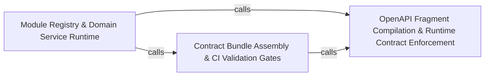

---
tags:
  - 2brain
  - 2brain/arch
  - project/boilerplate-node-backend
type: architecture
component: Contract_Generation_Pipeline
---

## Details

The build-time pipeline that compiles the per-module OpenAPI/AsyncAPI fragments into the published openapi.yaml/asyncapi.yaml bundles, generating error-code catalogues, authorization bundles, and client-collection bundles.

### OpenAPI Fragment Compilation & Runtime Contract Enforcement [[Expand]](./OpenAPI_Fragment_Compilation_Runtime_Contract_Enforcement.md)
The core compilation step that discovers per-module openapi.yaml fragments on disk, assembles the root document's path index and tag list, invokes redocly bundle to resolve $refs, then post-processes the bundle (merging app-level 429/400/413/415 responses, hanging ETag/If-Match/412 on versioned paths, stamping x-module on every operation, collecting x-error-codes into a single catalogue). It also emits the error-codes.ts constants file. At runtime, the infrastructure adapters (cache invalidation, idempotency keys, error mapping, Redis session store) enforce the contract's promises on every request.

**Related Classes/Methods**:

- `src.infrastructure.adapters.cache.invalidateCacheTagsLogged`:329-344

**Source Files:**

- `scripts/contracts/generate-error-codes.ts`
  - `scripts.contracts.generate-error-codes.ErrorCodeEntry` (L29-L32) - Interface
  - `scripts.contracts.generate-error-codes.OpenApiDocument` (L35-L37) - Interface
- `scripts/contracts/openapi-bundle.ts`
  - `scripts.contracts.openapi-bundle.filter() callback` (L75-L75) - Function
  - `scripts.contracts.openapi-bundle.AppLevelResponse` (L147-L150) - Interface
  - `scripts.contracts.openapi-bundle.Operation` (L153-L156) - Interface
  - `scripts.contracts.openapi-bundle.ErrorCodeEntry` (L159-L162) - Interface
  - `scripts.contracts.openapi-bundle.BundledDocument` (L165-L171) - Interface
  - `scripts.contracts.openapi-bundle.FragmentWithErrorCodes` (L345-L347) - Interface
- `src/infrastructure/adapters/cache.ts`
  - `src.infrastructure.adapters.cache.invalidateCacheTagsLogged` (L329-L344) - Class
  - `src.infrastructure.adapters.cache.invalidateCacheTagsLogged.then() callback` (L330-L344) - Function
- `src/infrastructure/adapters/logger.ts`
  - `src.infrastructure.adapters.logger.isSensitiveKey` (L130-L132) - Class
  - `src.infrastructure.adapters.logger.isSensitiveKey.SENSITIVE_KEY_FRAGMENTS.some() callback` (L132-L132) - Function
  - `src.infrastructure.adapters.logger.redactSensitiveFields.result` (L217-L219) - Class
  - `src.infrastructure.adapters.logger.redactSensitiveFields.result.input.map() callback` (L218-L218) - Function
  - `src.infrastructure.adapters.logger.redactFormat` (L286-L309) - Class
  - `src.infrastructure.adapters.logger.redactFormat.winston.format() callback` (L286-L309) - Function
  - `src.infrastructure.adapters.logger.prettyFormat` (L343-L356) - Class
  - `src.infrastructure.adapters.logger.prettyFormat.winston.format.printf() callback` (L349-L355) - Function
- `src/infrastructure/adapters/redis.ts`
  - `src.infrastructure.adapters.redis.isRedisConnectionError` (L140-L141) - Class
  - `src.infrastructure.adapters.redis.isRedisConnectionError.REDIS_CONNECTION_ERRORS.some() callback` (L141-L141) - Function
- `src/infrastructure/http/errors.ts`
  - `src.infrastructure.http.errors.databaseErrorInterpreter` (L60-L102) - Function
- `src/infrastructure/http/middlewares/cache.ts`
  - `src.infrastructure.http.middlewares.cache.invalidateCache` (L586-L596) - Class
  - `src.infrastructure.http.middlewares.cache.invalidateCache.<function>` (L587-L596) - Function
  - `src.infrastructure.http.middlewares.cache.invalidateCache.<function>.response.on('finish') callback` (L588-L593) - Function
- `src/infrastructure/http/middlewares/idempotency.ts`
  - `src.infrastructure.http.middlewares.idempotency.hasPrototypeKey` (L56-L61) - Class
  - `src.infrastructure.http.middlewares.idempotency.hasPrototypeKey.value.some() callback` (L57-L57) - Function
  - `src.infrastructure.http.middlewares.idempotency.hasPrototypeKey.some() callback` (L60-L60) - Function
  - `src.infrastructure.http.middlewares.idempotency.reclaimAbandoned` (L135-L161) - Class
  - `src.infrastructure.http.middlewares.idempotency.reclaimAbandoned.then() callback` (L149-L161) - Function
  - `src.infrastructure.http.middlewares.idempotency.armOutcomeCapture` (L175-L208) - Class
  - `src.infrastructure.http.middlewares.idempotency.armOutcomeCapture.<function>` (L177-L207) - Function
  - `src.infrastructure.http.middlewares.idempotency.armOutcomeCapture.<function>.catch() callback` (L192-L204) - Function
  - `src.infrastructure.http.middlewares.idempotency.onDuplicateKey` (L259-L294) - Class
  - `src.infrastructure.http.middlewares.idempotency.onDuplicateKey.then() callback` (L271-L287) - Function
  - `src.infrastructure.http.middlewares.idempotency.onDuplicateKey.catch() callback` (L288-L294) - Function
  - `src.infrastructure.http.middlewares.idempotency.claimIdempotencyKey` (L301-L323) - Class
  - `src.infrastructure.http.middlewares.idempotency.claimIdempotencyKey.then() callback` (L311-L314) - Function
  - `src.infrastructure.http.middlewares.idempotency.claimIdempotencyKey.catch() callback` (L315-L322) - Function
- `src/infrastructure/persistence/create-repository.ts`
  - `src.infrastructure.persistence.create-repository.buildWhere.ids` (L142-L144) - Class
  - `src.infrastructure.persistence.create-repository.buildWhere.ids.value.filter() callback` (L143-L143) - Function
  - `src.infrastructure.persistence.create-repository.buildWhere.ids.map() callback` (L144-L144) - Function
  - `src.infrastructure.persistence.create-repository.Repository` (L215-L278) - Interface
  - `src.infrastructure.persistence.create-repository.createRepository` (L315-L466) - Function
  - `src.infrastructure.persistence.create-repository.createRepository.buildWhere` (L464-L464) - Method
- `src/infrastructure/persistence/lease.ts`
  - `src.infrastructure.persistence.lease.acquireLease` (L141-L156) - Class
  - `src.infrastructure.persistence.lease.acquireLease.then() callback` (L151-L151) - Function
  - `src.infrastructure.persistence.lease.acquireLease.catch() callback` (L152-L155) - Function
- `src/infrastructure/persistence/metrics.ts`
  - `src.infrastructure.persistence.metrics.trackDatabaseQuery` (L28-L38) - Class
  - `src.infrastructure.persistence.metrics.trackDatabaseQuery.<function>` (L32-L38) - Function
  - `src.infrastructure.persistence.metrics.trackDatabaseQuery.<function>.catch() callback` (L34-L37) - Function
- `src/infrastructure/persistence/search.ts`
  - `src.infrastructure.persistence.search.PaginationInput` (L11-L17) - Interface
  - `src.infrastructure.persistence.search.readAll.collectFrom` (L98-L102) - Class
  - `src.infrastructure.persistence.search.readAll.collectFrom.then() callback` (L99-L102) - Function
- `src/infrastructure/persistence/versioning.ts`
  - `src.infrastructure.persistence.versioning.PreconditionFailedError` (L38-L40) - Class
  - `src.infrastructure.persistence.versioning.armed` (L159-L164) - Class
  - `src.infrastructure.persistence.versioning.armed.finally() callback` (L161-L163) - Function
  - `src.infrastructure.persistence.versioning.fencedSave` (L180-L192) - Class
  - `src.infrastructure.persistence.versioning.fencedSave.catch() callback` (L189-L191) - Function
  - `src.infrastructure.persistence.versioning.checkedDelete` (L211-L223) - Class
  - `src.infrastructure.persistence.versioning.checkedDelete.then() callback` (L220-L222) - Function
- `src/infrastructure/security/reencrypt.ts`
  - `src.infrastructure.security.reencrypt.reencryptOf` (L79-L82) - Class
  - `src.infrastructure.security.reencrypt.reencryptOf.<function>` (L81-L82) - Function
  - `src.infrastructure.security.reencrypt.reencryptCollection` (L146-L178) - Class
  - `src.infrastructure.security.reencrypt.reencryptCollection.then() callback` (L165-L177) - Function
  - `src.infrastructure.security.reencrypt.reencryptCollection.then() callback.apply.then() callback` (L171-L176) - Function
- `src/infrastructure/security/versioned-secret.ts`
  - `src.infrastructure.security.versioned-secret.decryptVersionedSecret.configured` (L124-L124) - Class
  - `src.infrastructure.security.versioned-secret.decryptVersionedSecret.configured.ring.find() callback` (L124-L124) - Function
- `src/infrastructure/surfaces/create-update-controller.ts`
  - `src.infrastructure.surfaces.create-update-controller.clearableFields` (L103-L107) - Class
  - `src.infrastructure.surfaces.create-update-controller.clearableFields.filter() callback` (L106-L106) - Function
  - `src.infrastructure.surfaces.create-update-controller.clearableFields.map() callback` (L107-L107) - Function
  - `src.infrastructure.surfaces.create-update-controller.createUpdateController.replaceFills` (L163-L165) - Class
  - `src.infrastructure.surfaces.create-update-controller.createUpdateController.replaceFills.filter() callback` (L164-L164) - Function
- `src/modules/addresses/repository.ts`
  - `src.modules.addresses.repository.addressBookRepository` (L105-L275) - Class
  - `src.modules.addresses.repository.addressBookRepository.create.items.map() callback` (L140-L141) - Function
  - `src.modules.addresses.repository.addressBookRepository.findByUserId` (L150-L154) - Method
  - `src.modules.addresses.repository.addressBookRepository.findByUserId.then() callback` (L154-L154) - Function
  - `src.modules.addresses.repository.addressBookRepository.addEntry` (L169-L198) - Method
  - `src.modules.addresses.repository.addressBookRepository.addEntry.catch() callback` (L184-L197) - Function
  - `src.modules.addresses.repository.addressBookRepository.addEntry.catch() callback.then() callback` (L189-L196) - Function
  - `src.modules.addresses.repository.addressBookRepository.updateEntry` (L205-L231) - Method
  - `src.modules.addresses.repository.addressBookRepository.setDefault` (L238-L248) - Method
  - `src.modules.addresses.repository.addressBookRepository.removeEntry` (L254-L263) - Method
  - `src.modules.addresses.repository.addressBookRepository.removeEntry.book.items.filter() callback` (L259-L259) - Function
  - `src.modules.addresses.repository.addressBookRepository.deleteByUserId` (L268-L274) - Method
  - `src.modules.addresses.repository.addressBookRepository.deleteByUserId.then() callback` (L272-L274) - Function
- `src/modules/addresses/service.ts`
  - `src.modules.addresses.service.addressForCheckout` (L97-L105) - Class
  - `src.modules.addresses.service.addressForCheckout.then() callback` (L101-L105) - Function
  - `src.modules.addresses.service.addressForCheckout.then() callback.book.items.find() callback` (L104-L104) - Function
- `src/modules/cart/domain/merge.ts`
  - `src.modules.cart.domain.merge.MergeLineFacts` (L12-L21) - Interface
  - `src.modules.cart.domain.merge.MergePlan` (L24-L29) - Interface
- `src/modules/delivery/repository.ts`
  - `src.modules.delivery.repository.shipmentRepository` (L20-L85) - Class
  - `src.modules.delivery.repository.shipmentRepository.findByOrderId` (L36-L37) - Method
  - `src.modules.delivery.repository.shipmentRepository.findByOrderIds` (L44-L45) - Method
  - `src.modules.delivery.repository.shipmentRepository.findByOrderIds.orderId.$in.orderIds.map() callback` (L45-L45) - Function
  - `src.modules.delivery.repository.shipmentRepository.upsertForOrder` (L53-L65) - Method
  - `src.modules.delivery.repository.shipmentRepository.updateStatusIfIn` (L77-L84) - Method
- `src/modules/delivery/service.ts`
  - `src.modules.delivery.service.moveAndStampDelivered.moveOrder.then() callback` (L381-L394) - Function
  - `src.modules.delivery.service.recordDelivery.then() callback.then() callback` (L421-L433) - Function
- `src/modules/inventory/domain/transitions.ts`
  - `src.modules.inventory.domain.transitions.CounterDelta` (L22-L25) - Interface
- `src/modules/inventory/metrics.ts`
  - `src.modules.inventory.metrics._productsLowStockTotal` (L24-L31) - Class
  - `src.modules.inventory.metrics._productsLowStockTotal.collect` (L28-L30) - Method
  - `src.modules.inventory.metrics._inventoryReservedUnitsTotal` (L38-L45) - Class
  - `src.modules.inventory.metrics._inventoryReservedUnitsTotal.collect` (L42-L44) - Method
- `src/modules/inventory/module.ts`
  - `src.modules.inventory.module.default` (L29-L68) - Class
  - `src.modules.inventory.module.default.subscribe` (L46-L57) - Method
  - `src.modules.inventory.module.subscribe.onDomainEvent() callback` (L47-L50) - Function
  - `src.modules.inventory.module.default.subscribe.onDomainEvent() callback.then() callback` (L48-L49) - Function
  - `src.modules.inventory.module.default.subscribe.onDomainEvent() callback` (L54-L55) - Function
- `src/modules/inventory/repository.ts`
  - `src.modules.inventory.repository.StockLevelRow` (L82-L87) - Interface
  - `src.modules.inventory.repository.toReservationItems` (L95-L101) - Class
  - `src.modules.inventory.repository.toReservationItems.lines.map() callback` (L98-L101) - Function
  - `src.modules.inventory.repository.stockLevelRepository` (L108-L288) - Class
  - `src.modules.inventory.repository.stockLevelRepository.ensure` (L147-L154) - Method
  - `src.modules.inventory.repository.stockLevelRepository.findManyByProductIds` (L162-L163) - Method
  - `src.modules.inventory.repository.stockLevelRepository.findManyByProductIds.productId.$in.productIds.map() callback` (L163-L163) - Function
  - `src.modules.inventory.repository.stockLevelRepository.findByProductId` (L170-L174) - Method
  - `src.modules.inventory.repository.stockLevelRepository.deleteByProductId` (L184-L188) - Method
  - `src.modules.inventory.repository.stockLevelRepository.deleteByProductId.then() callback` (L188-L188) - Function
  - `src.modules.inventory.repository.stockLevelRepository.applyDelta` (L204-L224) - Method
  - `src.modules.inventory.repository.stockLevelRepository.applyDelta.then() callback` (L224-L224) - Function
  - `src.modules.inventory.repository.stockLevelRepository.stockBoard` (L238-L260) - Method
  - `src.modules.inventory.repository.stockLevelRepository.stockBoard.then() callback` (L251-L259) - Function
  - `src.modules.inventory.repository.stockLevelRepository.stockBoard.then() callback.items.rows.map() callback` (L252-L257) - Function
  - `src.modules.inventory.repository.stockLevelRepository.lowAvailabilityProductIds` (L272-L277) - Method
  - `src.modules.inventory.repository.stockLevelRepository.lowAvailabilityProductIds.then() callback` (L277-L277) - Function
  - `src.modules.inventory.repository.stockLevelRepository.lowAvailabilityProductIds.then() callback.rows.map() callback` (L277-L277) - Function
  - `src.modules.inventory.repository.stockLevelRepository.sumReserved` (L284-L287) - Method
  - `src.modules.inventory.repository.stockLevelRepository.sumReserved.then() callback` (L287-L287) - Function
  - `src.modules.inventory.repository.reservationRepository` (L312-L444) - Class
  - `src.modules.inventory.repository.reservationRepository.insertHold` (L345-L357) - Method
  - `src.modules.inventory.repository.reservationRepository.insertHold.then() callback` (L353-L353) - Function
  - `src.modules.inventory.repository.reservationRepository.insertHold.catch() callback` (L354-L357) - Function
  - `src.modules.inventory.repository.reservationRepository.findByOrderId` (L365-L366) - Method
  - `src.modules.inventory.repository.reservationRepository.claimStatus` (L378-L391) - Method
  - `src.modules.inventory.repository.reservationRepository.findExpired` (L401-L406) - Method
  - `src.modules.inventory.repository.reservationRepository.narrowToTaken` (L418-L425) - Method
  - `src.modules.inventory.repository.reservationRepository.narrowToTaken.then() callback` (L425-L425) - Function
  - `src.modules.inventory.repository.reservationRepository.extendExpiry` (L436-L443) - Method
- `src/modules/inventory/services/holds.ts`
  - `src.modules.inventory.services.holds.claimAndApply` (L34-L54) - Class
  - `src.modules.inventory.services.holds.claimAndApply.claimAndMove` (L41-L47) - Class
  - `src.modules.inventory.services.holds.claimAndApply.claimAndMove.then() callback` (L42-L47) - Function
  - `src.modules.inventory.services.holds.claimAndApply.claimAndMove.then() callback.then() callback` (L45-L45) - Function
  - `src.modules.inventory.services.holds.claimAndApply.then() callback` (L51-L52) - Function
  - `src.modules.inventory.services.holds.claimAndApply.then() callback.then() callback` (L52-L52) - Function
  - `src.modules.inventory.services.holds.refreshStockCacheForOrder` (L147-L154) - Class
  - `src.modules.inventory.services.holds.refreshStockCacheForOrder.then() callback` (L150-L153) - Function
  - `src.modules.inventory.services.holds.refreshStockCacheForOrder.then() callback.map() callback` (L152-L152) - Function
  - `src.modules.inventory.services.holds.extendHoldForOrder` (L166-L169) - Class
  - `src.modules.inventory.services.holds.extendHoldForOrder.then() callback` (L169-L169) - Function
  - `src.modules.inventory.services.holds.isHoldReleased` (L181-L182) - Class
  - `src.modules.inventory.services.holds.isHoldReleased.then() callback` (L182-L182) - Function
  - `src.modules.inventory.services.holds.isStockBoundToOrder` (L194-L197) - Class
  - `src.modules.inventory.services.holds.isStockBoundToOrder.then() callback` (L197-L197) - Function
- `src/modules/inventory/services/levels.ts`
  - `src.modules.inventory.services.levels.ensureLevel` (L26-L27) - Class
  - `src.modules.inventory.services.levels.ensureLevel.then() callback` (L27-L27) - Function
  - `src.modules.inventory.services.levels.availableFor` (L50-L55) - Class
  - `src.modules.inventory.services.levels.availableFor.then() callback` (L54-L54) - Function
  - `src.modules.inventory.services.levels.availableFor.then() callback.levels.map() callback` (L54-L54) - Function
  - `src.modules.inventory.services.levels.listLevels.products` (L80-L80) - Class
  - `src.modules.inventory.services.levels.listLevels.products.items.map() callback` (L80-L80) - Function
  - `src.modules.inventory.services.levels.listLevels.titleOf` (L81-L81) - Class
  - `src.modules.inventory.services.levels.listLevels.titleOf.products.map() callback` (L81-L81) - Function
  - `src.modules.inventory.services.levels.listLevels.items.items.map() callback` (L84-L87) - Function
  - `src.modules.inventory.services.levels.lowStockCount` (L98-L101) - Class
  - `src.modules.inventory.services.levels.lowStockCount.then() callback` (L101-L101) - Function
- `src/modules/inventory/services/reserve.ts`
  - `src.modules.inventory.services.reserve.giveBackAndDeleteHold` (L30-L60) - Class
  - `src.modules.inventory.services.reserve.giveBackAndDeleteHold.taken.map() callback` (L38-L49) - Function
  - `src.modules.inventory.services.reserve.giveBackAndDeleteHold.taken.map() callback.catch() callback` (L42-L49) - Function
  - `src.modules.inventory.services.reserve.giveBackAndDeleteHold.catch() callback` (L52-L59) - Function
  - `src.modules.inventory.services.reserve.inLockOrder` (L73-L75) - Class
  - `src.modules.inventory.services.reserve.inLockOrder.lines.toSorted() callback` (L75-L75) - Function
- `src/modules/inventory/services/sweep.ts`
  - `src.modules.inventory.services.sweep.expireOne` (L38-L52) - Class
  - `src.modules.inventory.services.sweep.announceInTransaction() callback` (L40-L43) - Function
  - `src.modules.inventory.services.sweep.expireOne.announceInTransaction() callback.then() callback` (L41-L42) - Function
  - `src.modules.inventory.services.sweep.expireOne.announceInTransaction() callback` (L44-L48) - Function
  - `src.modules.inventory.services.sweep.expireOne.then() callback` (L49-L51) - Function
  - `src.modules.inventory.services.sweep.expireOne.then() callback.then() callback` (L51-L51) - Function
- `src/modules/inventory/services/transition.ts`
  - `src.modules.inventory.services.transition.syncStockCache` (L27-L41) - Class
  - `src.modules.inventory.services.transition.syncStockCache.then() callback` (L32-L32) - Function
  - `src.modules.inventory.services.transition.syncStockCache.catch() callback` (L33-L40) - Function
- `src/modules/inventory/services/types.ts`
  - `src.modules.inventory.services.types.StockLine` (L10-L13) - Interface
  - `src.modules.inventory.services.types.StockShortfall` (L16-L21) - Interface
  - `src.modules.inventory.services.types.LevelFilters` (L34-L36) - Interface
  - `src.modules.inventory.services.types.MovementFilters` (L39-L42) - Interface
- `src/modules/invoicing/services/partial-credit.ts`
  - `src.modules.invoicing.services.partial-credit.PartialCredit` (L22-L25) - Interface
  - `src.modules.invoicing.services.partial-credit.partialCredit.lines.taxSummary.flatMap() callback` (L46-L56) - Function
  - `src.modules.invoicing.services.partial-credit.lines` (L46-L57) - Class
  - `src.modules.invoicing.services.partial-credit.partialCredit.breakdown.items.lines.map() callback` (L60-L63) - Function
- `src/modules/invoicing/services/render.ts`
  - `src.modules.invoicing.services.render.then() callback.then() callback.then() callback` (L78-L78) - Function
- `src/modules/notifications/presenter.ts`
  - `src.modules.notifications.presenter.NotificationsView` (L11-L13) - Interface
  - `src.modules.notifications.presenter.presentNotifications.items.notifications.map() callback` (L44-L44) - Function
- `src/modules/notifications/repository.ts`
  - `src.modules.notifications.repository.notificationRepository` (L31-L123) - Class
  - `src.modules.notifications.repository.notificationRepository.listByUserId` (L48-L52) - Method
  - `src.modules.notifications.repository.notificationRepository.insertMany` (L60-L61) - Method
  - `src.modules.notifications.repository.notificationRepository.deleteOwned` (L67-L71) - Method
  - `src.modules.notifications.repository.notificationRepository.deleteOwned.then() callback` (L71-L71) - Function
  - `src.modules.notifications.repository.notificationRepository.deleteAllOwned` (L74-L80) - Method
  - `src.modules.notifications.repository.notificationRepository.deleteAllOwned.then() callback` (L78-L80) - Function
  - `src.modules.notifications.repository.notificationRepository.deleteByUserId` (L83-L89) - Method
  - `src.modules.notifications.repository.notificationRepository.deleteByUserId.then() callback` (L87-L89) - Function
  - `src.modules.notifications.repository.notificationRepository.markAllRead` (L92-L101) - Method
  - `src.modules.notifications.repository.notificationRepository.markAllRead.then() callback` (L99-L101) - Function
  - `src.modules.notifications.repository.notificationRepository.trimToNewest` (L108-L122) - Method
- `src/modules/notifications/services/inbox.ts`
  - `src.modules.notifications.services.inbox.trimInbox` (L30-L36) - Class
  - `src.modules.notifications.services.inbox.trimInbox.then() callback` (L33-L36) - Function
  - `src.modules.notifications.services.inbox.notificationsCreate` (L46-L57) - Class
  - `src.modules.notifications.services.inbox.notificationsCreate.created.map() callback` (L55-L55) - Function
  - `src.modules.notifications.services.inbox.notificationsDismissAll` (L75-L79) - Class
  - `src.modules.notifications.services.inbox.notificationsReadAll` (L82-L88) - Class
  - `src.modules.notifications.services.inbox.notificationsReadAll.then() callback` (L84-L87) - Function
- `src/modules/notifications/services/stream.ts`
  - `src.modules.notifications.services.stream.openStreamCount` (L61-L62) - Class
  - `src.modules.notifications.services.stream.openStreamCount.reduce() callback` (L62-L62) - Function
  - `src.modules.notifications.services.stream.streamNotifications.heartbeat` (L92-L94) - Class
  - `src.modules.notifications.services.stream.streamNotifications.heartbeat.setInterval() callback` (L92-L94) - Function
  - `src.modules.notifications.services.stream.streamNotifications.reverifyTimer` (L97-L106) - Class
  - `src.modules.notifications.services.stream.streamNotifications.reverifyTimer.setInterval() callback` (L97-L106) - Function
  - `src.modules.notifications.services.stream.streamNotifications.reverifyTimer.setInterval() callback.catch() callback` (L99-L99) - Function
  - `src.modules.notifications.services.stream.streamNotifications.reverifyTimer.setInterval() callback.then() callback` (L100-L105) - Function
- `src/modules/notifications/services/subscribers.ts`
  - `src.modules.notifications.services.subscribers.removedFor` (L17-L26) - Class
  - `src.modules.notifications.services.subscribers.removedFor.userIds.map() callback` (L21-L26) - Function
- `src/modules/orders/config.ts`
  - `src.modules.orders.config.ShopIdentity` (L94-L108) - Interface
  - `src.modules.orders.config.ReturnAddress` (L131-L139) - Interface
- `src/modules/orders/repository.ts`
  - `src.modules.orders.repository.search` (L105-L136) - Class
  - `src.modules.orders.repository.search.then() callback` (L123-L134) - Function
  - `src.modules.orders.repository.search.then() callback.then() callback` (L130-L133) - Function
- `src/modules/products/repository.ts`
  - `src.modules.products.repository.productRepository` (L33-L239) - Class
  - `src.modules.products.repository.productRepository.publicScope` (L75-L75) - Method
  - `src.modules.products.repository.productRepository.findByIdScoped` (L89-L90) - Method
  - `src.modules.products.repository.productRepository.findPublicById` (L99-L100) - Method
  - `src.modules.products.repository.productRepository.facets` (L109-L137) - Method
  - `src.modules.products.repository.productRepository.facets.then() callback` (L131-L137) - Function
  - `src.modules.products.repository.productRepository.facets.then() callback.categories.map() callback` (L132-L135) - Function
  - `src.modules.products.repository.productRepository.facets.then() callback.tags.map() callback` (L136-L136) - Function
  - `src.modules.products.repository.productRepository.syncStockCache` (L147-L151) - Method
  - `src.modules.products.repository.productRepository.syncStockCache.then() callback` (L151-L151) - Function
  - `src.modules.products.repository.productRepository.writeTranslatedFields` (L160-L179) - Method
  - `src.modules.products.repository.productRepository.writeTranslatedFields.$set.map() callback` (L172-L172) - Function
  - `src.modules.products.repository.productRepository.writeTranslatedFields.then() callback` (L179-L179) - Function
  - `src.modules.products.repository.productRepository.markEdited` (L189-L197) - Method
  - `src.modules.products.repository.productRepository.markEdited.then() callback` (L197-L197) - Function
  - `src.modules.products.repository.productRepository.existsById` (L207-L208) - Method
  - `src.modules.products.repository.productRepository.writebackImage` (L218-L238) - Method
  - `src.modules.products.repository.productRepository.writebackImage.then() callback` (L229-L237) - Function
  - `src.modules.products.repository.productRepository.writebackImage.then() callback.then() callback` (L237-L237) - Function
- `src/modules/products/services/lookups.ts`
  - `src.modules.products.services.lookups.findManyByIds` (L33-L36) - Class
  - `src.modules.products.services.lookups.findManyByIds.then() callback` (L34-L35) - Function
  - `src.modules.products.services.lookups.findManyByIds.then() callback._id.$in.ids.map() callback` (L35-L35) - Function
  - `src.modules.products.services.lookups.countPublic` (L48-L56) - Class
  - `src.modules.products.services.lookups.countPublic.then() callback` (L51-L55) - Function
  - `src.modules.products.services.lookups.countPublic.then() callback._id.$in.ids.map() callback` (L54-L54) - Function
- `src/modules/products/services/search.ts`
  - `src.modules.products.services.search.searchWithTranslatedText` (L68-L93) - Class
  - `src.modules.products.services.search.searchWithTranslatedText.then() callback` (L82-L92) - Function
  - `src.modules.products.services.search.searchWithTranslatedText.then() callback.union.$or._id.$in.translatedIds.map() callback` (L87-L87) - Function
- `src/modules/returns/repository.ts`
  - `src.modules.returns.repository.returnRepository` (L33-L113) - Class
  - `src.modules.returns.repository.returnRepository.claimStatus` (L66-L73) - Method
  - `src.modules.returns.repository.returnRepository.findByOrderId` (L80-L85) - Method
  - `src.modules.returns.repository.returnRepository.lockOrder` (L94-L102) - Method
  - `src.modules.returns.repository.returnRepository.lockOrder.then() callback` (L102-L102) - Function
  - `src.modules.returns.repository.returnRepository.findByOrderIds` (L108-L112) - Method
  - `src.modules.returns.repository.returnRepository.findByOrderIds.orderId.$in.orderIds.map() callback` (L110-L110) - Function
- `src/modules/returns/services/create.ts`
  - `src.modules.returns.services.create.CreateReturnInput` (L53-L59) - Interface
  - `src.modules.returns.services.create.writeReturn.lines.lines.map() callback` (L249-L258) - Function
  - `src.modules.returns.services.create.withTransaction() callback.then() callback` (L283-L283) - Function
- `src/modules/returns/services/decide.ts`
  - `src.modules.returns.services.decide.decide` (L77-L94) - Class
  - `src.modules.returns.services.decide.decide.then() callback` (L84-L93) - Function
  - `src.modules.returns.services.decide.decide.then() callback.then() callback` (L91-L92) - Function
  - `src.modules.returns.services.decide.refusalForDecision` (L106-L118) - Class
  - `src.modules.returns.services.decide.refusalForDecision.then() callback` (L111-L118) - Function
- `src/modules/users/model.ts`
  - `src.modules.users.model.tokenAdd` (L781-L805) - Function
  - `src.modules.users.model.tokenRemoveAll` (L810-L820) - Function
- `src/modules/users/repository.ts`
  - `src.modules.users.repository.userRepository` (L59-L583) - Class
  - `src.modules.users.repository.userRepository.updateMany` (L114-L115) - Method
  - `src.modules.users.repository.userRepository.findByIdWithCredentials` (L120-L121) - Method
  - `src.modules.users.repository.userRepository.findOneWithCredentials` (L126-L127) - Method
  - `src.modules.users.repository.userRepository.findByIdWithPendingEmail` (L134-L134) - Method
  - `src.modules.users.repository.userRepository.emailOrPendingEmailTaken` (L146-L152) - Method
  - `src.modules.users.repository.userRepository.emailOrPendingEmailTaken.then() callback` (L152-L152) - Function
  - `src.modules.users.repository.userRepository.findByToken` (L166-L170) - Method
  - `src.modules.users.repository.userRepository.findAuthenticatableById` (L180-L181) - Method
  - `src.modules.users.repository.userRepository.findAuthenticatableByEmail` (L189-L193) - Method
  - `src.modules.users.repository.userRepository.tokenRemove` (L203-L212) - Method
  - `src.modules.users.repository.userRepository.tokenRemoveByValue` (L222-L231) - Method
  - `src.modules.users.repository.userRepository.tokenRemoveExpired` (L257-L271) - Method
  - `src.modules.users.repository.userRepository.tokenRemoveExpired.then() callback` (L270-L270) - Function
  - `src.modules.users.repository.userRepository.findByTokenValue` (L283-L287) - Method
  - `src.modules.users.repository.userRepository.tokenTouch` (L295-L302) - Method
  - `src.modules.users.repository.userRepository.tokenSupersede` (L321-L333) - Method
  - `src.modules.users.repository.userRepository.tokenSupersede.then() callback` (L333-L333) - Function
  - `src.modules.users.repository.userRepository.sessionRemove` (L342-L349) - Method
  - `src.modules.users.repository.userRepository.linkOAuthAccount` (L361-L369) - Method
  - `src.modules.users.repository.userRepository.linkOAuthAccount.then() callback` (L369-L369) - Function
  - `src.modules.users.repository.userRepository.unlinkOAuthAccount` (L379-L387) - Method
  - `src.modules.users.repository.userRepository.unlinkOAuthAccount.then() callback` (L387-L387) - Function
  - `src.modules.users.repository.userRepository.reserveMfaAttempt` (L404-L453) - Method
  - `src.modules.users.repository.userRepository.reserveMfaAttempt.then() callback` (L448-L451) - Function
  - `src.modules.users.repository.userRepository.resetMfaAttempts` (L459-L470) - Method
  - `src.modules.users.repository.userRepository.resetMfaAttempts.then() callback` (L470-L470) - Function
  - `src.modules.users.repository.userRepository.bumpSessionEpoch` (L477-L488) - Method
  - `src.modules.users.repository.userRepository.bumpSessionEpoch.then() callback` (L488-L488) - Function
  - `src.modules.users.repository.userRepository.claimTotpStep` (L498-L514) - Method
  - `src.modules.users.repository.userRepository.claimTotpStep.then() callback` (L514-L514) - Function
  - `src.modules.users.repository.userRepository.writebackImage` (L523-L543) - Method
  - `src.modules.users.repository.userRepository.writebackImage.then() callback` (L534-L542) - Function
  - `src.modules.users.repository.userRepository.writebackImage.then() callback.then() callback` (L542-L542) - Function
  - `src.modules.users.repository.userRepository.findInactiveUnwarned` (L549-L557) - Method
  - `src.modules.users.repository.userRepository.findWarnedStillInactive` (L563-L570) - Method
  - `src.modules.users.repository.userRepository.findReaperSoftDeletedPastGrace` (L573-L582) - Method
- `src/modules/users/services/tokens.ts`
  - `src.modules.users.services.tokens.consumeToken` (L21-L31) - Class
  - `src.modules.users.services.tokens.consumeToken.then() callback` (L22-L31) - Function
  - `src.modules.users.services.tokens.consumeToken.then() callback.user.tokens.filter() callback` (L26-L26) - Function
- `src/modules/users/services/update.ts`
  - `src.modules.users.services.update.saveWithRole.then() callback.revoke` (L164-L167) - Class
  - `src.modules.users.services.update.saveWithRole.then() callback.revoke.catch() callback` (L166-L166) - Function
  - `src.modules.users.services.update.saveWithRole.then() callback.revoke.then() callback` (L184-L184) - Function

### Module Registry & Domain Service Runtime [[Expand]](./Module_Registry_Domain_Service_Runtime.md)
The kernel's module registry that turns the explicit module list into a running application: each module declares its routes, consumers, image targets, translatables, and personal-data sections in a single typed AppModule manifest. This group also contains the domain module implementations (account, addresses, api-keys, audit-logs) with their repositories and services, plus the security infrastructure (JWT, OAuth, two-factor, re-encryption) that the contract's authorization keys reference. It is the runtime target that the contract describes.

**Related Classes/Methods**:

- `src.kernel.registry.AppModule`:279-417
- `src.kernel.registry.ModuleConsumer`:63-79
- `src.modules.account.module.default`:60-106
- `src.infrastructure.security.reencrypt.ReencryptJob`:54-65
- `src.modules.addresses.service.addressesGet`:31-32

**Source Files:**

- `src/infrastructure/security/reencrypt.ts`
  - `src.infrastructure.security.reencrypt.ReencryptJob` (L54-L65) - Interface
- `src/kernel/registry.ts`
  - `src.kernel.registry.ModuleConsumer` (L63-L79) - Interface
  - `src.kernel.registry.ModuleConsumer.handler` (L68-L68) - Method
  - `src.kernel.registry.PersonalDataSection` (L231-L251) - Interface
  - `src.kernel.registry.AppModule` (L279-L417) - Interface
- `src/modules/account/module.ts`
  - `src.modules.account.module.default` (L60-L106) - Class
  - `src.modules.account.module.default.personalData.collect` (L75-L75) - Method
  - `src.modules.account.module.default.subscribe` (L94-L103) - Method
  - `src.modules.account.module.default.subscribe.onDomainEvent() callback` (L100-L101) - Function
  - `src.modules.account.module.default.subscribe.onDomainEvent() callback.then() callback` (L101-L101) - Function
- `src/modules/account/repository.ts`
  - `src.modules.account.repository.deleteById` (L86-L90) - Class
  - `src.modules.account.repository.deleteById.then() callback` (L90-L90) - Function
  - `src.modules.account.repository.deleteByUserId` (L100-L110) - Class
  - `src.modules.account.repository.deleteByUserId.then() callback` (L105-L109) - Function
  - `src.modules.account.repository.deleteByUserId.then() callback.then() callback` (L109-L109) - Function
  - `src.modules.account.repository.deleteByUserId.then() callback.then() callback.rows.map() callback` (L109-L109) - Function
- `src/modules/account/services/oauth.ts`
  - `src.modules.account.services.oauth.listOAuthLinks` (L280-L289) - Class
  - `src.modules.account.services.oauth.listOAuthLinks.then() callback` (L284-L288) - Function
  - `src.modules.account.services.oauth.listOAuthLinks.then() callback.map() callback` (L285-L288) - Function
- `src/modules/account/services/two-factor.ts`
  - `src.modules.account.services.two-factor.buildLoginChallenge.ttlMs.armed.some() callback` (L422-L422) - Function
  - `src.modules.account.services.two-factor.buildLoginChallenge.ttlMs` (L422-L424) - Class
  - `src.modules.account.services.two-factor.sendMethodCode.outcome.then() callback.armed` (L567-L567) - Class
  - `src.modules.account.services.two-factor.sendMethodCode.outcome.then() callback.armed.find() callback` (L567-L567) - Function
- `src/modules/account/session/jwt.ts`
  - `src.modules.account.session.jwt.TokenData` (L32-L54) - Interface
  - `src.modules.account.session.jwt.RotatedSession` (L60-L64) - Interface
  - `src.modules.account.session.jwt.then() callback.then() callback` (L361-L362) - Function
  - `src.modules.account.session.jwt.then() callback.then() callback.then() callback` (L362-L362) - Function
  - `src.modules.account.session.jwt.resolveLostRotation.then() callback.entry` (L396-L396) - Class
  - `src.modules.account.session.jwt.resolveLostRotation.then() callback.entry.user.tokens.find() callback` (L396-L396) - Function
- `src/modules/addresses/module.ts`
  - `src.modules.addresses.module.default.personalData.collect` (L32-L32) - Method
  - `src.modules.addresses.module.default.personalData.collect.then() callback` (L32-L32) - Function
- `src/modules/addresses/reencrypt.ts`
  - `src.modules.addresses.reencrypt.fieldsOf` (L17-L32) - Class
  - `src.modules.addresses.reencrypt.fieldsOf.book.items.flatMap() callback` (L18-L31) - Function
  - `src.modules.addresses.reencrypt.fieldsOf.book.items.flatMap() callback.ENTRY_FIELDS.flatMap() callback` (L19-L31) - Function
- `src/modules/addresses/service.ts`
  - `src.modules.addresses.service.addressesGet` (L31-L32) - Class
  - `src.modules.addresses.service.addressesGet.then() callback` (L32-L32) - Function
- `src/modules/api-keys/module.ts`
  - `src.modules.api-keys.module.default` (L34-L61) - Class
  - `src.modules.api-keys.module.default.subscribe` (L39-L46) - Method
  - `src.modules.api-keys.module.default.subscribe.onDomainEvent() callback` (L43-L44) - Function
  - `src.modules.api-keys.module.default.personalData.collect` (L52-L52) - Method
- `src/modules/api-keys/services/api-keys.ts`
  - `src.modules.api-keys.services.api-keys.findOwnApiKeys` (L107-L118) - Class
  - `src.modules.api-keys.services.api-keys.findOwnApiKeys.readAll() callback` (L109-L116) - Function
  - `src.modules.api-keys.services.api-keys.findOwnApiKeys.readAll() callback.then() callback` (L116-L116) - Function
- `src/modules/api-keys/services/resolver.ts`
  - `src.modules.api-keys.services.resolver.fromBearerToken.then() callback.then() callback.held` (L96-L98) - Class
  - `src.modules.api-keys.services.resolver.fromBearerToken.then() callback.then() callback.held.apiKey.permissions.filter() callback` (L97-L97) - Function
- `src/modules/audit-logs/module.ts`
  - `src.modules.audit-logs.module.default.personalData.collect` (L44-L44) - Method
- `src/modules/audit-logs/service.ts`
  - `src.modules.audit-logs.service.searchIncidents` (L118-L133) - Class
  - `src.modules.audit-logs.service.searchIncidents.then() callback` (L127-L133) - Function
  - `src.modules.audit-logs.service.searchIncidents.then() callback.items.page.items.map() callback` (L129-L132) - Function
  - `src.modules.audit-logs.service.findOwnAuditEntries.readFrom` (L149-L153) - Class
  - `src.modules.audit-logs.service.findOwnAuditEntries.readFrom.then() callback` (L150-L153) - Function
- `src/modules/delivery/domain/rates.ts`
  - `src.modules.delivery.domain.rates.cheapestStandardShipping.prices.SHIPPING_METHODS.filter() callback` (L84-L84) - Function
  - `src.modules.delivery.domain.rates.cheapestStandardShipping.prices.map() callback` (L84-L85) - Function
  - `src.modules.delivery.domain.rates.cheapestStandardShipping.prices` (L84-L86) - Class
- `src/modules/delivery/module.ts`
  - `src.modules.delivery.module.default.personalData.collect` (L30-L31) - Method
  - `src.modules.delivery.module.default.personalData.collect.then() callback` (L31-L31) - Function
- `src/modules/example/module.ts`
  - `src.modules.example.module.default` (L50-L78) - Class
  - `src.modules.example.module.default.subscribe` (L58-L60) - Method
- `src/modules/example/repository.ts`
  - `src.modules.example.repository.exampleRepository` (L28-L154) - Class
  - `src.modules.example.repository.exampleRepository.deleteAllOf` (L69-L80) - Method
  - `src.modules.example.repository.exampleRepository.deleteAllOf.then() callback` (L75-L79) - Function
  - `src.modules.example.repository.exampleRepository.deleteAllOf.then() callback.then() callback` (L79-L79) - Function
  - `src.modules.example.repository.exampleRepository.deleteAllOf.then() callback.then() callback.withCover.flatMap() callback` (L79-L79) - Function
  - `src.modules.example.repository.exampleRepository.existsById` (L87-L87) - Method
  - `src.modules.example.repository.exampleRepository.writeTranslatedFields` (L97-L110) - Method
  - `src.modules.example.repository.exampleRepository.writeTranslatedFields.$set.map() callback` (L103-L103) - Function
  - `src.modules.example.repository.exampleRepository.writeTranslatedFields.then() callback` (L110-L110) - Function
  - `src.modules.example.repository.exampleRepository.markEdited` (L119-L127) - Method
  - `src.modules.example.repository.exampleRepository.markEdited.then() callback` (L127-L127) - Function
  - `src.modules.example.repository.exampleRepository.writebackImage` (L133-L153) - Method
  - `src.modules.example.repository.exampleRepository.writebackImage.then() callback` (L144-L152) - Function
  - `src.modules.example.repository.exampleRepository.writebackImage.then() callback.then() callback` (L152-L152) - Function
- `src/modules/example/services/crud.ts`
  - `src.modules.example.services.crud.search` (L161-L179) - Class
  - `src.modules.example.services.crud.search.then() callback` (L174-L178) - Function
  - `src.modules.example.services.crud.search.then() callback.items.map() callback` (L175-L175) - Function
  - `src.modules.example.services.crud.search.then() callback.then() callback` (L175-L178) - Function
  - `src.modules.example.services.crud.search.then() callback.then() callback.items.items.map() callback` (L176-L176) - Function
- `src/modules/example/services/owner.ts`
  - `src.modules.example.services.owner.ownerNameOf` (L22-L23) - Class
  - `src.modules.example.services.owner.ownerNameOf.then() callback` (L23-L23) - Function
  - `src.modules.example.services.owner.ownerNamesOf` (L31-L36) - Class
  - `src.modules.example.services.owner.ownerNamesOf.map() callback` (L33-L34) - Function
  - `src.modules.example.services.owner.ownerNamesOf.map() callback.then() callback` (L34-L34) - Function
  - `src.modules.example.services.owner.ownerNamesOf.then() callback` (L36-L36) - Function
- `src/modules/example/services/personal-data.ts`
  - `src.modules.example.services.personal-data.collectPersonalData` (L25-L42) - Class
  - `src.modules.example.services.personal-data.collectPersonalData.readAll() callback` (L28-L36) - Function
  - `src.modules.example.services.personal-data.collectPersonalData.then() callback` (L40-L41) - Function
  - `src.modules.example.services.personal-data.collectPersonalData.then() callback.map() callback` (L41-L41) - Function
- `src/modules/feedback/module.ts`
  - `src.modules.feedback.module.default.personalData.collect` (L33-L36) - Method
- `src/modules/feedback/service.ts`
  - `src.modules.feedback.service.findOwnTickets` (L248-L256) - Class
  - `src.modules.feedback.service.findOwnTickets.readAll() callback` (L250-L254) - Function
  - `src.modules.feedback.service.findOwnTicketsForExport` (L284-L285) - Class
  - `src.modules.feedback.service.findOwnTicketsForExport.then() callback` (L285-L285) - Function
  - `src.modules.feedback.service.findOwnTicketsForExport.then() callback.tickets.map() callback` (L285-L285) - Function
- `src/modules/invoicing/emails.ts`
  - `src.modules.invoicing.emails.buildVatBlock.shippingTaxAt` (L144-L144) - Class
  - `src.modules.invoicing.emails.buildVatBlock.shippingTaxAt.document.shippingByRate.map() callback` (L144-L144) - Function
  - `src.modules.invoicing.emails.buildVatBlock.goodsTaxByRate` (L145-L150) - Class
  - `src.modules.invoicing.emails.buildVatBlock.goodsTaxByRate.document.taxSummary.map() callback` (L146-L149) - Function
- `src/modules/invoicing/model.ts`
  - `src.modules.invoicing.model.InvoiceLine` (L28-L41) - Interface
  - `src.modules.invoicing.model.InvoiceParty` (L44-L50) - Interface
  - `src.modules.invoicing.model.FrozenTaxDocument` (L62-L91) - Interface
  - `src.modules.invoicing.model.InvoiceDocument` (L94-L94) - Interface
  - `src.modules.invoicing.model.CreditNoteDocument` (L104-L111) - Interface
  - `src.modules.invoicing.model.NumberCounterDocument` (L228-L230) - Interface
- `src/modules/invoicing/module.ts`
  - `src.modules.invoicing.module.default` (L33-L66) - Class
  - `src.modules.invoicing.module.default.personalData.collect` (L42-L42) - Method
  - `src.modules.invoicing.module.default.subscribe` (L52-L63) - Method
  - `src.modules.invoicing.module.subscribe.onDomainEvent() callback` (L53-L59) - Function
  - `src.modules.invoicing.module.default.subscribe.onDomainEvent() callback.then() callback` (L58-L58) - Function
  - `src.modules.invoicing.module.default.subscribe.onDomainEvent() callback` (L60-L61) - Function
- `src/modules/invoicing/pii.ts`
  - `src.modules.invoicing.pii.encryptInvoiceParty` (L50-L55) - Class
  - `src.modules.invoicing.pii.encryptInvoiceParty.mapParty() callback` (L55-L55) - Function
  - `src.modules.invoicing.pii.decryptInvoiceParty` (L62-L69) - Class
  - `src.modules.invoicing.pii.decryptInvoiceParty.mapParty() callback` (L67-L68) - Function
- `src/modules/invoicing/repository.ts`
  - `src.modules.invoicing.repository.incrementCounter` (L112-L124) - Class
  - `src.modules.invoicing.repository.incrementCounter.then() callback` (L124-L124) - Function
  - `src.modules.invoicing.repository.invoicingRepository` (L127-L140) - Class
  - `src.modules.invoicing.repository.invoicingRepository.incrementInvoiceNumberCounter` (L136-L137) - Method
  - `src.modules.invoicing.repository.invoicingRepository.incrementCreditNoteNumberCounter` (L138-L139) - Method
- `src/modules/invoicing/services/issue-credit-note.ts`
  - `src.modules.invoicing.services.issue-credit-note.RefundedInput` (L24-L31) - Interface
  - `src.modules.invoicing.services.issue-credit-note.reversedFigures.grandTotal.items.lines.map() callback` (L81-L84) - Function
  - `src.modules.invoicing.services.issue-credit-note.readWinner` (L97-L103) - Class
  - `src.modules.invoicing.services.issue-credit-note.readWinner.<function>` (L97-L103) - Function
  - `src.modules.invoicing.services.issue-credit-note.readWinner.<function>.then() callback` (L99-L102) - Function
  - `src.modules.invoicing.services.issue-credit-note.issueCreditNote` (L118-L160) - Class
  - `src.modules.invoicing.services.issue-credit-note.issueCreditNote.then() callback` (L119-L160) - Function
  - `src.modules.invoicing.services.issue-credit-note.issueCreditNote.then() callback.withTransaction() callback` (L125-L158) - Function
  - `src.modules.invoicing.services.issue-credit-note.issueCreditNote.then() callback.withTransaction() callback.then() callback` (L126-L157) - Function
- `src/modules/invoicing/services/issue-invoice.ts`
  - `src.modules.invoicing.services.issue-invoice.frozenLines` (L40-L47) - Class
  - `src.modules.invoicing.services.issue-invoice.frozenLines.order.items.map() callback` (L41-L47) - Function
  - `src.modules.invoicing.services.issue-invoice.readWinner` (L55-L63) - Class
  - `src.modules.invoicing.services.issue-invoice.readWinner.<function>` (L55-L63) - Function
  - `src.modules.invoicing.services.issue-invoice.readWinner.<function>.then() callback` (L57-L62) - Function
  - `src.modules.invoicing.services.issue-invoice.issueInvoice` (L77-L130) - Class
  - `src.modules.invoicing.services.issue-invoice.issueInvoice.withTransaction() callback` (L92-L128) - Function
  - `src.modules.invoicing.services.issue-invoice.issueInvoice.withTransaction() callback.then() callback` (L93-L127) - Function
- `src/modules/invoicing/services/numbering.ts`
  - `src.modules.invoicing.services.numbering.allocateInvoiceNumber` (L28-L33) - Class
  - `src.modules.invoicing.services.numbering.allocateInvoiceNumber.then() callback` (L32-L32) - Function
  - `src.modules.invoicing.services.numbering.allocateCreditNoteNumber` (L41-L46) - Class
  - `src.modules.invoicing.services.numbering.allocateCreditNoteNumber.then() callback` (L45-L45) - Function
- `src/modules/invoicing/services/personal-data.ts`
  - `src.modules.invoicing.services.personal-data.collectPersonalData` (L19-L38) - Class
  - `src.modules.invoicing.services.personal-data.collectPersonalData.then() callback` (L22-L37) - Function
  - `src.modules.invoicing.services.personal-data.collectPersonalData.then() callback.orders.map() callback` (L24-L28) - Function
  - `src.modules.invoicing.services.personal-data.collectPersonalData.then() callback.then() callback` (L30-L37) - Function
  - `src.modules.invoicing.services.personal-data.collectPersonalData.then() callback.then() callback.invoices.pairs.flatMap() callback` (L31-L32) - Function
  - `src.modules.invoicing.services.personal-data.collectPersonalData.then() callback.then() callback.creditNotes.pairs.flatMap() callback` (L34-L35) - Function
  - `src.modules.invoicing.services.personal-data.collectPersonalData.then() callback.then() callback.creditNotes.pairs.flatMap() callback.creditNotes.map() callback` (L35-L35) - Function
- `src/modules/invoicing/services/reencrypt.ts`
  - `src.modules.invoicing.services.reencrypt.partyFields` (L15-L31) - Class
  - `src.modules.invoicing.services.reencrypt.partyFields.PARTY_FIELDS.flatMap() callback` (L19-L31) - Function
  - `src.modules.invoicing.services.reencrypt.reencryptInvoices` (L39-L60) - Class
  - `src.modules.invoicing.services.reencrypt.fieldsOf` (L47-L47) - Method
  - `src.modules.invoicing.services.reencrypt.reencryptInvoices.fieldsOf` (L55-L55) - Method
  - `src.modules.invoicing.services.reencrypt.reencryptInvoices.then() callback` (L59-L59) - Function
- `src/modules/notifications/module.ts`
  - `src.modules.notifications.module.default` (L29-L48) - Class
  - `src.modules.notifications.module.default.personalData.collect` (L37-L37) - Method
  - `src.modules.notifications.module.default.personalData.collect.then() callback` (L37-L37) - Function
  - `src.modules.notifications.module.default.subscribe` (L42-L46) - Method
- `src/modules/orders/module.ts`
  - `src.modules.orders.module.default` (L66-L135) - Class
  - `src.modules.orders.module.default.personalData.collect` (L76-L76) - Method
  - `src.modules.orders.module.default.subscribe` (L91-L95) - Method
  - `src.modules.orders.module.default.subscribe.onDomainEvent() callback` (L92-L93) - Function
- `src/modules/orders/services/current.ts`
  - `src.modules.orders.services.current.OrderShape` (L23-L25) - Interface
  - `src.modules.orders.services.current.resolveCurrentImages` (L47-L71) - Class
  - `src.modules.orders.services.current.resolveCurrentImages.then() callback` (L53-L70) - Function
- `src/modules/orders/services/read.ts`
  - `src.modules.orders.services.read.search` (L27-L45) - Class
  - `src.modules.orders.services.read.search.then() callback` (L35-L44) - Function
  - `src.modules.orders.services.read.search.then() callback.then() callback` (L37-L44) - Function
  - `src.modules.orders.services.read.ownOrderIds` (L54-L61) - Class
  - `src.modules.orders.services.read.ownOrderIds.readAll() callback` (L56-L59) - Function
  - `src.modules.orders.services.read.ownOrderIds.readAll() callback.then() callback` (L59-L59) - Function
  - `src.modules.orders.services.read.ownOrderIds.then() callback` (L61-L61) - Function
  - `src.modules.orders.services.read.ownOrderIds.then() callback.orders.map() callback` (L61-L61) - Function
  - `src.modules.orders.services.read.findOwnOrders` (L71-L78) - Class
  - `src.modules.orders.services.read.findOwnOrders.readAll() callback` (L73-L76) - Function
  - `src.modules.orders.services.read.findOwnOrders.readAll() callback.then() callback` (L75-L75) - Function
- `src/modules/payments/module.ts`
  - `src.modules.payments.module.default` (L70-L111) - Class
  - `src.modules.payments.module.default.personalData.collect` (L86-L86) - Method
  - `src.modules.payments.module.default.subscribe` (L92-L100) - Method
  - `src.modules.payments.module.subscribe.onDomainEvent() callback` (L95-L95) - Function
  - `src.modules.payments.module.default.subscribe.onDomainEvent() callback` (L99-L99) - Function
- `src/modules/payments/repository.ts`
  - `src.modules.payments.repository.claimWebhookEvent` (L469-L476) - Class
  - `src.modules.payments.repository.claimWebhookEvent.then() callback` (L472-L472) - Function
  - `src.modules.payments.repository.claimWebhookEvent.catch() callback` (L473-L476) - Function
- `src/modules/payments/services/retention.ts`
  - `src.modules.payments.services.retention.findOwnPayments` (L41-L49) - Class
  - `src.modules.payments.services.retention.findOwnPayments.readAll() callback` (L43-L47) - Function
  - `src.modules.payments.services.retention.toExportPayment.refunds.payment.refunds.map() callback` (L64-L73) - Function
  - `src.modules.payments.services.retention.findOwnPaymentsForExport` (L88-L89) - Class
  - `src.modules.payments.services.retention.findOwnPaymentsForExport.then() callback` (L89-L89) - Function
  - `src.modules.payments.services.retention.findOwnPaymentsForExport.then() callback.payments.map() callback` (L89-L89) - Function
- `src/modules/returns/module.ts`
  - `src.modules.returns.module.default` (L59-L91) - Class
  - `src.modules.returns.module.default.subscribe` (L71-L75) - Method
  - `src.modules.returns.module.default.subscribe.onDomainEvent() callback` (L72-L73) - Function
  - `src.modules.returns.module.default.subscribe.onDomainEvent() callback.then() callback` (L73-L73) - Function
  - `src.modules.returns.module.default.personalData.collect` (L79-L79) - Method
- `src/modules/returns/services/personal-data.ts`
  - `src.modules.returns.services.personal-data.toExportReturn.lines.returned.lines.map() callback` (L25-L29) - Function
  - `src.modules.returns.services.personal-data.collectPersonalData` (L38-L41) - Class
  - `src.modules.returns.services.personal-data.then() callback` (L40-L40) - Function
  - `src.modules.returns.services.personal-data.collectPersonalData.then() callback` (L41-L41) - Function
  - `src.modules.returns.services.personal-data.collectPersonalData.then() callback.returns.map() callback` (L41-L41) - Function
- `src/modules/returns/services/receive.ts`
  - `src.modules.returns.services.receive.carriesWholeOrder.returnedBy` (L64-L66) - Class
  - `src.modules.returns.services.receive.carriesWholeOrder.returnedBy.returned.lines.map() callback` (L65-L65) - Function
- `src/modules/users/module.ts`
  - `src.modules.users.module.ownSessions` (L41-L49) - Class
  - `src.modules.users.module.ownSessions.tokens.filter() callback` (L43-L43) - Function
  - `src.modules.users.module.ownSessions.map() callback` (L44-L49) - Function
  - `src.modules.users.module.personalData.collect` (L68-L68) - Method
  - `src.modules.users.module.default.personalData.collect` (L75-L78) - Method
  - `src.modules.users.module.default.personalData.collect.then() callback` (L78-L78) - Function
- `src/modules/users/services/reencrypt.ts`
  - `src.modules.users.services.reencrypt.reencryptUserPhones` (L19-L37) - Class
  - `src.modules.users.services.reencrypt.reencryptUserPhones.fieldsOf` (L24-L34) - Method
  - `src.modules.users.services.reencrypt.TwoFactorSecretRing` (L46-L49) - Interface
  - `src.modules.users.services.reencrypt.reencryptTwoFactorSecrets` (L58-L80) - Class
  - `src.modules.users.services.reencrypt.reencryptTwoFactorSecrets.fieldsOf` (L65-L77) - Method
  - `src.modules.users.services.reencrypt.reencryptTwoFactorSecrets.fieldsOf.user.twoFactorMethods.flatMap() callback` (L66-L76) - Function
- `src/modules/wishlist/module.ts`
  - `src.modules.wishlist.module.default` (L21-L40) - Class
  - `src.modules.wishlist.module.default.personalData.collect` (L28-L29) - Method
  - `src.modules.wishlist.module.default.personalData.collect.then() callback` (L29-L29) - Function
  - `src.modules.wishlist.module.default.subscribe` (L34-L38) - Method
  - `src.modules.wishlist.module.default.subscribe.onDomainEvent() callback` (L35-L36) - Function
- `src/modules/wishlist/repository.ts`
  - `src.modules.wishlist.repository.wishlistRepository` (L32-L132) - Class
  - `src.modules.wishlist.repository.wishlistRepository.findByUserId` (L50-L51) - Method
  - `src.modules.wishlist.repository.wishlistRepository.addLine` (L70-L91) - Method
  - `src.modules.wishlist.repository.wishlistRepository.addLine.added.before.items.some() callback` (L89-L89) - Function
  - `src.modules.wishlist.repository.wishlistRepository.removeLine` (L98-L105) - Method
  - `src.modules.wishlist.repository.wishlistRepository.deleteByUserId` (L111-L117) - Method
  - `src.modules.wishlist.repository.wishlistRepository.deleteByUserId.then() callback` (L115-L117) - Function
  - `src.modules.wishlist.repository.wishlistRepository.removeProductFromAll` (L124-L131) - Method
- `src/modules/wishlist/service.ts`
  - `src.modules.wishlist.service.wishlistMoveToCart.then() callback.saved` (L103-L103) - Class
  - `src.modules.wishlist.service.wishlistMoveToCart.then() callback.saved.wishlist.items.some() callback` (L103-L103) - Function
  - `src.modules.wishlist.service.productRemoveFromWishlistsById` (L140-L149) - Class
  - `src.modules.wishlist.service.productRemoveFromWishlistsById.then() callback` (L144-L149) - Function
  - `src.modules.wishlist.service.productRemoveFromWishlistsById.then() callback.then() callback` (L147-L147) - Function

### Contract Bundle Assembly & CI Validation Gates [[Expand]](./Contract_Bundle_Assembly_CI_Validation_Gates.md)
The higher-level assembly and validation layer that consumes the compiled bundles and produces the downstream artifacts: the authorization-keys bundle (text-spliced from per-module authorization.yaml fragments + root residual), the four API client collections (Bruno/Insomnia/Mockoon/Postman) generated on demand, the AsyncAPI TypeScript types (payload interfaces, channel constants, SSE event maps, Zod validators), and the root OpenAPI document assembly. It also provides the CI gates that protect contract stability: the AsyncAPI breaking-change detector (diffs against origin/main's merge-base), the mutation-testing baseline checker, and the shard-based mutation runner.

**Related Classes/Methods**: _None_

**Source Files:**

- `scripts/contracts/authorization-bundle.ts`
  - `scripts.contracts.authorization-bundle.FragmentKey` (L69-L71) - Interface
  - `scripts.contracts.authorization-bundle.FragmentDocument` (L74-L76) - Interface
  - `scripts.contracts.authorization-bundle.fragmentKeysBlock.misattributed` (L100-L100) - Class
  - `scripts.contracts.authorization-bundle.fragmentKeysBlock.misattributed.parsed.keys.filter() callback` (L100-L100) - Function
  - `scripts.contracts.authorization-bundle.fragmentKeysBlock.misattributed.map() callback` (L104-L104) - Function
  - `scripts.contracts.authorization-bundle.filter() callback` (L114-L114) - Function
- `scripts/contracts/check-asyncapi-breaking.ts`
  - `scripts.contracts.check-asyncapi-breaking.baseArgument` (L32-L32) - Class
  - `scripts.contracts.check-asyncapi-breaking.baseArgument.process.argv.find() callback` (L32-L32) - Function
- `scripts/contracts/client-collections-bundle.ts`
  - `scripts.contracts.client-collections-bundle.values` (L79-L156) - Class
  - `scripts.contracts.client-collections-bundle.values.pathParam` (L126-L135) - Method
  - `scripts.contracts.client-collections-bundle.filter() callback` (L170-L170) - Function
- `scripts/contracts/generate-asyncapi-types.ts`
  - `scripts.contracts.generate-asyncapi-types.then() callback.modelBlocks` (L588-L591) - Class
  - `scripts.contracts.generate-asyncapi-types.then() callback.modelBlocks.models.map() callback` (L589-L590) - Function
- `scripts/contracts/root-assembly.ts`
  - `scripts.contracts.root-assembly.pruneStaleReferences.stale` (L62-L67) - Class
  - `scripts.contracts.root-assembly.pruneStaleReferences.stale.paths.items.filter() callback` (L62-L67) - Function
  - `scripts.contracts.root-assembly.readModuleFragments.map() callback.operations` (L164-L164) - Class
  - `scripts.contracts.root-assembly.readModuleFragments.map() callback.operations.flatMap() callback` (L164-L164) - Function
- `scripts/docker/generate-dockerfile-dockerignore.ts`
  - `scripts.docker.generate-dockerfile-dockerignore.derive.kept` (L62-L62) - Class
  - `scripts.docker.generate-dockerfile-dockerignore.derive.kept.filter() callback` (L62-L62) - Function
- `scripts/mutation/baseline.ts`
  - `scripts.mutation.baseline.scoresFromReport.killed` (L90-L90) - Class
  - `scripts.mutation.baseline.scoresFromReport.killed.scored.filter() callback` (L90-L90) - Function
- `scripts/mutation/check-baseline.ts`
  - `scripts.mutation.check-baseline.mergeDirectoryArgument` (L42-L42) - Class
  - `scripts.mutation.check-baseline.mergeDirectoryArgument.process.argv.find() callback` (L42-L42) - Function
  - `scripts.mutation.check-baseline.map() callback` (L147-L147) - Function
  - `scripts.mutation.check-baseline.counts.held.comparisons.filter() callback` (L162-L162) - Function
  - `scripts.mutation.check-baseline.counts.improved.comparisons.filter() callback` (L163-L163) - Function
  - `scripts.mutation.check-baseline.counts.added.comparisons.filter() callback` (L164-L164) - Function
  - `scripts.mutation.check-baseline.counts.removed.comparisons.filter() callback` (L165-L165) - Function
  - `scripts.mutation.check-baseline.comparisons.filter() callback` (L184-L184) - Function
- `scripts/mutation/ci/cli.ts`
  - `scripts.mutation.ci.cli.readFinished.shards` (L150-L152) - Class
  - `scripts.mutation.ci.cli.readFinished.shards.plans.flatMap() callback` (L151-L151) - Function
  - `scripts.mutation.ci.cli.readFinished.shards.plans.flatMap() callback.each.map() callback` (L151-L151) - Function
- `scripts/mutation/ci/waves.ts`
  - `scripts.mutation.ci.waves.nextWave.results` (L207-L207) - Class
  - `scripts.mutation.ci.waves.nextWave.results.previous.shards.map() callback` (L207-L207) - Function
  - `scripts.mutation.ci.waves.nextWave.results.flatMap() callback` (L212-L212) - Function
- `scripts/mutation/local-policy.ts`
  - `scripts.mutation.local-policy.ShardSelection` (L14-L19) - Interface
  - `scripts.mutation.local-policy.selectShards.asked` (L47-L47) - Class
  - `scripts.mutation.local-policy.selectShards.asked.shards.filter() callback` (L47-L47) - Function
  - `scripts.mutation.local-policy.done` (L48-L48) - Class
  - `scripts.mutation.local-policy.selectShards.done.asked.filter() callback` (L48-L48) - Function
  - `scripts.mutation.local-policy.selectShards.outstanding` (L49-L49) - Class
  - `scripts.mutation.local-policy.selectShards.outstanding.asked.filter() callback` (L49-L49) - Function
  - `scripts.mutation.local-policy.selectShards.outstanding.asked.filter() callback.done.every() callback` (L49-L49) - Function
- `scripts/mutation/run-diff.ts`
  - `scripts.mutation.run-diff.baseArgument` (L47-L47) - Class
  - `scripts.mutation.run-diff.baseArgument.process.argv.find() callback` (L47-L47) - Function
- `scripts/mutation/run-shards.ts`
  - `scripts.mutation.run-shards.runShard.written` (L141-L141) - Class
  - `scripts.mutation.run-shards.runShard.written.catch() callback` (L141-L141) - Function
  - `scripts.mutation.run-shards.then() callback` (L222-L222) - Function
- `scripts/mutation/sharding.ts`
  - `scripts.mutation.sharding.packIntoShards.bins` (L48-L51) - Class
  - `scripts.mutation.sharding.packIntoShards.bins.Array.from() callback` (L48-L51) - Function
  - `scripts.mutation.sharding.packIntoShards.bins.map() callback` (L61-L65) - Function
- `scripts/mutation/stryker-run.ts`
  - `scripts.mutation.stryker-run.StrykerOutcome` (L80-L83) - Interface
  - `scripts.mutation.stryker-run.runStryker.passedConcurrency` (L101-L101) - Class
  - `scripts.mutation.stryker-run.runStryker.passedConcurrency.args.some() callback` (L101-L101) - Function
- `scripts/ops/demo-remove-authorization.ts`
  - `scripts.ops.demo-remove-authorization.readRemovedAuthorization.stillUsed` (L57-L57) - Class
  - `scripts.ops.demo-remove-authorization.readRemovedAuthorization.stillUsed.map() callback` (L57-L57) - Function
  - `scripts.ops.demo-remove-authorization.stripRoleGrants.lines` (L75-L77) - Class
  - `scripts.ops.demo-remove-authorization.stripRoleGrants.lines.filter() callback` (L77-L77) - Function
  - `scripts.ops.demo-remove-authorization.pruneCase.emptied` (L113-L115) - Class
  - `scripts.ops.demo-remove-authorization.pruneCase.emptied.lists.some() callback` (L114-L114) - Function
  - `scripts.ops.demo-remove-authorization.pruneCase.emptied.lists.some() callback.all.every() callback` (L114-L114) - Function
- `scripts/ops/demo-remove-registry.ts`
  - `scripts.ops.demo-remove-registry.removeCrontabEntries.escaped.scriptNames.map() callback` (L172-L173) - Function
  - `scripts.ops.demo-remove-registry.removeCrontabEntries.escaped` (L172-L174) - Class
- `scripts/ops/reencrypt.ts`
  - `scripts.ops.reencrypt.runAll` (L53-L60) - Class
  - `scripts.ops.reencrypt.runAll.then() callback` (L59-L59) - Function
  - `scripts.ops.reencrypt.then() callback` (L65-L65) - Function
- `scripts/ops/sweep-order-effects.ts`
  - `scripts.ops.sweep-order-effects.main` (L42-L48) - Class
  - `scripts.ops.sweep-order-effects.then() callback` (L44-L46) - Function
  - `scripts.ops.sweep-order-effects.main.then() callback` (L48-L48) - Function
- `scripts/pairing/spec-identity.ts`
  - `scripts.pairing.spec-identity.formatSharedFileProblems.lines` (L210-L226) - Class
  - `scripts.pairing.spec-identity.formatSharedFileProblems.lines.problems.map() callback` (L210-L226) - Function
- `scripts/scaffold/central-edits.ts`
  - `scripts.scaffold.central-edits.appendToList.opens` (L38-L38) - Class
  - `scripts.scaffold.central-edits.appendToList.opens.lines.findIndex() callback` (L38-L38) - Function
  - `scripts.scaffold.central-edits.addParityEntry.opens.lines.findIndex() callback` (L69-L70) - Function
  - `scripts.scaffold.central-edits.addParityEntry.opens` (L69-L71) - Class
  - `scripts.scaffold.central-edits.addParityEntry.at` (L77-L77) - Class
  - `scripts.scaffold.central-edits.addParityEntry.at.rows.findIndex() callback` (L77-L77) - Function
- `scripts/scaffold/names.ts`
  - `scripts.scaffold.names.pascal` (L57-L61) - Class
  - `scripts.scaffold.names.pascal.map() callback` (L60-L60) - Function
- `scripts/scaffold/options.ts`
  - `scripts.scaffold.options.parseArguments.positional` (L59-L65) - Class
  - `scripts.scaffold.options.parseArguments.positional.argv.filter() callback` (L59-L65) - Function
- `scripts/scaffold/registry.ts`
  - `scripts.scaffold.registry.insertInRun.first` (L27-L27) - Class
  - `scripts.scaffold.registry.insertInRun.first.lines.findIndex() callback` (L27-L27) - Function
  - `scripts.scaffold.registry.splitAfter.at` (L99-L99) - Class
  - `scripts.scaffold.registry.splitAfter.at.lines.findIndex() callback` (L99-L99) - Function
- `src/modules/cart/domain/rules.ts`
  - `src.modules.cart.domain.rules.CartLineCandidate` (L16-L32) - Interface
  - `src.modules.cart.domain.rules.UnavailableCartLine` (L35-L39) - Interface
  - `src.modules.cart.domain.rules.CheckoutShortfall` (L45-L49) - Interface
  - `src.modules.cart.domain.rules.WeighedCartLine` (L52-L55) - Interface
  - `src.modules.cart.domain.rules.evaluateCheckout.unavailable` (L156-L160) - Class
  - `src.modules.cart.domain.rules.evaluateCheckout.unavailable.lines.filter() callback` (L158-L158) - Function
  - `src.modules.cart.domain.rules.evaluateCheckout.unavailable.map() callback` (L160-L160) - Function
  - `src.modules.cart.domain.rules.shortfalls` (L167-L173) - Class
  - `src.modules.cart.domain.rules.evaluateCheckout.shortfalls.lines.filter() callback` (L168-L168) - Function
  - `src.modules.cart.domain.rules.evaluateCheckout.shortfalls.map() callback` (L169-L173) - Function
- `src/modules/cart/model.ts`
  - `src.modules.cart.model.CartItem` (L24-L27) - Interface
- `src/modules/cart/module.ts`
  - `src.modules.cart.module.default` (L24-L50) - Class
  - `src.modules.cart.module.default.personalData.collect` (L36-L39) - Method
  - `src.modules.cart.module.default.personalData.collect.then() callback` (L37-L38) - Function
  - `src.modules.cart.module.default.personalData.collect.then() callback.lines.map() callback` (L38-L38) - Function
  - `src.modules.cart.module.default.subscribe` (L44-L48) - Method
  - `src.modules.cart.module.default.subscribe.onDomainEvent() callback` (L45-L46) - Function
- `src/modules/cart/repository.ts`
  - `src.modules.cart.repository.pushNewLine` (L46-L58) - Class
  - `src.modules.cart.repository.pushNewLine.then() callback` (L58-L58) - Function
  - `src.modules.cart.repository.unchangedOrPushed` (L66-L76) - Class
  - `src.modules.cart.repository.unchangedOrPushed.then() callback` (L74-L75) - Function
  - `src.modules.cart.repository.upsertLine` (L97-L176) - Class
  - `src.modules.cart.repository.upsertLine.then() callback` (L143-L170) - Function
  - `src.modules.cart.repository.upsertLine.then() callback.then() callback` (L150-L169) - Function
  - `src.modules.cart.repository.upsertLine.catch() callback` (L171-L174) - Function
  - `src.modules.cart.repository.cartRepository` (L184-L343) - Class
  - `src.modules.cart.repository.cartRepository.findByUserId` (L214-L214) - Method
  - `src.modules.cart.repository.cartRepository.removeLine` (L227-L234) - Method
  - `src.modules.cart.repository.cartRepository.clearLines` (L242-L249) - Method
  - `src.modules.cart.repository.cartRepository.clearLinesIfUnchanged` (L268-L287) - Method
  - `src.modules.cart.repository.cartRepository.setShippingMethod` (L296-L305) - Method
  - `src.modules.cart.repository.cartRepository.deleteByUserId` (L314-L320) - Method
  - `src.modules.cart.repository.cartRepository.deleteByUserId.then() callback` (L318-L320) - Function
  - `src.modules.cart.repository.cartRepository.removeProductFromAll` (L332-L342) - Method
- `src/modules/cart/services/checkout.ts`
  - `src.modules.cart.services.checkout.runCheckout.joined` (L412-L412) - Class
  - `src.modules.cart.services.checkout.runCheckout.joined.lines.filter() callback` (L412-L412) - Function
  - `src.modules.cart.services.checkout.runCheckout.availableByProduct` (L441-L443) - Class
  - `src.modules.cart.services.checkout.runCheckout.availableByProduct.lines.map() callback` (L442-L442) - Function
  - `src.modules.cart.services.checkout.runCheckout.verdict` (L444-L454) - Class
  - `src.modules.cart.services.checkout.runCheckout.verdict.lines.map() callback` (L445-L453) - Function
  - `src.modules.cart.services.checkout.runCheckout.overLimit` (L471-L471) - Class
  - `src.modules.cart.services.checkout.runCheckout.overLimit.joined.filter() callback` (L471-L471) - Function
  - `src.modules.cart.services.checkout.runCheckout.outcome` (L526-L561) - Class
  - `src.modules.cart.services.checkout.runCheckout.outcome.lines.joined.map() callback` (L531-L536) - Function
  - `src.modules.cart.services.checkout.runCheckout.outcome.commitWith` (L557-L560) - Method
  - `src.modules.cart.services.checkout.runCheckout.outcome.commitWith.then() callback` (L560-L560) - Function
- `src/modules/cart/services/cleanup.ts`
  - `src.modules.cart.services.cleanup.productRemoveFromCartsById` (L39-L48) - Class
  - `src.modules.cart.services.cleanup.productRemoveFromCartsById.then() callback` (L43-L48) - Function
  - `src.modules.cart.services.cleanup.productRemoveFromCartsById.then() callback.then() callback` (L46-L46) - Function
- `src/modules/cart/services/items.ts`
  - `src.modules.cart.services.items.cartGet` (L34-L35) - Class
  - `src.modules.cart.services.items.cartGet.then() callback` (L35-L35) - Function
  - `src.modules.cart.services.items.cartShippingMethodSet.then() callback.then() callback.joined` (L268-L268) - Class
  - `src.modules.cart.services.items.cartShippingMethodSet.then() callback.then() callback.joined.lines.filter() callback` (L268-L268) - Function
- `src/modules/cart/services/merge.ts`
  - `src.modules.cart.services.merge.MergeResult` (L29-L32) - Interface
  - `src.modules.cart.services.merge.MergeStep` (L35-L38) - Interface
  - `src.modules.cart.services.merge.heldIn` (L41-L42) - Class
  - `src.modules.cart.services.merge.heldIn.cart.items.find() callback` (L42-L42) - Function
  - `src.modules.cart.services.merge.writeAdd` (L70-L81) - Class
  - `src.modules.cart.services.merge.writeAdd.then() callback` (L76-L81) - Function
  - `src.modules.cart.services.merge.writeAdd.then() callback.then() callback` (L78-L78) - Function
  - `src.modules.cart.services.merge.mergeLine` (L89-L125) - Class
  - `src.modules.cart.services.merge.mergeLine.written.then() callback` (L108-L124) - Function
  - `src.modules.cart.services.merge.mergeLines.shelves` (L139-L139) - Class
  - `src.modules.cart.services.merge.mergeLines.shelves.lines.map() callback` (L139-L139) - Function
  - `src.modules.cart.services.merge.announceUnavailable.unavailable` (L164-L164) - Class
  - `src.modules.cart.services.merge.announceUnavailable.unavailable.results.filter() callback` (L164-L164) - Function
  - `src.modules.cart.services.merge.announceUnavailable.unavailable.map() callback` (L168-L171) - Function
  - `src.modules.cart.services.merge.announceUnavailable.unavailable.map() callback.then() callback` (L171-L171) - Function
- `src/modules/cart/services/reorder.ts`
  - `src.modules.cart.services.reorder.resolveReorderLines.requested` (L51-L54) - Class
  - `src.modules.cart.services.reorder.resolveReorderLines.requested.order.items.map() callback` (L51-L54) - Function
  - `src.modules.cart.services.reorder.resolveReorderLines.requested.map() callback` (L58-L61) - Function
  - `src.modules.cart.services.reorder.resolveReorderLines.requested.map() callback.then() callback` (L61-L61) - Function
  - `src.modules.cart.services.reorder.addLinesToCart.quantities` (L77-L79) - Class
  - `src.modules.cart.services.reorder.addLinesToCart.quantities.map() callback` (L78-L78) - Function
- `src/modules/cart/services/shelf.ts`
  - `src.modules.cart.services.shelf.Shelf` (L15-L20) - Interface
  - `src.modules.cart.services.shelf.readShelf` (L28-L39) - Class
  - `src.modules.cart.services.shelf.readShelf.then() callback` (L33-L38) - Function
  - `src.modules.cart.services.shelf.readShelf.then() callback.byId` (L34-L34) - Class
  - `src.modules.cart.services.shelf.readShelf.then() callback.byId.products.map() callback` (L34-L34) - Function
  - `src.modules.cart.services.shelf.readShelf.then() callback.ids.map() callback` (L36-L36) - Function
- `src/modules/cart/services/view.ts`
  - `src.modules.cart.services.view.CartLine` (L35-L38) - Interface
  - `src.modules.cart.services.view.readCartLines` (L75-L90) - Class
  - `src.modules.cart.services.view.readCartLines.productIds` (L79-L79) - Class
  - `src.modules.cart.services.view.readCartLines.productIds.cart.items.map() callback` (L79-L79) - Function
  - `src.modules.cart.services.view.readCartLines.then() callback` (L81-L89) - Function
  - `src.modules.cart.services.view.readCartLines.then() callback.byId` (L82-L82) - Class
  - `src.modules.cart.services.view.readCartLines.then() callback.byId.products.map() callback` (L82-L82) - Function
  - `src.modules.cart.services.view.readCartLines.then() callback.cart.items.map() callback` (L84-L88) - Function
  - `src.modules.cart.services.view.buildView.joined` (L160-L160) - Class
  - `src.modules.cart.services.view.buildView.joined.lines.filter() callback` (L160-L160) - Function
  - `src.modules.cart.services.view.buildView.shippingCost` (L163-L163) - Class
  - `src.modules.cart.services.view.buildView.shippingCost.options.find() callback` (L163-L163) - Function
  - `src.modules.cart.services.view.buildView.items.lines.map() callback` (L165-L172) - Function
- `src/modules/orders/domain/transfer-reference.ts`
  - `src.modules.orders.domain.transfer-reference.numericStringFor` (L39-L40) - Class
  - `src.modules.orders.domain.transfer-reference.numericStringFor.value.replaceAll() callback` (L40-L40) - Function
- `src/modules/orders/pii.ts`
  - `src.modules.orders.pii.AddressText` (L24-L31) - Interface
  - `src.modules.orders.pii.OrderPiiFields` (L34-L38) - Interface
  - `src.modules.orders.pii.encryptOrderPii` (L75-L87) - Class
  - `src.modules.orders.pii.encryptOrderPii.mapAddress() callback` (L81-L82) - Function
  - `src.modules.orders.pii.decryptOrderAddress` (L94-L101) - Class
  - `src.modules.orders.pii.decryptOrderAddress.mapAddress() callback` (L99-L100) - Function
- `src/modules/orders/repository.ts`
  - `src.modules.orders.repository.findByIdScoped` (L148-L155) - Class
  - `src.modules.orders.repository.findByIdScoped.then() callback` (L155-L155) - Function
  - `src.modules.orders.repository.setProjection` (L274-L292) - Class
  - `src.modules.orders.repository.setProjection.then() callback` (L291-L291) - Function
  - `src.modules.orders.repository.clearPendingEffect` (L359-L367) - Class
  - `src.modules.orders.repository.clearPendingEffect.then() callback` (L367-L367) - Function
  - `src.modules.orders.repository.addPendingEffect` (L383-L387) - Class
  - `src.modules.orders.repository.addPendingEffect.then() callback` (L387-L387) - Function
  - `src.modules.orders.repository.findOpenUnpaidIdsOf` (L399-L411) - Class
  - `src.modules.orders.repository.findOpenUnpaidIdsOf.then() callback` (L411-L411) - Function
  - `src.modules.orders.repository.findOpenUnpaidIdsOf.then() callback.orders.map() callback` (L411-L411) - Function
  - `src.modules.orders.repository.detachUserId` (L429-L477) - Class
  - `src.modules.orders.repository.detachUserId.then() callback` (L476-L476) - Function
- `src/modules/orders/services/order-numbering.ts`
  - `src.modules.orders.services.order-numbering.allocateOrderNumber` (L29-L35) - Class
  - `src.modules.orders.services.order-numbering.allocateOrderNumber.then() callback` (L34-L34) - Function
- `src/modules/orders/services/place.ts`
  - `src.modules.orders.services.place.PlaceOrderLine` (L39-L42) - Interface
  - `src.modules.orders.services.place.PlaceOrderAddress` (L45-L52) - Interface
  - `src.modules.orders.services.place.PlaceOrderShipping` (L63-L68) - Interface
  - `src.modules.orders.services.place.PlaceOrderInput` (L71-L90) - Interface
  - `src.modules.orders.services.place.OrderSuperseded` (L101-L101) - Class
  - `src.modules.orders.services.place.placeOrder` (L120-L226) - Class
  - `src.modules.orders.services.place.orderItems.input.lines.map() callback` (L129-L129) - Function
  - `src.modules.orders.services.place.placeOrder.order.announceInTransaction() callback.then() callback` (L199-L206) - Function
  - `src.modules.orders.services.place.placeOrder.order.announceInTransaction() callback.then() callback.then() callback` (L202-L205) - Function
  - `src.modules.orders.services.place.placeOrder.order.announceInTransaction() callback` (L208-L208) - Function
  - `src.modules.orders.services.place.placeOrder.catch() callback` (L215-L222) - Function
- `src/modules/orders/services/reencrypt.ts`
  - `src.modules.orders.services.reencrypt.fieldsOf.addresses.ADDRESS_PATHS.flatMap() callback` (L16-L29) - Function
  - `src.modules.orders.services.reencrypt.fieldsOf.addresses` (L16-L30) - Class
  - `src.modules.orders.services.reencrypt.fieldsOf.addresses.ADDRESS_PATHS.flatMap() callback.ADDRESS_FIELDS.flatMap() callback` (L17-L29) - Function
- `src/modules/webhooks/repository.ts`
  - `src.modules.webhooks.repository.recordFailure` (L66-L81) - Class
  - `src.modules.webhooks.repository.recordFailure.then() callback` (L73-L80) - Function
