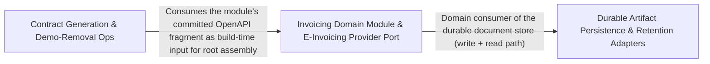

---
tags:
  - 2brain
  - 2brain/arch
  - project/boilerplate-node-backend
type: architecture
component: Contract_Type_Code_Generation_Demo_Removal_Ops
---

## Details

Contract-first code generation (AsyncAPI types, error codes, root assembly fragments) plus the ops tooling that strips demo/authorization/test scaffolding and refreshes breached-password corpora. It produces the generated artifacts and the demo-removal transformations that keep the boilerplate reusable.

### Invoicing Domain Module & E-Invoicing Provider Port
The invoicing bounded context — the e-invoicing provider port (a pluggable seam where a national e-invoicing network or the shipped pdf implementation answers), the hand-written repository for invoices/credit-notes and their numbering counters, and the read path that streams a stored PDF. It is the domain consumer of the durable document store and the authorization service's grantable roles.

**Related Classes/Methods**:

- `src.modules.invoicing.providers.index.EInvoicingProvider`:59-69
- `src.modules.invoicing.providers.pdf.pdfEInvoicingProvider`:37-50
- `src.modules.invoicing.repository.insertInvoice`:42-48
- `src.infrastructure.adapters.document-store.readDocument`:49-61
- `src.modules.access.service.grantableRoles`:175-178

**Source Files:**

- `src/infrastructure/adapters/document-store.ts`
  - `src.infrastructure.adapters.document-store.readDocument` (L49-L61) - Class
  - `src.infrastructure.adapters.document-store.readDocument.then() callback` (L55-L59) - Function
- `src/modules/access/service.ts`
  - `src.modules.access.service.grantableRoles` (L175-L178) - Class
  - `src.modules.access.service.grantableRoles.PRESET_ROLES.filter() callback` (L177-L177) - Function
  - `src.modules.access.service.grantableRoles.map() callback` (L178-L178) - Function
- `src/modules/invoicing/providers/index.ts`
  - `src.modules.invoicing.providers.index.EInvoicingDocument` (L30-L50) - Interface
  - `src.modules.invoicing.providers.index.EInvoicingArtifact` (L53-L56) - Interface
  - `src.modules.invoicing.providers.index.EInvoicingProvider` (L59-L69) - Interface
  - `src.modules.invoicing.providers.index.EInvoicingProvider.issue` (L68-L68) - Method
- `src/modules/invoicing/providers/pdf.ts`
  - `src.modules.invoicing.providers.pdf.pdfEInvoicingProvider` (L37-L50) - Class
  - `src.modules.invoicing.providers.pdf.pdfEInvoicingProvider.issue` (L40-L49) - Method
  - `src.modules.invoicing.providers.pdf.issue.then() callback` (L48-L48) - Function
  - `src.modules.invoicing.providers.pdf.pdfEInvoicingProvider.issue.then() callback` (L49-L49) - Function
- `src/modules/invoicing/repository.ts`
  - `src.modules.invoicing.repository.WithId` (L31-L33) - Interface
  - `src.modules.invoicing.repository.insertInvoice` (L42-L48) - Class
  - `src.modules.invoicing.repository.insertInvoice.then() callback` (L48-L48) - Function
  - `src.modules.invoicing.repository.insertCreditNote` (L92-L101) - Class
  - `src.modules.invoicing.repository.insertCreditNote.then() callback` (L101-L101) - Function
- `src/modules/invoicing/services/render.ts`
  - `src.modules.invoicing.services.render.storedOrRendered` (L60-L91) - Class
  - `src.modules.invoicing.services.render.storedOrRendered.catch() callback` (L64-L72) - Function
  - `src.modules.invoicing.services.render.storedOrRendered.then() callback` (L74-L89) - Function
  - `src.modules.invoicing.services.render.storedOrRendered.then() callback.then() callback` (L76-L88) - Function
  - `src.modules.invoicing.services.render.storedOrRendered.then() callback.then() callback.then() callback` (L79-L87) - Function
  - `src.modules.invoicing.services.render.renderInvoicePdf` (L100-L105) - Class
  - `src.modules.invoicing.services.render.renderInvoicePdf.storedOrRendered(`invoice-${String(invoice._id)}.pdf`) callback` (L101-L104) - Function
  - `src.modules.invoicing.services.render.renderInvoicePdf.storedOrRendered(`invoice-${String(invoice._id)}.pdf`) callback.then() callback` (L104-L104) - Function
  - `src.modules.invoicing.services.render.renderCreditNotePdf` (L112-L121) - Class
  - `src.modules.invoicing.services.render.renderCreditNotePdf.storedOrRendered(`credit-note-${String(creditNote._id)}.pdf`) callback` (L113-L120) - Function
  - `src.modules.invoicing.services.render.renderCreditNotePdf.storedOrRendered(`credit-note-${String(creditNote._id)}.pdf`) callback.then() callback` (L120-L120) - Function

### Durable Artifact Persistence & Retention Adapters
The infrastructure adapters that persist regenerable binary artifacts (rendered PDFs, account exports) to disk with atomic writes, name-shape validation, and retention-based reaping, plus the filesystem primitives they build on. This is the write/retention counterpart to the read path in the invoicing module — a regenerable copy store, never the legal record.

**Related Classes/Methods**:

- `src.infrastructure.adapters.document-store.writeDocument`:72-89
- `src.infrastructure.adapters.export-store.writeExport`:60-89
- `src.infrastructure.adapters.filesystem.pruneUnreferenced`:169-200
- `src.infrastructure.runtime.otel-sdk.publicEndpointPropagator`:99-109

**Source Files:**

- `src/infrastructure/adapters/document-store.ts`
  - `src.infrastructure.adapters.document-store.then() callback` (L54-L54) - Function
  - `src.infrastructure.adapters.document-store.writeDocument` (L72-L89) - Class
  - `src.infrastructure.adapters.document-store.writeDocument.then() callback` (L80-L80) - Function
  - `src.infrastructure.adapters.document-store.writeDocument.catch() callback` (L81-L87) - Function
  - `src.infrastructure.adapters.document-store.writeDocument.catch() callback.then() callback` (L84-L86) - Function
- `src/infrastructure/adapters/export-store.ts`
  - `src.infrastructure.adapters.export-store.writeExport` (L60-L89) - Class
  - `src.infrastructure.adapters.export-store.writeExport.then() callback.produce() callback` (L76-L76) - Function
  - `src.infrastructure.adapters.export-store.writeExport.then() callback.produce() callback.then() callback` (L76-L76) - Function
  - `src.infrastructure.adapters.export-store.writeExport.then() callback.finally() callback` (L76-L77) - Function
  - `src.infrastructure.adapters.export-store.writeExport.then() callback` (L80-L80) - Function
  - `src.infrastructure.adapters.export-store.writeExport.catch() callback` (L81-L87) - Function
  - `src.infrastructure.adapters.export-store.writeExport.catch() callback.then() callback` (L84-L86) - Function
- `src/infrastructure/adapters/filesystem.ts`
  - `src.infrastructure.adapters.filesystem.unlinkIfPresent` (L75-L88) - Class
  - `src.infrastructure.adapters.filesystem.unlinkIfPresent.then() callback` (L82-L87) - Function
  - `src.infrastructure.adapters.filesystem.pruneUnreferenced` (L169-L200) - Class
  - `src.infrastructure.adapters.filesystem.pruneUnreferenced.catch() callback` (L175-L178) - Function
  - `src.infrastructure.adapters.filesystem.pruneUnreferenced.then() callback` (L179-L200) - Function
  - `src.infrastructure.adapters.filesystem.pruneUnreferenced.then() callback.then() callback` (L196-L199) - Function
- `src/infrastructure/runtime/otel-sdk.ts`
  - `src.infrastructure.runtime.otel-sdk.publicEndpointPropagator` (L99-L109) - Class
  - `src.infrastructure.runtime.otel-sdk.publicEndpointPropagator.inject` (L102-L104) - Method
  - `src.infrastructure.runtime.otel-sdk.publicEndpointPropagator.extract` (L106-L106) - Method
  - `src.infrastructure.runtime.otel-sdk.publicEndpointPropagator.fields` (L107-L107) - Method

### Contract Generation & Demo-Removal Ops
Pure, disk-owning build/ops scripts that (a) generate the contract-derived artifacts — AsyncAPI TypeScript types, the error-code registry, and the assembled root OpenAPI document from module fragments — and (b) perform the demo-removal transformations (pruning authorization grants and conformance cases, removing test/demo modules) plus the breached-password corpus refresh. It treats the committed contract as the single source of truth and produces the artifacts and transformations that keep the boilerplate reusable.

**Related Classes/Methods**:

- `scripts.contracts.generate-error-codes.rows`
- `scripts.ops.demo-remove-authorization.pruneCase`:103-125
- `scripts.ops.refresh-breached-passwords.downloadCorpus`:73-80
- `scripts.ops.demo-remove-tests.requiredModules`:58-61

**Source Files:**

- `scripts/contracts/generate-asyncapi-types.ts`
  - `scripts.contracts.generate-asyncapi-types.buildOutput.sections` (L548-L577) - Class
  - `scripts.contracts.generate-asyncapi-types.buildOutput.sections.sseEntries.map() callback` (L571-L571) - Function
- `scripts/contracts/generate-error-codes.ts`
  - `scripts.contracts.generate-error-codes.rows` (L95-L95) - Class
  - `scripts.contracts.generate-error-codes.rows.codes.map() callback` (L95-L95) - Function
- `scripts/contracts/root-assembly.ts`
  - `scripts.contracts.root-assembly.ModuleFragment` (L22-L29) - Interface
  - `scripts.contracts.root-assembly.appendMissingTags.missing.fragments.flatMap() callback` (L98-L98) - Function
  - `scripts.contracts.root-assembly.appendMissingTags.missing` (L98-L100) - Class
  - `scripts.contracts.root-assembly.appendMissingTags.missing.filter() callback` (L99-L99) - Function
  - `scripts.contracts.root-assembly.FragmentOperation` (L131-L133) - Interface
  - `scripts.contracts.root-assembly.FragmentDocument` (L136-L138) - Interface
  - `scripts.contracts.root-assembly.present.filter() callback` (L154-L154) - Function
- `scripts/mutation/baseline.ts`
  - `scripts.mutation.baseline.missingFromReport` (L245-L251) - Class
  - `scripts.mutation.baseline.missingFromReport.filter() callback` (L250-L250) - Function
- `scripts/mutation/pull-baseline.ts`
  - `scripts.mutation.pull-baseline.listArtifacts` (L28-L32) - Class
  - `scripts.mutation.pull-baseline.listArtifacts.then() callback` (L32-L32) - Function
  - `scripts.mutation.pull-baseline.then() callback.then() callback` (L49-L49) - Function
  - `scripts.mutation.pull-baseline.catch() callback` (L67-L70) - Function
- `scripts/ops/demo-remove-authorization.ts`
  - `scripts.ops.demo-remove-authorization.stripRoleGrants.out` (L79-L84) - Class
  - `scripts.ops.demo-remove-authorization.stripRoleGrants.out.lines.map() callback` (L79-L84) - Function
  - `scripts.ops.demo-remove-authorization.pruneCase` (L103-L125) - Class
  - `scripts.ops.demo-remove-authorization.pruneCase.chunk.replaceAll() callback` (L118-L124) - Function
  - `scripts.ops.demo-remove-authorization.stripConformanceCases.casesKept` (L143-L146) - Class
  - `scripts.ops.demo-remove-authorization.stripConformanceCases.casesKept.map() callback` (L144-L144) - Function
  - `scripts.ops.demo-remove-authorization.stripConformanceCases.casesKept.filter() callback` (L145-L145) - Function
- `scripts/ops/demo-remove-tests.ts`
  - `scripts.ops.demo-remove-tests.requiredModules` (L58-L61) - Class
  - `scripts.ops.demo-remove-tests.requiredModules.flatMap() callback` (L59-L60) - Function
  - `scripts.ops.demo-remove-tests.requiredModules.flatMap() callback.map() callback` (L60-L60) - Function
  - `scripts.ops.demo-remove-tests.specifiersOf` (L67-L68) - Class
  - `scripts.ops.demo-remove-tests.specifiersOf.SPECIFIER_PATTERNS.flatMap() callback` (L68-L68) - Function
  - `scripts.ops.demo-remove-tests.specifiersOf.SPECIFIER_PATTERNS.flatMap() callback.map() callback` (L68-L68) - Function
  - `scripts.ops.demo-remove-tests.isGone` (L93-L99) - Class
  - `scripts.ops.demo-remove-tests.isGone.gone.some() callback` (L95-L98) - Function
  - `scripts.ops.demo-remove-tests.removeResidueTests.importsGone` (L124-L127) - Class
  - `scripts.ops.demo-remove-tests.removeResidueTests.importsGone.some() callback` (L124-L127) - Function
  - `scripts.ops.demo-remove-tests.removeResidueTests.requiresGone` (L128-L128) - Class
  - `scripts.ops.demo-remove-tests.removeResidueTests.requiresGone.some() callback` (L128-L128) - Function
- `scripts/ops/refresh-breached-passwords.ts`
  - `scripts.ops.refresh-breached-passwords.downloadCorpus` (L73-L80) - Class
  - `scripts.ops.refresh-breached-passwords.downloadCorpus.map() callback` (L79-L79) - Function
- `scripts/pairing/spec-identity.ts`
  - `scripts.pairing.spec-identity.sharedFileProblems` (L192-L193) - Class
  - `scripts.pairing.spec-identity.sharedFileProblems.comparisons.filter() callback` (L193-L193) - Function
- `scripts/pairing/sync-to-frontend.ts`
  - `scripts.pairing.sync-to-frontend.Outcome` (L112-L119) - Interface
  - `scripts.pairing.sync-to-frontend.list` (L156-L157) - Class
  - `scripts.pairing.sync-to-frontend.list.items.map() callback` (L157-L157) - Function
- `scripts/scaffold/apply.ts`
  - `scripts.scaffold.apply.FragmentShape` (L22-L24) - Interface
  - `scripts.scaffold.apply.applyScaffold.edits` (L108-L116) - Class
  - `scripts.scaffold.apply.applyScaffold.edits.map() callback` (L109-L115) - Function
- `scripts/scaffold/central-edits.ts`
  - `scripts.scaffold.central-edits.CentralEdit` (L21-L26) - Interface
  - `scripts.scaffold.central-edits.appendToList` (L36-L51) - Class
  - `scripts.scaffold.central-edits.appendToList.items.map() callback` (L48-L48) - Function
  - `scripts.scaffold.central-edits.addParityEntry` (L67-L85) - Class
  - `scripts.scaffold.central-edits.addParityEntry.sorted.map() callback` (L82-L82) - Function
  - `scripts.scaffold.central-edits.centralEdits` (L92-L108) - Class
  - `scripts.scaffold.central-edits.centralEdits.apply` (L106-L106) - Method
- `scripts/scaffold/names.ts`
  - `scripts.scaffold.names.ModuleNames` (L8-L29) - Interface
  - `scripts.scaffold.names.snake` (L75-L76) - Class
  - `scripts.scaffold.names.snake.replaceAll() callback` (L76-L76) - Function
  - `scripts.scaffold.names.permissionKeys` (L134-L135) - Class
  - `scripts.scaffold.names.permissionKeys.KEY_ACTIONS.map() callback` (L135-L135) - Function
