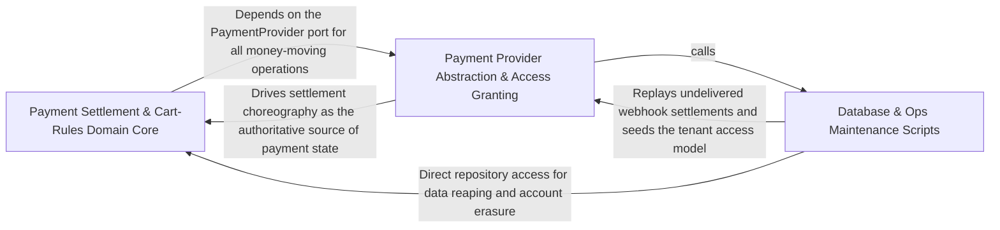

---
tags:
  - 2brain
  - 2brain/arch
  - project/boilerplate-node-backend
type: architecture
component: Database_Ops_Maintenance_Scripts
---

## Details

The db: and ops: one-shot scripts that prepare and maintain the database the scenario runner seeds into. This group owns access-model bootstrapping, Mongoose index synchronization (diffing registered models against the live database and applying unique/TTL indexes), and the scheduled reaping jobs (expired tokens, inactive accounts, account exports). Each is a self-contained main that opens its own connections and is wrapped by the shared runScript harness (Group 1) for exit codes, cleanup, and job-outcome recording. It is the 'database lifecycle' half of the subsystem, distinct from the seed/restore flow.

### Payment Settlement & Cart-Rules Domain Core
The domain core for the payment and cart bounded contexts: the payment repository (upsert-confirmable, refund attachment, provider-ref linking), the settlement/refunds/effect/intent domain logic, and the cart shipping rules and effective-shipping view. It also hosts the shared AuthContext/CallerContext/PlatformCaller/TenantCaller type surface that authorizes these operations. This is the 'what the data means' layer that the index-sync and reap scripts keep consistent at the storage level.

**Related Classes/Methods**:

- `src.modules.payments.repository.paymentRepository`:189-653
- `src.modules.cart.domain.rules.needsShipping`:97-98
- `src.modules.cart.services.view.effectiveShippingChoice`:145-149

**Source Files:**

- `src/modules/cart/domain/availability.ts`
  - `src.modules.cart.domain.availability.AvailabilityFacts` (L33-L40) - Interface
- `src/modules/cart/domain/rules.ts`
  - `src.modules.cart.domain.rules.needsShipping` (L97-L98) - Class
  - `src.modules.cart.domain.rules.needsShipping.lines.some() callback` (L98-L98) - Function
- `src/modules/cart/services/view.ts`
  - `src.modules.cart.services.view.effectiveShippingChoice` (L145-L149) - Class
  - `src.modules.cart.services.view.effectiveShippingChoice.options.some() callback` (L149-L149) - Function
- `src/modules/payments/repository.ts`
  - `src.modules.payments.repository.aggregateRefundRows` (L125-L129) - Class
  - `src.modules.payments.repository.aggregateRefundRows.then() callback` (L126-L129) - Function
  - `src.modules.payments.repository.UpsertedPayment` (L132-L135) - Interface
  - `src.modules.payments.repository.upsertConfirmable` (L149-L180) - Class
  - `src.modules.payments.repository.upsertConfirmable.then() callback` (L169-L175) - Function
  - `src.modules.payments.repository.upsertConfirmable.catch() callback` (L177-L180) - Function
  - `src.modules.payments.repository.paymentRepository` (L189-L653) - Class
  - `src.modules.payments.repository.paymentRepository.ownerScope` (L271-L271) - Method
  - `src.modules.payments.repository.paymentRepository.findByIdScoped` (L283-L284) - Method
  - `src.modules.payments.repository.paymentRepository.findByOrderId` (L293-L294) - Method
  - `src.modules.payments.repository.paymentRepository.findByProviderRef` (L303-L303) - Method
  - `src.modules.payments.repository.paymentRepository.attachProviderRef` (L314-L322) - Method
  - `src.modules.payments.repository.paymentRepository.attachProviderRef.then() callback` (L322-L322) - Function
  - `src.modules.payments.repository.paymentRepository.upsertIntent` (L333-L338) - Method
  - `src.modules.payments.repository.paymentRepository.upsertOffline` (L347-L355) - Method
  - `src.modules.payments.repository.paymentRepository.updateStatusIfIn` (L362-L369) - Method
  - `src.modules.payments.repository.paymentRepository.detachUserId` (L380-L388) - Method
  - `src.modules.payments.repository.paymentRepository.detachUserId.then() callback` (L388-L388) - Function
  - `src.modules.payments.repository.paymentRepository.deleteAbandonedBefore` (L400-L407) - Method
  - `src.modules.payments.repository.paymentRepository.deleteAbandonedBefore.then() callback` (L407-L407) - Function
  - `src.modules.payments.repository.paymentRepository.addRefund` (L426-L437) - Method
  - `src.modules.payments.repository.paymentRepository.settleRefund` (L451-L476) - Method
  - `src.modules.payments.repository.paymentRepository.failRefund` (L488-L505) - Method
  - `src.modules.payments.repository.paymentRepository.sumMix` (L539-L554) - Method
  - `src.modules.payments.repository.paymentRepository.searchRefunds` (L562-L585) - Method
  - `src.modules.payments.repository.paymentRepository.findOpenRefundRows` (L594-L612) - Method
  - `src.modules.payments.repository.paymentRepository.findWithOpenRefunds` (L622-L630) - Method
  - `src.modules.payments.repository.paymentRepository.findStaleInFlight` (L642-L652) - Method
- `src/modules/payments/services/announce.ts`
  - `src.modules.payments.services.announce.recordDecline.announceInTransaction() callback.SETTLEABLE_PAYMENT_STATUSES.filter() callback` (L47-L47) - Function
  - `src.modules.payments.services.announce.recordDecline.announceInTransaction() callback.then() callback` (L54-L66) - Function
  - `src.modules.payments.services.announce.recordDecline.announceInTransaction() callback.then() callback.then() callback` (L65-L65) - Function
- `src/modules/payments/services/intent.ts`
  - `src.modules.payments.services.intent.cancelOpenIntentForOrder` (L178-L207) - Class
  - `src.modules.payments.services.intent.cancelOpenIntentForOrder.then() callback` (L179-L207) - Function
  - `src.modules.payments.services.intent.cancelOpenIntentForOrder.then() callback.then() callback` (L190-L190) - Function
  - `src.modules.payments.services.intent.cancelOpenIntentForOrder.then() callback.catch() callback.then() callback` (L197-L197) - Function
  - `src.modules.payments.services.intent.cancelOpenIntentForOrder.then() callback.catch() callback` (L199-L206) - Function
- `src/modules/payments/services/list.ts`
  - `src.modules.payments.services.list.listRefunds` (L93-L98) - Class
  - `src.modules.payments.services.list.listRefunds.then() callback` (L98-L98) - Function
  - `src.modules.payments.services.list.listRefunds.then() callback.items.items.map() callback` (L98-L98) - Function
  - `src.modules.payments.services.list.listAttention` (L121-L144) - Class
  - `src.modules.payments.services.list.listAttention.then() callback` (L131-L143) - Function
  - `src.modules.payments.services.list.listAttention.then() callback.items.stale.map() callback` (L133-L133) - Function
  - `src.modules.payments.services.list.listAttention.then() callback.items.manual.map() callback` (L134-L134) - Function
  - `src.modules.payments.services.list.listAttention.then() callback.items.owed.map() callback` (L136-L140) - Function
  - `src.modules.payments.services.list.listAttention.then() callback.items.toSorted() callback` (L142-L142) - Function
- `src/modules/payments/services/refunds.ts`
  - `src.modules.payments.services.refunds.openRefund` (L170-L237) - Class
  - `src.modules.payments.services.refunds.openRefund.write` (L197-L220) - Class
  - `src.modules.payments.services.refunds.openRefund.write.then() callback` (L206-L219) - Function
  - `src.modules.payments.services.refunds.openRefund.write.then() callback.then() callback` (L218-L218) - Function
  - `src.modules.payments.services.refunds.openRefund.then() callback` (L222-L236) - Function
  - `src.modules.payments.services.refunds.openRefund.then() callback.then() callback` (L231-L234) - Function
  - `src.modules.payments.services.refunds.isFullyRefunded` (L244-L245) - Class
  - `src.modules.payments.services.refunds.isFullyRefunded.payment.refunds.every() callback` (L245-L245) - Function
  - `src.modules.payments.services.refunds.writeSettlement` (L337-L358) - Class
  - `src.modules.payments.services.refunds.writeSettlement.then() callback` (L346-L357) - Function
  - `src.modules.payments.services.refunds.writeSettlement.then() callback.then() callback` (L356-L356) - Function
  - `src.modules.payments.services.refunds.settleRefund` (L373-L390) - Class
  - `src.modules.payments.services.refunds.settleRefund.announceInTransaction() callback` (L382-L386) - Function
  - `src.modules.payments.services.refunds.settleRefund.then() callback` (L387-L390) - Function
  - `src.modules.payments.services.refunds.settledElsewhere` (L526-L536) - Class
  - `src.modules.payments.services.refunds.settledElsewhere.then() callback` (L529-L535) - Function
  - `src.modules.payments.services.refunds.settledElsewhere.then() callback.fresh.refunds.some() callback` (L531-L532) - Function
  - `src.modules.payments.services.refunds.performRefund` (L555-L582) - Class
  - `src.modules.payments.services.refunds.performRefund.then() callback` (L560-L582) - Function
  - `src.modules.payments.services.refunds.performRefund.then() callback.then() callback` (L570-L581) - Function
  - `src.modules.payments.services.refunds.performRefund.then() callback.then() callback.then() callback` (L574-L579) - Function
  - `src.modules.payments.services.refunds.performRefund.then() callback.then() callback.then() callback.then() callback` (L577-L577) - Function
  - `src.modules.payments.services.refunds.refundForOrder` (L675-L676) - Class
  - `src.modules.payments.services.refunds.refundForOrder.then() callback` (L676-L676) - Function
  - `src.modules.payments.services.refunds.refundForReturn` (L696-L722) - Class
  - `src.modules.payments.services.refunds.refundForReturn.then() callback` (L707-L722) - Function
- `src/modules/payments/services/settlement.ts`
  - `src.modules.payments.services.settlement.refundLostPayment.refunded` (L103-L113) - Class
  - `src.modules.payments.services.settlement.refundLostPayment.refunded.then() callback.then() callback` (L104-L104) - Function
  - `src.modules.payments.services.settlement.refundLostPayment.refunded.catch() callback` (L105-L113) - Function
  - `src.modules.payments.services.settlement.cancelMismatchedOrder` (L126-L140) - Class
  - `src.modules.payments.services.settlement.cancelMismatchedOrder.then() callback` (L129-L132) - Function
  - `src.modules.payments.services.settlement.cancelMismatchedOrder.then() callback.then() callback` (L131-L131) - Function
  - `src.modules.payments.services.settlement.cancelMismatchedOrder.catch() callback` (L133-L140) - Function
  - `src.modules.payments.services.settlement.settleMismatch` (L154-L206) - Class
  - `src.modules.payments.services.settlement.settleMismatch.then() callback` (L168-L205) - Function
  - `src.modules.payments.services.settlement.afterSettlement` (L287-L332) - Class
  - `src.modules.payments.services.settlement.afterSettlement.catch() callback` (L323-L330) - Function
  - `src.modules.payments.services.settlement.afterSettlement.then() callback` (L331-L331) - Function
  - `src.modules.payments.services.settlement.settlePayment.withTransaction() callback` (L411-L412) - Function
- `src/modules/payments/services/stats.ts`
  - `src.modules.payments.services.stats.methodMix` (L25-L34) - Class
  - `src.modules.payments.services.stats.methodMix.then() callback` (L26-L33) - Function
  - `src.modules.payments.services.stats.methodMix.then() callback.rows.map() callback` (L27-L33) - Function
- `src/types/auth-context.ts`
  - `src.types.auth-context.AuthContext` (L29-L85) - Interface
  - `src.types.auth-context.TenantCaller` (L115-L143) - Interface
  - `src.types.auth-context.PlatformCaller` (L146-L160) - Interface
  - `src.types.auth-context.CallerContext` (L171-L224) - Interface
  - `src.types.auth-context.TenantCallerContext` (L235-L237) - Interface
  - `src.types.auth-context.ResolveOptions` (L247-L253) - Interface

### Payment Provider Abstraction & Access Granting
The provider/adapter and access-grant surface: the PaymentProvider port and its state types (PreparedPayment, ProviderPaymentState, ProviderWebhookEvent), the scenario fake-provider doubles (fakePaymentProvider, lazy registration), the tenant repository (tenantRepository.upsertBySlug), the access service grant check (checkGrant.escalated), and the postPaymentWebhook controller. This is the boundary where external payment providers and the access model meet the domain core, and where the bootstrap-access script's upserted tenant is consumed.

**Related Classes/Methods**:

- `src.modules.payments.providers.index.PaymentProvider`:101-198
- `src.modules.payments.controllers.post-payment-webhook.postPaymentWebhook`:33-85
- `src.modules.access.repository.tenantRepository`:15-36
- `src.modules.access.service.checkGrant.escalated`
- `scenarios.support.doubles.payments.fake.fakePaymentProvider`:166-281

**Source Files:**

- `scenarios/support/doubles/payments/fake.ts`
  - `scenarios.support.doubles.payments.fake.fakePaymentProvider` (L166-L281) - Class
  - `scenarios.support.doubles.payments.fake.fakePaymentProvider.prepare` (L171-L188) - Method
  - `scenarios.support.doubles.payments.fake.fakePaymentProvider.confirm` (L190-L199) - Method
  - `scenarios.support.doubles.payments.fake.fakePaymentProvider.retrieve` (L201-L206) - Method
  - `scenarios.support.doubles.payments.fake.fakePaymentProvider.refund` (L210-L224) - Method
  - `scenarios.support.doubles.payments.fake.fakePaymentProvider.cancel` (L226-L246) - Method
  - `scenarios.support.doubles.payments.fake.fakePaymentProvider.parseWebhook` (L258-L280) - Method
  - `scenarios.support.doubles.payments.fake.fakePaymentProvider.parseWebhook.catch() callback` (L268-L271) - Function
  - `scenarios.support.doubles.payments.fake.fakePaymentProvider.parseWebhook.then() callback` (L272-L280) - Function
- `scenarios/support/doubles/payments/register.ts`
  - `scenarios.support.doubles.payments.register.loadFakePaymentProvider` (L17-L18) - Class
  - `scenarios.support.doubles.payments.register.loadFakePaymentProvider.then() callback` (L18-L18) - Function
  - `scenarios.support.doubles.payments.register.lazyFakePaymentProvider` (L26-L46) - Class
  - `scenarios.support.doubles.payments.register.lazyFakePaymentProvider.prepare` (L28-L31) - Method
  - `scenarios.support.doubles.payments.register.lazyFakePaymentProvider.prepare.then() callback` (L29-L30) - Function
  - `scenarios.support.doubles.payments.register.lazyFakePaymentProvider.confirm` (L32-L35) - Method
  - `scenarios.support.doubles.payments.register.lazyFakePaymentProvider.confirm.then() callback` (L33-L34) - Function
  - `scenarios.support.doubles.payments.register.lazyFakePaymentProvider.retrieve` (L36-L37) - Method
  - `scenarios.support.doubles.payments.register.lazyFakePaymentProvider.retrieve.then() callback` (L37-L37) - Function
  - `scenarios.support.doubles.payments.register.lazyFakePaymentProvider.refund` (L38-L41) - Method
  - `scenarios.support.doubles.payments.register.lazyFakePaymentProvider.refund.then() callback` (L39-L40) - Function
  - `scenarios.support.doubles.payments.register.lazyFakePaymentProvider.cancel` (L42-L43) - Method
  - `scenarios.support.doubles.payments.register.lazyFakePaymentProvider.cancel.then() callback` (L43-L43) - Function
  - `scenarios.support.doubles.payments.register.lazyFakePaymentProvider.parseWebhook` (L44-L45) - Method
  - `scenarios.support.doubles.payments.register.lazyFakePaymentProvider.parseWebhook.then() callback` (L45-L45) - Function
- `src/modules/access/repository.ts`
  - `src.modules.access.repository.tenantRepository` (L15-L36) - Class
  - `src.modules.access.repository.tenantRepository.upsertBySlug` (L20-L35) - Method
- `src/modules/access/service.ts`
  - `src.modules.access.service.checkGrant.escalated` (L133-L133) - Class
  - `src.modules.access.service.checkGrant.escalated.permissions.filter() callback` (L133-L133) - Function
- `src/modules/payments/controllers/post-payment-confirm.ts`
  - `src.modules.payments.controllers.post-payment-confirm.postPaymentConfirm.then() callback.declined` (L38-L39) - Class
  - `src.modules.payments.controllers.post-payment-confirm.postPaymentConfirm.then() callback.declined.result.errors.some() callback` (L39-L39) - Function
- `src/modules/payments/controllers/post-payment-webhook.ts`
  - `src.modules.payments.controllers.post-payment-webhook.postPaymentWebhook` (L33-L85) - Class
  - `src.modules.payments.controllers.post-payment-webhook.postPaymentWebhook.then() callback` (L50-L61) - Function
  - `src.modules.payments.controllers.post-payment-webhook.then() callback.then() callback` (L57-L57) - Function
  - `src.modules.payments.controllers.post-payment-webhook.postPaymentWebhook.then() callback.then() callback` (L58-L60) - Function
  - `src.modules.payments.controllers.post-payment-webhook.postPaymentWebhook.catch() callback` (L62-L84) - Function
- `src/modules/payments/providers/errors.ts`
  - `src.modules.payments.providers.errors.PaymentInFlightError` (L15-L21) - Class
  - `src.modules.payments.providers.errors.PaymentInFlightError.constructor` (L17-L20) - Constructor
  - `src.modules.payments.providers.errors.PaymentProviderError` (L28-L40) - Class
  - `src.modules.payments.providers.errors.PaymentProviderError.constructor` (L33-L39) - Constructor
- `src/modules/payments/providers/index.ts`
  - `src.modules.payments.providers.index.ProviderPaymentState` (L35-L56) - Interface
  - `src.modules.payments.providers.index.PreparedPayment` (L59-L67) - Interface
  - `src.modules.payments.providers.index.RefundedByProvider` (L70-L73) - Interface
  - `src.modules.payments.providers.index.ProviderWebhookEvent` (L84-L89) - Interface
  - `src.modules.payments.providers.index.PaymentProvider` (L101-L198) - Interface
  - `src.modules.payments.providers.index.PaymentProvider.prepare` (L119-L123) - Method
  - `src.modules.payments.providers.index.PaymentProvider.confirm` (L133-L133) - Method
  - `src.modules.payments.providers.index.PaymentProvider.retrieve` (L141-L141) - Method
  - `src.modules.payments.providers.index.PaymentProvider.refund` (L155-L159) - Method
  - `src.modules.payments.providers.index.PaymentProvider.cancel` (L175-L175) - Method
  - `src.modules.payments.providers.index.PaymentProvider.parseWebhook` (L197-L197) - Method
- `src/modules/payments/providers/webhook-signature.ts`
  - `src.modules.payments.providers.webhook-signature.WebhookRejected` (L33-L46) - Class
  - `src.modules.payments.providers.webhook-signature.WebhookRejected.constructor` (L39-L45) - Constructor
- `src/modules/payments/services/announce.ts`
  - `src.modules.payments.services.announce.recordDecline` (L35-L73) - Class
  - `src.modules.payments.services.announce.announceInTransaction() callback` (L41-L67) - Function
  - `src.modules.payments.services.announce.recordDecline.announceInTransaction() callback` (L68-L72) - Function
- `src/modules/payments/services/effects.ts`
  - `src.modules.payments.services.effects.reconcileOne` (L102-L116) - Class
  - `src.modules.payments.services.effects.reconcileOne.then() callback` (L105-L106) - Function
  - `src.modules.payments.services.effects.reconcileOne.catch() callback` (L108-L116) - Function
- `src/modules/payments/services/intent.ts`
  - `src.modules.payments.services.intent.rejectStrayIntent` (L43-L70) - Class
  - `src.modules.payments.services.intent.rejectStrayIntent.catch() callback` (L50-L57) - Function
  - `src.modules.payments.services.intent.rejectStrayIntent.then() callback` (L58-L70) - Function
- `src/modules/payments/services/notify.ts`
  - `src.modules.payments.services.notify.completesPayment.refundedMinor` (L38-L45) - Class
  - `src.modules.payments.services.notify.completesPayment.refundedMinor.payment.refunds.filter() callback` (L40-L43) - Function
  - `src.modules.payments.services.notify.completesPayment.refundedMinor.reduce() callback` (L45-L45) - Function
- `src/modules/payments/services/refunds.ts`
  - `src.modules.payments.services.refunds.recordRefundFailure` (L401-L421) - Class
  - `src.modules.payments.services.refunds.recordRefundFailure.withTransaction() callback` (L406-L420) - Function
  - `src.modules.payments.services.refunds.recordRefundFailure.withTransaction() callback.then() callback` (L409-L419) - Function
  - `src.modules.payments.services.refunds.sendToProvider` (L433-L452) - Class
  - `src.modules.payments.services.refunds.sendToProvider.then() callback` (L448-L451) - Function
  - `src.modules.payments.services.refunds.sendToProvider.then() callback.then() callback` (L449-L451) - Function
- `src/modules/payments/services/settlement.ts`
  - `src.modules.payments.services.settlement.settlePayment` (L355-L414) - Class
  - `src.modules.payments.services.settlement.settlePayment.then() callback.catch() callback` (L381-L388) - Function
  - `src.modules.payments.services.settlement.settlePayment.then() callback` (L413-L413) - Function
  - `src.modules.payments.services.settlement.settleFound` (L550-L580) - Class
  - `src.modules.payments.services.settlement.settleFound.then() callback` (L567-L579) - Function
  - `src.modules.payments.services.settlement.settleFound.then() callback.then() callback` (L571-L577) - Function
  - `src.modules.payments.services.settlement.settleVia` (L593-L613) - Class
  - `src.modules.payments.services.settlement.settleVia.then() callback` (L605-L613) - Function
  - `src.modules.payments.services.settlement.confirmPayment` (L630-L643) - Class
  - `src.modules.payments.services.settlement.confirmPayment.settleVia() callback` (L642-L642) - Function
  - `src.modules.payments.services.settlement.syncPayment` (L655-L673) - Class
  - `src.modules.payments.services.settlement.syncPayment.then() callback` (L660-L673) - Function
  - `src.modules.payments.services.settlement.syncPayment.then() callback.settleFound() callback` (L670-L670) - Function
  - `src.modules.payments.services.settlement.settleFromProvider` (L726-L733) - Class
  - `src.modules.payments.services.settlement.settleFromProvider.then() callback` (L732-L732) - Function
  - `src.modules.payments.services.settlement.applyWebhookSettlement` (L748-L771) - Class
  - `src.modules.payments.services.settlement.applyWebhookSettlement.then() callback` (L749-L771) - Function
  - `src.modules.payments.services.settlement.applyWebhookSettlement.then() callback.then() callback` (L760-L770) - Function
- `src/modules/stats/services/breakdowns.ts`
  - `src.modules.stats.services.breakdowns.getProductStats` (L30-L51) - Class
  - `src.modules.stats.services.breakdowns.getProductStats.then() callback` (L34-L51) - Function
  - `src.modules.stats.services.breakdowns.getProductStats.then() callback.products.sold.map() callback` (L38-L49) - Function
  - `src.modules.stats.services.breakdowns.getPaymentMix` (L96-L106) - Class
  - `src.modules.stats.services.breakdowns.getPaymentMix.then() callback` (L97-L106) - Function
  - `src.modules.stats.services.breakdowns.getPaymentMix.then() callback.rows.rows.map() callback` (L99-L105) - Function
- `src/modules/stats/services/figures.ts`
  - `src.modules.stats.services.figures.Figures` (L35-L49) - Interface

### Database & Ops Maintenance Scripts
The db: and ops: one-shot scripts that prepare and maintain the database. It owns three responsibilities: (1) access-model bootstrapping — idempotently upserting the fixed DEPLOYMENT_TENANT_ID shop on a fresh production DB; (2) Mongoose index synchronization — diffing every registered model against the live database (planIndexSync/diffIndexes), pre-flight checking for blocking unique-index duplicates (findBlockingDuplicates), and applying via syncIndexes (applyIndexSync), with a --check deploy-gate mode; and (3) scheduled reaping jobs — expired tokens, inactive accounts (three-stage warn/soft-delete/hard-delete), account exports, mail spool, and orders, each guarded by withLease where a double-run is expensive. Each is a self-contained main that opens its own connection and is wrapped by the shared runScript harness for exit codes, cleanup, and job-outcome recording.

**Related Classes/Methods**:

- `scripts.db.bootstrap-access.main`:26-31
- `scripts.db.index-sync.applyIndexSync`:214-233

**Source Files:**

- `scripts/db/bootstrap-access.ts`
  - `scripts.db.bootstrap-access.main` (L26-L31) - Class
  - `scripts.db.bootstrap-access.then() callback` (L28-L28) - Function
  - `scripts.db.bootstrap-access.main.then() callback` (L29-L31) - Function
- `scripts/db/index-sync.ts`
  - `scripts.db.index-sync.IndexDiff` (L30-L37) - Interface
  - `scripts.db.index-sync.RegisteredModel` (L47-L51) - Interface
  - `scripts.db.index-sync.UniqueIndex` (L56-L63) - Interface
  - `scripts.db.index-sync.uniqueIndexes` (L88-L98) - Class
  - `scripts.db.index-sync.uniqueIndexes.flatMap() callback` (L89-L97) - Function
  - `scripts.db.index-sync.uniqueIndexes.flatMap() callback.filter() callback` (L92-L92) - Function
  - `scripts.db.index-sync.uniqueIndexes.flatMap() callback.map() callback` (L93-L97) - Function
  - `scripts.db.index-sync.findDuplicates.$match.keys.map() callback` (L117-L117) - Function
  - `scripts.db.index-sync.findDuplicates.$group._id.keys.map() callback` (L123-L123) - Function
  - `scripts.db.index-sync.findBlockingDuplicates.pending` (L155-L161) - Class
  - `scripts.db.index-sync.findBlockingDuplicates.pending.plan.flatMap() callback` (L158-L159) - Function
  - `scripts.db.index-sync.findBlockingDuplicates.pending.plan.flatMap() callback.toCreate.map() callback` (L159-L159) - Function
  - `scripts.db.index-sync.applyIndexSync` (L214-L233) - Class
  - `scripts.db.index-sync.applyIndexSync.blocking.map() callback` (L221-L221) - Function
- `scripts/db/sync-indexes.ts`
  - `scripts.db.sync-indexes.describe` (L31-L36) - Class
  - `scripts.db.sync-indexes.describe.toCreate.map() callback` (L34-L34) - Function
  - `scripts.db.sync-indexes.describe.toDrop.map() callback` (L35-L35) - Function
  - `scripts.db.sync-indexes.report` (L39-L46) - Class
  - `scripts.db.sync-indexes.report.plan.map() callback` (L45-L45) - Function
  - `scripts.db.sync-indexes.runScript() callback` (L79-L79) - Function
- `scripts/ops/reencrypt.ts`
  - `scripts.ops.reencrypt.main` (L53-L58) - Class
  - `scripts.ops.reencrypt.main.then() callback` (L56-L58) - Function
- `scripts/ops/run-job.ts`
  - `scripts.ops.run-job.work` (L50-L58) - Class
  - `scripts.ops.run-job.work.withLease() callback` (L54-L54) - Function
  - `scripts.ops.run-job.work.withLease() callback.then() callback` (L54-L54) - Function
  - `scripts.ops.run-job.work.then() callback` (L54-L57) - Function
- `scripts/security/refresh-breached-passwords.ts`
  - `scripts.security.refresh-breached-passwords.main.survivors.lines.filter() callback` (L88-L88) - Function
- `src/app/jobs.ts`
  - `src.app.jobs.appJobs` (L38-L88) - Class
  - `src.app.jobs.run` (L43-L50) - Method
  - `src.app.jobs.appJobs.run` (L80-L83) - Method
  - `src.app.jobs.appJobs.run.then() callback` (L81-L83) - Function
- `src/infrastructure/adapters/filesystem.ts`
  - `src.infrastructure.adapters.filesystem.ReapResult` (L102-L105) - Interface
  - `src.infrastructure.adapters.filesystem.reapDirectory` (L119-L154) - Class
  - `src.infrastructure.adapters.filesystem.reapDirectory.catch() callback` (L121-L132) - Function
  - `src.infrastructure.adapters.filesystem.reapDirectory.then() callback` (L133-L153) - Function
  - `src.infrastructure.adapters.filesystem.reapDirectory.then() callback.entries.map() callback` (L135-L149) - Function
  - `src.infrastructure.adapters.filesystem.reapDirectory.then() callback.entries.map() callback.then() callback` (L138-L141) - Function
  - `src.infrastructure.adapters.filesystem.reapDirectory.then() callback.entries.map() callback.then() callback.then() callback` (L140-L140) - Function
  - `src.infrastructure.adapters.filesystem.reapDirectory.then() callback.entries.map() callback.catch() callback` (L143-L148) - Function
  - `src.infrastructure.adapters.filesystem.reapDirectory.then() callback.then() callback` (L150-L153) - Function
  - `src.infrastructure.adapters.filesystem.then() callback.orphaned.map() callback.then() callback` (L186-L191) - Function
- `src/infrastructure/adapters/logger.ts`
  - `src.infrastructure.adapters.logger.Logger.info` (L35-L35) - Method
- `src/infrastructure/adapters/mail-spool.ts`
  - `src.infrastructure.adapters.mail-spool.spoolAttachment` (L46-L51) - Class
  - `src.infrastructure.adapters.mail-spool.spoolAttachment.then() callback` (L50-L50) - Function
  - `src.infrastructure.adapters.mail-spool.reapSpooled` (L92-L93) - Class
  - `src.infrastructure.adapters.mail-spool.reapSpooled.then() callback` (L93-L93) - Function
- `src/infrastructure/adapters/queue.ts`
  - `src.infrastructure.adapters.queue.parkedCounts` (L441-L465) - Class
  - `src.infrastructure.adapters.queue.parkedCounts.then() callback` (L447-L462) - Function
  - `src.infrastructure.adapters.queue.parkedCounts.then() callback.map() callback` (L449-L452) - Function
  - `src.infrastructure.adapters.queue.parkedCounts.then() callback.map() callback.then() callback` (L452-L452) - Function
  - `src.infrastructure.adapters.queue.parkedCounts.then() callback.then() callback` (L455-L458) - Function
  - `src.infrastructure.adapters.queue.parkedCounts.then() callback.then() callback.results.flatMap() callback` (L456-L457) - Function
  - `src.infrastructure.adapters.queue.parkedCounts.then() callback.finally() callback` (L460-L462) - Function
  - `src.infrastructure.adapters.queue.parkedCounts.then() callback.finally() callback.catch() callback` (L461-L461) - Function
  - `src.infrastructure.adapters.queue.parkedCounts.catch() callback` (L464-L464) - Function
- `src/infrastructure/adapters/ssrf-guard.ts`
  - `src.infrastructure.adapters.ssrf-guard.rejectOnAbort` (L210-L218) - Class
  - `src.infrastructure.adapters.ssrf-guard.rejectOnAbort.<function>` (L211-L218) - Function
  - `src.infrastructure.adapters.ssrf-guard.rejectOnAbort.<function>.signal.addEventListener('abort') callback` (L217-L217) - Function
- `src/infrastructure/persistence/lease.ts`
  - `src.infrastructure.persistence.lease.LeaseDocument` (L36-L43) - Interface
  - `src.infrastructure.persistence.lease.LeaseSummary` (L84-L89) - Interface
  - `src.infrastructure.persistence.lease.releaseLease` (L159-L191) - Class
  - `src.infrastructure.persistence.lease.releaseLease.catch() callback` (L180-L191) - Function
  - `src.infrastructure.persistence.lease.withLease` (L248-L266) - Class
  - `src.infrastructure.persistence.lease.withLease.then() callback` (L255-L265) - Function
  - `src.infrastructure.persistence.lease.then() callback.then() callback.then() callback` (L259-L259) - Function
  - `src.infrastructure.persistence.lease.withLease.then() callback.then() callback` (L260-L263) - Function
  - `src.infrastructure.persistence.lease.withLease.then() callback.then() callback.then() callback` (L261-L263) - Function
- `src/kernel/outbox.ts`
  - `src.kernel.outbox.settleOutboxNudges` (L430-L431) - Class
  - `src.kernel.outbox.settleOutboxNudges.then() callback` (L431-L431) - Function
- `src/kernel/registry.ts`
  - `src.kernel.registry.JobDeclaration` (L256-L291) - Interface
  - `src.kernel.registry.resolveTranslatables` (L596-L604) - Class
  - `src.kernel.registry.resolveTranslatables.appModules.flatMap() callback` (L602-L602) - Function
  - `src.kernel.registry.resolvePublicEvents` (L619-L627) - Class
  - `src.kernel.registry.resolvePublicEvents.appModules.flatMap() callback` (L625-L625) - Function
- `src/modules.ts`
  - `src.modules.enabledModuleDirectories` (L76-L79) - Class
  - `src.modules.enabledModuleDirectories.enabledModules.map() callback` (L78-L78) - Function
  - `src.modules.enabledModuleDirectories.filter() callback` (L79-L79) - Function
- `src/modules/account/emails.ts`
  - `src.modules.account.emails.twoFactorCodeEmail` (L187-L204) - Class
  - `src.modules.account.emails.twoFactorCodeEmail.body` (L197-L202) - Method
- `src/modules/account/jobs.ts`
  - `src.modules.account.jobs.accountJobs` (L34-L67) - Class
  - `src.modules.account.jobs.accountJobs.run` (L62-L65) - Method
  - `src.modules.account.jobs.accountJobs.run.then() callback` (L63-L65) - Function
- `src/modules/account/services/previous-email-cleanup.ts`
  - `src.modules.account.services.previous-email-cleanup.reapLapsedPreviousEmails` (L22-L25) - Class
  - `src.modules.account.services.previous-email-cleanup.reapLapsedPreviousEmails.then() callback` (L25-L25) - Function
- `src/modules/account/services/reap-inactive.ts`
  - `src.modules.account.services.reap-inactive.minimiseStage` (L47-L50) - Class
  - `src.modules.account.services.reap-inactive.minimiseStage.then() callback` (L48-L50) - Function
- `src/modules/delivery/jobs.ts`
  - `src.modules.delivery.jobs.deliveryJobs` (L15-L41) - Class
  - `src.modules.delivery.jobs.run` (L21-L21) - Method
  - `src.modules.delivery.jobs.deliveryJobs.run` (L30-L37) - Method
  - `src.modules.delivery.jobs.deliveryJobs.run.then() callback` (L37-L37) - Function
- `src/modules/delivery/services/cut.ts`
  - `src.modules.delivery.services.cut.Cut` (L36-L39) - Interface
- `src/modules/delivery/services/fulfill.ts`
  - `src.modules.delivery.services.fulfill.Fulfilled` (L37-L40) - Interface
- `src/modules/delivery/services/holds.ts`
  - `src.modules.delivery.services.holds.HoldInput` (L36-L41) - Interface
- `src/modules/delivery/services/read.ts`
  - `src.modules.delivery.services.read.then() callback.then() callback` (L43-L49) - Function
- `src/modules/delivery/services/retention.ts`
  - `src.modules.delivery.services.retention.scrubHoldNotes` (L25-L33) - Class
  - `src.modules.delivery.services.retention.scrubHoldNotes.then() callback` (L28-L33) - Function
- `src/modules/inventory/jobs.ts`
  - `src.modules.inventory.jobs.inventoryJobs` (L13-L28) - Class
  - `src.modules.inventory.jobs.inventoryJobs.run` (L22-L22) - Method
  - `src.modules.inventory.jobs.inventoryJobs.run.then() callback` (L22-L22) - Function
- `src/modules/invoicing/domain/credit-shares.ts`
  - `src.modules.invoicing.domain.credit-shares.CreditableInvoice` (L35-L43) - Interface
  - `src.modules.invoicing.domain.credit-shares.RefundedGoods` (L46-L50) - Interface
  - `src.modules.invoicing.domain.credit-shares.CreditLine` (L53-L60) - Interface
  - `src.modules.invoicing.domain.credit-shares.goodsWeights` (L70-L90) - Class
  - `src.modules.invoicing.domain.credit-shares.goodsWeights.weights` (L72-L72) - Class
  - `src.modules.invoicing.domain.credit-shares.goodsWeights.weights.taxSummary.map() callback` (L72-L72) - Function
  - `src.modules.invoicing.domain.credit-shares.goodsWeights.line` (L78-L78) - Class
  - `src.modules.invoicing.domain.credit-shares.goodsWeights.line.lines.find() callback` (L78-L78) - Function
  - `src.modules.invoicing.domain.credit-shares.goodsWeights.shippingShares` (L83-L86) - Class
  - `src.modules.invoicing.domain.credit-shares.goodsWeights.shippingShares.shippingByRate.map() callback` (L85-L85) - Function
  - `src.modules.invoicing.domain.credit-shares.goodsWeights.taxSummary.map() callback` (L89-L89) - Function
  - `src.modules.invoicing.domain.credit-shares.creditShares` (L101-L126) - Class
  - `src.modules.invoicing.domain.credit-shares.creditShares.everyRate` (L108-L108) - Class
  - `src.modules.invoicing.domain.credit-shares.creditShares.everyRate.taxSummary.map() callback` (L108-L108) - Function
  - `src.modules.invoicing.domain.credit-shares.creditShares.taxSummary.flatMap() callback` (L114-L124) - Function
- `src/modules/invoicing/emails.ts`
  - `src.modules.invoicing.emails.buildVatBlock.perLine` (L155-L162) - Class
  - `src.modules.invoicing.emails.buildVatBlock.perLine.document.lines.map() callback` (L156-L159) - Function
- `src/modules/invoicing/jobs.ts`
  - `src.modules.invoicing.jobs.invoicingJobs` (L18-L31) - Class
  - `src.modules.invoicing.jobs.invoicingJobs.run` (L24-L27) - Method
  - `src.modules.invoicing.jobs.invoicingJobs.run.then() callback` (L25-L27) - Function
- `src/modules/orders/domain/tax.ts`
  - `src.modules.orders.domain.tax.allocateLineTax.shares` (L188-L191) - Class
  - `src.modules.orders.domain.tax.allocateLineTax.shares.indexes.map() callback` (L190-L190) - Function
  - `src.modules.orders.domain.tax.lineTaxFromRateTotals` (L205-L224) - Class
  - `src.modules.orders.domain.tax.lineTaxFromRateTotals.grossByLine.items.map() callback` (L211-L212) - Function
  - `src.modules.orders.domain.tax.lineTaxFromRateTotals.grossByLine` (L211-L213) - Class
  - `src.modules.orders.domain.tax.lineTaxFromRateTotals.taxes` (L214-L218) - Class
  - `src.modules.orders.domain.tax.lineTaxFromRateTotals.taxes.map() callback` (L217-L217) - Function
  - `src.modules.orders.domain.tax.lineTaxFromRateTotals.grossByLine.map() callback` (L219-L223) - Function
  - `src.modules.orders.domain.tax.orderTaxBreakdown.grossAmounts.items.map() callback` (L239-L240) - Function
  - `src.modules.orders.domain.tax.orderTaxBreakdown.grossAmounts` (L239-L241) - Class
  - `src.modules.orders.domain.tax.orderTaxBreakdown.lineTaxes` (L250-L254) - Class
  - `src.modules.orders.domain.tax.orderTaxBreakdown.lineTaxes.map() callback` (L253-L253) - Function
  - `src.modules.orders.domain.tax.orderTaxBreakdown.sumOf` (L263-L264) - Class
  - `src.modules.orders.domain.tax.orderTaxBreakdown.sumOf.sortedGroups.map() callback` (L264-L264) - Function
  - `src.modules.orders.domain.tax.orderTaxBreakdown.shippingNetTotal` (L284-L287) - Class
  - `src.modules.orders.domain.tax.orderTaxBreakdown.shippingNetTotal.sumOf() callback` (L286-L286) - Function
  - `src.modules.orders.domain.tax.netTotal` (L288-L291) - Class
  - `src.modules.orders.domain.tax.netTotal.sumOf() callback` (L289-L289) - Function
- `src/modules/orders/jobs.ts`
  - `src.modules.orders.jobs.ordersJobs` (L14-L34) - Class
  - `src.modules.orders.jobs.ordersJobs.run.then() callback` (L20-L20) - Function
  - `src.modules.orders.jobs.run` (L20-L20) - Method
- `src/modules/orders/services/retention.ts`
  - `src.modules.orders.services.retention.startOrderPiiClock` (L46-L55) - Class
  - `src.modules.orders.services.retention.startOrderPiiClock.then() callback` (L47-L55) - Function
  - `src.modules.orders.services.retention.anonymizeDueOrders` (L63-L70) - Class
  - `src.modules.orders.services.retention.anonymizeDueOrders.then() callback` (L64-L70) - Function
  - `src.modules.orders.services.retention.then() callback.then() callback` (L129-L129) - Function
- `src/modules/orders/services/stats.ts`
  - `src.modules.orders.services.stats.paidBuckets` (L50-L73) - Class
  - `src.modules.orders.services.stats.paidBuckets.then() callback` (L66-L72) - Function
  - `src.modules.orders.services.stats.paidBuckets.then() callback.rows.map() callback` (L67-L72) - Function
  - `src.modules.orders.services.stats.productSeries` (L172-L192) - Class
  - `src.modules.orders.services.stats.productSeries.then() callback` (L189-L192) - Function
  - `src.modules.orders.services.stats.productSeries.then() callback.buckets.rows.map() callback` (L191-L191) - Function
- `src/modules/orders/services/timeline.ts`
  - `src.modules.orders.services.timeline.scrubTimelineText` (L153-L161) - Class
  - `src.modules.orders.services.timeline.scrubTimelineText.then() callback` (L156-L161) - Function
- `src/modules/payments/jobs.ts`
  - `src.modules.payments.jobs.paymentsJobs` (L13-L29) - Class
  - `src.modules.payments.jobs.run` (L18-L18) - Method
  - `src.modules.payments.jobs.paymentsJobs.run` (L27-L27) - Method
  - `src.modules.payments.jobs.paymentsJobs.run.then() callback` (L27-L27) - Function
- `src/modules/payments/services/retention.ts`
  - `src.modules.payments.services.retention.detachUserId` (L23-L33) - Class
  - `src.modules.payments.services.retention.detachUserId.then() callback` (L24-L33) - Function
  - `src.modules.payments.services.retention.reapAbandonedPayments` (L99-L110) - Class
  - `src.modules.payments.services.retention.reapAbandonedPayments.then() callback` (L103-L109) - Function
- `src/modules/payments/services/settlement.ts`
  - `src.modules.payments.services.settlement.applyWebhookDelivery` (L694-L713) - Class
- `src/modules/returns/jobs.ts`
  - `src.modules.returns.jobs.returnsJobs` (L12-L20) - Class
  - `src.modules.returns.jobs.returnsJobs.run` (L18-L18) - Method
- `src/modules/returns/services/retention.ts`
  - `src.modules.returns.services.retention.scrubReturnText` (L23-L31) - Class
  - `src.modules.returns.services.retention.scrubReturnText.then() callback` (L26-L31) - Function
- `src/modules/returns/services/stats.ts`
  - `src.modules.returns.services.stats.returnedBuckets` (L22-L34) - Class
  - `src.modules.returns.services.stats.returnedBuckets.then() callback` (L28-L33) - Function
  - `src.modules.returns.services.stats.returnedBuckets.then() callback.rows.map() callback` (L29-L33) - Function
- `src/modules/webhooks/jobs.ts`
  - `src.modules.webhooks.jobs.webhooksJobs` (L12-L21) - Class
  - `src.modules.webhooks.jobs.webhooksJobs.run` (L19-L19) - Method
- `src/shared-kernel/money.ts`
  - `src.shared-kernel.money.ISO_4217_EXPONENTS` (L39-L57) - Class
  - `src.shared-kernel.money.ISO_4217_EXPONENTS.flatMap() callback` (L56-L56) - Function
  - `src.shared-kernel.money.ISO_4217_EXPONENTS.flatMap() callback.map() callback` (L56-L56) - Function
  - `src.shared-kernel.money.apportion` (L202-L217) - Class
  - `src.shared-kernel.money.apportion.weights.map() callback` (L204-L204) - Function
  - `src.shared-kernel.money.apportion.shares` (L206-L206) - Class
  - `src.shared-kernel.money.apportion.shares.weights.map() callback` (L206-L206) - Function
