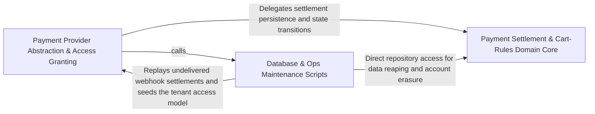

---
tags:
  - 2brain
  - 2brain/arch
  - project/boilerplate-node-backend
type: architecture
component: Database_Ops_Maintenance_Scripts
---

## Details

The db: and ops: one-shot scripts that prepare and maintain the database the scenario runner seeds into. This group owns access-model bootstrapping, Mongoose index synchronization (diffing registered models against the live database and applying unique/TTL indexes), and the scheduled reaping jobs (expired tokens, inactive accounts, account exports). Each is a self-contained main that opens its own connections and is wrapped by the shared runScript harness (Group 1) for exit codes, cleanup, and job-outcome recording. It is the 'database lifecycle' half of the subsystem, distinct from the seed/restore flow.

### Payment Settlement & Cart-Rules Domain Core
The domain core for the payment and cart bounded contexts: the payment repository (upsert-confirmable, refund attachment, provider-ref linking), the settlement/refunds/effect/intent domain logic, and the cart shipping rules and effective-shipping view. It also hosts the shared AuthContext/CallerContext/PlatformCaller/TenantCaller type surface that authorizes these operations. This is the 'what the data means' layer that the index-sync and reap scripts keep consistent at the storage level.

**Related Classes/Methods**:

- `src.modules.payments.repository.paymentRepository`:81-457
- `src.modules.cart.domain.rules.needsShipping`:92-93
- `src.modules.cart.services.view.effectiveShippingChoice`:144-148

**Source Files:**

- `src/modules/cart/domain/rules.ts`
  - `src.modules.cart.domain.rules.needsShipping` (L92-L93) - Class
  - `src.modules.cart.domain.rules.needsShipping.lines.some() callback` (L93-L93) - Function
- `src/modules/cart/services/view.ts`
  - `src.modules.cart.services.view.effectiveShippingChoice` (L144-L148) - Class
  - `src.modules.cart.services.view.effectiveShippingChoice.options.some() callback` (L148-L148) - Function
- `src/modules/payments/repository.ts`
  - `src.modules.payments.repository.UpsertedPayment` (L30-L33) - Interface
  - `src.modules.payments.repository.upsertConfirmable` (L47-L78) - Class
  - `src.modules.payments.repository.upsertConfirmable.then() callback` (L67-L73) - Function
  - `src.modules.payments.repository.upsertConfirmable.catch() callback` (L75-L78) - Function
  - `src.modules.payments.repository.paymentRepository` (L81-L457) - Class
  - `src.modules.payments.repository.paymentRepository.ownerScope` (L153-L153) - Method
  - `src.modules.payments.repository.paymentRepository.findByIdScoped` (L165-L166) - Method
  - `src.modules.payments.repository.paymentRepository.findByOrderId` (L175-L176) - Method
  - `src.modules.payments.repository.paymentRepository.findByProviderRef` (L185-L185) - Method
  - `src.modules.payments.repository.paymentRepository.attachProviderRef` (L196-L204) - Method
  - `src.modules.payments.repository.paymentRepository.attachProviderRef.then() callback` (L204-L204) - Function
  - `src.modules.payments.repository.paymentRepository.upsertIntent` (L215-L220) - Method
  - `src.modules.payments.repository.paymentRepository.upsertOffline` (L229-L237) - Method
  - `src.modules.payments.repository.paymentRepository.updateStatusIfIn` (L244-L251) - Method
  - `src.modules.payments.repository.paymentRepository.detachUserId` (L262-L270) - Method
  - `src.modules.payments.repository.paymentRepository.detachUserId.then() callback` (L270-L270) - Function
  - `src.modules.payments.repository.paymentRepository.deleteAbandonedBefore` (L281-L288) - Method
  - `src.modules.payments.repository.paymentRepository.deleteAbandonedBefore.then() callback` (L288-L288) - Function
  - `src.modules.payments.repository.paymentRepository.clearPendingEffects` (L297-L305) - Method
  - `src.modules.payments.repository.paymentRepository.clearPendingEffects.then() callback` (L305-L305) - Function
  - `src.modules.payments.repository.paymentRepository.clearPendingEffectsOnce` (L316-L324) - Method
  - `src.modules.payments.repository.paymentRepository.clearPendingEffectsOnce.then() callback` (L324-L324) - Function
  - `src.modules.payments.repository.paymentRepository.findWithPendingEffects` (L336-L344) - Method
  - `src.modules.payments.repository.paymentRepository.addRefund` (L362-L373) - Method
  - `src.modules.payments.repository.paymentRepository.settleRefund` (L387-L412) - Method
  - `src.modules.payments.repository.paymentRepository.failRefund` (L423-L438) - Method
  - `src.modules.payments.repository.paymentRepository.findWithOpenRefunds` (L448-L456) - Method
- `src/modules/payments/services/effects.ts`
  - `src.modules.payments.services.effects.retryOne` (L31-L65) - Class
  - `src.modules.payments.services.effects.retryOne.then() callback.then() callback` (L53-L53) - Function
  - `src.modules.payments.services.effects.retryOne.then() callback` (L55-L55) - Function
  - `src.modules.payments.services.effects.retryOne.catch() callback` (L56-L64) - Function
- `src/modules/payments/services/intent.ts`
  - `src.modules.payments.services.intent.cancelOpenIntentForOrder` (L198-L211) - Class
  - `src.modules.payments.services.intent.cancelOpenIntentForOrder.then() callback` (L199-L211) - Function
  - `src.modules.payments.services.intent.cancelOpenIntentForOrder.then() callback.catch() callback` (L203-L210) - Function
- `src/modules/payments/services/refunds.ts`
  - `src.modules.payments.services.refunds.openRefund` (L127-L163) - Class
  - `src.modules.payments.services.refunds.openRefund.then() callback` (L153-L162) - Function
  - `src.modules.payments.services.refunds.openRefund.then() callback.then() callback` (L159-L160) - Function
  - `src.modules.payments.services.refunds.isFullyRefunded` (L170-L171) - Class
  - `src.modules.payments.services.refunds.isFullyRefunded.payment.refunds.every() callback` (L171-L171) - Function
  - `src.modules.payments.services.refunds.writeSettlement` (L311-L331) - Class
  - `src.modules.payments.services.refunds.writeSettlement.then() callback` (L319-L331) - Function
  - `src.modules.payments.services.refunds.writeSettlement.then() callback.then() callback` (L330-L330) - Function
  - `src.modules.payments.services.refunds.settleRefund` (L346-L363) - Class
  - `src.modules.payments.services.refunds.settleRefund.announceInTransaction() callback` (L355-L359) - Function
  - `src.modules.payments.services.refunds.settleRefund.then() callback` (L360-L363) - Function
  - `src.modules.payments.services.refunds.settledElsewhere` (L474-L484) - Class
  - `src.modules.payments.services.refunds.settledElsewhere.then() callback` (L477-L483) - Function
  - `src.modules.payments.services.refunds.settledElsewhere.then() callback.fresh.refunds.some() callback` (L479-L480) - Function
  - `src.modules.payments.services.refunds.performRefund` (L502-L525) - Class
  - `src.modules.payments.services.refunds.performRefund.then() callback` (L507-L525) - Function
  - `src.modules.payments.services.refunds.performRefund.then() callback.then() callback` (L514-L524) - Function
  - `src.modules.payments.services.refunds.performRefund.then() callback.then() callback.then() callback` (L517-L522) - Function
  - `src.modules.payments.services.refunds.performRefund.then() callback.then() callback.then() callback.then() callback` (L520-L520) - Function
  - `src.modules.payments.services.refunds.refundForOrder` (L615-L616) - Class
  - `src.modules.payments.services.refunds.refundForOrder.then() callback` (L616-L616) - Function
  - `src.modules.payments.services.refunds.refundForReturn` (L633-L651) - Class
  - `src.modules.payments.services.refunds.refundForReturn.then() callback` (L638-L651) - Function
- `src/modules/payments/services/settlement.ts`
  - `src.modules.payments.services.settlement.refundLostPayment.refunded` (L97-L107) - Class
  - `src.modules.payments.services.settlement.refundLostPayment.refunded.then() callback.then() callback` (L98-L98) - Function
  - `src.modules.payments.services.settlement.refundLostPayment.refunded.catch() callback` (L99-L107) - Function
  - `src.modules.payments.services.settlement.cancelMismatchedOrder` (L127-L141) - Class
  - `src.modules.payments.services.settlement.cancelMismatchedOrder.then() callback` (L130-L133) - Function
  - `src.modules.payments.services.settlement.cancelMismatchedOrder.then() callback.then() callback` (L132-L132) - Function
  - `src.modules.payments.services.settlement.cancelMismatchedOrder.catch() callback` (L134-L141) - Function
  - `src.modules.payments.services.settlement.settleMismatch` (L155-L208) - Class
  - `src.modules.payments.services.settlement.settleMismatch.then() callback` (L170-L207) - Function
- `src/types/auth-context.ts`
  - `src.types.auth-context.AuthContext` (L29-L85) - Interface
  - `src.types.auth-context.TenantCaller` (L115-L143) - Interface
  - `src.types.auth-context.PlatformCaller` (L146-L160) - Interface
  - `src.types.auth-context.CallerContext` (L171-L224) - Interface
  - `src.types.auth-context.TenantCallerContext` (L235-L237) - Interface

### Payment Provider Abstraction & Access Granting
The provider/adapter and access-grant surface: the PaymentProvider port and its state types (PreparedPayment, ProviderPaymentState, ProviderWebhookEvent), the scenario fake-provider doubles (fakePaymentProvider, lazy registration), the tenant repository (tenantRepository.upsertBySlug), the access service grant check (checkGrant.escalated), and the postPaymentWebhook controller. This is the boundary where external payment providers and the access model meet the domain core, and where the bootstrap-access script's upserted tenant is consumed.

**Related Classes/Methods**:

- `src.modules.payments.providers.index.PaymentProvider`:101-198
- `src.modules.payments.controllers.post-payment-webhook.postPaymentWebhook`:33-85
- `src.modules.access.repository.tenantRepository`:15-36
- `src.modules.access.service.checkGrant.escalated`
- `scenarios.support.doubles.payments.fake.fakePaymentProvider`:146-256

**Source Files:**

- `scenarios/support/doubles/payments/fake.ts`
  - `scenarios.support.doubles.payments.fake.fakePaymentProvider` (L146-L256) - Class
  - `scenarios.support.doubles.payments.fake.fakePaymentProvider.prepare` (L151-L168) - Method
  - `scenarios.support.doubles.payments.fake.fakePaymentProvider.confirm` (L170-L179) - Method
  - `scenarios.support.doubles.payments.fake.fakePaymentProvider.retrieve` (L181-L186) - Method
  - `scenarios.support.doubles.payments.fake.fakePaymentProvider.refund` (L190-L199) - Method
  - `scenarios.support.doubles.payments.fake.fakePaymentProvider.cancel` (L201-L221) - Method
  - `scenarios.support.doubles.payments.fake.fakePaymentProvider.parseWebhook` (L233-L255) - Method
  - `scenarios.support.doubles.payments.fake.fakePaymentProvider.parseWebhook.catch() callback` (L243-L246) - Function
  - `scenarios.support.doubles.payments.fake.fakePaymentProvider.parseWebhook.then() callback` (L247-L255) - Function
- `scenarios/support/doubles/payments/register.ts`
  - `scenarios.support.doubles.payments.register.loadFakePaymentProvider` (L17-L18) - Class
  - `scenarios.support.doubles.payments.register.loadFakePaymentProvider.then() callback` (L18-L18) - Function
  - `scenarios.support.doubles.payments.register.lazyFakePaymentProvider` (L26-L46) - Class
  - `scenarios.support.doubles.payments.register.lazyFakePaymentProvider.prepare` (L28-L31) - Method
  - `scenarios.support.doubles.payments.register.lazyFakePaymentProvider.prepare.then() callback` (L29-L30) - Function
  - `scenarios.support.doubles.payments.register.lazyFakePaymentProvider.confirm` (L32-L35) - Method
  - `scenarios.support.doubles.payments.register.lazyFakePaymentProvider.confirm.then() callback` (L33-L34) - Function
  - `scenarios.support.doubles.payments.register.lazyFakePaymentProvider.retrieve` (L36-L37) - Method
  - `scenarios.support.doubles.payments.register.lazyFakePaymentProvider.retrieve.then() callback` (L37-L37) - Function
  - `scenarios.support.doubles.payments.register.lazyFakePaymentProvider.refund` (L38-L41) - Method
  - `scenarios.support.doubles.payments.register.lazyFakePaymentProvider.refund.then() callback` (L39-L40) - Function
  - `scenarios.support.doubles.payments.register.lazyFakePaymentProvider.cancel` (L42-L43) - Method
  - `scenarios.support.doubles.payments.register.lazyFakePaymentProvider.cancel.then() callback` (L43-L43) - Function
  - `scenarios.support.doubles.payments.register.lazyFakePaymentProvider.parseWebhook` (L44-L45) - Method
  - `scenarios.support.doubles.payments.register.lazyFakePaymentProvider.parseWebhook.then() callback` (L45-L45) - Function
- `src/modules/access/repository.ts`
  - `src.modules.access.repository.tenantRepository` (L15-L36) - Class
  - `src.modules.access.repository.tenantRepository.upsertBySlug` (L20-L35) - Method
- `src/modules/access/service.ts`
  - `src.modules.access.service.checkGrant.escalated` (L132-L132) - Class
  - `src.modules.access.service.checkGrant.escalated.permissions.filter() callback` (L132-L132) - Function
- `src/modules/payments/controllers/post-payment-confirm.ts`
  - `src.modules.payments.controllers.post-payment-confirm.postPaymentConfirm.then() callback.declined` (L38-L39) - Class
  - `src.modules.payments.controllers.post-payment-confirm.postPaymentConfirm.then() callback.declined.result.errors.some() callback` (L39-L39) - Function
- `src/modules/payments/controllers/post-payment-webhook.ts`
  - `src.modules.payments.controllers.post-payment-webhook.postPaymentWebhook` (L33-L85) - Class
  - `src.modules.payments.controllers.post-payment-webhook.postPaymentWebhook.then() callback` (L50-L61) - Function
  - `src.modules.payments.controllers.post-payment-webhook.then() callback.then() callback` (L57-L57) - Function
  - `src.modules.payments.controllers.post-payment-webhook.postPaymentWebhook.then() callback.then() callback` (L58-L60) - Function
  - `src.modules.payments.controllers.post-payment-webhook.postPaymentWebhook.catch() callback` (L62-L84) - Function
- `src/modules/payments/providers/errors.ts`
  - `src.modules.payments.providers.errors.PaymentInFlightError` (L13-L19) - Class
  - `src.modules.payments.providers.errors.PaymentInFlightError.constructor` (L15-L18) - Constructor
- `src/modules/payments/providers/index.ts`
  - `src.modules.payments.providers.index.ProviderPaymentState` (L35-L56) - Interface
  - `src.modules.payments.providers.index.PreparedPayment` (L59-L67) - Interface
  - `src.modules.payments.providers.index.RefundedByProvider` (L70-L73) - Interface
  - `src.modules.payments.providers.index.ProviderWebhookEvent` (L84-L89) - Interface
  - `src.modules.payments.providers.index.PaymentProvider` (L101-L198) - Interface
  - `src.modules.payments.providers.index.PaymentProvider.prepare` (L119-L123) - Method
  - `src.modules.payments.providers.index.PaymentProvider.confirm` (L133-L133) - Method
  - `src.modules.payments.providers.index.PaymentProvider.retrieve` (L141-L141) - Method
  - `src.modules.payments.providers.index.PaymentProvider.refund` (L155-L159) - Method
  - `src.modules.payments.providers.index.PaymentProvider.cancel` (L175-L175) - Method
  - `src.modules.payments.providers.index.PaymentProvider.parseWebhook` (L197-L197) - Method
- `src/modules/payments/providers/webhook-signature.ts`
  - `src.modules.payments.providers.webhook-signature.WebhookRejected` (L32-L45) - Class
  - `src.modules.payments.providers.webhook-signature.WebhookRejected.constructor` (L38-L44) - Constructor
- `src/modules/payments/services/announce.ts`
  - `src.modules.payments.services.announce.recordDecline` (L65-L83) - Class
  - `src.modules.payments.services.announce.announceInTransaction() callback` (L70-L77) - Function
  - `src.modules.payments.services.announce.recordDecline.announceInTransaction() callback` (L78-L82) - Function
- `src/modules/payments/services/intent.ts`
  - `src.modules.payments.services.intent.rejectStrayIntent` (L37-L64) - Class
  - `src.modules.payments.services.intent.rejectStrayIntent.catch() callback` (L44-L51) - Function
  - `src.modules.payments.services.intent.rejectStrayIntent.then() callback` (L52-L64) - Function
- `src/modules/payments/services/refunds.ts`
  - `src.modules.payments.services.refunds.sendToProvider` (L375-L400) - Class
  - `src.modules.payments.services.refunds.sendToProvider.then() callback` (L390-L399) - Function
  - `src.modules.payments.services.refunds.sendToProvider.then() callback.then() callback` (L397-L399) - Function
- `src/modules/payments/services/settlement.ts`
  - `src.modules.payments.services.settlement.settlePayment` (L225-L351) - Class
  - `src.modules.payments.services.settlement.settlePayment.then() callback.catch() callback` (L249-L256) - Function
  - `src.modules.payments.services.settlement.settlePayment.then() callback` (L283-L350) - Function
  - `src.modules.payments.services.settlement.settlePayment.then() callback.mailBuyer() callback` (L340-L347) - Function
  - `src.modules.payments.services.settlement.settleFound` (L475-L493) - Class
  - `src.modules.payments.services.settlement.settleFound.then() callback` (L487-L492) - Function
  - `src.modules.payments.services.settlement.settleFound.then() callback.then() callback` (L490-L490) - Function
  - `src.modules.payments.services.settlement.settleVia` (L506-L524) - Class
  - `src.modules.payments.services.settlement.settleVia.then() callback` (L524-L524) - Function
  - `src.modules.payments.services.settlement.confirmPayment` (L541-L554) - Class
  - `src.modules.payments.services.settlement.confirmPayment.settleVia() callback` (L553-L553) - Function
  - `src.modules.payments.services.settlement.syncPayment` (L566-L584) - Class
  - `src.modules.payments.services.settlement.syncPayment.then() callback.settleFound() callback` (L580-L581) - Function
  - `src.modules.payments.services.settlement.syncPayment.then() callback` (L584-L584) - Function
  - `src.modules.payments.services.settlement.applyWebhookSettlement` (L649-L676) - Class
  - `src.modules.payments.services.settlement.applyWebhookSettlement.then() callback` (L650-L676) - Function
  - `src.modules.payments.services.settlement.applyWebhookSettlement.then() callback.then() callback` (L666-L675) - Function

### Database & Ops Maintenance Scripts
The db: and ops: one-shot scripts that prepare and maintain the database. It owns three responsibilities: (1) access-model bootstrapping — idempotently upserting the fixed DEPLOYMENT_TENANT_ID shop on a fresh production DB; (2) Mongoose index synchronization — diffing every registered model against the live database (planIndexSync/diffIndexes), pre-flight checking for blocking unique-index duplicates (findBlockingDuplicates), and applying via syncIndexes (applyIndexSync), with a --check deploy-gate mode; and (3) scheduled reaping jobs — expired tokens, inactive accounts (three-stage warn/soft-delete/hard-delete), account exports, mail spool, and orders, each guarded by withLease where a double-run is expensive. Each is a self-contained main that opens its own connection and is wrapped by the shared runScript harness for exit codes, cleanup, and job-outcome recording.

**Related Classes/Methods**:

- `scripts.db.bootstrap-access.main`:26-31
- `scripts.db.index-sync.applyIndexSync`:214-233
- `scripts.ops.reap-account-exports.main`:28-33
- `scripts.ops.reap-expired-tokens.main`:38-47

**Source Files:**

- `scripts/db/bootstrap-access.ts`
  - `scripts.db.bootstrap-access.main` (L26-L31) - Class
  - `scripts.db.bootstrap-access.then() callback` (L28-L28) - Function
  - `scripts.db.bootstrap-access.main.then() callback` (L29-L31) - Function
- `scripts/db/index-sync.ts`
  - `scripts.db.index-sync.IndexDiff` (L30-L37) - Interface
  - `scripts.db.index-sync.RegisteredModel` (L47-L51) - Interface
  - `scripts.db.index-sync.UniqueIndex` (L56-L63) - Interface
  - `scripts.db.index-sync.uniqueIndexes` (L88-L98) - Class
  - `scripts.db.index-sync.uniqueIndexes.flatMap() callback` (L89-L97) - Function
  - `scripts.db.index-sync.uniqueIndexes.flatMap() callback.filter() callback` (L92-L92) - Function
  - `scripts.db.index-sync.uniqueIndexes.flatMap() callback.map() callback` (L93-L97) - Function
  - `scripts.db.index-sync.findDuplicates.$match.keys.map() callback` (L117-L117) - Function
  - `scripts.db.index-sync.findDuplicates.$group._id.keys.map() callback` (L123-L123) - Function
  - `scripts.db.index-sync.findBlockingDuplicates.pending` (L155-L161) - Class
  - `scripts.db.index-sync.findBlockingDuplicates.pending.plan.flatMap() callback` (L158-L159) - Function
  - `scripts.db.index-sync.findBlockingDuplicates.pending.plan.flatMap() callback.toCreate.map() callback` (L159-L159) - Function
  - `scripts.db.index-sync.applyIndexSync` (L214-L233) - Class
  - `scripts.db.index-sync.applyIndexSync.blocking.map() callback` (L221-L221) - Function
- `scripts/db/sync-indexes.ts`
  - `scripts.db.sync-indexes.describe` (L31-L36) - Class
  - `scripts.db.sync-indexes.describe.toCreate.map() callback` (L34-L34) - Function
  - `scripts.db.sync-indexes.describe.toDrop.map() callback` (L35-L35) - Function
  - `scripts.db.sync-indexes.report` (L39-L46) - Class
  - `scripts.db.sync-indexes.report.plan.map() callback` (L45-L45) - Function
  - `scripts.db.sync-indexes.runScript() callback` (L79-L79) - Function
- `scripts/ops/reap-account-exports.ts`
  - `scripts.ops.reap-account-exports.main` (L28-L33) - Class
  - `scripts.ops.reap-account-exports.main.then() callback` (L31-L32) - Function
- `scripts/ops/reap-expired-tokens.ts`
  - `scripts.ops.reap-expired-tokens.main` (L38-L47) - Class
  - `scripts.ops.reap-expired-tokens.then() callback` (L40-L40) - Function
  - `scripts.ops.reap-expired-tokens.main.then() callback` (L41-L47) - Function
- `scripts/ops/reap-inactive-accounts.ts`
  - `scripts.ops.reap-inactive-accounts.warn` (L87-L98) - Class
  - `scripts.ops.reap-inactive-accounts.warn.then() callback.then() callback` (L96-L96) - Function
  - `scripts.ops.reap-inactive-accounts.main.ran` (L113-L139) - Class
  - `scripts.ops.reap-inactive-accounts.main.ran.withLease('reap:inactive-accounts') callback` (L113-L139) - Function
- `scripts/ops/reap-mail-spool.ts`
  - `scripts.ops.reap-mail-spool.main` (L35-L40) - Class
  - `scripts.ops.reap-mail-spool.then() callback` (L37-L39) - Function
  - `scripts.ops.reap-mail-spool.main.then() callback` (L40-L40) - Function
- `scripts/ops/reap-orders.ts`
  - `scripts.ops.reap-orders.main` (L31-L34) - Class
  - `scripts.ops.reap-orders.then() callback` (L33-L33) - Function
  - `scripts.ops.reap-orders.main.then() callback` (L34-L34) - Function
- `scripts/ops/reap-payments.ts`
  - `scripts.ops.reap-payments.main` (L29-L32) - Class
  - `scripts.ops.reap-payments.then() callback` (L31-L31) - Function
  - `scripts.ops.reap-payments.main.then() callback` (L32-L32) - Function
- `scripts/ops/reap-quarantine.ts`
  - `scripts.ops.reap-quarantine.main` (L35-L43) - Class
  - `scripts.ops.reap-quarantine.then() callback` (L39-L40) - Function
  - `scripts.ops.reap-quarantine.main.then() callback` (L42-L42) - Function
- `scripts/ops/reencrypt.ts`
  - `scripts.ops.reencrypt.main` (L63-L68) - Class
  - `scripts.ops.reencrypt.main.then() callback` (L66-L68) - Function
- `scripts/ops/sweep-payment-effects.ts`
  - `scripts.ops.sweep-payment-effects.main` (L36-L40) - Class
  - `scripts.ops.sweep-payment-effects.then() callback` (L38-L38) - Function
  - `scripts.ops.sweep-payment-effects.main.then() callback` (L40-L40) - Function
- `scripts/ops/sweep-reservations.ts`
  - `scripts.ops.sweep-reservations.main` (L43-L61) - Class
  - `scripts.ops.sweep-reservations.then() callback` (L45-L48) - Function
  - `scripts.ops.sweep-reservations.main.then() callback.withLease('sweep:reservations') callback` (L52-L53) - Function
  - `scripts.ops.sweep-reservations.main.then() callback.withLease('sweep:reservations') callback.then() callback` (L53-L53) - Function
  - `scripts.ops.sweep-reservations.main.then() callback` (L56-L61) - Function
- `src/infrastructure/adapters/filesystem.ts`
  - `src.infrastructure.adapters.filesystem.ReapResult` (L102-L105) - Interface
  - `src.infrastructure.adapters.filesystem.reapDirectory` (L119-L154) - Class
  - `src.infrastructure.adapters.filesystem.reapDirectory.catch() callback` (L121-L132) - Function
  - `src.infrastructure.adapters.filesystem.reapDirectory.then() callback` (L133-L153) - Function
  - `src.infrastructure.adapters.filesystem.reapDirectory.then() callback.entries.map() callback` (L135-L149) - Function
  - `src.infrastructure.adapters.filesystem.reapDirectory.then() callback.entries.map() callback.then() callback` (L138-L141) - Function
  - `src.infrastructure.adapters.filesystem.reapDirectory.then() callback.entries.map() callback.then() callback.then() callback` (L140-L140) - Function
  - `src.infrastructure.adapters.filesystem.reapDirectory.then() callback.entries.map() callback.catch() callback` (L143-L148) - Function
  - `src.infrastructure.adapters.filesystem.reapDirectory.then() callback.then() callback` (L150-L153) - Function
  - `src.infrastructure.adapters.filesystem.then() callback.orphaned.map() callback.then() callback` (L186-L191) - Function
- `src/infrastructure/adapters/logger.ts`
  - `src.infrastructure.adapters.logger.Logger.info` (L34-L34) - Method
- `src/infrastructure/adapters/mail-spool.ts`
  - `src.infrastructure.adapters.mail-spool.spoolAttachment` (L46-L51) - Class
  - `src.infrastructure.adapters.mail-spool.spoolAttachment.then() callback` (L50-L50) - Function
  - `src.infrastructure.adapters.mail-spool.reapSpooled` (L92-L93) - Class
  - `src.infrastructure.adapters.mail-spool.reapSpooled.then() callback` (L93-L93) - Function
- `src/infrastructure/adapters/queue.ts`
  - `src.infrastructure.adapters.queue.parkedCounts` (L441-L465) - Class
  - `src.infrastructure.adapters.queue.parkedCounts.then() callback` (L447-L462) - Function
  - `src.infrastructure.adapters.queue.parkedCounts.then() callback.map() callback` (L449-L452) - Function
  - `src.infrastructure.adapters.queue.parkedCounts.then() callback.map() callback.then() callback` (L452-L452) - Function
  - `src.infrastructure.adapters.queue.parkedCounts.then() callback.then() callback` (L455-L458) - Function
  - `src.infrastructure.adapters.queue.parkedCounts.then() callback.then() callback.results.flatMap() callback` (L456-L457) - Function
  - `src.infrastructure.adapters.queue.parkedCounts.then() callback.finally() callback` (L460-L462) - Function
  - `src.infrastructure.adapters.queue.parkedCounts.then() callback.finally() callback.catch() callback` (L461-L461) - Function
  - `src.infrastructure.adapters.queue.parkedCounts.catch() callback` (L464-L464) - Function
- `src/infrastructure/adapters/ssrf-guard.ts`
  - `src.infrastructure.adapters.ssrf-guard.rejectOnAbort` (L209-L216) - Class
  - `src.infrastructure.adapters.ssrf-guard.rejectOnAbort.<function>` (L210-L216) - Function
  - `src.infrastructure.adapters.ssrf-guard.rejectOnAbort.<function>.signal.addEventListener('abort') callback` (L215-L215) - Function
- `src/infrastructure/persistence/lease.ts`
  - `src.infrastructure.persistence.lease.LeaseDocument` (L37-L44) - Interface
  - `src.infrastructure.persistence.lease.LeaseSummary` (L104-L108) - Interface
  - `src.infrastructure.persistence.lease.releaseLease` (L176-L208) - Class
  - `src.infrastructure.persistence.lease.releaseLease.catch() callback` (L197-L208) - Function
  - `src.infrastructure.persistence.lease.withLease` (L265-L283) - Class
  - `src.infrastructure.persistence.lease.withLease.then() callback` (L272-L282) - Function
  - `src.infrastructure.persistence.lease.then() callback.then() callback.then() callback` (L276-L276) - Function
  - `src.infrastructure.persistence.lease.withLease.then() callback.then() callback` (L277-L280) - Function
  - `src.infrastructure.persistence.lease.withLease.then() callback.then() callback.then() callback` (L278-L280) - Function
- `src/kernel/outbox.ts`
  - `src.kernel.outbox.settleOutboxNudges` (L391-L392) - Class
  - `src.kernel.outbox.settleOutboxNudges.then() callback` (L392-L392) - Function
- `src/kernel/registry.ts`
  - `src.kernel.registry.resolveTranslatables` (L487-L495) - Class
  - `src.kernel.registry.resolveTranslatables.appModules.flatMap() callback` (L493-L493) - Function
  - `src.kernel.registry.resolvePublicEvents` (L510-L518) - Class
  - `src.kernel.registry.resolvePublicEvents.appModules.flatMap() callback` (L516-L516) - Function
- `src/modules.ts`
  - `src.modules.enabledModuleDirectories` (L70-L73) - Class
  - `src.modules.enabledModuleDirectories.enabledModules.map() callback` (L72-L72) - Function
  - `src.modules.enabledModuleDirectories.filter() callback` (L73-L73) - Function
- `src/modules/invoicing/emails.ts`
  - `src.modules.invoicing.emails.buildVatBlock.perLine` (L151-L158) - Class
  - `src.modules.invoicing.emails.buildVatBlock.perLine.document.lines.map() callback` (L152-L155) - Function
- `src/modules/invoicing/services/partial-credit.ts`
  - `src.modules.invoicing.services.partial-credit.partialCredit.shares` (L41-L44) - Class
  - `src.modules.invoicing.services.partial-credit.partialCredit.shares.taxSummary.map() callback` (L43-L43) - Function
- `src/modules/orders/domain/money.ts`
  - `src.modules.orders.domain.money.apportion` (L159-L174) - Class
  - `src.modules.orders.domain.money.apportion.weights.map() callback` (L161-L161) - Function
  - `src.modules.orders.domain.money.apportion.shares` (L163-L163) - Class
  - `src.modules.orders.domain.money.apportion.shares.weights.map() callback` (L163-L163) - Function
- `src/modules/orders/domain/tax.ts`
  - `src.modules.orders.domain.tax.allocateLineTax.shares` (L188-L191) - Class
  - `src.modules.orders.domain.tax.allocateLineTax.shares.indexes.map() callback` (L190-L190) - Function
  - `src.modules.orders.domain.tax.lineTaxFromRateTotals` (L205-L224) - Class
  - `src.modules.orders.domain.tax.lineTaxFromRateTotals.grossByLine.items.map() callback` (L211-L212) - Function
  - `src.modules.orders.domain.tax.lineTaxFromRateTotals.grossByLine` (L211-L213) - Class
  - `src.modules.orders.domain.tax.lineTaxFromRateTotals.taxes` (L214-L218) - Class
  - `src.modules.orders.domain.tax.lineTaxFromRateTotals.taxes.map() callback` (L217-L217) - Function
  - `src.modules.orders.domain.tax.lineTaxFromRateTotals.grossByLine.map() callback` (L219-L223) - Function
  - `src.modules.orders.domain.tax.orderTaxBreakdown.grossAmounts.items.map() callback` (L239-L240) - Function
  - `src.modules.orders.domain.tax.orderTaxBreakdown.grossAmounts` (L239-L241) - Class
  - `src.modules.orders.domain.tax.orderTaxBreakdown.lineTaxes` (L250-L254) - Class
  - `src.modules.orders.domain.tax.orderTaxBreakdown.lineTaxes.map() callback` (L253-L253) - Function
  - `src.modules.orders.domain.tax.orderTaxBreakdown.sumOf` (L263-L264) - Class
  - `src.modules.orders.domain.tax.orderTaxBreakdown.sumOf.sortedGroups.map() callback` (L264-L264) - Function
  - `src.modules.orders.domain.tax.orderTaxBreakdown.shippingNetTotal` (L284-L287) - Class
  - `src.modules.orders.domain.tax.orderTaxBreakdown.shippingNetTotal.sumOf() callback` (L286-L286) - Function
  - `src.modules.orders.domain.tax.netTotal` (L288-L291) - Class
  - `src.modules.orders.domain.tax.netTotal.sumOf() callback` (L289-L289) - Function
- `src/modules/orders/services/retention.ts`
  - `src.modules.orders.services.retention.anonymizeDueOrders` (L44-L51) - Class
  - `src.modules.orders.services.retention.anonymizeDueOrders.then() callback` (L45-L51) - Function
- `src/modules/payments/repository.ts`
  - `src.modules.payments.repository.releaseWebhookEvent` (L487-L491) - Class
  - `src.modules.payments.repository.releaseWebhookEvent.then() callback` (L491-L491) - Function
- `src/modules/payments/services/retention.ts`
  - `src.modules.payments.services.retention.detachUserId` (L23-L33) - Class
  - `src.modules.payments.services.retention.detachUserId.then() callback` (L24-L33) - Function
  - `src.modules.payments.services.retention.reapAbandonedPayments` (L100-L111) - Class
  - `src.modules.payments.services.retention.reapAbandonedPayments.then() callback` (L104-L110) - Function
- `src/modules/payments/services/settlement.ts`
  - `src.modules.payments.services.settlement.applyWebhookDelivery` (L607-L631) - Class
  - `src.modules.payments.services.settlement.applyWebhookDelivery.then() callback` (L608-L631) - Function
  - `src.modules.payments.services.settlement.applyWebhookDelivery.then() callback.catch() callback` (L623-L629) - Function
  - `src.modules.payments.services.settlement.applyWebhookDelivery.then() callback.catch() callback.then() callback` (L627-L629) - Function
