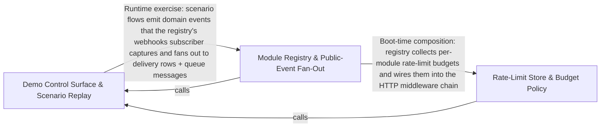

---
tags:
  - 2brain
  - 2brain/arch
  - project/boilerplate-node-backend
type: architecture
component: Demo_Control_Surface_Test_Doubles
---

## Details

The demo profile's runtime control plane and the dev-only doubles that make the flows runnable without external services. installDemo/restoreScenario mount the unauthenticated /__test/* routes (restore, describe, emails, clock, jobs) and implement build-once/replay-many via the database-snapshot helpers (emptyDatabase, captureDatabase, restoreDatabaseCopy). The doubles — the fake PSP (3-D Secure + signed webhooks), the mail outbox, and the in-process mongod replica set — let the seed and e2e suite walk the full payment/webhook/mail paths with no real provider, broker, or database. This group is the 'make it runnable and observable' half of the subsystem, kept strictly outside src/.

### Demo Control Surface & Scenario Replay
The demo profile's runtime control plane. installDemo/restoreScenario mount the six unauthenticated /__test/* routes (restore, scenario, emails, clock, jobs) and implement build-once/replay-many: buildOnce builds a named scenario into an empty database once, captures it, and every later restore replays the captured copy. It is backed by the database-snapshot helpers (emptyDatabase, captureDatabase, restoreDatabaseCopy) and the in-process mongod replica set that makes multi-document transactions possible without an external database. This is the 'runnable and observable' control surface, mounted only by scenarios/run-server.ts and invisible to production src/.

**Related Classes/Methods**:

- `scenarios.support.ephemeral-mongod.startInProcessMongod`:48-81

**Source Files:**

- `scenarios/support/ephemeral-mongod.ts`
  - `scenarios.support.ephemeral-mongod.startInProcessMongod` (L48-L81) - Class
  - `scenarios.support.ephemeral-mongod.startInProcessMongod.catch() callback` (L76-L79) - Function
  - `scenarios.support.ephemeral-mongod.startInProcessMongod.finally() callback` (L80-L80) - Function
- `src/app/error-handling.ts`
  - `src.app.error-handling.installErrorHandling` (L231-L256) - Class
  - `src.app.error-handling.installErrorHandling.process.on('uncaughtException') callback` (L244-L255) - Function
- `src/cluster.ts`
  - `src.cluster.then() callback` (L183-L183) - Function
  - `src.cluster.catch() callback` (L185-L191) - Function
- `src/infrastructure/adapters/logger.ts`
  - `src.infrastructure.adapters.logger.Logger.error` (L41-L41) - Method
- `src/infrastructure/adapters/mailer.ts`
  - `src.infrastructure.adapters.mailer.enqueueEmail` (L245-L295) - Class
- `src/infrastructure/adapters/queue.ts`
  - `src.infrastructure.adapters.queue.then() callback` (L567-L567) - Function
  - `src.infrastructure.adapters.queue.PublishOptions` (L602-L609) - Interface
  - `src.infrastructure.adapters.queue.ConsumeOptions` (L696-L713) - Interface
  - `src.infrastructure.adapters.queue.retryLater` (L811-L846) - Class
  - `src.infrastructure.adapters.queue.retryLater.ch.sendToQueue() callback` (L828-L841) - Function
  - `src.infrastructure.adapters.queue.handleDelivery.settled` (L905-L931) - Class
  - `src.infrastructure.adapters.queue.settled.then() callback` (L906-L906) - Function
  - `src.infrastructure.adapters.queue.handleDelivery.settled.then() callback` (L907-L912) - Function
  - `src.infrastructure.adapters.queue.handleDelivery.settled.catch() callback` (L913-L931) - Function
  - `src.infrastructure.adapters.queue.handleDelivery.settled.finally() callback` (L933-L933) - Function
- `src/infrastructure/runtime/server-lifecycle.ts`
  - `src.infrastructure.runtime.server-lifecycle.failBoot` (L64-L70) - Class
  - `src.infrastructure.runtime.server-lifecycle.failBoot.catch() callback` (L68-L68) - Function
  - `src.infrastructure.runtime.server-lifecycle.failBoot.finally() callback` (L69-L69) - Function
  - `src.infrastructure.runtime.server-lifecycle.registerSignalHandlers` (L168-L221) - Class
  - `src.infrastructure.runtime.server-lifecycle.registerSignalHandlers.onProcessSignal` (L173-L215) - Class
  - `src.infrastructure.runtime.server-lifecycle.onProcessSignal.then() callback` (L197-L197) - Function
  - `src.infrastructure.runtime.server-lifecycle.registerSignalHandlers.onProcessSignal.then() callback` (L198-L204) - Function
  - `src.infrastructure.runtime.server-lifecycle.registerSignalHandlers.onProcessSignal.catch() callback` (L205-L214) - Function
  - `src.infrastructure.runtime.server-lifecycle.registerSignalHandlers.process.on('SIGTERM') callback` (L218-L218) - Function
  - `src.infrastructure.runtime.server-lifecycle.registerSignalHandlers.process.on('SIGINT') callback` (L220-L220) - Function
- `src/kernel/outbox.ts`
  - `src.kernel.outbox.OutboxEventDocument` (L45-L63) - Interface
  - `src.kernel.outbox.OutboxRow` (L156-L161) - Interface
  - `src.kernel.outbox.RelayResult` (L164-L168) - Interface
  - `src.kernel.outbox.claim` (L201-L214) - Class
  - `src.kernel.outbox.claim.then() callback` (L213-L213) - Function
  - `src.kernel.outbox.dispatch` (L221-L229) - Class
  - `src.kernel.outbox.dispatch.then() callback` (L228-L228) - Function
  - `src.kernel.outbox.markFailed` (L246-L274) - Class
  - `src.kernel.outbox.markFailed.then() callback` (L264-L273) - Function
  - `src.kernel.outbox.relayOne` (L277-L285) - Class
  - `src.kernel.outbox.relayOne.then() callback` (L278-L285) - Function
  - `src.kernel.outbox.relayOne.then() callback.then() callback` (L280-L283) - Function
  - `src.kernel.outbox.relayOne.then() callback.then() callback.then() callback` (L282-L282) - Function
  - `src.kernel.outbox.relayOutbox.outcomes` (L319-L319) - Class
  - `src.kernel.outbox.relayOutbox.outcomes.heads.map() callback` (L319-L319) - Function
  - `src.kernel.outbox.relayOutbox.outcomes.every() callback` (L322-L322) - Function
  - `src.kernel.outbox.OutboxAnnouncement` (L350-L357) - Interface
  - `src.kernel.outbox.setOutboxPendingReader() callback` (L437-L437) - Function
- `src/modules/account/emails.ts`
  - `src.modules.account.emails.verifyRequestEmail` (L94-L111) - Class
  - `src.modules.account.emails.verifyRequestEmail.body` (L104-L109) - Method
  - `src.modules.account.emails.emailChangeNoticeEmail` (L122-L138) - Class
  - `src.modules.account.emails.emailChangeNoticeEmail.body` (L132-L136) - Method
  - `src.modules.account.emails.resetRequestEmail` (L141-L153) - Class
  - `src.modules.account.emails.resetRequestEmail.body` (L146-L151) - Method
  - `src.modules.account.emails.resetConfirmEmail` (L291-L315) - Class
  - `src.modules.account.emails.resetConfirmEmail.body` (L300-L313) - Method
  - `src.modules.account.emails.resetConfirmEmail.body.providers.providers.providers.map() callback` (L308-L308) - Function
  - `src.modules.account.emails.deleteRequestEmail` (L318-L330) - Class
  - `src.modules.account.emails.deleteRequestEmail.body` (L323-L328) - Method
  - `src.modules.account.emails.deleteConfirmEmail` (L333-L343) - Class
  - `src.modules.account.emails.deleteConfirmEmail.body` (L338-L341) - Method
  - `src.modules.account.emails.inactivityWarningEmail` (L349-L362) - Class
  - `src.modules.account.emails.inactivityWarningEmail.body` (L358-L360) - Method
  - `src.modules.account.emails.exportFailedEmail` (L371-L381) - Class
  - `src.modules.account.emails.exportFailedEmail.body` (L376-L379) - Method
  - `src.modules.account.emails.exportReadyEmail` (L392-L410) - Class
  - `src.modules.account.emails.exportReadyEmail.body` (L402-L408) - Method
- `src/modules/account/mail-budget.ts`
  - `src.modules.account.mail-budget.mailRecipientLimiter` (L93-L108) - Class
  - `src.modules.account.mail-budget.mailRecipientLimiter.then() callback` (L100-L107) - Function
- `src/modules/account/services/deletion-request.ts`
  - `src.modules.account.services.deletion-request.requestAccountDeletion` (L21-L40) - Class
  - `src.modules.account.services.deletion-request.requestAccountDeletion.then() callback` (L22-L40) - Function
- `src/modules/account/services/email-change.ts`
  - `src.modules.account.services.email-change.sendEmailChangeMail` (L136-L149) - Class
  - `src.modules.account.services.email-change.sendEmailChangeMail.then() callback` (L149-L149) - Function
- `src/modules/account/services/export-job.ts`
  - `src.modules.account.services.export-job.mailRequester` (L80-L90) - Class
  - `src.modules.account.services.export-job.mailRequester.then() callback` (L84-L90) - Function
  - `src.modules.account.services.export-job.mailLink` (L98-L101) - Class
  - `src.modules.account.services.export-job.mailLink.mailRequester() callback` (L100-L100) - Function
  - `src.modules.account.services.export-job.buildAndSettle` (L110-L129) - Class
  - `src.modules.account.services.export-job.buildAndSettle.writeExport() callback` (L120-L121) - Function
  - `src.modules.account.services.export-job.buildAndSettle.then() callback` (L122-L127) - Function
  - `src.modules.account.services.export-job.removeFileIfRowGone` (L138-L141) - Class
  - `src.modules.account.services.export-job.removeFileIfRowGone.then() callback.then() callback` (L141-L141) - Function
  - `src.modules.account.services.export-job.afterBuild` (L154-L168) - Class
  - `src.modules.account.services.export-job.afterBuild.catch() callback` (L161-L167) - Function
  - `src.modules.account.services.export-job.mailFailure` (L176-L179) - Class
  - `src.modules.account.services.export-job.mailFailure.mailRequester() callback` (L177-L177) - Function
  - `src.modules.account.services.export-job.mailFailure.catch() callback` (L177-L179) - Function
  - `src.modules.account.services.export-job.fail` (L189-L207) - Class
  - `src.modules.account.services.export-job.fail.then() callback` (L198-L206) - Function
  - `src.modules.account.services.export-job.fail.then() callback.then() callback` (L205-L205) - Function
  - `src.modules.account.services.export-job.runExportJob` (L218-L231) - Class
  - `src.modules.account.services.export-job.runExportJob.then() callback` (L219-L231) - Function
  - `src.modules.account.services.export-job.runExportJob.then() callback.then() callback` (L230-L230) - Function
- `src/modules/account/services/export-rows.ts`
  - `src.modules.account.services.export-rows.removeRow` (L20-L21) - Class
  - `src.modules.account.services.export-rows.removeRow.then() callback` (L21-L21) - Function
  - `src.modules.account.services.export-rows.reapExpiredExports` (L32-L44) - Class
  - `src.modules.account.services.export-rows.reapExpiredExports.drain` (L33-L39) - Class
  - `src.modules.account.services.export-rows.reapExpiredExports.drain.then() callback` (L34-L39) - Function
  - `src.modules.account.services.export-rows.reapExpiredExports.drain.then() callback.due.map() callback` (L36-L36) - Function
  - `src.modules.account.services.export-rows.reapExpiredExports.drain.then() callback.then() callback` (L36-L37) - Function
  - `src.modules.account.services.export-rows.reapExpiredExports.then() callback` (L41-L42) - Function
  - `src.modules.account.services.export-rows.reapExpiredExports.then() callback.then() callback` (L42-L42) - Function
- `src/modules/account/services/export.ts`
  - `src.modules.account.services.export.AccountExportRequestResult` (L56-L59) - Interface
  - `src.modules.account.services.export.insertRow` (L88-L111) - Class
  - `src.modules.account.services.export.insertRow.then() callback` (L102-L109) - Function
  - `src.modules.account.services.export.insertRow.then() callback.then() callback` (L104-L108) - Function
  - `src.modules.account.services.export.dispatch.then() callback.running` (L127-L135) - Class
  - `src.modules.account.services.export.dispatch.then() callback.running.catch() callback` (L128-L134) - Function
  - `src.modules.account.services.export.dispatch.then() callback.running.finally() callback` (L135-L135) - Function
  - `src.modules.account.services.export.ExportRowChoice` (L140-L143) - Interface
  - `src.modules.account.services.export.rowOrRefusal` (L155-L166) - Class
  - `src.modules.account.services.export.rowOrRefusal.then() callback` (L156-L166) - Function
  - `src.modules.account.services.export.rowOrRefusal.then() callback.then() callback` (L162-L164) - Function
  - `src.modules.account.services.export.rowOrRefusal.then() callback.then() callback.then() callback` (L164-L164) - Function
  - `src.modules.account.services.export.eraseExports` (L265-L271) - Class
  - `src.modules.account.services.export.eraseExports.then() callback` (L269-L270) - Function
  - `src.modules.account.services.export.eraseExports.then() callback.<function>` (L269-L270) - Function
  - `src.modules.account.services.export.eraseExports.then() callback.<function>.files.map() callback` (L270-L270) - Function
  - `src.modules.account.services.export.eraseExports.then() callback.<function>.then() callback` (L270-L270) - Function
- `src/modules/account/services/password-reset-request.ts`
  - `src.modules.account.services.password-reset-request.mailResetLink` (L67-L86) - Class
  - `src.modules.account.services.password-reset-request.mailResetLink.then() callback` (L68-L86) - Function
  - `src.modules.account.services.password-reset-request.mailResetLink.then() callback.then() callback` (L71-L85) - Function
  - `src.modules.account.services.password-reset-request.requestPasswordReset` (L101-L131) - Class
  - `src.modules.account.services.password-reset-request.requestPasswordReset.then() callback` (L121-L130) - Function
- `src/modules/account/services/password-reset.ts`
  - `src.modules.account.services.password-reset.afterReset.mail` (L79-L86) - Class
  - `src.modules.account.services.password-reset.afterReset.mail.map() callback` (L85-L85) - Function
- `src/modules/account/services/reap-inactive.ts`
  - `src.modules.account.services.reap-inactive.warn` (L30-L41) - Class
  - `src.modules.account.services.reap-inactive.warn.then() callback.then() callback` (L39-L39) - Function
- `src/modules/account/services/reauth.ts`
  - `src.modules.account.services.reauth.deliverCode` (L98-L110) - Class
  - `src.modules.account.services.reauth.deliverCode.then() callback.then() callback` (L108-L108) - Function
  - `src.modules.account.services.reauth.deliverCode.then() callback` (L109-L109) - Function
- `src/modules/account/services/self-delete.ts`
  - `src.modules.account.services.self-delete.removeOwnAccount` (L33-L72) - Class
  - `src.modules.account.services.self-delete.removeOwnAccount.then() callback` (L48-L70) - Function
  - `src.modules.account.services.self-delete.removeOwnAccount.then() callback.then() callback` (L49-L70) - Function
- `src/modules/account/services/tokens.ts`
  - `src.modules.account.services.tokens.issueToken` (L34-L53) - Class
  - `src.modules.account.services.tokens.issueToken.then() callback` (L52-L52) - Function
- `src/modules/account/services/verification.ts`
  - `src.modules.account.services.verification.VERIFICATION_TARGETS.[EMAIL_VERIFY_TOKEN_TYPE].addressOf` (L65-L65) - Method
  - `src.modules.account.services.verification.VERIFICATION_TARGETS.[EMAIL_CHANGE_TOKEN_TYPE].addressOf` (L66-L66) - Method
  - `src.modules.account.services.verification.sendVerificationEmail` (L77-L104) - Class
  - `src.modules.account.services.verification.sendVerificationEmail.then() callback` (L89-L103) - Function
- `src/modules/account/two-factor/methods/email.ts`
  - `src.modules.account.two-factor.methods.email.deliverEmailCode` (L47-L74) - Class
  - `src.modules.account.two-factor.methods.email.deliverEmailCode.then() callback` (L66-L73) - Function
- `src/modules/delivery/services/cut.ts`
  - `src.modules.delivery.services.cut.CutInput` (L18-L33) - Interface
- `src/modules/delivery/services/holds.ts`
  - `src.modules.delivery.services.holds.Changed` (L44-L47) - Interface
- `src/modules/delivery/services/notify.ts`
  - `src.modules.delivery.services.notify.emailLines` (L22-L23) - Class
  - `src.modules.delivery.services.notify.emailLines.shipment.lines.map() callback` (L23-L23) - Function
  - `src.modules.delivery.services.notify.notifyShipped` (L35-L51) - Class
  - `src.modules.delivery.services.notify.notifyShipped.orderService.mailBuyer() callback` (L40-L51) - Function
  - `src.modules.delivery.services.notify.notifyDelivered` (L61-L73) - Class
  - `src.modules.delivery.services.notify.notifyDelivered.then() callback` (L62-L73) - Function
  - `src.modules.delivery.services.notify.notifyDelivered.then() callback.orderService.mailBuyer() callback` (L66-L72) - Function
  - `src.modules.delivery.services.notify.notifyDelayed` (L83-L97) - Class
  - `src.modules.delivery.services.notify.notifyDelayed.orderService.mailBuyer() callback` (L87-L97) - Function
- `src/modules/delivery/services/preorder-sweep.ts`
  - `src.modules.delivery.services.preorder-sweep.PreorderSweepResult` (L30-L35) - Interface
- `src/modules/delivery/services/read.ts`
  - `src.modules.delivery.services.read.RemainderOption` (L87-L92) - Interface
- `src/modules/delivery/services/ship.ts`
  - `src.modules.delivery.services.ship.ShipInput` (L43-L52) - Interface
  - `src.modules.delivery.services.ship.then() callback` (L197-L197) - Function
- `src/modules/delivery/services/slip.ts`
  - `src.modules.delivery.services.slip.expectedFrom.then() callback.dates` (L47-L49) - Class
  - `src.modules.delivery.services.slip.expectedFrom.then() callback.dates.products.map() callback` (L48-L48) - Function
  - `src.modules.delivery.services.slip.expectedFrom.then() callback.dates.filter() callback` (L49-L49) - Function
  - `src.modules.delivery.services.slip.expectedFrom.then() callback.dates.map() callback` (L52-L52) - Function
- `src/modules/example/services/notify.ts`
  - `src.modules.example.services.notify.mailOwnerOfPublished` (L24-L33) - Class
  - `src.modules.example.services.notify.mailOwnerOfPublished.then() callback` (L25-L33) - Function
- `src/modules/feedback/service.ts`
  - `src.modules.feedback.service.create` (L73-L129) - Class
  - `src.modules.feedback.service.create.then() callback` (L77-L128) - Function
  - `src.modules.feedback.service.create.then() callback.then() callback` (L88-L127) - Function
  - `src.modules.feedback.service.create.then() callback.then() callback.catch() callback` (L117-L122) - Function
- `src/modules/inventory/services/sweep.ts`
  - `src.modules.inventory.services.sweep.tryExpireOne` (L63-L72) - Class
  - `src.modules.inventory.services.sweep.tryExpireOne.catch() callback` (L64-L72) - Function
- `src/modules/orders/services/crud.ts`
  - `src.modules.orders.services.crud.create.buyerLocale` (L132-L144) - Class
  - `src.modules.orders.services.crud.create.buyerLocale.then() callback` (L134-L134) - Function
  - `src.modules.orders.services.crud.create.buyerLocale.catch() callback` (L135-L144) - Function
- `src/modules/orders/services/notify.ts`
  - `src.modules.orders.services.notify.mailBuyer` (L83-L112) - Class
  - `src.modules.orders.services.notify.mailBuyer.then() callback` (L100-L102) - Function
  - `src.modules.orders.services.notify.mailBuyer.catch() callback` (L103-L111) - Function
- `src/modules/orders/services/retention.ts`
  - `src.modules.orders.services.retention.detachUserId` (L29-L37) - Class
  - `src.modules.orders.services.retention.detachUserId.then() callback` (L32-L36) - Function
  - `src.modules.orders.services.retention.cancelUnpaidOrders` (L82-L105) - Class
  - `src.modules.orders.services.retention.cancelUnpaidOrders.orderIds.map() callback` (L84-L103) - Function
  - `src.modules.orders.services.retention.cancelUnpaidOrders.orderIds.map() callback.then() callback` (L86-L94) - Function
  - `src.modules.orders.services.retention.cancelUnpaidOrders.orderIds.map() callback.catch() callback` (L95-L103) - Function
  - `src.modules.orders.services.retention.cancelUnpaidOrders.then() callback` (L105-L105) - Function
  - `src.modules.orders.services.retention.eraseUserOrders` (L121-L131) - Class
  - `src.modules.orders.services.retention.eraseUserOrders.then() callback` (L125-L130) - Function
  - `src.modules.orders.services.retention.eraseUserOrders.then() callback.then() callback` (L130-L130) - Function
- `src/modules/orders/services/stats.ts`
  - `src.modules.orders.services.stats.productTotals` (L89-L118) - Class
  - `src.modules.orders.services.stats.productTotals.then() callback` (L110-L117) - Function
  - `src.modules.orders.services.stats.productTotals.then() callback.rows.map() callback` (L111-L117) - Function
  - `src.modules.orders.services.stats.categoryTotals` (L133-L159) - Class
  - `src.modules.orders.services.stats.categoryTotals.then() callback` (L152-L158) - Function
  - `src.modules.orders.services.stats.categoryTotals.then() callback.rows.map() callback` (L153-L158) - Function
  - `src.modules.orders.services.stats.pipeline` (L288-L333) - Class
  - `src.modules.orders.services.stats.pipeline.then() callback` (L325-L333) - Function
  - `src.modules.orders.services.stats.pipeline.then() callback.awaitingTransfers.facet.transfers.map() callback` (L326-L331) - Function
- `src/modules/orders/services/timeline.ts`
  - `src.modules.orders.services.timeline.clearTimelineActor` (L144-L145) - Class
  - `src.modules.orders.services.timeline.clearTimelineActor.then() callback` (L145-L145) - Function
- `src/modules/payments/services/effects.ts`
  - `src.modules.payments.services.effects.retryOneRefund` (L64-L75) - Class
  - `src.modules.payments.services.effects.retryOneRefund.then() callback` (L66-L66) - Function
  - `src.modules.payments.services.effects.retryOneRefund.catch() callback` (L67-L75) - Function
- `src/modules/payments/services/notify.ts`
  - `src.modules.payments.services.notify.mailPaymentReceived` (L54-L78) - Class
  - `src.modules.payments.services.notify.mailPaymentReceived.then() callback` (L59-L69) - Function
  - `src.modules.payments.services.notify.mailPaymentReceived.then() callback.orderService.mailBuyer() callback` (L61-L68) - Function
  - `src.modules.payments.services.notify.mailPaymentReceived.catch() callback` (L71-L78) - Function
  - `src.modules.payments.services.notify.mailRefundIssued` (L87-L119) - Class
  - `src.modules.payments.services.notify.mailRefundIssued.then() callback` (L92-L111) - Function
  - `src.modules.payments.services.notify.mailRefundIssued.then() callback.orderService.mailBuyer() callback` (L97-L110) - Function
  - `src.modules.payments.services.notify.mailRefundIssued.catch() callback` (L112-L119) - Function
- `src/modules/returns/services/close.ts`
  - `src.modules.returns.services.close.closeReturn` (L27-L85) - Class
  - `src.modules.returns.services.close.announceInTransaction() callback` (L29-L56) - Function
  - `src.modules.returns.services.close.closeReturn.then() callback` (L67-L85) - Function
  - `src.modules.returns.services.close.closeReturn.then() callback.then() callback` (L84-L84) - Function
- `src/modules/returns/services/create.ts`
  - `src.modules.returns.services.create.announceOpened` (L286-L308) - Class
  - `src.modules.returns.services.create.announceOpened.then() callback` (L307-L307) - Function
- `src/modules/returns/services/decide.ts`
  - `src.modules.returns.services.decide.notifyDecision` (L54-L67) - Class
  - `src.modules.returns.services.decide.notifyDecision.then() callback` (L58-L67) - Function
- `src/modules/returns/services/notify.ts`
  - `src.modules.returns.services.notify.mailReturnNotice` (L22-L33) - Class
  - `src.modules.returns.services.notify.mailReturnNotice.mailBuyer() callback` (L27-L33) - Function
- `src/modules/returns/services/projection.ts`
  - `src.modules.returns.services.projection.syncReturnStatus` (L20-L50) - Class
  - `src.modules.returns.services.projection.syncReturnStatus.then() callback` (L22-L42) - Function
  - `src.modules.returns.services.projection.syncReturnStatus.then() callback.then() callback` (L41-L41) - Function
  - `src.modules.returns.services.projection.syncReturnStatus.catch() callback` (L43-L50) - Function
- `src/modules/returns/services/receive.ts`
  - `src.modules.returns.services.receive.refundAndClose` (L188-L228) - Class
  - `src.modules.returns.services.receive.refundAndClose.finish` (L194-L195) - Class
  - `src.modules.returns.services.receive.refundAndClose.finish.then() callback` (L195-L195) - Function
  - `src.modules.returns.services.receive.refundAndClose.then() callback` (L217-L217) - Function
  - `src.modules.returns.services.receive.refundAndClose.catch() callback` (L218-L226) - Function
- `src/modules/returns/services/stats.ts`
  - `src.modules.returns.services.stats.returnedSeries` (L55-L68) - Class
  - `src.modules.returns.services.stats.returnedSeries.then() callback` (L68-L68) - Function
  - `src.modules.returns.services.stats.returnedSeries.then() callback.rows.map() callback` (L68-L68) - Function
- `src/modules/users/services/remove.ts`
  - `src.modules.users.services.remove.runAfterErase` (L61-L70) - Class
  - `src.modules.users.services.remove.runAfterErase.deferred.map() callback` (L63-L68) - Function
  - `src.modules.users.services.remove.runAfterErase.deferred.map() callback.catch() callback` (L64-L68) - Function
  - `src.modules.users.services.remove.runAfterErase.then() callback` (L70-L70) - Function
- `src/modules/webhooks/services/attempt.ts`
  - `src.modules.webhooks.services.attempt.notifyOwnerOfAutoDisable` (L46-L81) - Class
  - `src.modules.webhooks.services.attempt.notifyOwnerOfAutoDisable.then() callback` (L65-L69) - Function
  - `src.modules.webhooks.services.attempt.notifyOwnerOfAutoDisable.catch() callback` (L70-L80) - Function
  - `src.modules.webhooks.services.attempt.recordExhaustion` (L147-L183) - Class
  - `src.modules.webhooks.services.attempt.recordExhaustion.then() callback` (L164-L182) - Function
  - `src.modules.webhooks.services.attempt.recordExhaustion.then() callback.then() callback` (L168-L181) - Function
  - `src.modules.webhooks.services.attempt.recordExhaustion.then() callback.then() callback.then() callback` (L175-L179) - Function
  - `src.modules.webhooks.services.attempt.processDeliveryJob` (L277-L285) - Class
  - `src.modules.webhooks.services.attempt.processDeliveryJob.then() callback` (L278-L285) - Function
  - `src.modules.webhooks.services.attempt.then() callback.then() callback` (L283-L283) - Function
  - `src.modules.webhooks.services.attempt.processDeliveryJob.then() callback.then() callback` (L284-L284) - Function
- `src/modules/webhooks/services/sweep.ts`
  - `src.modules.webhooks.services.sweep.publishOrSend` (L41-L46) - Class
  - `src.modules.webhooks.services.sweep.publishOrSend.then() callback` (L42-L45) - Function
  - `src.modules.webhooks.services.sweep.publishOrSend.then() callback.then() callback` (L45-L45) - Function
  - `src.modules.webhooks.services.sweep.handleInGroups` (L55-L69) - Class
  - `src.modules.webhooks.services.sweep.handleInGroups.group.map() callback` (L59-L59) - Function
  - `src.modules.webhooks.services.sweep.handleInGroups.then() callback` (L59-L68) - Function
  - `src.modules.webhooks.services.sweep.handleInGroups.then() callback.failed.outcomes.filter() callback` (L60-L60) - Function
  - `src.modules.webhooks.services.sweep.then() callback.failed` (L60-L60) - Class
  - `src.modules.webhooks.services.sweep.sweepDueWebhookDeliveries` (L76-L81) - Class
  - `src.modules.webhooks.services.sweep.sweepDueWebhookDeliveries.then() callback` (L77-L81) - Function
- `src/serve.ts`
  - `src.serve.catch() callback` (L29-L29) - Function

### Rate-Limit Store & Budget Policy
The cross-cutting HTTP rate-limiting layer: where limiters keep their counters and how they degrade when Redis is unavailable. It defines the RateLimitBudget contract (per-budget failure policy: memory vs pass), the Redis-backed store with lazy construction, the failover/escalation stores, and the process-wide breaker that keeps an outage from adding the connect timeout to every request. It also carries the adjacent HTTP middleware concerns (validation-message registration and the frontend-link helper) that ride the same request path.

**Related Classes/Methods**:

- `src.types.rate-limit-budget.RateLimitBudget`:22-100
- `src.infrastructure.http.middlewares.rate-limit-store.lazyRedisStore`:52-102
- `src.infrastructure.http.middlewares.store-breaker.createBreaker`:37-57
- `src.infrastructure.http.validation-messages.registerValidationMessages`:154-157
- `src.infrastructure.http.frontend-link.frontendLink`:41-52

**Source Files:**

- `src/infrastructure/http/frontend-link.ts`
  - `src.infrastructure.http.frontend-link.frontendLink` (L41-L52) - Class
  - `src.infrastructure.http.frontend-link.frontendLink.path.replaceAll(`{${name}}`) callback` (L49-L49) - Function
- `src/infrastructure/http/middlewares/rate-limit-store.ts`
  - `src.infrastructure.http.middlewares.rate-limit-store.lazyRedisStore` (L52-L102) - Class
  - `src.infrastructure.http.middlewares.rate-limit-store.lazyRedisStore.store` (L56-L91) - Class
  - `src.infrastructure.http.middlewares.rate-limit-store.lazyRedisStore.store.catch() callback` (L77-L86) - Function
  - `src.infrastructure.http.middlewares.rate-limit-store.lazyRedisStore.init` (L94-L96) - Method
  - `src.infrastructure.http.middlewares.rate-limit-store.lazyRedisStore.increment` (L97-L97) - Method
  - `src.infrastructure.http.middlewares.rate-limit-store.lazyRedisStore.decrement` (L98-L98) - Method
  - `src.infrastructure.http.middlewares.rate-limit-store.lazyRedisStore.resetKey` (L99-L99) - Method
  - `src.infrastructure.http.middlewares.rate-limit-store.lazyRedisStore.get` (L100-L100) - Method
  - `src.infrastructure.http.middlewares.rate-limit-store.failoverStore` (L119-L162) - Class
  - `src.infrastructure.http.middlewares.rate-limit-store.failoverStore.route` (L137-L150) - Class
  - `src.infrastructure.http.middlewares.rate-limit-store.route.then() callback` (L141-L141) - Function
  - `src.infrastructure.http.middlewares.rate-limit-store.failoverStore.route.then() callback` (L142-L145) - Function
  - `src.infrastructure.http.middlewares.rate-limit-store.failoverStore.route.catch() callback` (L146-L149) - Function
  - `src.infrastructure.http.middlewares.rate-limit-store.failoverStore.init` (L153-L156) - Method
  - `src.infrastructure.http.middlewares.rate-limit-store.failoverStore.increment` (L157-L157) - Method
  - `src.infrastructure.http.middlewares.rate-limit-store.failoverStore.increment.route() callback` (L157-L157) - Function
  - `src.infrastructure.http.middlewares.rate-limit-store.failoverStore.decrement` (L158-L158) - Method
  - `src.infrastructure.http.middlewares.rate-limit-store.failoverStore.decrement.route() callback` (L158-L158) - Function
  - `src.infrastructure.http.middlewares.rate-limit-store.failoverStore.decrement.then() callback` (L158-L158) - Function
  - `src.infrastructure.http.middlewares.rate-limit-store.failoverStore.resetKey` (L159-L159) - Method
  - `src.infrastructure.http.middlewares.rate-limit-store.failoverStore.resetKey.route() callback` (L159-L159) - Function
  - `src.infrastructure.http.middlewares.rate-limit-store.failoverStore.resetKey.then() callback` (L159-L159) - Function
  - `src.infrastructure.http.middlewares.rate-limit-store.failoverStore.get` (L160-L160) - Method
  - `src.infrastructure.http.middlewares.rate-limit-store.failoverStore.get.route() callback` (L160-L160) - Function
  - `src.infrastructure.http.middlewares.rate-limit-store.Escalation` (L212-L217) - Interface
  - `src.infrastructure.http.middlewares.rate-limit-store.escalatingStore` (L240-L292) - Class
  - `src.infrastructure.http.middlewares.rate-limit-store.escalatingStore.levels.Array.from() callback` (L245-L246) - Function
  - `src.infrastructure.http.middlewares.rate-limit-store.escalatingStore.levels` (L245-L247) - Class
  - `src.infrastructure.http.middlewares.rate-limit-store.escalatingStore.init` (L266-L274) - Method
  - `src.infrastructure.http.middlewares.rate-limit-store.escalatingStore.increment` (L275-L284) - Method
  - `src.infrastructure.http.middlewares.rate-limit-store.escalatingStore.decrement` (L285-L285) - Method
  - `src.infrastructure.http.middlewares.rate-limit-store.escalatingStore.resetKey` (L286-L289) - Method
  - `src.infrastructure.http.middlewares.rate-limit-store.escalatingStore.resetKey.map() callback` (L288-L288) - Function
  - `src.infrastructure.http.middlewares.rate-limit-store.escalatingStore.resetKey.then() callback` (L289-L289) - Function
  - `src.infrastructure.http.middlewares.rate-limit-store.escalatingStore.get` (L290-L290) - Method
  - `src.infrastructure.http.middlewares.rate-limit-store.then() callback` (L351-L351) - Function
- `src/infrastructure/http/middlewares/rate-limit.ts`
  - `src.infrastructure.http.middlewares.rate-limit.GLOBAL_RATE_LIMIT_BUDGET` (L335-L353) - Class
  - `src.infrastructure.http.middlewares.rate-limit.GLOBAL_RATE_LIMIT_BUDGET.skip` (L351-L352) - Method
  - `src.infrastructure.http.middlewares.rate-limit.API_KEY_RATE_LIMIT_BUDGET` (L364-L379) - Class
  - `src.infrastructure.http.middlewares.rate-limit.API_KEY_RATE_LIMIT_BUDGET.keyGenerator` (L378-L378) - Method
- `src/infrastructure/http/middlewares/store-breaker.ts`
  - `src.infrastructure.http.middlewares.store-breaker.Breaker` (L16-L29) - Interface
  - `src.infrastructure.http.middlewares.store-breaker.createBreaker` (L37-L57) - Class
  - `src.infrastructure.http.middlewares.store-breaker.createBreaker.admit` (L42-L47) - Method
  - `src.infrastructure.http.middlewares.store-breaker.createBreaker.succeeded` (L48-L51) - Method
  - `src.infrastructure.http.middlewares.store-breaker.createBreaker.failed` (L52-L55) - Method
- `src/infrastructure/http/validation-messages.ts`
  - `src.infrastructure.http.validation-messages.registerValidationMessages` (L154-L157) - Class
  - `src.infrastructure.http.validation-messages.registerValidationMessages.customError` (L156-L156) - Method
- `src/modules/account/emails.ts`
  - `src.modules.account.emails.reauthCodeEmail` (L214-L231) - Class
  - `src.modules.account.emails.reauthCodeEmail.body` (L224-L229) - Method
- `src/modules/account/rate-limits.ts`
  - `src.modules.account.rate-limits.CREDENTIAL_DEVICE_BUDGET` (L121-L134) - Class
  - `src.modules.account.rate-limits.CREDENTIAL_DEVICE_BUDGET.skip` (L133-L133) - Method
- `src/modules/payments/rate-limits.ts`
  - `src.modules.payments.rate-limits.CONFIRM_DECLINE_BUDGET` (L98-L113) - Class
  - `src.modules.payments.rate-limits.CONFIRM_DECLINE_BUDGET.requestWasSuccessful` (L111-L111) - Method
  - `src.modules.payments.rate-limits.CONFIRM_DECLINE_BLOCK_BUDGET` (L158-L173) - Class
  - `src.modules.payments.rate-limits.CONFIRM_DECLINE_BLOCK_BUDGET.requestWasSuccessful` (L171-L171) - Method
- `src/types/rate-limit-budget.ts`
  - `src.types.rate-limit-budget.RateLimitBudget` (L22-L100) - Interface

### Module Registry & Public-Event Fan-Out
The kernel's module registry and the webhooks module's domain-event subscriber. The registry turns the explicit module list into a running application and resolves each module's declared publicEvents into PublicEventTargets. The webhooks publish service subscribes to every such target, projects each domain event into a public event, matches it against enabled subscription filters, and fans out one delivery row + one queue message per match (idempotent on (subscriptionId, eventId), degrading to queued rather than lost). This is the reverse-edge mechanism that lets orders/payments emit events without importing webhooks.

**Related Classes/Methods**:

- `src.kernel.registry.PublicEventTarget`:200-206
- `src.modules.webhooks.services.publish.fanOut`:86-104
- `src.modules.webhooks.services.catalogue.catalogue`

**Source Files:**

- `src/kernel/registry.ts`
  - `src.kernel.registry.PublicEventTarget` (L200-L206) - Interface
- `src/modules/delivery/domain/fulfillment.ts`
  - `src.modules.delivery.domain.fulfillment.withShipped.add` (L241-L241) - Class
  - `src.modules.delivery.domain.fulfillment.withShipped.add.shipped.map() callback` (L241-L241) - Function
  - `src.modules.delivery.domain.fulfillment.summarize.last` (L308-L308) - Class
  - `src.modules.delivery.domain.fulfillment.summarize.last.arrivals.toSorted() callback` (L308-L308) - Function
  - `src.modules.delivery.domain.fulfillment.summarize.undelivered.shipments.filter() callback` (L317-L317) - Function
- `src/modules/delivery/emails.ts`
  - `src.modules.delivery.emails.EmailLine` (L14-L17) - Interface
  - `src.modules.delivery.emails.ShippedEmailInput` (L20-L27) - Interface
  - `src.modules.delivery.emails.DeliveredEmailInput` (L30-L35) - Interface
  - `src.modules.delivery.emails.PreorderDelayedEmailInput` (L38-L51) - Interface
  - `src.modules.delivery.emails.lineTexts` (L67-L68) - Class
  - `src.modules.delivery.emails.lineTexts.lines.map() callback` (L68-L68) - Function
- `src/modules/delivery/module.ts`
  - `src.modules.delivery.module.publicEvents.[SHIPMENT_SHIPPED].toPublicEvent` (L66-L69) - Method
  - `src.modules.delivery.module.publicEvents.[SHIPMENT_DELIVERED].toPublicEvent` (L72-L75) - Method
- `src/modules/example/module.ts`
  - `src.modules.example.module.publicEvents.[EXAMPLE_PUBLISHED].toPublicEvent` (L42-L45) - Method
- `src/modules/orders/module.ts`
  - `src.modules.orders.module.publicEvents.[ORDER_CREATED].toPublicEvent` (L52-L55) - Method
  - `src.modules.orders.module.publicEvents.[ORDER_STATUS_CHANGED].toPublicEvent` (L58-L61) - Method
  - `src.modules.orders.module.publicEvents.[ORDER_CANCELLED].toPublicEvent` (L64-L67) - Method
- `src/modules/payments/domain/display-status.ts`
  - `src.modules.payments.domain.display-status.displayStatusOf` (L30-L49) - Class
  - `src.modules.payments.domain.display-status.displayStatusOf.refunds.some() callback` (L37-L37) - Function
  - `src.modules.payments.domain.display-status.displayStatusOf.refunds.every() callback` (L40-L40) - Function
- `src/modules/payments/module.ts`
  - `src.modules.payments.module.publicEvents.[PAYMENT_SUCCEEDED].toPublicEvent` (L46-L49) - Method
  - `src.modules.payments.module.publicEvents.[PAYMENT_FAILED].toPublicEvent` (L52-L55) - Method
  - `src.modules.payments.module.publicEvents.[PAYMENT_REFUNDED].toPublicEvent` (L58-L67) - Method
- `src/modules/returns/module.ts`
  - `src.modules.returns.module.publicEvents.[RETURN_REQUESTED].toPublicEvent` (L38-L41) - Method
  - `src.modules.returns.module.publicEvents.[RETURN_RECEIVED].toPublicEvent` (L44-L47) - Method
  - `src.modules.returns.module.publicEvents.[RETURN_CLOSED].toPublicEvent` (L50-L58) - Method
- `src/modules/stats/services/breakdowns.ts`
  - `src.modules.stats.services.breakdowns.getProductSeries` (L73-L90) - Class
  - `src.modules.stats.services.breakdowns.getProductSeries.then() callback` (L77-L90) - Function
  - `src.modules.stats.services.breakdowns.getProductSeries.then() callback.buckets.period.bucketStarts.map() callback` (L84-L88) - Function
- `src/modules/webhooks/services/catalogue.ts`
  - `src.modules.webhooks.services.catalogue.catalogue` (L27-L27) - Class
- `src/modules/webhooks/services/publish.ts`
  - `src.modules.webhooks.services.publish.createDeliveryRow` (L36-L55) - Class
  - `src.modules.webhooks.services.publish.createDeliveryRow.catch() callback` (L52-L55) - Function
  - `src.modules.webhooks.services.publish.deliverToOne` (L64-L71) - Class
  - `src.modules.webhooks.services.publish.deliverToOne.then() callback` (L69-L70) - Function
  - `src.modules.webhooks.services.publish.deliverToOne.then() callback.then() callback` (L70-L70) - Function
  - `src.modules.webhooks.services.publish.fanOut` (L86-L104) - Class
  - `src.modules.webhooks.services.publish.fanOut.then() callback` (L87-L104) - Function
  - `src.modules.webhooks.services.publish.fanOut.then() callback.matches.subscriptions.filter() callback` (L88-L89) - Function
  - `src.modules.webhooks.services.publish.fanOut.then() callback.matches` (L88-L90) - Class
  - `src.modules.webhooks.services.publish.fanOut.then() callback.matches.map() callback` (L92-L92) - Function
  - `src.modules.webhooks.services.publish.fanOut.then() callback.then() callback` (L93-L103) - Function
  - `src.modules.webhooks.services.publish.fanOut.then() callback.then() callback.failures` (L94-L94) - Class
  - `src.modules.webhooks.services.publish.fanOut.then() callback.then() callback.failures.outcomes.filter() callback` (L94-L94) - Function
  - `src.modules.webhooks.services.publish.subscribeToTarget` (L120-L129) - Class
  - `src.modules.webhooks.services.publish.subscribeToTarget.onDomainEvent() callback` (L125-L128) - Function
