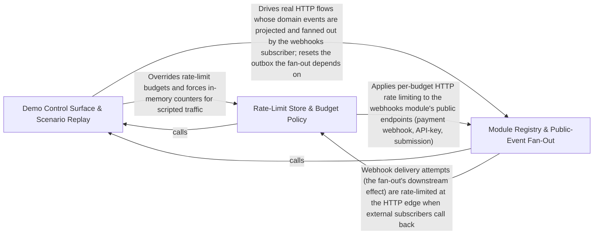

---
tags:
  - 2brain
  - 2brain/arch
  - project/boilerplate-node-backend
type: architecture
component: Demo_Control_Surface_Test_Doubles
---

## Details

The demo profile's runtime control plane and the dev-only doubles that make the flows runnable without external services. installDemo/restoreScenario mount the unauthenticated /__test/* routes (restore, describe, emails, clock, jobs) and implement build-once/replay-many via the database-snapshot helpers (emptyDatabase, captureDatabase, restoreDatabaseCopy). The doubles — the fake PSP (3-D Secure + signed webhooks), the mail outbox, and the in-process mongod replica set — let the seed and e2e suite walk the full payment/webhook/mail paths with no real provider, broker, or database. This group is the 'make it runnable and observable' half of the subsystem, kept strictly outside src/.

### Demo Control Surface & Scenario Replay
The demo profile's runtime control plane. installDemo/restoreScenario mount the six unauthenticated /__test/* routes (restore, scenario, emails, clock, jobs) and implement build-once/replay-many: buildOnce builds a named scenario into an empty database once, captures it, and every later restore replays the captured copy. It is backed by the database-snapshot helpers (emptyDatabase, captureDatabase, restoreDatabaseCopy) and the in-process mongod replica set that makes multi-document transactions possible without an external database. This is the 'runnable and observable' control surface, mounted only by scenarios/run-server.ts and invisible to production src/.

**Related Classes/Methods**:

- `scenarios.support.ephemeral-mongod.startInProcessMongod`:48-81

**Source Files:**

- `scenarios/support/ephemeral-mongod.ts`
  - `scenarios.support.ephemeral-mongod.startInProcessMongod` (L48-L81) - Class
  - `scenarios.support.ephemeral-mongod.startInProcessMongod.catch() callback` (L76-L79) - Function
  - `scenarios.support.ephemeral-mongod.startInProcessMongod.finally() callback` (L80-L80) - Function
- `scripts/ops/sweep-webhook-retries.ts`
  - `scripts.ops.sweep-webhook-retries.main` (L32-L32) - Class
  - `scripts.ops.sweep-webhook-retries.main.then() callback` (L32-L32) - Function
- `src/app/error-handling.ts`
  - `src.app.error-handling.installErrorHandling` (L231-L256) - Class
  - `src.app.error-handling.installErrorHandling.process.on('uncaughtException') callback` (L244-L255) - Function
- `src/cluster.ts`
  - `src.cluster.then() callback` (L183-L183) - Function
  - `src.cluster.catch() callback` (L185-L191) - Function
- `src/infrastructure/adapters/logger.ts`
  - `src.infrastructure.adapters.logger.Logger.error` (L40-L40) - Method
- `src/infrastructure/adapters/mailer.ts`
  - `src.infrastructure.adapters.mailer.enqueueEmail` (L245-L295) - Class
- `src/infrastructure/adapters/queue.ts`
  - `src.infrastructure.adapters.queue.then() callback` (L567-L567) - Function
  - `src.infrastructure.adapters.queue.PublishOptions` (L602-L609) - Interface
  - `src.infrastructure.adapters.queue.ConsumeOptions` (L696-L713) - Interface
  - `src.infrastructure.adapters.queue.retryLater` (L811-L846) - Class
  - `src.infrastructure.adapters.queue.retryLater.ch.sendToQueue() callback` (L828-L841) - Function
  - `src.infrastructure.adapters.queue.handleDelivery.settled` (L905-L931) - Class
  - `src.infrastructure.adapters.queue.settled.then() callback` (L906-L906) - Function
  - `src.infrastructure.adapters.queue.handleDelivery.settled.then() callback` (L907-L912) - Function
  - `src.infrastructure.adapters.queue.handleDelivery.settled.catch() callback` (L913-L931) - Function
  - `src.infrastructure.adapters.queue.handleDelivery.settled.finally() callback` (L933-L933) - Function
- `src/infrastructure/runtime/server-lifecycle.ts`
  - `src.infrastructure.runtime.server-lifecycle.failBoot` (L64-L70) - Class
  - `src.infrastructure.runtime.server-lifecycle.failBoot.catch() callback` (L68-L68) - Function
  - `src.infrastructure.runtime.server-lifecycle.failBoot.finally() callback` (L69-L69) - Function
  - `src.infrastructure.runtime.server-lifecycle.registerSignalHandlers` (L168-L221) - Class
  - `src.infrastructure.runtime.server-lifecycle.registerSignalHandlers.onProcessSignal` (L173-L215) - Class
  - `src.infrastructure.runtime.server-lifecycle.onProcessSignal.then() callback` (L197-L197) - Function
  - `src.infrastructure.runtime.server-lifecycle.registerSignalHandlers.onProcessSignal.then() callback` (L198-L204) - Function
  - `src.infrastructure.runtime.server-lifecycle.registerSignalHandlers.onProcessSignal.catch() callback` (L205-L214) - Function
  - `src.infrastructure.runtime.server-lifecycle.registerSignalHandlers.process.on('SIGTERM') callback` (L218-L218) - Function
  - `src.infrastructure.runtime.server-lifecycle.registerSignalHandlers.process.on('SIGINT') callback` (L220-L220) - Function
- `src/kernel/outbox.ts`
  - `src.kernel.outbox.OutboxEventDocument` (L44-L62) - Interface
  - `src.kernel.outbox.OutboxRow` (L155-L160) - Interface
  - `src.kernel.outbox.RelayResult` (L163-L167) - Interface
  - `src.kernel.outbox.claim` (L200-L213) - Class
  - `src.kernel.outbox.claim.then() callback` (L212-L212) - Function
  - `src.kernel.outbox.dispatch` (L220-L228) - Class
  - `src.kernel.outbox.dispatch.then() callback` (L227-L227) - Function
  - `src.kernel.outbox.markFailed` (L245-L273) - Class
  - `src.kernel.outbox.markFailed.then() callback` (L263-L272) - Function
  - `src.kernel.outbox.relayOne` (L276-L284) - Class
  - `src.kernel.outbox.relayOne.then() callback` (L277-L284) - Function
  - `src.kernel.outbox.relayOne.then() callback.then() callback` (L279-L282) - Function
  - `src.kernel.outbox.relayOne.then() callback.then() callback.then() callback` (L281-L281) - Function
  - `src.kernel.outbox.relayOutbox.outcomes` (L318-L318) - Class
  - `src.kernel.outbox.relayOutbox.outcomes.heads.map() callback` (L318-L318) - Function
  - `src.kernel.outbox.relayOutbox.outcomes.every() callback` (L321-L321) - Function
  - `src.kernel.outbox.OutboxAnnouncement` (L349-L356) - Interface
  - `src.kernel.outbox.setOutboxPendingReader() callback` (L398-L398) - Function
- `src/modules/account/mail-budget.ts`
  - `src.modules.account.mail-budget.mailRecipientLimiter` (L93-L108) - Class
  - `src.modules.account.mail-budget.mailRecipientLimiter.then() callback` (L100-L107) - Function
- `src/modules/account/services/authentication.ts`
  - `src.modules.account.services.authentication.requestAccountDeletion` (L78-L97) - Class
  - `src.modules.account.services.authentication.requestAccountDeletion.then() callback` (L79-L97) - Function
  - `src.modules.account.services.authentication.resetRecentlySent` (L127-L131) - Class
  - `src.modules.account.services.authentication.resetRecentlySent.user.tokens.find() callback` (L129-L129) - Function
  - `src.modules.account.services.authentication.issueResetToken` (L144-L147) - Class
  - `src.modules.account.services.authentication.issueResetToken.then() callback` (L147-L147) - Function
  - `src.modules.account.services.authentication.requestPasswordReset` (L162-L214) - Class
  - `src.modules.account.services.authentication.requestPasswordReset.attempt` (L167-L192) - Class
  - `src.modules.account.services.authentication.requestPasswordReset.attempt.then() callback` (L168-L191) - Function
  - `src.modules.account.services.authentication.requestPasswordReset.attempt.then() callback.then() callback` (L175-L190) - Function
  - `src.modules.account.services.authentication.requestPasswordReset.attempt.catch() callback` (L198-L203) - Function
  - `src.modules.account.services.authentication.requestPasswordReset.then() callback` (L204-L213) - Function
  - `src.modules.account.services.authentication.requestAccountSetup` (L222-L231) - Class
  - `src.modules.account.services.authentication.requestAccountSetup.then() callback` (L223-L231) - Function
- `src/modules/account/services/export-job.ts`
  - `src.modules.account.services.export-job.mailLink` (L78-L90) - Class
  - `src.modules.account.services.export-job.mailLink.then() callback` (L79-L90) - Function
  - `src.modules.account.services.export-job.buildAndSettle` (L99-L118) - Class
  - `src.modules.account.services.export-job.buildAndSettle.writeExport() callback` (L109-L110) - Function
  - `src.modules.account.services.export-job.buildAndSettle.then() callback` (L111-L116) - Function
  - `src.modules.account.services.export-job.removeFileIfRowGone` (L127-L130) - Class
  - `src.modules.account.services.export-job.removeFileIfRowGone.then() callback.then() callback` (L130-L130) - Function
  - `src.modules.account.services.export-job.afterBuild` (L143-L157) - Class
  - `src.modules.account.services.export-job.afterBuild.catch() callback` (L150-L156) - Function
  - `src.modules.account.services.export-job.fail` (L166-L176) - Class
  - `src.modules.account.services.export-job.fail.then() callback` (L171-L174) - Function
  - `src.modules.account.services.export-job.fail.then() callback.then() callback` (L174-L174) - Function
  - `src.modules.account.services.export-job.runExportJob` (L187-L200) - Class
  - `src.modules.account.services.export-job.runExportJob.then() callback` (L188-L200) - Function
  - `src.modules.account.services.export-job.runExportJob.then() callback.then() callback` (L199-L199) - Function
- `src/modules/account/services/export-rows.ts`
  - `src.modules.account.services.export-rows.removeRow` (L20-L21) - Class
  - `src.modules.account.services.export-rows.removeRow.then() callback` (L21-L21) - Function
  - `src.modules.account.services.export-rows.reapExpiredExports` (L32-L44) - Class
  - `src.modules.account.services.export-rows.reapExpiredExports.drain` (L33-L39) - Class
  - `src.modules.account.services.export-rows.reapExpiredExports.drain.then() callback` (L34-L39) - Function
  - `src.modules.account.services.export-rows.reapExpiredExports.drain.then() callback.due.map() callback` (L36-L36) - Function
  - `src.modules.account.services.export-rows.reapExpiredExports.drain.then() callback.then() callback` (L36-L37) - Function
  - `src.modules.account.services.export-rows.reapExpiredExports.then() callback` (L41-L42) - Function
  - `src.modules.account.services.export-rows.reapExpiredExports.then() callback.then() callback` (L42-L42) - Function
- `src/modules/account/services/export.ts`
  - `src.modules.account.services.export.AccountExportRequestResult` (L55-L58) - Interface
  - `src.modules.account.services.export.insertRow` (L87-L110) - Class
  - `src.modules.account.services.export.insertRow.then() callback` (L101-L108) - Function
  - `src.modules.account.services.export.insertRow.then() callback.then() callback` (L103-L107) - Function
  - `src.modules.account.services.export.dispatch.then() callback.running` (L126-L134) - Class
  - `src.modules.account.services.export.dispatch.then() callback.running.catch() callback` (L127-L133) - Function
  - `src.modules.account.services.export.dispatch.then() callback.running.finally() callback` (L134-L134) - Function
  - `src.modules.account.services.export.ExportRowChoice` (L139-L142) - Interface
  - `src.modules.account.services.export.rowOrRefusal` (L154-L165) - Class
  - `src.modules.account.services.export.rowOrRefusal.then() callback` (L155-L165) - Function
  - `src.modules.account.services.export.rowOrRefusal.then() callback.then() callback` (L161-L163) - Function
  - `src.modules.account.services.export.rowOrRefusal.then() callback.then() callback.then() callback` (L163-L163) - Function
  - `src.modules.account.services.export.eraseExports` (L263-L269) - Class
  - `src.modules.account.services.export.eraseExports.then() callback` (L267-L268) - Function
  - `src.modules.account.services.export.eraseExports.then() callback.<function>` (L267-L268) - Function
  - `src.modules.account.services.export.eraseExports.then() callback.<function>.files.map() callback` (L268-L268) - Function
  - `src.modules.account.services.export.eraseExports.then() callback.<function>.then() callback` (L268-L268) - Function
- `src/modules/account/services/profile.ts`
  - `src.modules.account.services.profile.afterReset.mail` (L266-L273) - Class
  - `src.modules.account.services.profile.afterReset.mail.map() callback` (L272-L272) - Function
  - `src.modules.account.services.profile.removeOwnAccount` (L363-L402) - Class
  - `src.modules.account.services.profile.removeOwnAccount.then() callback` (L378-L400) - Function
  - `src.modules.account.services.profile.removeOwnAccount.then() callback.then() callback` (L379-L400) - Function
  - `src.modules.account.services.profile.applyEmailChangeRequest` (L466-L483) - Class
  - `src.modules.account.services.profile.applyEmailChangeRequest.then() callback` (L478-L482) - Function
  - `src.modules.account.services.profile.sendEmailChangeMail` (L537-L552) - Class
  - `src.modules.account.services.profile.sendEmailChangeMail.then() callback` (L552-L552) - Function
- `src/modules/account/services/reauth.ts`
  - `src.modules.account.services.reauth.deliverCode` (L122-L150) - Class
  - `src.modules.account.services.reauth.deliverCode.then() callback` (L141-L148) - Function
- `src/modules/account/services/verification.ts`
  - `src.modules.account.services.verification.VERIFICATION_TARGETS.[EMAIL_VERIFY_TOKEN_TYPE].addressOf` (L68-L68) - Method
  - `src.modules.account.services.verification.VERIFICATION_TARGETS.[EMAIL_CHANGE_TOKEN_TYPE].addressOf` (L69-L69) - Method
  - `src.modules.account.services.verification.sendVerificationEmail` (L80-L109) - Class
  - `src.modules.account.services.verification.sendVerificationEmail.then() callback` (L94-L108) - Function
- `src/modules/account/two-factor/methods/email.ts`
  - `src.modules.account.two-factor.methods.email.deliver` (L41-L67) - Class
  - `src.modules.account.two-factor.methods.email.deliver.then() callback` (L59-L66) - Function
- `src/modules/delivery/service.ts`
  - `src.modules.delivery.service.notifyShipped` (L157-L167) - Class
  - `src.modules.delivery.service.notifyShipped.mailBuyer() callback` (L162-L167) - Function
- `src/modules/example/services/notify.ts`
  - `src.modules.example.services.notify.mailOwnerOfPublished` (L23-L32) - Class
  - `src.modules.example.services.notify.mailOwnerOfPublished.then() callback` (L24-L32) - Function
- `src/modules/feedback/service.ts`
  - `src.modules.feedback.service.create` (L73-L129) - Class
  - `src.modules.feedback.service.create.then() callback` (L77-L128) - Function
  - `src.modules.feedback.service.create.then() callback.then() callback` (L88-L127) - Function
  - `src.modules.feedback.service.create.then() callback.then() callback.catch() callback` (L117-L122) - Function
- `src/modules/inventory/services/sweep.ts`
  - `src.modules.inventory.services.sweep.tryExpireOne` (L63-L72) - Class
  - `src.modules.inventory.services.sweep.tryExpireOne.catch() callback` (L64-L72) - Function
- `src/modules/orders/services/crud.ts`
  - `src.modules.orders.services.crud.create.buyerLocale` (L100-L112) - Class
  - `src.modules.orders.services.crud.create.buyerLocale.then() callback` (L102-L102) - Function
  - `src.modules.orders.services.crud.create.buyerLocale.catch() callback` (L103-L112) - Function
- `src/modules/orders/services/notify.ts`
  - `src.modules.orders.services.notify.mailBuyer` (L83-L112) - Class
  - `src.modules.orders.services.notify.mailBuyer.then() callback` (L100-L102) - Function
  - `src.modules.orders.services.notify.mailBuyer.catch() callback` (L103-L111) - Function
- `src/modules/orders/services/retention.ts`
  - `src.modules.orders.services.retention.detachUserId` (L28-L36) - Class
  - `src.modules.orders.services.retention.detachUserId.then() callback` (L31-L35) - Function
  - `src.modules.orders.services.retention.cancelUnpaidOrders` (L63-L86) - Class
  - `src.modules.orders.services.retention.cancelUnpaidOrders.orderIds.map() callback` (L65-L84) - Function
  - `src.modules.orders.services.retention.cancelUnpaidOrders.orderIds.map() callback.then() callback` (L67-L75) - Function
  - `src.modules.orders.services.retention.cancelUnpaidOrders.orderIds.map() callback.catch() callback` (L76-L84) - Function
  - `src.modules.orders.services.retention.cancelUnpaidOrders.then() callback` (L86-L86) - Function
  - `src.modules.orders.services.retention.eraseUserOrders` (L102-L112) - Class
  - `src.modules.orders.services.retention.eraseUserOrders.then() callback` (L108-L111) - Function
  - `src.modules.orders.services.retention.eraseUserOrders.then() callback.then() callback` (L109-L110) - Function
- `src/modules/payments/services/effects.ts`
  - `src.modules.payments.services.effects.then() callback` (L37-L54) - Function
  - `src.modules.payments.services.effects.then() callback.then() callback` (L43-L43) - Function
  - `src.modules.payments.services.effects.retryOneRefund` (L119-L130) - Class
  - `src.modules.payments.services.effects.retryOneRefund.then() callback` (L121-L121) - Function
  - `src.modules.payments.services.effects.retryOneRefund.catch() callback` (L122-L130) - Function
- `src/modules/payments/services/refunds.ts`
  - `src.modules.payments.services.refunds.reportRefundedToOrder` (L179-L196) - Class
  - `src.modules.payments.services.refunds.reportRefundedToOrder.then() callback` (L182-L186) - Function
  - `src.modules.payments.services.refunds.reportRefundedToOrder.catch() callback` (L188-L195) - Function
  - `src.modules.payments.services.refunds.mailRefundIssued` (L208-L241) - Class
  - `src.modules.payments.services.refunds.mailRefundIssued.then() callback` (L215-L231) - Function
  - `src.modules.payments.services.refunds.mailRefundIssued.then() callback.mailBuyer() callback` (L217-L230) - Function
  - `src.modules.payments.services.refunds.mailRefundIssued.catch() callback` (L233-L240) - Function
- `src/modules/returns/services/close.ts`
  - `src.modules.returns.services.close.closeReturn` (L26-L53) - Class
  - `src.modules.returns.services.close.closeReturn.then() callback` (L29-L53) - Function
  - `src.modules.returns.services.close.then() callback.then() callback` (L39-L39) - Function
  - `src.modules.returns.services.close.closeReturn.then() callback.then() callback` (L52-L52) - Function
- `src/modules/returns/services/create.ts`
  - `src.modules.returns.services.create.announceOpened` (L308-L330) - Class
  - `src.modules.returns.services.create.announceOpened.then() callback` (L329-L329) - Function
- `src/modules/returns/services/decide.ts`
  - `src.modules.returns.services.decide.notifyDecision` (L52-L65) - Class
  - `src.modules.returns.services.decide.notifyDecision.then() callback` (L56-L65) - Function
- `src/modules/returns/services/notify.ts`
  - `src.modules.returns.services.notify.mailReturnNotice` (L22-L33) - Class
  - `src.modules.returns.services.notify.mailReturnNotice.mailBuyer() callback` (L27-L33) - Function
- `src/modules/returns/services/projection.ts`
  - `src.modules.returns.services.projection.syncReturnStatus` (L20-L42) - Class
  - `src.modules.returns.services.projection.syncReturnStatus.then() callback` (L22-L34) - Function
  - `src.modules.returns.services.projection.syncReturnStatus.then() callback.then() callback` (L33-L33) - Function
  - `src.modules.returns.services.projection.syncReturnStatus.catch() callback` (L35-L42) - Function
- `src/modules/returns/services/receive.ts`
  - `src.modules.returns.services.receive.refundAndClose` (L134-L165) - Class
  - `src.modules.returns.services.receive.refundAndClose.finish` (L139-L140) - Class
  - `src.modules.returns.services.receive.refundAndClose.finish.then() callback` (L140-L140) - Function
  - `src.modules.returns.services.receive.refundAndClose.then() callback` (L154-L154) - Function
  - `src.modules.returns.services.receive.refundAndClose.catch() callback` (L155-L163) - Function
- `src/modules/users/services/remove.ts`
  - `src.modules.users.services.remove.runAfterErase` (L61-L70) - Class
  - `src.modules.users.services.remove.runAfterErase.deferred.map() callback` (L63-L68) - Function
  - `src.modules.users.services.remove.runAfterErase.deferred.map() callback.catch() callback` (L64-L68) - Function
  - `src.modules.users.services.remove.runAfterErase.then() callback` (L70-L70) - Function
- `src/modules/webhooks/services/attempt.ts`
  - `src.modules.webhooks.services.attempt.notifyOwnerOfAutoDisable` (L46-L81) - Class
  - `src.modules.webhooks.services.attempt.notifyOwnerOfAutoDisable.then() callback` (L65-L69) - Function
  - `src.modules.webhooks.services.attempt.notifyOwnerOfAutoDisable.catch() callback` (L70-L80) - Function
  - `src.modules.webhooks.services.attempt.recordExhaustion` (L147-L183) - Class
  - `src.modules.webhooks.services.attempt.recordExhaustion.then() callback` (L164-L182) - Function
  - `src.modules.webhooks.services.attempt.recordExhaustion.then() callback.then() callback` (L168-L181) - Function
  - `src.modules.webhooks.services.attempt.recordExhaustion.then() callback.then() callback.then() callback` (L175-L179) - Function
  - `src.modules.webhooks.services.attempt.processDeliveryJob` (L277-L285) - Class
  - `src.modules.webhooks.services.attempt.processDeliveryJob.then() callback` (L278-L285) - Function
  - `src.modules.webhooks.services.attempt.then() callback.then() callback` (L283-L283) - Function
  - `src.modules.webhooks.services.attempt.processDeliveryJob.then() callback.then() callback` (L284-L284) - Function
- `src/modules/webhooks/services/sweep.ts`
  - `src.modules.webhooks.services.sweep.publishOrSend` (L41-L46) - Class
  - `src.modules.webhooks.services.sweep.publishOrSend.then() callback` (L42-L45) - Function
  - `src.modules.webhooks.services.sweep.publishOrSend.then() callback.then() callback` (L45-L45) - Function
  - `src.modules.webhooks.services.sweep.handleInGroups` (L55-L69) - Class
  - `src.modules.webhooks.services.sweep.handleInGroups.group.map() callback` (L59-L59) - Function
  - `src.modules.webhooks.services.sweep.handleInGroups.then() callback` (L59-L68) - Function
  - `src.modules.webhooks.services.sweep.handleInGroups.then() callback.failed.outcomes.filter() callback` (L60-L60) - Function
  - `src.modules.webhooks.services.sweep.then() callback.failed` (L60-L60) - Class
  - `src.modules.webhooks.services.sweep.sweepDueWebhookDeliveries` (L76-L81) - Class
  - `src.modules.webhooks.services.sweep.sweepDueWebhookDeliveries.then() callback` (L77-L81) - Function
- `src/serve.ts`
  - `src.serve.catch() callback` (L29-L29) - Function

### Rate-Limit Store & Budget Policy
The cross-cutting HTTP rate-limiting layer: where limiters keep their counters and how they degrade when Redis is unavailable. It defines the RateLimitBudget contract (per-budget failure policy: memory vs pass), the Redis-backed store with lazy construction, the failover/escalation stores, and the process-wide breaker that keeps an outage from adding the connect timeout to every request. It also carries the adjacent HTTP middleware concerns (validation-message registration and the frontend-link helper) that ride the same request path.

**Related Classes/Methods**:

- `src.types.rate-limit-budget.RateLimitBudget`:22-100
- `src.infrastructure.http.middlewares.rate-limit-store.lazyRedisStore`:52-102
- `src.infrastructure.http.middlewares.store-breaker.createBreaker`:37-57
- `src.infrastructure.http.validation-messages.registerValidationMessages`:88-91
- `src.infrastructure.http.frontend-link.frontendLink`:41-52

**Source Files:**

- `src/infrastructure/http/frontend-link.ts`
  - `src.infrastructure.http.frontend-link.frontendLink` (L41-L52) - Class
  - `src.infrastructure.http.frontend-link.frontendLink.path.replaceAll(`{${name}}`) callback` (L49-L49) - Function
- `src/infrastructure/http/middlewares/rate-limit-store.ts`
  - `src.infrastructure.http.middlewares.rate-limit-store.lazyRedisStore` (L52-L102) - Class
  - `src.infrastructure.http.middlewares.rate-limit-store.lazyRedisStore.store` (L56-L91) - Class
  - `src.infrastructure.http.middlewares.rate-limit-store.lazyRedisStore.store.catch() callback` (L77-L86) - Function
  - `src.infrastructure.http.middlewares.rate-limit-store.lazyRedisStore.init` (L94-L96) - Method
  - `src.infrastructure.http.middlewares.rate-limit-store.lazyRedisStore.increment` (L97-L97) - Method
  - `src.infrastructure.http.middlewares.rate-limit-store.lazyRedisStore.decrement` (L98-L98) - Method
  - `src.infrastructure.http.middlewares.rate-limit-store.lazyRedisStore.resetKey` (L99-L99) - Method
  - `src.infrastructure.http.middlewares.rate-limit-store.lazyRedisStore.get` (L100-L100) - Method
  - `src.infrastructure.http.middlewares.rate-limit-store.failoverStore` (L119-L160) - Class
  - `src.infrastructure.http.middlewares.rate-limit-store.failoverStore.route` (L135-L148) - Class
  - `src.infrastructure.http.middlewares.rate-limit-store.route.then() callback` (L139-L139) - Function
  - `src.infrastructure.http.middlewares.rate-limit-store.failoverStore.route.then() callback` (L140-L143) - Function
  - `src.infrastructure.http.middlewares.rate-limit-store.failoverStore.route.catch() callback` (L144-L147) - Function
  - `src.infrastructure.http.middlewares.rate-limit-store.failoverStore.init` (L151-L154) - Method
  - `src.infrastructure.http.middlewares.rate-limit-store.failoverStore.increment` (L155-L155) - Method
  - `src.infrastructure.http.middlewares.rate-limit-store.failoverStore.increment.route() callback` (L155-L155) - Function
  - `src.infrastructure.http.middlewares.rate-limit-store.failoverStore.decrement` (L156-L156) - Method
  - `src.infrastructure.http.middlewares.rate-limit-store.failoverStore.decrement.route() callback` (L156-L156) - Function
  - `src.infrastructure.http.middlewares.rate-limit-store.failoverStore.decrement.then() callback` (L156-L156) - Function
  - `src.infrastructure.http.middlewares.rate-limit-store.failoverStore.resetKey` (L157-L157) - Method
  - `src.infrastructure.http.middlewares.rate-limit-store.failoverStore.resetKey.route() callback` (L157-L157) - Function
  - `src.infrastructure.http.middlewares.rate-limit-store.failoverStore.resetKey.then() callback` (L157-L157) - Function
  - `src.infrastructure.http.middlewares.rate-limit-store.failoverStore.get` (L158-L158) - Method
  - `src.infrastructure.http.middlewares.rate-limit-store.failoverStore.get.route() callback` (L158-L158) - Function
  - `src.infrastructure.http.middlewares.rate-limit-store.Escalation` (L210-L215) - Interface
  - `src.infrastructure.http.middlewares.rate-limit-store.escalatingStore` (L238-L290) - Class
  - `src.infrastructure.http.middlewares.rate-limit-store.escalatingStore.levels.Array.from() callback` (L243-L244) - Function
  - `src.infrastructure.http.middlewares.rate-limit-store.escalatingStore.levels` (L243-L245) - Class
  - `src.infrastructure.http.middlewares.rate-limit-store.escalatingStore.init` (L264-L272) - Method
  - `src.infrastructure.http.middlewares.rate-limit-store.escalatingStore.increment` (L273-L282) - Method
  - `src.infrastructure.http.middlewares.rate-limit-store.escalatingStore.decrement` (L283-L283) - Method
  - `src.infrastructure.http.middlewares.rate-limit-store.escalatingStore.resetKey` (L284-L287) - Method
  - `src.infrastructure.http.middlewares.rate-limit-store.escalatingStore.resetKey.map() callback` (L286-L286) - Function
  - `src.infrastructure.http.middlewares.rate-limit-store.escalatingStore.resetKey.then() callback` (L287-L287) - Function
  - `src.infrastructure.http.middlewares.rate-limit-store.escalatingStore.get` (L288-L288) - Method
  - `src.infrastructure.http.middlewares.rate-limit-store.then() callback` (L341-L341) - Function
- `src/infrastructure/http/middlewares/rate-limit.ts`
  - `src.infrastructure.http.middlewares.rate-limit.GLOBAL_RATE_LIMIT_BUDGET` (L324-L342) - Class
  - `src.infrastructure.http.middlewares.rate-limit.GLOBAL_RATE_LIMIT_BUDGET.skip` (L340-L341) - Method
  - `src.infrastructure.http.middlewares.rate-limit.API_KEY_RATE_LIMIT_BUDGET` (L353-L368) - Class
  - `src.infrastructure.http.middlewares.rate-limit.API_KEY_RATE_LIMIT_BUDGET.keyGenerator` (L367-L367) - Method
- `src/infrastructure/http/middlewares/store-breaker.ts`
  - `src.infrastructure.http.middlewares.store-breaker.Breaker` (L16-L29) - Interface
  - `src.infrastructure.http.middlewares.store-breaker.createBreaker` (L37-L57) - Class
  - `src.infrastructure.http.middlewares.store-breaker.createBreaker.admit` (L42-L47) - Method
  - `src.infrastructure.http.middlewares.store-breaker.createBreaker.succeeded` (L48-L51) - Method
  - `src.infrastructure.http.middlewares.store-breaker.createBreaker.failed` (L52-L55) - Method
- `src/infrastructure/http/validation-messages.ts`
  - `src.infrastructure.http.validation-messages.registerValidationMessages` (L88-L91) - Class
  - `src.infrastructure.http.validation-messages.registerValidationMessages.customError` (L90-L90) - Method
- `src/modules/account/rate-limits.ts`
  - `src.modules.account.rate-limits.CREDENTIAL_DEVICE_BUDGET` (L96-L109) - Class
  - `src.modules.account.rate-limits.CREDENTIAL_DEVICE_BUDGET.skip` (L108-L108) - Method
- `src/modules/payments/rate-limits.ts`
  - `src.modules.payments.rate-limits.CONFIRM_DECLINE_BUDGET` (L97-L112) - Class
  - `src.modules.payments.rate-limits.CONFIRM_DECLINE_BUDGET.requestWasSuccessful` (L110-L110) - Method
  - `src.modules.payments.rate-limits.CONFIRM_DECLINE_BLOCK_BUDGET` (L157-L172) - Class
  - `src.modules.payments.rate-limits.CONFIRM_DECLINE_BLOCK_BUDGET.requestWasSuccessful` (L170-L170) - Method
- `src/types/rate-limit-budget.ts`
  - `src.types.rate-limit-budget.RateLimitBudget` (L22-L100) - Interface

### Module Registry & Public-Event Fan-Out
The kernel's module registry and the webhooks module's domain-event subscriber. The registry turns the explicit module list into a running application and resolves each module's declared publicEvents into PublicEventTargets. The webhooks publish service subscribes to every such target, projects each domain event into a public event, matches it against enabled subscription filters, and fans out one delivery row + one queue message per match (idempotent on (subscriptionId, eventId), degrading to queued rather than lost). This is the reverse-edge mechanism that lets orders/payments emit events without importing webhooks.

**Related Classes/Methods**:

- `src.kernel.registry.PublicEventTarget`:197-203
- `src.modules.webhooks.services.publish.fanOut`:86-104
- `src.modules.webhooks.services.catalogue.catalogue`:22-32

**Source Files:**

- `src/kernel/registry.ts`
  - `src.kernel.registry.PublicEventTarget` (L197-L203) - Interface
- `src/modules/example/module.ts`
  - `src.modules.example.module.publicEvents.[EXAMPLE_PUBLISHED].toPublicEvent` (L42-L45) - Method
- `src/modules/orders/module.ts`
  - `src.modules.orders.module.publicEvents.[ORDER_CREATED].toPublicEvent` (L43-L46) - Method
  - `src.modules.orders.module.publicEvents.[ORDER_STATUS_CHANGED].toPublicEvent` (L49-L55) - Method
  - `src.modules.orders.module.publicEvents.[ORDER_CANCELLED].toPublicEvent` (L58-L61) - Method
- `src/modules/payments/module.ts`
  - `src.modules.payments.module.publicEvents.[PAYMENT_SUCCEEDED].toPublicEvent` (L44-L47) - Method
  - `src.modules.payments.module.publicEvents.[PAYMENT_FAILED].toPublicEvent` (L50-L53) - Method
  - `src.modules.payments.module.publicEvents.[PAYMENT_REFUNDED].toPublicEvent` (L56-L65) - Method
- `src/modules/returns/module.ts`
  - `src.modules.returns.module.publicEvents.[RETURN_REQUESTED].toPublicEvent` (L34-L37) - Method
  - `src.modules.returns.module.publicEvents.[RETURN_RECEIVED].toPublicEvent` (L40-L43) - Method
  - `src.modules.returns.module.publicEvents.[RETURN_CLOSED].toPublicEvent` (L46-L54) - Method
- `src/modules/webhooks/services/catalogue.ts`
  - `src.modules.webhooks.services.catalogue.catalogue` (L22-L32) - Class
  - `src.modules.webhooks.services.catalogue.catalogue.<function>` (L22-L32) - Function
  - `src.modules.webhooks.services.catalogue.catalogue.<function>.map() callback` (L28-L31) - Function
- `src/modules/webhooks/services/publish.ts`
  - `src.modules.webhooks.services.publish.createDeliveryRow` (L36-L55) - Class
  - `src.modules.webhooks.services.publish.createDeliveryRow.catch() callback` (L52-L55) - Function
  - `src.modules.webhooks.services.publish.deliverToOne` (L64-L71) - Class
  - `src.modules.webhooks.services.publish.deliverToOne.then() callback` (L69-L70) - Function
  - `src.modules.webhooks.services.publish.deliverToOne.then() callback.then() callback` (L70-L70) - Function
  - `src.modules.webhooks.services.publish.fanOut` (L86-L104) - Class
  - `src.modules.webhooks.services.publish.fanOut.then() callback` (L87-L104) - Function
  - `src.modules.webhooks.services.publish.fanOut.then() callback.matches.subscriptions.filter() callback` (L88-L89) - Function
  - `src.modules.webhooks.services.publish.fanOut.then() callback.matches` (L88-L90) - Class
  - `src.modules.webhooks.services.publish.fanOut.then() callback.matches.map() callback` (L92-L92) - Function
  - `src.modules.webhooks.services.publish.fanOut.then() callback.then() callback` (L93-L103) - Function
  - `src.modules.webhooks.services.publish.fanOut.then() callback.then() callback.failures` (L94-L94) - Class
  - `src.modules.webhooks.services.publish.fanOut.then() callback.then() callback.failures.outcomes.filter() callback` (L94-L94) - Function
  - `src.modules.webhooks.services.publish.subscribeToTarget` (L120-L129) - Class
  - `src.modules.webhooks.services.publish.subscribeToTarget.onDomainEvent() callback` (L125-L128) - Function
