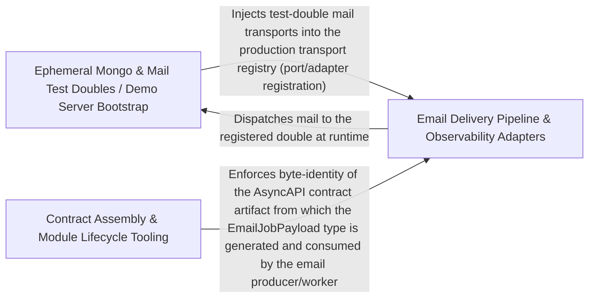

---
tags:
  - 2brain
  - 2brain/arch
  - project/boilerplate-node-backend
type: architecture
component: Ephemeral_Mongo_Mail_Test_Doubles_Demo_Server_Bootstrap
---

## Details

The heart of the subsystem: the Mongo resolver/starter pair, the development mail doubles (outbox + log), and the demo server bootstrap that wires the app to run against ephemeral Mongo and fake providers. This is the disposable runtime the scenario layer depends on.

### Ephemeral Mongo & Mail Test Doubles / Demo Server Bootstrap
The heart of the subsystem and the disposable runtime the scenario layer depends on. It owns the Mongo resolver/starter pair (env-var-first, in-process-fallback), the development mail doubles (in-memory outbox and rendering log transports), and the demo server bootstrap that wires the real app to run against ephemeral Mongo and fake providers. This is the component that makes npm run demo self-contained: it resolves a Mongo, installs throwaway secrets, force-disables Redis/RabbitMQ, pins the mail transport to outbox, seeds the scenario, and serves on NODE_PORT.

**Related Classes/Methods**:

- `scenarios.support.ephemeral-mongo.startEphemeralMongo`:73-86
- `scenarios.support.ephemeral-mongo.EphemeralMongo`:35-38
- `scenarios.support.doubles.mail-outbox.outboxMailTransport`:78-84

**Source Files:**

- `scenarios/run-server.ts`
  - `scenarios.run-server.then() callback.process.once() callback` (L169-L178) - Function
- `scenarios/support/doubles/mail-log.ts`
  - `scenarios.support.doubles.mail-log.logMailTransport` (L20-L35) - Class
  - `scenarios.support.doubles.mail-log.logMailTransport.delivers` (L21-L21) - Method
  - `scenarios.support.doubles.mail-log.logMailTransport.send` (L22-L34) - Method
  - `scenarios.support.doubles.mail-log.logMailTransport.send.then() callback` (L23-L33) - Function
- `scenarios/support/doubles/mail-outbox.ts`
  - `scenarios.support.doubles.mail-outbox.outboxMailTransport` (L78-L84) - Class
  - `scenarios.support.doubles.mail-outbox.outboxMailTransport.delivers` (L79-L79) - Method
  - `scenarios.support.doubles.mail-outbox.outboxMailTransport.send` (L80-L83) - Method
- `scenarios/support/ephemeral-mongo.ts`
  - `scenarios.support.ephemeral-mongo.EphemeralMongo` (L35-L38) - Interface
  - `scenarios.support.ephemeral-mongo.startEphemeralMongo` (L73-L86) - Class
  - `scenarios.support.ephemeral-mongo.startEphemeralMongo.stop` (L80-L80) - Method
- `scenarios/support/ephemeral-mongod.ts`
  - `scenarios.support.ephemeral-mongod.toEphemeralMongo` (L32-L35) - Class
  - `scenarios.support.ephemeral-mongod.toEphemeralMongo.stop` (L34-L34) - Method
  - `scenarios.support.ephemeral-mongod.toEphemeralMongo.stop.then() callback` (L34-L34) - Function
- `src/infrastructure/adapters/mail-transports.ts`
  - `src.infrastructure.adapters.mail-transports.OutgoingMail` (L28-L40) - Interface
  - `src.infrastructure.adapters.mail-transports.MailTransportAdapter` (L43-L62) - Interface
  - `src.infrastructure.adapters.mail-transports.smtpTransport` (L67-L70) - Class
  - `src.infrastructure.adapters.mail-transports.smtpTransport.delivers` (L68-L68) - Method
  - `src.infrastructure.adapters.mail-transports.smtpTransport.send` (L69-L69) - Method
  - `src.infrastructure.adapters.mail-transports.smtpTransport.send.then() callback` (L69-L69) - Function
- `src/infrastructure/adapters/mailer.ts`
  - `src.infrastructure.adapters.mailer.ResolvedAttachment` (L41-L44) - Interface
  - `src.infrastructure.adapters.mailer.resolveAttachments` (L58-L73) - Class
  - `src.infrastructure.adapters.mailer.resolveAttachments.attachments.map() callback` (L62-L72) - Function
  - `src.infrastructure.adapters.mailer.resolveAttachments.attachments.map() callback.then() callback` (L64-L64) - Function
  - `src.infrastructure.adapters.mailer.resolveAttachments.then() callback` (L73-L73) - Function
  - `src.infrastructure.adapters.mailer.renderMessage` (L87-L119) - Class
  - `src.infrastructure.adapters.mailer.renderMessage.then() callback` (L110-L119) - Function
  - `src.infrastructure.adapters.mailer.sendTemplatedEmail` (L140-L184) - Class
  - `src.infrastructure.adapters.mailer.sendTemplatedEmail.withSpan('email.send') callback` (L148-L183) - Function
  - `src.infrastructure.adapters.mailer.withSpan('email.send') callback.then() callback` (L165-L171) - Function
  - `src.infrastructure.adapters.mailer.sendTemplatedEmail.withSpan('email.send') callback.then() callback.render` (L170-L170) - Method
  - `src.infrastructure.adapters.mailer.sendTemplatedEmail.withSpan('email.send') callback.then() callback` (L173-L179) - Function
  - `src.infrastructure.adapters.mailer.EmailContent` (L192-L204) - Interface
- `src/infrastructure/adapters/smtp-transport.ts`
  - `src.infrastructure.adapters.smtp-transport.sendBySmtp` (L85-L86) - Class
  - `src.infrastructure.adapters.smtp-transport.sendBySmtp.then() callback` (L86-L86) - Function
- `src/infrastructure/observability/tracer.ts`
  - `src.infrastructure.observability.tracer.withSpan` (L37-L77) - Class
  - `src.infrastructure.observability.tracer.withSpan.tracer.startActiveSpan() callback` (L42-L76) - Function
  - `src.infrastructure.observability.tracer.withSpan.tracer.startActiveSpan() callback.then() callback` (L60-L74) - Function

### Email Delivery Pipeline & Observability Adapters
The production mail path that the demo doubles stand in for, plus the observability adapters that instrument it. It renders EJS templates into a nodemailer envelope, manages the durable attachment spool (Claim-Check pattern: bytes on disk, opaque ticket on the queue message), and drains queued email jobs in a worker. The observability adapters (audit entries, metrics registry, Umami, logger) provide the tracing/metrics/audit surface around this request-path work. This is the real counterpart to the outbox/log doubles in Group 1.

**Related Classes/Methods**:

- `src.infrastructure.adapters.mailer.sendInline`:212-223
- `src.infrastructure.adapters.email.worker.handleEmailJob`:40-74
- `src.infrastructure.observability.audit.AuditEntry`:138-143

**Source Files:**

- `src/app/jobs.ts`
  - `src.app.jobs.run.then() callback` (L46-L48) - Function
- `src/infrastructure/adapters/email.worker.ts`
  - `src.infrastructure.adapters.email.worker.discardJobAttachments` (L26-L29) - Class
  - `src.infrastructure.adapters.email.worker.discardJobAttachments.attachments.map() callback` (L29-L29) - Function
  - `src.infrastructure.adapters.email.worker.discardJobAttachments.then() callback` (L29-L29) - Function
  - `src.infrastructure.adapters.email.worker.handleEmailJob` (L40-L74) - Class
  - `src.infrastructure.adapters.email.worker.handleEmailJob.then() callback.then() callback` (L64-L64) - Function
  - `src.infrastructure.adapters.email.worker.handleEmailJob.catch() callback` (L65-L72) - Function
- `src/infrastructure/adapters/logger.ts`
  - `src.infrastructure.adapters.logger.Logger.debug` (L32-L32) - Method
- `src/infrastructure/adapters/mail-spool.ts`
  - `src.infrastructure.adapters.mail-spool.discardSpooled` (L72-L79) - Class
  - `src.infrastructure.adapters.mail-spool.discardSpooled.then() callback` (L77-L77) - Function
- `src/infrastructure/adapters/mailer.ts`
  - `src.infrastructure.adapters.mailer.sendInline` (L212-L223) - Class
  - `src.infrastructure.adapters.mailer.sendInline.then() callback` (L218-L218) - Function
  - `src.infrastructure.adapters.mailer.sendInline.finally() callback` (L219-L222) - Function
  - `src.infrastructure.adapters.mailer.sendInline.finally() callback.map() callback` (L220-L220) - Function
  - `src.infrastructure.adapters.mailer.sendInline.finally() callback.then() callback` (L221-L221) - Function
  - `src.infrastructure.adapters.mailer.enqueueEmail.dispatch` (L259-L279) - Class
  - `src.infrastructure.adapters.mailer.enqueueEmail.dispatch.then() callback` (L265-L279) - Function
  - `src.infrastructure.adapters.mailer.enqueueEmail.dispatch.catch() callback` (L286-L294) - Function
- `src/infrastructure/observability/analytics/umami.ts`
  - `src.infrastructure.observability.analytics.umami.umamiAnalyticsProvider.capture` (L87-L150) - Method
- `src/infrastructure/observability/audit.ts`
  - `src.infrastructure.observability.audit.AuditEvent` (L85-L132) - Interface
  - `src.infrastructure.observability.audit.AuditEntry` (L138-L143) - Interface
- `src/infrastructure/observability/metrics-registry.ts`
  - `src.infrastructure.observability.metrics-registry._heapSizeLimitGauge` (L55-L62) - Class
  - `src.infrastructure.observability.metrics-registry._heapSizeLimitGauge.collect` (L59-L61) - Method

### Contract Assembly & Module Lifecycle Tooling
The contract-first and module-lifecycle scripts that keep the shared artifacts in lockstep as modules are added or removed. It assembles the root OpenAPI document from per-module fragments (pruning stale $refs, appending new paths/tags), enforces cross-repo shared-file identity (the byte-for-byte contract files shared with the paired frontend), generates request content types, and provides the demo/shop-module removal registry that strips a module's name from the central lists. This is the adding-a-module-edits-nothing-outside-its-folder machinery that the demo runtime in Group 1 ultimately consumes.

**Related Classes/Methods**:

- `scripts.pairing.spec-identity.compareSharedFiles`:160-189
- `scripts.mutation.baseline.compareToBaseline`:166-185

**Source Files:**

- `scripts/contracts/analytics-browser-events.ts`
  - `scripts.contracts.analytics-browser-events.OpenApiDocument` (L36-L38) - Interface
- `scripts/contracts/cookie-auth.ts`
  - `scripts.contracts.cookie-auth.Bundled` (L32-L34) - Interface
- `scripts/contracts/fragments.ts`
  - `scripts.contracts.fragments.DeclaredSection` (L22-L25) - Interface
  - `scripts.contracts.fragments.OpenApiFragment` (L31-L37) - Interface
  - `scripts.contracts.fragments.AuthorizationKey` (L59-L63) - Interface
  - `scripts.contracts.fragments.AuthorizationFragment` (L66-L68) - Interface
- `scripts/contracts/generate-request-content-types.ts`
  - `scripts.contracts.generate-request-content-types.compileTemplate.source` (L61-L67) - Class
  - `scripts.contracts.generate-request-content-types.compileTemplate.source.segments.map() callback` (L62-L65) - Function
- `scripts/contracts/prune-unused.ts`
  - `scripts.contracts.prune-unused.Findings` (L39-L46) - Interface
- `scripts/eslint/controller-chain-must-catch.ts`
  - `scripts.eslint.controller-chain-must-catch.controllerChainMustCatch.create.CallExpression.parents` (L144-L146) - Class
  - `scripts.eslint.controller-chain-must-catch.controllerChainMustCatch.create.CallExpression.parents.map() callback` (L145-L145) - Function
- `scripts/eslint/no-hardcoded-user-text.ts`
  - `scripts.eslint.no-hardcoded-user-text.noHardcodedUserText.create.CallExpression.errors` (L51-L54) - Class
  - `scripts.eslint.no-hardcoded-user-text.noHardcodedUserText.create.CallExpression.errors.node.arguments.find() callback` (L52-L53) - Function
- `scripts/mutation/baseline.ts`
  - `scripts.mutation.baseline.compareToBaseline` (L166-L185) - Class
  - `scripts.mutation.baseline.compareToBaseline.files.map() callback` (L173-L184) - Function
  - `scripts.mutation.baseline.compareMerged.filter() callback` (L197-L197) - Function
- `scripts/mutation/mutate-scope.ts`
  - `scripts.mutation.mutate-scope.isMutable.exclude` (L43-L45) - Class
  - `scripts.mutation.mutate-scope.isMutable.exclude.patterns.filter() callback` (L44-L44) - Function
  - `scripts.mutation.mutate-scope.isMutable.exclude.map() callback` (L45-L45) - Function
  - `scripts.mutation.mutate-scope.isMutable.exclude.every() callback` (L50-L50) - Function
- `scripts/pairing/spec-identity.ts`
  - `scripts.pairing.spec-identity.SharedFile` (L33-L36) - Interface
  - `scripts.pairing.spec-identity.SpecComparison` (L128-L138) - Interface
  - `scripts.pairing.spec-identity.compareSharedFiles` (L160-L189) - Class
  - `scripts.pairing.spec-identity.compareSharedFiles.SHARED_FILES.map() callback` (L165-L189) - Function
- `scripts/pairing/sync-to-frontend.ts`
  - `scripts.pairing.sync-to-frontend.outcomes` (L122-L138) - Class
  - `scripts.pairing.sync-to-frontend.outcomes.SHARED_FILES.map() callback` (L122-L138) - Function
- `scripts/scaffold/plan.ts`
  - `scripts.scaffold.plan.collidingSchemas` (L126-L135) - Class
  - `scripts.scaffold.plan.collidingSchemas.filter() callback` (L135-L135) - Function
