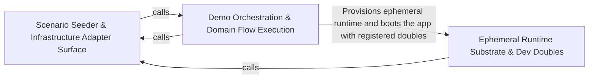

---
tags:
  - 2brain
  - 2brain/arch
  - project/boilerplate-node-backend
type: architecture
component: Ephemeral_Runtime_Dev_Doubles
---

## Details

The disposable execution substrate for the demo profile and test suites. It boots a real single-member mongod replica set in-process (via mongodb-memory-server), wraps it in a minimal EphemeralMongo handle (uri + stop()), and provides the development doubles that replace external services: a fake payment provider, a webhook sink with its own TLS CA and SSRF exemption, and an OAuth fake. The run-server entry point assembles these into a self-contained, loopback-only API instance that the paired frontend's dev server and e2e suite run against. Scenario apply and waves orchestrate the seeding and flow execution on top of this substrate.

### Scenario Seeder & Infrastructure Adapter Surface
The data-seeding runner and the infrastructure adapters it exercises. apply.ts is the CLI entry point that boots the real application in-process, overrides rate limits and mail transport to in-memory/log modes, and drives the shop scenario through the actual checkout, payment, shipping, and refund endpoints. It owns the gates, the connection lifecycle, and the single call into buildScenario. The infrastructure adapters in this group — image-signature validation, PDF generation, SSRF guard, config field schema, and HTTP response helpers — are the cross-cutting surfaces that the seeded data and the flows it drives must pass through. The doubles registration wires the fake payment provider and mail log into the app's provider registry before the server starts listening.

**Related Classes/Methods**:

- `src.infrastructure.adapters.image-signatures.ACCEPTED_UPLOAD_MIMETYPES`:59-62

**Source Files:**

- `scenarios/apply.ts`
  - `scenarios.apply.filter() callback` (L91-L91) - Function
- `scenarios/support/doubles/payments/fake.ts`
  - `scenarios.support.doubles.payments.fake.fakePaymentProvider.refund` (L421-L488) - Method
  - `scenarios.support.doubles.payments.fake.fakePaymentProvider.retrieveRefund` (L490-L499) - Method
  - `scenarios.support.doubles.payments.fake.fakePaymentProvider.listRefunds` (L501-L512) - Method
- `scenarios/support/doubles/payments/register.ts`
  - `scenarios.support.doubles.payments.register.loadFakePaymentProvider` (L17-L18) - Class
  - `scenarios.support.doubles.payments.register.loadFakePaymentProvider.then() callback` (L18-L18) - Function
  - `scenarios.support.doubles.payments.register.lazyFakePaymentProvider.refund` (L38-L41) - Method
  - `scenarios.support.doubles.payments.register.lazyFakePaymentProvider.retrieveRefund` (L42-L43) - Method
  - `scenarios.support.doubles.payments.register.lazyFakePaymentProvider.listRefunds` (L44-L45) - Method
- `src/infrastructure/adapters/image-signatures.ts`
  - `src.infrastructure.adapters.image-signatures.ACCEPTED_UPLOAD_MIMETYPES` (L59-L62) - Class
  - `src.infrastructure.adapters.image-signatures.ACCEPTED_UPLOAD_MIMETYPES.SUPPORTED_IMAGE_FORMATS.flatMap() callback` (L61-L61) - Function
  - `src.infrastructure.adapters.image-signatures.CANONICAL_MIME_BY_ALIAS` (L65-L69) - Class
  - `src.infrastructure.adapters.image-signatures.CANONICAL_MIME_BY_ALIAS.SUPPORTED_IMAGE_FORMATS.flatMap() callback` (L66-L67) - Function
  - `src.infrastructure.adapters.image-signatures.CANONICAL_MIME_BY_ALIAS.SUPPORTED_IMAGE_FORMATS.flatMap() callback.map() callback` (L67-L67) - Function
- `src/infrastructure/adapters/image.worker.ts`
  - `src.infrastructure.adapters.image.worker.REENCODABLE_MIMES` (L28-L33) - Class
  - `src.infrastructure.adapters.image.worker.REENCODABLE_MIMES.filter() callback` (L31-L31) - Function
  - `src.infrastructure.adapters.image.worker.REENCODABLE_MIMES.map() callback` (L32-L32) - Function
- `src/infrastructure/adapters/logger.ts`
  - `src.infrastructure.adapters.logger.SENSITIVE_KEYS` (L98-L98) - Class
  - `src.infrastructure.adapters.logger.SENSITIVE_KEYS.map() callback` (L98-L98) - Function
- `src/infrastructure/adapters/pdf.ts`
  - `src.infrastructure.adapters.pdf.refuseNonDataRequest` (L212-L218) - Class
  - `src.infrastructure.adapters.pdf.refuseNonDataRequest.answer.catch() callback` (L217-L217) - Function
- `src/infrastructure/adapters/ssrf-guard.ts`
  - `src.infrastructure.adapters.ssrf-guard.SafeOutboundTarget` (L49-L62) - Interface
  - `src.infrastructure.adapters.ssrf-guard.resolveAllAddresses.lookup.then() callback.addresses.results.flatMap() callback` (L167-L168) - Function
  - `src.infrastructure.adapters.ssrf-guard.resolveAllAddresses.lookup.then() callback.addresses` (L167-L169) - Class
- `src/infrastructure/config/define.ts`
  - `src.infrastructure.config.define.FieldInfo` (L26-L33) - Interface
  - `src.infrastructure.config.define.SliceProblems` (L36-L43) - Interface
  - `src.infrastructure.config.define.presenceBroken` (L146-L158) - Class
  - `src.infrastructure.config.define.presenceProblems.presence.info.filter() callback` (L220-L224) - Function
  - `src.infrastructure.config.define.presenceProblems.presence.map() callback` (L226-L226) - Function
  - `src.infrastructure.config.define.slice` (L242-L255) - Class
  - `src.infrastructure.config.define.configProblems.merged` (L296-L298) - Class
  - `src.infrastructure.config.define.configProblems.merged.all.flatMap() callback` (L297-L297) - Function
  - `src.infrastructure.config.define.configProblems.invalid.merged() callback` (L300-L300) - Function
  - `src.infrastructure.config.define.configProblems.presence.merged() callback` (L301-L301) - Function
  - `src.infrastructure.config.define.configProblems.checks.merged() callback` (L302-L302) - Function
  - `src.infrastructure.config.define.assertConfigIn.clauses` (L316-L322) - Class
  - `src.infrastructure.config.define.assertConfigIn.clauses.filter() callback` (L322-L322) - Function
- `src/infrastructure/config/shared-rules/cookies.ts`
  - `src.infrastructure.config.shared-rules.cookies.cookies.refine() callback` (L42-L42) - Function
  - `src.infrastructure.config.shared-rules.cookies.cookiesSchema.cookies.refine() callback.every() callback` (L46-L46) - Function
  - `src.infrastructure.config.shared-rules.cookies.cookiesSchema.cookies.refine() callback` (L51-L54) - Function
  - `src.infrastructure.config.shared-rules.cookies.cookiesSchema.cookies.refine() callback.names` (L52-L52) - Class
  - `src.infrastructure.config.shared-rules.cookies.cookiesSchema.cookies.refine() callback.names.map() callback` (L52-L52) - Function
- `src/infrastructure/config/shared-rules/generate-spec.ts`
  - `src.infrastructure.config.shared-rules.generate-spec.GeneratedExport` (L22-L31) - Interface
  - `src.infrastructure.config.shared-rules.generate-spec.GenerateSpec` (L34-L39) - Interface
  - `src.infrastructure.config.shared-rules.generate-spec.KeyedEntry` (L42-L47) - Interface
  - `src.infrastructure.config.shared-rules.generate-spec.keyedListSchema` (L55-L61) - Class
  - `src.infrastructure.config.shared-rules.generate-spec.keyedListSchema.refine() callback` (L59-L59) - Function
  - `src.infrastructure.config.shared-rules.generate-spec.keyedListSchema.refine() callback.entries.map() callback` (L59-L59) - Function
- `src/infrastructure/config/shared-rules/metrics.ts`
  - `src.infrastructure.config.shared-rules.metrics.metricDataSchema` (L13-L35) - Class
  - `src.infrastructure.config.shared-rules.metrics.refine() callback` (L29-L29) - Function
  - `src.infrastructure.config.shared-rules.metrics.metricDataSchema.refine() callback` (L33-L33) - Function
  - `src.infrastructure.config.shared-rules.metrics.metricsSchema.refine() callback.names` (L46-L46) - Class
  - `src.infrastructure.config.shared-rules.metrics.metricsSchema.refine() callback.names.map() callback` (L46-L46) - Function
- `src/infrastructure/config/shared-rules/rate-limits.ts`
  - `src.infrastructure.config.shared-rules.rate-limits.camelCaseOf` (L39-L40) - Class
  - `src.infrastructure.config.shared-rules.rate-limits.camelCaseOf.namespace.replaceAll() callback` (L40-L40) - Function
  - `src.infrastructure.config.shared-rules.rate-limits.rateLimitsBlockSchema` (L43-L49) - Class
  - `src.infrastructure.config.shared-rules.rate-limits.rateLimitsBlockSchema.refine() callback` (L46-L47) - Function
  - `src.infrastructure.config.shared-rules.rate-limits.rateLimitsBlockSchema.refine() callback.every() callback` (L47-L47) - Function
- `src/infrastructure/config/store.ts`
  - `src.infrastructure.config.store.overrideEnvironment.before` (L116-L118) - Class
  - `src.infrastructure.config.store.overrideEnvironment.before.map() callback` (L117-L117) - Function
- `src/infrastructure/http/middlewares/cache.ts`
  - `src.infrastructure.http.middlewares.cache.CachedResponse` (L36-L40) - Interface
- `src/infrastructure/http/middlewares/upload.ts`
  - `src.infrastructure.http.middlewares.upload.validateUploadedImages.then() callback.rejected` (L271-L275) - Class
  - `src.infrastructure.http.middlewares.upload.validateUploadedImages.then() callback.rejected.paths.filter() callback` (L272-L274) - Function
  - `src.infrastructure.http.middlewares.upload.validateUploadedImages.then() callback.rejected.map() callback` (L293-L293) - Function
  - `src.infrastructure.http.middlewares.upload.quarantineUploadedImages.then() callback.failed` (L407-L407) - Class
  - `src.infrastructure.http.middlewares.upload.quarantineUploadedImages.then() callback.failed.results.find() callback` (L407-L407) - Function
- `src/infrastructure/http/preconditions.ts`
  - `src.infrastructure.http.preconditions.tagsOf` (L28-L28) - Class
  - `src.infrastructure.http.preconditions.tagsOf.map() callback` (L28-L28) - Function
- `src/infrastructure/http/request.ts`
  - `src.infrastructure.http.request.parseFormCsvList.tokens` (L77-L80) - Class
  - `src.infrastructure.http.request.parseFormCsvList.tokens.entries.flatMap() callback` (L78-L78) - Function
  - `src.infrastructure.http.request.parseFormCsvList.tokens.map() callback` (L79-L79) - Function
  - `src.infrastructure.http.request.parseFormCsvList.tokens.filter() callback` (L80-L80) - Function
  - `src.infrastructure.http.request.readInput.undecoded` (L288-L288) - Class
  - `src.infrastructure.http.request.readInput.undecoded.stated.find() callback` (L288-L288) - Function
- `src/infrastructure/http/response.ts`
  - `src.infrastructure.http.response.ResponseNeutral` (L20-L25) - Interface
  - `src.infrastructure.http.response.ResponseSuccess` (L31-L38) - Interface
  - `src.infrastructure.http.response.ResponseErrorItem` (L41-L53) - Interface
  - `src.infrastructure.http.response.ResponseReject` (L59-L70) - Interface
  - `src.infrastructure.http.response.ProblemDetails` (L304-L317) - Interface
- `src/infrastructure/http/sse.ts`
  - `src.infrastructure.http.sse.openSseStream.reverifyTimer` (L65-L71) - Class
  - `src.infrastructure.http.sse.openSseStream.reverifyTimer.setInterval() callback` (L65-L71) - Function
  - `src.infrastructure.http.sse.openSseStream.reverifyTimer.setInterval() callback.then() callback` (L67-L69) - Function
- `src/infrastructure/observability/audit-changes.ts`
  - `src.infrastructure.observability.audit-changes.auditChanges.changedFields` (L83-L83) - Class
  - `src.infrastructure.observability.audit-changes.auditChanges.changedFields.fields.named.filter() callback` (L83-L83) - Function
- `src/infrastructure/observability/tracer.ts`
  - `src.infrastructure.observability.tracer.tracer.startActiveSpan() callback.then() callback` (L51-L51) - Function
- `src/infrastructure/persistence/money-field.ts`
  - `src.infrastructure.persistence.money-field.MoneyPathOptions` (L82-L89) - Interface
  - `src.infrastructure.persistence.money-field.moneyPath.validate.message` (L123-L124) - Method
- `src/infrastructure/persistence/report.ts`
  - `src.infrastructure.persistence.report.ReportWindow` (L15-L24) - Interface
- `src/infrastructure/runtime/busy.ts`
  - `src.infrastructure.runtime.busy.ServiceBusyError` (L13-L19) - Class
  - `src.infrastructure.runtime.busy.ServiceBusyError.constructor` (L15-L18) - Constructor
- `src/infrastructure/runtime/otel-sdk.ts`
  - `src.infrastructure.runtime.otel-sdk.redactUrlSecrets.secrets` (L70-L70) - Class
  - `src.infrastructure.runtime.otel-sdk.redactUrlSecrets.secrets.QUERY_SECRETS.filter() callback` (L70-L70) - Function
- `src/infrastructure/runtime/provider-registry.ts`
  - `src.infrastructure.runtime.provider-registry.ProviderRegistry` (L17-L34) - Interface
  - `src.infrastructure.runtime.provider-registry.ProviderRegistry.register` (L23-L23) - Method
  - `src.infrastructure.runtime.provider-registry.ProviderRegistry.names` (L26-L26) - Method
  - `src.infrastructure.runtime.provider-registry.ProviderRegistry.resolve` (L33-L33) - Method
  - `src.infrastructure.runtime.provider-registry.registryOver` (L41-L47) - Class
  - `src.infrastructure.runtime.provider-registry.registryOver.register` (L42-L44) - Method
  - `src.infrastructure.runtime.provider-registry.registryOver.names` (L45-L45) - Method
  - `src.infrastructure.runtime.provider-registry.registryOver.resolve` (L46-L46) - Method
- `src/modules/account/oauth/providers/github.ts`
  - `src.modules.account.oauth.providers.github.identityOf.primary` (L80-L80) - Class
  - `src.modules.account.oauth.providers.github.identityOf.primary.emails.find() callback` (L80-L80) - Function
- `src/modules/account/oauth/providers/index.ts`
  - `src.modules.account.oauth.providers.index.enabledProviders` (L35-L36) - Class
  - `src.modules.account.oauth.providers.index.enabledProviders.filter() callback` (L36-L36) - Function
- `src/modules/account/repository.ts`
  - `src.modules.account.repository.insert` (L54-L56) - Class
  - `src.modules.account.repository.insert.then() callback` (L56-L56) - Function
  - `src.modules.account.repository.insertSession` (L159-L160) - Class
  - `src.modules.account.repository.insertSession.then() callback` (L160-L160) - Function
  - `src.modules.account.repository.supersedeSession` (L184-L201) - Class
  - `src.modules.account.repository.supersedeSession.then() callback` (L201-L201) - Function
  - `src.modules.account.repository.touchSession` (L212-L227) - Class
  - `src.modules.account.repository.touchSession.then() callback` (L227-L227) - Function
  - `src.modules.account.repository.removeSessionByHash` (L260-L264) - Class
  - `src.modules.account.repository.removeSessionByHash.then() callback` (L264-L264) - Function
  - `src.modules.account.repository.FamilyActivity` (L304-L311) - Interface
  - `src.modules.account.repository.sessionFamilyActivity.then() callback.stamps.rows.flatMap() callback` (L372-L373) - Function
  - `src.modules.account.repository.sessionFamilyActivity.then() callback.stamps` (L372-L374) - Class
  - `src.modules.account.repository.NewVerificationToken` (L481-L488) - Interface
  - `src.modules.account.repository.spendVerificationToken` (L562-L566) - Class
  - `src.modules.account.repository.spendVerificationToken.then() callback` (L566-L566) - Function
  - `src.modules.account.repository.userIdsWithLiveVerificationToken` (L608-L615) - Class
  - `src.modules.account.repository.userIdsWithLiveVerificationToken.then() callback` (L615-L615) - Function
- `src/modules/account/session/account-view.ts`
  - `src.modules.account.session.account-view.modelVersion` (L44-L44) - Class
  - `src.modules.account.session.account-view.modelVersion.PERMISSION_RULES.map() callback` (L44-L44) - Function
- `src/modules/invoicing/services/credit-breakdown.ts`
  - `src.modules.invoicing.services.credit-breakdown.creditBreakdownOf.items.map() callback` (L27-L30) - Function
- `src/modules/orders/domain/totals.ts`
  - `src.modules.orders.domain.totals.LineItem` (L21-L25) - Interface
  - `src.modules.orders.domain.totals.LineItemTotals` (L28-L35) - Interface
  - `src.modules.orders.domain.totals.OrderTotalInput` (L68-L80) - Interface
- `src/modules/orders/emails.ts`
  - `src.modules.orders.emails.OrderLines` (L33-L57) - Interface
  - `src.modules.orders.emails.WithdrawalNotice` (L63-L73) - Interface
  - `src.modules.orders.emails.withdrawalNotice.excludedNote.titles.excluded.map() callback` (L146-L146) - Function
  - `src.modules.orders.emails.orderConfirmEmail.data.lines.order.items.map() callback` (L259-L267) - Function
- `src/modules/orders/model.ts`
  - `src.modules.orders.model.OrderDocumentItem` (L72-L96) - Interface
  - `src.modules.orders.model.OrderReference` (L99-L103) - Interface
  - `src.modules.orders.model.OrderDocument` (L112-L225) - Interface
  - `src.modules.orders.model.OrderNumberCounterDocument` (L663-L665) - Interface
  - `src.modules.orders.model.OrderEventDocument` (L687-L707) - Interface
- `src/modules/payments/emails.ts`
  - `src.modules.payments.emails.paymentReceivedEmail.data.lines.order.items.map() callback` (L42-L47) - Function
  - `src.modules.payments.emails.TransferInstructions` (L139-L146) - Interface
- `src/modules/payments/model.ts`
  - `src.modules.payments.model.RefundLine` (L31-L36) - Interface
  - `src.modules.payments.model.RefundRecord` (L43-L113) - Interface
  - `src.modules.payments.model.DisputeRecord` (L120-L141) - Interface
  - `src.modules.payments.model.RefundSettlement` (L147-L157) - Interface
  - `src.modules.payments.model.PaymentDocument` (L162-L217) - Interface
- `src/modules/payments/presenter.ts`
  - `src.modules.payments.presenter.StaffFields` (L18-L21) - Interface
  - `src.modules.payments.presenter.staffFieldsOf.refunds.raw.refunds.map() callback` (L29-L32) - Function
  - `src.modules.payments.presenter.withStaffFields.refunds.wire.refunds.map() callback` (L44-L44) - Function
  - `src.modules.payments.presenter.presentPayment.wire.refunds.serialized.refunds.map() callback` (L102-L105) - Function
- `src/modules/payments/providers/errors.ts`
  - `src.modules.payments.providers.errors.PaymentProviderError` (L28-L40) - Class
  - `src.modules.payments.providers.errors.PaymentProviderError.constructor` (L33-L39) - Constructor
- `src/modules/payments/providers/index.ts`
  - `src.modules.payments.providers.index.ProviderPaymentState` (L46-L67) - Interface
  - `src.modules.payments.providers.index.PreparedPayment` (L70-L78) - Interface
  - `src.modules.payments.providers.index.RefundedByProvider` (L85-L93) - Interface
  - `src.modules.payments.providers.index.ProviderWebhookEvent` (L143-L159) - Interface
  - `src.modules.payments.providers.index.PaymentProvider.refund` (L244-L248) - Method
  - `src.modules.payments.providers.index.PaymentProvider.retrieveRefund` (L256-L256) - Method
- `src/modules/payments/repository.ts`
  - `src.modules.payments.repository.paymentRepository.findStaleInFlight` (L1158-L1170) - Method
- `src/modules/payments/services/errors.ts`
  - `src.modules.payments.services.errors.RefundLeftOpenError` (L46-L58) - Class
  - `src.modules.payments.services.errors.RefundLeftOpenError.constructor` (L51-L57) - Constructor
- `src/modules/payments/services/external-refunds.ts`
  - `src.modules.payments.services.external-refunds.ourRecord` (L37-L46) - Class
  - `src.modules.payments.services.external-refunds.ourRecord.payment.refunds.find() callback` (L42-L45) - Function
  - `src.modules.payments.services.external-refunds.writeImport` (L73-L111) - Class
  - `src.modules.payments.services.external-refunds.writeImport.then() callback` (L92-L110) - Function
  - `src.modules.payments.services.external-refunds.writeImport.then() callback.then() callback` (L109-L109) - Function
  - `src.modules.payments.services.external-refunds.importRefund` (L120-L154) - Class
  - `src.modules.payments.services.external-refunds.announceInTransaction() callback` (L127-L127) - Function
  - `src.modules.payments.services.external-refunds.importRefund.announceInTransaction() callback` (L128-L132) - Function
  - `src.modules.payments.services.external-refunds.importRefund.then() callback` (L133-L153) - Function
  - `src.modules.payments.services.external-refunds.importRefund.then() callback.then() callback` (L144-L152) - Function
  - `src.modules.payments.services.external-refunds.syncProviderRefunds` (L184-L195) - Class
  - `src.modules.payments.services.external-refunds.syncProviderRefunds.then() callback` (L189-L194) - Function
  - `src.modules.payments.services.external-refunds.syncOne` (L204-L216) - Class
  - `src.modules.payments.services.external-refunds.syncOne.then() callback` (L211-L211) - Function
- `src/modules/payments/services/refund-settlement.ts`
  - `src.modules.payments.services.refund-settlement.recordRefundFailure` (L272-L318) - Class
  - `src.modules.payments.services.refund-settlement.recordRefundFailure.announceInTransaction() callback.then() callback` (L297-L310) - Function
  - `src.modules.payments.services.refund-settlement.recordRefundFailure.announceInTransaction() callback.then() callback.then() callback` (L309-L309) - Function
  - `src.modules.payments.services.refund-settlement.recordRefundFailure.announceInTransaction() callback` (L312-L316) - Function
  - `src.modules.payments.services.refund-settlement.recordRefundFailure.then() callback` (L317-L317) - Function
- `src/modules/payments/services/refund-sync.ts`
  - `src.modules.payments.services.refund-sync.rereadRefund` (L66-L87) - Class
  - `src.modules.payments.services.refund-sync.then() callback` (L76-L76) - Function
  - `src.modules.payments.services.refund-sync.rereadRefund.then() callback` (L77-L77) - Function
  - `src.modules.payments.services.refund-sync.rereadRefund.catch() callback` (L78-L86) - Function
- `src/modules/payments/services/refunds.ts`
  - `src.modules.payments.services.refunds.keepPending` (L394-L402) - Class
  - `src.modules.payments.services.refunds.keepPending.then() callback` (L402-L402) - Function
  - `src.modules.payments.services.refunds.sendToProvider` (L414-L472) - Class
  - `src.modules.payments.services.refunds.sendToProvider.refuse` (L420-L423) - Class
  - `src.modules.payments.services.refunds.sendToProvider.refuse.then() callback` (L421-L423) - Function
  - `src.modules.payments.services.refunds.sendToProvider.then() callback` (L470-L470) - Function
- `src/modules/returns/emails.ts`
  - `src.modules.returns.emails.ReturnNoticeInput` (L31-L53) - Interface
- `src/modules/returns/model.ts`
  - `src.modules.returns.model.ReturnLine` (L31-L42) - Interface
  - `src.modules.returns.model.ReturnDocument` (L45-L107) - Interface
  - `src.modules.returns.model.ReturnOrderLockDocument` (L211-L214) - Interface

### Demo Orchestration & Domain Flow Execution
The run-server entry point that assembles the demo profile into a listening, loopback-only API instance, plus the domain services and mutation-testing orchestration that the seeded flows drive. run-server.ts resolves the ephemeral Mongo, installs the demo clock, force-disables external services, sets throwaway secrets and loopback binding, and polls until the server is accepting connections. The fake payment provider's refund mechanics and lazy registration are the test levers that let e2e and mutation waves exercise the full payment lifecycle. The domain services — order numbering, order stats, and delivery preorder — are the business logic that the scenario flows and mutation waves validate. The waves.ts orchestrator sequences mutation-testing rounds against this substrate.

**Related Classes/Methods**:

- `scenarios.support.doubles.payments.register.lazyFakePaymentProvider`:26-50
- `scenarios.support.doubles.payments.fake.FakeRefund`:227-232
- `src.modules.orders.services.order-numbering.allocateOrderNumber`:46-52
- `src.modules.delivery.domain.preorder.BoardFacts`:191-195

**Source Files:**

- `scenarios/run-server.ts`
  - `scenarios.run-server.waitUntilListening.poll` (L149-L157) - Class
  - `scenarios.run-server.waitUntilListening.poll.then() callback` (L152-L156) - Function
- `scenarios/support/doubles/payments/fake.ts`
  - `scenarios.support.doubles.payments.fake.FakeRefund` (L227-L232) - Interface
  - `scenarios.support.doubles.payments.fake.fakePaymentProvider.prepare` (L379-L396) - Method
  - `scenarios.support.doubles.payments.fake.fakePaymentProvider.confirm` (L398-L407) - Method
  - `scenarios.support.doubles.payments.fake.fakePaymentProvider.retrieve` (L409-L416) - Method
- `scenarios/support/doubles/payments/register.ts`
  - `scenarios.support.doubles.payments.register.lazyFakePaymentProvider` (L26-L50) - Class
  - `scenarios.support.doubles.payments.register.lazyFakePaymentProvider.prepare` (L28-L31) - Method
  - `scenarios.support.doubles.payments.register.lazyFakePaymentProvider.prepare.then() callback` (L29-L30) - Function
  - `scenarios.support.doubles.payments.register.lazyFakePaymentProvider.confirm` (L32-L35) - Method
  - `scenarios.support.doubles.payments.register.lazyFakePaymentProvider.confirm.then() callback` (L33-L34) - Function
  - `scenarios.support.doubles.payments.register.lazyFakePaymentProvider.retrieve` (L36-L37) - Method
  - `scenarios.support.doubles.payments.register.lazyFakePaymentProvider.retrieve.then() callback` (L37-L37) - Function
  - `scenarios.support.doubles.payments.register.lazyFakePaymentProvider.refund.then() callback` (L39-L40) - Function
  - `scenarios.support.doubles.payments.register.lazyFakePaymentProvider.retrieveRefund.then() callback` (L43-L43) - Function
  - `scenarios.support.doubles.payments.register.lazyFakePaymentProvider.listRefunds.then() callback` (L45-L45) - Function
  - `scenarios.support.doubles.payments.register.lazyFakePaymentProvider.cancel.then() callback` (L47-L47) - Function
  - `scenarios.support.doubles.payments.register.lazyFakePaymentProvider.parseWebhook.then() callback` (L49-L49) - Function
- `scripts/mutation/ci/waves.ts`
  - `scripts.mutation.ci.waves.nextWave.results` (L198-L198) - Class
  - `scripts.mutation.ci.waves.nextWave.results.previous.shards.map() callback` (L198-L198) - Function
  - `scripts.mutation.ci.waves.nextWave.results.flatMap() callback` (L203-L203) - Function
- `src/modules/delivery/domain/lost.ts`
  - `src.modules.delivery.domain.lost.withRestoration.dropped` (L165-L173) - Class
  - `src.modules.delivery.domain.lost.withRestoration.dropped.back.filter() callback` (L166-L166) - Function
  - `src.modules.delivery.domain.lost.withRestoration.dropped.map() callback` (L167-L173) - Function
- `src/modules/delivery/domain/preorder.ts`
  - `src.modules.delivery.domain.preorder.SweepFacts` (L136-L140) - Interface
  - `src.modules.delivery.domain.preorder.BoardFacts` (L191-L195) - Interface
- `src/modules/delivery/domain/reship.ts`
  - `src.modules.delivery.domain.reship.planReopening.latestFirst` (L41-L43) - Class
  - `src.modules.delivery.domain.reship.planReopening.latestFirst.orders.filter() callback` (L42-L42) - Function
  - `src.modules.delivery.domain.reship.planReopening.latestFirst.toSorted() callback` (L43-L43) - Function
- `src/modules/orders/domain/tax.ts`
  - `src.modules.orders.domain.tax.allocateLineTax.taxes` (L184-L184) - Class
  - `src.modules.orders.domain.tax.allocateLineTax.taxes.grossByLine.map() callback` (L184-L184) - Function
  - `src.modules.orders.domain.tax.orderTaxBreakdown.lineTaxes` (L245-L249) - Class
  - `src.modules.orders.domain.tax.orderTaxBreakdown.lineTaxes.map() callback` (L248-L248) - Function
- `src/modules/orders/services/crud.ts`
  - `src.modules.orders.services.crud.create.removed` (L138-L138) - Class
  - `src.modules.orders.services.crud.create.removed.resolvedItems.filter() callback` (L138-L138) - Function
- `src/modules/orders/services/order-numbering.ts`
  - `src.modules.orders.services.order-numbering.allocateOrderNumber` (L46-L52) - Class
  - `src.modules.orders.services.order-numbering.allocateOrderNumber.then() callback` (L51-L51) - Function
- `src/modules/orders/services/stats.ts`
  - `src.modules.orders.services.stats.PaidBucket` (L39-L44) - Interface
  - `src.modules.orders.services.stats.ProductTotal` (L76-L82) - Interface
  - `src.modules.orders.services.stats.CategoryTotal` (L121-L126) - Interface
  - `src.modules.orders.services.stats.categoryTotals` (L133-L159) - Class
  - `src.modules.orders.services.stats.categoryTotals.then() callback` (L152-L158) - Function
  - `src.modules.orders.services.stats.categoryTotals.then() callback.rows.map() callback` (L153-L158) - Function
  - `src.modules.orders.services.stats.ProductSeriesRead` (L162-L165) - Interface
  - `src.modules.orders.services.stats.AwaitingTransfers` (L254-L259) - Interface
  - `src.modules.orders.services.stats.PipelineRead` (L262-L265) - Interface
- `src/modules/payments/providers/index.ts`
  - `src.modules.payments.providers.index.ProviderRefundState` (L99-L106) - Interface
  - `src.modules.payments.providers.index.ProviderRefund` (L112-L121) - Interface
  - `src.modules.payments.providers.index.PaymentProvider` (L171-L309) - Interface
  - `src.modules.payments.providers.index.PaymentProvider.prepare` (L189-L193) - Method
  - `src.modules.payments.providers.index.PaymentProvider.confirm` (L203-L203) - Method
  - `src.modules.payments.providers.index.PaymentProvider.retrieve` (L211-L211) - Method
  - `src.modules.payments.providers.index.PaymentProvider.listRefunds` (L266-L266) - Method
- `src/modules/payments/providers/webhook-signature.ts`
  - `src.modules.payments.providers.webhook-signature.verifyWebhookSignature.pairs` (L86-L89) - Class
  - `src.modules.payments.providers.webhook-signature.verifyWebhookSignature.pairs.map() callback` (L86-L89) - Function
  - `src.modules.payments.providers.webhook-signature.verifyWebhookSignature.timestamp` (L91-L91) - Class
  - `src.modules.payments.providers.webhook-signature.verifyWebhookSignature.timestamp.pairs.find() callback` (L91-L91) - Function
- `src/modules/payments/services/effects.ts`
  - `src.modules.payments.services.effects.reconcileOne` (L102-L106) - Class
  - `src.modules.payments.services.effects.reconcileOne.then() callback` (L104-L105) - Function
- `src/modules/payments/services/external-refunds.ts`
  - `src.modules.payments.services.external-refunds.importRefund.then() callback.then() callback.done` (L146-L148) - Class
  - `src.modules.payments.services.external-refunds.importRefund.then() callback.then() callback.done.fresh.refunds.some() callback` (L147-L147) - Function
- `src/modules/payments/services/notify.ts`
  - `src.modules.payments.services.notify.completesPayment.refundedMinor` (L47-L54) - Class
  - `src.modules.payments.services.notify.completesPayment.refundedMinor.payment.refunds.filter() callback` (L49-L52) - Function
  - `src.modules.payments.services.notify.completesPayment.refundedMinor.reduce() callback` (L54-L54) - Function
  - `src.modules.payments.services.notify.mailRefundUndeliverable.then() callback.refund` (L132-L132) - Class
  - `src.modules.payments.services.notify.mailRefundUndeliverable.then() callback.refund.payment.refunds.find() callback` (L132-L132) - Function
- `src/modules/payments/services/settlement.ts`
  - `src.modules.payments.services.settlement.Settlement` (L63-L80) - Interface
  - `src.modules.payments.services.settlement.then() callback` (L316-L320) - Function
  - `src.modules.payments.services.settlement.confirmableOrder` (L547-L550) - Class
  - `src.modules.payments.services.settlement.confirmableOrder.then() callback` (L550-L550) - Function
  - `src.modules.payments.services.settlement.settleFound` (L569-L595) - Class
  - `src.modules.payments.services.settlement.settleFound.then() callback` (L582-L594) - Function
  - `src.modules.payments.services.settlement.settleFound.then() callback.then() callback` (L586-L592) - Function
  - `src.modules.payments.services.settlement.confirmPayment` (L612-L642) - Class
  - `src.modules.payments.services.settlement.confirmPayment.then() callback` (L618-L642) - Function
  - `src.modules.payments.services.settlement.confirmPayment.then() callback.settleFound() callback` (L627-L635) - Function
  - `src.modules.payments.services.settlement.confirmPayment.then() callback.settleFound() callback.then() callback` (L630-L634) - Function
  - `src.modules.payments.services.settlement.confirmPayment.then() callback.precheck` (L638-L638) - Method
  - `src.modules.payments.services.settlement.syncPayment` (L654-L678) - Class
  - `src.modules.payments.services.settlement.syncPayment.then() callback` (L659-L678) - Function
  - `src.modules.payments.services.settlement.syncPayment.then() callback.settleFound() callback` (L672-L675) - Function
  - `src.modules.payments.services.settlement.syncPayment.then() callback.settleFound() callback.then() callback` (L673-L674) - Function
  - `src.modules.payments.services.settlement.settleFromProvider` (L830-L840) - Class
  - `src.modules.payments.services.settlement.settleFromProvider.then() callback` (L839-L839) - Function
- `src/modules/payments/services/view.ts`
  - `src.modules.payments.services.view.getRefund` (L104-L116) - Class
  - `src.modules.payments.services.view.getRefund.then() callback` (L109-L116) - Function
- `src/modules/returns/services/cancel-remainder.ts`
  - `src.modules.returns.services.cancel-remainder.rowFor.byProduct` (L87-L87) - Class
  - `src.modules.returns.services.cancel-remainder.rowFor.byProduct.order.items.map() callback` (L87-L87) - Function
- `src/modules/returns/services/options.ts`
  - `src.modules.returns.services.options.optionLines.titles` (L64-L66) - Class
  - `src.modules.returns.services.options.optionLines.titles.order.items.map() callback` (L65-L65) - Function
- `src/modules/stats/services/breakdowns.ts`
  - `src.modules.stats.services.breakdowns.getPipelineStats` (L160-L169) - Class
  - `src.modules.stats.services.breakdowns.getPipelineStats.then() callback` (L161-L169) - Function
  - `src.modules.stats.services.breakdowns.getPipelineStats.then() callback.awaitingTransfers.snapshot.awaitingTransfers.map() callback` (L163-L168) - Function

### Ephemeral Runtime Substrate & Dev Doubles
The core disposable infrastructure: the in-process mongod replica set, the webhook sink with its own TLS CA and SSRF exemption, the fake payment provider's core implementation, and the app route installation that wires the served modules. ephemeral-mongo.ts defines the EphemeralMongo interface and the resolver that prefers an external NODE_TEST_MONGO_URI over the in-process fallback. ephemeral-mongod.ts is the one shared implementation that actually starts a MongoMemoryReplSet and adapts it to the EphemeralMongo shape. The webhook sink registers the sink's origin as an SSRF-exempt target and adds its committed test CA to the process's trusted roots. The fake payment provider implements the full PaymentProvider port using in-memory maps. The app routes install the served modules and the control surface that the demo profile mounts.

**Related Classes/Methods**:

- `scenarios.support.ephemeral-mongo.EphemeralMongo`:35-38
- `scenarios.support.doubles.webhook-sink.trustSinkCertificateAuthority`:28-37
- `scenarios.support.doubles.payments.fake.fakePaymentProvider`:374-570

**Source Files:**

- `scenarios/run-server.ts`
  - `scenarios.run-server.then() callback.process.once() callback` (L169-L179) - Function
  - `scenarios.run-server.then() callback.then() callback` (L245-L247) - Function
- `scenarios/support/doubles/payments/fake.ts`
  - `scenarios.support.doubles.payments.fake.fakePaymentProvider` (L374-L570) - Class
  - `scenarios.support.doubles.payments.fake.fakePaymentProvider.listRefunds.filter() callback` (L504-L504) - Function
  - `scenarios.support.doubles.payments.fake.fakePaymentProvider.listRefunds.map() callback` (L505-L511) - Function
  - `scenarios.support.doubles.payments.fake.fakePaymentProvider.cancel` (L514-L534) - Method
  - `scenarios.support.doubles.payments.fake.fakePaymentProvider.parseWebhook` (L547-L569) - Method
  - `scenarios.support.doubles.payments.fake.fakePaymentProvider.parseWebhook.catch() callback` (L563-L566) - Function
  - `scenarios.support.doubles.payments.fake.fakePaymentProvider.parseWebhook.then() callback` (L569-L569) - Function
- `scenarios/support/doubles/payments/register.ts`
  - `scenarios.support.doubles.payments.register.lazyFakePaymentProvider.cancel` (L46-L47) - Method
  - `scenarios.support.doubles.payments.register.lazyFakePaymentProvider.parseWebhook` (L48-L49) - Method
- `scenarios/support/doubles/webhook-sink.ts`
  - `scenarios.support.doubles.webhook-sink.trustSinkCertificateAuthority` (L28-L37) - Class
  - `scenarios.support.doubles.webhook-sink.trustSinkCertificateAuthority.defaults.some() callback` (L33-L33) - Function
- `scenarios/support/ephemeral-mongo.ts`
  - `scenarios.support.ephemeral-mongo.EphemeralMongo` (L35-L38) - Interface
- `scenarios/support/ephemeral-mongod.ts`
  - `scenarios.support.ephemeral-mongod.toEphemeralMongo` (L32-L35) - Class
  - `scenarios.support.ephemeral-mongod.toEphemeralMongo.stop` (L34-L34) - Method
  - `scenarios.support.ephemeral-mongod.toEphemeralMongo.stop.then() callback` (L34-L34) - Function
  - `scenarios.support.ephemeral-mongod.startInProcessMongod.timeout` (L51-L63) - Class
  - `scenarios.support.ephemeral-mongod.startInProcessMongod.timeout.<function>` (L51-L63) - Function
  - `scenarios.support.ephemeral-mongod.startInProcessMongod.timeout.<function>.setTimeout() callback` (L53-L60) - Function
- `scripts/mutation/mutate-scope.ts`
  - `scripts.mutation.mutate-scope.StrykerConfig` (L21-L23) - Interface
  - `scripts.mutation.mutate-scope.isMutable.exclude` (L43-L45) - Class
  - `scripts.mutation.mutate-scope.isMutable.exclude.patterns.filter() callback` (L44-L44) - Function
  - `scripts.mutation.mutate-scope.isMutable.exclude.map() callback` (L45-L45) - Function
  - `scripts.mutation.mutate-scope.isMutable.exclude.every() callback` (L50-L50) - Function
- `src/app/routes.ts`
  - `src.app.routes.app.use() callback` (L39-L42) - Function
  - `src.app.routes.installRoutes.servedModules` (L49-L49) - Class
  - `src.app.routes.installRoutes.servedModules.enabledModules.map() callback` (L49-L49) - Function
- `src/modules/delivery/domain/lost.ts`
  - `src.modules.delivery.domain.lost.LostShipmentFacts` (L16-L20) - Interface
  - `src.modules.delivery.domain.lost.RestorableFulfillmentOrder` (L23-L28) - Interface
  - `src.modules.delivery.domain.lost.Restoration` (L31-L38) - Interface
  - `src.modules.delivery.domain.lost.planRestoration.shipped.shipment.lines.map() callback` (L126-L126) - Function
  - `src.modules.delivery.domain.lost.planRestoration.owedFulfillmentOrderIds.linked.map() callback` (L128-L128) - Function
  - `src.modules.delivery.domain.lost.withRestoration.known` (L154-L154) - Class
  - `src.modules.delivery.domain.lost.withRestoration.known.lines.map() callback` (L154-L154) - Function
  - `src.modules.delivery.domain.lost.OwedDate` (L178-L182) - Interface
  - `src.modules.delivery.domain.lost.owedDateOf.at.ahead.map() callback` (L203-L203) - Function
- `src/modules/orders/domain/purchase-hold.ts`
  - `src.modules.orders.domain.purchase-hold.purchaseHoldUntil.counted` (L39-L42) - Class
  - `src.modules.orders.domain.purchase-hold.purchaseHoldUntil.counted.cancelTimes.map() callback` (L40-L40) - Function
  - `src.modules.orders.domain.purchase-hold.purchaseHoldUntil.counted.filter() callback` (L41-L41) - Function
  - `src.modules.orders.domain.purchase-hold.purchaseHoldUntil.counted.toSorted() callback` (L42-L42) - Function
- `src/modules/orders/domain/tax.ts`
  - `src.modules.orders.domain.tax.lineTaxFromRateTotals.taxes` (L211-L215) - Class
  - `src.modules.orders.domain.tax.lineTaxFromRateTotals.taxes.map() callback` (L214-L214) - Function
  - `src.modules.orders.domain.tax.orderTaxBreakdown.sortedGroups` (L257-L257) - Class
  - `src.modules.orders.domain.tax.orderTaxBreakdown.sortedGroups.toSorted() callback` (L257-L257) - Function
- `src/modules/orders/repository.ts`
  - `src.modules.orders.repository.setProjection.changes` (L435-L439) - Class
  - `src.modules.orders.repository.setProjection.changes.filter() callback` (L437-L437) - Function
  - `src.modules.orders.repository.setProjection.changes.map() callback` (L438-L438) - Function
- `src/modules/orders/services/digest.ts`
  - `src.modules.orders.services.digest.ordersDigest` (L29-L45) - Class
  - `src.modules.orders.services.digest.ordersDigest.then() callback` (L45-L45) - Function
- `src/modules/orders/services/place.ts`
  - `src.modules.orders.services.place.order` (L228-L248) - Class
  - `src.modules.orders.services.place.order.announceInTransaction() callback` (L229-L246) - Function
  - `src.modules.orders.services.place.order.announceInTransaction() callback.then() callback` (L233-L236) - Function
  - `src.modules.orders.services.place.order.announceInTransaction() callback.then() callback.then() callback` (L235-L235) - Function
- `src/modules/orders/services/stats.ts`
  - `src.modules.orders.services.stats.productSeries` (L172-L192) - Class
  - `src.modules.orders.services.stats.productSeries.then() callback` (L189-L192) - Function
  - `src.modules.orders.services.stats.productSeries.then() callback.buckets.rows.map() callback` (L191-L191) - Function
  - `src.modules.orders.services.stats.cancellationCohort` (L233-L251) - Class
  - `src.modules.orders.services.stats.cancellationCohort.then() callback` (L248-L251) - Function
- `src/modules/payments/controllers/post-payment-confirm.ts`
  - `src.modules.payments.controllers.post-payment-confirm.postPaymentConfirm.then() callback.declined` (L38-L40) - Class
  - `src.modules.payments.controllers.post-payment-confirm.postPaymentConfirm.then() callback.declined.result.errors.some() callback` (L40-L40) - Function
- `src/modules/payments/controllers/post-payment-webhook.ts`
  - `src.modules.payments.controllers.post-payment-webhook.postPaymentWebhook` (L37-L89) - Class
  - `src.modules.payments.controllers.post-payment-webhook.then() callback` (L53-L53) - Function
  - `src.modules.payments.controllers.post-payment-webhook.postPaymentWebhook.then() callback` (L54-L65) - Function
  - `src.modules.payments.controllers.post-payment-webhook.then() callback.then() callback` (L61-L61) - Function
  - `src.modules.payments.controllers.post-payment-webhook.postPaymentWebhook.then() callback.then() callback` (L62-L64) - Function
  - `src.modules.payments.controllers.post-payment-webhook.postPaymentWebhook.catch() callback` (L66-L88) - Function
- `src/modules/payments/providers/errors.ts`
  - `src.modules.payments.providers.errors.PaymentInFlightError` (L15-L21) - Class
  - `src.modules.payments.providers.errors.PaymentInFlightError.constructor` (L17-L20) - Constructor
- `src/modules/payments/providers/index.ts`
  - `src.modules.payments.providers.index.PaymentProvider.cancel` (L282-L282) - Method
  - `src.modules.payments.providers.index.PaymentProvider.parseWebhook` (L308-L308) - Method
- `src/modules/payments/providers/webhook-signature.ts`
  - `src.modules.payments.providers.webhook-signature.WebhookRejected` (L33-L46) - Class
  - `src.modules.payments.providers.webhook-signature.WebhookRejected.constructor` (L39-L45) - Constructor
  - `src.modules.payments.providers.webhook-signature.verifyWebhookSignature.provided` (L94-L94) - Class
  - `src.modules.payments.providers.webhook-signature.verifyWebhookSignature.provided.map() callback` (L94-L94) - Function
  - `src.modules.payments.providers.webhook-signature.verifyWebhookSignature.provided.pairs.filter() callback` (L94-L94) - Function
- `src/modules/payments/services/intent.ts`
  - `src.modules.payments.services.intent.rejectStrayIntent` (L44-L71) - Class
  - `src.modules.payments.services.intent.rejectStrayIntent.catch() callback` (L51-L58) - Function
  - `src.modules.payments.services.intent.rejectStrayIntent.then() callback` (L59-L71) - Function
  - `src.modules.payments.services.intent.cancelOpenIntent` (L157-L164) - Class
  - `src.modules.payments.services.intent.cancelOpenIntent.then() callback` (L161-L162) - Function
- `src/modules/payments/services/list.ts`
  - `src.modules.payments.services.list.listPayments.then() callback.then() callback.byId` (L105-L105) - Class
  - `src.modules.payments.services.list.listPayments.then() callback.then() callback.byId.orders.map() callback` (L105-L105) - Function
- `src/modules/payments/services/refunds.ts`
  - `src.modules.payments.services.refunds.sendOpenedRefund.then() callback.refund` (L1251-L1251) - Class
  - `src.modules.payments.services.refunds.sendOpenedRefund.then() callback.refund.payment.refunds.find() callback` (L1251-L1251) - Function
- `src/modules/payments/services/view.ts`
  - `src.modules.payments.services.view.cancelableRefunds` (L217-L222) - Class
  - `src.modules.payments.services.view.cancelableRefunds.payment.refunds.filter() callback` (L220-L220) - Function
  - `src.modules.payments.services.view.cancelableRefunds.map() callback` (L221-L221) - Function
- `src/modules/returns/domain/statement.ts`
  - `src.modules.returns.domain.statement.Statement` (L31-L35) - Interface
- `src/modules/returns/services/create.ts`
  - `src.modules.returns.services.create.Opening` (L117-L121) - Interface
  - `src.modules.returns.services.create.openFor.then() callback.returnable` (L323-L323) - Class
  - `src.modules.returns.services.create.openFor.then() callback.returnable.shipped.filter() callback` (L323-L323) - Function
- `src/modules/stats/services/breakdowns.ts`
  - `src.modules.stats.services.breakdowns.then() callback.refunds.currencies.map() callback.invoiced` (L134-L134) - Class
  - `src.modules.stats.services.breakdowns.then() callback.refunds.currencies.map() callback.credited` (L135-L135) - Class
  - `src.modules.stats.services.breakdowns.getCustomerStats` (L150-L157) - Class
  - `src.modules.stats.services.breakdowns.getCustomerStats.then() callback` (L151-L157) - Function
