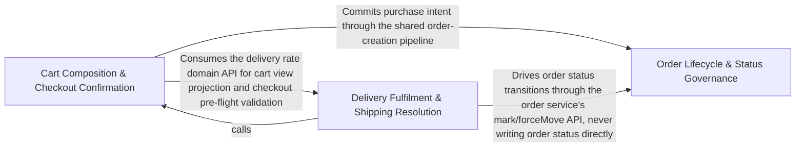

---
tags:
  - 2brain
  - 2brain/arch
  - project/boilerplate-node-backend
type: architecture
component: Flow_Driven_Module_Services
---

## Details

The module business services the flow runner drives after seeding to give the shop a past: cart item/merge/reorder/view services, the checkout service (orderConfirm, CheckoutChoices, ExpectedTotal), and the delivery service (startFulfilment, shipOrder, recordShipment, recordDelivery, moveAndStampDelivered, fulfillOrder). These are the read/write services that turn the seeded onHand: 0 catalogue into delivered orders, which backdateHistory then moves into the past. They are the 'living history' half of the scenario, downstream of the seed core.

### Cart Composition & Checkout Confirmation
This sub-component owns the purchase-intent phase of the flow. It provides the read/write services that build, inspect, and finalize a shopping cart, then confirm it into an order. The items service handles granular cart mutations (add, remove, update quantity, upsert), the view service projects the cart into a display-ready shape, the reorder service re-enters previously purchased lines back into the cart, and the checkout service is the terminal step that validates the cart against CheckoutChoices, computes the ExpectedTotal, and commits the order.

**Related Classes/Methods**:

- `src.modules.cart.services.checkout.orderConfirm`:585-614
- `src.modules.cart.services.items.cartGetForView`:50-57
- `src.modules.cart.services.reorder.reorderIntoCart`:111-156

**Source Files:**

- `src/modules/cart/services/checkout.ts`
  - `src.modules.cart.services.checkout.CheckoutChoices` (L78-L84) - Interface
  - `src.modules.cart.services.checkout.resolvePaymentMethod.methodInfo.find() callback` (L110-L110) - Function
  - `src.modules.cart.services.checkout.buildStockRefusal.details.lines.refusal.shortfalls.map() callback` (L300-L304) - Function
  - `src.modules.cart.services.checkout.ExpectedTotal` (L320-L325) - Interface
  - `src.modules.cart.services.checkout.runCheckout.details.productIds.overLimit.map() callback` (L477-L477) - Function
  - `src.modules.cart.services.checkout.orderConfirm` (L585-L614) - Class
  - `src.modules.cart.services.checkout.orderConfirm.catch() callback` (L591-L591) - Function
  - `src.modules.cart.services.checkout.orderConfirm.then() callback` (L592-L614) - Function
- `src/modules/cart/services/items.ts`
  - `src.modules.cart.services.items.cartViewOf` (L43-L44) - Class
  - `src.modules.cart.services.items.cartViewOf.then() callback` (L44-L44) - Function
  - `src.modules.cart.services.items.cartGetForView` (L50-L57) - Class
  - `src.modules.cart.services.items.cartGetForView.then() callback` (L51-L57) - Function
  - `src.modules.cart.services.items.upsertCartItem` (L76-L100) - Class
  - `src.modules.cart.services.items.upsertCartItem.then() callback` (L82-L100) - Function
  - `src.modules.cart.services.items.upsertCartItem.then() callback.then() callback` (L89-L99) - Function
  - `src.modules.cart.services.items.upsertCartItem.then() callback.then() callback.then() callback` (L96-L97) - Function
  - `src.modules.cart.services.items.cartItemAdd` (L151-L159) - Class
  - `src.modules.cart.services.items.cartItemAdd.then() callback` (L157-L158) - Function
  - `src.modules.cart.services.items.cartItemUpdateQuantity` (L165-L173) - Class
  - `src.modules.cart.services.items.cartItemUpdateQuantity.then() callback` (L171-L172) - Function
  - `src.modules.cart.services.items.cartItemRemoveById` (L192-L212) - Class
  - `src.modules.cart.services.items.cartItemRemoveById.then() callback` (L197-L212) - Function
  - `src.modules.cart.services.items.cartItemRemoveById.then() callback.then() callback` (L211-L211) - Function
  - `src.modules.cart.services.items.cartRemove` (L220-L230) - Class
  - `src.modules.cart.services.items.cartRemove.then() callback` (L221-L229) - Function
  - `src.modules.cart.services.items.cartRemove.then() callback.then() callback` (L222-L229) - Function
- `src/modules/cart/services/reorder.ts`
  - `src.modules.cart.services.reorder.ReorderLine` (L35-L40) - Interface
  - `src.modules.cart.services.reorder.resolveReorderLines` (L50-L64) - Class
  - `src.modules.cart.services.reorder.resolveReorderLines.then() callback` (L63-L63) - Function
  - `src.modules.cart.services.reorder.resolveReorderLines.then() callback.lines.filter() callback` (L63-L63) - Function
  - `src.modules.cart.services.reorder.reorderIntoCart` (L111-L156) - Class
  - `src.modules.cart.services.reorder.then() callback` (L120-L139) - Function
  - `src.modules.cart.services.reorder.reorderIntoCart.then() callback.then() callback` (L123-L138) - Function
  - `src.modules.cart.services.reorder.reorderIntoCart.then() callback.then() callback.then() callback` (L132-L136) - Function
  - `src.modules.cart.services.reorder.then() callback.then() callback.then() callback.then() callback` (L135-L135) - Function
  - `src.modules.cart.services.reorder.reorderIntoCart.then() callback.then() callback.then() callback.then() callback` (L136-L136) - Function
  - `src.modules.cart.services.reorder.reorderIntoCart.catch() callback` (L140-L140) - Function
  - `src.modules.cart.services.reorder.reorderIntoCart.then() callback` (L141-L155) - Function
- `src/modules/cart/services/view.ts`
  - `src.modules.cart.services.view.CartView` (L49-L61) - Interface
  - `src.modules.cart.services.view.shippingOptionsFor.options.SHIPPING_METHODS.filter() callback` (L124-L124) - Function
  - `src.modules.cart.services.view.shippingOptionsFor.options.map() callback` (L125-L130) - Function
  - `src.modules.cart.services.view.toCartView` (L196-L201) - Class
  - `src.modules.cart.services.view.toCartView.then() callback` (L197-L200) - Function
  - `src.modules.cart.services.view.toCartView.then() callback.lines.map() callback` (L199-L199) - Function
  - `src.modules.cart.services.view.toCartView.then() callback.then() callback` (L200-L200) - Function

### Delivery Fulfilment & Shipping Resolution
This sub-component owns the fulfilment-execution phase. Once orderConfirm has committed an order, the delivery service drives it through the physical lifecycle: startFulfilment transitions the order into the fulfilment pipeline, shipOrder records the shipment event, recordShipment persists carrier/tracking data, recordDelivery marks the package as delivered, and moveAndStampDelivered finalises the order status with a delivery timestamp. Supporting domain logic lives in the domain/ sub-package: rates.findShippingMethod resolves the applicable shipping method, tax computes tax obligations, rules enforces fulfilment invariants, and lifecycle models the state machine.

**Related Classes/Methods**:

- `src.modules.delivery.service.fulfillOrder`:218-238
- `src.modules.delivery.service.shipOrder`:315-350
- `src.modules.delivery.service.recordDelivery`:409-435
- `src.modules.delivery.service.startFulfilment`:95-118
- `src.modules.delivery.domain.rates.findShippingMethod`:48-49

**Source Files:**

- `src/modules/cart/services/items.ts`
  - `src.modules.cart.services.items.cartShippingMethodSet` (L245-L292) - Class
  - `src.modules.cart.services.items.cartShippingMethodSet.then() callback` (L266-L290) - Function
  - `src.modules.cart.services.items.cartShippingMethodSet.then() callback.then() callback` (L267-L290) - Function
  - `src.modules.cart.services.items.then() callback.then() callback.then() callback` (L288-L288) - Function
  - `src.modules.cart.services.items.cartShippingMethodSet.then() callback.then() callback.then() callback` (L289-L289) - Function
- `src/modules/cart/services/merge.ts`
  - `src.modules.cart.services.merge.announceUnavailable` (L163-L174) - Class
  - `src.modules.cart.services.merge.announceUnavailable.then() callback` (L173-L173) - Function
  - `src.modules.cart.services.merge.cartMerge` (L188-L197) - Class
  - `src.modules.cart.services.merge.cartMerge.then() callback` (L193-L196) - Function
  - `src.modules.cart.services.merge.cartMerge.then() callback.then() callback` (L194-L195) - Function
  - `src.modules.cart.services.merge.cartMerge.then() callback.then() callback.then() callback` (L195-L195) - Function
- `src/modules/delivery/domain/rates.ts`
  - `src.modules.delivery.domain.rates.findShippingMethod` (L48-L49) - Class
  - `src.modules.delivery.domain.rates.findShippingMethod.SHIPPING_METHODS.find() callback` (L49-L49) - Function
- `src/modules/delivery/service.ts`
  - `src.modules.delivery.service.listMethods.methods.SHIPPING_METHODS.map() callback` (L57-L57) - Function
  - `src.modules.delivery.service.getForOrder` (L69-L79) - Class
  - `src.modules.delivery.service.getForOrder.then() callback` (L73-L79) - Function
  - `src.modules.delivery.service.getForOrder.then() callback.then() callback` (L75-L78) - Function
  - `src.modules.delivery.service.startFulfilment` (L95-L118) - Class
  - `src.modules.delivery.service.startFulfilment.then() callback` (L100-L118) - Function
  - `src.modules.delivery.service.startFulfilment.then() callback.then() callback` (L103-L117) - Function
  - `src.modules.delivery.service.startFulfilment.then() callback.then() callback.then() callback` (L107-L116) - Function
  - `src.modules.delivery.service.fulfillOrder` (L218-L238) - Class
  - `src.modules.delivery.service.fulfillOrder.then() callback` (L223-L238) - Function
  - `src.modules.delivery.service.fulfillOrder.then() callback.then() callback` (L226-L237) - Function
  - `src.modules.delivery.service.fulfillOrder.then() callback.then() callback.then() callback` (L231-L236) - Function
  - `src.modules.delivery.service.afterShipmentRecorded` (L253-L275) - Class
  - `src.modules.delivery.service.afterShipmentRecorded.moveOrder.then() callback` (L265-L274) - Function
  - `src.modules.delivery.service.afterShipmentRecorded.moveOrder.then() callback.then() callback` (L270-L273) - Function
  - `src.modules.delivery.service.recordShipment` (L289-L309) - Class
  - `src.modules.delivery.service.recordShipment.then() callback` (L299-L308) - Function
  - `src.modules.delivery.service.recordShipment.then() callback.then() callback` (L305-L306) - Function
  - `src.modules.delivery.service.shipOrder` (L315-L350) - Class
  - `src.modules.delivery.service.shipOrder.then() callback` (L347-L348) - Function
  - `src.modules.delivery.service.moveAndStampDelivered` (L368-L395) - Class
  - `src.modules.delivery.service.moveAndStampDelivered.moveOrder.then() callback.then() callback` (L388-L393) - Function
  - `src.modules.delivery.service.recordDelivery` (L409-L435) - Class
  - `src.modules.delivery.service.recordDelivery.then() callback` (L418-L434) - Function
  - `src.modules.delivery.service.recordDelivery.then() callback.then() callback.then() callback` (L428-L432) - Function
- `src/modules/orders/domain/lifecycle.ts`
  - `src.modules.orders.domain.lifecycle.overridableTargetsFrom` (L139-L140) - Class
  - `src.modules.orders.domain.lifecycle.overridableTargetsFrom.OVERRIDABLE_SEQUENCE.filter() callback` (L140-L140) - Function
  - `src.modules.orders.domain.lifecycle.statusesReachableFrom` (L160-L164) - Class
  - `src.modules.orders.domain.lifecycle.statusesReachableFrom.filter() callback` (L164-L164) - Function
- `src/modules/orders/domain/rules.ts`
  - `src.modules.orders.domain.rules.isDigitalOnlyOrder` (L51-L52) - Class
  - `src.modules.orders.domain.rules.isDigitalOnlyOrder.lines.every() callback` (L52-L52) - Function
- `src/modules/orders/domain/tax.ts`
  - `src.modules.orders.domain.tax.orderTaxBreakdown.shippingWeights.items.map() callback` (L244-L245) - Function
  - `src.modules.orders.domain.tax.orderTaxBreakdown.shippingWeights` (L244-L246) - Class
- `src/modules/orders/domain/withdrawal.ts`
  - `src.modules.orders.domain.withdrawal.WithdrawableLine` (L64-L66) - Interface
  - `src.modules.orders.domain.withdrawal.WithdrawalCandidate` (L77-L83) - Interface
  - `src.modules.orders.domain.withdrawal.canWithdraw` (L91-L94) - Class
  - `src.modules.orders.domain.withdrawal.canWithdraw.order.items.some() callback` (L93-L93) - Function
- `src/modules/orders/services/scope.ts`
  - `src.modules.orders.services.scope.standingOn` (L352-L359) - Class
  - `src.modules.orders.services.scope.standingOn.then() callback` (L356-L359) - Function
  - `src.modules.orders.services.scope.withActions` (L399-L433) - Class
  - `src.modules.orders.services.scope.withActions.then() callback` (L405-L431) - Function

### Order Lifecycle & Status Governance
This sub-component owns the order-governance phase — the administrative operations that act on orders after they exist. cancelById handles order cancellation within a transaction, announcing the cancellation to subscribers. overrideStatus and forceMove allow an operator to force an order into a specific lifecycle state. update/updateById provide the standard read-modify-write path for order fields. remove handles hard deletion. scope enforces tenancy/visibility boundaries on all order queries. The emails module provides the withdrawal-case logic that determines whether a buyer can exercise a statutory withdrawal right.

**Related Classes/Methods**:

- `src.modules.orders.services.cancel.cancelById`:203-277
- `src.modules.orders.services.override.overrideStatus`:163-183
- `src.modules.orders.services.crud.updateById`:176-200
- `src.modules.orders.emails.withdrawalCase.withdrawable`

**Source Files:**

- `src/modules/orders/emails.ts`
  - `src.modules.orders.emails.withdrawalCase.withdrawable` (L95-L95) - Class
  - `src.modules.orders.emails.withdrawalCase.withdrawable.order.items.filter() callback` (L95-L95) - Function
  - `src.modules.orders.emails.withdrawalCase.withdrawable.some() callback` (L97-L97) - Function
  - `src.modules.orders.emails.withdrawalNotice.excluded` (L153-L153) - Class
  - `src.modules.orders.emails.withdrawalNotice.excluded.order.items.filter() callback` (L153-L153) - Function
- `src/modules/orders/services/cancel.ts`
  - `src.modules.orders.services.cancel.announceInTransaction() callback` (L82-L93) - Function
  - `src.modules.orders.services.cancel.afterCancel` (L113-L183) - Class
  - `src.modules.orders.services.cancel.mailBuyer() callback` (L148-L151) - Function
  - `src.modules.orders.services.cancel.afterCancel.mailBuyer() callback` (L160-L163) - Function
  - `src.modules.orders.services.cancel.cancelById` (L203-L277) - Class
  - `src.modules.orders.services.cancel.cancelById.rank.then() callback` (L237-L275) - Function
  - `src.modules.orders.services.cancel.cancelById.rank.then() callback.then() callback` (L251-L274) - Function
  - `src.modules.orders.services.cancel.cancelById.rank.then() callback.then() callback.then() callback` (L265-L273) - Function
- `src/modules/orders/services/crud.ts`
  - `src.modules.orders.services.crud.update` (L162-L169) - Class
  - `src.modules.orders.services.crud.update.then() callback` (L168-L168) - Function
  - `src.modules.orders.services.crud.updateById` (L176-L200) - Class
  - `src.modules.orders.services.crud.updateById.then() callback` (L181-L200) - Function
  - `src.modules.orders.services.crud.updateById.then() callback.then() callback` (L187-L198) - Function
  - `src.modules.orders.services.crud.updateById.then() callback.then() callback.then() callback` (L189-L198) - Function
- `src/modules/orders/services/override.ts`
  - `src.modules.orders.services.override.announceInTransaction() callback` (L97-L105) - Function
  - `src.modules.orders.services.override.overrideStatus` (L163-L183) - Class
  - `src.modules.orders.services.override.overrideStatus.then() callback` (L169-L183) - Function
  - `src.modules.orders.services.override.overrideStatus.then() callback.then() callback` (L172-L182) - Function
  - `src.modules.orders.services.override.overrideStatus.then() callback.then() callback.then() callback` (L177-L180) - Function
  - `src.modules.orders.services.override.forceMove` (L203-L216) - Class
  - `src.modules.orders.services.override.forceMove.then() callback` (L212-L215) - Function
- `src/modules/orders/services/remove.ts`
  - `src.modules.orders.services.remove.remove` (L38-L92) - Class
  - `src.modules.orders.services.remove.then() callback` (L61-L61) - Function
  - `src.modules.orders.services.remove.remove.then() callback` (L81-L91) - Function
  - `src.modules.orders.services.remove.restoreById` (L103-L125) - Class
  - `src.modules.orders.services.remove.restoreById.then() callback` (L107-L125) - Function
  - `src.modules.orders.services.remove.restoreById.then() callback.then() callback` (L110-L124) - Function
  - `src.modules.orders.services.remove.restoreById.then() callback.then() callback.then() callback` (L114-L123) - Function
  - `src.modules.orders.services.remove.removeById` (L135-L146) - Class
  - `src.modules.orders.services.remove.removeById.then() callback` (L140-L146) - Function
  - `src.modules.orders.services.remove.removeById.then() callback.then() callback` (L144-L144) - Function
- `src/modules/orders/services/scope.ts`
  - `src.modules.orders.services.scope.refusalOnOrderId` (L90-L99) - Class
  - `src.modules.orders.services.scope.refusalOnOrderId.then() callback` (L99-L99) - Function
  - `src.modules.orders.services.scope.reachesBuyerOf` (L300-L308) - Class
  - `src.modules.orders.services.scope.reachesBuyerOf.then() callback` (L307-L307) - Function
  - `src.modules.orders.services.scope.handlesMoneyOf` (L317-L323) - Class
  - `src.modules.orders.services.scope.handlesMoneyOf.then() callback` (L322-L322) - Function
  - `src.modules.orders.services.scope.handlesMoneyOfOrder` (L332-L340) - Class
  - `src.modules.orders.services.scope.handlesMoneyOfOrder.then() callback` (L339-L339) - Function
