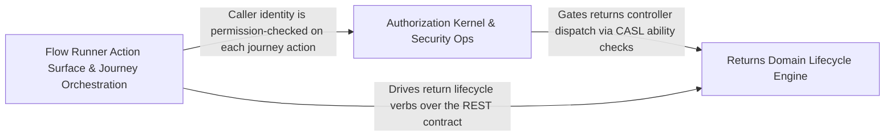

---
tags:
  - 2brain
  - 2brain/arch
  - project/boilerplate-node-backend
type: architecture
component: Flow_Runner_Actions_Seeded_Data_Consumers_
---

## Details

The flow-runner action layer that exercises the seeded dataset end-to-end — the typed action surface (CartSummaryData, CheckoutData, FulfillmentData, PaymentData, Line) and the journey verbs (openPayment, holdOrder, deliverOrder, cancelOrder, cancelRemainder, hardDeleteProduct, readFulfillment, backdate, reencrypt, shop-history). These actions are the read side of the seeding subsystem: they address the pinned ids that the seeders wrote (e.g. SEED_USER_ID, SEED_ADMIN_ID, the seeded product ids) and drive the cart → checkout → payment → fulfilment → returns pipeline against the seeded rows. They also include the operational helpers (generate-role-matrix, reencrypt, backdate) that mutate the seeded state to reach specific journey preconditions.

### Returns Domain Lifecycle Engine
The full returns bounded-context: domain logic (quantity arithmetic, status projection, accounting), the conditional-write repository that makes every lifecycle transition exactly-once (claimStatus), per-order locking for concurrent decisions, and the service layer that composes those primitives into the four lifecycle verbs the flow runner drives — cancel-remainder, cancel-right, cancel, and close. This is the destination endpoint of the flow runner's cancelRemainder and requestReturn actions.

**Related Classes/Methods**:

- `src.modules.returns.repository.returnRepository.claimStatus`:93-97
- `src.modules.returns.domain.quantities.returnableLinesOf`:48-56
- `src.modules.returns.domain.status-projection.projectReturnStatus`:39-62
- `src.modules.returns.repository.returnRepository.lockOrder`:137-145

**Source Files:**

- `src/modules/orders/services/cancel.ts`
  - `src.modules.orders.services.cancel.attemptCancel` (L270-L306) - Class
  - `src.modules.orders.services.cancel.attemptCancel.then() callback` (L305-L305) - Function
  - `src.modules.orders.services.cancel.refusalOf` (L314-L327) - Class
  - `src.modules.orders.services.cancel.refusalOf.then() callback` (L318-L326) - Function
  - `src.modules.orders.services.cancel.withdrawWithin` (L425-L451) - Class
  - `src.modules.orders.services.cancel.withdrawWithin.then() callback` (L441-L450) - Function
  - `src.modules.orders.services.cancel.withdrawWithin.then() callback.settle` (L445-L448) - Method
  - `src.modules.orders.services.cancel.withdrawWithin.then() callback.settle.then() callback` (L448-L448) - Function
- `src/modules/returns/domain/accounting.ts`
  - `src.modules.returns.domain.accounting.accountsOf.accountedFor.settled.flatMap() callback` (L60-L60) - Function
- `src/modules/returns/domain/quantities.ts`
  - `src.modules.returns.domain.quantities.ProductQuantity` (L8-L11) - Interface
  - `src.modules.returns.domain.quantities.wireLines` (L24-L27) - Class
  - `src.modules.returns.domain.quantities.wireLines.lines.map() callback` (L27-L27) - Function
  - `src.modules.returns.domain.quantities.returnableLinesOf` (L48-L56) - Class
  - `src.modules.returns.domain.quantities.returnableLinesOf.items.filter() callback` (L55-L55) - Function
  - `src.modules.returns.domain.quantities.returnableLinesOf.map() callback` (L56-L56) - Function
  - `src.modules.returns.domain.quantities.checkRequestedLines.lines.filter() callback` (L95-L95) - Function
  - `src.modules.returns.domain.quantities.checkRequestedLines.lines.map() callback` (L109-L109) - Function
  - `src.modules.returns.domain.quantities.takesLastUnit` (L122-L131) - Class
  - `src.modules.returns.domain.quantities.takesLastUnit.every() callback` (L129-L129) - Function
- `src/modules/returns/domain/status-projection.ts`
  - `src.modules.returns.domain.status-projection.projectReturnStatus` (L39-L62) - Class
  - `src.modules.returns.domain.status-projection.projectReturnStatus.back` (L56-L56) - Class
  - `src.modules.returns.domain.status-projection.projectReturnStatus.back.holding.flatMap() callback` (L56-L56) - Function
- `src/modules/returns/repository.ts`
  - `src.modules.returns.repository.returnRepository` (L46-L207) - Class
  - `src.modules.returns.repository.returnRepository.claimStatus` (L93-L97) - Method
  - `src.modules.returns.repository.returnRepository.claimProof` (L109-L116) - Method
  - `src.modules.returns.repository.returnRepository.findByOrderId` (L123-L128) - Method
  - `src.modules.returns.repository.returnRepository.lockOrder` (L137-L145) - Method
  - `src.modules.returns.repository.returnRepository.lockOrder.then() callback` (L145-L145) - Function
  - `src.modules.returns.repository.returnRepository.findByOrderIds` (L178-L182) - Method
  - `src.modules.returns.repository.returnRepository.findByOrderIds.orderId.$in.orderIds.map() callback` (L180-L180) - Function
  - `src.modules.returns.repository.returnRepository.scrubFreeTextBefore` (L195-L206) - Method
  - `src.modules.returns.repository.returnRepository.scrubFreeTextBefore.then() callback` (L206-L206) - Function
- `src/modules/returns/services/cancel-remainder.ts`
  - `src.modules.returns.services.cancel-remainder.rowFor.lines.lines.map() callback` (L101-L110) - Function
  - `src.modules.returns.services.cancel-remainder.cancelUnderLock` (L130-L193) - Class
  - `src.modules.returns.services.cancel-remainder.cancelUnderLock.withTransaction() callback` (L138-L193) - Function
  - `src.modules.returns.services.cancel-remainder.cancelUnderLock.withTransaction() callback.canceled.lines.map() callback` (L158-L158) - Function
  - `src.modules.returns.services.cancel-remainder.refund` (L203-L208) - Class
  - `src.modules.returns.services.cancel-remainder.refund.then() callback` (L207-L207) - Function
  - `src.modules.returns.services.cancel-remainder.announceCanceled` (L218-L232) - Class
  - `src.modules.returns.services.cancel-remainder.announceCanceled.done.lines.map() callback` (L228-L228) - Function
  - `src.modules.returns.services.cancel-remainder.then() callback` (L229-L229) - Function
  - `src.modules.returns.services.cancel-remainder.announceCanceled.then() callback` (L231-L231) - Function
  - `src.modules.returns.services.cancel-remainder.createCancellation` (L292-L340) - Class
  - `src.modules.returns.services.cancel-remainder.createCancellation.then() callback` (L301-L339) - Function
  - `src.modules.returns.services.cancel-remainder.createCancellation.then() callback.then() callback` (L306-L338) - Function
  - `src.modules.returns.services.cancel-remainder.createCancellation.then() callback.then() callback.then() callback` (L327-L332) - Function
  - `src.modules.returns.services.cancel-remainder.createCancellation.then() callback.then() callback.catch() callback` (L334-L337) - Function
- `src/modules/returns/services/cancel-right.ts`
  - `src.modules.returns.services.cancel-right.cancelRefusalOf.excluded` (L57-L61) - Class
  - `src.modules.returns.services.cancel-right.cancelRefusalOf.excluded.order.items.filter() callback` (L59-L59) - Function
  - `src.modules.returns.services.cancel-right.cancelRefusalOf.excluded.map() callback` (L60-L60) - Function
- `src/modules/returns/services/cancel.ts`
  - `src.modules.returns.services.cancel.notCancelable` (L38-L49) - Class
  - `src.modules.returns.services.cancel.notCancelable.then() callback` (L39-L49) - Function
  - `src.modules.returns.services.cancel.cancelReturn` (L61-L113) - Class
  - `src.modules.returns.services.cancel.cancelReturn.withTransaction() callback` (L66-L99) - Function
  - `src.modules.returns.services.cancel.cancelReturn.withTransaction() callback.then() callback` (L85-L98) - Function
  - `src.modules.returns.services.cancel.cancelReturn.withTransaction() callback.then() callback.then() callback` (L97-L97) - Function
  - `src.modules.returns.services.cancel.cancelReturn.then() callback` (L100-L113) - Function
  - `src.modules.returns.services.cancel.cancelReturn.then() callback.then() callback` (L110-L111) - Function
- `src/modules/returns/services/close.ts`
  - `src.modules.returns.services.close.claimClosed` (L43-L78) - Class
  - `src.modules.returns.services.close.claimClosed.then() callback` (L56-L77) - Function
  - `src.modules.returns.services.close.claimClosed.then() callback.then() callback` (L76-L76) - Function
  - `src.modules.returns.services.close.closeReturn` (L93-L100) - Class
  - `src.modules.returns.services.close.closeReturn.announceInTransaction() callback` (L94-L94) - Function
  - `src.modules.returns.services.close.closeReturn.then() callback` (L95-L99) - Function
  - `src.modules.returns.services.close.closeReturn.then() callback.then() callback` (L98-L98) - Function
  - `src.modules.returns.services.close.notClosable` (L107-L117) - Class
  - `src.modules.returns.services.close.notClosable.then() callback` (L108-L116) - Function
  - `src.modules.returns.services.close.closeReturnByHand` (L130-L146) - Class
  - `src.modules.returns.services.close.closeReturnByHand.withTransaction() callback` (L135-L135) - Function
  - `src.modules.returns.services.close.closeReturnByHand.then() callback` (L135-L146) - Function
  - `src.modules.returns.services.close.closeReturnByHand.then() callback.then() callback` (L145-L145) - Function
- `src/modules/returns/services/create.ts`
  - `src.modules.returns.services.create.alreadyReturned` (L83-L88) - Class
  - `src.modules.returns.services.create.alreadyReturned.then() callback` (L86-L87) - Function
  - `src.modules.returns.services.create.alreadyReturned.then() callback.flatMap() callback` (L87-L87) - Function
  - `src.modules.returns.services.create.announceOpened` (L266-L274) - Class
  - `src.modules.returns.services.create.announceOpened.then() callback` (L273-L273) - Function
- `src/modules/returns/services/decide.ts`
  - `src.modules.returns.services.decide.notDecidable` (L39-L49) - Class
  - `src.modules.returns.services.decide.notDecidable.then() callback` (L40-L48) - Function
  - `src.modules.returns.services.decide.decide` (L59-L105) - Class
  - `src.modules.returns.services.decide.decide.withTransaction() callback` (L70-L101) - Function
  - `src.modules.returns.services.decide.decide.withTransaction() callback.then() callback` (L79-L100) - Function
  - `src.modules.returns.services.decide.withTransaction() callback.then() callback.then() callback` (L91-L97) - Function
  - `src.modules.returns.services.decide.decide.withTransaction() callback.then() callback.then() callback` (L99-L99) - Function
  - `src.modules.returns.services.decide.decide.then() callback` (L102-L103) - Function
  - `src.modules.returns.services.decide.settleDecision` (L116-L155) - Class
  - `src.modules.returns.services.decide.settleDecision.catch() callback` (L129-L137) - Function
  - `src.modules.returns.services.decide.settleDecision.then() callback` (L154-L154) - Function
- `src/modules/returns/services/notify.ts`
  - `src.modules.returns.services.notify.withReturn` (L27-L41) - Class
  - `src.modules.returns.services.notify.withReturn.then() callback` (L33-L33) - Function
  - `src.modules.returns.services.notify.withReturn.catch() callback` (L34-L41) - Function
  - `src.modules.returns.services.notify.sendNotice` (L49-L61) - Class
  - `src.modules.returns.services.notify.sendNotice.orderService.mailBuyerOfOrder() callback` (L54-L61) - Function
  - `src.modules.returns.services.notify.mailReturnRequested` (L70-L101) - Class
  - `src.modules.returns.services.notify.mailReturnRequested.withReturn() callback` (L73-L101) - Function
  - `src.modules.returns.services.notify.mailReturnDecided` (L121-L136) - Class
  - `src.modules.returns.services.notify.mailReturnDecided.withReturn() callback` (L125-L135) - Function
  - `src.modules.returns.services.notify.mailReturnClosed` (L154-L168) - Class
  - `src.modules.returns.services.notify.mailReturnClosed.withReturn() callback` (L160-L167) - Function
- `src/modules/returns/services/options.ts`
  - `src.modules.returns.services.options.OfferedReasons` (L78-L84) - Interface
  - `src.modules.returns.services.options.offeredReasons.exceptions.reasons.filter() callback` (L111-L111) - Function
  - `src.modules.returns.services.options.getReturnOptions.then() callback.then() callback.excluded` (L141-L145) - Class
  - `src.modules.returns.services.options.getReturnOptions.then() callback.then() callback.excluded.order.items.filter() callback` (L143-L143) - Function
  - `src.modules.returns.services.options.getReturnOptions.then() callback.then() callback.excluded.map() callback` (L144-L144) - Function
  - `src.modules.returns.services.options.getReturnOptions.then() callback.then() callback.excludedOffered` (L146-L146) - Class
  - `src.modules.returns.services.options.getReturnOptions.then() callback.then() callback.excludedOffered.reasons.some() callback` (L146-L146) - Function
  - `src.modules.returns.services.options.then() callback.then() callback.returnable` (L147-L149) - Class
  - `src.modules.returns.services.options.getReturnOptions.then() callback.then() callback.back` (L150-L152) - Class
  - `src.modules.returns.services.options.getReturnOptions.then() callback.then() callback.back.flatMap() callback` (L152-L152) - Function
  - `src.modules.returns.services.options.getReturnOptions.then() callback.then() callback.cancelable.remainders.map() callback` (L163-L174) - Function
- `src/modules/returns/services/personal-data.ts`
  - `src.modules.returns.services.personal-data.toExportReturn.lines.returned.lines.map() callback` (L29-L33) - Function
  - `src.modules.returns.services.personal-data.collectPersonalData` (L42-L46) - Class
  - `src.modules.returns.services.personal-data.then() callback` (L45-L45) - Function
  - `src.modules.returns.services.personal-data.collectPersonalData.then() callback` (L46-L46) - Function
  - `src.modules.returns.services.personal-data.collectPersonalData.then() callback.returns.map() callback` (L46-L46) - Function
- `src/modules/returns/services/projection.ts`
  - `src.modules.returns.services.projection.syncReturnStatus` (L20-L51) - Class
  - `src.modules.returns.services.projection.syncReturnStatus.then() callback` (L22-L43) - Function
  - `src.modules.returns.services.projection.syncReturnStatus.then() callback.canceled` (L27-L29) - Class
  - `src.modules.returns.services.projection.syncReturnStatus.then() callback.canceled.returns.filter() callback` (L28-L28) - Function
  - `src.modules.returns.services.projection.syncReturnStatus.then() callback.canceled.flatMap() callback` (L29-L29) - Function
  - `src.modules.returns.services.projection.syncReturnStatus.then() callback.status` (L30-L41) - Class
  - `src.modules.returns.services.projection.syncReturnStatus.then() callback.status.returns.map() callback` (L31-L36) - Function
  - `src.modules.returns.services.projection.syncReturnStatus.then() callback.then() callback` (L42-L42) - Function
  - `src.modules.returns.services.projection.syncReturnStatus.catch() callback` (L44-L51) - Function
- `src/modules/returns/services/proof.ts`
  - `src.modules.returns.services.proof.lostRace` (L62-L65) - Class
  - `src.modules.returns.services.proof.lostRace.then() callback` (L65-L65) - Function
  - `src.modules.returns.services.proof.stampProof` (L94-L151) - Class
  - `src.modules.returns.services.proof.stampProof.withTransaction() callback` (L100-L151) - Function
  - `src.modules.returns.services.proof.recordProofOfSending` (L162-L209) - Class
  - `src.modules.returns.services.proof.recordProofOfSending.then() callback` (L167-L209) - Function
  - `src.modules.returns.services.proof.recordProofOfSending.then() callback.then() callback` (L180-L208) - Function
  - `src.modules.returns.services.proof.recordProofOfSending.then() callback.then() callback.then() callback` (L183-L207) - Function
  - `src.modules.returns.services.proof.recordProofOfSending.then() callback.then() callback.then() callback.then() callback` (L206-L206) - Function
- `src/modules/returns/services/receive.ts`
  - `src.modules.returns.services.receive.ReceiveReturnInput` (L69-L79) - Interface
  - `src.modules.returns.services.receive.stampRestocked` (L119-L120) - Class
  - `src.modules.returns.services.receive.stampRestocked.restocked.map() callback` (L120-L120) - Function
  - `src.modules.returns.services.receive.restockedLines` (L128-L134) - Class
  - `src.modules.returns.services.receive.restockedLines.map() callback` (L133-L133) - Function
  - `src.modules.returns.services.receive.restockedLines.filter() callback` (L134-L134) - Function
  - `src.modules.returns.services.receive.claimAndRestock` (L221-L336) - Class
  - `src.modules.returns.services.receive.announceInTransaction() callback` (L230-L323) - Function
  - `src.modules.returns.services.receive.claimAndRestock.announceInTransaction() callback` (L325-L335) - Function
  - `src.modules.returns.services.receive.refundAndClose` (L348-L362) - Class
  - `src.modules.returns.services.receive.refundAndClose.finish` (L353-L354) - Class
  - `src.modules.returns.services.receive.refundAndClose.finish.then() callback` (L354-L354) - Function
  - `src.modules.returns.services.receive.refundAndClose.then() callback` (L361-L361) - Function
  - `src.modules.returns.services.receive.closeAfterProofRefund` (L373-L392) - Class
  - `src.modules.returns.services.receive.closeAfterProofRefund.then() callback` (L379-L391) - Function
  - `src.modules.returns.services.receive.closeAfterProofRefund.then() callback.then() callback` (L386-L390) - Function
  - `src.modules.returns.services.receive.closeAfterProofRefund.then() callback.then() callback.then() callback` (L390-L390) - Function
  - `src.modules.returns.services.receive.receiveFor` (L404-L514) - Class
  - `src.modules.returns.services.receive.receiveFor.catch() callback` (L459-L462) - Function
  - `src.modules.returns.services.receive.receiveFor.then() callback` (L463-L512) - Function
  - `src.modules.returns.services.receive.receiveFor.then() callback.map() callback` (L487-L487) - Function
  - `src.modules.returns.services.receive.receiveFor.then() callback.then() callback` (L511-L511) - Function
  - `src.modules.returns.services.receive.receiveReturn` (L524-L538) - Class
  - `src.modules.returns.services.receive.receiveReturn.then() callback` (L529-L538) - Function
  - `src.modules.returns.services.receive.receiveReturn.then() callback.then() callback` (L533-L537) - Function
- `src/modules/returns/services/withdraw.ts`
  - `src.modules.returns.services.withdraw.cancelAndRecord` (L100-L123) - Class
  - `src.modules.returns.services.withdraw.cancelAndRecord.withTransaction() callback` (L106-L123) - Function
  - `src.modules.returns.services.withdraw.withdrawEligibleGroups.excluded` (L145-L149) - Class
  - `src.modules.returns.services.withdraw.withdrawEligibleGroups.excluded.order.items.filter() callback` (L147-L147) - Function
  - `src.modules.returns.services.withdraw.withdrawEligibleGroups.excluded.map() callback` (L148-L148) - Function
  - `src.modules.returns.services.withdraw.withdrawBeforeDispatch.bespokeAndStarted` (L220-L221) - Class
  - `src.modules.returns.services.withdraw.withdrawBeforeDispatch.bespokeAndStarted.order.items.some() callback` (L221-L221) - Function

### Authorization Kernel & Security Ops
The kernel-level permission model (rules → sets → roles) read from shared YAML artefacts, the CASL ability engine that evaluates holds/holdsSet per request, and the two operational scripts that maintain the seeded dataset's security and documentation invariants: reencrypt (re-encrypts every stored secret onto the newest key ring after a rotation) and generate-role-matrix (renders the effective permission table per role into the docs). The flow runner's actions are gated by this kernel.

**Related Classes/Methods**:

- `src.kernel.permissions.PERMISSION_RULES`:289-294
- `src.kernel.ability.holds`:164-177
- `scripts.ops.reencrypt.runAll`:44-51
- `scripts.docs.generate-role-matrix.effectiveTable`:148-159

**Source Files:**

- `scripts/contracts/permission-security.ts`
  - `scripts.contracts.permission-security.sendsEnrollment` (L72-L106) - Class
  - `scripts.contracts.permission-security.sendsEnrollment.PRESET_ROLES.some() callback` (L77-L104) - Function
  - `scripts.contracts.permission-security.sendsEnrollment.PRESET_ROLES.some() callback.some() callback` (L78-L104) - Function
- `scripts/docs/generate-role-matrix.ts`
  - `scripts.docs.generate-role-matrix.cell` (L122-L145) - Class
  - `scripts.docs.generate-role-matrix.cell.map() callback` (L139-L143) - Function
  - `scripts.docs.generate-role-matrix.effectiveTable` (L148-L159) - Class
  - `scripts.docs.generate-role-matrix.effectiveTable.personas.map() callback` (L152-L158) - Function
  - `scripts.docs.generate-role-matrix.effectiveTable.personas.map() callback.modules.map() callback` (L156-L156) - Function
  - `scripts.docs.generate-role-matrix.moduleBody` (L233-L261) - Class
  - `scripts.docs.generate-role-matrix.moduleBody.callers` (L234-L234) - Class
  - `scripts.docs.generate-role-matrix.moduleBody.callers.personas.map() callback` (L234-L234) - Function
  - `scripts.docs.generate-role-matrix.moduleBody.rows.PERMISSION_RULES.filter() callback` (L235-L235) - Function
  - `scripts.docs.generate-role-matrix.moduleBody.rows` (L235-L249) - Class
  - `scripts.docs.generate-role-matrix.moduleBody.rows.map() callback` (L236-L248) - Function
  - `scripts.docs.generate-role-matrix.moduleBody.rows.map() callback.callers.map() callback` (L246-L246) - Function
  - `scripts.docs.generate-role-matrix.moduleBody.personas.map() callback` (L252-L252) - Function
  - `scripts.docs.generate-role-matrix.pages` (L264-L271) - Class
  - `scripts.docs.generate-role-matrix.pages.map() callback` (L266-L270) - Function
- `scripts/ops/reencrypt.ts`
  - `scripts.ops.reencrypt.runAll` (L44-L51) - Class
  - `scripts.ops.reencrypt.runAll.then() callback` (L50-L50) - Function
  - `scripts.ops.reencrypt.main` (L54-L59) - Class
  - `scripts.ops.reencrypt.main.then() callback` (L57-L59) - Function
- `src/infrastructure/http/errors.ts`
  - `src.infrastructure.http.errors.ConflictError` (L40-L42) - Class
  - `src.infrastructure.http.errors.databaseErrorInterpreter` (L69-L114) - Function
- `src/infrastructure/persistence/money-field.ts`
  - `src.infrastructure.persistence.money-field.moneyPathsOf` (L179-L187) - Class
  - `src.infrastructure.persistence.money-field.moneyPathsOf.schema.eachPath() callback` (L181-L185) - Function
- `src/infrastructure/security/reencrypt.ts`
  - `src.infrastructure.security.reencrypt.EncryptedField` (L31-L40) - Interface
  - `src.infrastructure.security.reencrypt.ReencryptReport` (L46-L51) - Interface
  - `src.infrastructure.security.reencrypt.ReencryptJob` (L54-L65) - Interface
- `src/kernel/ability.ts`
  - `src.kernel.ability.holds` (L164-L177) - Class
  - `src.kernel.ability.holds.some() callback` (L176-L176) - Function
  - `src.kernel.ability.holdsSet` (L186-L197) - Class
  - `src.kernel.ability.heldRules` (L203-L204) - Class
  - `src.kernel.ability.heldRules.map() callback` (L204-L204) - Function
- `src/kernel/access/query.ts`
  - `src.kernel.access.query.coerce` (L62-L69) - Class
  - `src.kernel.access.query.coerce.userId` (L68-L68) - Method
  - `src.kernel.access.query.toStorage` (L77-L102) - Class
  - `src.kernel.access.query.toStorage.query.map() callback` (L79-L79) - Function
- `src/kernel/middlewares/authorizations.ts`
  - `src.kernel.middlewares.authorizations.requirePermission` (L567-L700) - Class
  - `src.kernel.middlewares.authorizations.requirePermission.requirePermissionGuard` (L588-L694) - Function
  - `src.kernel.middlewares.authorizations.cookieGuard` (L767-L810) - Class
  - `src.kernel.middlewares.authorizations.cookieGuard.cookieSessionGuard` (L777-L807) - Function
  - `src.kernel.middlewares.authorizations.cookieGuard.cookieSessionGuard.then() callback` (L790-L803) - Function
  - `src.kernel.middlewares.authorizations.cookieGuard.cookieSessionGuard.catch() callback` (L804-L806) - Function
  - `src.kernel.middlewares.authorizations.requirePermissionViaCookie` (L827-L836) - Class
  - `src.kernel.middlewares.authorizations.requirePermissionViaCookie.cookieGuard('requirePermissionViaCookieGuard') callback` (L833-L834) - Function
  - `src.kernel.middlewares.authorizations.stillHoldsRuleViaCookie` (L871-L879) - Class
  - `src.kernel.middlewares.authorizations.stillHoldsRuleViaCookie.then() callback` (L878-L878) - Function
  - `src.kernel.middlewares.authorizations.stillHoldsRuleViaCookie.catch() callback` (L879-L879) - Function
  - `src.kernel.middlewares.authorizations.FreshAuthOptions` (L895-L903) - Interface
  - `src.kernel.middlewares.authorizations.requireFreshAuth` (L920-L966) - Class
  - `src.kernel.middlewares.authorizations.requireFreshAuth.<function>` (L922-L966) - Function
  - `src.kernel.middlewares.authorizations.requireFreshAuthWhen` (L985-L1001) - Class
  - `src.kernel.middlewares.authorizations.requireFreshAuthWhen.<function>` (L991-L1001) - Function
- `src/kernel/permissions.ts`
  - `src.kernel.permissions.PermissionSet` (L152-L158) - Interface
  - `src.kernel.permissions.PresetRole` (L170-L184) - Interface
  - `src.kernel.permissions.AudienceRole` (L208-L214) - Interface
  - `src.kernel.permissions.PERMISSION_RULES` (L289-L294) - Class
  - `src.kernel.permissions.PERMISSION_RULES.keysDocument.rules.map() callback` (L289-L294) - Function
  - `src.kernel.permissions.callerInScope` (L600-L613) - Function
  - `src.kernel.permissions.scopeOfSubject` (L640-L641) - Class
  - `src.kernel.permissions.scopeOfSubject.PERMISSION_RULES.find() callback` (L641-L641) - Function
  - `src.kernel.permissions.holdsEveryDeclaredRule` (L671-L680) - Class
  - `src.kernel.permissions.holdsEveryDeclaredRule.declared.every() callback` (L679-L679) - Function
- `src/modules/access/repository.ts`
  - `src.modules.access.repository.tenantRepository` (L15-L36) - Class
  - `src.modules.access.repository.tenantRepository.upsertBySlug` (L20-L35) - Method
  - `src.modules.access.repository.membershipRepository` (L39-L108) - Class
  - `src.modules.access.repository.membershipRepository.findByUserId` (L41-L42) - Method
  - `src.modules.access.repository.membershipRepository.findOne` (L45-L50) - Method
  - `src.modules.access.repository.membershipRepository.upsertRole` (L57-L72) - Method
  - `src.modules.access.repository.membershipRepository.deleteById` (L79-L83) - Method
  - `src.modules.access.repository.membershipRepository.deleteByUserId` (L90-L92) - Method
  - `src.modules.access.repository.membershipRepository.findByUserIds` (L95-L100) - Method
  - `src.modules.access.repository.membershipRepository.findUserIdsByRoles` (L103-L107) - Method
- `src/modules/access/services/grants.ts`
  - `src.modules.access.services.grants.AccessInvariantError` (L30-L36) - Class
  - `src.modules.access.services.grants.AccessInvariantError.constructor` (L32-L35) - Constructor
- `src/modules/access/services/memberships.ts`
  - `src.modules.access.services.memberships.assignRole` (L60-L95) - Class
  - `src.modules.access.services.memberships.assignRole.attempt` (L69-L73) - Class
  - `src.modules.access.services.memberships.attempt.then() callback` (L70-L70) - Function
  - `src.modules.access.services.memberships.assignRole.attempt.then() callback` (L82-L93) - Function
  - `src.modules.access.services.memberships.revokeRole` (L112-L159) - Class
  - `src.modules.access.services.memberships.revokeRole.attempt` (L124-L136) - Class
  - `src.modules.access.services.memberships.revokeRole.attempt.then() callback.then() callback` (L135-L135) - Function
  - `src.modules.access.services.memberships.revokeRole.attempt.then() callback` (L146-L157) - Function
  - `src.modules.access.services.memberships.eraseMemberships` (L172-L173) - Class
  - `src.modules.access.services.memberships.eraseMemberships.then() callback` (L173-L173) - Function
  - `src.modules.access.services.memberships.rolesOf` (L184-L193) - Class
  - `src.modules.access.services.memberships.rolesOf.then() callback` (L188-L193) - Function
  - `src.modules.access.services.memberships.rolesOf.then() callback.tenant.memberships.find() callback` (L190-L190) - Function
  - `src.modules.access.services.memberships.rolesOf.then() callback.platform.memberships.find() callback` (L192-L192) - Function
  - `src.modules.access.services.memberships.rolesOfMany` (L201-L213) - Class
  - `src.modules.access.services.memberships.rolesOfMany.then() callback` (L211-L212) - Function
  - `src.modules.access.services.memberships.rolesOfMany.then() callback.memberships.map() callback` (L212-L212) - Function
  - `src.modules.access.services.memberships.membersHolding.roles` (L250-L255) - Class
  - `src.modules.access.services.memberships.membersHolding.roles.PRESET_ROLES.filter() callback` (L251-L254) - Function
  - `src.modules.access.services.memberships.membersHolding.roles.PRESET_ROLES.filter() callback.role.sets.some() callback` (L254-L254) - Function
  - `src.modules.access.services.memberships.membersHolding.roles.map() callback` (L255-L255) - Function
- `src/modules/access/services/protection.ts`
  - `src.modules.access.services.protection.holdsStaffRole` (L35-L36) - Class
  - `src.modules.access.services.protection.holdsStaffRole.then() callback` (L36-L36) - Function
  - `src.modules.access.services.protection.staffHoldersAmong` (L45-L49) - Class
  - `src.modules.access.services.protection.staffHoldersAmong.then() callback` (L49-L49) - Function
  - `src.modules.access.services.protection.canChangeAccount` (L71-L80) - Class
  - `src.modules.access.services.protection.canChangeAccount.then() callback` (L77-L78) - Function
  - `src.modules.access.services.protection.roleProtectedRefusal` (L102-L116) - Class
  - `src.modules.access.services.protection.roleProtectedRefusal.then() callback` (L106-L116) - Function
- `src/modules/api-keys/services/api-keys.ts`
  - `src.modules.api-keys.services.api-keys.findOwnApiKeys` (L131-L143) - Class
  - `src.modules.api-keys.services.api-keys.findOwnApiKeys.readAll() callback` (L134-L141) - Function
  - `src.modules.api-keys.services.api-keys.findOwnApiKeys.readAll() callback.then() callback` (L141-L141) - Function
  - `src.modules.api-keys.services.api-keys.findOwnApiKeys.then() callback` (L143-L143) - Function
  - `src.modules.api-keys.services.api-keys.findOwnApiKeys.then() callback.rows.map() callback` (L143-L143) - Function
  - `src.modules.api-keys.services.api-keys.mint.invalid` (L230-L230) - Class
  - `src.modules.api-keys.services.api-keys.mint.invalid.body.permissions.filter() callback` (L230-L230) - Function
  - `src.modules.api-keys.services.api-keys.revoke` (L284-L304) - Class
  - `src.modules.api-keys.services.api-keys.revoke.then() callback` (L288-L304) - Function
  - `src.modules.api-keys.services.api-keys.revoke.then() callback.then() callback` (L294-L303) - Function
- `src/modules/api-keys/services/resolver.ts`
  - `src.modules.api-keys.services.resolver.currentCallerOf` (L37-L51) - Class
  - `src.modules.api-keys.services.resolver.currentCallerOf.then() callback` (L38-L51) - Function
  - `src.modules.api-keys.services.resolver.currentCallerOf.then() callback.then() callback` (L41-L50) - Function
  - `src.modules.api-keys.services.resolver.missFor` (L58-L62) - Class
  - `src.modules.api-keys.services.resolver.missFor.then() callback` (L59-L62) - Function
  - `src.modules.api-keys.services.resolver.fromBearerToken` (L70-L129) - Class
  - `src.modules.api-keys.services.resolver.fromBearerToken.then() callback` (L74-L128) - Function
  - `src.modules.api-keys.services.resolver.fromBearerToken.then() callback.then() callback` (L78-L127) - Function
  - `src.modules.api-keys.services.resolver.then() callback.then() callback.catch() callback` (L87-L93) - Function
  - `src.modules.api-keys.services.resolver.fromBearerToken.then() callback.then() callback.catch() callback` (L97-L103) - Function
- `src/modules/invoicing/services/reencrypt.ts`
  - `src.modules.invoicing.services.reencrypt.partyFields` (L15-L31) - Class
  - `src.modules.invoicing.services.reencrypt.partyFields.PARTY_FIELDS.flatMap() callback` (L19-L31) - Function
  - `src.modules.invoicing.services.reencrypt.reencryptInvoices` (L39-L60) - Class
  - `src.modules.invoicing.services.reencrypt.fieldsOf` (L47-L47) - Method
  - `src.modules.invoicing.services.reencrypt.reencryptInvoices.fieldsOf` (L55-L55) - Method
  - `src.modules.invoicing.services.reencrypt.reencryptInvoices.then() callback` (L59-L59) - Function
- `src/modules/notifications/controllers/get-notifications-stream.ts`
  - `src.modules.notifications.controllers.get-notifications-stream.getNotificationsStream` (L21-L35) - Class
  - `src.modules.notifications.controllers.get-notifications-stream.getNotificationsStream.notificationsService.stream() callback` (L34-L34) - Function
- `src/modules/notifications/staff-routing.ts`
  - `src.modules.notifications.staff-routing.StaffRoute` (L22-L35) - Interface
  - `src.modules.notifications.staff-routing.StaffLink` (L38-L41) - Interface
  - `src.modules.notifications.staff-routing.callerHoldsAnySet` (L160-L161) - Class
  - `src.modules.notifications.staff-routing.callerHoldsAnySet.sets.some() callback` (L161-L161) - Function
- `src/modules/observability/controllers/get-observability-events.ts`
  - `src.modules.observability.controllers.get-observability-events.getObservabilityEvents` (L23-L38) - Class
  - `src.modules.observability.controllers.get-observability-events.getObservabilityEvents.observabilityService.streamObservabilityMetrics() callback` (L35-L36) - Function
- `src/modules/orders/domain/lifecycle.ts`
  - `src.modules.orders.domain.lifecycle.overridableTargetsFrom` (L248-L252) - Class
  - `src.modules.orders.domain.lifecycle.overridableTargetsFrom.OVERRIDABLE_SEQUENCE.filter() callback` (L252-L252) - Function
- `src/modules/orders/domain/tax.ts`
  - `src.modules.orders.domain.tax.orderTaxBreakdown.shippingWeights.items.map() callback` (L239-L240) - Function
  - `src.modules.orders.domain.tax.orderTaxBreakdown.shippingWeights` (L239-L241) - Class
- `src/modules/orders/domain/timeline.ts`
  - `src.modules.orders.domain.timeline.BUYER_VISIBLE_TYPES` (L88-L91) - Class
  - `src.modules.orders.domain.timeline.BUYER_VISIBLE_TYPES.filter() callback` (L90-L90) - Function
  - `src.modules.orders.domain.timeline.BUYER_VISIBLE_TYPES.map() callback` (L91-L91) - Function
- `src/modules/orders/domain/withdrawal.ts`
  - `src.modules.orders.domain.withdrawal.DispatchCandidate` (L18-L22) - Interface
  - `src.modules.orders.domain.withdrawal.AddressCandidate` (L35-L41) - Interface
  - `src.modules.orders.domain.withdrawal.WithdrawalClockCandidate` (L174-L177) - Interface
  - `src.modules.orders.domain.withdrawal.DeliveryClock` (L192-L197) - Interface
  - `src.modules.orders.domain.withdrawal.WithdrawableLine` (L216-L218) - Interface
  - `src.modules.orders.domain.withdrawal.WithdrawalCandidate` (L230-L238) - Interface
  - `src.modules.orders.domain.withdrawal.withdrawalRefusalOf` (L255-L268) - Class
  - `src.modules.orders.domain.withdrawal.withdrawalRefusalOf.order.items.every() callback` (L260-L260) - Function
- `src/modules/orders/model.ts`
  - `src.modules.orders.model.applyOrderLineProductTransform` (L309-L316) - Class
  - `src.modules.orders.model.applyOrderLineProductTransform.after` (L310-L315) - Method
- `src/modules/orders/repository.ts`
  - `src.modules.orders.repository.findByIdScoped` (L239-L246) - Class
  - `src.modules.orders.repository.findByIdScoped.then() callback` (L246-L246) - Function
  - `src.modules.orders.repository.setProjection` (L429-L454) - Class
  - `src.modules.orders.repository.setProjection.then() callback` (L452-L452) - Function
  - `src.modules.orders.repository.findManyReferences` (L532-L543) - Class
  - `src.modules.orders.repository.findManyReferences._id.$in.ids.map() callback` (L534-L534) - Function
  - `src.modules.orders.repository.findManyReferences.then() callback` (L537-L542) - Function
  - `src.modules.orders.repository.findManyReferences.then() callback.rows.map() callback` (L538-L542) - Function
  - `src.modules.orders.repository.detachUserId` (L661-L670) - Class
  - `src.modules.orders.repository.detachUserId.then() callback` (L670-L670) - Function
- `src/modules/orders/services/actions.ts`
  - `src.modules.orders.services.actions.withListActions.page.items.map() callback` (L239-L239) - Function
- `src/modules/orders/services/remove.ts`
  - `src.modules.orders.services.remove.hardDeleteCanceled` (L61-L71) - Class
  - `src.modules.orders.services.remove.hardDeleteCanceled.then() callback` (L62-L71) - Function
  - `src.modules.orders.services.remove.hardDeleteCanceled.then() callback.then() callback` (L68-L69) - Function
- `src/modules/returns/services/cancel-right.ts`
  - `src.modules.returns.services.cancel-right.cancelRefusalOf` (L40-L63) - Class
  - `src.modules.returns.services.cancel-right.cancelRefusalOf.remainder.some() callback` (L62-L62) - Function
- `src/modules/returns/services/create.ts`
  - `src.modules.returns.services.create.writeReturn` (L134-L186) - Class
  - `src.modules.returns.services.create.writeReturn.lines.lines.map() callback` (L155-L164) - Function
  - `src.modules.returns.services.create.writeReturn.then() callback.then() callback` (L185-L185) - Function
  - `src.modules.returns.services.create.excludedProductIds` (L192-L197) - Class
  - `src.modules.returns.services.create.excludedProductIds.order.items.filter() callback` (L195-L195) - Function
  - `src.modules.returns.services.create.excludedProductIds.map() callback` (L196-L196) - Function
  - `src.modules.returns.services.create.openUnderLock` (L221-L257) - Class
  - `src.modules.returns.services.create.openUnderLock.withTransaction() callback` (L227-L256) - Function
  - `src.modules.returns.services.create.withTransaction() callback.then() callback` (L230-L230) - Function
  - `src.modules.returns.services.create.openUnderLock.withTransaction() callback.then() callback` (L231-L256) - Function
  - `src.modules.returns.services.create.withTransaction() callback.then() callback.policyExceptions` (L240-L247) - Class
  - `src.modules.returns.services.create.openUnderLock.withTransaction() callback.then() callback.policyExceptions.verdict.lines.some() callback` (L245-L245) - Function
  - `src.modules.returns.services.create.openUnderLock.withTransaction() callback.then() callback.then() callback` (L255-L255) - Function
  - `src.modules.returns.services.create.openFor` (L286-L333) - Class
  - `src.modules.returns.services.create.openFor.withdrawBeforeDispatch() callback` (L311-L312) - Function
  - `src.modules.returns.services.create.openFor.then() callback` (L317-L332) - Function
  - `src.modules.returns.services.create.openFor.then() callback.input.lines.some() callback` (L320-L320) - Function
  - `src.modules.returns.services.create.openFor.then() callback.then() callback` (L327-L331) - Function
  - `src.modules.returns.services.create.openReturn` (L342-L370) - Class
  - `src.modules.returns.services.create.openReturn.then() callback` (L347-L370) - Function
- `src/modules/returns/services/options.ts`
  - `src.modules.returns.services.options.optionLines` (L59-L75) - Class
  - `src.modules.returns.services.options.optionLines.filter() callback` (L68-L68) - Function
  - `src.modules.returns.services.options.optionLines.map() callback` (L69-L74) - Function
  - `src.modules.returns.services.options.getReturnOptions` (L124-L177) - Class
  - `src.modules.returns.services.options.getReturnOptions.then() callback` (L128-L177) - Function
  - `src.modules.returns.services.options.getReturnOptions.then() callback.then() callback` (L135-L176) - Function
  - `src.modules.returns.services.options.getReturnOptions.then() callback.then() callback.returnable.shipped.filter() callback` (L148-L148) - Function
- `src/modules/returns/services/ownership.ts`
  - `src.modules.returns.services.ownership.OpenableOrder` (L14-L18) - Interface
  - `src.modules.returns.services.ownership.ownOrder` (L26-L32) - Class
  - `src.modules.returns.services.ownership.ownOrder.then() callback` (L32-L32) - Function
  - `src.modules.returns.services.ownership.openableOrder` (L41-L52) - Class
  - `src.modules.returns.services.ownership.openableOrder.then() callback` (L45-L52) - Function
  - `src.modules.returns.services.ownership.openableOrder.then() callback.then() callback` (L51-L51) - Function
- `src/modules/returns/services/read.ts`
  - `src.modules.returns.services.read.ReturnFilters` (L32-L39) - Interface
  - `src.modules.returns.services.read.StatusOnly` (L42-L46) - Interface
  - `src.modules.returns.services.read.actionsForCaller` (L60-L85) - Class
  - `src.modules.returns.services.read.actionsForCaller.<function>` (L65-L84) - Function
  - `src.modules.returns.services.read.listReturns` (L104-L127) - Class
  - `src.modules.returns.services.read.listReturns.withCallerActions.items.items.map() callback` (L116-L116) - Function
  - `src.modules.returns.services.read.listReturns.then() callback` (L125-L125) - Function
  - `src.modules.returns.services.read.getReturn` (L136-L152) - Class
  - `src.modules.returns.services.read.getReturn.then() callback` (L140-L152) - Function
  - `src.modules.returns.services.read.getReturn.then() callback.visible.then() callback` (L147-L150) - Function
- `src/modules/returns/services/withdraw.ts`
  - `src.modules.returns.services.withdraw.withdrawBeforeDispatch` (L212-L240) - Class
  - `src.modules.returns.services.withdraw.withdrawBeforeDispatch.then() callback` (L228-L239) - Function
  - `src.modules.returns.services.withdraw.withdrawBeforeDispatch.then() callback.then() callback` (L238-L238) - Function
- `src/modules/shop-tasks/domain/openings.ts`
  - `src.modules.shop-tasks.domain.openings.ShopOpening` (L21-L36) - Interface
  - `src.modules.shop-tasks.domain.openings.DelayFacts` (L225-L238) - Interface
  - `src.modules.shop-tasks.domain.openings.bindsThisShipment` (L247-L248) - Class
  - `src.modules.shop-tasks.domain.openings.bindsThisShipment.FTC_JURISDICTIONS.some() callback` (L248-L248) - Function
- `src/modules/shop-tasks/module.ts`
  - `src.modules.shop-tasks.module.default` (L60-L100) - Class
  - `src.modules.shop-tasks.module.default.subscribe` (L68-L97) - Method
- `src/modules/shop-tasks/services/delayed.ts`
  - `src.modules.shop-tasks.services.delayed.onFulfillmentOrderDelayed` (L19-L25) - Class
  - `src.modules.shop-tasks.services.delayed.onFulfillmentOrderDelayed.then() callback` (L25-L25) - Function
- `src/modules/shop-tasks/services/digest.ts`
  - `src.modules.shop-tasks.services.digest.readFigures` (L87-L121) - Class
  - `src.modules.shop-tasks.services.digest.readFigures.then() callback.items.filter() callback` (L108-L108) - Function
  - `src.modules.shop-tasks.services.digest.readFigures.then() callback` (L114-L120) - Function
- `src/modules/shop-tasks/services/notices.ts`
  - `src.modules.shop-tasks.services.notices.removedFor` (L24-L33) - Class
  - `src.modules.shop-tasks.services.notices.removedFor.userIds.map() callback` (L28-L33) - Function
  - `src.modules.shop-tasks.services.notices.shopNotices` (L36-L197) - Class
  - `src.modules.shop-tasks.services.notices.shopNotices.onCartLinesRemoved` (L38-L39) - Method
  - `src.modules.shop-tasks.services.notices.shopNotices.onWishlistItemsRemoved` (L42-L43) - Method
  - `src.modules.shop-tasks.services.notices.shopNotices.onStockAlertSent` (L46-L58) - Method
  - `src.modules.shop-tasks.services.notices.shopNotices.onCartMergeRefused` (L61-L69) - Method
  - `src.modules.shop-tasks.services.notices.shopNotices.onFulfillmentOrderHoldNoticed` (L76-L94) - Method
  - `src.modules.shop-tasks.services.notices.shopNotices.onShipmentLost` (L101-L124) - Method
  - `src.modules.shop-tasks.services.notices.shopNotices.onFulfillmentOrderDelayedNotice` (L131-L152) - Method
  - `src.modules.shop-tasks.services.notices.shopNotices.onPurchaseHoldPlaced` (L155-L171) - Method
  - `src.modules.shop-tasks.services.notices.shopNotices.onPurchaseHoldPlaced.then() callback` (L171-L171) - Function
  - `src.modules.shop-tasks.services.notices.shopNotices.onReturnRequested` (L178-L196) - Method
  - `src.modules.shop-tasks.services.notices.shopNotices.onReturnRequested.then() callback` (L196-L196) - Function
- `src/modules/shop-tasks/services/tasks.ts`
  - `src.modules.shop-tasks.services.tasks.guarded` (L68-L72) - Class
  - `src.modules.shop-tasks.services.tasks.guarded.catch() callback` (L69-L72) - Function
  - `src.modules.shop-tasks.services.tasks.shopTasks` (L82-L245) - Class
  - `src.modules.shop-tasks.services.tasks.shopTasks.onRefundOwedByHand` (L84-L94) - Method
  - `src.modules.shop-tasks.services.tasks.shopTasks.onRefundOwedByHand.guarded('payment.refund_owed_by_hand') callback` (L88-L93) - Function
  - `src.modules.shop-tasks.services.tasks.shopTasks.onRefundFailed` (L101-L118) - Method
  - `src.modules.shop-tasks.services.tasks.shopTasks.onRefundFailed.guarded('payment.refund_failed') callback` (L102-L117) - Function
  - `src.modules.shop-tasks.services.tasks.shopTasks.onRefundFailed.guarded('payment.refund_failed') callback.then() callback` (L106-L115) - Function
  - `src.modules.shop-tasks.services.tasks.shopTasks.onRefundReversed` (L126-L143) - Method
  - `src.modules.shop-tasks.services.tasks.shopTasks.onRefundReversed.guarded('payment.refund_reversed') callback` (L127-L142) - Function
  - `src.modules.shop-tasks.services.tasks.shopTasks.onRefundReversed.guarded('payment.refund_reversed') callback.then() callback` (L132-L141) - Function
  - `src.modules.shop-tasks.services.tasks.shopTasks.onRefundClosed` (L146-L152) - Method
  - `src.modules.shop-tasks.services.tasks.shopTasks.onRefundClosed.guarded('refund closed') callback` (L147-L151) - Function
  - `src.modules.shop-tasks.services.tasks.shopTasks.onAmountMismatch` (L155-L162) - Method
  - `src.modules.shop-tasks.services.tasks.shopTasks.onAmountMismatch.guarded('payment.amount_mismatch') callback` (L156-L161) - Function
  - `src.modules.shop-tasks.services.tasks.shopTasks.onDispute` (L169-L193) - Method
  - `src.modules.shop-tasks.services.tasks.shopTasks.onDispute.guarded('payment dispute') callback` (L170-L193) - Function
  - `src.modules.shop-tasks.services.tasks.shopTasks.onDispute.guarded('payment dispute') callback.then() callback` (L181-L186) - Function
  - `src.modules.shop-tasks.services.tasks.shopTasks.onHoldOrphaned` (L196-L203) - Method
  - `src.modules.shop-tasks.services.tasks.shopTasks.onHoldOrphaned.guarded('inventory.hold_orphaned') callback` (L197-L202) - Function
  - `src.modules.shop-tasks.services.tasks.shopTasks.onOrderCanceled` (L206-L212) - Method
  - `src.modules.shop-tasks.services.tasks.shopTasks.onOrderCanceled.guarded('order.canceled') callback` (L207-L211) - Function
  - `src.modules.shop-tasks.services.tasks.shopTasks.onShipped` (L215-L228) - Method
  - `src.modules.shop-tasks.services.tasks.shopTasks.onShipped.guarded('shipment.shipped') callback` (L216-L227) - Function
  - `src.modules.shop-tasks.services.tasks.shopTasks.onShipped.guarded('shipment.shipped') callback.then() callback` (L222-L226) - Function
  - `src.modules.shop-tasks.services.tasks.shopTasks.onFulfillmentOrderCanceled` (L231-L237) - Method
  - `src.modules.shop-tasks.services.tasks.shopTasks.onFulfillmentOrderCanceled.guarded('fulfillment_order.canceled') callback` (L232-L236) - Function
  - `src.modules.shop-tasks.services.tasks.shopTasks.onDelayed` (L240-L244) - Method
  - `src.modules.shop-tasks.services.tasks.shopTasks.onDelayed.guarded('fulfillment_order.delayed') callback` (L241-L244) - Function
- `src/modules/shop-tasks/services/work-summary.ts`
  - `src.modules.shop-tasks.services.work-summary.Badge` (L19-L23) - Interface
  - `src.modules.shop-tasks.services.work-summary.BADGES` (L41-L79) - Class
  - `src.modules.shop-tasks.services.work-summary.BADGES.count.then() callback` (L58-L58) - Function
  - `src.modules.shop-tasks.services.work-summary.BADGES.count` (L77-L77) - Method
- `src/modules/tasks/access.ts`
  - `src.modules.tasks.access.heldRouteSets` (L26-L27) - Class
  - `src.modules.tasks.access.heldRouteSets.PERMISSION_SETS.map() callback` (L27-L27) - Function
  - `src.modules.tasks.access.heldRouteSets.filter() callback` (L27-L27) - Function
  - `src.modules.tasks.access.roleMayWorkRouteSet` (L81-L88) - Class
- `src/modules/tasks/model.ts`
  - `src.modules.tasks.model.applyTaskTransform` (L298-L313) - Class
  - `src.modules.tasks.model.applyTaskTransform.after` (L300-L312) - Method
  - `src.modules.tasks.model.applyTaskTransform.after.serialized.notes.map() callback` (L307-L311) - Function
- `src/modules/tasks/services/personal-data.ts`
  - `src.modules.tasks.services.personal-data.findOwnTasks` (L47-L55) - Class
  - `src.modules.tasks.services.personal-data.findOwnTasks.readAll() callback` (L49-L53) - Function
  - `src.modules.tasks.services.personal-data.findOwnTasksForExport` (L91-L92) - Class
  - `src.modules.tasks.services.personal-data.findOwnTasksForExport.then() callback` (L92-L92) - Function
  - `src.modules.tasks.services.personal-data.findOwnTasksForExport.then() callback.tasks.map() callback` (L92-L92) - Function
- `src/modules/tasks/services/system.ts`
  - `src.modules.tasks.services.system.open.announceInTransaction() callback` (L47-L64) - Function
  - `src.modules.tasks.services.system.then() callback` (L102-L124) - Function
- `src/modules/tasks/services/workflow.ts`
  - `src.modules.tasks.services.workflow.present` (L107-L110) - Class
  - `src.modules.tasks.services.workflow.present.then() callback` (L108-L109) - Function
  - `src.modules.tasks.services.workflow.loadWorkable` (L119-L128) - Class
  - `src.modules.tasks.services.workflow.loadWorkable.then() callback` (L123-L128) - Function
  - `src.modules.tasks.services.workflow.move.then() callback.then() callback` (L176-L195) - Function
  - `src.modules.tasks.services.workflow.mayBeAssigned` (L209-L215) - Class
  - `src.modules.tasks.services.workflow.mayBeAssigned.then() callback` (L210-L215) - Function
  - `src.modules.tasks.services.workflow.mayBeAssigned.then() callback.then() callback` (L214-L214) - Function
  - `src.modules.tasks.services.workflow.announceInTransaction() callback` (L237-L237) - Function
  - `src.modules.tasks.services.workflow.assign` (L263-L298) - Class
  - `src.modules.tasks.services.workflow.assign.then() callback` (L268-L298) - Function
  - `src.modules.tasks.services.workflow.assign.then() callback.then() callback` (L277-L297) - Function
  - `src.modules.tasks.services.workflow.assign.then() callback.then() callback.then() callback` (L286-L296) - Function
  - `src.modules.tasks.services.workflow.assign.then() callback.then() callback.then() callback.then() callback` (L295-L295) - Function
  - `src.modules.tasks.services.workflow.unassign` (L307-L326) - Class
  - `src.modules.tasks.services.workflow.unassign.then() callback` (L311-L326) - Function
  - `src.modules.tasks.services.workflow.unassign.then() callback.then() callback` (L315-L325) - Function
  - `src.modules.tasks.services.workflow.unassign.then() callback.then() callback.then() callback` (L324-L324) - Function
  - `src.modules.tasks.services.workflow.addNote` (L336-L363) - Class
  - `src.modules.tasks.services.workflow.addNote.then() callback` (L341-L363) - Function
  - `src.modules.tasks.services.workflow.addNote.then() callback.then() callback` (L353-L362) - Function
  - `src.modules.tasks.services.workflow.addNote.then() callback.then() callback.then() callback` (L361-L361) - Function
  - `src.modules.tasks.services.workflow.summary` (L371-L392) - Class
  - `src.modules.tasks.services.workflow.summary.then() callback` (L386-L391) - Function
- `src/modules/tasks/views.ts`
  - `src.modules.tasks.views.assigneeNamesOf` (L29-L43) - Class
  - `src.modules.tasks.views.assigneeNamesOf.toString` (L30-L30) - Method
  - `src.modules.tasks.views.assigneeNamesOf.then() callback` (L38-L41) - Function
  - `src.modules.tasks.views.assigneeNamesOf.then() callback.items.map() callback` (L40-L40) - Function
  - `src.modules.tasks.views.viewerOf` (L51-L69) - Class
  - `src.modules.tasks.views.viewerOf.of` (L55-L68) - Method
- `src/modules/users/routes.ts`
  - `src.modules.users.routes.changesPowers` (L44-L52) - Class
- `src/modules/users/services/own-account.ts`
  - `src.modules.users.services.own-account.scheduleOwnDeletion` (L105-L124) - Class
  - `src.modules.users.services.own-account.scheduleOwnDeletion.withTransaction() callback` (L115-L122) - Function
  - `src.modules.users.services.own-account.scheduleOwnDeletion.withTransaction() callback.then() callback` (L118-L121) - Function
  - `src.modules.users.services.own-account.scheduleOwnDeletion.withTransaction() callback.then() callback.then() callback` (L120-L120) - Function
  - `src.modules.users.services.own-account.eraseAgain` (L197-L206) - Class
  - `src.modules.users.services.own-account.eraseAgain.then() callback` (L205-L205) - Function
- `src/modules/users/services/read.ts`
  - `src.modules.users.services.read.toUserListItems` (L112-L135) - Class
  - `src.modules.users.services.read.toUserListItems.then() callback` (L121-L133) - Function
  - `src.modules.users.services.read.toUserListItems.then() callback.rows.map() callback` (L122-L132) - Function
- `src/modules/users/services/reaper.ts`
  - `src.modules.users.services.reaper.minimiseInactiveBefore` (L69-L84) - Class
  - `src.modules.users.services.reaper.minimiseInactiveBefore.then() callback` (L72-L84) - Function
  - `src.modules.users.services.reaper.minimiseInactiveBefore.then() callback.catch() callback` (L75-L82) - Function
- `src/modules/users/services/reencrypt.ts`
  - `src.modules.users.services.reencrypt.reencryptUserPhones` (L19-L37) - Class
  - `src.modules.users.services.reencrypt.reencryptUserPhones.fieldsOf` (L24-L34) - Method
  - `src.modules.users.services.reencrypt.TwoFactorSecretRing` (L46-L49) - Interface
  - `src.modules.users.services.reencrypt.reencryptTwoFactorSecrets` (L58-L80) - Class
  - `src.modules.users.services.reencrypt.reencryptTwoFactorSecrets.fieldsOf` (L65-L77) - Method
  - `src.modules.users.services.reencrypt.reencryptTwoFactorSecrets.fieldsOf.user.twoFactorMethods.flatMap() callback` (L66-L76) - Function
- `src/modules/users/services/role.ts`
  - `src.modules.users.services.role.heldRoleOf` (L37-L38) - Class
  - `src.modules.users.services.role.heldRoleOf.then() callback` (L38-L38) - Function
  - `src.modules.users.services.role.writeRole` (L60-L69) - Class
  - `src.modules.users.services.role.writeRole.withTransaction() callback` (L64-L69) - Function
  - `src.modules.users.services.role.writeRole.withTransaction() callback.then() callback.then() callback` (L68-L68) - Function
  - `src.modules.users.services.role.assignUserRole` (L82-L124) - Class
  - `src.modules.users.services.role.assignUserRole.then() callback` (L87-L124) - Function
  - `src.modules.users.services.role.assignUserRole.then() callback.then() callback` (L100-L123) - Function
  - `src.modules.users.services.role.assignUserRole.then() callback.then() callback.writeRole() callback` (L108-L117) - Function
  - `src.modules.users.services.role.assignUserRole.then() callback.then() callback.then() callback` (L118-L122) - Function
  - `src.modules.users.services.role.revokeUserRole` (L134-L157) - Class
  - `src.modules.users.services.role.revokeUserRole.then() callback` (L138-L157) - Function
  - `src.modules.users.services.role.revokeUserRole.then() callback.then() callback` (L146-L156) - Function
  - `src.modules.users.services.role.revokeUserRole.then() callback.then() callback.writeRole() callback` (L150-L151) - Function
  - `src.modules.users.services.role.revokeUserRole.then() callback.then() callback.then() callback` (L152-L155) - Function
- `src/modules/webhooks/services/actions.ts`
  - `src.modules.webhooks.services.actions.standingOn` (L36-L40) - Class

### Flow Runner Action Surface & Journey Orchestration
The typed verb layer that the flow runner uses to drive the seeded dataset through its full lifecycle. Four files form a tight unit: client.ts provides the Caller interface; actions.ts defines the journey verbs and typed data shapes; backdate.ts rewrites the date columns of an order's entire trail into the past; and shop-history.ts is the orchestration script that composes all of the above into the final seeded order book. This is the read side of the seeding subsystem: it consumes the seeded rows and produces the application's own audit trail, domain events, and analytics events.

**Related Classes/Methods**:

- `scenarios.flows.actions.openPayment`:128-129
- `scenarios.flows.actions.deliverOrder`:308-314
- `scenarios.flows.backdate.backdateHistory`:161-166

**Source Files:**

- `scenarios/flows/actions.ts`
  - `scenarios.flows.actions.Line` (L15-L18) - Interface
  - `scenarios.flows.actions.CartSummaryData` (L21-L23) - Interface
  - `scenarios.flows.actions.CheckoutData` (L26-L28) - Interface
  - `scenarios.flows.actions.PaymentData` (L31-L34) - Interface
  - `scenarios.flows.actions.openPayment` (L128-L129) - Class
  - `scenarios.flows.actions.openPayment.then() callback` (L129-L129) - Function
  - `scenarios.flows.actions.submitCard` (L142-L159) - Class
  - `scenarios.flows.actions.submitCard.then() callback` (L149-L159) - Function
  - `scenarios.flows.actions.syncPayment` (L165-L168) - Class
  - `scenarios.flows.actions.syncPayment.then() callback` (L168-L168) - Function
  - `scenarios.flows.actions.recordOfflinePayment` (L191-L196) - Class
  - `scenarios.flows.actions.recordOfflinePayment.then() callback` (L196-L196) - Function
  - `scenarios.flows.actions.startProcessing` (L205-L206) - Class
  - `scenarios.flows.actions.startProcessing.then() callback` (L206-L206) - Function
  - `scenarios.flows.actions.FulfillmentData` (L209-L217) - Interface
  - `scenarios.flows.actions.readFulfillment` (L222-L233) - Class
  - `scenarios.flows.actions.readFulfillment.then() callback` (L227-L232) - Function
  - `scenarios.flows.actions.readFulfillment.then() callback.then() callback` (L232-L232) - Function
  - `scenarios.flows.actions.shipOrder` (L253-L261) - Class
  - `scenarios.flows.actions.shipOrder.then() callback` (L254-L260) - Function
  - `scenarios.flows.actions.shipOrder.then() callback.fulfillmentOrders.filter() callback` (L257-L257) - Function
  - `scenarios.flows.actions.shipOrder.then() callback.inSequence() callback` (L259-L259) - Function
  - `scenarios.flows.actions.shipPart` (L271-L284) - Class
  - `scenarios.flows.actions.shipPart.then() callback` (L277-L284) - Function
  - `scenarios.flows.actions.shipPart.then() callback.then() callback` (L283-L283) - Function
  - `scenarios.flows.actions.holdOrder` (L292-L300) - Class
  - `scenarios.flows.actions.holdOrder.then() callback` (L293-L299) - Function
  - `scenarios.flows.actions.holdOrder.then() callback.then() callback` (L299-L299) - Function
  - `scenarios.flows.actions.deliverOrder` (L308-L314) - Class
  - `scenarios.flows.actions.deliverOrder.then() callback` (L309-L313) - Function
  - `scenarios.flows.actions.deliverOrder.then() callback.shipments.filter() callback` (L311-L311) - Function
  - `scenarios.flows.actions.deliverOrder.then() callback.inSequence() callback` (L312-L312) - Function
  - `scenarios.flows.actions.cancelRemainder` (L323-L340) - Class
  - `scenarios.flows.actions.cancelRemainder.then() callback` (L340-L340) - Function
  - `scenarios.flows.actions.cancelOrder` (L346-L347) - Class
  - `scenarios.flows.actions.cancelOrder.then() callback` (L347-L347) - Function
  - `scenarios.flows.actions.requestReturn` (L358-L366) - Class
  - `scenarios.flows.actions.requestReturn.then() callback` (L366-L366) - Function
  - `scenarios.flows.actions.softDeleteOrder` (L373-L374) - Class
  - `scenarios.flows.actions.softDeleteOrder.then() callback` (L374-L374) - Function
  - `scenarios.flows.actions.replaceProductImage` (L393-L397) - Class
  - `scenarios.flows.actions.replaceProductImage.then() callback` (L396-L396) - Function
  - `scenarios.flows.actions.hardDeleteProduct` (L405-L406) - Class
  - `scenarios.flows.actions.hardDeleteProduct.then() callback` (L406-L406) - Function
- `scenarios/flows/backdate.ts`
  - `scenarios.flows.backdate.mover() callback` (L67-L67) - Function
  - `scenarios.flows.backdate.backdateOrder` (L127-L130) - Class
  - `scenarios.flows.backdate.backdateOrder.TRAILS.map() callback` (L130-L130) - Function
  - `scenarios.flows.backdate.backdateOrder.then() callback` (L130-L130) - Function
  - `scenarios.flows.backdate.backdateHistory` (L161-L166) - Class
  - `scenarios.flows.backdate.then() callback` (L163-L164) - Function
  - `scenarios.flows.backdate.backdateHistory.then() callback.map() callback` (L164-L164) - Function
  - `scenarios.flows.backdate.backdateHistory.then() callback` (L166-L166) - Function
- `scenarios/flows/client.ts`
  - `scenarios.flows.client.ScenarioFlowError` (L41-L55) - Class
  - `scenarios.flows.client.ScenarioFlowError.constructor` (L48-L54) - Constructor
  - `scenarios.flows.client.answerChallenge` (L129-L148) - Class
  - `scenarios.flows.client.answerChallenge.then() callback` (L141-L146) - Function
  - `scenarios.flows.client.signIn` (L164-L202) - Class
  - `scenarios.flows.client.signIn.then() callback` (L176-L202) - Function
  - `scenarios.flows.client.signIn.then() callback.call` (L193-L200) - Method
  - `scenarios.flows.client.signIn.then() callback.call.then() callback` (L194-L200) - Function
- `scenarios/flows/shop-history.ts`
  - `scenarios.flows.shop-history.signInCustomerBase` (L252-L257) - Class
  - `scenarios.flows.shop-history.signInCustomerBase.map() callback` (L254-L255) - Function
  - `scenarios.flows.shop-history.signInCustomerBase.map() callback.then() callback` (L255-L255) - Function
  - `scenarios.flows.shop-history.signInCustomerBase.then() callback` (L257-L257) - Function
  - `scenarios.flows.shop-history.banOneCustomer` (L286-L287) - Class
  - `scenarios.flows.shop-history.banOneCustomer.then() callback` (L287-L287) - Function
  - `scenarios.flows.shop-history.signOutEveryone` (L298-L301) - Class
  - `scenarios.flows.shop-history.signOutEveryone.callers.map() callback` (L299-L299) - Function
  - `scenarios.flows.shop-history.signOutEveryone.then() callback` (L300-L300) - Function
  - `scenarios.flows.shop-history.requireBankTransfer` (L333-L339) - Class
  - `scenarios.flows.shop-history.requireBankTransfer.then() callback` (L334-L339) - Function
  - `scenarios.flows.shop-history.requireBankTransfer.then() callback.methods.some() callback` (L335-L335) - Function
  - `scenarios.flows.shop-history.driveShopHistory` (L353-L652) - Class
  - `scenarios.flows.shop-history.driveShopHistory.orderId.lines.map() callback` (L386-L386) - Function
  - `scenarios.flows.shop-history.driveShopHistory.<function>` (L431-L441) - Function
  - `scenarios.flows.shop-history.driveShopHistory.ages` (L640-L645) - Class
  - `scenarios.flows.shop-history.driveShopHistory.ages.placed.map() callback` (L641-L644) - Function
