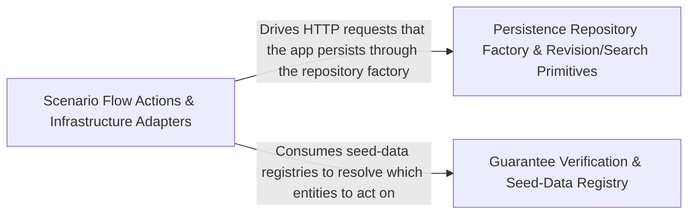

---
tags:
  - 2brain
  - 2brain/arch
  - project/boilerplate-node-backend
type: architecture
component: Guarantee_Verification_Seed_Data_Registry
---

## Details

The verification pillar of the subsystem. assertScenarioGuarantees and findUnmetGuarantees implement the contract check: for every shop module that declares a scenario guarantee, the checker walks the subjects the scenario actually offers and reports any guarantee that is not met. The same group carries the seed-data registry that the guarantees reference — OPENING_STOCK, PRODUCT_COPY_BY_ID, DIGITAL_GUIDES, SEED_CUSTOMER_EMAILS — so the checker has a single source of truth for what the scenario promises. describeTo provides the human-readable description of a scenario's guarantee surface, used in test output and documentation. This is the noun + assertion layer: it defines what the scenario must guarantee and checks that it does.

### Persistence Repository Factory & Revision/Search Primitives
The generic persistence kernel that the scenario layer (and the app) build repositories on. create-repository.ts is a factory that turns a Mongoose model into a typed repository with save, deleteOne, search, and pagination. revision-plugin.ts stamps updatedAt and increments a revision counter on update, and search.ts normalizes search results into PaginationResult/PaginatedMeta. This is the read/write persistence substrate beneath the scenario seed rows — the mechanism by which seeded products, customers, and orders are actually written and later queried.

**Related Classes/Methods**:

- `src.infrastructure.persistence.revision-plugin.revisionPlugin`:107-120
- `src.infrastructure.persistence.search.PaginationResult`:20-24

**Source Files:**

- `scripts/audit/code-shape/scripts/generate-shallow-candidates.ts`
  - `scripts.audit.code-shape.scripts.generate-shallow-candidates.rawConfig.ts.readConfigFile() callback` (L27-L28) - Function
  - `scripts.audit.code-shape.scripts.generate-shallow-candidates.rawConfig` (L27-L29) - Class
- `scripts/scaffold/demo-remove-alert-rules.ts`
  - `scripts.scaffold.demo-remove-alert-rules.stripRuleTests` (L122-L133) - Class
  - `scripts.scaffold.demo-remove-alert-rules.stripRuleTests.asksAboutDropped` (L124-L125) - Class
  - `scripts.scaffold.demo-remove-alert-rules.stripRuleTests.asksAboutDropped.some() callback` (L125-L125) - Function
  - `scripts.scaffold.demo-remove-alert-rules.stripRuleTests.filter() callback` (L130-L130) - Function
- `src/infrastructure/persistence/changes.ts`
  - `src.infrastructure.persistence.changes.setAndUnset.$set` (L34-L34) - Class
  - `src.infrastructure.persistence.changes.setAndUnset.$set.entries.filter() callback` (L34-L34) - Function
  - `src.infrastructure.persistence.changes.setAndUnset.$unset` (L35-L37) - Class
  - `src.infrastructure.persistence.changes.setAndUnset.$unset.entries.filter() callback` (L36-L36) - Function
  - `src.infrastructure.persistence.changes.setAndUnset.$unset.map() callback` (L36-L36) - Function
- `src/infrastructure/persistence/command-metrics.ts`
  - `src.infrastructure.persistence.command-metrics.PendingCommand` (L30-L33) - Interface
- `src/infrastructure/persistence/create-repository.ts`
  - `src.infrastructure.persistence.create-repository.FindAllOptions` (L54-L63) - Interface
  - `src.infrastructure.persistence.create-repository.SearchSpec` (L73-L106) - Interface
  - `src.infrastructure.persistence.create-repository.PaginatedResult` (L213-L216) - Interface
  - `src.infrastructure.persistence.create-repository.RepositoryOptions` (L219-L228) - Interface
  - `src.infrastructure.persistence.create-repository.createRepository.normalize.transformed.items.map() callback` (L353-L354) - Function
  - `src.infrastructure.persistence.create-repository.createRepository.normalize.transformed` (L353-L355) - Class
  - `src.infrastructure.persistence.create-repository.save` (L409-L412) - Class
  - `src.infrastructure.persistence.create-repository.createRepository.save.fencedSave() callback` (L412-L412) - Function
  - `src.infrastructure.persistence.create-repository.deleteOne` (L425-L430) - Class
  - `src.infrastructure.persistence.create-repository.createRepository.deleteOne.checkedDelete() callback` (L429-L429) - Function
  - `src.infrastructure.persistence.create-repository.search` (L441-L467) - Class
  - `src.infrastructure.persistence.create-repository.createRepository.search.then() callback` (L456-L465) - Function
  - `src.infrastructure.persistence.create-repository.createRepository.search.then() callback.then() callback` (L462-L465) - Function
- `src/infrastructure/persistence/money-field.ts`
  - `src.infrastructure.persistence.money-field.MoneyPathOptions` (L79-L86) - Interface
  - `src.infrastructure.persistence.money-field.isWritableAmount` (L92-L97) - Class
  - `src.infrastructure.persistence.money-field.isWritableAmount.<function>` (L94-L97) - Function
  - `src.infrastructure.persistence.money-field.moneyPath.validate.message` (L116-L117) - Method
  - `src.infrastructure.persistence.money-field.moneyPlugin` (L132-L142) - Class
  - `src.infrastructure.persistence.money-field.moneyPlugin.reviveLean` (L138-L140) - Function
- `src/infrastructure/persistence/report.ts`
  - `src.infrastructure.persistence.report.ReportWindow` (L15-L24) - Interface
- `src/infrastructure/persistence/revision-plugin.ts`
  - `src.infrastructure.persistence.revision-plugin.stampsUpdatedAt` (L65-L70) - Class
  - `src.infrastructure.persistence.revision-plugin.stampsUpdatedAt.setters.map() callback` (L66-L67) - Function
  - `src.infrastructure.persistence.revision-plugin.stampsUpdatedAt.setters` (L66-L68) - Class
  - `src.infrastructure.persistence.revision-plugin.stampsUpdatedAt.setters.some() callback` (L69-L69) - Function
  - `src.infrastructure.persistence.revision-plugin.incrementOnUpdate` (L81-L97) - Function
  - `src.infrastructure.persistence.revision-plugin.revisionPlugin` (L107-L120) - Class
  - `src.infrastructure.persistence.revision-plugin.revisionPlugin.flagEdit` (L112-L116) - Function
- `src/infrastructure/persistence/search.ts`
  - `src.infrastructure.persistence.search.PaginationResult` (L20-L24) - Interface
  - `src.infrastructure.persistence.search.PaginatedMeta` (L27-L32) - Interface
  - `src.infrastructure.persistence.search.addTextFilter` (L150-L160) - Class
  - `src.infrastructure.persistence.search.addTextFilter.fields.map() callback` (L157-L159) - Function
- `src/infrastructure/persistence/serialize.ts`
  - `src.infrastructure.persistence.serialize.SerializeOptions` (L19-L33) - Interface
  - `src.infrastructure.persistence.serialize.SerializableSchema` (L42-L44) - Interface
  - `src.infrastructure.persistence.serialize.applySerialization` (L53-L98) - Class
  - `src.infrastructure.persistence.serialize.transform` (L58-L79) - Class
  - `src.infrastructure.persistence.serialize.applySerialization.transform.toString` (L62-L62) - Method
  - `src.infrastructure.persistence.serialize.applySerialization.transform` (L88-L94) - Method
- `src/modules/audit-logs/model.ts`
  - `src.modules.audit-logs.model.AuditLogDocument` (L39-L41) - Interface
  - `src.modules.audit-logs.model.applyAuditLogTransform` (L179-L186) - Class
  - `src.modules.audit-logs.model.applyAuditLogTransform.after` (L182-L185) - Method
- `src/modules/audit-logs/repository.ts`
  - `src.modules.audit-logs.repository.AuditLogSearchFilters` (L23-L32) - Interface
  - `src.modules.audit-logs.repository.OwnEntriesCursor` (L75-L78) - Interface
  - `src.modules.audit-logs.repository.OwnEntriesPage` (L81-L85) - Interface
  - `src.modules.audit-logs.repository.cursorAfter.atEdge` (L99-L99) - Class
  - `src.modules.audit-logs.repository.cursorAfter.atEdge.rows.filter() callback` (L99-L99) - Function
  - `src.modules.audit-logs.repository.cursorAfter.seen.atEdge.map() callback` (L101-L101) - Function
  - `src.modules.audit-logs.repository.ownEntriesPage` (L115-L134) - Class
  - `src.modules.audit-logs.repository.ownEntriesPage.then() callback` (L129-L134) - Function
- `src/modules/example/model.ts`
  - `src.modules.example.model.ExampleDocument` (L25-L38) - Interface
  - `src.modules.example.model.applyExampleTransform` (L77-L82) - Class
  - `src.modules.example.model.applyExampleTransform.after` (L79-L81) - Method
- `src/modules/example/services/crud.ts`
  - `src.modules.example.services.crud.announceInTransaction() callback` (L196-L207) - Function
- `src/modules/orders/model.ts`
  - `src.modules.orders.model.OrderDocumentItem` (L76-L94) - Interface
  - `src.modules.orders.model.OrderReference` (L97-L101) - Interface
  - `src.modules.orders.model.OrderDocument` (L126-L243) - Interface
  - `src.modules.orders.model.applyOrderTransform` (L691-L710) - Class
  - `src.modules.orders.model.applyOrderTransform.after` (L698-L709) - Method
  - `src.modules.orders.model.OrderNumberCounterDocument` (L723-L725) - Interface
  - `src.modules.orders.model.OrderEventDocument` (L746-L763) - Interface
- `src/modules/payments/emails.ts`
  - `src.modules.payments.emails.paymentReceivedEmail.data.lines.order.items.map() callback` (L47-L52) - Function
- `src/modules/payments/model.ts`
  - `src.modules.payments.model.RefundLine` (L28-L33) - Interface
  - `src.modules.payments.model.RefundRecord` (L40-L77) - Interface
  - `src.modules.payments.model.PaymentDocument` (L82-L132) - Interface
  - `src.modules.payments.model.applyPaymentTransform` (L289-L300) - Class
  - `src.modules.payments.model.applyPaymentTransform.after` (L291-L299) - Method
  - `src.modules.payments.model.applyPaymentTransform.after.serialized.refunds.map() callback` (L296-L297) - Function
- `src/modules/payments/repository.ts`
  - `src.modules.payments.repository.MixSums` (L65-L69) - Interface
  - `src.modules.payments.repository.RefundRow` (L72-L77) - Interface
  - `src.modules.payments.repository.RefundFilters` (L80-L88) - Interface
- `src/modules/users/two-factor-write.ts`
  - `src.modules.users.two-factor-write.EntryChange` (L37-L44) - Interface
  - `src.modules.users.two-factor-write.MintedBackupCodes` (L67-L72) - Interface
  - `src.modules.users.two-factor-write.added` (L200-L202) - Class
  - `src.modules.users.two-factor-write.planTwoFactorWrite.changed.filter() callback` (L205-L205) - Function
- `src/modules/webhooks/metrics.ts`
  - `src.modules.webhooks.metrics._webhookDeliveriesOverdue` (L49-L61) - Class
  - `src.modules.webhooks.metrics._webhookDeliveriesOverdue.collect` (L53-L60) - Method
- `src/modules/webhooks/model.ts`
  - `src.modules.webhooks.model.WebhookSecretRingEntry` (L24-L28) - Interface
  - `src.modules.webhooks.model.WebhookSubscriptionDocument` (L31-L57) - Interface
  - `src.modules.webhooks.model.webhookSubscriptionSchema.eventTypes.validate.validator` (L91-L91) - Method
  - `src.modules.webhooks.model.applyWebhookSubscriptionTransform` (L148-L155) - Class
  - `src.modules.webhooks.model.applyWebhookSubscriptionTransform.after` (L150-L154) - Method
  - `src.modules.webhooks.model.applyWebhookSubscriptionTransform.after.map() callback` (L152-L152) - Function
  - `src.modules.webhooks.model.WebhookDeliveryDocument` (L178-L203) - Interface
- `src/modules/webhooks/repository.ts`
  - `src.modules.webhooks.repository.outcomeUpdate.present` (L253-L253) - Class
  - `src.modules.webhooks.repository.outcomeUpdate.present.entries.filter() callback` (L253-L253) - Function
  - `src.modules.webhooks.repository.outcomeUpdate.absent` (L254-L254) - Class
  - `src.modules.webhooks.repository.outcomeUpdate.absent.entries.filter() callback` (L254-L254) - Function

### Guarantee Verification & Seed-Data Registry
The verification pillar of the subsystem. assertScenarioGuarantees and findUnmetGuarantees implement the contract check: for every enabled shop module that declares a scenario guarantee, the checker walks the subjects the scenario actually offers and reports any guarantee that is not met (and any subject no module declares) — a bidirectional equality check between declared promises and offered rows. The same group carries the seed-data registries the guarantees reference — OPENING_STOCK, PRODUCT_COPY_BY_ID, DIGITAL_GUIDES, SEED_CUSTOMER_EMAILS — so the checker has a single source of truth for what the scenario promises. describeTo provides the human-readable description of a scenario's guarantee surface, used in test output and documentation.

**Related Classes/Methods**:

- `scenarios.check.assertScenarioGuarantees`:73-83
- `scenarios.check.findUnmetGuarantees`:44-63
- `scenarios.products.OPENING_STOCK`:400-414
- `scenarios.products.PRODUCT_COPY_BY_ID`:431-438
- `scenarios.apply.describeTo`:110-112

**Source Files:**

- `scenarios/apply.ts`
  - `scenarios.apply.describeTo` (L110-L112) - Class
  - `scenarios.apply.describeTo.process.argv.find() callback` (L111-L111) - Function
- `scenarios/check.ts`
  - `scenarios.check.findUnmetGuarantees` (L44-L63) - Class
  - `scenarios.check.findUnmetGuarantees.problems` (L53-L55) - Class
  - `scenarios.check.findUnmetGuarantees.problems.filter() callback` (L54-L54) - Function
  - `scenarios.check.findUnmetGuarantees.problems.map() callback` (L55-L55) - Function
  - `scenarios.check.findUnmetGuarantees.filter() callback` (L60-L60) - Function
  - `scenarios.check.findUnmetGuarantees.map() callback` (L61-L61) - Function
  - `scenarios.check.assertScenarioGuarantees` (L73-L83) - Class
  - `scenarios.check.assertScenarioGuarantees.problems.map() callback` (L81-L81) - Function
- `scenarios/flows/actions.ts`
  - `scenarios.flows.actions.receiveStock` (L52-L55) - Class
  - `scenarios.flows.actions.receiveStock.then() callback` (L55-L55) - Function
  - `scenarios.flows.actions.startProcessing` (L203-L204) - Class
  - `scenarios.flows.actions.startProcessing.then() callback` (L204-L204) - Function
  - `scenarios.flows.actions.shipPart` (L257-L270) - Class
  - `scenarios.flows.actions.shipPart.then() callback` (L263-L270) - Function
  - `scenarios.flows.actions.shipPart.then() callback.then() callback` (L269-L269) - Function
  - `scenarios.flows.actions.requestReturn` (L344-L352) - Class
  - `scenarios.flows.actions.requestReturn.then() callback` (L352-L352) - Function
- `scenarios/products-filler.ts`
  - `scenarios.products-filler.DIGITAL_GUIDES` (L268-L292) - Class
  - `scenarios.products-filler.DIGITAL_GUIDES.map() callback` (L271-L292) - Function
- `scenarios/products.ts`
  - `scenarios.products.OPENING_STOCK` (L400-L414) - Class
  - `scenarios.products.OPENING_STOCK.FILLER_PRODUCTS.map() callback` (L412-L412) - Function
  - `scenarios.products.PRODUCT_COPY_BY_ID` (L431-L438) - Class
  - `scenarios.products.PRODUCT_COPY_BY_ID.map() callback` (L433-L433) - Function
  - `scenarios.products.PRODUCT_COPY_BY_ID.FILLER_PRODUCTS.map() callback` (L436-L436) - Function
- `scenarios/users.ts`
  - `scenarios.users.SEED_CUSTOMER_EMAILS` (L242-L246) - Class
  - `scenarios.users.SEED_CUSTOMER_EMAILS.CUSTOMER_NAMES.map() callback` (L243-L243) - Function
- `scripts/audit/code-shape/scripts/shallow-candidates.ts`
  - `scripts.audit.code-shape.scripts.shallow-candidates.projectFiles` (L158-L165) - Class
  - `scripts.audit.code-shape.scripts.shallow-candidates.projectFiles.filter() callback` (L162-L164) - Function
- `scripts/docs/jobs-render.ts`
  - `scripts.docs.jobs-render.withJobScripts.first` (L106-L106) - Class
  - `scripts.docs.jobs-render.withJobScripts.first.lines.findIndex() callback` (L106-L106) - Function
- `scripts/scaffold/demo-remove-alert-rules.ts`
  - `scripts.scaffold.demo-remove-alert-rules.readRemovedMetrics.removedRoots` (L61-L61) - Class
  - `scripts.scaffold.demo-remove-alert-rules.readRemovedMetrics.removedRoots.names.map() callback` (L61-L61) - Function
  - `scripts.scaffold.demo-remove-alert-rules.stripRules.reads` (L102-L103) - Class
  - `scripts.scaffold.demo-remove-alert-rules.stripRules.reads.some() callback` (L103-L103) - Function
  - `scripts.scaffold.demo-remove-alert-rules.stripRules.dropped` (L106-L106) - Class
  - `scripts.scaffold.demo-remove-alert-rules.stripRules.dropped.chunks.filter() callback` (L106-L106) - Function
  - `scripts.scaffold.demo-remove-alert-rules.stripRules.dropped.map() callback` (L114-L114) - Function
- `scripts/scaffold/demo-remove-scenarios.ts`
  - `scripts.scaffold.demo-remove-scenarios.stripScenarioModuleEntries` (L124-L161) - Class
  - `scripts.scaffold.demo-remove-scenarios.stripScenarioModuleEntries.content.replaceAll() callback` (L149-L157) - Function
  - `scripts.scaffold.demo-remove-scenarios.stripScenarioModuleEntries.content.replaceAll() callback.kept` (L150-L153) - Class
  - `scripts.scaffold.demo-remove-scenarios.stripScenarioModuleEntries.content.replaceAll() callback.kept.map() callback` (L152-L152) - Function
  - `scripts.scaffold.demo-remove-scenarios.stripScenarioModuleEntries.content.replaceAll() callback.kept.filter() callback` (L153-L153) - Function
  - `scripts.scaffold.demo-remove-scenarios.stripScenarioModuleEntries.content.replaceAll() callback.kept.filter() callback.names.every() callback` (L153-L153) - Function
- `src/cluster.ts`
  - `src.cluster.supervise.scheduleRespawn.timer` (L72-L75) - Class
  - `src.cluster.supervise.scheduleRespawn.timer.setTimeout() callback` (L72-L75) - Function
- `src/modules/account/model.ts`
  - `src.modules.account.model.SessionDocument` (L76-L109) - Interface
- `src/modules/account/repository.ts`
  - `src.modules.account.repository.insertSession` (L169-L170) - Class
  - `src.modules.account.repository.insertSession.then() callback` (L170-L170) - Function
  - `src.modules.account.repository.spendVerificationToken` (L539-L543) - Class
  - `src.modules.account.repository.spendVerificationToken.then() callback` (L543-L543) - Function
  - `src.modules.account.repository.userIdsWithLiveVerificationToken` (L585-L592) - Class
  - `src.modules.account.repository.userIdsWithLiveVerificationToken.then() callback` (L592-L592) - Function
- `src/modules/api-keys/repository.ts`
  - `src.modules.api-keys.repository.deleteByUserId` (L63-L69) - Class
  - `src.modules.api-keys.repository.deleteByUserId.then() callback` (L67-L69) - Function
- `src/modules/cart/repository.ts`
  - `src.modules.cart.repository.LineWrite` (L27-L30) - Interface
  - `src.modules.cart.repository.upsertLine.then() callback.then() callback.currentQuantity.existing.items.find() callback` (L151-L152) - Function
  - `src.modules.cart.repository.upsertLine.then() callback.then() callback.currentQuantity` (L151-L153) - Class
- `src/modules/delivery/events.ts`
  - `src.modules.delivery.events.ShipmentEventLine` (L11-L14) - Interface
  - `src.modules.delivery.events.'@kernel/events'.DomainEventMap` (L46-L81) - Interface
- `src/modules/delivery/model.ts`
  - `src.modules.delivery.model.FulfillmentOrderDocument` (L39-L75) - Interface
- `src/modules/orders/domain/fulfillment.ts`
  - `src.modules.orders.domain.fulfillment.FulfillmentSummary` (L20-L33) - Interface
  - `src.modules.orders.domain.fulfillment.fulfillmentStatusFilter.withValue` (L120-L127) - Class
  - `src.modules.orders.domain.fulfillment.fulfillmentStatusFilter.withValue.statusesWhere() callback` (L123-L125) - Function
  - `src.modules.orders.domain.fulfillment.fulfillmentStatusFilter.inFlight` (L129-L129) - Class
  - `src.modules.orders.domain.fulfillment.fulfillmentStatusFilter.inFlight.statusesWhere() callback` (L129-L129) - Function
- `src/modules/orders/domain/lifecycle.ts`
  - `src.modules.orders.domain.lifecycle.OrderEvent` (L32-L36) - Interface
- `src/modules/orders/domain/shop-time.ts`
  - `src.modules.orders.domain.shop-time.wallClockAsUtc.field` (L45-L46) - Class
  - `src.modules.orders.domain.shop-time.wallClockAsUtc.field.parts.find() callback` (L46-L46) - Function
- `src/modules/orders/domain/status-traits.ts`
  - `src.modules.orders.domain.status-traits.statusesWhere` (L83-L86) - Class
  - `src.modules.orders.domain.status-traits.statusesWhere.filter() callback` (L86-L86) - Function
- `src/modules/orders/domain/tax.ts`
  - `src.modules.orders.domain.tax.TaxableLineItem` (L24-L28) - Interface
  - `src.modules.orders.domain.tax.LineTaxBreakdown` (L38-L42) - Interface
  - `src.modules.orders.domain.tax.TaxRateSummary` (L49-L55) - Interface
  - `src.modules.orders.domain.tax.OrderTaxBreakdown` (L58-L90) - Interface
  - `src.modules.orders.domain.tax.OrderTaxInput` (L93-L104) - Interface
  - `src.modules.orders.domain.tax.RateGroup` (L128-L134) - Interface
  - `src.modules.orders.domain.tax.allocateLineTax.taxes` (L185-L185) - Class
  - `src.modules.orders.domain.tax.allocateLineTax.taxes.grossByLine.map() callback` (L185-L185) - Function
  - `src.modules.orders.domain.tax.allocateLineTax.indexes` (L187-L187) - Class
  - `src.modules.orders.domain.tax.allocateLineTax.indexes.rates.flatMap() callback` (L187-L187) - Function
  - `src.modules.orders.domain.tax.lineTaxFromRateTotals.rates` (L210-L210) - Class
  - `src.modules.orders.domain.tax.lineTaxFromRateTotals.rates.items.map() callback` (L210-L210) - Function
  - `src.modules.orders.domain.tax.lines` (L256-L260) - Class
  - `src.modules.orders.domain.tax.orderTaxBreakdown.lines.items.map() callback` (L256-L260) - Function
  - `src.modules.orders.domain.tax.orderTaxBreakdown.sortedGroups` (L262-L262) - Class
  - `src.modules.orders.domain.tax.orderTaxBreakdown.sortedGroups.toSorted() callback` (L262-L262) - Function
  - `src.modules.orders.domain.tax.orderTaxBreakdown.taxSummary.sortedGroups.map() callback` (L274-L275) - Function
  - `src.modules.orders.domain.tax.taxSummary` (L274-L276) - Class
  - `src.modules.orders.domain.tax.shippingByRate` (L278-L282) - Class
  - `src.modules.orders.domain.tax.orderTaxBreakdown.shippingByRate.sortedGroups.map() callback` (L279-L280) - Function
  - `src.modules.orders.domain.tax.orderTaxBreakdown.shippingByRate.filter() callback` (L282-L282) - Function
  - `src.modules.orders.domain.tax.shippingNetTotal.sumOf() callback` (L285-L285) - Function
  - `src.modules.orders.domain.tax.orderTaxBreakdown.netTotal.sumOf() callback` (L290-L290) - Function
  - `src.modules.orders.domain.tax.orderTaxBreakdown.taxTotal.sumOf() callback` (L297-L297) - Function
  - `src.modules.orders.domain.tax.orderTaxBreakdown.shippingTaxAmount.sumOf() callback` (L302-L302) - Function
- `src/modules/orders/domain/withdrawal.ts`
  - `src.modules.orders.domain.withdrawal.WithdrawalClockCandidate` (L62-L65) - Interface
- `src/modules/orders/repository.ts`
  - `src.modules.orders.repository.scrubDueForAnonymization` (L659-L669) - Class
  - `src.modules.orders.repository.scrubDueForAnonymization.then() callback` (L669-L669) - Function
- `src/modules/users/two-factor-write.ts`
  - `src.modules.users.two-factor-write.TwoFactorWriteOutcome` (L75-L82) - Interface
  - `src.modules.users.two-factor-write.planTwoFactorWrite.added.map() callback` (L202-L202) - Function
  - `src.modules.users.two-factor-write.methodsAfter.addedMethods` (L279-L279) - Class
  - `src.modules.users.two-factor-write.methodsAfter.addedMethods.write.added.map() callback` (L279-L279) - Function

### Scenario Flow Actions & Infrastructure Adapters
The scripted flow layer that exercises the seeded dataset against a live app, plus the infrastructure adapters it depends on. shop-history.ts composes the ordered, promise-chained actions that give the demo its history — banOneCustomer, requireBankTransfer, signOutEveryone — and actions.ts supplies the atomic verbs (receiveStock, requestReturn) that put stock on the shelf and drive returns. These flows are what make the guarantees in Group 2 hold. The group also bundles the adapters the flows and app lean on: pdf.ts (renderOnce, printIn, withDeadline), queue.ts, ids.ts (carriedAt, malformedIdIssues), locale.ts, content-type.ts, and filesystem.ts. Together this is the verb layer — the actions and adapters that turn the seeded nouns into a coherent, verifiable shop history.

**Related Classes/Methods**:

- `scenarios.flows.shop-history.requireBankTransfer`:347-353
- `src.infrastructure.adapters.pdf.renderOnce`:164-168
- `src.infrastructure.http.ids.carriedAt`:228-241

**Source Files:**

- `scenarios/flows/shop-history.ts`
  - `scenarios.flows.shop-history.banOneCustomer` (L298-L301) - Class
  - `scenarios.flows.shop-history.banOneCustomer.then() callback` (L301-L301) - Function
  - `scenarios.flows.shop-history.signOutEveryone` (L312-L315) - Class
  - `scenarios.flows.shop-history.signOutEveryone.callers.map() callback` (L313-L313) - Function
  - `scenarios.flows.shop-history.signOutEveryone.then() callback` (L314-L314) - Function
  - `scenarios.flows.shop-history.requireBankTransfer` (L347-L353) - Class
  - `scenarios.flows.shop-history.requireBankTransfer.then() callback` (L348-L353) - Function
  - `scenarios.flows.shop-history.requireBankTransfer.then() callback.methods.some() callback` (L349-L349) - Function
- `scripts/audit/code-shape/scripts/shallow-candidates.ts`
  - `scripts.audit.code-shape.scripts.shallow-candidates.FunctionFacts` (L40-L58) - Interface
  - `scripts.audit.code-shape.scripts.shallow-candidates.Usage` (L91-L96) - Interface
  - `scripts.audit.code-shape.scripts.shallow-candidates.optionalNeverPassed` (L299-L310) - Class
  - `scripts.audit.code-shape.scripts.shallow-candidates.optionalNeverPassed.declared.parameters.filter() callback` (L304-L307) - Function
  - `scripts.audit.code-shape.scripts.shallow-candidates.optionalNeverPassed.map() callback` (L309-L309) - Function
  - `scripts.audit.code-shape.scripts.shallow-candidates.findShallowCandidates.optionalNeverPassed.functions.filter() callback` (L485-L485) - Function
- `scripts/ops/run-job.ts`
  - `scripts.ops.run-job.requestedJob` (L75-L89) - Class
  - `scripts.ops.run-job.requestedJob.map() callback` (L83-L83) - Function
- `scripts/scaffold/demo-remove-alert-rules.ts`
  - `scripts.scaffold.demo-remove-alert-rules.sourceFiles` (L34-L39) - Class
  - `scripts.scaffold.demo-remove-alert-rules.sourceFiles.flatMap() callback` (L35-L39) - Function
  - `scripts.scaffold.demo-remove-alert-rules.metricsIn` (L45-L50) - Class
  - `scripts.scaffold.demo-remove-alert-rules.metricsIn.files.flatMap() callback` (L47-L48) - Function
  - `scripts.scaffold.demo-remove-alert-rules.metricsIn.files.flatMap() callback.map() callback` (L48-L48) - Function
  - `scripts.scaffold.demo-remove-alert-rules.readRemovedMetrics` (L57-L72) - Class
  - `scripts.scaffold.demo-remove-alert-rules.readRemovedMetrics.isRemoved` (L62-L63) - Class
  - `scripts.scaffold.demo-remove-alert-rules.readRemovedMetrics.isRemoved.removedRoots.some() callback` (L63-L63) - Function
  - `scripts.scaffold.demo-remove-alert-rules.readRemovedMetrics.surviving` (L66-L66) - Class
  - `scripts.scaffold.demo-remove-alert-rules.readRemovedMetrics.surviving.files.filter() callback` (L66-L66) - Function
  - `scripts.scaffold.demo-remove-alert-rules.readRemovedMetrics.files.filter() callback` (L68-L68) - Function
  - `scripts.scaffold.demo-remove-alert-rules.readRemovedMetrics.filter() callback` (L69-L69) - Function
- `scripts/scaffold/demo-remove-authorization.ts`
  - `scripts.scaffold.demo-remove-authorization.RemovedAuthorization` (L22-L27) - Interface
  - `scripts.scaffold.demo-remove-authorization.stripRoleGrants.out.lines.map() callback.next` (L73-L73) - Class
  - `scripts.scaffold.demo-remove-authorization.stripRoleGrants.out.lines.map() callback.next.find() callback` (L73-L73) - Function
  - `scripts.scaffold.demo-remove-authorization.pruneCase.lists.map() callback` (L98-L102) - Function
  - `scripts.scaffold.demo-remove-authorization.pruneCase.lists` (L98-L103) - Class
  - `scripts.scaffold.demo-remove-authorization.pruneCase.lists.map() callback.map() callback` (L101-L101) - Function
- `scripts/scaffold/demo-remove-scenarios.ts`
  - `scripts.scaffold.demo-remove-scenarios.stripModuleDoubles` (L175-L205) - Class
  - `scripts.scaffold.demo-remove-scenarios.stripModuleDoubles.names.filter() callback` (L180-L180) - Function
  - `scripts.scaffold.demo-remove-scenarios.stripModuleDoubles.map() callback` (L181-L204) - Function
- `scripts/scaffold/demo-remove-tests.ts`
  - `scripts.scaffold.demo-remove-tests.specifiersOf` (L68-L69) - Class
  - `scripts.scaffold.demo-remove-tests.specifiersOf.SPECIFIER_PATTERNS.flatMap() callback` (L69-L69) - Function
  - `scripts.scaffold.demo-remove-tests.specifiersOf.SPECIFIER_PATTERNS.flatMap() callback.map() callback` (L69-L69) - Function
  - `scripts.scaffold.demo-remove-tests.isGone` (L94-L100) - Class
  - `scripts.scaffold.demo-remove-tests.isGone.gone.some() callback` (L96-L99) - Function
  - `scripts.scaffold.demo-remove-tests.removeResidueTests.gone` (L114-L118) - Class
  - `scripts.scaffold.demo-remove-tests.removeResidueTests.gone.names.flatMap() callback` (L114-L118) - Function
  - `scripts.scaffold.demo-remove-tests.removeResidueTests.importsGone` (L125-L128) - Class
  - `scripts.scaffold.demo-remove-tests.removeResidueTests.importsGone.some() callback` (L125-L128) - Function
- `scripts/scaffold/demo-remove-validation-labels.ts`
  - `scripts.scaffold.demo-remove-validation-labels.stripValidationLabels.flatMap() callback.dropped` (L157-L157) - Class
  - `scripts.scaffold.demo-remove-validation-labels.stripValidationLabels.flatMap() callback.dropped.filter() callback` (L157-L157) - Function
- `src/infrastructure/adapters/filesystem.ts`
  - `src.infrastructure.adapters.filesystem.pruneUnreferenced.then() callback.orphaned` (L180-L180) - Class
  - `src.infrastructure.adapters.filesystem.pruneUnreferenced.then() callback.orphaned.entries.filter() callback` (L180-L180) - Function
  - `src.infrastructure.adapters.filesystem.pruneUnreferenced.then() callback.orphaned.map() callback` (L183-L195) - Function
  - `src.infrastructure.adapters.filesystem.pruneUnreferenced.then() callback.orphaned.map() callback.then() callback` (L193-L193) - Function
- `src/infrastructure/adapters/logger.ts`
  - `src.infrastructure.adapters.logger.SENSITIVE_KEYS` (L124-L124) - Class
  - `src.infrastructure.adapters.logger.SENSITIVE_KEYS.map() callback` (L124-L124) - Function
- `src/infrastructure/adapters/pdf.ts`
  - `src.infrastructure.adapters.pdf.renderHtmlToPdf.render` (L134-L134) - Class
  - `src.infrastructure.adapters.pdf.renderHtmlToPdf.render.withRenderSlot() callback` (L134-L134) - Function
  - `src.infrastructure.adapters.pdf.renderOnce` (L164-L168) - Class
  - `src.infrastructure.adapters.pdf.renderOnce.then() callback` (L168-L168) - Function
  - `src.infrastructure.adapters.pdf.withDeadline` (L180-L202) - Class
  - `src.infrastructure.adapters.pdf.withDeadline.finally() callback` (L197-L200) - Function
  - `src.infrastructure.adapters.pdf.printIn` (L227-L264) - Class
  - `src.infrastructure.adapters.pdf.printIn.then() callback` (L232-L262) - Function
  - `src.infrastructure.adapters.pdf.printIn.then() callback.then() callback` (L262-L262) - Function
- `src/infrastructure/adapters/queue.ts`
  - `src.infrastructure.adapters.queue.publishToQueue.then() callback.<function>.timer` (L656-L660) - Class
  - `src.infrastructure.adapters.queue.publishToQueue.then() callback.<function>.timer.setTimeout() callback` (L656-L660) - Function
- `src/infrastructure/http/ids.ts`
  - `src.infrastructure.http.ids.carriedAt` (L228-L241) - Class
  - `src.infrastructure.http.ids.carriedAt.value.flatMap() callback` (L234-L235) - Function
  - `src.infrastructure.http.ids.malformedIdIssues` (L254-L265) - Class
  - `src.infrastructure.http.ids.malformedIdIssues.flatMap() callback` (L260-L260) - Function
  - `src.infrastructure.http.ids.malformedIdIssues.filter() callback` (L262-L263) - Function
  - `src.infrastructure.http.ids.malformedIdIssues.map() callback` (L265-L265) - Function
- `src/infrastructure/http/middlewares/content-type.ts`
  - `src.infrastructure.http.middlewares.content-type.requireDeclaredContentType.<function>.operation` (L46-L48) - Class
  - `src.infrastructure.http.middlewares.content-type.requireDeclaredContentType.<function>.operation.operations.find() callback` (L47-L47) - Function
- `src/infrastructure/http/middlewares/locale.ts`
  - `src.infrastructure.http.middlewares.locale.negotiateLocale.offered` (L36-L36) - Class
  - `src.infrastructure.http.middlewares.locale.negotiateLocale.offered.supported.filter() callback` (L36-L36) - Function
- `src/infrastructure/http/middlewares/upload.ts`
  - `src.infrastructure.http.middlewares.upload.withLocaleRestored` (L196-L205) - Class
  - `src.infrastructure.http.middlewares.upload.withLocaleRestored.<function>` (L198-L205) - Function
  - `src.infrastructure.http.middlewares.upload.withLocaleRestored.<function>.middleware() callback` (L199-L205) - Function
  - `src.infrastructure.http.middlewares.upload.withLocaleRestored.<function>.middleware() callback.runWithLocaleContext() callback` (L204-L204) - Function
  - `src.infrastructure.http.middlewares.upload.validateUploadedImages.then() callback.rejected` (L237-L241) - Class
  - `src.infrastructure.http.middlewares.upload.validateUploadedImages.then() callback.rejected.paths.filter() callback` (L238-L240) - Function
  - `src.infrastructure.http.middlewares.upload.validateUploadedImages.then() callback.rejected.map() callback` (L259-L259) - Function
  - `src.infrastructure.http.middlewares.upload.then() callback.digested.map() callback` (L332-L332) - Function
  - `src.infrastructure.http.middlewares.upload.quarantineUploadedImages.then() callback.failed` (L372-L372) - Class
  - `src.infrastructure.http.middlewares.upload.quarantineUploadedImages.then() callback.failed.results.find() callback` (L372-L372) - Function
  - `src.infrastructure.http.middlewares.upload.quarantineUploadedImages.then() callback.keys` (L378-L380) - Class
  - `src.infrastructure.http.middlewares.upload.quarantineUploadedImages.then() callback.keys.results.map() callback` (L379-L379) - Function
  - `src.infrastructure.http.middlewares.upload.upload` (L446-L448) - Class
  - `src.infrastructure.http.middlewares.upload.upload.image` (L447-L447) - Method
- `src/infrastructure/http/preconditions.ts`
  - `src.infrastructure.http.preconditions.tagsOf` (L28-L28) - Class
  - `src.infrastructure.http.preconditions.tagsOf.map() callback` (L28-L28) - Function
- `src/infrastructure/http/request.ts`
  - `src.infrastructure.http.request.parseFormCsvList.tokens` (L77-L80) - Class
  - `src.infrastructure.http.request.parseFormCsvList.tokens.entries.flatMap() callback` (L78-L78) - Function
  - `src.infrastructure.http.request.parseFormCsvList.tokens.map() callback` (L79-L79) - Function
  - `src.infrastructure.http.request.parseFormCsvList.tokens.filter() callback` (L80-L80) - Function
