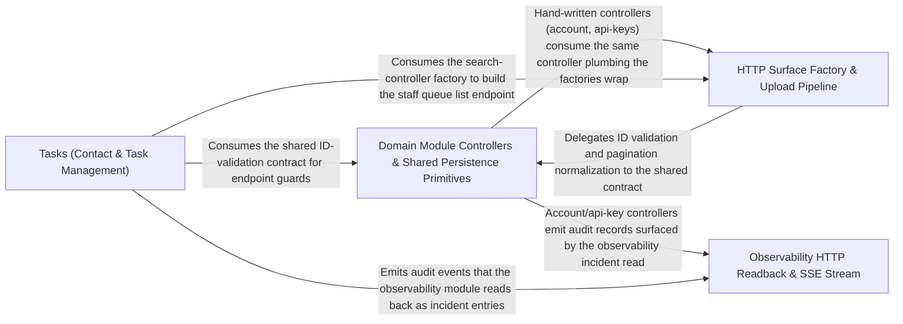

---
tags:
  - 2brain
  - 2brain/arch
  - project/boilerplate-node-backend
type: architecture
component: HTTP_Surface_Factory_Pagination_Primitives
---

## Details

The generic REST controller construction layer. Rather than each domain module hand-writing Express handlers, this group provides factory functions (createListController, createItemController, createDeleteController, createRestoreController) that accept a spec object (route path, service method, validation schema, auth requirement) and return a fully-wired Express handler. namedHandler is the low-level wrapper that binds a named function to a route with consistent error propagation. PaginationResult / PaginationInput / PaginatedMeta standardize the cursor/offset pagination contract across all list endpoints. writeWithUploadedImage handles the multipart upload to image-store to record-update pipeline.

### Domain Module Controllers & Shared Persistence Primitives
The concrete domain-module endpoint implementations and the shared persistence-layer primitives they depend on. Contains business-logic controllers (session management, address CRUD, API-key lifecycle, ticket export, webhook owner management) that call into module repositories and services. Also houses the pagination contract types (PaginationInput, PaginationResult, PaginatedMeta) and the normalizePagination / buildPaginatedMeta / readAll helpers that every list/search endpoint uses to produce a uniform paged envelope. The RequiredId interface and requireId / isValidObjectId functions define the single authority on malformed-ID handling.

**Related Classes/Methods**:

- `src.infrastructure.http.ids.RequiredId`:68-79
- `src.modules.account.controllers.delete-session.deleteSession`:25-49
- `src.modules.api-keys.repository.deleteByUserId`:72-78

**Source Files:**

- `src/infrastructure/http/ids.ts`
  - `src.infrastructure.http.ids.RequiredId` (L68-L79) - Interface
- `src/infrastructure/persistence/search.ts`
  - `src.infrastructure.persistence.search.PaginationInput` (L11-L17) - Interface
  - `src.infrastructure.persistence.search.PaginationResult` (L20-L24) - Interface
  - `src.infrastructure.persistence.search.PaginatedMeta` (L27-L32) - Interface
- `src/modules/account/controllers/delete-session.ts`
  - `src.modules.account.controllers.delete-session.deleteSession` (L25-L49) - Class
  - `src.modules.account.controllers.delete-session.deleteSession.then() callback` (L36-L47) - Function
- `src/modules/account/controllers/get-session.ts`
  - `src.modules.account.controllers.get-session.getSession` (L19-L38) - Class
  - `src.modules.account.controllers.get-session.getSession.then() callback` (L30-L36) - Function
- `src/modules/addresses/controllers/delete-address.ts`
  - `src.modules.addresses.controllers.delete-address.deleteAddress` (L17-L34) - Class
  - `src.modules.addresses.controllers.delete-address.deleteAddress.then() callback` (L28-L32) - Function
- `src/modules/addresses/controllers/get-address.ts`
  - `src.modules.addresses.controllers.get-address.getAddress` (L17-L33) - Class
  - `src.modules.addresses.controllers.get-address.getAddress.then() callback` (L28-L31) - Function
- `src/modules/addresses/controllers/put-address-default.ts`
  - `src.modules.addresses.controllers.put-address-default.putAddressDefault` (L19-L38) - Class
  - `src.modules.addresses.controllers.put-address-default.putAddressDefault.then() callback` (L31-L36) - Function
- `src/modules/api-keys/controllers/delete-api-key.ts`
  - `src.modules.api-keys.controllers.delete-api-key.revokeApiKey` (L20-L32) - Class
  - `src.modules.api-keys.controllers.delete-api-key.revokeApiKey.then() callback` (L27-L30) - Function
- `src/modules/api-keys/controllers/get-api-key.ts`
  - `src.modules.api-keys.controllers.get-api-key.getApiKey` (L19-L30) - Class
  - `src.modules.api-keys.controllers.get-api-key.getApiKey.then() callback` (L25-L28) - Function
- `src/modules/api-keys/controllers/post-api-key.ts`
  - `src.modules.api-keys.controllers.post-api-key.mintApiKey` (L19-L37) - Class
  - `src.modules.api-keys.controllers.post-api-key.mintApiKey.then() callback` (L28-L35) - Function
- `src/modules/api-keys/repository.ts`
  - `src.modules.api-keys.repository.deleteByUserId` (L72-L78) - Class
  - `src.modules.api-keys.repository.deleteByUserId.then() callback` (L76-L78) - Function
  - `src.modules.api-keys.repository.revokeMany` (L102-L106) - Class
  - `src.modules.api-keys.repository.revokeMany.then() callback` (L106-L106) - Function
  - `src.modules.api-keys.repository.mintersOf` (L115-L119) - Class
  - `src.modules.api-keys.repository.mintersOf.then() callback` (L119-L119) - Function
  - `src.modules.api-keys.repository.mintersOf.then() callback.rows.map() callback` (L119-L119) - Function
- `src/modules/cart/controllers/delete-cart-item.ts`
  - `src.modules.cart.controllers.delete-cart-item.deleteCartItem` (L20-L38) - Class
  - `src.modules.cart.controllers.delete-cart-item.deleteCartItem.then() callback` (L33-L36) - Function
- `src/modules/cart/controllers/patch-cart-item.ts`
  - `src.modules.cart.controllers.patch-cart-item.patchCartItem` (L21-L49) - Class
  - `src.modules.cart.controllers.patch-cart-item.patchCartItem.then() callback` (L43-L47) - Function
- `src/modules/delivery/controllers/get-date-impact.ts`
  - `src.modules.delivery.controllers.get-date-impact.dateImpactController` (L29-L67) - Class
  - `src.modules.delivery.controllers.get-date-impact.dateImpactController.<function>` (L36-L67) - Function
  - `src.modules.delivery.controllers.get-date-impact.dateImpactController.<function>.then() callback` (L62-L65) - Function
- `src/modules/delivery/controllers/get-fulfillment-order.ts`
  - `src.modules.delivery.controllers.get-fulfillment-order.getFulfillmentOrder` (L15-L26) - Class
  - `src.modules.delivery.controllers.get-fulfillment-order.getFulfillmentOrder.then() callback` (L21-L24) - Function
- `src/modules/delivery/controllers/get-order-fulfillment-lists.ts`
  - `src.modules.delivery.controllers.get-order-fulfillment-lists.getOrderFulfillmentOrders` (L17-L31) - Class
  - `src.modules.delivery.controllers.get-order-fulfillment-lists.getOrderFulfillmentOrders.then() callback` (L26-L29) - Function
  - `src.modules.delivery.controllers.get-order-fulfillment-lists.getOrderShipments` (L34-L45) - Class
  - `src.modules.delivery.controllers.get-order-fulfillment-lists.getOrderShipments.then() callback` (L40-L43) - Function
- `src/modules/delivery/controllers/get-shipment.ts`
  - `src.modules.delivery.controllers.get-shipment.getShipment` (L15-L26) - Class
  - `src.modules.delivery.controllers.get-shipment.getShipment.then() callback` (L21-L24) - Function
- `src/modules/delivery/controllers/patch-shipment.ts`
  - `src.modules.delivery.controllers.patch-shipment.patchShipment` (L17-L31) - Class
  - `src.modules.delivery.controllers.patch-shipment.patchShipment.then() callback` (L26-L29) - Function
- `src/modules/delivery/controllers/post-deliver-shipment.ts`
  - `src.modules.delivery.controllers.post-deliver-shipment.postDeliverShipment` (L17-L28) - Class
  - `src.modules.delivery.controllers.post-deliver-shipment.postDeliverShipment.then() callback` (L23-L26) - Function
- `src/modules/delivery/controllers/post-fulfill-fulfillment-order.ts`
  - `src.modules.delivery.controllers.post-fulfill-fulfillment-order.postFulfillFulfillmentOrder` (L16-L34) - Class
  - `src.modules.delivery.controllers.post-fulfill-fulfillment-order.postFulfillFulfillmentOrder.then() callback` (L25-L32) - Function
- `src/modules/delivery/controllers/post-hold-fulfillment-order.ts`
  - `src.modules.delivery.controllers.post-hold-fulfillment-order.postHoldFulfillmentOrder` (L17-L31) - Class
  - `src.modules.delivery.controllers.post-hold-fulfillment-order.postHoldFulfillmentOrder.then() callback` (L26-L29) - Function
  - `src.modules.delivery.controllers.post-hold-fulfillment-order.postReleaseFulfillmentOrder` (L34-L48) - Class
  - `src.modules.delivery.controllers.post-hold-fulfillment-order.postReleaseFulfillmentOrder.then() callback` (L43-L46) - Function
- `src/modules/delivery/controllers/post-mark-shipment-lost.ts`
  - `src.modules.delivery.controllers.post-mark-shipment-lost.postMarkShipmentLost` (L17-L31) - Class
  - `src.modules.delivery.controllers.post-mark-shipment-lost.postMarkShipmentLost.then() callback` (L26-L29) - Function
- `src/modules/delivery/controllers/post-process-order.ts`
  - `src.modules.delivery.controllers.post-process-order.postProcessOrder` (L17-L30) - Class
  - `src.modules.delivery.controllers.post-process-order.postProcessOrder.then() callback` (L25-L28) - Function
- `src/modules/delivery/controllers/post-ship-fulfillment-order.ts`
  - `src.modules.delivery.controllers.post-ship-fulfillment-order.postShipFulfillmentOrder` (L17-L35) - Class
  - `src.modules.delivery.controllers.post-ship-fulfillment-order.postShipFulfillmentOrder.then() callback` (L26-L33) - Function
- `src/modules/delivery/services/board.ts`
  - `src.modules.delivery.services.board.BoardQuery` (L38-L44) - Interface
  - `src.modules.delivery.services.board.isDelivered` (L66-L72) - Class
  - `src.modules.delivery.services.board.isDelivered.shipped.every() callback` (L72-L72) - Function
  - `src.modules.delivery.services.board.listPreorderFulfillmentOrders.items.items.map() callback` (L101-L112) - Function
  - `src.modules.delivery.services.board.summarizePreorders.items.items.map() callback` (L140-L140) - Function
- `src/modules/delivery/services/deliver.ts`
  - `src.modules.delivery.services.deliver.deliverShipment.then() callback.shelf` (L112-L114) - Class
  - `src.modules.delivery.services.deliver.deliverShipment.then() callback.shelf.shipment.lines.map() callback` (L113-L113) - Function
  - `src.modules.delivery.services.deliver.deliverShipment.then() callback.shelf.then() callback` (L115-L118) - Function
  - `src.modules.delivery.services.deliver.deliverShipment.then() callback.shelf.then() callback.then() callback` (L116-L117) - Function
- `src/modules/delivery/services/digest.ts`
  - `src.modules.delivery.services.digest.DeliveryDigest` (L22-L31) - Interface
  - `src.modules.delivery.services.digest.DeliveryDigestAllowance` (L34-L38) - Interface
  - `src.modules.delivery.services.digest.countAwaitingTracking.methodOf` (L57-L59) - Class
  - `src.modules.delivery.services.digest.countAwaitingTracking.methodOf.shipments.map() callback` (L58-L58) - Function
  - `src.modules.delivery.services.digest.then() callback` (L78-L78) - Function
- `src/modules/delivery/services/found.ts`
  - `src.modules.delivery.services.found.restorableIds.lost` (L67-L67) - Class
  - `src.modules.delivery.services.found.restorableIds.lost.shipments.filter() callback` (L67-L67) - Function
  - `src.modules.delivery.services.found.restoreLostShipment.facts.lines.flatMap() callback.owed` (L176-L176) - Class
  - `src.modules.delivery.services.found.restoreLostShipment.facts.lines.flatMap() callback.owed.restoration.owed.find() callback` (L176-L176) - Function
- `src/modules/delivery/services/release-date-impact.ts`
  - `src.modules.delivery.services.release-date-impact.Judged` (L33-L36) - Interface
  - `src.modules.delivery.services.release-date-impact.verdictsFor.otherIds` (L72-L74) - Class
  - `src.modules.delivery.services.release-date-impact.verdictsFor.otherIds.waiting.flatMap() callback` (L73-L73) - Function
  - `src.modules.delivery.services.release-date-impact.verdictsFor.otherIds.waiting.flatMap() callback.lines.map() callback` (L73-L73) - Function
  - `src.modules.delivery.services.release-date-impact.verdictsFor.otherIds.filter() callback` (L74-L74) - Function
  - `src.modules.delivery.services.release-date-impact.verdictsFor.then() callback.dateOf.other` (L78-L78) - Class
  - `src.modules.delivery.services.release-date-impact.verdictsFor.then() callback.dateOf.other.products.find() callback` (L78-L78) - Function
  - `src.modules.delivery.services.release-date-impact.tally.notify.judged.filter() callback` (L99-L99) - Function
  - `src.modules.delivery.services.release-date-impact.tally.notify.map() callback` (L99-L99) - Function
  - `src.modules.delivery.services.release-date-impact.then() callback.then() callback` (L124-L124) - Function
- `src/modules/delivery/services/slip.ts`
  - `src.modules.delivery.services.slip.expectedFrom.then() callback.expectedDateOfWaiting() callback.product` (L44-L44) - Class
  - `src.modules.delivery.services.slip.expectedFrom.then() callback.expectedDateOfWaiting() callback.product.products.find() callback` (L44-L44) - Function
- `src/modules/delivery/services/split.ts`
  - `src.modules.delivery.services.split.withoutAllocated` (L40-L57) - Class
  - `src.modules.delivery.services.split.withoutAllocated.moved` (L44-L44) - Class
  - `src.modules.delivery.services.split.withoutAllocated.moved.allocated.map() callback` (L44-L44) - Function
  - `src.modules.delivery.services.split.withoutAllocated.lines.map() callback` (L47-L53) - Function
  - `src.modules.delivery.services.split.withoutAllocated.filter() callback` (L55-L55) - Function
- `src/modules/example/controllers/delete-example.ts`
  - `src.modules.example.controllers.delete-example.deleteExample` (L21-L32) - Class
  - `src.modules.example.controllers.delete-example.deleteExample.then() callback` (L27-L30) - Function
- `src/modules/inventory/controllers/get-inventory-level.ts`
  - `src.modules.inventory.controllers.get-inventory-level.getInventoryLevel` (L15-L29) - Class
  - `src.modules.inventory.controllers.get-inventory-level.getInventoryLevel.then() callback` (L24-L27) - Function
- `src/modules/inventory/controllers/patch-inventory-level.ts`
  - `src.modules.inventory.controllers.patch-inventory-level.patchInventoryLevel` (L18-L47) - Class
  - `src.modules.inventory.controllers.patch-inventory-level.patchInventoryLevel.edit.then() callback` (L42-L45) - Function
- `src/modules/inventory/controllers/post-adjustment.ts`
  - `src.modules.inventory.controllers.post-adjustment.postAdjustment` (L20-L45) - Class
  - `src.modules.inventory.controllers.post-adjustment.postAdjustment.then() callback` (L40-L43) - Function
- `src/modules/inventory/controllers/post-receipt.ts`
  - `src.modules.inventory.controllers.post-receipt.postReceipt` (L18-L36) - Class
  - `src.modules.inventory.controllers.post-receipt.postReceipt.then() callback` (L31-L34) - Function
- `src/modules/inventory/repository.ts`
  - `src.modules.inventory.repository.stockLevelRepository.preorderBoard.then() callback.ids` (L442-L442) - Class
  - `src.modules.inventory.repository.stockLevelRepository.preorderBoard.then() callback.ids.rows.map() callback` (L442-L442) - Function
- `src/modules/inventory/services/types.ts`
  - `src.modules.inventory.services.types.StockLine` (L16-L25) - Interface
  - `src.modules.inventory.services.types.StockShortfall` (L31-L36) - Interface
  - `src.modules.inventory.services.types.TopUp` (L57-L63) - Interface
  - `src.modules.inventory.services.types.StockPosition` (L70-L73) - Interface
  - `src.modules.inventory.services.types.LevelFilters` (L76-L78) - Interface
  - `src.modules.inventory.services.types.MovementFilters` (L81-L84) - Interface
- `src/modules/invoicing/controllers/get-order-credit-note.ts`
  - `src.modules.invoicing.controllers.get-order-credit-note.getOrderCreditNote` (L19-L51) - Class
  - `src.modules.invoicing.controllers.get-order-credit-note.getOrderCreditNote.then() callback` (L33-L49) - Function
  - `src.modules.invoicing.controllers.get-order-credit-note.getOrderCreditNote.then() callback.then() callback` (L48-L48) - Function
- `src/modules/invoicing/controllers/get-order-credit-notes.ts`
  - `src.modules.invoicing.controllers.get-order-credit-notes.getOrderCreditNotes` (L17-L32) - Class
  - `src.modules.invoicing.controllers.get-order-credit-notes.getOrderCreditNotes.then() callback` (L23-L30) - Function
  - `src.modules.invoicing.controllers.get-order-credit-notes.getOrderCreditNotes.then() callback.items.result.data.map() callback` (L27-L27) - Function
- `src/modules/invoicing/controllers/get-order-invoice.ts`
  - `src.modules.invoicing.controllers.get-order-invoice.getOrderInvoice` (L20-L46) - Class
  - `src.modules.invoicing.controllers.get-order-invoice.getOrderInvoice.then() callback` (L27-L44) - Function
  - `src.modules.invoicing.controllers.get-order-invoice.getOrderInvoice.then() callback.then() callback` (L43-L43) - Function
- `src/modules/locales/controllers/delete-locale-entry.ts`
  - `src.modules.locales.controllers.delete-locale-entry.deleteLocaleEntry` (L20-L38) - Class
  - `src.modules.locales.controllers.delete-locale-entry.deleteLocaleEntry.then() callback` (L32-L36) - Function
- `src/modules/locales/controllers/get-entity-translations.ts`
  - `src.modules.locales.controllers.get-entity-translations.getEntityTranslations.id` (L23-L25) - Class
  - `src.modules.locales.controllers.get-entity-translations.getEntityTranslations.id.notFound` (L24-L24) - Method
- `src/modules/locales/controllers/get-locale-entries.ts`
  - `src.modules.locales.controllers.get-locale-entries.getLocaleEntry` (L100-L117) - Class
  - `src.modules.locales.controllers.get-locale-entries.getLocaleEntry.then() callback` (L112-L115) - Function
- `src/modules/locales/controllers/put-locale-entry.ts`
  - `src.modules.locales.controllers.put-locale-entry.replaceLocaleEntry` (L22-L53) - Class
  - `src.modules.locales.controllers.put-locale-entry.replaceLocaleEntry.then() callback` (L47-L51) - Function
- `src/modules/locales/controllers/update-entity-translations.ts`
  - `src.modules.locales.controllers.update-entity-translations.writeEntityTranslations.<function>.id` (L57-L59) - Class
  - `src.modules.locales.controllers.update-entity-translations.writeEntityTranslations.<function>.id.notFound` (L58-L58) - Method
- `src/modules/notifications/controllers/delete-notification.ts`
  - `src.modules.notifications.controllers.delete-notification.deleteNotification` (L17-L29) - Class
  - `src.modules.notifications.controllers.delete-notification.deleteNotification.then() callback` (L23-L27) - Function
- `src/modules/notifications/controllers/get-notification.ts`
  - `src.modules.notifications.controllers.get-notification.getNotification` (L18-L30) - Class
  - `src.modules.notifications.controllers.get-notification.getNotification.then() callback` (L24-L28) - Function
- `src/modules/orders/controllers/get-order-timeline.ts`
  - `src.modules.orders.controllers.get-order-timeline.getOrderTimeline` (L20-L39) - Class
  - `src.modules.orders.controllers.get-order-timeline.getOrderTimeline.then() callback` (L29-L37) - Function
  - `src.modules.orders.controllers.get-order-timeline.getOrderTimeline.then() callback.then() callback` (L34-L36) - Function
- `src/modules/orders/controllers/get-order.ts`
  - `src.modules.orders.controllers.get-order.getOrderItem` (L25-L53) - Class
  - `src.modules.orders.controllers.get-order.getOrderItem.then() callback` (L34-L51) - Function
- `src/modules/orders/controllers/order-notes.ts`
  - `src.modules.orders.controllers.order-notes.postOrderNote` (L20-L41) - Class
  - `src.modules.orders.controllers.order-notes.postOrderNote.then() callback` (L32-L39) - Function
  - `src.modules.orders.controllers.order-notes.deleteOrderNote` (L46-L62) - Class
  - `src.modules.orders.controllers.order-notes.deleteOrderNote.then() callback` (L57-L60) - Function
- `src/modules/orders/controllers/post-cancel-order.ts`
  - `src.modules.orders.controllers.post-cancel-order.postCancelOrder` (L23-L50) - Class
  - `src.modules.orders.controllers.post-cancel-order.postCancelOrder.then() callback` (L44-L48) - Function
- `src/modules/orders/controllers/post-order-status-override.ts`
  - `src.modules.orders.controllers.post-order-status-override.postOrderStatusOverride` (L20-L43) - Class
  - `src.modules.orders.controllers.post-order-status-override.postOrderStatusOverride.then() callback` (L32-L41) - Function
- `src/modules/orders/controllers/post-order.ts`
  - `src.modules.orders.controllers.post-order.createOrder` (L18-L38) - Class
  - `src.modules.orders.controllers.post-order.createOrder.then() callback` (L29-L36) - Function
- `src/modules/orders/controllers/put-shipping-address.ts`
  - `src.modules.orders.controllers.put-shipping-address.putShippingAddress` (L17-L40) - Class
  - `src.modules.orders.controllers.put-shipping-address.putShippingAddress.then() callback` (L29-L38) - Function
- `src/modules/orders/controllers/respond.ts`
  - `src.modules.orders.controllers.respond.respondWithOrder` (L35-L48) - Class
  - `src.modules.orders.controllers.respond.respondWithOrder.then() callback` (L44-L47) - Function
- `src/modules/payments/controllers/get-order-payments.ts`
  - `src.modules.payments.controllers.get-order-payments.getOrderPayments` (L17-L28) - Class
  - `src.modules.payments.controllers.get-order-payments.getOrderPayments.then() callback` (L23-L26) - Function
- `src/modules/payments/controllers/get-payment-attention.ts`
  - `src.modules.payments.controllers.get-payment-attention.getPaymentAttention` (L13-L19) - Class
  - `src.modules.payments.controllers.get-payment-attention.getPaymentAttention.then() callback` (L16-L18) - Function
- `src/modules/payments/controllers/get-payment.ts`
  - `src.modules.payments.controllers.get-payment.getPayment` (L16-L27) - Class
  - `src.modules.payments.controllers.get-payment.getPayment.then() callback` (L22-L25) - Function
- `src/modules/payments/controllers/get-refund.ts`
  - `src.modules.payments.controllers.get-refund.getRefund` (L16-L36) - Class
  - `src.modules.payments.controllers.get-refund.getRefund.then() callback` (L31-L34) - Function
- `src/modules/payments/controllers/post-order-payment.ts`
  - `src.modules.payments.controllers.post-order-payment.postOrderPayment` (L19-L39) - Class
  - `src.modules.payments.controllers.post-order-payment.postOrderPayment.then() callback` (L30-L37) - Function
- `src/modules/payments/controllers/post-payment-confirm.ts`
  - `src.modules.payments.controllers.post-payment-confirm.postPaymentConfirm` (L23-L63) - Class
  - `src.modules.payments.controllers.post-payment-confirm.postPaymentConfirm.then() callback` (L37-L61) - Function
  - `src.modules.payments.controllers.post-payment-confirm.postPaymentConfirm.then() callback.then() callback` (L58-L60) - Function
- `src/modules/payments/controllers/post-payment-refund-cancel.ts`
  - `src.modules.payments.controllers.post-payment-refund-cancel.postPaymentRefundCancel` (L18-L42) - Class
  - `src.modules.payments.controllers.post-payment-refund-cancel.postPaymentRefundCancel.then() callback` (L34-L40) - Function
- `src/modules/payments/controllers/post-payment-refund-settle.ts`
  - `src.modules.payments.controllers.post-payment-refund-settle.postPaymentRefundSettle` (L17-L39) - Class
  - `src.modules.payments.controllers.post-payment-refund-settle.postPaymentRefundSettle.then() callback` (L31-L37) - Function
- `src/modules/payments/controllers/post-payment-refund.ts`
  - `src.modules.payments.controllers.post-payment-refund.postPaymentRefund` (L19-L37) - Class
  - `src.modules.payments.controllers.post-payment-refund.postPaymentRefund.then() callback` (L28-L35) - Function
- `src/modules/payments/controllers/post-payment-sync.ts`
  - `src.modules.payments.controllers.post-payment-sync.postPaymentSync` (L19-L35) - Class
  - `src.modules.payments.controllers.post-payment-sync.postPaymentSync.then() callback` (L25-L33) - Function
  - `src.modules.payments.controllers.post-payment-sync.postPaymentSync.then() callback.then() callback` (L30-L32) - Function
- `src/modules/returns/controllers/get-return-options.ts`
  - `src.modules.returns.controllers.get-return-options.getReturnOptions` (L15-L29) - Class
  - `src.modules.returns.controllers.get-return-options.getReturnOptions.then() callback` (L24-L27) - Function
- `src/modules/returns/controllers/get-return.ts`
  - `src.modules.returns.controllers.get-return.getReturnById` (L17-L36) - Class
  - `src.modules.returns.controllers.get-return.getReturnById.then() callback` (L25-L34) - Function
- `src/modules/returns/controllers/post-return-cancel.ts`
  - `src.modules.returns.controllers.post-return-cancel.postReturnCancel` (L17-L37) - Class
  - `src.modules.returns.controllers.post-return-cancel.postReturnCancel.then() callback` (L28-L35) - Function
- `src/modules/returns/controllers/post-return-close.ts`
  - `src.modules.returns.controllers.post-return-close.postReturnClose` (L17-L37) - Class
  - `src.modules.returns.controllers.post-return-close.postReturnClose.then() callback` (L28-L35) - Function
- `src/modules/returns/controllers/post-return-decision.ts`
  - `src.modules.returns.controllers.post-return-decision.postReturnApprove` (L17-L34) - Class
  - `src.modules.returns.controllers.post-return-decision.postReturnApprove.then() callback` (L25-L32) - Function
  - `src.modules.returns.controllers.post-return-decision.postReturnDecline` (L37-L56) - Class
  - `src.modules.returns.controllers.post-return-decision.postReturnDecline.then() callback` (L47-L54) - Function
- `src/modules/returns/controllers/post-return-receive.ts`
  - `src.modules.returns.controllers.post-return-receive.postReturnReceive` (L18-L38) - Class
  - `src.modules.returns.controllers.post-return-receive.postReturnReceive.then() callback` (L29-L36) - Function
- `src/modules/returns/controllers/post-return.ts`
  - `src.modules.returns.controllers.post-return.postReturn` (L18-L39) - Class
  - `src.modules.returns.controllers.post-return.postReturn.then() callback` (L33-L37) - Function
- `src/modules/stock-alerts/controllers/delete-stock-alert.ts`
  - `src.modules.stock-alerts.controllers.delete-stock-alert.deleteStockAlert` (L14-L28) - Class
  - `src.modules.stock-alerts.controllers.delete-stock-alert.deleteStockAlert.then() callback` (L23-L26) - Function
- `src/modules/tasks/controllers/delete-task-assignee.ts`
  - `src.modules.tasks.controllers.delete-task-assignee.deleteTaskAssignee` (L17-L28) - Class
  - `src.modules.tasks.controllers.delete-task-assignee.deleteTaskAssignee.then() callback` (L23-L26) - Function
- `src/modules/tasks/controllers/delete-task.ts`
  - `src.modules.tasks.controllers.delete-task.deleteTask` (L21-L32) - Class
  - `src.modules.tasks.controllers.delete-task.deleteTask.then() callback` (L27-L30) - Function
- `src/modules/tasks/controllers/get-task.ts`
  - `src.modules.tasks.controllers.get-task.getTaskById` (L23-L42) - Class
  - `src.modules.tasks.controllers.get-task.getTaskById.then() callback` (L29-L40) - Function
- `src/modules/tasks/controllers/post-task-note.ts`
  - `src.modules.tasks.controllers.post-task-note.postTaskNote` (L24-L40) - Class
  - `src.modules.tasks.controllers.post-task-note.postTaskNote.then() callback` (L35-L38) - Function
- `src/modules/tasks/controllers/put-task-assignee.ts`
  - `src.modules.tasks.controllers.put-task-assignee.putTaskAssignee` (L18-L34) - Class
  - `src.modules.tasks.controllers.put-task-assignee.putTaskAssignee.then() callback` (L29-L32) - Function
- `src/modules/webhooks/controllers/delete-subscription-secret.ts`
  - `src.modules.webhooks.controllers.delete-subscription-secret.deleteWebhookSubscriptionSecret` (L21-L39) - Class
  - `src.modules.webhooks.controllers.delete-subscription-secret.deleteWebhookSubscriptionSecret.then() callback` (L31-L37) - Function
- `src/modules/webhooks/controllers/delete-subscription.ts`
  - `src.modules.webhooks.controllers.delete-subscription.deleteWebhookSubscription` (L19-L31) - Class
  - `src.modules.webhooks.controllers.delete-subscription.deleteWebhookSubscription.then() callback` (L26-L29) - Function
- `src/modules/webhooks/controllers/get-delivery.ts`
  - `src.modules.webhooks.controllers.get-delivery.getWebhookDelivery` (L18-L29) - Class
  - `src.modules.webhooks.controllers.get-delivery.getWebhookDelivery.then() callback` (L24-L27) - Function
- `src/modules/webhooks/controllers/post-delivery-replay.ts`
  - `src.modules.webhooks.controllers.post-delivery-replay.replayWebhookDelivery` (L19-L31) - Class
  - `src.modules.webhooks.controllers.post-delivery-replay.replayWebhookDelivery.then() callback` (L26-L29) - Function
- `src/modules/webhooks/controllers/post-subscription-disable.ts`
  - `src.modules.webhooks.controllers.post-subscription-disable.disableWebhookSubscription` (L19-L37) - Class
  - `src.modules.webhooks.controllers.post-subscription-disable.disableWebhookSubscription.then() callback` (L29-L35) - Function
- `src/modules/webhooks/controllers/post-subscription-enable.ts`
  - `src.modules.webhooks.controllers.post-subscription-enable.enableWebhookSubscription` (L19-L34) - Class
  - `src.modules.webhooks.controllers.post-subscription-enable.enableWebhookSubscription.then() callback` (L26-L32) - Function
- `src/modules/webhooks/controllers/post-subscription-secret.ts`
  - `src.modules.webhooks.controllers.post-subscription-secret.createWebhookSubscriptionSecret` (L20-L38) - Class
  - `src.modules.webhooks.controllers.post-subscription-secret.createWebhookSubscriptionSecret.then() callback` (L30-L36) - Function
- `src/modules/webhooks/controllers/post-subscription.ts`
  - `src.modules.webhooks.controllers.post-subscription.createWebhookSubscription` (L22-L42) - Class
  - `src.modules.webhooks.controllers.post-subscription.createWebhookSubscription.then() callback` (L32-L40) - Function
- `src/modules/webhooks/metrics.ts`
  - `src.modules.webhooks.metrics._webhookDeliveriesOverdue` (L50-L62) - Class
  - `src.modules.webhooks.metrics._webhookDeliveriesOverdue.collect` (L54-L61) - Method
- `src/modules/webhooks/repository.ts`
  - `src.modules.webhooks.repository.forgetOwner` (L142-L146) - Class
  - `src.modules.webhooks.repository.forgetOwner.then() callback` (L146-L146) - Function
- `src/modules/webhooks/services/catalog.ts`
  - `src.modules.webhooks.services.catalog.AsyncApiChannelsDocument` (L22-L24) - Interface
  - `src.modules.webhooks.services.catalog.eventsOf` (L34-L45) - Class
  - `src.modules.webhooks.services.catalog.eventsOf.map() callback` (L39-L44) - Function
  - `src.modules.webhooks.services.catalog.registerWebhookCatalog` (L53-L55) - Class
  - `src.modules.webhooks.services.catalog.registerWebhookCatalog.moduleNames.flatMap() callback` (L54-L54) - Function
  - `src.modules.webhooks.services.catalog.unknownEventTypes` (L67-L70) - Class
  - `src.modules.webhooks.services.catalog.unknownEventTypes.known` (L68-L68) - Class
  - `src.modules.webhooks.services.catalog.unknownEventTypes.known.catalogue.map() callback` (L68-L68) - Function
  - `src.modules.webhooks.services.catalog.unknownEventTypes.filter() callback` (L69-L69) - Function
- `src/modules/webhooks/services/publish.ts`
  - `src.modules.webhooks.services.publish.fanOut.then() callback.then() callback.failures` (L94-L94) - Class
  - `src.modules.webhooks.services.publish.fanOut.then() callback.then() callback.failures.outcomes.filter() callback` (L94-L94) - Function
- `src/modules/wishlist/controllers/delete-wishlist-item.ts`
  - `src.modules.wishlist.controllers.delete-wishlist-item.deleteWishlistItem` (L19-L35) - Class
  - `src.modules.wishlist.controllers.delete-wishlist-item.deleteWishlistItem.then() callback` (L29-L33) - Function
- `src/modules/wishlist/controllers/post-move-to-cart.ts`
  - `src.modules.wishlist.controllers.post-move-to-cart.postMoveToCart` (L21-L37) - Class
  - `src.modules.wishlist.controllers.post-move-to-cart.postMoveToCart.then() callback` (L31-L35) - Function

### HTTP Surface Factory & Upload Pipeline
The generic REST controller construction layer — the write-once-reuse-everywhere factory family. Each factory (createListController, createItemController, createDeleteController, createRestoreController, createSearchController, createUpdateController) accepts a small spec object and returns a fully-wired Express handler. Internally every factory delegates to namedHandler and catchAs for consistent error propagation. The writeWithUploadedImage helper handles the multipart-upload to image-store to record-update pipeline. This group is the infrastructure backbone that all domain modules consume; it encodes the project's contract-first conventions in one place so that adding a new module requires only a spec object.

**Related Classes/Methods**:

- `src.infrastructure.surfaces.create-list-controller.createListController`:49-76
- `src.infrastructure.surfaces.create-item-controller.createItemController`:42-63
- `src.infrastructure.http.controller.namedHandler`:46-54
- `src.infrastructure.http.uploads.writeWithUploadedImage`:142-157
- `src.infrastructure.surfaces.create-delete-controller.createDeleteController`:50-80

**Source Files:**

- `src/infrastructure/http/controller.ts`
  - `src.infrastructure.http.controller.namedHandler` (L46-L54) - Class
  - `src.infrastructure.http.controller.namedHandler.[operation]` (L52-L52) - Method
- `src/infrastructure/http/uploads.ts`
  - `src.infrastructure.http.uploads.writeWithUploadedImage` (L142-L157) - Class
  - `src.infrastructure.http.uploads.writeWithUploadedImage.then() callback` (L153-L156) - Function
- `src/infrastructure/surfaces/create-delete-controller.ts`
  - `src.infrastructure.surfaces.create-delete-controller.DeleteControllerSpec` (L27-L42) - Interface
  - `src.infrastructure.surfaces.create-delete-controller.createDeleteController` (L50-L80) - Class
  - `src.infrastructure.surfaces.create-delete-controller.createDeleteController.namedHandler() callback` (L54-L79) - Function
  - `src.infrastructure.surfaces.create-delete-controller.createDeleteController.namedHandler() callback.withIfMatch() callback` (L71-L71) - Function
  - `src.infrastructure.surfaces.create-delete-controller.createDeleteController.namedHandler() callback.then() callback` (L72-L77) - Function
- `src/infrastructure/surfaces/create-item-controller.ts`
  - `src.infrastructure.surfaces.create-item-controller.ItemControllerSpec` (L18-L34) - Interface
  - `src.infrastructure.surfaces.create-item-controller.createItemController` (L42-L63) - Class
  - `src.infrastructure.surfaces.create-item-controller.createItemController.namedHandler() callback` (L46-L62) - Function
  - `src.infrastructure.surfaces.create-item-controller.createItemController.namedHandler() callback.then() callback` (L52-L60) - Function
- `src/infrastructure/surfaces/create-list-controller.ts`
  - `src.infrastructure.surfaces.create-list-controller.ListControllerSpec` (L17-L41) - Interface
  - `src.infrastructure.surfaces.create-list-controller.createListController` (L49-L76) - Class
  - `src.infrastructure.surfaces.create-list-controller.createListController.namedHandler() callback` (L58-L75) - Function
  - `src.infrastructure.surfaces.create-list-controller.createListController.namedHandler() callback.then() callback` (L71-L73) - Function
- `src/infrastructure/surfaces/create-restore-controller.ts`
  - `src.infrastructure.surfaces.create-restore-controller.RestoreControllerSpec` (L22-L39) - Interface
  - `src.infrastructure.surfaces.create-restore-controller.createRestoreController` (L47-L71) - Class
  - `src.infrastructure.surfaces.create-restore-controller.createRestoreController.namedHandler() callback` (L55-L70) - Function
  - `src.infrastructure.surfaces.create-restore-controller.createRestoreController.namedHandler() callback.then() callback` (L61-L68) - Function
  - `src.infrastructure.surfaces.create-restore-controller.createRestoreController.namedHandler() callback.then() callback.then() callback` (L65-L67) - Function
- `src/infrastructure/surfaces/create-search-controller.ts`
  - `src.infrastructure.surfaces.create-search-controller.SearchControllerSpec` (L17-L34) - Interface
  - `src.infrastructure.surfaces.create-search-controller.createSearchController` (L73-L97) - Class
  - `src.infrastructure.surfaces.create-search-controller.createSearchController.namedHandler() callback` (L82-L96) - Function
  - `src.infrastructure.surfaces.create-search-controller.createSearchController.namedHandler() callback.then() callback` (L92-L94) - Function
- `src/infrastructure/surfaces/create-update-controller.ts`
  - `src.infrastructure.surfaces.create-update-controller.clearableFields` (L115-L119) - Class
  - `src.infrastructure.surfaces.create-update-controller.clearableFields.filter() callback` (L118-L118) - Function
  - `src.infrastructure.surfaces.create-update-controller.clearableFields.map() callback` (L119-L119) - Function
  - `src.infrastructure.surfaces.create-update-controller.pipelineOf` (L141-L189) - Class
  - `src.infrastructure.surfaces.create-update-controller.pipelineOf.<function>` (L143-L189) - Function
  - `src.infrastructure.surfaces.create-update-controller.pipelineOf.<function>.<function>` (L149-L189) - Function
  - `src.infrastructure.surfaces.create-update-controller.<function>.<function>.then() callback` (L173-L176) - Function
  - `src.infrastructure.surfaces.create-update-controller.pipelineOf.<function>.<function>.then() callback.withIfMatch() callback` (L175-L175) - Function
  - `src.infrastructure.surfaces.create-update-controller.pipelineOf.<function>.<function>.then() callback` (L178-L186) - Function
  - `src.infrastructure.surfaces.create-update-controller.pipelineOf.<function>.<function>.then() callback.then() callback` (L183-L185) - Function
  - `src.infrastructure.surfaces.create-update-controller.createUpdateController.replaceFills` (L221-L223) - Class
  - `src.infrastructure.surfaces.create-update-controller.createUpdateController.replaceFills.filter() callback` (L222-L222) - Function
- `src/modules/api-keys/controllers/get-api-keys.ts`
  - `src.modules.api-keys.controllers.get-api-keys.listApiKeys` (L17-L25) - Class
  - `src.modules.api-keys.controllers.get-api-keys.listApiKeys.runList` (L23-L24) - Method
- `src/modules/api-keys/repository.ts`
  - `src.modules.api-keys.repository.touchLastUsed` (L61-L65) - Class
  - `src.modules.api-keys.repository.touchLastUsed.then() callback` (L65-L65) - Function
- `src/modules/audit-logs/controllers/get-audit.ts`
  - `src.modules.audit-logs.controllers.get-audit.getAudit` (L16-L32) - Class
  - `src.modules.audit-logs.controllers.get-audit.getAudit.runList` (L27-L31) - Method
- `src/modules/audit-logs/repository.ts`
  - `src.modules.audit-logs.repository.AuditLogSearchFilters` (L23-L34) - Interface
  - `src.modules.audit-logs.repository.OwnEntriesCursor` (L89-L92) - Interface
  - `src.modules.audit-logs.repository.OwnEntriesPage` (L95-L99) - Interface
  - `src.modules.audit-logs.repository.cursorAfter.atEdge` (L113-L113) - Class
  - `src.modules.audit-logs.repository.cursorAfter.atEdge.rows.filter() callback` (L113-L113) - Function
  - `src.modules.audit-logs.repository.cursorAfter.seen.atEdge.map() callback` (L115-L115) - Function
  - `src.modules.audit-logs.repository.ownEntriesPage` (L129-L148) - Class
  - `src.modules.audit-logs.repository.ownEntriesPage.then() callback` (L143-L148) - Function
- `src/modules/audit-logs/service.ts`
  - `src.modules.audit-logs.service.searchIncidents` (L112-L121) - Class
  - `src.modules.audit-logs.service.searchIncidents.then() callback` (L121-L121) - Function
  - `src.modules.audit-logs.service.searchIncidents.then() callback.items.page.items.map() callback` (L121-L121) - Function
  - `src.modules.audit-logs.service.findOwnAuditEntries.readFrom` (L137-L141) - Class
  - `src.modules.audit-logs.service.findOwnAuditEntries.readFrom.then() callback` (L138-L141) - Function
- `src/modules/delivery/controllers/get-preorder-fulfillment-orders.ts`
  - `src.modules.delivery.controllers.get-preorder-fulfillment-orders.getPreorderFulfillmentOrders` (L16-L26) - Class
  - `src.modules.delivery.controllers.get-preorder-fulfillment-orders.getPreorderFulfillmentOrders.runList` (L24-L25) - Method
  - `src.modules.delivery.controllers.get-preorder-fulfillment-orders.getPreorderSummary` (L29-L36) - Class
  - `src.modules.delivery.controllers.get-preorder-fulfillment-orders.getPreorderSummary.runList` (L35-L35) - Method
- `src/modules/delivery/services/lost.ts`
  - `src.modules.delivery.services.lost.markShipmentLost.then() callback.productIds` (L187-L187) - Class
  - `src.modules.delivery.services.lost.markShipmentLost.then() callback.productIds.shipment.lines.map() callback` (L187-L187) - Function
- `src/modules/delivery/services/reship.ts`
  - `src.modules.delivery.services.reship.reopenLines.origin` (L40-L40) - Class
  - `src.modules.delivery.services.reship.reopenLines.origin.orders.find() callback` (L40-L40) - Function
- `src/modules/delivery/services/split.ts`
  - `src.modules.delivery.services.split.allocatedLines` (L64-L74) - Class
  - `src.modules.delivery.services.split.allocatedLines.allocated.map() callback` (L68-L74) - Function
  - `src.modules.delivery.services.split.allocatedLines.allocated.map() callback.title.held.lines.find() callback` (L70-L70) - Function
  - `src.modules.delivery.services.split.splitAct.covers.held.lines.every() callback.taken` (L101-L101) - Class
  - `src.modules.delivery.services.split.splitAct.covers.held.lines.every() callback.taken.units.find() callback` (L101-L101) - Function
- `src/modules/example/controllers/get-example.ts`
  - `src.modules.example.controllers.get-example.getExample` (L15-L19) - Class
  - `src.modules.example.controllers.get-example.getExample.fetch` (L18-L18) - Method
- `src/modules/example/controllers/get-examples.ts`
  - `src.modules.example.controllers.get-examples.getExamples` (L27-L31) - Class
  - `src.modules.example.controllers.get-examples.getExamples.runSearch` (L30-L30) - Method
- `src/modules/example/controllers/post-example-event.ts`
  - `src.modules.example.controllers.post-example-event.eventHandler` (L32-L43) - Class
  - `src.modules.example.controllers.post-example-event.eventHandler.namedHandler() callback` (L33-L43) - Function
  - `src.modules.example.controllers.post-example-event.eventHandler.namedHandler() callback.then() callback` (L38-L41) - Function
- `src/modules/example/controllers/post-example.ts`
  - `src.modules.example.controllers.post-example.postExample` (L24-L35) - Class
  - `src.modules.example.controllers.post-example.postExample.namedHandler('postExample') callback` (L24-L35) - Function
  - `src.modules.example.controllers.post-example.postExample.namedHandler('postExample') callback.then() callback` (L30-L33) - Function
- `src/modules/example/controllers/put-example-cover.ts`
  - `src.modules.example.controllers.put-example-cover.putExampleCover` (L20-L45) - Class
  - `src.modules.example.controllers.put-example-cover.putExampleCover.namedHandler('putExampleCover') callback` (L22-L44) - Function
  - `src.modules.example.controllers.put-example-cover.putExampleCover.namedHandler('putExampleCover') callback.then() callback` (L38-L42) - Function
- `src/modules/inventory/controllers/get-inventory-levels.ts`
  - `src.modules.inventory.controllers.get-inventory-levels.getInventoryLevels` (L13-L22) - Class
  - `src.modules.inventory.controllers.get-inventory-levels.getInventoryLevels.runList` (L21-L21) - Method
- `src/modules/inventory/controllers/get-preorder-levels.ts`
  - `src.modules.inventory.controllers.get-preorder-levels.getPreorderLevels` (L14-L21) - Class
  - `src.modules.inventory.controllers.get-preorder-levels.getPreorderLevels.runList` (L20-L20) - Method
- `src/modules/inventory/controllers/get-stock-movements.ts`
  - `src.modules.inventory.controllers.get-stock-movements.getStockMovements` (L13-L21) - Class
  - `src.modules.inventory.controllers.get-stock-movements.getStockMovements.runList` (L20-L20) - Method
- `src/modules/inventory/controllers/post-reservations-sweep.ts`
  - `src.modules.inventory.controllers.post-reservations-sweep.postReservationsSweep` (L19-L25) - Class
  - `src.modules.inventory.controllers.post-reservations-sweep.postReservationsSweep.then() callback` (L22-L24) - Function
- `src/modules/inventory/metrics.ts`
  - `src.modules.inventory.metrics._productsLowStockTotal` (L24-L31) - Class
  - `src.modules.inventory.metrics._productsLowStockTotal.collect` (L28-L30) - Method
- `src/modules/observability/controllers/get-observability-audit.ts`
  - `src.modules.observability.controllers.get-observability-audit.getObservabilityAuditLogs` (L21-L35) - Class
  - `src.modules.observability.controllers.get-observability-audit.getObservabilityAuditLogs.runList` (L30-L34) - Method
- `src/modules/orders/controllers/delete-orders.ts`
  - `src.modules.orders.controllers.delete-orders.deleteOrders` (L17-L22) - Class
  - `src.modules.orders.controllers.delete-orders.deleteOrders.remove` (L19-L20) - Method
- `src/modules/orders/controllers/get-orders-export.ts`
  - `src.modules.orders.controllers.get-orders-export.getOrdersExport` (L30-L71) - Class
  - `src.modules.orders.controllers.get-orders-export.getOrdersExport.namedHandler('getOrdersExport') callback` (L32-L70) - Function
  - `src.modules.orders.controllers.get-orders-export.getOrdersExport.namedHandler('getOrdersExport') callback.then() callback` (L42-L60) - Function
  - `src.modules.orders.controllers.get-orders-export.getOrdersExport.namedHandler('getOrdersExport') callback.catch() callback` (L61-L69) - Function
- `src/modules/orders/controllers/get-orders.ts`
  - `src.modules.orders.controllers.get-orders.getOrders` (L53-L61) - Class
  - `src.modules.orders.controllers.get-orders.getOrders.runSearch` (L57-L60) - Method
  - `src.modules.orders.controllers.get-orders.getOrders.runSearch.then() callback` (L60-L60) - Function
- `src/modules/orders/controllers/post-order-restore.ts`
  - `src.modules.orders.controllers.post-order-restore.restoreOrders` (L15-L20) - Class
  - `src.modules.orders.controllers.post-order-restore.restoreOrders.restore` (L17-L17) - Method
  - `src.modules.orders.controllers.post-order-restore.restoreOrders.present` (L18-L18) - Method
- `src/modules/payments/controllers/get-payments.ts`
  - `src.modules.payments.controllers.get-payments.getPayments` (L32-L36) - Class
  - `src.modules.payments.controllers.get-payments.getPayments.runSearch` (L35-L35) - Method
- `src/modules/payments/controllers/get-refunds.ts`
  - `src.modules.payments.controllers.get-refunds.getRefunds` (L18-L31) - Class
  - `src.modules.payments.controllers.get-refunds.getRefunds.runSearch` (L21-L30) - Method
- `src/modules/payments/controllers/post-payment.ts`
  - `src.modules.payments.controllers.post-payment.postPayment` (L21-L40) - Class
  - `src.modules.payments.controllers.post-payment.postPayment.then() callback` (L27-L38) - Function
- `src/modules/products/config.ts`
  - `src.modules.products.config.productPagePath` (L73-L75) - Class
  - `src.modules.products.config.productPagePath.NODE_FRONTEND_LINK_PRODUCT.replaceAll('{id}') callback` (L75-L75) - Function
- `src/modules/products/controllers/delete-products.ts`
  - `src.modules.products.controllers.delete-products.deleteProducts` (L17-L22) - Class
  - `src.modules.products.controllers.delete-products.deleteProducts.remove` (L19-L20) - Method
- `src/modules/products/controllers/get-catalog-facets.ts`
  - `src.modules.products.controllers.get-catalog-facets.getCatalogFacets` (L19-L25) - Class
  - `src.modules.products.controllers.get-catalog-facets.getCatalogFacets.then() callback` (L22-L24) - Function
- `src/modules/products/controllers/get-product.ts`
  - `src.modules.products.controllers.get-product.getProductItem` (L16-L26) - Class
  - `src.modules.products.controllers.get-product.getProductItem.fetch` (L20-L25) - Method
- `src/modules/products/controllers/get-products.ts`
  - `src.modules.products.controllers.get-products.getProducts` (L86-L96) - Class
  - `src.modules.products.controllers.get-products.getProducts.runSearch` (L90-L95) - Method
- `src/modules/products/controllers/post-product-restore.ts`
  - `src.modules.products.controllers.post-product-restore.restoreProducts` (L15-L20) - Class
  - `src.modules.products.controllers.post-product-restore.restoreProducts.restore` (L17-L17) - Method
- `src/modules/products/controllers/post-product.ts`
  - `src.modules.products.controllers.post-product.createProduct` (L23-L88) - Class
  - `src.modules.products.controllers.post-product.createProduct.writeWithUploadedImage() callback` (L72-L73) - Function
  - `src.modules.products.controllers.post-product.createProduct.catch() callback` (L85-L87) - Function
- `src/modules/returns/controllers/get-returns.ts`
  - `src.modules.returns.controllers.get-returns.getReturns` (L13-L21) - Class
  - `src.modules.returns.controllers.get-returns.getReturns.runList` (L20-L20) - Method
- `src/modules/sitemap/controllers/get-sitemap-index.ts`
  - `src.modules.sitemap.controllers.get-sitemap-index.getSitemapIndex` (L13-L19) - Class
  - `src.modules.sitemap.controllers.get-sitemap-index.getSitemapIndex.then() callback` (L16-L18) - Function
- `src/modules/sitemap/controllers/get-sitemap-pages.ts`
  - `src.modules.sitemap.controllers.get-sitemap-pages.getSitemapPages` (L13-L19) - Class
  - `src.modules.sitemap.controllers.get-sitemap-pages.getSitemapPages.then() callback` (L16-L18) - Function
- `src/modules/sitemap/controllers/get-sitemap-products.ts`
  - `src.modules.sitemap.controllers.get-sitemap-products.getSitemapProducts` (L17-L33) - Class
  - `src.modules.sitemap.controllers.get-sitemap-products.getSitemapProducts.then() callback` (L25-L31) - Function
- `src/modules/sitemap/controllers/send-xml.ts`
  - `src.modules.sitemap.controllers.send-xml.sendXml` (L24-L34) - Class
  - `src.modules.sitemap.controllers.send-xml.sendXml.pipeline() callback` (L30-L33) - Function
- `src/modules/sitemap/service.ts`
  - `src.modules.sitemap.service.entriesFor` (L57-L67) - Class
  - `src.modules.sitemap.service.entriesFor.languages.tags.map() callback` (L62-L66) - Function
  - `src.modules.sitemap.service.sitemapService` (L79-L121) - Class
  - `src.modules.sitemap.service.sitemapService.listFiles` (L84-L96) - Method
  - `src.modules.sitemap.service.sitemapService.listFiles.Array.from() callback` (L93-L93) - Function
  - `src.modules.sitemap.service.sitemapService.listPages` (L99-L102) - Method
  - `src.modules.sitemap.service.sitemapService.listPages.STATIC_PAGES.flatMap() callback` (L101-L101) - Function
  - `src.modules.sitemap.service.sitemapService.listProducts` (L111-L120) - Method
  - `src.modules.sitemap.service.sitemapService.listProducts.products.flatMap() callback` (L117-L118) - Function
- `src/modules/stats/controllers/get-stats.ts`
  - `src.modules.stats.controllers.get-stats.getSalesStats` (L17-L21) - Class
  - `src.modules.stats.controllers.get-stats.getSalesStats.statsHandler('getSalesStats') callback` (L20-L20) - Function
  - `src.modules.stats.controllers.get-stats.getProductStats` (L24-L31) - Class
  - `src.modules.stats.controllers.get-stats.getProductStats.statsHandler('getProductStats') callback` (L30-L30) - Function
  - `src.modules.stats.controllers.get-stats.productSeries` (L34-L39) - Class
  - `src.modules.stats.controllers.get-stats.productSeries.statsHandler('getProductSalesSeries') callback` (L37-L38) - Function
  - `src.modules.stats.controllers.get-stats.getProductSalesSeries` (L42-L48) - Class
  - `src.modules.stats.controllers.get-stats.getProductSalesSeries.namedHandler('getProductSalesSeries') callback` (L44-L47) - Function
  - `src.modules.stats.controllers.get-stats.getCategoryStats` (L51-L55) - Class
  - `src.modules.stats.controllers.get-stats.getCategoryStats.statsHandler('getCategoryStats') callback` (L54-L54) - Function
  - `src.modules.stats.controllers.get-stats.getPaymentMixStats` (L58-L62) - Class
  - `src.modules.stats.controllers.get-stats.getPaymentMixStats.statsHandler('getPaymentMixStats') callback` (L61-L61) - Function
  - `src.modules.stats.controllers.get-stats.getOperationsStats` (L65-L69) - Class
  - `src.modules.stats.controllers.get-stats.getOperationsStats.statsHandler('getOperationsStats') callback` (L68-L68) - Function
  - `src.modules.stats.controllers.get-stats.getCustomerStats` (L72-L76) - Class
  - `src.modules.stats.controllers.get-stats.getCustomerStats.statsHandler('getCustomerStats') callback` (L75-L75) - Function
  - `src.modules.stats.controllers.get-stats.getPipelineStats` (L79-L85) - Class
  - `src.modules.stats.controllers.get-stats.getPipelineStats.then() callback` (L82-L84) - Function
- `src/modules/stats/controllers/respond.ts`
  - `src.modules.stats.controllers.respond.statsHandler` (L38-L65) - Class
  - `src.modules.stats.controllers.respond.statsHandler.namedHandler() callback` (L49-L65) - Function
  - `src.modules.stats.controllers.respond.statsHandler.namedHandler() callback.then() callback` (L61-L63) - Function
- `src/modules/stats/services/breakdowns.ts`
  - `src.modules.stats.services.breakdowns.getProductSeries.then() callback.reversed` (L85-L85) - Class
  - `src.modules.stats.services.breakdowns.getProductSeries.then() callback.reversed.returned.map() callback` (L85-L85) - Function
  - `src.modules.stats.services.breakdowns.getOperationsStats.then() callback.unitsOrdered` (L125-L125) - Class
  - `src.modules.stats.services.breakdowns.getOperationsStats.then() callback.unitsOrdered.paid.reduce() callback` (L125-L125) - Function
  - `src.modules.stats.services.breakdowns.getOperationsStats.then() callback.unitsReturned` (L126-L126) - Class
  - `src.modules.stats.services.breakdowns.getOperationsStats.then() callback.unitsReturned.returned.reduce() callback` (L126-L126) - Function
  - `src.modules.stats.services.breakdowns.getOperationsStats.then() callback.currencies` (L127-L127) - Class
  - `src.modules.stats.services.breakdowns.getOperationsStats.then() callback.currencies.money.map() callback` (L127-L127) - Function
  - `src.modules.stats.services.breakdowns.getOperationsStats.then() callback.refunds.currencies.map() callback.rows` (L133-L133) - Class
  - `src.modules.stats.services.breakdowns.getOperationsStats.then() callback.refunds.currencies.map() callback.rows.money.filter() callback` (L133-L133) - Function
- `src/modules/tasks/controllers/get-tasks.ts`
  - `src.modules.tasks.controllers.get-tasks.getTasks` (L30-L35) - Class
  - `src.modules.tasks.controllers.get-tasks.getTasks.runSearch` (L33-L34) - Method
- `src/modules/users/controllers/delete-purchase-hold.ts`
  - `src.modules.users.controllers.delete-purchase-hold.deletePurchaseHold` (L19-L38) - Class
  - `src.modules.users.controllers.delete-purchase-hold.deletePurchaseHold.namedHandler('liftUserPurchaseHold') callback` (L21-L37) - Function
  - `src.modules.users.controllers.delete-purchase-hold.deletePurchaseHold.namedHandler('liftUserPurchaseHold') callback.then() callback` (L27-L35) - Function
  - `src.modules.users.controllers.delete-purchase-hold.deletePurchaseHold.namedHandler('liftUserPurchaseHold') callback.then() callback.then() callback` (L32-L34) - Function
- `src/modules/users/controllers/delete-users.ts`
  - `src.modules.users.controllers.delete-users.deleteUsers` (L22-L27) - Class
  - `src.modules.users.controllers.delete-users.deleteUsers.remove` (L24-L25) - Method
- `src/modules/users/controllers/get-user.ts`
  - `src.modules.users.controllers.get-user.getUserItem` (L22-L37) - Class
  - `src.modules.users.controllers.get-user.getUserItem.fetch` (L25-L36) - Method
  - `src.modules.users.controllers.get-user.getUserItem.fetch.then() callback` (L26-L36) - Function
- `src/modules/users/controllers/get-users.ts`
  - `src.modules.users.controllers.get-users.getUsers` (L42-L53) - Class
  - `src.modules.users.controllers.get-users.getUsers.runSearch` (L45-L52) - Method
  - `src.modules.users.controllers.get-users.getUsers.runSearch.then() callback` (L48-L51) - Function
  - `src.modules.users.controllers.get-users.getUsers.runSearch.then() callback.then() callback` (L51-L51) - Function
- `src/modules/users/controllers/post-user-activation.ts`
  - `src.modules.users.controllers.post-user-activation.switchHandler` (L23-L38) - Class
  - `src.modules.users.controllers.post-user-activation.switchHandler.namedHandler() callback` (L24-L38) - Function
  - `src.modules.users.controllers.post-user-activation.switchHandler.namedHandler() callback.then() callback` (L30-L36) - Function
  - `src.modules.users.controllers.post-user-activation.switchHandler.namedHandler() callback.then() callback.then() callback` (L33-L35) - Function
  - `src.modules.users.controllers.post-user-activation.postActivate.switchHandler('activateUserById') callback` (L41-L42) - Function
  - `src.modules.users.controllers.post-user-activation.postActivate` (L41-L43) - Class
  - `src.modules.users.controllers.post-user-activation.postDeactivate.switchHandler('deactivateUserById') callback` (L46-L47) - Function
  - `src.modules.users.controllers.post-user-activation.postDeactivate` (L46-L48) - Class
- `src/modules/users/controllers/post-user-restore.ts`
  - `src.modules.users.controllers.post-user-restore.restoreUsers` (L16-L21) - Class
  - `src.modules.users.controllers.post-user-restore.restoreUsers.restore` (L18-L18) - Method
  - `src.modules.users.controllers.post-user-restore.restoreUsers.present` (L19-L19) - Method
- `src/modules/users/controllers/post-user.ts`
  - `src.modules.users.controllers.post-user.createUser` (L21-L71) - Class
  - `src.modules.users.controllers.post-user.createUser.writeWithUploadedImage() callback` (L51-L52) - Function
  - `src.modules.users.controllers.post-user.createUser.then() callback` (L54-L67) - Function
  - `src.modules.users.controllers.post-user.createUser.then() callback.then() callback` (L64-L66) - Function
  - `src.modules.users.controllers.post-user.createUser.catch() callback` (L68-L70) - Function
- `src/modules/users/controllers/put-purchase-hold.ts`
  - `src.modules.users.controllers.put-purchase-hold.putPurchaseHold` (L20-L46) - Class
  - `src.modules.users.controllers.put-purchase-hold.putPurchaseHold.namedHandler('setUserPurchaseHold') callback` (L22-L45) - Function
  - `src.modules.users.controllers.put-purchase-hold.putPurchaseHold.namedHandler('setUserPurchaseHold') callback.then() callback` (L35-L43) - Function
  - `src.modules.users.controllers.put-purchase-hold.putPurchaseHold.namedHandler('setUserPurchaseHold') callback.then() callback.then() callback` (L40-L42) - Function
- `src/modules/users/model.ts`
  - `src.modules.users.model.UserRecord` (L25-L190) - Interface
  - `src.modules.users.model.PurchaseHoldRecord` (L196-L204) - Interface
  - `src.modules.users.model.DeliveredCodeState` (L219-L231) - Interface
  - `src.modules.users.model.TwoFactorMethodRecord` (L247-L262) - Interface
  - `src.modules.users.model.MfaReservation` (L268-L274) - Interface
  - `src.modules.users.model.OAuthAccount` (L281-L288) - Interface
  - `src.modules.users.model.UserDocument` (L293-L303) - Interface
  - `src.modules.users.model.userSchema.pre('save') callback.then() callback` (L728-L730) - Function
- `src/modules/users/two-factor-write.ts`
  - `src.modules.users.two-factor-write.EntryChange` (L37-L44) - Interface
  - `src.modules.users.two-factor-write.TwoFactorWrite` (L49-L64) - Interface
  - `src.modules.users.two-factor-write.MintedBackupCodes` (L67-L72) - Interface
  - `src.modules.users.two-factor-write.TwoFactorWriteOutcome` (L75-L82) - Interface
  - `src.modules.users.two-factor-write.TwoFactorWriteOptions` (L85-L92) - Interface
  - `src.modules.users.two-factor-write.accountChanges.paths` (L172-L177) - Class
  - `src.modules.users.two-factor-write.accountChanges.paths.filter() callback` (L175-L176) - Function
  - `src.modules.users.two-factor-write.added` (L200-L202) - Class
  - `src.modules.users.two-factor-write.planTwoFactorWrite.added.entries.filter() callback` (L201-L201) - Function
  - `src.modules.users.two-factor-write.planTwoFactorWrite.added.map() callback` (L202-L202) - Function
  - `src.modules.users.two-factor-write.changed` (L203-L205) - Class
  - `src.modules.users.two-factor-write.planTwoFactorWrite.changed.entries.flatMap() callback` (L204-L204) - Function
  - `src.modules.users.two-factor-write.planTwoFactorWrite.changed.filter() callback` (L205-L205) - Function
  - `src.modules.users.two-factor-write.patched.entry.$mergeObjects.map() callback` (L265-L265) - Function
  - `src.modules.users.two-factor-write.methodsAfter.addedMethods` (L279-L279) - Class
  - `src.modules.users.two-factor-write.methodsAfter.addedMethods.write.added.map() callback` (L279-L279) - Function
  - `src.modules.users.two-factor-write.methodsAfter.patchedKept.$map.in.$switch.branches.write.changed.map() callback` (L300-L304) - Function
- `src/modules/webhooks/controllers/get-deliveries.ts`
  - `src.modules.webhooks.controllers.get-deliveries.listWebhookDeliveries` (L17-L28) - Class
  - `src.modules.webhooks.controllers.get-deliveries.listWebhookDeliveries.runList` (L26-L27) - Method
- `src/modules/webhooks/controllers/get-subscription.ts`
  - `src.modules.webhooks.controllers.get-subscription.getWebhookSubscription` (L15-L19) - Class
  - `src.modules.webhooks.controllers.get-subscription.getWebhookSubscription.fetch` (L18-L18) - Method
- `src/modules/webhooks/controllers/get-subscriptions.ts`
  - `src.modules.webhooks.controllers.get-subscriptions.listWebhookSubscriptions` (L17-L29) - Class
  - `src.modules.webhooks.controllers.get-subscriptions.listWebhookSubscriptions.runList` (L27-L28) - Method
- `src/modules/webhooks/services/publish.ts`
  - `src.modules.webhooks.services.publish.fanOut.then() callback.matches.subscriptions.filter() callback` (L88-L89) - Function
  - `src.modules.webhooks.services.publish.fanOut.then() callback.matches` (L88-L90) - Class
  - `src.modules.webhooks.services.publish.fanOut.then() callback.matches.map() callback` (L92-L92) - Function
- `src/modules/webhooks/services/subscriptions.ts`
  - `src.modules.webhooks.services.subscriptions.SubscriptionWithMintedSecrets` (L42-L48) - Interface
  - `src.modules.webhooks.services.subscriptions.SubscriptionListFilters` (L96-L102) - Interface
  - `src.modules.webhooks.services.subscriptions.getById` (L141-L149) - Class
  - `src.modules.webhooks.services.subscriptions.getById.then() callback` (L147-L148) - Function

### Observability HTTP Readback & SSE Stream
The in-app observability surface that reads back the shared Prometheus HTTP counters and duration histogram and exposes them as human-readable numbers. getHttpRequestCounters sums the httpRequestsTotal and httpRequestErrorsTotal counters across all method/route label series. percentileFromHistogramBuckets walks cumulative histogram buckets to approximate p50/p95 latency. getObservabilityHealth and getObservabilityMetricsOverview are the two REST controllers that assemble these numbers into the contract-defined response shapes. The stream module provides an SSE endpoint that periodically re-reads the same counters and pushes updates to connected dashboards.

**Related Classes/Methods**:

- `src.modules.observability.http-readback.getHttpRequestCounters`:110-116
- `src.modules.observability.controllers.get-observability-metrics-overview.getObservabilityMetricsOverview`:86-155
- `src.modules.observability.controllers.get-observability-health.getObservabilityHealth`:24-30

**Source Files:**

- `src/modules/observability/controllers/get-observability-health.ts`
  - `src.modules.observability.controllers.get-observability-health.getObservabilityHealth` (L24-L30) - Class
  - `src.modules.observability.controllers.get-observability-health.getObservabilityHealth.then() callback` (L27-L29) - Function
- `src/modules/observability/controllers/get-observability-metrics-overview.ts`
  - `src.modules.observability.controllers.get-observability-metrics-overview.MetricSample` (L21-L24) - Interface
  - `src.modules.observability.controllers.get-observability-metrics-overview.readCounter` (L40-L50) - Class
  - `src.modules.observability.controllers.get-observability-metrics-overview.readCounter.then() callback` (L47-L48) - Function
  - `src.modules.observability.controllers.get-observability-metrics-overview.hasShopMetrics` (L64-L65) - Class
  - `src.modules.observability.controllers.get-observability-metrics-overview.hasShopMetrics.SHOP_METRIC_NAMES.some() callback` (L65-L65) - Function
  - `src.modules.observability.controllers.get-observability-metrics-overview.histogramCounts` (L71-L72) - Class
  - `src.modules.observability.controllers.get-observability-metrics-overview.histogramCounts.values.filter() callback` (L72-L72) - Function
  - `src.modules.observability.controllers.get-observability-metrics-overview.sumByLabels` (L77-L80) - Class
  - `src.modules.observability.controllers.get-observability-metrics-overview.sumByLabels.values.filter() callback` (L79-L79) - Function
  - `src.modules.observability.controllers.get-observability-metrics-overview.sumByLabels.values.filter() callback.every() callback` (L79-L79) - Function
  - `src.modules.observability.controllers.get-observability-metrics-overview.sumByLabels.reduce() callback` (L80-L80) - Function
  - `src.modules.observability.controllers.get-observability-metrics-overview.getObservabilityMetricsOverview` (L86-L155) - Class
  - `src.modules.observability.controllers.get-observability-metrics-overview.getObservabilityMetricsOverview.then() callback` (L102-L153) - Function
  - `src.modules.observability.controllers.get-observability-metrics-overview.getObservabilityMetricsOverview.then() callback.data.database.errorsTotal.databaseCommands.filter() callback` (L142-L142) - Function
- `src/modules/observability/http-readback.ts`
  - `src.modules.observability.http-readback.sumMetricValues` (L23-L24) - Class
  - `src.modules.observability.http-readback.sumMetricValues.values.reduce() callback` (L24-L24) - Function
  - `src.modules.observability.http-readback.LatencyBucket` (L27-L31) - Interface
  - `src.modules.observability.http-readback.aggregateLatencyBuckets.buckets.toSorted() callback` (L70-L70) - Function
  - `src.modules.observability.http-readback.aggregateLatencyBuckets.buckets.map() callback` (L71-L71) - Function
  - `src.modules.observability.http-readback.getHttpRequestCounters` (L110-L116) - Class
  - `src.modules.observability.http-readback.getHttpRequestCounters.then() callback` (L112-L115) - Function
  - `src.modules.observability.http-readback.getLatencyPercentiles` (L126-L135) - Class
  - `src.modules.observability.http-readback.getLatencyPercentiles.then() callback` (L127-L135) - Function
- `src/modules/observability/services/stream.ts`
  - `src.modules.observability.services.stream.buildObservabilityPayload` (L57-L80) - Class
  - `src.modules.observability.services.stream.buildObservabilityPayload.then() callback` (L61-L79) - Function
  - `src.modules.observability.services.stream.writeMetricsEvent` (L88-L95) - Class
  - `src.modules.observability.services.stream.writeMetricsEvent.then() callback` (L91-L93) - Function
  - `src.modules.observability.services.stream.writeMetricsEvent.catch() callback` (L94-L94) - Function
  - `src.modules.observability.services.stream.streamObservabilityMetrics.updatesInterval` (L120-L122) - Class
  - `src.modules.observability.services.stream.streamObservabilityMetrics.updatesInterval.setInterval() callback` (L120-L122) - Function
  - `src.modules.observability.services.stream.streamObservabilityMetrics.heartbeatInterval` (L126-L128) - Class
  - `src.modules.observability.services.stream.streamObservabilityMetrics.heartbeatInterval.setInterval() callback` (L126-L128) - Function

### Tasks (Contact & Task Management)
The self-contained `tasks` domain module that owns the visitor contact form and staff task workflow — creating contact requests (announced on the domain-event bus), staff reads/deletes, the workflow "doors" (resolve, assign, note), and the module's `personalData` export/erasure halves, with jurisdiction-based access control and audit logging.

**Related Classes/Methods**: _None_

**Source Files:**

- `src/modules/tasks/access.ts`
  - `src.modules.tasks.access.Jurisdiction` (L15-L18) - Interface
- `src/modules/tasks/audit.ts`
  - `src.modules.tasks.audit.'@infrastructure/observability/audit'.AuditActionMap` (L25-L27) - Interface
- `src/modules/tasks/controllers/get-task-summary.ts`
  - `src.modules.tasks.controllers.get-task-summary.getTaskSummary` (L15-L19) - Class
  - `src.modules.tasks.controllers.get-task-summary.getTaskSummary.then() callback` (L18-L18) - Function
- `src/modules/tasks/controllers/post-task-doors.ts`
  - `src.modules.tasks.controllers.post-task-doors.doorController` (L23-L35) - Class
  - `src.modules.tasks.controllers.post-task-doors.doorController.<function>` (L25-L35) - Function
  - `src.modules.tasks.controllers.post-task-doors.doorController.<function>.then() callback` (L30-L33) - Function
- `src/modules/tasks/controllers/post-task.ts`
  - `src.modules.tasks.controllers.post-task.postTask` (L35-L54) - Class
  - `src.modules.tasks.controllers.post-task.postTask.then() callback` (L52-L52) - Function
- `src/modules/tasks/emails.ts`
  - `src.modules.tasks.emails.ContactRequest` (L16-L28) - Interface
  - `src.modules.tasks.emails.erasureNoticeEmail.references` (L113-L113) - Class
  - `src.modules.tasks.emails.erasureNoticeEmail.references.ids.map() callback` (L113-L113) - Function
- `src/modules/tasks/events.ts`
  - `src.modules.tasks.events.'@kernel/events'.DomainEventMap` (L15-L75) - Interface
- `src/modules/tasks/model.ts`
  - `src.modules.tasks.model.TaskNoteDocument` (L36-L40) - Interface
  - `src.modules.tasks.model.TaskDocument` (L44-L88) - Interface
  - `src.modules.tasks.model.taskSchema.routeSet.default` (L149-L149) - Method
- `src/modules/tasks/module.ts`
  - `src.modules.tasks.module.default.subscribe` (L47-L52) - Method
- `src/modules/tasks/presenter.ts`
  - `src.modules.tasks.presenter.TaskView` (L16-L20) - Interface
- `src/modules/tasks/repository.ts`
  - `src.modules.tasks.repository.TaskRepository` (L43-L82) - Interface
  - `src.modules.tasks.repository.NewSystemTask` (L85-L99) - Interface
  - `src.modules.tasks.repository.taskRepository` (L108-L321) - Class
  - `src.modules.tasks.repository.taskRepository.moveFrom` (L111-L125) - Method
  - `src.modules.tasks.repository.taskRepository.assign` (L127-L145) - Method
  - `src.modules.tasks.repository.taskRepository.assign.then() callback` (L136-L144) - Function
  - `src.modules.tasks.repository.taskRepository.unassign` (L147-L162) - Method
  - `src.modules.tasks.repository.taskRepository.unassign.then() callback` (L154-L161) - Function
  - `src.modules.tasks.repository.taskRepository.appendNote` (L164-L171) - Method
  - `src.modules.tasks.repository.taskRepository.claimOverdue` (L173-L189) - Method
  - `src.modules.tasks.repository.taskRepository.claimDueSoon` (L191-L210) - Method
  - `src.modules.tasks.repository.taskRepository.sawEvent` (L212-L216) - Method
  - `src.modules.tasks.repository.taskRepository.sawEvent.then() callback` (L216-L216) - Function
  - `src.modules.tasks.repository.taskRepository.insertSystem` (L218-L236) - Method
  - `src.modules.tasks.repository.taskRepository.touchOpen` (L238-L253) - Method
  - `src.modules.tasks.repository.taskRepository.touchOpen.then() callback` (L253-L253) - Function
  - `src.modules.tasks.repository.taskRepository.findOpenSystem` (L255-L256) - Method
  - `src.modules.tasks.repository.taskRepository.findOpenByKey` (L258-L258) - Method
  - `src.modules.tasks.repository.taskRepository.deleteOwned` (L260-L276) - Method
  - `src.modules.tasks.repository.deleteOwned.then() callback` (L270-L270) - Function
  - `src.modules.tasks.repository.taskRepository.deleteOwned.then() callback.rows.map() callback` (L270-L270) - Function
  - `src.modules.tasks.repository.taskRepository.deleteOwned.then() callback` (L271-L275) - Function
  - `src.modules.tasks.repository.taskRepository.deleteOwned.then() callback.then() callback` (L275-L275) - Function
  - `src.modules.tasks.repository.taskRepository.deleteSystemAbout` (L278-L289) - Method
  - `src.modules.tasks.repository.taskRepository.deleteSystemAbout.then() callback` (L289-L289) - Function
  - `src.modules.tasks.repository.taskRepository.detachSubject` (L291-L299) - Method
  - `src.modules.tasks.repository.taskRepository.detachSubject.then() callback` (L299-L299) - Function
  - `src.modules.tasks.repository.taskRepository.forgetStaff` (L301-L320) - Method
  - `src.modules.tasks.repository.taskRepository.forgetStaff.then() callback` (L320-L320) - Function
- `src/modules/tasks/service.ts`
  - `src.modules.tasks.service.findOwnTasks` (L385-L393) - Class
  - `src.modules.tasks.service.findOwnTasks.readAll() callback` (L387-L391) - Function
  - `src.modules.tasks.service.exportNotesOf` (L401-L402) - Class
  - `src.modules.tasks.service.exportNotesOf.task.notes.map() callback` (L402-L402) - Function
  - `src.modules.tasks.service.findOwnTasksForExport` (L429-L430) - Class
  - `src.modules.tasks.service.findOwnTasksForExport.then() callback` (L430-L430) - Function
  - `src.modules.tasks.service.findOwnTasksForExport.then() callback.tasks.map() callback` (L430-L430) - Function
- `src/modules/tasks/services/overdue.ts`
  - `src.modules.tasks.services.overdue.claimAndAnnounce` (L25-L33) - Class
  - `src.modules.tasks.services.overdue.claimAndAnnounce.announceInTransaction() callback` (L29-L33) - Function
  - `src.modules.tasks.services.overdue.claimAndAnnounce.then() callback` (L33-L33) - Function
  - `src.modules.tasks.services.overdue.remindOverdue` (L63-L64) - Class
  - `src.modules.tasks.services.overdue.remindOverdue.announceAll() callback` (L64-L64) - Function
  - `src.modules.tasks.services.overdue.remindDueSoon` (L74-L75) - Class
  - `src.modules.tasks.services.overdue.remindDueSoon.announceAll() callback` (L75-L75) - Function
- `src/modules/tasks/services/system.ts`
  - `src.modules.tasks.services.system.openSystemTask` (L37-L89) - Class
  - `src.modules.tasks.services.system.openSystemTask.touch` (L40-L40) - Class
  - `src.modules.tasks.services.system.openSystemTask.touch.then() callback` (L40-L40) - Function
  - `src.modules.tasks.services.system.openSystemTask.open` (L45-L85) - Class
  - `src.modules.tasks.services.system.openSystemTask.open.announceInTransaction() callback` (L65-L69) - Function
  - `src.modules.tasks.services.system.openSystemTask.open.then() callback` (L71-L79) - Function
  - `src.modules.tasks.services.system.openSystemTask.open.catch() callback` (L82-L85) - Function
  - `src.modules.tasks.services.system.openSystemTask.seen.then() callback` (L88-L88) - Function
  - `src.modules.tasks.services.system.clearMatching` (L98-L127) - Class
  - `src.modules.tasks.services.system.clearMatching.then() callback.open.map() callback` (L104-L122) - Function
  - `src.modules.tasks.services.system.clearMatching.then() callback.open.map() callback.then() callback` (L107-L122) - Function
  - `src.modules.tasks.services.system.clearMatching.then() callback` (L126-L126) - Function
  - `src.modules.tasks.services.system.clearSystemTasks.openKey.$in.kinds.map() callback` (L144-L144) - Function
  - `src.modules.tasks.services.system.guarded` (L153-L157) - Class
  - `src.modules.tasks.services.system.guarded.catch() callback` (L154-L157) - Function
  - `src.modules.tasks.services.system.systemTasks` (L164-L200) - Class
  - `src.modules.tasks.services.system.systemTasks.onReviewFlagged` (L166-L175) - Method
  - `src.modules.tasks.services.system.systemTasks.onReviewFlagged.guarded('user.review_flagged') callback` (L167-L174) - Function
  - `src.modules.tasks.services.system.systemTasks.onReviewCleared` (L178-L181) - Method
  - `src.modules.tasks.services.system.systemTasks.onReviewCleared.guarded('user.review_cleared') callback` (L179-L180) - Function
  - `src.modules.tasks.services.system.systemTasks.onExportFailed` (L184-L190) - Method
  - `src.modules.tasks.services.system.systemTasks.onExportFailed.guarded('account.export_failed') callback` (L185-L189) - Function
  - `src.modules.tasks.services.system.systemTasks.onExportReady` (L193-L199) - Method
  - `src.modules.tasks.services.system.systemTasks.onExportReady.guarded('account.export_ready') callback` (L194-L198) - Function
- `src/modules/tasks/services/workflow.ts`
  - `src.modules.tasks.services.workflow.DOORS.resolve.rule` (L53-L53) - Method
  - `src.modules.tasks.services.workflow.DOORS.markSpam.rule` (L54-L54) - Method
  - `src.modules.tasks.services.workflow.DOORS.reopen.rule` (L55-L55) - Method
  - `src.modules.tasks.services.workflow.superseded` (L127-L138) - Class
  - `src.modules.tasks.services.workflow.superseded.then() callback` (L130-L137) - Function
  - `src.modules.tasks.services.workflow.move` (L150-L192) - Class
  - `src.modules.tasks.services.workflow.move.then() callback` (L156-L192) - Function
  - `src.modules.tasks.services.workflow.move.then() callback.then() callback.then() callback` (L186-L186) - Function
  - `src.modules.tasks.services.workflow.move.then() callback.catch() callback` (L188-L191) - Function
  - `src.modules.tasks.services.workflow.assignAndAnnounce` (L222-L244) - Class
  - `src.modules.tasks.services.workflow.assignAndAnnounce.announceInTransaction() callback` (L229-L243) - Function
  - `src.modules.tasks.services.workflow.workflow` (L382-L390) - Class
  - `src.modules.tasks.services.workflow.workflow.resolve` (L383-L383) - Method
  - `src.modules.tasks.services.workflow.workflow.markSpam` (L384-L384) - Method
  - `src.modules.tasks.services.workflow.workflow.reopen` (L385-L385) - Method
- `src/modules/tasks/views.ts`
  - `src.modules.tasks.views.Viewable` (L16-L21) - Interface
  - `src.modules.tasks.views.assigneeNamesOf.wanted` (L32-L32) - Class
  - `src.modules.tasks.views.assigneeNamesOf.wanted.ids.filter() callback` (L32-L32) - Function
