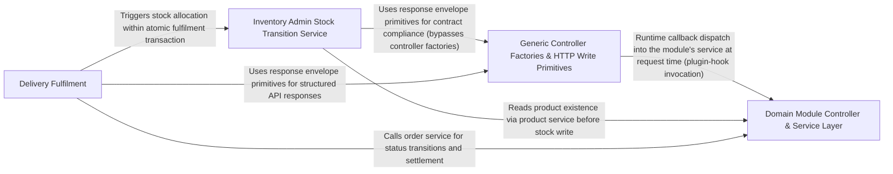

---
tags:
  - 2brain
  - 2brain/arch
  - project/boilerplate-node-backend
type: architecture
component: HTTP_Write_Surface_Controller_Factories
---

## Details

The infrastructure HTTP layer that both the seed fixtures and the driven flows write through. It provides the generic controller factories (createItemController, createListController, createDeleteController, createRestoreController), the namedHandler binding, id/upload helpers (RequiredId, readUploadedImage, writeWithUploadedImage), and the surfaces spec types. The product seeder deliberately routes its translation writes through this surface's planTranslations/writeTranslations primitives rather than a raw repository insert, so the seeded translations rows match what a real editor's write would produce.

### Domain Module Controller & Service Layer
The bounded-context controllers and services that consume the shared HTTP surface. This is the large fan-out of module-level read/write handlers — addresses (addressAdd, addressRemove, addressSetDefault), wishlist (wishlistAdd, wishlistGet, wishlistMoveToCart, wishlistRemove), feedback (remove), and the account lifecycle controllers (cancelPendingEmail, deleteAccountRequest, deleteAccountConfirm, deleteSession, get2fa, getAccountExport, getOauthLinks). Each module owns its controller file and service, supplying the per-entity spec (entity name, service call, not-found key) to the infrastructure factories and building its own CallerContext for tenancy-aware authorization and audit. This is the primary consumer of the surface: it is where the generic factories become concrete, named, module-specific endpoints.

**Related Classes/Methods**:

- `src.modules.addresses.service.addressAdd`:38-50
- `src.modules.wishlist.service.wishlistMoveToCart`:118-148
- `src.modules.account.controllers.delete-account-confirm.deleteAccountConfirm`:21-41
- `src.modules.feedback.service.remove`:222-237
- `src.infrastructure.http.ids.RequiredId`:68-79

**Source Files:**

- `src/infrastructure/http/ids.ts`
  - `src.infrastructure.http.ids.RequiredId` (L68-L79) - Interface
- `src/modules/account/controllers/cancel-pending-email.ts`
  - `src.modules.account.controllers.cancel-pending-email.cancelPendingEmail` (L19-L34) - Class
  - `src.modules.account.controllers.cancel-pending-email.cancelPendingEmail.then() callback` (L24-L32) - Function
- `src/modules/account/controllers/delete-account-confirm.ts`
  - `src.modules.account.controllers.delete-account-confirm.deleteAccountConfirm` (L21-L41) - Class
  - `src.modules.account.controllers.delete-account-confirm.deleteAccountConfirm.then() callback` (L30-L35) - Function
  - `src.modules.account.controllers.delete-account-confirm.deleteAccountConfirm.catch() callback` (L36-L40) - Function
- `src/modules/account/controllers/delete-account-request.ts`
  - `src.modules.account.controllers.delete-account-request.deleteAccountRequest` (L22-L51) - Class
  - `src.modules.account.controllers.delete-account-request.deleteAccountRequest.then() callback` (L28-L49) - Function
  - `src.modules.account.controllers.delete-account-request.deleteAccountRequest.then() callback.then() callback` (L40-L48) - Function
- `src/modules/account/controllers/delete-session.ts`
  - `src.modules.account.controllers.delete-session.deleteSession` (L25-L49) - Class
  - `src.modules.account.controllers.delete-session.deleteSession.then() callback` (L36-L47) - Function
- `src/modules/account/controllers/get-2fa.ts`
  - `src.modules.account.controllers.get-2fa.get2fa` (L17-L31) - Class
  - `src.modules.account.controllers.get-2fa.get2fa.then() callback` (L22-L29) - Function
- `src/modules/account/controllers/get-account-export.ts`
  - `src.modules.account.controllers.get-account-export.getAccountExport` (L25-L61) - Class
  - `src.modules.account.controllers.get-account-export.getAccountExport.then() callback` (L34-L51) - Function
  - `src.modules.account.controllers.get-account-export.getAccountExport.catch() callback` (L52-L60) - Function
- `src/modules/account/controllers/get-oauth-links.ts`
  - `src.modules.account.controllers.get-oauth-links.getOAuthLinks` (L16-L27) - Class
  - `src.modules.account.controllers.get-oauth-links.getOAuthLinks.then() callback` (L19-L25) - Function
  - `src.modules.account.controllers.get-oauth-links.getOAuthLinks.then() callback.links.links.map() callback` (L21-L24) - Function
- `src/modules/account/controllers/get-refresh-token.ts`
  - `src.modules.account.controllers.get-refresh-token.getRefreshToken` (L24-L57) - Class
  - `src.modules.account.controllers.get-refresh-token.getRefreshToken.then() callback` (L37-L44) - Function
  - `src.modules.account.controllers.get-refresh-token.getRefreshToken.catch() callback` (L48-L55) - Function
- `src/modules/account/controllers/get-sessions.ts`
  - `src.modules.account.controllers.get-sessions.getSessions` (L17-L27) - Class
  - `src.modules.account.controllers.get-sessions.getSessions.then() callback` (L23-L25) - Function
- `src/modules/account/controllers/post-2fa-backup-codes.ts`
  - `src.modules.account.controllers.post-2fa-backup-codes.post2faBackupCodes` (L21-L50) - Class
  - `src.modules.account.controllers.post-2fa-backup-codes.post2faBackupCodes.then() callback` (L35-L48) - Function
- `src/modules/account/controllers/post-account-export.ts`
  - `src.modules.account.controllers.post-account-export.postAccountExport` (L19-L29) - Class
  - `src.modules.account.controllers.post-account-export.postAccountExport.then() callback` (L24-L27) - Function
- `src/modules/account/controllers/post-email-change-confirm.ts`
  - `src.modules.account.controllers.post-email-change-confirm.postEmailChangeConfirm` (L24-L52) - Class
  - `src.modules.account.controllers.post-email-change-confirm.postEmailChangeConfirm.then() callback` (L36-L43) - Function
  - `src.modules.account.controllers.post-email-change-confirm.postEmailChangeConfirm.catch() callback` (L44-L51) - Function
- `src/modules/account/controllers/post-email-change-undo.ts`
  - `src.modules.account.controllers.post-email-change-undo.postEmailChangeUndo` (L22-L48) - Class
  - `src.modules.account.controllers.post-email-change-undo.postEmailChangeUndo.then() callback` (L35-L42) - Function
  - `src.modules.account.controllers.post-email-change-undo.postEmailChangeUndo.catch() callback` (L43-L47) - Function
- `src/modules/account/controllers/post-login-2fa-send.ts`
  - `src.modules.account.controllers.post-login-2fa-send.postLoginTwoFactorSend` (L23-L59) - Class
  - `src.modules.account.controllers.post-login-2fa-send.postLoginTwoFactorSend.then() callback` (L42-L54) - Function
  - `src.modules.account.controllers.post-login-2fa-send.postLoginTwoFactorSend.catch() callback` (L55-L58) - Function
- `src/modules/account/controllers/post-password-check.ts`
  - `src.modules.account.controllers.post-password-check.postPasswordCheck` (L16-L25) - Class
  - `src.modules.account.controllers.post-password-check.postPasswordCheck.then() callback` (L21-L23) - Function
- `src/modules/account/controllers/post-reset-confirm.ts`
  - `src.modules.account.controllers.post-reset-confirm.postResetConfirm` (L22-L50) - Class
  - `src.modules.account.controllers.post-reset-confirm.postResetConfirm.then() callback` (L36-L45) - Function
  - `src.modules.account.controllers.post-reset-confirm.postResetConfirm.catch() callback` (L46-L49) - Function
- `src/modules/account/controllers/post-verify-confirm.ts`
  - `src.modules.account.controllers.post-verify-confirm.postVerifyConfirm` (L21-L45) - Class
  - `src.modules.account.controllers.post-verify-confirm.postVerifyConfirm.then() callback` (L33-L40) - Function
  - `src.modules.account.controllers.post-verify-confirm.postVerifyConfirm.catch() callback` (L41-L44) - Function
- `src/modules/account/controllers/post-verify-request.ts`
  - `src.modules.account.controllers.post-verify-request.postVerifyRequest` (L18-L29) - Class
  - `src.modules.account.controllers.post-verify-request.postVerifyRequest.then() callback` (L24-L27) - Function
- `src/modules/account/services/export.ts`
  - `src.modules.account.services.export.requestExport` (L185-L224) - Class
- `src/modules/addresses/controllers/delete-address.ts`
  - `src.modules.addresses.controllers.delete-address.deleteAddress` (L18-L35) - Class
  - `src.modules.addresses.controllers.delete-address.deleteAddress.then() callback` (L28-L33) - Function
- `src/modules/addresses/controllers/get-addresses.ts`
  - `src.modules.addresses.controllers.get-addresses.getAddresses` (L19-L28) - Class
  - `src.modules.addresses.controllers.get-addresses.getAddresses.then() callback` (L24-L26) - Function
- `src/modules/addresses/controllers/post-address.ts`
  - `src.modules.addresses.controllers.post-address.postAddress` (L20-L37) - Class
  - `src.modules.addresses.controllers.post-address.postAddress.then() callback` (L31-L35) - Function
- `src/modules/addresses/controllers/put-address-default.ts`
  - `src.modules.addresses.controllers.put-address-default.putAddressDefault` (L19-L37) - Class
  - `src.modules.addresses.controllers.put-address-default.putAddressDefault.then() callback` (L30-L35) - Function
- `src/modules/addresses/service.ts`
  - `src.modules.addresses.service.addressAdd` (L38-L50) - Class
  - `src.modules.addresses.service.addressAdd.then() callback` (L42-L50) - Function
  - `src.modules.addresses.service.addressSetDefault` (L71-L79) - Class
  - `src.modules.addresses.service.addressSetDefault.then() callback` (L75-L79) - Function
  - `src.modules.addresses.service.addressRemove` (L82-L89) - Class
  - `src.modules.addresses.service.addressRemove.then() callback` (L86-L89) - Function
  - `src.modules.addresses.service.then() callback.book.items.find() callback` (L103-L103) - Function
- `src/modules/api-keys/controllers/revoke-api-key.ts`
  - `src.modules.api-keys.controllers.revoke-api-key.revokeApiKey` (L20-L32) - Class
  - `src.modules.api-keys.controllers.revoke-api-key.revokeApiKey.then() callback` (L27-L30) - Function
- `src/modules/cart/controllers/delete-cart-all.ts`
  - `src.modules.cart.controllers.delete-cart-all.clearCart` (L20-L29) - Class
  - `src.modules.cart.controllers.delete-cart-all.clearCart.then() callback` (L25-L27) - Function
- `src/modules/cart/controllers/delete-cart-item.ts`
  - `src.modules.cart.controllers.delete-cart-item.deleteCartItem` (L24-L47) - Class
  - `src.modules.cart.controllers.delete-cart-item.deleteCartItem.then() callback` (L42-L45) - Function
- `src/modules/cart/controllers/get-cart-summary.ts`
  - `src.modules.cart.controllers.get-cart-summary.getCartSummary` (L17-L24) - Class
  - `src.modules.cart.controllers.get-cart-summary.getCartSummary.then() callback` (L20-L22) - Function
- `src/modules/cart/controllers/get-cart.ts`
  - `src.modules.cart.controllers.get-cart.getCart` (L18-L25) - Class
  - `src.modules.cart.controllers.get-cart.getCart.then() callback` (L21-L23) - Function
- `src/modules/cart/controllers/post-cart-merge.ts`
  - `src.modules.cart.controllers.post-cart-merge.postCartMerge` (L19-L32) - Class
  - `src.modules.cart.controllers.post-cart-merge.postCartMerge.then() callback` (L28-L30) - Function
- `src/modules/cart/controllers/post-cart.ts`
  - `src.modules.cart.controllers.post-cart.postCart` (L22-L49) - Class
  - `src.modules.cart.controllers.post-cart.postCart.then() callback` (L36-L47) - Function
- `src/modules/cart/controllers/post-checkout.ts`
  - `src.modules.cart.controllers.post-checkout.postCheckout` (L24-L56) - Class
  - `src.modules.cart.controllers.post-checkout.postCheckout.then() callback` (L33-L50) - Function
  - `src.modules.cart.controllers.post-checkout.postCheckout.then() callback.then() callback` (L40-L49) - Function
  - `src.modules.cart.controllers.post-checkout.postCheckout.catch() callback` (L51-L55) - Function
- `src/modules/cart/controllers/post-reorder.ts`
  - `src.modules.cart.controllers.post-reorder.postReorder` (L20-L35) - Class
  - `src.modules.cart.controllers.post-reorder.postReorder.then() callback` (L29-L33) - Function
- `src/modules/cart/controllers/put-cart-item.ts`
  - `src.modules.cart.controllers.put-cart-item.putCartItem` (L21-L49) - Class
  - `src.modules.cart.controllers.put-cart-item.putCartItem.then() callback` (L43-L47) - Function
- `src/modules/cart/controllers/put-cart-shipping-method.ts`
  - `src.modules.cart.controllers.put-cart-shipping-method.putCartShippingMethod` (L19-L36) - Class
  - `src.modules.cart.controllers.put-cart-shipping-method.putCartShippingMethod.then() callback` (L30-L34) - Function
- `src/modules/delivery/controllers/post-start-order.ts`
  - `src.modules.delivery.controllers.post-start-order.postStartOrder` (L17-L31) - Class
  - `src.modules.delivery.controllers.post-start-order.postStartOrder.then() callback` (L26-L29) - Function
- `src/modules/example/controllers/delete-example.ts`
  - `src.modules.example.controllers.delete-example.deleteExample` (L21-L32) - Class
  - `src.modules.example.controllers.delete-example.deleteExample.then() callback` (L27-L30) - Function
- `src/modules/feedback/controllers/delete-feedback.ts`
  - `src.modules.feedback.controllers.delete-feedback.deleteFeedback` (L21-L32) - Class
  - `src.modules.feedback.controllers.delete-feedback.deleteFeedback.then() callback` (L27-L30) - Function
- `src/modules/feedback/service.ts`
  - `src.modules.feedback.service.remove` (L222-L237) - Class
  - `src.modules.feedback.service.remove.then() callback` (L226-L237) - Function
  - `src.modules.feedback.service.remove.then() callback.then() callback` (L228-L236) - Function
- `src/modules/invoicing/controllers/get-order-credit-note.ts`
  - `src.modules.invoicing.controllers.get-order-credit-note.getOrderCreditNote` (L28-L73) - Class
  - `src.modules.invoicing.controllers.get-order-credit-note.getOrderCreditNote.then() callback` (L41-L71) - Function
  - `src.modules.invoicing.controllers.get-order-credit-note.getOrderCreditNote.then() callback.then() callback` (L53-L70) - Function
  - `src.modules.invoicing.controllers.get-order-credit-note.getOrderCreditNote.then() callback.then() callback.then() callback` (L59-L69) - Function
- `src/modules/invoicing/controllers/get-order-credit-notes.ts`
  - `src.modules.invoicing.controllers.get-order-credit-notes.getOrderCreditNotes` (L18-L39) - Class
  - `src.modules.invoicing.controllers.get-order-credit-notes.getOrderCreditNotes.then() callback` (L24-L37) - Function
  - `src.modules.invoicing.controllers.get-order-credit-notes.getOrderCreditNotes.then() callback.then() callback` (L30-L36) - Function
  - `src.modules.invoicing.controllers.get-order-credit-notes.getOrderCreditNotes.then() callback.then() callback.notes.map() callback` (L33-L33) - Function
- `src/modules/invoicing/controllers/get-order-invoice.ts`
  - `src.modules.invoicing.controllers.get-order-invoice.getOrderInvoice` (L21-L71) - Class
  - `src.modules.invoicing.controllers.get-order-invoice.getOrderInvoice.then() callback` (L28-L69) - Function
  - `src.modules.invoicing.controllers.get-order-invoice.getOrderInvoice.then() callback.then() callback` (L34-L68) - Function
  - `src.modules.invoicing.controllers.get-order-invoice.getOrderInvoice.then() callback.then() callback.then() callback` (L53-L66) - Function
- `src/modules/locales/controllers/delete-locale-entry.ts`
  - `src.modules.locales.controllers.delete-locale-entry.deleteLocaleEntry` (L20-L38) - Class
  - `src.modules.locales.controllers.delete-locale-entry.deleteLocaleEntry.then() callback` (L32-L36) - Function
- `src/modules/locales/controllers/get-entity-translations.ts`
  - `src.modules.locales.controllers.get-entity-translations.getEntityTranslations.id` (L23-L25) - Class
  - `src.modules.locales.controllers.get-entity-translations.getEntityTranslations.id.notFound` (L24-L24) - Method
- `src/modules/locales/controllers/write-entity-translations.ts`
  - `src.modules.locales.controllers.write-entity-translations.writeEntityTranslations.<function>.id` (L53-L55) - Class
  - `src.modules.locales.controllers.write-entity-translations.writeEntityTranslations.<function>.id.notFound` (L54-L54) - Method
- `src/modules/locales/controllers/write-locale-entries.ts`
  - `src.modules.locales.controllers.write-locale-entries.updateLocaleEntry` (L65-L96) - Class
  - `src.modules.locales.controllers.write-locale-entries.updateLocaleEntry.then() callback` (L90-L94) - Function
- `src/modules/notifications/controllers/delete-notification.ts`
  - `src.modules.notifications.controllers.delete-notification.deleteNotification` (L17-L29) - Class
  - `src.modules.notifications.controllers.delete-notification.deleteNotification.then() callback` (L23-L27) - Function
- `src/modules/notifications/controllers/get-notifications-stream.ts`
  - `src.modules.notifications.controllers.get-notifications-stream.getNotificationsStream` (L27-L43) - Class
  - `src.modules.notifications.controllers.get-notifications-stream.getNotificationsStream.streamNotifications() callback` (L40-L41) - Function
- `src/modules/notifications/controllers/get-notifications.ts`
  - `src.modules.notifications.controllers.get-notifications.getNotifications` (L16-L23) - Class
  - `src.modules.notifications.controllers.get-notifications.getNotifications.then() callback` (L19-L21) - Function
- `src/modules/notifications/controllers/post-dismiss-all.ts`
  - `src.modules.notifications.controllers.post-dismiss-all.postDismissAll` (L15-L22) - Class
  - `src.modules.notifications.controllers.post-dismiss-all.postDismissAll.then() callback` (L18-L20) - Function
- `src/modules/notifications/controllers/post-read-all.ts`
  - `src.modules.notifications.controllers.post-read-all.postReadAll` (L15-L22) - Class
  - `src.modules.notifications.controllers.post-read-all.postReadAll.then() callback` (L18-L20) - Function
- `src/modules/notifications/services/inbox.ts`
  - `src.modules.notifications.services.inbox.notificationDelete` (L63-L72) - Class
  - `src.modules.notifications.services.inbox.notificationDelete.then() callback` (L67-L72) - Function
  - `src.modules.notifications.services.inbox.notificationsDismissAll.then() callback` (L76-L79) - Function
- `src/modules/orders/controllers/create-order.ts`
  - `src.modules.orders.controllers.create-order.createOrder` (L18-L38) - Class
  - `src.modules.orders.controllers.create-order.createOrder.then() callback` (L29-L36) - Function
- `src/modules/orders/controllers/get-order-item.ts`
  - `src.modules.orders.controllers.get-order-item.getOrderItem` (L24-L52) - Class
  - `src.modules.orders.controllers.get-order-item.getOrderItem.then() callback` (L33-L50) - Function
- `src/modules/orders/controllers/post-cancel-order.ts`
  - `src.modules.orders.controllers.post-cancel-order.postCancelOrder` (L23-L54) - Class
  - `src.modules.orders.controllers.post-cancel-order.postCancelOrder.then() callback` (L41-L52) - Function
- `src/modules/orders/controllers/post-order-status-override.ts`
  - `src.modules.orders.controllers.post-order-status-override.postOrderStatusOverride` (L20-L43) - Class
  - `src.modules.orders.controllers.post-order-status-override.postOrderStatusOverride.then() callback` (L32-L41) - Function
- `src/modules/orders/controllers/respond.ts`
  - `src.modules.orders.controllers.respond.respondWithOrder` (L36-L50) - Class
  - `src.modules.orders.controllers.respond.respondWithOrder.then() callback` (L46-L49) - Function
- `src/modules/payments/controllers/get-order-by-reference.ts`
  - `src.modules.payments.controllers.get-order-by-reference.getOrderByReference` (L18-L39) - Class
  - `src.modules.payments.controllers.get-order-by-reference.getOrderByReference.then() callback` (L29-L37) - Function
  - `src.modules.payments.controllers.get-order-by-reference.getOrderByReference.then() callback.then() callback` (L36-L36) - Function
- `src/modules/payments/controllers/get-payment-by-order.ts`
  - `src.modules.payments.controllers.get-payment-by-order.getPaymentByOrder` (L16-L30) - Class
  - `src.modules.payments.controllers.get-payment-by-order.getPaymentByOrder.then() callback` (L25-L28) - Function
- `src/modules/payments/controllers/get-payments.ts`
  - `src.modules.payments.controllers.get-payments.getPayments` (L30-L34) - Class
  - `src.modules.payments.controllers.get-payments.getPayments.runSearch` (L33-L33) - Method
- `src/modules/payments/controllers/get-refunds.ts`
  - `src.modules.payments.controllers.get-refunds.getRefunds` (L18-L31) - Class
  - `src.modules.payments.controllers.get-refunds.getRefunds.runSearch` (L21-L30) - Method
- `src/modules/payments/controllers/post-payment-confirm.ts`
  - `src.modules.payments.controllers.post-payment-confirm.postPaymentConfirm` (L23-L56) - Class
  - `src.modules.payments.controllers.post-payment-confirm.postPaymentConfirm.then() callback` (L37-L54) - Function
- `src/modules/payments/controllers/post-payment-intent.ts`
  - `src.modules.payments.controllers.post-payment-intent.postPaymentIntent` (L21-L40) - Class
  - `src.modules.payments.controllers.post-payment-intent.postPaymentIntent.then() callback` (L27-L38) - Function
- `src/modules/payments/controllers/post-payment-offline.ts`
  - `src.modules.payments.controllers.post-payment-offline.postPaymentOffline` (L20-L45) - Class
  - `src.modules.payments.controllers.post-payment-offline.postPaymentOffline.then() callback` (L32-L43) - Function
- `src/modules/payments/controllers/post-payment-refund.ts`
  - `src.modules.payments.controllers.post-payment-refund.postPaymentRefund` (L21-L43) - Class
  - `src.modules.payments.controllers.post-payment-refund.postPaymentRefund.then() callback` (L33-L41) - Function
- `src/modules/payments/controllers/post-payment-sync.ts`
  - `src.modules.payments.controllers.post-payment-sync.postPaymentSync` (L20-L32) - Class
  - `src.modules.payments.controllers.post-payment-sync.postPaymentSync.then() callback` (L26-L30) - Function
- `src/modules/payments/providers/webhook-signature.ts`
  - `src.modules.payments.providers.webhook-signature.verifyWebhookSignature.matches.flatMap() callback` (L105-L108) - Function
  - `src.modules.payments.providers.webhook-signature.verifyWebhookSignature.matches` (L105-L109) - Class
  - `src.modules.payments.providers.webhook-signature.verifyWebhookSignature.matches.flatMap() callback.provided.map() callback` (L106-L107) - Function
- `src/modules/payments/services/lookup.ts`
  - `src.modules.payments.services.lookup.getOrderByReference` (L27-L38) - Class
  - `src.modules.payments.services.lookup.getOrderByReference.then() callback` (L35-L36) - Function
- `src/modules/payments/services/offline.ts`
  - `src.modules.payments.services.offline.OfflinePaymentInput` (L34-L38) - Interface
  - `src.modules.payments.services.offline.recordOfflinePayment.refusal` (L78-L86) - Class
  - `src.modules.payments.services.offline.recordOfflinePayment.refusal.then() callback` (L79-L79) - Function
  - `src.modules.payments.services.offline.recordOfflinePayment.refusal.catch() callback` (L80-L86) - Function
- `src/modules/payments/services/refunds.ts`
  - `src.modules.payments.services.refunds.RefundRequest` (L58-L72) - Interface
  - `src.modules.payments.services.refunds.OpenedRefund` (L78-L81) - Interface
  - `src.modules.payments.services.refunds.announceInTransaction() callback` (L381-L381) - Function
  - `src.modules.payments.services.refunds.refundByOrder` (L629-L664) - Class
  - `src.modules.payments.services.refunds.refundByOrder.then() callback` (L640-L663) - Function
  - `src.modules.payments.services.refunds.refundByOrder.then() callback.then() callback` (L644-L663) - Function
  - `src.modules.payments.services.refunds.refundByOrder.then() callback.then() callback.then() callback` (L653-L661) - Function
- `src/modules/payments/services/settlement.ts`
  - `src.modules.payments.services.settlement.Settlement` (L46-L63) - Interface
  - `src.modules.payments.services.settlement.confirmableOrder` (L521-L531) - Class
  - `src.modules.payments.services.settlement.confirmableOrder.then() callback.then() callback` (L528-L528) - Function
  - `src.modules.payments.services.settlement.confirmableOrder.then() callback` (L531-L531) - Function
  - `src.modules.payments.services.settlement.settleVia() callback` (L641-L641) - Function
- `src/modules/payments/services/view.ts`
  - `src.modules.payments.services.view.getForOrder` (L32-L46) - Class
  - `src.modules.payments.services.view.getForOrder.then() callback` (L36-L46) - Function
  - `src.modules.payments.services.view.getForOrder.then() callback.then() callback` (L43-L44) - Function
  - `src.modules.payments.services.view.getForOrder.then() callback.then() callback.then() callback` (L44-L44) - Function
  - `src.modules.payments.services.view.withActions` (L67-L101) - Class
  - `src.modules.payments.services.view.withActions.then() callback` (L73-L100) - Function
- `src/modules/returns/controllers/get-return-by-id.ts`
  - `src.modules.returns.controllers.get-return-by-id.getReturnById` (L17-L36) - Class
  - `src.modules.returns.controllers.get-return-by-id.getReturnById.then() callback` (L25-L34) - Function
- `src/modules/returns/controllers/get-return-options.ts`
  - `src.modules.returns.controllers.get-return-options.getReturnOptions` (L15-L29) - Class
  - `src.modules.returns.controllers.get-return-options.getReturnOptions.then() callback` (L24-L27) - Function
- `src/modules/returns/controllers/get-returns.ts`
  - `src.modules.returns.controllers.get-returns.getReturns` (L21-L34) - Class
  - `src.modules.returns.controllers.get-returns.getReturns.then() callback` (L30-L32) - Function
- `src/modules/returns/controllers/post-return-decision.ts`
  - `src.modules.returns.controllers.post-return-decision.postReturnApprove` (L17-L32) - Class
  - `src.modules.returns.controllers.post-return-decision.postReturnApprove.then() callback` (L25-L30) - Function
  - `src.modules.returns.controllers.post-return-decision.postReturnApprove.then() callback.then() callback` (L27-L29) - Function
  - `src.modules.returns.controllers.post-return-decision.postReturnDecline` (L35-L52) - Class
  - `src.modules.returns.controllers.post-return-decision.postReturnDecline.then() callback` (L45-L50) - Function
  - `src.modules.returns.controllers.post-return-decision.postReturnDecline.then() callback.then() callback` (L47-L49) - Function
- `src/modules/returns/controllers/post-return-receive.ts`
  - `src.modules.returns.controllers.post-return-receive.postReturnReceive` (L18-L36) - Class
  - `src.modules.returns.controllers.post-return-receive.postReturnReceive.then() callback` (L29-L34) - Function
  - `src.modules.returns.controllers.post-return-receive.postReturnReceive.then() callback.then() callback` (L31-L33) - Function
- `src/modules/returns/controllers/post-return.ts`
  - `src.modules.returns.controllers.post-return.postReturn` (L19-L51) - Class
  - `src.modules.returns.controllers.post-return.postReturn.then() callback` (L28-L49) - Function
  - `src.modules.returns.controllers.post-return.postReturn.then() callback.then() callback` (L33-L48) - Function
- `src/modules/webhooks/controllers/delete-subscription.ts`
  - `src.modules.webhooks.controllers.delete-subscription.deleteWebhookSubscription` (L19-L31) - Class
  - `src.modules.webhooks.controllers.delete-subscription.deleteWebhookSubscription.then() callback` (L26-L29) - Function
- `src/modules/webhooks/controllers/remove-subscription-secret.ts`
  - `src.modules.webhooks.controllers.remove-subscription-secret.removeWebhookSubscriptionSecret` (L21-L38) - Class
  - `src.modules.webhooks.controllers.remove-subscription-secret.removeWebhookSubscriptionSecret.then() callback` (L30-L36) - Function
- `src/modules/webhooks/controllers/replay-delivery.ts`
  - `src.modules.webhooks.controllers.replay-delivery.replayWebhookDelivery` (L20-L32) - Class
  - `src.modules.webhooks.controllers.replay-delivery.replayWebhookDelivery.then() callback` (L27-L30) - Function
- `src/modules/webhooks/controllers/rotate-subscription-secret.ts`
  - `src.modules.webhooks.controllers.rotate-subscription-secret.rotateWebhookSubscriptionSecret` (L20-L37) - Class
  - `src.modules.webhooks.controllers.rotate-subscription-secret.rotateWebhookSubscriptionSecret.then() callback` (L29-L35) - Function
- `src/modules/wishlist/controllers/delete-wishlist-item.ts`
  - `src.modules.wishlist.controllers.delete-wishlist-item.deleteWishlistItem` (L19-L35) - Class
  - `src.modules.wishlist.controllers.delete-wishlist-item.deleteWishlistItem.then() callback` (L29-L33) - Function
- `src/modules/wishlist/controllers/get-wishlist.ts`
  - `src.modules.wishlist.controllers.get-wishlist.getWishlist` (L18-L25) - Class
  - `src.modules.wishlist.controllers.get-wishlist.getWishlist.then() callback` (L21-L23) - Function
- `src/modules/wishlist/controllers/post-move-to-cart.ts`
  - `src.modules.wishlist.controllers.post-move-to-cart.postMoveToCart` (L21-L37) - Class
  - `src.modules.wishlist.controllers.post-move-to-cart.postMoveToCart.then() callback` (L31-L35) - Function
- `src/modules/wishlist/controllers/put-wishlist-item.ts`
  - `src.modules.wishlist.controllers.put-wishlist-item.putWishlistItem` (L21-L37) - Class
  - `src.modules.wishlist.controllers.put-wishlist-item.putWishlistItem.then() callback` (L31-L35) - Function
- `src/modules/wishlist/service.ts`
  - `src.modules.wishlist.service.wishlistAdd` (L61-L80) - Class
  - `src.modules.wishlist.service.wishlistAdd.then() callback` (L66-L80) - Function
  - `src.modules.wishlist.service.wishlistAdd.then() callback.then() callback` (L68-L79) - Function
  - `src.modules.wishlist.service.wishlistRemove` (L88-L101) - Class
  - `src.modules.wishlist.service.wishlistRemove.then() callback` (L93-L101) - Function
  - `src.modules.wishlist.service.wishlistMoveToCart` (L118-L148) - Class
  - `src.modules.wishlist.service.wishlistMoveToCart.then() callback` (L123-L148) - Function
  - `src.modules.wishlist.service.wishlistMoveToCart.then() callback.then() callback` (L127-L147) - Function
  - `src.modules.wishlist.service.wishlistMoveToCart.then() callback.then() callback.added.errors.some() callback` (L133-L133) - Function
  - `src.modules.wishlist.service.wishlistMoveToCart.then() callback.then() callback.then() callback` (L137-L146) - Function

### Generic Controller Factories & HTTP Write Primitives
The core of the subsystem — the spec-driven controller factories and the low-level HTTP primitives they compose. createItemController (read-one), createListController (paged list), createDeleteController (soft/hard delete triplet), and create-restore-controller (undo of a soft delete) each take a *ControllerSpec and return a named Express handler. They are built on namedHandler/operationName (stable handler naming for stack traces, logs, and generated docs), requireId (malformed-id-as-unknown-id contract), refused/catchAs (envelope branching and the mandatory .catch), and the upload helpers readUploadedImage/writeWithUploadedImage (image-bearing writes with claim/undo semantics). This is the single landing site for the API's write contract decisions, and the path the product seeder uses for translation writes.

**Related Classes/Methods**:

- `src.infrastructure.surfaces.create-item-controller.createItemController`:48-74
- `src.infrastructure.surfaces.create-list-controller.createListController`:49-76
- `src.infrastructure.surfaces.create-delete-controller.createDeleteController`:50-83
- `src.infrastructure.http.controller.namedHandler`:46-54
- `src.infrastructure.http.uploads.writeWithUploadedImage`:142-157

**Source Files:**

- `src/infrastructure/http/controller.ts`
  - `src.infrastructure.http.controller.namedHandler` (L46-L54) - Class
  - `src.infrastructure.http.controller.namedHandler.[operation]` (L52-L52) - Method
- `src/infrastructure/http/uploads.ts`
  - `src.infrastructure.http.uploads.readUploadedImage` (L68-L113) - Class
  - `src.infrastructure.http.uploads.writeWithUploadedImage` (L142-L157) - Class
  - `src.infrastructure.http.uploads.writeWithUploadedImage.then() callback` (L153-L156) - Function
- `src/infrastructure/surfaces/create-delete-controller.ts`
  - `src.infrastructure.surfaces.create-delete-controller.DeleteControllerSpec` (L27-L42) - Interface
  - `src.infrastructure.surfaces.create-delete-controller.createDeleteController` (L50-L83) - Class
  - `src.infrastructure.surfaces.create-delete-controller.createDeleteController.namedHandler() callback` (L54-L82) - Function
  - `src.infrastructure.surfaces.create-delete-controller.createDeleteController.namedHandler() callback.withIfMatch() callback` (L74-L74) - Function
  - `src.infrastructure.surfaces.create-delete-controller.createDeleteController.namedHandler() callback.then() callback` (L75-L80) - Function
- `src/infrastructure/surfaces/create-item-controller.ts`
  - `src.infrastructure.surfaces.create-item-controller.ItemControllerSpec` (L18-L40) - Interface
  - `src.infrastructure.surfaces.create-item-controller.createItemController` (L48-L74) - Class
  - `src.infrastructure.surfaces.create-item-controller.createItemController.namedHandler() callback` (L57-L73) - Function
  - `src.infrastructure.surfaces.create-item-controller.createItemController.namedHandler() callback.then() callback` (L63-L71) - Function
- `src/infrastructure/surfaces/create-list-controller.ts`
  - `src.infrastructure.surfaces.create-list-controller.ListControllerSpec` (L17-L41) - Interface
  - `src.infrastructure.surfaces.create-list-controller.createListController` (L49-L76) - Class
  - `src.infrastructure.surfaces.create-list-controller.createListController.namedHandler() callback` (L58-L75) - Function
  - `src.infrastructure.surfaces.create-list-controller.createListController.namedHandler() callback.then() callback` (L71-L73) - Function
- `src/infrastructure/surfaces/create-restore-controller.ts`
  - `src.infrastructure.surfaces.create-restore-controller.RestoreControllerSpec` (L22-L39) - Interface
  - `src.infrastructure.surfaces.create-restore-controller.createRestoreController` (L47-L71) - Class
  - `src.infrastructure.surfaces.create-restore-controller.createRestoreController.namedHandler() callback` (L55-L70) - Function
  - `src.infrastructure.surfaces.create-restore-controller.createRestoreController.namedHandler() callback.then() callback` (L61-L68) - Function
  - `src.infrastructure.surfaces.create-restore-controller.createRestoreController.namedHandler() callback.then() callback.then() callback` (L65-L67) - Function
- `src/modules/api-keys/controllers/list-api-keys.ts`
  - `src.modules.api-keys.controllers.list-api-keys.listApiKeys` (L16-L21) - Class
  - `src.modules.api-keys.controllers.list-api-keys.listApiKeys.runList` (L19-L20) - Method
- `src/modules/api-keys/controllers/mint-api-key.ts`
  - `src.modules.api-keys.controllers.mint-api-key.mintApiKey` (L19-L37) - Class
  - `src.modules.api-keys.controllers.mint-api-key.mintApiKey.then() callback` (L28-L35) - Function
- `src/modules/audit-logs/controllers/get-audit.ts`
  - `src.modules.audit-logs.controllers.get-audit.getAudit` (L16-L30) - Class
  - `src.modules.audit-logs.controllers.get-audit.getAudit.runList` (L25-L29) - Method
- `src/modules/delivery/controllers/get-order-fulfillment.ts`
  - `src.modules.delivery.controllers.get-order-fulfillment.getOrderFulfillment` (L16-L30) - Class
  - `src.modules.delivery.controllers.get-order-fulfillment.getOrderFulfillment.then() callback` (L25-L28) - Function
- `src/modules/delivery/controllers/get-preorder-fulfillment-orders.ts`
  - `src.modules.delivery.controllers.get-preorder-fulfillment-orders.getPreorderFulfillmentOrders` (L16-L25) - Class
  - `src.modules.delivery.controllers.get-preorder-fulfillment-orders.getPreorderFulfillmentOrders.runList` (L24-L24) - Method
- `src/modules/delivery/controllers/patch-shipment.ts`
  - `src.modules.delivery.controllers.patch-shipment.patchShipment` (L17-L31) - Class
  - `src.modules.delivery.controllers.patch-shipment.patchShipment.then() callback` (L26-L29) - Function
- `src/modules/delivery/controllers/post-confirm-wait.ts`
  - `src.modules.delivery.controllers.post-confirm-wait.postConfirmWait` (L16-L27) - Class
  - `src.modules.delivery.controllers.post-confirm-wait.postConfirmWait.then() callback` (L22-L25) - Function
- `src/modules/delivery/controllers/post-deliver-shipment.ts`
  - `src.modules.delivery.controllers.post-deliver-shipment.postDeliverShipment` (L18-L32) - Class
  - `src.modules.delivery.controllers.post-deliver-shipment.postDeliverShipment.then() callback` (L27-L30) - Function
- `src/modules/delivery/controllers/post-fulfill-fulfillment-order.ts`
  - `src.modules.delivery.controllers.post-fulfill-fulfillment-order.postFulfillFulfillmentOrder` (L16-L30) - Class
  - `src.modules.delivery.controllers.post-fulfill-fulfillment-order.postFulfillFulfillmentOrder.then() callback` (L25-L28) - Function
- `src/modules/delivery/controllers/post-hold-fulfillment-order.ts`
  - `src.modules.delivery.controllers.post-hold-fulfillment-order.postHoldFulfillmentOrder` (L17-L31) - Class
  - `src.modules.delivery.controllers.post-hold-fulfillment-order.postHoldFulfillmentOrder.then() callback` (L26-L29) - Function
  - `src.modules.delivery.controllers.post-hold-fulfillment-order.postReleaseFulfillmentOrder` (L34-L48) - Class
  - `src.modules.delivery.controllers.post-hold-fulfillment-order.postReleaseFulfillmentOrder.then() callback` (L43-L46) - Function
- `src/modules/delivery/controllers/post-ship-fulfillment-order.ts`
  - `src.modules.delivery.controllers.post-ship-fulfillment-order.postShipFulfillmentOrder` (L17-L35) - Class
  - `src.modules.delivery.controllers.post-ship-fulfillment-order.postShipFulfillmentOrder.then() callback` (L26-L33) - Function
- `src/modules/example/controllers/get-example.ts`
  - `src.modules.example.controllers.get-example.getExample` (L15-L19) - Class
  - `src.modules.example.controllers.get-example.getExample.fetch` (L18-L18) - Method
  - `src.modules.example.controllers.get-example.getPublishedExample` (L22-L27) - Class
  - `src.modules.example.controllers.get-example.getPublishedExample.fetch` (L26-L26) - Method
- `src/modules/example/controllers/post-example.ts`
  - `src.modules.example.controllers.post-example.postExample` (L17-L28) - Class
  - `src.modules.example.controllers.post-example.postExample.namedHandler('postExample') callback` (L17-L28) - Function
  - `src.modules.example.controllers.post-example.postExample.namedHandler('postExample') callback.then() callback` (L23-L26) - Function
- `src/modules/example/controllers/put-example-cover.ts`
  - `src.modules.example.controllers.put-example-cover.putExampleCover` (L19-L44) - Class
  - `src.modules.example.controllers.put-example-cover.putExampleCover.namedHandler('putExampleCover') callback` (L21-L43) - Function
  - `src.modules.example.controllers.put-example-cover.putExampleCover.namedHandler('putExampleCover') callback.then() callback` (L37-L41) - Function
- `src/modules/inventory/controllers/get-inventory-levels.ts`
  - `src.modules.inventory.controllers.get-inventory-levels.getInventoryLevels` (L13-L22) - Class
  - `src.modules.inventory.controllers.get-inventory-levels.getInventoryLevels.runList` (L21-L21) - Method
- `src/modules/inventory/controllers/get-preorder-levels.ts`
  - `src.modules.inventory.controllers.get-preorder-levels.getPreorderLevels` (L14-L21) - Class
  - `src.modules.inventory.controllers.get-preorder-levels.getPreorderLevels.runList` (L20-L20) - Method
- `src/modules/inventory/controllers/get-stock-movements.ts`
  - `src.modules.inventory.controllers.get-stock-movements.getStockMovements` (L13-L21) - Class
  - `src.modules.inventory.controllers.get-stock-movements.getStockMovements.runList` (L20-L20) - Method
- `src/modules/inventory/controllers/post-adjustment.ts`
  - `src.modules.inventory.controllers.post-adjustment.postAdjustment` (L19-L38) - Class
  - `src.modules.inventory.controllers.post-adjustment.postAdjustment.then() callback` (L33-L36) - Function
- `src/modules/inventory/controllers/post-receipt.ts`
  - `src.modules.inventory.controllers.post-receipt.postReceipt` (L17-L29) - Class
  - `src.modules.inventory.controllers.post-receipt.postReceipt.then() callback` (L24-L27) - Function
- `src/modules/inventory/controllers/post-reservations-sweep.ts`
  - `src.modules.inventory.controllers.post-reservations-sweep.postReservationsSweep` (L20-L31) - Class
  - `src.modules.inventory.controllers.post-reservations-sweep.postReservationsSweep.then() callback` (L23-L30) - Function
- `src/modules/inventory/controllers/put-preorder-limit.ts`
  - `src.modules.inventory.controllers.put-preorder-limit.putPreorderLimit` (L18-L35) - Class
  - `src.modules.inventory.controllers.put-preorder-limit.putPreorderLimit.then() callback` (L30-L33) - Function
- `src/modules/observability/controllers/get-observability-audit.ts`
  - `src.modules.observability.controllers.get-observability-audit.getObservabilityAuditLogs` (L21-L35) - Class
  - `src.modules.observability.controllers.get-observability-audit.getObservabilityAuditLogs.runList` (L30-L34) - Method
- `src/modules/observability/controllers/get-observability-health.ts`
  - `src.modules.observability.controllers.get-observability-health.getObservabilityHealth` (L24-L29) - Class
  - `src.modules.observability.controllers.get-observability-health.getObservabilityHealth.then() callback` (L26-L28) - Function
- `src/modules/orders/controllers/delete-orders.ts`
  - `src.modules.orders.controllers.delete-orders.deleteOrders` (L17-L22) - Class
  - `src.modules.orders.controllers.delete-orders.deleteOrders.remove` (L19-L20) - Method
- `src/modules/orders/controllers/get-order-timeline.ts`
  - `src.modules.orders.controllers.get-order-timeline.getOrderTimeline` (L20-L39) - Class
  - `src.modules.orders.controllers.get-order-timeline.getOrderTimeline.then() callback` (L29-L37) - Function
  - `src.modules.orders.controllers.get-order-timeline.getOrderTimeline.then() callback.then() callback` (L34-L36) - Function
- `src/modules/orders/controllers/get-orders-export.ts`
  - `src.modules.orders.controllers.get-orders-export.getOrdersExport` (L28-L67) - Class
  - `src.modules.orders.controllers.get-orders-export.getOrdersExport.namedHandler('getOrdersExport') callback` (L30-L66) - Function
  - `src.modules.orders.controllers.get-orders-export.getOrdersExport.namedHandler('getOrdersExport') callback.then() callback` (L40-L56) - Function
  - `src.modules.orders.controllers.get-orders-export.getOrdersExport.namedHandler('getOrdersExport') callback.catch() callback` (L57-L65) - Function
- `src/modules/orders/controllers/restore-orders.ts`
  - `src.modules.orders.controllers.restore-orders.restoreOrders` (L15-L20) - Class
  - `src.modules.orders.controllers.restore-orders.restoreOrders.restore` (L17-L17) - Method
  - `src.modules.orders.controllers.restore-orders.restoreOrders.present` (L18-L18) - Method
- `src/modules/orders/domain/lifecycle.ts`
  - `src.modules.orders.domain.lifecycle.canTransition` (L110-L113) - Class
  - `src.modules.orders.domain.lifecycle.canTransition.EVERY_EVENT.some() callback` (L112-L112) - Function
- `src/modules/products/controllers/create-product.ts`
  - `src.modules.products.controllers.create-product.createProduct` (L23-L95) - Class
  - `src.modules.products.controllers.create-product.createProduct.then() callback` (L81-L91) - Function
  - `src.modules.products.controllers.create-product.createProduct.catch() callback` (L92-L94) - Function
- `src/modules/products/controllers/delete-products.ts`
  - `src.modules.products.controllers.delete-products.deleteProducts` (L17-L22) - Class
  - `src.modules.products.controllers.delete-products.deleteProducts.remove` (L19-L20) - Method
- `src/modules/products/controllers/get-product-admin.ts`
  - `src.modules.products.controllers.get-product-admin.getProductAdmin` (L14-L19) - Class
  - `src.modules.products.controllers.get-product-admin.getProductAdmin.fetch` (L18-L18) - Method
- `src/modules/products/controllers/get-product-item.ts`
  - `src.modules.products.controllers.get-product-item.getProductItem` (L16-L26) - Class
  - `src.modules.products.controllers.get-product-item.getProductItem.fetch` (L20-L25) - Method
- `src/modules/products/controllers/restore-products.ts`
  - `src.modules.products.controllers.restore-products.restoreProducts` (L15-L20) - Class
  - `src.modules.products.controllers.restore-products.restoreProducts.restore` (L17-L17) - Method
  - `src.modules.products.controllers.restore-products.restoreProducts.present` (L18-L18) - Method
- `src/modules/products/model.ts`
  - `src.modules.products.model.zodProductCreateSchema.CreateProductBody.superRefine() callback` (L193-L197) - Function
  - `src.modules.products.model.zodProductReplaceSchema.ReplaceProductByIdBody.superRefine() callback` (L204-L208) - Function
  - `src.modules.products.model.zodProductUpdateSchema.UpdateProductByIdBody.superRefine() callback` (L214-L218) - Function
- `src/modules/products/services/remove.ts`
  - `src.modules.products.services.remove.announceDeleted() callback` (L84-L88) - Function
  - `src.modules.products.services.remove.announceDeleted() callback.then() callback` (L87-L87) - Function
  - `src.modules.products.services.remove.remove.announceDeleted() callback.then() callback` (L88-L88) - Function
  - `src.modules.products.services.remove.remove.announceDeleted() callback` (L99-L100) - Function
  - `src.modules.products.services.remove.restoreById` (L135-L152) - Class
  - `src.modules.products.services.remove.restoreById.then() callback` (L139-L152) - Function
  - `src.modules.products.services.remove.restoreById.then() callback.then() callback` (L143-L151) - Function
- `src/modules/stats/controllers/get-stats.ts`
  - `src.modules.stats.controllers.get-stats.getSalesStats` (L17-L21) - Class
  - `src.modules.stats.controllers.get-stats.getSalesStats.statsHandler('getSalesStats') callback` (L20-L20) - Function
  - `src.modules.stats.controllers.get-stats.getProductStats` (L24-L31) - Class
  - `src.modules.stats.controllers.get-stats.getProductStats.statsHandler('getProductStats') callback` (L30-L30) - Function
  - `src.modules.stats.controllers.get-stats.productSeries` (L34-L39) - Class
  - `src.modules.stats.controllers.get-stats.productSeries.statsHandler('getProductSalesSeries') callback` (L37-L38) - Function
  - `src.modules.stats.controllers.get-stats.getProductSalesSeries` (L42-L48) - Class
  - `src.modules.stats.controllers.get-stats.getProductSalesSeries.namedHandler('getProductSalesSeries') callback` (L44-L47) - Function
  - `src.modules.stats.controllers.get-stats.getCategoryStats` (L51-L55) - Class
  - `src.modules.stats.controllers.get-stats.getCategoryStats.statsHandler('getCategoryStats') callback` (L54-L54) - Function
  - `src.modules.stats.controllers.get-stats.getPaymentMixStats` (L58-L62) - Class
  - `src.modules.stats.controllers.get-stats.getPaymentMixStats.statsHandler('getPaymentMixStats') callback` (L61-L61) - Function
  - `src.modules.stats.controllers.get-stats.getOperationsStats` (L65-L69) - Class
  - `src.modules.stats.controllers.get-stats.getOperationsStats.statsHandler('getOperationsStats') callback` (L68-L68) - Function
  - `src.modules.stats.controllers.get-stats.getCustomerStats` (L72-L76) - Class
  - `src.modules.stats.controllers.get-stats.getCustomerStats.statsHandler('getCustomerStats') callback` (L75-L75) - Function
- `src/modules/stats/controllers/respond.ts`
  - `src.modules.stats.controllers.respond.statsHandler` (L35-L62) - Class
  - `src.modules.stats.controllers.respond.statsHandler.namedHandler() callback` (L46-L62) - Function
  - `src.modules.stats.controllers.respond.statsHandler.namedHandler() callback.then() callback` (L58-L60) - Function
- `src/modules/users/controllers/create-user.ts`
  - `src.modules.users.controllers.create-user.createUser` (L21-L85) - Class
  - `src.modules.users.controllers.create-user.createUser.then() callback` (L69-L81) - Function
  - `src.modules.users.controllers.create-user.createUser.then() callback.then() callback` (L78-L80) - Function
  - `src.modules.users.controllers.create-user.createUser.catch() callback` (L82-L84) - Function
- `src/modules/users/controllers/delete-users.ts`
  - `src.modules.users.controllers.delete-users.deleteUsers` (L23-L28) - Class
  - `src.modules.users.controllers.delete-users.deleteUsers.remove` (L25-L26) - Method
- `src/modules/users/controllers/get-user-item.ts`
  - `src.modules.users.controllers.get-user-item.getUserItem` (L21-L36) - Class
  - `src.modules.users.controllers.get-user-item.getUserItem.fetch` (L24-L35) - Method
  - `src.modules.users.controllers.get-user-item.getUserItem.fetch.then() callback` (L25-L35) - Function
- `src/modules/users/controllers/restore-users.ts`
  - `src.modules.users.controllers.restore-users.restoreUsers` (L16-L21) - Class
  - `src.modules.users.controllers.restore-users.restoreUsers.restore` (L18-L18) - Method
  - `src.modules.users.controllers.restore-users.restoreUsers.present` (L19-L19) - Method
- `src/modules/users/two-factor-write.ts`
  - `src.modules.users.two-factor-write.modifiedFieldsOf` (L119-L123) - Class
  - `src.modules.users.two-factor-write.modifiedFieldsOf.ENTRY_FIELDS.filter() callback` (L122-L122) - Function
- `src/modules/webhooks/controllers/create-subscription.ts`
  - `src.modules.webhooks.controllers.create-subscription.createWebhookSubscription` (L22-L41) - Class
  - `src.modules.webhooks.controllers.create-subscription.createWebhookSubscription.then() callback` (L31-L39) - Function
- `src/modules/webhooks/controllers/list-deliveries.ts`
  - `src.modules.webhooks.controllers.list-deliveries.listWebhookDeliveries` (L17-L28) - Class
  - `src.modules.webhooks.controllers.list-deliveries.listWebhookDeliveries.runList` (L26-L27) - Method
- `src/modules/webhooks/controllers/list-subscriptions.ts`
  - `src.modules.webhooks.controllers.list-subscriptions.listWebhookSubscriptions` (L17-L28) - Class
  - `src.modules.webhooks.controllers.list-subscriptions.listWebhookSubscriptions.runList` (L26-L27) - Method

### Inventory Admin Stock Transition Service
The operator-facing inventory write path that produces audited stock changes through the shared write surface. receive (units arrive from a supplier) and adjust (post-stocktake correction) both flow through the shared applyAdminStockTransition body, parameterized by the AdminStockTransition spec (reason, signed amount, onFailure rule, auditAction, buildAuditMetadata, success message). It checks the product exists before writing, applies a signed transition, decides the failure status (404 vs 409), records an audit row, and answers with the fresh level. This is a concrete example of a domain service whose write is shaped by the surface's envelope/audit conventions rather than a raw repository insert.

**Related Classes/Methods**:

- `src.modules.inventory.services.admin.AdminStockTransition`:80-99
- `src.modules.inventory.services.admin.receive`:160-176
- `src.modules.inventory.services.admin.adjust`:189-221
- `src.modules.inventory.services.admin.adjust.buildAuditMetadata`

**Source Files:**

- `src/modules/inventory/services/admin.ts`
  - `src.modules.inventory.services.admin.levelFor` (L31-L44) - Class
  - `src.modules.inventory.services.admin.levelFor.then() callback` (L32-L43) - Function
  - `src.modules.inventory.services.admin.AdminStockTransition` (L80-L99) - Interface
  - `src.modules.inventory.services.admin.applyAdminStockTransition` (L105-L148) - Class
  - `src.modules.inventory.services.admin.applyAdminStockTransition.then() callback` (L120-L148) - Function
  - `src.modules.inventory.services.admin.applyAdminStockTransition.then() callback.applied.then() callback` (L127-L147) - Function
  - `src.modules.inventory.services.admin.applyAdminStockTransition.then() callback.applied.then() callback.then() callback` (L134-L146) - Function
  - `src.modules.inventory.services.admin.receive` (L160-L176) - Class
  - `src.modules.inventory.services.admin.receive.buildAuditMetadata` (L174-L174) - Method
  - `src.modules.inventory.services.admin.adjust` (L189-L221) - Class
  - `src.modules.inventory.services.admin.adjust.onFailure` (L207-L217) - Method
  - `src.modules.inventory.services.admin.adjust.onFailure.then() callback` (L208-L217) - Function
  - `src.modules.inventory.services.admin.adjust.buildAuditMetadata` (L219-L219) - Method
  - `src.modules.inventory.services.admin.setPreorderLimit` (L233-L257) - Class
  - `src.modules.inventory.services.admin.setPreorderLimit.then() callback` (L238-L257) - Function
  - `src.modules.inventory.services.admin.setPreorderLimit.then() callback.then() callback` (L244-L256) - Function
- `src/modules/stats/controllers/get-stats.ts`
  - `src.modules.stats.controllers.get-stats.getPipelineStats` (L79-L85) - Class
  - `src.modules.stats.controllers.get-stats.getPipelineStats.then() callback` (L82-L84) - Function

### Delivery Fulfilment
The delivery module's service layer that drives the shipment lifecycle — starting fulfilment, shipping, recording arrival/delivery, settling the order, and managing holds and the staff board view.

**Related Classes/Methods**: _None_

**Source Files:**

- `src/modules/delivery/presenter.ts`
  - `src.modules.delivery.presenter.presentExportShipment.lines.shipment.lines.map() callback` (L64-L68) - Function
- `src/modules/delivery/services/actions.ts`
  - `src.modules.delivery.services.actions.standingOn` (L40-L50) - Class
  - `src.modules.delivery.services.actions.standingOn.then() callback` (L45-L49) - Function
  - `src.modules.delivery.services.actions.viewFulfillmentOrder` (L120-L131) - Class
  - `src.modules.delivery.services.actions.viewFulfillmentOrder.then() callback` (L125-L130) - Function
  - `src.modules.delivery.services.actions.viewShipment` (L139-L146) - Class
  - `src.modules.delivery.services.actions.viewShipment.then() callback` (L144-L145) - Function
- `src/modules/delivery/services/board.ts`
  - `src.modules.delivery.services.board.isDelivered` (L65-L71) - Class
  - `src.modules.delivery.services.board.isDelivered.shipped.every() callback` (L71-L71) - Function
  - `src.modules.delivery.services.board.listPreorderFulfillmentOrders.items.items.map() callback` (L100-L111) - Function
  - `src.modules.delivery.services.board.summarizePreorders.items.items.map() callback` (L139-L139) - Function
- `src/modules/delivery/services/confirm-wait.ts`
  - `src.modules.delivery.services.confirm-wait.confirmWait.then() callback.then() callback` (L48-L102) - Function
- `src/modules/delivery/services/deliver.ts`
  - `src.modules.delivery.services.deliver.deliverShipment` (L113-L151) - Class
  - `src.modules.delivery.services.deliver.deliverShipment.then() callback` (L122-L150) - Function
  - `src.modules.delivery.services.deliver.deliverShipment.then() callback.then() callback` (L125-L149) - Function
  - `src.modules.delivery.services.deliver.deliverShipment.then() callback.then() callback.then() callback` (L128-L148) - Function
  - `src.modules.delivery.services.deliver.deliverShipment.then() callback.then() callback.then() callback.runAct() callback` (L130-L130) - Function
  - `src.modules.delivery.services.deliver.deliverShipment.then() callback.then() callback.then() callback.then() callback` (L131-L146) - Function
  - `src.modules.delivery.services.deliver.deliverShipment.then() callback.then() callback.then() callback.then() callback.then() callback` (L145-L145) - Function
- `src/modules/delivery/services/ensure.ts`
  - `src.modules.delivery.services.ensure.groupableLinesOf` (L25-L33) - Class
  - `src.modules.delivery.services.ensure.groupableLinesOf.order.items.map() callback` (L26-L33) - Function
- `src/modules/delivery/services/fulfill.ts`
  - `src.modules.delivery.services.fulfill.fulfillFulfillmentOrder` (L97-L132) - Class
  - `src.modules.delivery.services.fulfill.fulfillFulfillmentOrder.then() callback` (L102-L132) - Function
  - `src.modules.delivery.services.fulfill.fulfillFulfillmentOrder.then() callback.then() callback` (L105-L131) - Function
  - `src.modules.delivery.services.fulfill.fulfillFulfillmentOrder.then() callback.then() callback.then() callback` (L108-L130) - Function
  - `src.modules.delivery.services.fulfill.fulfillFulfillmentOrder.then() callback.then() callback.then() callback.runAct() callback` (L110-L111) - Function
  - `src.modules.delivery.services.fulfill.fulfillFulfillmentOrder.then() callback.then() callback.then() callback.then() callback` (L112-L129) - Function
  - `src.modules.delivery.services.fulfill.fulfillFulfillmentOrder.then() callback.then() callback.then() callback.then() callback.shipment.lines.map() callback` (L116-L116) - Function
  - `src.modules.delivery.services.fulfill.fulfillFulfillmentOrder.then() callback.then() callback.then() callback.then() callback.then() callback` (L128-L128) - Function
- `src/modules/delivery/services/holds.ts`
  - `src.modules.delivery.services.holds.guarded` (L151-L189) - Class
  - `src.modules.delivery.services.holds.guarded.then() callback` (L158-L189) - Function
  - `src.modules.delivery.services.holds.guarded.then() callback.then() callback` (L161-L188) - Function
  - `src.modules.delivery.services.holds.guarded.then() callback.then() callback.then() callback` (L164-L187) - Function
  - `src.modules.delivery.services.holds.guarded.then() callback.then() callback.then() callback.then() callback` (L166-L186) - Function
  - `src.modules.delivery.services.holds.guarded.then() callback.then() callback.then() callback.then() callback.then() callback` (L185-L185) - Function
- `src/modules/delivery/services/read.ts`
  - `src.modules.delivery.services.read.getForOrder` (L35-L67) - Class
  - `src.modules.delivery.services.read.getForOrder.then() callback` (L39-L67) - Function
  - `src.modules.delivery.services.read.getForOrder.then() callback.then() callback` (L51-L66) - Function
  - `src.modules.delivery.services.read.getForOrder.then() callback.then() callback.fulfillmentOrders.fulfillmentOrders.map() callback` (L55-L60) - Function
  - `src.modules.delivery.services.read.getForOrder.then() callback.then() callback.shipments.shipments.map() callback` (L62-L63) - Function
- `src/modules/delivery/services/ship.ts`
  - `src.modules.delivery.services.ship.afterShipped` (L194-L209) - Class
  - `src.modules.delivery.services.ship.afterShipped.shipped.shipment.lines.map() callback` (L196-L196) - Function
  - `src.modules.delivery.services.ship.afterShipped.then() callback` (L198-L209) - Function
  - `src.modules.delivery.services.ship.shipFulfillmentOrder` (L220-L251) - Class
  - `src.modules.delivery.services.ship.shipFulfillmentOrder.then() callback` (L229-L250) - Function
  - `src.modules.delivery.services.ship.shipFulfillmentOrder.then() callback.then() callback` (L232-L249) - Function
  - `src.modules.delivery.services.ship.shipFulfillmentOrder.then() callback.then() callback.then() callback` (L236-L248) - Function
  - `src.modules.delivery.services.ship.shipFulfillmentOrder.then() callback.then() callback.then() callback.runAct() callback` (L238-L239) - Function
  - `src.modules.delivery.services.ship.shipFulfillmentOrder.then() callback.then() callback.then() callback.then() callback` (L240-L247) - Function
  - `src.modules.delivery.services.ship.shipFulfillmentOrder.then() callback.then() callback.then() callback.then() callback.then() callback` (L246-L246) - Function
- `src/modules/delivery/services/start.ts`
  - `src.modules.delivery.services.start.startFulfilment` (L56-L82) - Class
  - `src.modules.delivery.services.start.startFulfilment.then() callback` (L61-L82) - Function
  - `src.modules.delivery.services.start.startFulfilment.then() callback.then() callback` (L64-L81) - Function
  - `src.modules.delivery.services.start.startFulfilment.then() callback.then() callback.then() callback` (L70-L80) - Function
- `src/modules/delivery/services/tracking.ts`
  - `src.modules.delivery.services.tracking.editShipmentTracking` (L31-L73) - Class
  - `src.modules.delivery.services.tracking.editShipmentTracking.then() callback` (L37-L73) - Function
  - `src.modules.delivery.services.tracking.editShipmentTracking.then() callback.then() callback` (L40-L72) - Function
  - `src.modules.delivery.services.tracking.editShipmentTracking.then() callback.then() callback.then() callback` (L43-L71) - Function
  - `src.modules.delivery.services.tracking.editShipmentTracking.then() callback.then() callback.then() callback.then() callback` (L52-L70) - Function
  - `src.modules.delivery.services.tracking.editShipmentTracking.then() callback.then() callback.then() callback.then() callback.then() callback` (L67-L68) - Function
