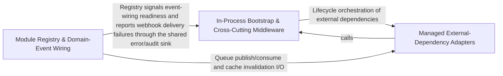

---
tags:
  - 2brain
  - 2brain/arch
  - project/boilerplate-node-backend
type: architecture
component: In_Process_Runtime_Bootstrap_App_Assembly
---

## Details

The harness that lets both entry points run the real application without Docker/Redis/broker: it starts an in-process single-member mongod replica set (needed for multi-document transactions), installs the app's cross-cutting extensions (error handling, static assets, telemetry), and provides the outbox relay/claim/dispatch machinery the seeded flows depend on.

### In-Process Bootstrap & Cross-Cutting Middleware
The entry-point harness that assembles a runnable Express application in-process. It starts a single-member mongod replica set (via mongodb-memory-server) so multi-document transactions work without external infrastructure, then installs the three cross-cutting Express middleware layers in order: Prometheus HTTP telemetry (latency + in-flight gauges), static asset serving (uploads with hardened cache/CORS headers), and the global error handler (Express error middleware + process-level unhandledRejection/uncaughtException audit). It also exposes the outbox relay loop (relayOne → claim → dispatch → markPublished/markFailed) that drains the transactional outbox and re-emits domain events onto the in-process bus, which is the mechanism seeded scenario flows use to observe cross-module side effects. The cluster/serve entry callbacks and test levers live here as the glue that ties the above together into a single start() call.

**Related Classes/Methods**:

- `scenarios.support.ephemeral-mongod.startInProcessMongod`:48-90
- `src.app.error-handling.installErrorHandling`:215-240
- `src.app.telemetry.installTelemetry`:22-44
- `src.app.static-assets.installStatic`:19-52
- `src.kernel.outbox.relayOne`:295-303

**Source Files:**

- `scenarios/support/doubles/payments/levers.ts`
  - `scenarios.support.doubles.payments.levers.REFUND_FAILURE_BODY.orderId.refine('not an order id') callback` (L28-L28) - Function
  - `scenarios.support.doubles.payments.levers.DISPUTE_BODY.orderId.refine('not an order id') callback` (L39-L39) - Function
  - `scenarios.support.doubles.payments.levers.providerRefOf` (L60-L61) - Class
  - `scenarios.support.doubles.payments.levers.providerRefOf.then() callback` (L61-L61) - Function
  - `scenarios.support.doubles.payments.levers.installDisputeLever` (L68-L106) - Class
  - `scenarios.support.doubles.payments.levers.installDisputeLever.app.post('/__test/payments/dispute') callback` (L69-L105) - Function
  - `scenarios.support.doubles.payments.levers.installDisputeLever.app.post('/__test/payments/dispute') callback.then() callback` (L78-L99) - Function
  - `scenarios.support.doubles.payments.levers.installDisputeLever.app.post('/__test/payments/dispute') callback.then() callback.then() callback` (L98-L98) - Function
  - `scenarios.support.doubles.payments.levers.installDisputeLever.app.post('/__test/payments/dispute') callback.catch() callback` (L100-L104) - Function
  - `scenarios.support.doubles.payments.levers.installLever` (L112-L137) - Class
  - `scenarios.support.doubles.payments.levers.installLever.app.post('/__test/payments/refund-failure') callback` (L114-L136) - Function
  - `scenarios.support.doubles.payments.levers.installLever.app.post('/__test/payments/refund-failure') callback.then() callback` (L122-L130) - Function
  - `scenarios.support.doubles.payments.levers.installLever.app.post('/__test/payments/refund-failure') callback.catch() callback` (L131-L135) - Function
- `scenarios/support/ephemeral-mongod.ts`
  - `scenarios.support.ephemeral-mongod.startInProcessMongod` (L48-L90) - Class
  - `scenarios.support.ephemeral-mongod.startInProcessMongod.catch() callback` (L85-L88) - Function
  - `scenarios.support.ephemeral-mongod.startInProcessMongod.finally() callback` (L89-L89) - Function
- `src/app/config-routes.ts`
  - `src.app.config-routes.router.get('/config') callback.then() callback` (L38-L50) - Function
- `src/app/error-handling.ts`
  - `src.app.error-handling.installErrorHandling` (L215-L240) - Class
  - `src.app.error-handling.installErrorHandling.process.on('uncaughtException') callback` (L228-L239) - Function
- `src/app/static-assets.ts`
  - `src.app.static-assets.installStatic` (L19-L52) - Class
  - `src.app.static-assets.installStatic.setHeaders` (L44-L49) - Method
- `src/app/telemetry.ts`
  - `src.app.telemetry.installTelemetry` (L22-L44) - Class
  - `src.app.telemetry.installTelemetry.app.use() callback` (L26-L43) - Function
  - `src.app.telemetry.installTelemetry.app.use() callback.response.once('finish') callback` (L32-L41) - Function
- `src/cluster.ts`
  - `src.cluster.then() callback` (L183-L183) - Function
  - `src.cluster.catch() callback` (L197-L203) - Function
- `src/infrastructure/adapters/logger.ts`
  - `src.infrastructure.adapters.logger.Logger.error` (L50-L50) - Method
- `src/infrastructure/adapters/mailer.ts`
  - `src.infrastructure.adapters.mailer.enqueueEmail` (L256-L305) - Class
- `src/infrastructure/adapters/queue.ts`
  - `src.infrastructure.adapters.queue.retryLater` (L812-L847) - Class
  - `src.infrastructure.adapters.queue.retryLater.ch.sendToQueue() callback` (L829-L842) - Function
  - `src.infrastructure.adapters.queue.handleDelivery.settled` (L906-L932) - Class
  - `src.infrastructure.adapters.queue.handleDelivery.settled.then() callback` (L908-L913) - Function
  - `src.infrastructure.adapters.queue.handleDelivery.settled.catch() callback` (L914-L932) - Function
- `src/infrastructure/http/frontend-link.ts`
  - `src.infrastructure.http.frontend-link.frontendLink` (L66-L70) - Class
- `src/infrastructure/runtime/server-lifecycle.ts`
  - `src.infrastructure.runtime.server-lifecycle.failBoot` (L64-L70) - Class
  - `src.infrastructure.runtime.server-lifecycle.failBoot.catch() callback` (L68-L68) - Function
  - `src.infrastructure.runtime.server-lifecycle.failBoot.finally() callback` (L69-L69) - Function
  - `src.infrastructure.runtime.server-lifecycle.registerSignalHandlers` (L168-L221) - Class
  - `src.infrastructure.runtime.server-lifecycle.registerSignalHandlers.onProcessSignal` (L173-L215) - Class
  - `src.infrastructure.runtime.server-lifecycle.registerSignalHandlers.onProcessSignal.forcedExitTimer` (L185-L189) - Class
  - `src.infrastructure.runtime.server-lifecycle.registerSignalHandlers.onProcessSignal.forcedExitTimer.setTimeout() callback` (L185-L189) - Function
  - `src.infrastructure.runtime.server-lifecycle.registerSignalHandlers.onProcessSignal.then() callback` (L198-L204) - Function
  - `src.infrastructure.runtime.server-lifecycle.registerSignalHandlers.onProcessSignal.catch() callback` (L205-L214) - Function
  - `src.infrastructure.runtime.server-lifecycle.registerSignalHandlers.process.on('SIGTERM') callback` (L218-L218) - Function
  - `src.infrastructure.runtime.server-lifecycle.registerSignalHandlers.process.on('SIGINT') callback` (L220-L220) - Function
- `src/kernel/outbox.ts`
  - `src.kernel.outbox.claim` (L213-L226) - Class
  - `src.kernel.outbox.claim.then() callback` (L225-L225) - Function
  - `src.kernel.outbox.dispatch` (L233-L241) - Class
  - `src.kernel.outbox.dispatch.then() callback` (L240-L240) - Function
  - `src.kernel.outbox.markFailed` (L258-L292) - Class
  - `src.kernel.outbox.markFailed.then() callback` (L276-L291) - Function
  - `src.kernel.outbox.markFailed.then() callback.then() callback` (L290-L290) - Function
  - `src.kernel.outbox.relayOne` (L295-L303) - Class
  - `src.kernel.outbox.relayOne.then() callback` (L296-L303) - Function
  - `src.kernel.outbox.relayOne.then() callback.then() callback` (L298-L301) - Function
  - `src.kernel.outbox.relayOne.then() callback.then() callback.then() callback` (L300-L300) - Function
  - `src.kernel.outbox.relayOutbox.outcomes` (L337-L337) - Class
  - `src.kernel.outbox.relayOutbox.outcomes.heads.map() callback` (L337-L337) - Function
  - `src.kernel.outbox.relayOutbox.outcomes.every() callback` (L340-L340) - Function
- `src/modules/account/emails.ts`
  - `src.modules.account.emails.twoFactorCodeEmail` (L195-L212) - Class
  - `src.modules.account.emails.twoFactorCodeEmail.body` (L205-L210) - Method
  - `src.modules.account.emails.accountDeletedEmail` (L454-L464) - Class
  - `src.modules.account.emails.accountDeletedEmail.body` (L459-L462) - Method
  - `src.modules.account.emails.inactivityWarningEmail` (L470-L483) - Class
  - `src.modules.account.emails.inactivityWarningEmail.body` (L479-L481) - Method
  - `src.modules.account.emails.exportFailedEmail` (L492-L502) - Class
  - `src.modules.account.emails.exportFailedEmail.body` (L497-L500) - Method
  - `src.modules.account.emails.exportReadyEmail` (L512-L525) - Class
  - `src.modules.account.emails.exportReadyEmail.body` (L517-L523) - Method
- `src/modules/account/services/export-job.ts`
  - `src.modules.account.services.export-job.mailRequester` (L84-L93) - Class
  - `src.modules.account.services.export-job.mailRequester.then() callback` (L88-L93) - Function
  - `src.modules.account.services.export-job.mailLink` (L100-L103) - Class
  - `src.modules.account.services.export-job.mailLink.mailRequester() callback` (L102-L102) - Function
  - `src.modules.account.services.export-job.settleAnnouncing` (L114-L131) - Class
  - `src.modules.account.services.export-job.announceInTransaction() callback` (L119-L125) - Function
  - `src.modules.account.services.export-job.settleAnnouncing.announceInTransaction() callback` (L126-L130) - Function
  - `src.modules.account.services.export-job.buildAndSettle` (L141-L147) - Class
  - `src.modules.account.services.export-job.buildAndSettle.writeExport() callback` (L145-L145) - Function
  - `src.modules.account.services.export-job.buildAndSettle.then() callback` (L146-L146) - Function
  - `src.modules.account.services.export-job.removeFileIfRowGone` (L156-L159) - Class
  - `src.modules.account.services.export-job.removeFileIfRowGone.then() callback.then() callback` (L159-L159) - Function
  - `src.modules.account.services.export-job.afterBuild` (L172-L186) - Class
  - `src.modules.account.services.export-job.afterBuild.catch() callback` (L179-L185) - Function
  - `src.modules.account.services.export-job.mailFailure` (L194-L197) - Class
  - `src.modules.account.services.export-job.mailFailure.mailRequester() callback` (L195-L195) - Function
  - `src.modules.account.services.export-job.mailFailure.catch() callback` (L195-L197) - Function
  - `src.modules.account.services.export-job.fail` (L207-L223) - Class
  - `src.modules.account.services.export-job.fail.then() callback` (L214-L222) - Function
  - `src.modules.account.services.export-job.fail.then() callback.then() callback` (L221-L221) - Function
  - `src.modules.account.services.export-job.runExportJob` (L234-L253) - Class
  - `src.modules.account.services.export-job.runExportJob.then() callback` (L235-L253) - Function
  - `src.modules.account.services.export-job.runExportJob.then() callback.then() callback` (L239-L252) - Function
  - `src.modules.account.services.export-job.then() callback.then() callback.then() callback` (L242-L242) - Function
  - `src.modules.account.services.export-job.runExportJob.then() callback.then() callback.then() callback` (L251-L251) - Function
- `src/modules/account/services/export.ts`
  - `src.modules.account.services.export.dispatch.then() callback.running` (L124-L132) - Class
  - `src.modules.account.services.export.dispatch.then() callback.running.catch() callback` (L125-L131) - Function
  - `src.modules.account.services.export.dispatch.then() callback.running.finally() callback` (L132-L132) - Function
- `src/modules/account/services/password-reset-request.ts`
  - `src.modules.account.services.password-reset-request.requestPasswordReset` (L107-L137) - Class
  - `src.modules.account.services.password-reset-request.requestPasswordReset.then() callback` (L127-L136) - Function
- `src/modules/account/services/purge-deletions.ts`
  - `src.modules.account.services.purge-deletions.PurgeCounts` (L20-L27) - Interface
  - `src.modules.account.services.purge-deletions.purgeOne` (L36-L66) - Class
  - `src.modules.account.services.purge-deletions.purgeOne.then() callback` (L43-L60) - Function
  - `src.modules.account.services.purge-deletions.purgeOne.catch() callback` (L61-L65) - Function
- `src/modules/account/services/reap-inactive.ts`
  - `src.modules.account.services.reap-inactive.warn` (L31-L42) - Class
  - `src.modules.account.services.reap-inactive.warn.then() callback.then() callback` (L40-L40) - Function
  - `src.modules.account.services.reap-inactive.InactiveReapCounts` (L55-L64) - Interface
- `src/modules/delivery/services/notify.ts`
  - `src.modules.delivery.services.notify.emailLines` (L32-L33) - Class
  - `src.modules.delivery.services.notify.emailLines.shipment.lines.map() callback` (L33-L33) - Function
  - `src.modules.delivery.services.notify.mailShipped` (L42-L80) - Class
  - `src.modules.delivery.services.notify.mailShipped.then() callback` (L51-L70) - Function
  - `src.modules.delivery.services.notify.mailShipped.then() callback.orderService.mailBuyerOfOrder() callback` (L53-L69) - Function
  - `src.modules.delivery.services.notify.mailShipped.catch() callback` (L72-L79) - Function
  - `src.modules.delivery.services.notify.mailTrackingChanged` (L91-L111) - Class
  - `src.modules.delivery.services.notify.mailTrackingChanged.orderService.mailBuyerOfOrder() callback` (L96-L105) - Function
  - `src.modules.delivery.services.notify.mailTrackingChanged.catch() callback` (L106-L111) - Function
  - `src.modules.delivery.services.notify.mailDelivered` (L120-L152) - Class
  - `src.modules.delivery.services.notify.mailDelivered.then() callback` (L126-L143) - Function
  - `src.modules.delivery.services.notify.mailDelivered.then() callback.orderService.mailBuyerOfOrder() callback` (L128-L142) - Function
  - `src.modules.delivery.services.notify.mailDelivered.catch() callback` (L145-L152) - Function
  - `src.modules.delivery.services.notify.mailLost` (L162-L192) - Class
  - `src.modules.delivery.services.notify.mailLost.then() callback` (L165-L183) - Function
  - `src.modules.delivery.services.notify.mailLost.then() callback.orderService.mailBuyerOfOrder() callback` (L167-L182) - Function
  - `src.modules.delivery.services.notify.mailLost.catch() callback` (L185-L192) - Function
  - `src.modules.delivery.services.notify.mailDelayed` (L201-L212) - Class
  - `src.modules.delivery.services.notify.mailDelayed.orderService.mailBuyerOfOrder() callback` (L202-L212) - Function
  - `src.modules.delivery.services.notify.mailHoldNoticed` (L220-L229) - Class
  - `src.modules.delivery.services.notify.mailHoldNoticed.orderService.mailBuyerOfOrder() callback` (L221-L229) - Function
- `src/modules/example/services/notify.ts`
  - `src.modules.example.services.notify.mailOwnerOfPublished` (L27-L37) - Class
  - `src.modules.example.services.notify.mailOwnerOfPublished.then() callback` (L28-L37) - Function
- `src/modules/inventory/services/holds.ts`
  - `src.modules.inventory.services.holds.serveQueueAfter.freed` (L43-L45) - Class
  - `src.modules.inventory.services.holds.serveQueueAfter.freed.lines.filter() callback` (L44-L44) - Function
  - `src.modules.inventory.services.holds.serveQueueAfter.freed.map() callback` (L45-L45) - Function
  - `src.modules.inventory.services.holds.claimAndMove.then() callback.then() callback` (L78-L78) - Function
  - `src.modules.inventory.services.holds.retakeReleasedForOrder.lines` (L156-L162) - Class
  - `src.modules.inventory.services.holds.retakeReleasedForOrder.lines.hold.items.map() callback` (L157-L161) - Function
  - `src.modules.inventory.services.holds.retakeReleasedForOrder.lines.toSorted() callback` (L162-L162) - Function
  - `src.modules.inventory.services.holds.retakeReleasedForOrder.productIds.lines.map() callback` (L198-L198) - Function
  - `src.modules.inventory.services.holds.commitWithin.preorderProducts` (L221-L223) - Class
  - `src.modules.inventory.services.holds.commitWithin.preorderProducts.hold.items.filter() callback` (L222-L222) - Function
  - `src.modules.inventory.services.holds.commitWithin.preorderProducts.map() callback` (L223-L223) - Function
  - `src.modules.inventory.services.holds.then() callback.then() callback.then() callback` (L347-L347) - Function
- `src/modules/inventory/services/levels.ts`
  - `src.modules.inventory.services.levels.listPreorders.products` (L104-L104) - Class
  - `src.modules.inventory.services.levels.listPreorders.products.items.map() callback` (L104-L104) - Function
  - `src.modules.inventory.services.levels.listPreorders.byId` (L105-L105) - Class
  - `src.modules.inventory.services.levels.listPreorders.byId.products.map() callback` (L105-L105) - Function
  - `src.modules.inventory.services.levels.listLevels.products` (L147-L147) - Class
  - `src.modules.inventory.services.levels.listLevels.products.items.map() callback` (L147-L147) - Function
  - `src.modules.inventory.services.levels.listLevels.titleOf` (L148-L148) - Class
  - `src.modules.inventory.services.levels.listLevels.titleOf.products.map() callback` (L148-L148) - Function
- `src/modules/inventory/services/reserve.ts`
  - `src.modules.inventory.services.reserve.takeSpillLine.parts.withTransaction() callback.others` (L156-L162) - Class
  - `src.modules.inventory.services.reserve.takeSpillLine.parts.withTransaction() callback.others.filter() callback` (L157-L157) - Function
  - `src.modules.inventory.services.reserve.takeSpillLine.parts.withTransaction() callback.others.map() callback` (L158-L162) - Function
- `src/modules/inventory/services/sweep.ts`
  - `src.modules.inventory.services.sweep.tryExpireOne` (L63-L72) - Class
  - `src.modules.inventory.services.sweep.tryExpireOne.catch() callback` (L64-L72) - Function
- `src/modules/observability/controllers/get-observability-metrics.ts`
  - `src.modules.observability.controllers.get-observability-metrics.getObservabilityMetrics` (L18-L29) - Class
  - `src.modules.observability.controllers.get-observability-metrics.getObservabilityMetrics.then() callback` (L20-L23) - Function
  - `src.modules.observability.controllers.get-observability-metrics.getObservabilityMetrics.catch() callback` (L24-L28) - Function
- `src/modules/orders/services/cancel-mail.ts`
  - `src.modules.orders.services.cancel-mail.mailOrderCanceled` (L20-L41) - Class
  - `src.modules.orders.services.cancel-mail.mailOrderCanceled.mailBuyerOfOrder() callback` (L28-L40) - Function
- `src/modules/orders/services/notify.ts`
  - `src.modules.orders.services.notify.mailBuyer` (L37-L67) - Class
  - `src.modules.orders.services.notify.catch() callback` (L45-L54) - Function
  - `src.modules.orders.services.notify.mailBuyer.then() callback` (L55-L57) - Function
  - `src.modules.orders.services.notify.mailBuyer.catch() callback` (L58-L66) - Function
  - `src.modules.orders.services.notify.mailBuyerOfOrder` (L77-L92) - Class
  - `src.modules.orders.services.notify.mailBuyerOfOrder.then() callback` (L82-L83) - Function
  - `src.modules.orders.services.notify.mailBuyerOfOrder.then() callback.mailBuyer() callback` (L83-L83) - Function
  - `src.modules.orders.services.notify.mailBuyerOfOrder.catch() callback` (L85-L92) - Function
  - `src.modules.orders.services.notify.mailOrderPlaced` (L101-L106) - Class
  - `src.modules.orders.services.notify.mailOrderPlaced.mailBuyerOfOrder() callback` (L102-L106) - Function
- `src/modules/orders/services/purchase-hold.ts`
  - `src.modules.orders.services.purchase-hold.Findings` (L37-L42) - Interface
  - `src.modules.orders.services.purchase-hold.findingsFor` (L50-L75) - Class
  - `src.modules.orders.services.purchase-hold.findingsFor.then() callback` (L61-L75) - Function
  - `src.modules.orders.services.purchase-hold.actOn` (L86-L109) - Class
  - `src.modules.orders.services.purchase-hold.then() callback` (L94-L101) - Function
  - `src.modules.orders.services.purchase-hold.actOn.then() callback.then() callback` (L100-L100) - Function
  - `src.modules.orders.services.purchase-hold.actOn.then() callback` (L106-L108) - Function
  - `src.modules.orders.services.purchase-hold.considerPurchaseHold` (L120-L138) - Class
  - `src.modules.orders.services.purchase-hold.considerPurchaseHold.then() callback` (L128-L134) - Function
  - `src.modules.orders.services.purchase-hold.considerPurchaseHold.then() callback.then() callback` (L133-L133) - Function
  - `src.modules.orders.services.purchase-hold.considerPurchaseHold.catch() callback` (L135-L137) - Function
- `src/modules/payments/services/deadline.ts`
  - `src.modules.payments.services.deadline.refundLegalDueAt.then() callback.refund` (L23-L23) - Class
  - `src.modules.payments.services.deadline.refundLegalDueAt.then() callback.refund.payment.refunds.find() callback` (L23-L23) - Function
- `src/modules/payments/services/effects.ts`
  - `src.modules.payments.services.effects.sweepDue.done` (L42-L50) - Class
  - `src.modules.payments.services.effects.sweepDue.done.catch() callback` (L42-L50) - Function
- `src/modules/payments/services/notify.ts`
  - `src.modules.payments.services.notify.mailPaymentReceived` (L63-L70) - Class
  - `src.modules.payments.services.notify.mailPaymentReceived.orderService.mailBuyerOfOrder() callback` (L66-L70) - Function
  - `src.modules.payments.services.notify.mailTransferInstructions` (L168-L199) - Class
  - `src.modules.payments.services.notify.mailTransferInstructions.orderService.mailBuyer() callback` (L178-L190) - Function
  - `src.modules.payments.services.notify.mailTransferInstructions.catch() callback` (L191-L198) - Function
- `src/modules/payments/services/refunds.ts`
  - `src.modules.payments.services.refunds.refundForOrder` (L1118-L1129) - Class
  - `src.modules.payments.services.refunds.refundForOrder.then() callback` (L1120-L1120) - Function
  - `src.modules.payments.services.refunds.refundForOrder.catch() callback` (L1121-L1129) - Function
- `src/modules/payments/services/settlement.ts`
  - `src.modules.payments.services.settlement.returnMismatchedMoney` (L115-L135) - Class
  - `src.modules.payments.services.settlement.returnMismatchedMoney.then() callback` (L127-L127) - Function
  - `src.modules.payments.services.settlement.returnMismatchedMoney.catch() callback` (L128-L135) - Function
- `src/modules/shop-tasks/services/digest.ts`
  - `src.modules.shop-tasks.services.digest.Summary` (L42-L46) - Interface
  - `src.modules.shop-tasks.services.digest.SUMMARIES` (L49-L84) - Class
  - `src.modules.shop-tasks.services.digest.SUMMARIES.count` (L82-L82) - Method
  - `src.modules.shop-tasks.services.digest.runStaffDigest` (L169-L194) - Class
  - `src.modules.shop-tasks.services.digest.runStaffDigest.SUMMARIES.filter() callback` (L177-L177) - Function
- `src/modules/stock-alerts/service.ts`
  - `src.modules.stock-alerts.service.titleFor` (L107-L111) - Class
  - `src.modules.stock-alerts.service.titleFor.map() callback` (L109-L109) - Function
  - `src.modules.stock-alerts.service.mailBuyer` (L149-L174) - Class
  - `src.modules.stock-alerts.service.mailBuyer.then() callback` (L156-L166) - Function
  - `src.modules.stock-alerts.service.mailBuyer.catch() callback` (L167-L174) - Function
- `src/modules/tasks/service.ts`
  - `src.modules.tasks.service.mailMainMailbox` (L148-L196) - Class
  - `src.modules.tasks.service.mailMainMailbox.then() callback` (L151-L195) - Function
  - `src.modules.tasks.service.mailMainMailbox.then() callback.then() callback` (L189-L189) - Function
  - `src.modules.tasks.service.mailMainMailbox.then() callback.catch() callback` (L190-L194) - Function
  - `src.modules.tasks.service.mailErasureNotice` (L205-L212) - Class
  - `src.modules.tasks.service.mailErasureNotice.then() callback` (L211-L211) - Function
- `src/modules/users/services/credentials.ts`
  - `src.modules.users.services.credentials.mirrorSpentCode.entry` (L246-L246) - Class
  - `src.modules.users.services.credentials.mirrorSpentCode.entry.user.twoFactorMethods.find() callback` (L246-L246) - Function
- `src/modules/users/services/purchase-hold.ts`
  - `src.modules.users.services.purchase-hold.countingSinceOf` (L71-L80) - Class
  - `src.modules.users.services.purchase-hold.countingSinceOf.marks` (L74-L76) - Class
  - `src.modules.users.services.purchase-hold.countingSinceOf.marks.filter() callback` (L75-L75) - Function
  - `src.modules.users.services.purchase-hold.countingSinceOf.marks.map() callback` (L79-L79) - Function
  - `src.modules.users.services.purchase-hold.purchaseHoldCountingSince` (L100-L101) - Class
  - `src.modules.users.services.purchase-hold.purchaseHoldCountingSince.then() callback` (L101-L101) - Function
  - `src.modules.users.services.purchase-hold.PurchaseHoldBasis` (L104-L107) - Interface
  - `src.modules.users.services.purchase-hold.notifyBuyer` (L118-L146) - Class
  - `src.modules.users.services.purchase-hold.notifyBuyer.then() callback` (L126-L142) - Function
  - `src.modules.users.services.purchase-hold.notifyBuyer.catch() callback` (L143-L144) - Function
  - `src.modules.users.services.purchase-hold.announceInTransaction() callback` (L332-L335) - Function
- `src/modules/users/services/read.ts`
  - `src.modules.users.services.read.getById` (L48-L51) - Class
  - `src.modules.users.services.read.getById.then() callback` (L50-L50) - Function
  - `src.modules.users.services.read.StaffContact` (L54-L58) - Interface
  - `src.modules.users.services.read.toUserContracts.ids` (L107-L107) - Class
  - `src.modules.users.services.read.toUserContracts.ids.rows.map() callback` (L107-L107) - Function
- `src/modules/users/services/reaper.ts`
  - `src.modules.users.services.reaper.customersOnly` (L19-L22) - Class
  - `src.modules.users.services.reaper.customersOnly.accounts.map() callback` (L21-L21) - Function
  - `src.modules.users.services.reaper.customersOnly.then() callback` (L22-L22) - Function
  - `src.modules.users.services.reaper.customersOnly.then() callback.accounts.filter() callback` (L22-L22) - Function
- `src/modules/users/services/remove.ts`
  - `src.modules.users.services.remove.runAfterErase` (L73-L82) - Class
  - `src.modules.users.services.remove.runAfterErase.deferred.map() callback` (L75-L80) - Function
  - `src.modules.users.services.remove.runAfterErase.deferred.map() callback.catch() callback` (L76-L80) - Function
  - `src.modules.users.services.remove.runAfterErase.then() callback` (L82-L82) - Function
- `src/serve.ts`
  - `src.serve.catch() callback` (L29-L29) - Function

### Managed External-Dependency Adapters
The shared lifecycle layer for all optional external dependencies (Redis cache, Redis-backed rate-limit store, RabbitMQ queue). It centralises the 'unconfigured is a supported deployment, unreachable is a degraded one, neither may turn a request into an error' contract into a single ManagedConnection<T> abstraction: a memoised handle, a shared in-flight connect, a warn-once UnavailabilityLatch, a getter that resolves undefined instead of rejecting, a DependencyStatus reader for the health endpoint, and a stop() close. The Redis cache adapter, the Redis rate-limit store (buildLimitsClient, isLimitsKeyClaimed, sendToLimits), and the RabbitMQ queue adapter (ensureConnecting, publishToQueue, consumeFromQueue) each supply only their own connect/isReady/close and degrade to no-ops when the dependency is absent. This is what lets the in-process bootstrap run the full app with zero external services.

**Related Classes/Methods**:

- `src.infrastructure.adapters.managed-connection.ManagedConnection`:115-158
- `src.infrastructure.adapters.managed-connection.UnavailabilityLatch`:21-27
- `src.infrastructure.adapters.cache.cacheConnection`:44-69
- `src.infrastructure.adapters.limits-redis.buildLimitsClient`:48-56
- `src.infrastructure.adapters.queue.ensureConnecting`:211-240

**Source Files:**

- `src/infrastructure/adapters/cache.ts`
  - `src.infrastructure.adapters.cache.cacheConnection` (L44-L69) - Class
  - `src.infrastructure.adapters.cache.cacheConnection.isReady` (L50-L50) - Method
  - `src.infrastructure.adapters.cache.cacheConnection.connect` (L51-L67) - Method
  - `src.infrastructure.adapters.cache.cacheConnection.connect.then() callback` (L66-L66) - Function
- `src/infrastructure/adapters/limits-redis.ts`
  - `src.infrastructure.adapters.limits-redis.buildLimitsClient` (L48-L56) - Class
  - `src.infrastructure.adapters.limits-redis.buildLimitsClient.redisClient.on('error') callback` (L53-L53) - Function
  - `src.infrastructure.adapters.limits-redis.connectionFor` (L66-L114) - Class
  - `src.infrastructure.adapters.limits-redis.connectionFor.connection` (L75-L103) - Class
  - `src.infrastructure.adapters.limits-redis.connectionFor.connection.isEnabled` (L81-L81) - Method
  - `src.infrastructure.adapters.limits-redis.connectionFor.connection.connect` (L82-L94) - Method
  - `src.infrastructure.adapters.limits-redis.connectionFor.connection.connect.then() callback` (L88-L92) - Function
  - `src.infrastructure.adapters.limits-redis.connectionFor.connection.isReady` (L95-L95) - Method
  - `src.infrastructure.adapters.limits-redis.connectionFor.connection.close` (L96-L99) - Method
  - `src.infrastructure.adapters.limits-redis.connectionFor.connection.onRecovered` (L100-L102) - Method
  - `src.infrastructure.adapters.limits-redis.connectionFor.forget` (L107-L110) - Method
  - `src.infrastructure.adapters.limits-redis.sendToLimits` (L127-L138) - Class
  - `src.infrastructure.adapters.limits-redis.sendToLimits.then() callback` (L130-L136) - Function
  - `src.infrastructure.adapters.limits-redis.sendToLimits.then() callback.catch() callback` (L131-L136) - Function
  - `src.infrastructure.adapters.limits-redis.isLimitsKeyClaimed` (L184-L195) - Class
  - `src.infrastructure.adapters.limits-redis.isLimitsKeyClaimed.then() callback` (L189-L189) - Function
  - `src.infrastructure.adapters.limits-redis.isLimitsKeyClaimed.catch() callback` (L190-L194) - Function
- `src/infrastructure/adapters/managed-connection.ts`
  - `src.infrastructure.adapters.managed-connection.UnavailabilityLatch` (L21-L27) - Interface
  - `src.infrastructure.adapters.managed-connection.unavailabilityLatch` (L37-L52) - Class
  - `src.infrastructure.adapters.managed-connection.unavailabilityLatch.report` (L41-L45) - Method
  - `src.infrastructure.adapters.managed-connection.unavailabilityLatch.clear` (L46-L50) - Method
  - `src.infrastructure.adapters.managed-connection.ManagedConnectionOptions` (L63-L112) - Interface
  - `src.infrastructure.adapters.managed-connection.ManagedConnection` (L115-L158) - Interface
  - `src.infrastructure.adapters.managed-connection.manageConnection` (L167-L282) - Class
  - `src.infrastructure.adapters.managed-connection.manageConnection.latch` (L183-L191) - Class
  - `src.infrastructure.adapters.managed-connection.manageConnection.latch.unavailabilityLatch() callback` (L183-L191) - Function
  - `src.infrastructure.adapters.managed-connection.manageConnection.NotConfigured` (L194-L194) - Class
  - `src.infrastructure.adapters.managed-connection.manageConnection.attempt.running` (L200-L218) - Class
  - `src.infrastructure.adapters.managed-connection.manageConnection.attempt.running.then() callback` (L201-L209) - Function
  - `src.infrastructure.adapters.managed-connection.manageConnection.attempt.running.catch() callback` (L210-L214) - Function
  - `src.infrastructure.adapters.managed-connection.manageConnection.attempt.running.finally() callback` (L215-L218) - Function
  - `src.infrastructure.adapters.managed-connection.get` (L233-L240) - Class
  - `src.infrastructure.adapters.managed-connection.manageConnection.get.catch() callback` (L239-L239) - Function
  - `src.infrastructure.adapters.managed-connection.manageConnection.state` (L246-L253) - Method
  - `src.infrastructure.adapters.managed-connection.manageConnection.forget` (L255-L257) - Method
  - `src.infrastructure.adapters.managed-connection.manageConnection.stop` (L261-L280) - Method
  - `src.infrastructure.adapters.managed-connection.manageConnection.stop.catch() callback` (L273-L273) - Function
  - `src.infrastructure.adapters.managed-connection.manageConnection.stop.finally() callback` (L274-L278) - Function
- `src/infrastructure/adapters/queue.ts`
  - `src.infrastructure.adapters.queue.unavailabilityLog.unavailabilityLatch() callback` (L111-L113) - Function
  - `src.infrastructure.adapters.queue.unavailabilityLog` (L111-L114) - Class
  - `src.infrastructure.adapters.queue.setupChannel` (L146-L187) - Class
  - `src.infrastructure.adapters.queue.setupChannel.ch.on('error') callback` (L159-L162) - Function
  - `src.infrastructure.adapters.queue.setupChannel.ch.on('close') callback` (L163-L184) - Function
  - `src.infrastructure.adapters.queue.setupChannel.ch.on('close') callback.retry` (L180-L182) - Class
  - `src.infrastructure.adapters.queue.setupChannel.ch.on('close') callback.retry.setTimeout() callback` (L180-L182) - Function
  - `src.infrastructure.adapters.queue.ensureConnecting` (L211-L240) - Class
  - `src.infrastructure.adapters.queue.ensureConnecting.then() callback` (L222-L236) - Function
  - `src.infrastructure.adapters.queue.ensureConnecting.then() callback.model.on('connect') callback` (L227-L231) - Function
  - `src.infrastructure.adapters.queue.ensureConnecting.then() callback.model.on('disconnect') callback` (L232-L235) - Function
- `src/infrastructure/adapters/redis.ts`
  - `src.infrastructure.adapters.redis.closeRedisClient` (L120-L126) - Class
  - `src.infrastructure.adapters.redis.closeRedisClient.then() callback` (L124-L124) - Function
- `src/infrastructure/http/ids.ts`
  - `src.infrastructure.http.ids.SchemaNode` (L122-L137) - Interface
  - `src.infrastructure.http.ids.isIdString` (L166-L171) - Class
  - `src.infrastructure.http.ids.isIdString.some() callback` (L168-L170) - Function
  - `src.infrastructure.http.ids.collectIdPaths` (L179-L196) - Class
  - `src.infrastructure.http.ids.flatMap() callback` (L184-L185) - Function
  - `src.infrastructure.http.ids.collectIdPaths.flatMap() callback` (L194-L194) - Function
  - `src.infrastructure.http.ids.CarriedId` (L216-L219) - Interface
- `src/infrastructure/http/middlewares/rate-limit-store.ts`
  - `src.infrastructure.http.middlewares.rate-limit-store.lazyRedisStore` (L59-L109) - Class
  - `src.infrastructure.http.middlewares.rate-limit-store.lazyRedisStore.store` (L63-L98) - Class
  - `src.infrastructure.http.middlewares.rate-limit-store.lazyRedisStore.store.sendCommand` (L69-L69) - Method
  - `src.infrastructure.http.middlewares.rate-limit-store.lazyRedisStore.store.catch() callback` (L84-L93) - Function
  - `src.infrastructure.http.middlewares.rate-limit-store.lazyRedisStore.init` (L101-L103) - Method
  - `src.infrastructure.http.middlewares.rate-limit-store.lazyRedisStore.increment` (L104-L104) - Method
  - `src.infrastructure.http.middlewares.rate-limit-store.lazyRedisStore.decrement` (L105-L105) - Method
  - `src.infrastructure.http.middlewares.rate-limit-store.lazyRedisStore.resetKey` (L106-L106) - Method
  - `src.infrastructure.http.middlewares.rate-limit-store.lazyRedisStore.get` (L107-L107) - Method
  - `src.infrastructure.http.middlewares.rate-limit-store.failoverStore` (L126-L169) - Class
  - `src.infrastructure.http.middlewares.rate-limit-store.failoverStore.route` (L144-L157) - Class
  - `src.infrastructure.http.middlewares.rate-limit-store.route.then() callback` (L148-L148) - Function
  - `src.infrastructure.http.middlewares.rate-limit-store.failoverStore.route.then() callback` (L149-L152) - Function
  - `src.infrastructure.http.middlewares.rate-limit-store.failoverStore.route.catch() callback` (L153-L156) - Function
  - `src.infrastructure.http.middlewares.rate-limit-store.failoverStore.init` (L160-L163) - Method
  - `src.infrastructure.http.middlewares.rate-limit-store.failoverStore.increment` (L164-L164) - Method
  - `src.infrastructure.http.middlewares.rate-limit-store.failoverStore.increment.route() callback` (L164-L164) - Function
  - `src.infrastructure.http.middlewares.rate-limit-store.failoverStore.decrement` (L165-L165) - Method
  - `src.infrastructure.http.middlewares.rate-limit-store.failoverStore.decrement.route() callback` (L165-L165) - Function
  - `src.infrastructure.http.middlewares.rate-limit-store.failoverStore.decrement.then() callback` (L165-L165) - Function
  - `src.infrastructure.http.middlewares.rate-limit-store.failoverStore.resetKey` (L166-L166) - Method
  - `src.infrastructure.http.middlewares.rate-limit-store.failoverStore.resetKey.route() callback` (L166-L166) - Function
  - `src.infrastructure.http.middlewares.rate-limit-store.failoverStore.resetKey.then() callback` (L166-L166) - Function
  - `src.infrastructure.http.middlewares.rate-limit-store.failoverStore.get` (L167-L167) - Method
  - `src.infrastructure.http.middlewares.rate-limit-store.failoverStore.get.route() callback` (L167-L167) - Function
  - `src.infrastructure.http.middlewares.rate-limit-store.Escalation` (L241-L246) - Interface
  - `src.infrastructure.http.middlewares.rate-limit-store.escalatingStore` (L269-L320) - Class
  - `src.infrastructure.http.middlewares.rate-limit-store.escalatingStore.levels.Array.from() callback` (L274-L275) - Function
  - `src.infrastructure.http.middlewares.rate-limit-store.escalatingStore.levels` (L274-L276) - Class
  - `src.infrastructure.http.middlewares.rate-limit-store.escalatingStore.init` (L295-L303) - Method
  - `src.infrastructure.http.middlewares.rate-limit-store.escalatingStore.increment` (L304-L312) - Method
  - `src.infrastructure.http.middlewares.rate-limit-store.escalatingStore.decrement` (L314-L314) - Method
  - `src.infrastructure.http.middlewares.rate-limit-store.escalatingStore.decrement.then() callback` (L314-L314) - Function
  - `src.infrastructure.http.middlewares.rate-limit-store.escalatingStore.resetKey` (L315-L318) - Method
  - `src.infrastructure.http.middlewares.rate-limit-store.escalatingStore.resetKey.map() callback` (L317-L317) - Function
  - `src.infrastructure.http.middlewares.rate-limit-store.escalatingStore.resetKey.then() callback` (L318-L318) - Function
  - `src.infrastructure.http.middlewares.rate-limit-store.clearRateLimitCounters` (L380-L398) - Class
  - `src.infrastructure.http.middlewares.rate-limit-store.then() callback` (L389-L389) - Function
  - `src.infrastructure.http.middlewares.rate-limit-store.clearRateLimitCounters.then() callback` (L390-L390) - Function
  - `src.infrastructure.http.middlewares.rate-limit-store.clearRateLimitCounters.catch() callback` (L391-L396) - Function
  - `src.infrastructure.http.middlewares.rate-limit-store.clearRateLimitCounters.finally() callback` (L397-L397) - Function
- `src/infrastructure/http/middlewares/store-breaker.ts`
  - `src.infrastructure.http.middlewares.store-breaker.Breaker` (L16-L29) - Interface
  - `src.infrastructure.http.middlewares.store-breaker.createBreaker` (L37-L57) - Class
  - `src.infrastructure.http.middlewares.store-breaker.createBreaker.admit` (L42-L47) - Method
  - `src.infrastructure.http.middlewares.store-breaker.createBreaker.succeeded` (L48-L51) - Method
  - `src.infrastructure.http.middlewares.store-breaker.createBreaker.failed` (L52-L55) - Method
- `src/infrastructure/http/middlewares/upload.ts`
  - `src.infrastructure.http.middlewares.upload.resolveUploadDestination` (L68-L86) - Class
  - `src.infrastructure.http.middlewares.upload.resolveUploadDestination.then() callback` (L84-L84) - Function
  - `src.infrastructure.http.middlewares.upload.resolveUploadDestination.catch() callback` (L85-L85) - Function

### Module Registry & Domain-Event Wiring
The kernel-side module manifest system that turns the explicit list in src/modules.ts into a running application. Each domain module declares its routes, config slice, domain-event subscriptions (subscribe.onDomainEvent), public events (publicEvents.*.toPublicEvent), image targets, queue consumers, and translatable targets in a single typed object. The registry collects these declarations and wires them: domain events emitted by one module are routed to every subscriber's handler; public events are fanned out to webhook targets (fanOut, deliverToOne, subscribeToTarget); and the app-tier workers call each module's registered ModuleConsumer.handler without the infrastructure layer ever importing a domain module. This is the seam that keeps the dependency direction sacred (kernel → modules, never modules → kernel) and makes enabling or removing a domain a one-line edit.

**Related Classes/Methods**:

- `src.kernel.registry.PublicEventTarget`:200-206
- `src.modules.webhooks.services.publish.fanOut`:86-104

**Source Files:**

- `src/kernel/registry.ts`
  - `src.kernel.registry.PublicEventTarget` (L200-L206) - Interface
- `src/modules/delivery/module.ts`
  - `src.modules.delivery.module.shipmentData.lines.payload.lines.map() callback` (L56-L56) - Function
  - `src.modules.delivery.module.publicEvents.[SHIPMENT_SHIPPED].toPublicEvent` (L67-L70) - Method
  - `src.modules.delivery.module.publicEvents.[SHIPMENT_DELIVERED].toPublicEvent` (L73-L76) - Method
  - `src.modules.delivery.module.publicEvents.[SHIPMENT_LOST].toPublicEvent` (L80-L83) - Method
  - `src.modules.delivery.module.personalData.collect.then() callback` (L110-L110) - Function
  - `src.modules.delivery.module.subscribe.onDomainEvent() callback` (L130-L131) - Function
- `src/modules/example/module.ts`
  - `src.modules.example.module.publicEvents.[EXAMPLE_PUBLISHED].toPublicEvent` (L47-L50) - Method
- `src/modules/orders/module.ts`
  - `src.modules.orders.module.publicEvents.[ORDER_CREATED].toPublicEvent` (L44-L47) - Method
  - `src.modules.orders.module.publicEvents.[ORDER_STATUS_CHANGED].toPublicEvent` (L50-L53) - Method
  - `src.modules.orders.module.publicEvents.[ORDER_CANCELED].toPublicEvent` (L56-L60) - Method
  - `src.modules.orders.module.publicEvents.[ORDER_REDACTED].toPublicEvent` (L63-L66) - Method
  - `src.modules.orders.module.subscribe.onDomainEvent() callback` (L109-L110) - Function
- `src/modules/payments/module.ts`
  - `src.modules.payments.module.publicEvents.[PAYMENT_SUCCEEDED].toPublicEvent` (L47-L50) - Method
  - `src.modules.payments.module.publicEvents.[PAYMENT_FAILED].toPublicEvent` (L53-L56) - Method
  - `src.modules.payments.module.publicEvents.[PAYMENT_REFUNDED].toPublicEvent` (L59-L68) - Method
  - `src.modules.payments.module.publicEvents.[PAYMENT_REFUND_FAILED].toPublicEvent` (L71-L82) - Method
  - `src.modules.payments.module.publicEvents.[PAYMENT_DISPUTE_OPENED].toPublicEvent` (L85-L89) - Method
  - `src.modules.payments.module.publicEvents.[PAYMENT_DISPUTE_UPDATED].toPublicEvent` (L92-L96) - Method
  - `src.modules.payments.module.publicEvents.[PAYMENT_REFUND_REVERSED].toPublicEvent` (L99-L109) - Method
  - `src.modules.payments.module.subscribe.onDomainEvent() callback` (L145-L148) - Function
- `src/modules/returns/module.ts`
  - `src.modules.returns.module.publicEvents.[RETURN_REQUESTED].toPublicEvent` (L37-L46) - Method
  - `src.modules.returns.module.publicEvents.[RETURN_RECEIVED].toPublicEvent` (L49-L52) - Method
  - `src.modules.returns.module.publicEvents.[RETURN_CLOSED].toPublicEvent` (L55-L64) - Method
- `src/modules/shop-tasks/emails.ts`
  - `src.modules.shop-tasks.emails.staffDigestEmail.data.lines.items.map() callback` (L35-L42) - Function
- `src/modules/users/module.ts`
  - `src.modules.users.module.publicEvents.[USER_ERASED].toPublicEvent` (L49-L52) - Method
  - `src.modules.users.module.publicEvents.[USER_PROFILE_CHANGED].toPublicEvent` (L55-L59) - Method
- `src/modules/webhooks/services/publish.ts`
  - `src.modules.webhooks.services.publish.deliverToOne` (L64-L71) - Class
  - `src.modules.webhooks.services.publish.deliverToOne.then() callback` (L69-L70) - Function
  - `src.modules.webhooks.services.publish.deliverToOne.then() callback.then() callback` (L70-L70) - Function
  - `src.modules.webhooks.services.publish.fanOut` (L86-L104) - Class
  - `src.modules.webhooks.services.publish.fanOut.then() callback` (L87-L104) - Function
  - `src.modules.webhooks.services.publish.fanOut.then() callback.then() callback` (L93-L103) - Function
  - `src.modules.webhooks.services.publish.subscribeToTarget` (L120-L129) - Class
  - `src.modules.webhooks.services.publish.subscribeToTarget.onDomainEvent() callback` (L125-L128) - Function
