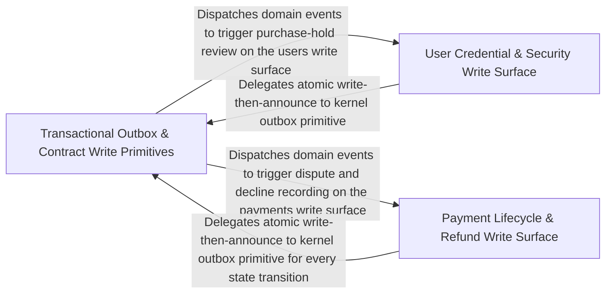

---
tags:
  - 2brain
  - 2brain/arch
  - project/boilerplate-node-backend
type: architecture
component: Kernel_Write_Surface_Primitives
---

## Details

The transactional and contract-level write primitives that seeders invoke to produce the same side effects a real service call would — transactional outbox announcements (announceInTransaction, announceWithin), the translation write plan (TranslationWritePlan, applyTranslations.resolved), the access query collapse, and the module-level PII/email helpers (e.g. encryptOrderPii, decryptOrderAddress, withdrawalCase). Seeders deliberately route through these primitives (e.g. planTranslations/writeTranslations) rather than raw driver writes so that the seeded rows are indistinguishable from rows a human editor would have produced.

### Transactional Outbox & Contract Write Primitives
The kernel-level shared write surface that guarantees atomic write-then-announce semantics and provides contract-level helpers (translation write plans, access query collapse, PII encryption/decryption, email case helpers) that both production services and seeders invoke. announceInTransaction opens a transaction, runs the caller's write, enqueues the domain event in the same session, commits, and nudges the relay. TranslationWritePlan provides the locale-aware write plan so a seeder's translation rows carry the same origin, version, and fallback-chain semantics as a human editor's PATCH. collapse resolves the access query into a single MongoDB filter. encryptOrderPii binds PII fields to their order via AAD so a seeder's encrypted rows are cryptographically identical to production rows.

**Related Classes/Methods**:

- `src.kernel.outbox.announceInTransaction`:434-441
- `src.kernel.outbox.announceWithin`:413-421
- `src.kernel.access.query.collapse`:120-132
- `src.modules.orders.pii.encryptOrderPii`:69-81

**Source Files:**

- `src/kernel/access/query.ts`
  - `src.kernel.access.query.collapse` (L120-L132) - Class
  - `src.kernel.access.query.collapse.branches.some() callback` (L127-L127) - Function
- `src/kernel/outbox.ts`
  - `src.kernel.outbox.announceWithin` (L413-L421) - Class
  - `src.kernel.outbox.announceWithin.then() callback` (L418-L421) - Function
  - `src.kernel.outbox.announceWithin.then() callback.then() callback` (L420-L420) - Function
  - `src.kernel.outbox.announceInTransaction` (L434-L441) - Class
  - `src.kernel.outbox.announceInTransaction.withTransaction() callback` (L438-L438) - Function
  - `src.kernel.outbox.announceInTransaction.then() callback` (L438-L441) - Function
- `src/kernel/translation.ts`
  - `src.kernel.translation.TranslationWritePlan` (L179-L182) - Interface
  - `src.kernel.translation.applyTranslations.resolved` (L378-L383) - Class
  - `src.kernel.translation.applyTranslations.resolved.items.map() callback` (L380-L380) - Function
- `src/modules/orders/domain/lifecycle.ts`
  - `src.modules.orders.domain.lifecycle.OrderEvent` (L31-L35) - Interface
  - `src.modules.orders.domain.lifecycle.statusesReachableFrom` (L259-L263) - Class
  - `src.modules.orders.domain.lifecycle.statusesReachableFrom.filter() callback` (L263-L263) - Function
  - `src.modules.orders.domain.lifecycle.statusesLeadingTo` (L270-L271) - Class
  - `src.modules.orders.domain.lifecycle.statusesLeadingTo.filter() callback` (L271-L271) - Function
- `src/modules/orders/domain/rules.ts`
  - `src.modules.orders.domain.rules.OrderLineCandidate` (L8-L11) - Interface
  - `src.modules.orders.domain.rules.HasBuyer` (L33-L35) - Interface
  - `src.modules.orders.domain.rules.ShippableLineCandidate` (L56-L58) - Interface
  - `src.modules.orders.domain.rules.isDigitalOnlyOrder` (L74-L75) - Class
  - `src.modules.orders.domain.rules.isDigitalOnlyOrder.lines.every() callback` (L75-L75) - Function
- `src/modules/orders/emails.ts`
  - `src.modules.orders.emails.withdrawalCase` (L81-L85) - Class
  - `src.modules.orders.emails.withdrawalCase.withdrawable` (L82-L82) - Class
  - `src.modules.orders.emails.withdrawalCase.withdrawable.order.items.filter() callback` (L82-L82) - Function
  - `src.modules.orders.emails.withdrawalCase.withdrawable.some() callback` (L84-L84) - Function
  - `src.modules.orders.emails.withdrawalNotice.excluded` (L140-L140) - Class
  - `src.modules.orders.emails.withdrawalNotice.excluded.order.items.filter() callback` (L140-L140) - Function
- `src/modules/orders/pii.ts`
  - `src.modules.orders.pii.OrderPiiFields` (L28-L32) - Interface
  - `src.modules.orders.pii.encryptOrderPii` (L69-L81) - Class
  - `src.modules.orders.pii.encryptOrderPii.mapAddress() callback` (L75-L76) - Function
  - `src.modules.orders.pii.decryptOrderAddress` (L88-L95) - Class
  - `src.modules.orders.pii.decryptOrderAddress.mapAddress() callback` (L93-L94) - Function
- `src/modules/orders/repository.ts`
  - `src.modules.orders.repository.search` (L156-L187) - Class
  - `src.modules.orders.repository.search.then() callback` (L174-L185) - Function
  - `src.modules.orders.repository.search.then() callback.then() callback` (L181-L184) - Function
  - `src.modules.orders.repository.countMatching` (L196-L203) - Class
  - `src.modules.orders.repository.countMatching.then() callback` (L203-L203) - Function
  - `src.modules.orders.repository.streamMatching` (L213-L226) - Function
  - `src.modules.orders.repository.extendConformity` (L343-L360) - Class
  - `src.modules.orders.repository.extendConformity.then() callback` (L360-L360) - Function
  - `src.modules.orders.repository.markMoneyReceived` (L407-L415) - Class
  - `src.modules.orders.repository.markMoneyReceived.then() callback` (L415-L415) - Function
  - `src.modules.orders.repository.findOpenUnpaidIdsOf` (L544-L556) - Class
  - `src.modules.orders.repository.findOpenUnpaidIdsOf.then() callback` (L556-L556) - Function
  - `src.modules.orders.repository.findOpenUnpaidIdsOf.then() callback.orders.map() callback` (L556-L556) - Function
  - `src.modules.orders.repository.findCanceledIdsOf` (L566-L573) - Class
  - `src.modules.orders.repository.findCanceledIdsOf.then() callback` (L570-L573) - Function
  - `src.modules.orders.repository.findCanceledIdsOf.then() callback.paid.map() callback` (L571-L571) - Function
  - `src.modules.orders.repository.findCanceledIdsOf.then() callback.paid.orders.filter() callback` (L571-L571) - Function
  - `src.modules.orders.repository.findCanceledIdsOf.then() callback.unpaid.map() callback` (L572-L572) - Function
  - `src.modules.orders.repository.findCanceledIdsOf.then() callback.unpaid.orders.filter() callback` (L572-L572) - Function
  - `src.modules.orders.repository.PiiClaimWindow` (L578-L583) - Interface
  - `src.modules.orders.repository.startPiiClock` (L668-L676) - Class
  - `src.modules.orders.repository.startPiiClock.then() callback` (L676-L676) - Function
  - `src.modules.orders.repository.scrubBatch` (L697-L739) - Class
  - `src.modules.orders.repository.announceInTransaction() callback` (L699-L732) - Function
  - `src.modules.orders.repository.scrubBatch.announceInTransaction() callback.then() callback` (L705-L731) - Function
  - `src.modules.orders.repository.scrubBatch.announceInTransaction() callback.then() callback._id.$in.due.map() callback` (L708-L708) - Function
  - `src.modules.orders.repository.scrubBatch.announceInTransaction() callback.then() callback.then() callback.orderId.$in.due.map() callback` (L725-L725) - Function
  - `src.modules.orders.repository.scrubBatch.announceInTransaction() callback.then() callback.then() callback` (L731-L731) - Function
  - `src.modules.orders.repository.scrubBatch.announceInTransaction() callback.then() callback.then() callback.due.map() callback` (L731-L731) - Function
  - `src.modules.orders.repository.scrubBatch.announceInTransaction() callback` (L733-L738) - Function
  - `src.modules.orders.repository.scrubBatch.announceInTransaction() callback.scrubbedIds.map() callback` (L734-L738) - Function
  - `src.modules.orders.repository.scrubBatch.then() callback` (L739-L739) - Function
  - `src.modules.orders.repository.scrubDueForAnonymization.scrubbed` (L773-L777) - Class
  - `src.modules.orders.repository.scrubDueForAnonymization.scrubbed.due.map() callback` (L774-L774) - Function
- `src/modules/orders/services/actions.ts`
  - `src.modules.orders.services.actions.startAndOverrideActions.override.filter() callback` (L69-L69) - Function
  - `src.modules.orders.services.actions.withActions` (L214-L218) - Class
  - `src.modules.orders.services.actions.withActions.then() callback` (L215-L218) - Function
  - `src.modules.orders.services.actions.withListActions` (L228-L254) - Class
  - `src.modules.orders.services.actions.withListActions._id.$in.page.items.map() callback` (L236-L236) - Function
  - `src.modules.orders.services.actions.withListActions.then() callback` (L239-L254) - Function
  - `src.modules.orders.services.actions.withListActions.then() callback.items.page.items.flatMap() callback` (L246-L251) - Function
- `src/modules/orders/services/address.ts`
  - `src.modules.orders.services.address.correctShippingAddress` (L59-L88) - Class
  - `src.modules.orders.services.address.correctShippingAddress.then() callback` (L64-L88) - Function
  - `src.modules.orders.services.address.then() callback.withTimeline() callback` (L72-L73) - Function
  - `src.modules.orders.services.address.correctShippingAddress.then() callback.withTimeline() callback` (L74-L74) - Function
  - `src.modules.orders.services.address.correctShippingAddress.then() callback.then() callback` (L76-L87) - Function
- `src/modules/orders/services/cancel.ts`
  - `src.modules.orders.services.cancel.moveToCanceled` (L69-L103) - Class
  - `src.modules.orders.services.cancel.announceInTransaction() callback` (L78-L95) - Function
  - `src.modules.orders.services.cancel.moveToCanceled.announceInTransaction() callback.order` (L79-L92) - Class
  - `src.modules.orders.services.cancel.announceInTransaction() callback.order.withTimeline() callback` (L80-L84) - Function
  - `src.modules.orders.services.cancel.moveToCanceled.announceInTransaction() callback.order.withTimeline() callback` (L85-L91) - Function
  - `src.modules.orders.services.cancel.moveToCanceled.announceInTransaction() callback` (L96-L100) - Function
  - `src.modules.orders.services.cancel.moveToCanceled.then() callback` (L101-L102) - Function
  - `src.modules.orders.services.cancel.moveToCanceled.then() callback.then() callback` (L102-L102) - Function
  - `src.modules.orders.services.cancel.CauseRules` (L120-L140) - Interface
  - `src.modules.orders.services.cancel.cancel` (L252-L299) - Class
  - `src.modules.orders.services.cancel.cancel.then() callback` (L283-L297) - Function
  - `src.modules.orders.services.cancel.cancel.then() callback.then() callback` (L288-L296) - Function
- `src/modules/orders/services/crud.ts`
  - `src.modules.orders.services.crud.create.details.productIds.removed.map() callback` (L144-L144) - Function
  - `src.modules.orders.services.crud.create.details.lines.outcome.shortfalls.map() callback` (L171-L172) - Function
  - `src.modules.orders.services.crud.update` (L194-L201) - Class
  - `src.modules.orders.services.crud.update.then() callback` (L200-L200) - Function
  - `src.modules.orders.services.crud.updateById` (L206-L230) - Class
  - `src.modules.orders.services.crud.updateById.then() callback` (L211-L230) - Function
  - `src.modules.orders.services.crud.updateById.then() callback.then() callback` (L219-L229) - Function
- `src/modules/orders/services/current.ts`
  - `src.modules.orders.services.current.OrderLineCurrent` (L14-L17) - Interface
  - `src.modules.orders.services.current.OrderLineShape` (L20-L23) - Interface
  - `src.modules.orders.services.current.OrderShape` (L26-L28) - Interface
  - `src.modules.orders.services.current.resolveCurrentImages` (L50-L73) - Class
  - `src.modules.orders.services.current.resolveCurrentImages.then() callback` (L56-L72) - Function
- `src/modules/orders/services/digest.ts`
  - `src.modules.orders.services.digest.OrdersDigest` (L14-L19) - Interface
  - `src.modules.orders.services.digest.shippingMethodsOf` (L53-L66) - Class
  - `src.modules.orders.services.digest.shippingMethodsOf._id.$in.orderIds.map() callback` (L60-L60) - Function
  - `src.modules.orders.services.digest.shippingMethodsOf.then() callback` (L64-L65) - Function
  - `src.modules.orders.services.digest.shippingMethodsOf.then() callback.orders.map() callback` (L65-L65) - Function
- `src/modules/orders/services/export.ts`
  - `src.modules.orders.services.export.OrderExport` (L53-L58) - Interface
  - `src.modules.orders.services.export.csvRows` (L66-L72) - Function
  - `src.modules.orders.services.export.openOrderExport` (L86-L115) - Class
  - `src.modules.orders.services.export.openOrderExport.then() callback` (L94-L114) - Function
- `src/modules/orders/services/fulfillment.ts`
  - `src.modules.orders.services.fulfillment.isPayableNow` (L130-L137) - Class
  - `src.modules.orders.services.fulfillment.isPayableNow.then() callback` (L133-L136) - Function
  - `src.modules.orders.services.fulfillment.isPayableNow.then() callback.then() callback` (L135-L135) - Function
- `src/modules/orders/services/override.ts`
  - `src.modules.orders.services.override.applyOverride` (L46-L117) - Class
  - `src.modules.orders.services.override.applyOverride.write` (L78-L90) - Class
  - `src.modules.orders.services.override.write.withTimeline() callback` (L79-L80) - Function
  - `src.modules.orders.services.override.applyOverride.write.withTimeline() callback` (L81-L89) - Function
  - `src.modules.orders.services.override.applyOverride.move.then() callback` (L104-L116) - Function
  - `src.modules.orders.services.override.overrideStatus` (L151-L169) - Class
  - `src.modules.orders.services.override.overrideStatus.then() callback` (L157-L169) - Function
  - `src.modules.orders.services.override.overrideStatus.then() callback.then() callback` (L164-L167) - Function
- `src/modules/orders/services/place.ts`
  - `src.modules.orders.services.place.withOwedLines` (L108-L125) - Class
  - `src.modules.orders.services.place.withOwedLines.items.map() callback` (L114-L124) - Function
  - `src.modules.orders.services.place.placeOrder` (L144-L265) - Class
  - `src.modules.orders.services.place.placeOrder.order.announceInTransaction() callback.then() callback` (L238-L245) - Function
  - `src.modules.orders.services.place.placeOrder.order.announceInTransaction() callback.then() callback.then() callback` (L241-L244) - Function
  - `src.modules.orders.services.place.placeOrder.order.announceInTransaction() callback` (L247-L247) - Function
  - `src.modules.orders.services.place.placeOrder.catch() callback` (L254-L261) - Function
- `src/modules/orders/services/read.ts`
  - `src.modules.orders.services.read.search` (L65-L83) - Class
  - `src.modules.orders.services.read.search.then() callback` (L73-L82) - Function
  - `src.modules.orders.services.read.search.then() callback.then() callback` (L75-L82) - Function
  - `src.modules.orders.services.read.orderBriefsByIds` (L120-L142) - Class
  - `src.modules.orders.services.read.orderBriefsByIds._id.$in.orderIds.map() callback` (L125-L125) - Function
  - `src.modules.orders.services.read.orderBriefsByIds.then() callback` (L129-L141) - Function
  - `src.modules.orders.services.read.orderBriefsByIds.then() callback.orders.map() callback` (L131-L140) - Function
  - `src.modules.orders.services.read.findOwnOrders` (L152-L159) - Class
  - `src.modules.orders.services.read.findOwnOrders.readAll() callback` (L154-L157) - Function
  - `src.modules.orders.services.read.findOwnOrders.readAll() callback.then() callback` (L156-L156) - Function
- `src/modules/orders/services/reencrypt.ts`
  - `src.modules.orders.services.reencrypt.fieldsOf.addresses.ADDRESS_PATHS.flatMap() callback` (L18-L31) - Function
  - `src.modules.orders.services.reencrypt.fieldsOf.addresses` (L18-L32) - Class
  - `src.modules.orders.services.reencrypt.fieldsOf.addresses.ADDRESS_PATHS.flatMap() callback.POSTAL_ADDRESS_FIELDS.flatMap() callback` (L19-L31) - Function
  - `src.modules.orders.services.reencrypt.reencryptOrders` (L66-L80) - Class
  - `src.modules.orders.services.reencrypt.reencryptOrders.then() callback` (L69-L79) - Function
  - `src.modules.orders.services.reencrypt.reencryptOrders.then() callback.then() callback` (L79-L79) - Function
- `src/modules/orders/services/remove.ts`
  - `src.modules.orders.services.remove.restoreById` (L151-L169) - Class
  - `src.modules.orders.services.remove.restoreById.then() callback` (L155-L169) - Function
  - `src.modules.orders.services.remove.restoreById.then() callback.then() callback` (L160-L168) - Function
- `src/modules/orders/services/ship-stock.ts`
  - `src.modules.orders.services.ship-stock.announceMoveShippingStock` (L30-L43) - Class
  - `src.modules.orders.services.ship-stock.announceMoveShippingStock.announceInTransaction() callback` (L36-L39) - Function
  - `src.modules.orders.services.ship-stock.announceMoveShippingStock.announceInTransaction() callback.then() callback` (L37-L38) - Function
  - `src.modules.orders.services.ship-stock.announceMoveShippingStock.announceInTransaction() callback.then() callback.then() callback` (L38-L38) - Function
  - `src.modules.orders.services.ship-stock.announceMoveShippingStock.then() callback` (L41-L42) - Function
  - `src.modules.orders.services.ship-stock.announceMoveShippingStock.then() callback.then() callback` (L42-L42) - Function
- `src/modules/orders/services/status.ts`
  - `src.modules.orders.services.status.markSystemMove` (L78-L97) - Class
  - `src.modules.orders.services.status.markSystemMove.withTimeline() callback` (L90-L93) - Function
  - `src.modules.orders.services.status.markSystemMove.announceMove() callback` (L95-L95) - Function
  - `src.modules.orders.services.status.markPaid` (L128-L172) - Class
  - `src.modules.orders.services.status.markPaid.movePaid` (L135-L142) - Class
  - `src.modules.orders.services.status.movePaid.withTimeline() callback` (L136-L136) - Function
  - `src.modules.orders.services.status.markPaid.movePaid.withTimeline() callback` (L137-L141) - Function
  - `src.modules.orders.services.status.markPaid.announceMove() callback.then() callback` (L149-L169) - Function
  - `src.modules.orders.services.status.markPaid.announceMove() callback.then() callback.then() callback` (L156-L168) - Function
  - `src.modules.orders.services.status.markPaid.announceMove() callback.then() callback.then() callback.then() callback` (L158-L167) - Function
  - `src.modules.orders.services.status.announceMove() callback.then() callback.then() callback.then() callback.then() callback` (L162-L162) - Function
  - `src.modules.orders.services.status.markPaid.announceMove() callback.then() callback.then() callback.then() callback.then() callback` (L166-L166) - Function
  - `src.modules.orders.services.status.markPaid.announceMove() callback` (L170-L170) - Function
  - `src.modules.orders.services.status.markDelivered` (L269-L289) - Class
  - `src.modules.orders.services.status.withTimeline() callback` (L283-L283) - Function
  - `src.modules.orders.services.status.markDelivered.withTimeline() callback` (L285-L285) - Function
  - `src.modules.orders.services.status.markDelivered.announceMove() callback` (L287-L287) - Function
  - `src.modules.orders.services.status.markFulfillmentComplete` (L306-L335) - Class
  - `src.modules.orders.services.status.markFulfillmentComplete.then() callback` (L312-L335) - Function
  - `src.modules.orders.services.status.then() callback.withTimeline() callback` (L324-L324) - Function
  - `src.modules.orders.services.status.markFulfillmentComplete.then() callback.withTimeline() callback` (L325-L328) - Function
  - `src.modules.orders.services.status.markFulfillmentComplete.then() callback.announceWithin() callback` (L330-L333) - Function
  - `src.modules.orders.services.status.markFulfillmentComplete.then() callback.announceWithin() callback.events.map() callback` (L331-L332) - Function
  - `src.modules.orders.services.status.markUndeliverable` (L351-L386) - Class
  - `src.modules.orders.services.status.markUndeliverable.withTimeline() callback` (L365-L370) - Function
  - `src.modules.orders.services.status.markUndeliverable.announceWithin() callback` (L372-L376) - Function
  - `src.modules.orders.services.status.markUndeliverable.then() callback` (L377-L385) - Function
  - `src.modules.orders.services.status.markUndeliverable.then() callback.reportCanceled` (L381-L383) - Method
- `src/modules/orders/services/timeline.ts`
  - `src.modules.orders.services.timeline.withTimeline` (L109-L119) - Class
  - `src.modules.orders.services.timeline.withTimeline.<function>` (L114-L119) - Function
  - `src.modules.orders.services.timeline.withTimeline.<function>.then() callback` (L115-L118) - Function
  - `src.modules.orders.services.timeline.withTimeline.<function>.then() callback.then() callback` (L117-L117) - Function
  - `src.modules.orders.services.timeline.addNote` (L130-L150) - Class
  - `src.modules.orders.services.timeline.addNote.then() callback` (L135-L150) - Function
  - `src.modules.orders.services.timeline.addNote.then() callback.withTransaction() callback` (L138-L139) - Function
  - `src.modules.orders.services.timeline.addNote.then() callback.then() callback` (L140-L149) - Function
  - `src.modules.orders.services.timeline.deleteNote` (L161-L178) - Class
  - `src.modules.orders.services.timeline.deleteNote.then() callback` (L166-L178) - Function
- `src/modules/payments/services/disputes.ts`
  - `src.modules.payments.services.disputes.storeDispute` (L137-L157) - Class
  - `src.modules.payments.services.disputes.announceInTransaction() callback` (L142-L151) - Function
  - `src.modules.payments.services.disputes.storeDispute.announceInTransaction() callback.then() callback` (L145-L150) - Function
  - `src.modules.payments.services.disputes.storeDispute.announceInTransaction() callback.then() callback.then() callback` (L148-L148) - Function
  - `src.modules.payments.services.disputes.storeDispute.announceInTransaction() callback` (L152-L156) - Function
- `src/modules/stock-alerts/repository.ts`
  - `src.modules.stock-alerts.repository.stockAlertRepository` (L21-L110) - Class
  - `src.modules.stock-alerts.repository.stockAlertRepository.ask` (L43-L56) - Method
  - `src.modules.stock-alerts.repository.stockAlertRepository.ask.then() callback` (L53-L56) - Function
  - `src.modules.stock-alerts.repository.stockAlertRepository.cancel` (L59-L63) - Method
  - `src.modules.stock-alerts.repository.stockAlertRepository.cancel.then() callback` (L63-L63) - Function
  - `src.modules.stock-alerts.repository.stockAlertRepository.findByUserId` (L66-L70) - Method
  - `src.modules.stock-alerts.repository.stockAlertRepository.findByProductId` (L73-L77) - Method
  - `src.modules.stock-alerts.repository.stockAlertRepository.distinctProductIds` (L80-L84) - Method
  - `src.modules.stock-alerts.repository.stockAlertRepository.distinctProductIds.then() callback` (L84-L84) - Function
  - `src.modules.stock-alerts.repository.stockAlertRepository.deleteById` (L87-L91) - Method
  - `src.modules.stock-alerts.repository.stockAlertRepository.deleteById.then() callback` (L91-L91) - Function
  - `src.modules.stock-alerts.repository.stockAlertRepository.deleteByUserId` (L94-L100) - Method
  - `src.modules.stock-alerts.repository.stockAlertRepository.deleteByUserId.then() callback` (L98-L100) - Function
  - `src.modules.stock-alerts.repository.stockAlertRepository.deleteByProductId` (L103-L109) - Method
  - `src.modules.stock-alerts.repository.stockAlertRepository.deleteByProductId.then() callback` (L107-L109) - Function
- `src/modules/stock-alerts/service.ts`
  - `src.modules.stock-alerts.service.list` (L33-L34) - Class
  - `src.modules.stock-alerts.service.list.then() callback` (L34-L34) - Function
  - `src.modules.stock-alerts.service.ask` (L45-L63) - Class
  - `src.modules.stock-alerts.service.ask.then() callback` (L49-L63) - Function
  - `src.modules.stock-alerts.service.ask.then() callback.then() callback` (L62-L62) - Function
  - `src.modules.stock-alerts.service.cancel` (L71-L78) - Class
  - `src.modules.stock-alerts.service.cancel.then() callback` (L75-L78) - Function
  - `src.modules.stock-alerts.service.cancel.then() callback.then() callback` (L77-L77) - Function
  - `src.modules.stock-alerts.service.exportRows` (L84-L85) - Class
  - `src.modules.stock-alerts.service.exportRows.then() callback` (L85-L85) - Function
  - `src.modules.stock-alerts.service.answerOne` (L122-L139) - Class
  - `src.modules.stock-alerts.service.announceInTransaction() callback` (L127-L130) - Function
  - `src.modules.stock-alerts.service.answerOne.announceInTransaction() callback.then() callback` (L130-L130) - Function
  - `src.modules.stock-alerts.service.answerOne.announceInTransaction() callback` (L131-L135) - Function
  - `src.modules.stock-alerts.service.answerOne.then() callback` (L136-L139) - Function
  - `src.modules.stock-alerts.service.answerOne.then() callback.then() callback` (L138-L138) - Function
- `src/modules/tasks/access.ts`
  - `src.modules.tasks.access.roleMayWorkRouteSet.set` (L86-L86) - Class
  - `src.modules.tasks.access.roleMayWorkRouteSet.set.PERMISSION_SETS.find() callback` (L86-L86) - Function
  - `src.modules.tasks.access.roleMayWorkRouteSet.set.rules.every() callback` (L87-L87) - Function
- `src/modules/tasks/domain/actions.ts`
  - `src.modules.tasks.domain.actions.ActionFacts` (L11-L18) - Interface
  - `src.modules.tasks.domain.actions.TaskActionFlags` (L21-L29) - Interface
- `src/modules/tasks/domain/lifecycle.ts`
  - `src.modules.tasks.domain.lifecycle.TaskFacts` (L18-L26) - Interface
  - `src.modules.tasks.domain.lifecycle.TaskPatch` (L29-L32) - Interface
- `src/modules/tasks/domain/ownership.ts`
  - `src.modules.tasks.domain.ownership.OwnerRef` (L8-L12) - Interface
  - `src.modules.tasks.domain.ownership.OwnTasksFilter` (L18-L21) - Interface
- `src/modules/tasks/domain/system.ts`
  - `src.modules.tasks.domain.system.SystemOpening` (L22-L44) - Interface
- `src/modules/tasks/repository.ts`
  - `src.modules.tasks.repository.forgetStaff.then() callback` (L309-L318) - Function
- `src/modules/tasks/service.ts`
  - `src.modules.tasks.service.create` (L90-L134) - Class
  - `src.modules.tasks.service.create.then() callback` (L95-L133) - Function
  - `src.modules.tasks.service.create.then() callback.announceInTransaction() callback` (L124-L131) - Function
- `src/modules/users/services/activation.ts`
  - `src.modules.users.services.activation.withClearedAccount` (L39-L51) - Class
  - `src.modules.users.services.activation.withClearedAccount.then() callback` (L44-L51) - Function
  - `src.modules.users.services.activation.withClearedAccount.then() callback.then() callback` (L50-L50) - Function
  - `src.modules.users.services.activation.activate` (L61-L86) - Class
  - `src.modules.users.services.activation.activate.withClearedAccount() callback` (L65-L86) - Function
  - `src.modules.users.services.activation.activate.withClearedAccount() callback.then() callback` (L77-L85) - Function
  - `src.modules.users.services.activation.deactivate` (L97-L142) - Class
  - `src.modules.users.services.activation.deactivate.withClearedAccount() callback` (L101-L142) - Function
  - `src.modules.users.services.activation.deactivate.withClearedAccount() callback.withTransaction() callback` (L114-L123) - Function
  - `src.modules.users.services.activation.withClearedAccount() callback.withTransaction() callback.announceWithin() callback` (L117-L117) - Function
  - `src.modules.users.services.activation.deactivate.withClearedAccount() callback.withTransaction() callback.announceWithin() callback` (L118-L122) - Function
  - `src.modules.users.services.activation.deactivate.withClearedAccount() callback.then() callback` (L124-L141) - Function
- `src/modules/users/services/credentials.ts`
  - `src.modules.users.services.credentials.saveAnnouncingEmail` (L80-L88) - Class
  - `src.modules.users.services.credentials.saveAnnouncingEmail.announceInTransaction() callback` (L83-L87) - Function
- `src/modules/users/services/purchase-hold.ts`
  - `src.modules.users.services.purchase-hold.saveAnnouncingReview` (L155-L166) - Class
  - `src.modules.users.services.purchase-hold.saveAnnouncingReview.announceInTransaction() callback` (L158-L165) - Function
  - `src.modules.users.services.purchase-hold.setPurchaseHold` (L178-L219) - Class
  - `src.modules.users.services.purchase-hold.setPurchaseHold.then() callback` (L183-L219) - Function
  - `src.modules.users.services.purchase-hold.setPurchaseHold.then() callback.then() callback` (L186-L218) - Function
  - `src.modules.users.services.purchase-hold.setPurchaseHold.then() callback.then() callback.then() callback` (L207-L217) - Function
  - `src.modules.users.services.purchase-hold.liftPurchaseHold` (L232-L266) - Class
  - `src.modules.users.services.purchase-hold.liftPurchaseHold.then() callback` (L236-L266) - Function
  - `src.modules.users.services.purchase-hold.liftPurchaseHold.then() callback.then() callback` (L239-L265) - Function
  - `src.modules.users.services.purchase-hold.liftPurchaseHold.then() callback.then() callback.then() callback` (L255-L264) - Function
  - `src.modules.users.services.purchase-hold.flagPurchaseHoldReview` (L330-L351) - Class
  - `src.modules.users.services.purchase-hold.flagPurchaseHoldReview.announceInTransaction() callback.then() callback` (L335-L335) - Function
  - `src.modules.users.services.purchase-hold.flagPurchaseHoldReview.announceInTransaction() callback` (L336-L340) - Function
  - `src.modules.users.services.purchase-hold.flagPurchaseHoldReview.then() callback` (L341-L351) - Function

### User Credential & Security Write Surface
The users module's repository-level write operations that manage the full credential and security lifecycle: 2FA enrollment and code delivery, session invalidation, purchase-hold claiming and review, scheduled erasure, and daily activity stamping. The two-factor-write pipeline computes the exact field diff for a 2FA write so the repository can apply a minimal, auditable update. clearedCode builds the $unset document that atomically clears a delivered-code slot. These operations are the write surface a seeder must invoke to produce user rows with the same credential state, epoch counters, and hold records that a real sign-in flow would create.

**Related Classes/Methods**:

- `src.modules.users.repository.userRepository`:157-983
- `src.modules.users.repository.userRepository.claimPurchaseHold`:754-770
- `src.modules.users.two-factor-write.modifiedFieldsOf`:119-123
- `src.modules.users.repository.clearedCode`:149-150
- `src.modules.users.repository.stampDaily`:80-94

**Source Files:**

- `src/modules/users/repository.ts`
  - `src.modules.users.repository.stampDaily` (L80-L94) - Class
  - `src.modules.users.repository.stampDaily.then() callback` (L94-L94) - Function
  - `src.modules.users.repository.clearedCode` (L149-L150) - Class
  - `src.modules.users.repository.clearedCode.DELIVERED_CODE_FIELDS.map() callback` (L150-L150) - Function
  - `src.modules.users.repository.userRepository` (L157-L983) - Class
  - `src.modules.users.repository.userRepository.updateMany` (L246-L247) - Method
  - `src.modules.users.repository.userRepository.findByIdWithCredentials` (L252-L253) - Method
  - `src.modules.users.repository.userRepository.findOneWithCredentials` (L258-L259) - Method
  - `src.modules.users.repository.userRepository.findByIdWithPendingEmail` (L266-L266) - Method
  - `src.modules.users.repository.userRepository.emailOrPendingEmailTaken` (L278-L285) - Method
  - `src.modules.users.repository.userRepository.emailOrPendingEmailTaken.then() callback` (L285-L285) - Function
  - `src.modules.users.repository.userRepository.emailTaken` (L293-L297) - Method
  - `src.modules.users.repository.userRepository.emailTaken.then() callback` (L297-L297) - Function
  - `src.modules.users.repository.userRepository.findStaffContacts` (L305-L313) - Method
  - `src.modules.users.repository.userRepository.findStaffContacts._id.$in.ids.map() callback` (L308-L308) - Function
  - `src.modules.users.repository.userRepository.findAuthenticatableById` (L323-L326) - Method
  - `src.modules.users.repository.userRepository.findForSignInByEmail` (L335-L340) - Method
  - `src.modules.users.repository.userRepository.findForSignInByOAuthIdentity` (L347-L356) - Method
  - `src.modules.users.repository.userRepository.clearLapsedPreviousEmail` (L368-L379) - Method
  - `src.modules.users.repository.userRepository.clearLapsedPreviousEmail._id.$nin.keepUserIds.map() callback` (L373-L373) - Function
  - `src.modules.users.repository.userRepository.clearLapsedPreviousEmail.then() callback` (L379-L379) - Function
  - `src.modules.users.repository.userRepository.linkOAuthAccount` (L391-L401) - Method
  - `src.modules.users.repository.userRepository.linkOAuthAccount.then() callback` (L401-L401) - Function
  - `src.modules.users.repository.userRepository.unlinkOAuthAccount` (L411-L419) - Method
  - `src.modules.users.repository.userRepository.unlinkOAuthAccount.then() callback` (L419-L419) - Function
  - `src.modules.users.repository.userRepository.reserveMfaAttempt` (L436-L485) - Method
  - `src.modules.users.repository.userRepository.reserveMfaAttempt.then() callback` (L480-L483) - Function
  - `src.modules.users.repository.userRepository.resetMfaAttempts` (L491-L502) - Method
  - `src.modules.users.repository.userRepository.resetMfaAttempts.then() callback` (L502-L502) - Function
  - `src.modules.users.repository.userRepository.bumpSessionEpoch` (L509-L521) - Method
  - `src.modules.users.repository.userRepository.bumpSessionEpoch.then() callback` (L521-L521) - Function
  - `src.modules.users.repository.userRepository.claimTotpStep` (L531-L547) - Method
  - `src.modules.users.repository.userRepository.claimTotpStep.then() callback` (L547-L547) - Function
  - `src.modules.users.repository.userRepository.spendBackupCode` (L559-L567) - Method
  - `src.modules.users.repository.userRepository.spendBackupCode.then() callback` (L567-L567) - Function
  - `src.modules.users.repository.userRepository.spendDeliveredCode` (L581-L596) - Method
  - `src.modules.users.repository.userRepository.spendDeliveredCode.codeSlotFilter() callback` (L584-L591) - Function
  - `src.modules.users.repository.userRepository.spendDeliveredCode.then() callback` (L596-L596) - Function
  - `src.modules.users.repository.userRepository.recordDeliveredMiss` (L608-L634) - Method
  - `src.modules.users.repository.userRepository.recordDeliveredMiss.codeSlotFilter() callback` (L611-L617) - Function
  - `src.modules.users.repository.recordDeliveredMiss.then() callback` (L622-L632) - Function
  - `src.modules.users.repository.userRepository.recordDeliveredMiss.then() callback.codeSlotFilter() callback` (L625-L628) - Function
  - `src.modules.users.repository.userRepository.recordDeliveredMiss.then() callback` (L634-L634) - Function
  - `src.modules.users.repository.userRepository.armReauthCode` (L644-L652) - Method
  - `src.modules.users.repository.userRepository.armReauthCode.then() callback` (L652-L652) - Function
  - `src.modules.users.repository.userRepository.writeTwoFactor` (L667-L697) - Method
  - `src.modules.users.repository.userRepository.writeTwoFactor.then() callback` (L689-L696) - Function
  - `src.modules.users.repository.userRepository.touchLastActive` (L715-L715) - Method
  - `src.modules.users.repository.userRepository.touchApiKeyUse` (L724-L724) - Method
  - `src.modules.users.repository.userRepository.markInactivityMinimised` (L733-L741) - Method
  - `src.modules.users.repository.userRepository.markInactivityMinimised.then() callback` (L741-L741) - Function
  - `src.modules.users.repository.userRepository.claimPurchaseHold` (L754-L770) - Method
  - `src.modules.users.repository.userRepository.claimPurchaseHold.then() callback` (L770-L770) - Function
  - `src.modules.users.repository.userRepository.claimPurchaseHoldReview` (L783-L791) - Method
  - `src.modules.users.repository.userRepository.claimPurchaseHoldReview.then() callback` (L791-L791) - Function
  - `src.modules.users.repository.userRepository.reduceExpiredPurchaseHolds` (L803-L825) - Method
  - `src.modules.users.repository.userRepository.reduceExpiredPurchaseHolds.then() callback` (L825-L825) - Function
  - `src.modules.users.repository.userRepository.findInactiveUnminimised` (L834-L850) - Method
  - `src.modules.users.repository.userRepository.findInactiveUnwarned` (L856-L862) - Method
  - `src.modules.users.repository.userRepository.findWarnedStillInactive` (L869-L876) - Method
  - `src.modules.users.repository.userRepository.findReaperSoftDeletedPastGrace` (L879-L888) - Method
  - `src.modules.users.repository.userRepository.forgetHoldSetter` (L897-L905) - Method
  - `src.modules.users.repository.userRepository.forgetHoldSetter.then() callback` (L905-L905) - Function
  - `src.modules.users.repository.userRepository.findScheduledDeletionsDue` (L908-L909) - Method
  - `src.modules.users.repository.userRepository.restoreScheduledDeletion` (L919-L928) - Method
  - `src.modules.users.repository.userRepository.restoreScheduledDeletion.then() callback` (L928-L928) - Function
  - `src.modules.users.repository.userRepository.claimScheduledErasure` (L974-L982) - Method
  - `src.modules.users.repository.userRepository.claimScheduledErasure.then() callback` (L982-L982) - Function
- `src/modules/users/services/credentials.ts`
  - `src.modules.users.services.credentials.announceInTransaction() callback` (L82-L82) - Function
  - `src.modules.users.services.credentials.persistTwoFactorWrite` (L177-L195) - Class
  - `src.modules.users.services.credentials.persistTwoFactorWrite.then() callback` (L189-L194) - Function
  - `src.modules.users.services.credentials.persistTwoFactorMethods` (L214-L217) - Class
  - `src.modules.users.services.credentials.persistTwoFactorMethods.then() callback` (L217-L217) - Function
  - `src.modules.users.services.credentials.armReauthCode` (L226-L234) - Class
  - `src.modules.users.services.credentials.armReauthCode.then() callback` (L230-L233) - Function
  - `src.modules.users.services.credentials.spendDeliveredCode` (L262-L272) - Class
  - `src.modules.users.services.credentials.spendDeliveredCode.then() callback` (L269-L272) - Function
  - `src.modules.users.services.credentials.spendBackupCode` (L323-L332) - Class
  - `src.modules.users.services.credentials.spendBackupCode.then() callback` (L324-L332) - Function
  - `src.modules.users.services.credentials.spendBackupCode.then() callback.user.twoFactorBackupCodes.filter() callback` (L327-L327) - Function
- `src/modules/users/services/own-account.ts`
  - `src.modules.users.services.own-account.softDeleteInactive` (L66-L87) - Class
  - `src.modules.users.services.own-account.softDeleteInactive.then() callback` (L77-L85) - Function
  - `src.modules.users.services.own-account.eraseScheduledDeletion` (L177-L182) - Class
  - `src.modules.users.services.own-account.eraseScheduledDeletion.erase() callback` (L182-L182) - Function
- `src/modules/users/services/purchase-hold.ts`
  - `src.modules.users.services.purchase-hold.purchaseHoldOf` (L88-L92) - Class
  - `src.modules.users.services.purchase-hold.purchaseHoldOf.then() callback` (L92-L92) - Function
  - `src.modules.users.services.purchase-hold.takeAutomaticPurchaseHold` (L288-L318) - Class
  - `src.modules.users.services.purchase-hold.takeAutomaticPurchaseHold.then() callback` (L296-L317) - Function
  - `src.modules.users.services.purchase-hold.takeAutomaticPurchaseHold.then() callback.catch() callback` (L313-L314) - Function
  - `src.modules.users.services.purchase-hold.takeAutomaticPurchaseHold.then() callback.then() callback` (L316-L316) - Function
- `src/modules/users/services/read.ts`
  - `src.modules.users.services.read.staffContacts` (L67-L76) - Class
  - `src.modules.users.services.read.staffContacts.then() callback` (L70-L75) - Function
  - `src.modules.users.services.read.staffContacts.then() callback.users.map() callback` (L71-L75) - Function
  - `src.modules.users.services.read.toUserContract` (L87-L96) - Class
  - `src.modules.users.services.read.toUserContract.then() callback` (L90-L95) - Function
- `src/modules/users/services/remove.ts`
  - `src.modules.users.services.remove.erase` (L94-L124) - Class
  - `src.modules.users.services.remove.erase.withTransaction() callback` (L100-L103) - Function
  - `src.modules.users.services.remove.erase.withTransaction() callback.then() callback` (L101-L102) - Function
  - `src.modules.users.services.remove.erase.then() callback` (L104-L124) - Function
  - `src.modules.users.services.remove.then() callback.then() callback` (L111-L111) - Function
  - `src.modules.users.services.remove.erase.then() callback.then() callback` (L123-L123) - Function
  - `src.modules.users.services.remove.remove` (L143-L170) - Class
  - `src.modules.users.services.remove.remove.then() callback` (L158-L169) - Function
  - `src.modules.users.services.remove.restoreScheduled` (L182-L216) - Class
  - `src.modules.users.services.remove.announceInTransaction() callback` (L193-L196) - Function
  - `src.modules.users.services.remove.restoreScheduled.announceInTransaction() callback.then() callback` (L196-L196) - Function
  - `src.modules.users.services.remove.restoreScheduled.announceInTransaction() callback` (L197-L201) - Function
  - `src.modules.users.services.remove.restoreScheduled.then() callback` (L202-L215) - Function
  - `src.modules.users.services.remove.restoreScheduled.then() callback.then() callback` (L214-L214) - Function
  - `src.modules.users.services.remove.restoreById` (L227-L254) - Class
  - `src.modules.users.services.remove.restoreById.then() callback` (L231-L254) - Function
  - `src.modules.users.services.remove.restoreById.then() callback.then() callback` (L234-L253) - Function
  - `src.modules.users.services.remove.restoreById.then() callback.then() callback.then() callback` (L244-L252) - Function
  - `src.modules.users.services.remove.removeById` (L261-L272) - Class
  - `src.modules.users.services.remove.removeById.then() callback` (L266-L272) - Function
  - `src.modules.users.services.remove.removeById.then() callback.then() callback` (L271-L271) - Function
- `src/modules/users/services/sign-in-methods.ts`
  - `src.modules.users.services.sign-in-methods.exportSignInMethods` (L24-L40) - Class
  - `src.modules.users.services.sign-in-methods.exportSignInMethods.then() callback` (L25-L39) - Function
  - `src.modules.users.services.sign-in-methods.exportSignInMethods.then() callback.providers.user.oauthAccounts.map() callback` (L28-L32) - Function
  - `src.modules.users.services.sign-in-methods.exportSignInMethods.then() callback.twoFactor.user.twoFactorMethods.flatMap() callback` (L35-L36) - Function
- `src/modules/users/two-factor-write.ts`
  - `src.modules.users.two-factor-write.modifiedFieldsOf` (L119-L123) - Class
  - `src.modules.users.two-factor-write.modifiedFieldsOf.ENTRY_FIELDS.filter() callback` (L122-L122) - Function

### Payment Lifecycle & Refund Write Surface
The payments module's repository-level write operations that manage the full payment and refund state machine: intent upserts, provider reference attachment, refund lifecycle transitions, user detachment, and retention cleanup. aggregateRefundRows provides the $unwind-based aggregation that flattens embedded refund arrays into rows for the staff Refunds tab. The webhook-signature module validates inbound provider webhooks before the repository applies state changes. announce.ts and intent.ts provide the outbox-announcement and payment-intent write helpers that a seeder uses to produce payment rows with the same provider refs, status transitions, and outbox events that a real checkout flow would create.

**Related Classes/Methods**:

- `src.modules.payments.repository.paymentRepository`:313-1171
- `src.modules.payments.repository.upsertOutcome`:250-269
- `src.modules.payments.repository.paymentRepository.claimRefund`:807-825
- `src.modules.payments.repository.aggregateRefundRows`:219-223
- `src.modules.payments.repository.paymentRepository.attachProviderRef`:498-506

**Source Files:**

- `src/modules/payments/providers/webhook-signature.ts`
  - `src.modules.payments.providers.webhook-signature.verifyWebhookSignature.matches.flatMap() callback` (L105-L108) - Function
  - `src.modules.payments.providers.webhook-signature.verifyWebhookSignature.matches` (L105-L109) - Class
  - `src.modules.payments.providers.webhook-signature.verifyWebhookSignature.matches.flatMap() callback.provided.map() callback` (L106-L107) - Function
- `src/modules/payments/repository.ts`
  - `src.modules.payments.repository.aggregateRefundRows` (L219-L223) - Class
  - `src.modules.payments.repository.aggregateRefundRows.then() callback` (L220-L223) - Function
  - `src.modules.payments.repository.upsertOutcome` (L250-L269) - Class
  - `src.modules.payments.repository.upsertOutcome.then() callback` (L258-L264) - Function
  - `src.modules.payments.repository.upsertOutcome.catch() callback` (L266-L269) - Function
  - `src.modules.payments.repository.paymentRepository` (L313-L1171) - Class
  - `src.modules.payments.repository.paymentRepository.ownerScope` (L450-L450) - Method
  - `src.modules.payments.repository.paymentRepository.attachProviderRef` (L498-L506) - Method
  - `src.modules.payments.repository.paymentRepository.attachProviderRef.then() callback` (L506-L506) - Function
  - `src.modules.payments.repository.paymentRepository.upsertIntent` (L517-L529) - Method
  - `src.modules.payments.repository.paymentRepository.upsertOffline` (L538-L553) - Method
  - `src.modules.payments.repository.paymentRepository.openTransfer` (L562-L577) - Method
  - `src.modules.payments.repository.paymentRepository.updateStatusIfIn` (L584-L588) - Method
  - `src.modules.payments.repository.paymentRepository.detachUserId` (L599-L607) - Method
  - `src.modules.payments.repository.paymentRepository.detachUserId.then() callback` (L607-L607) - Function
  - `src.modules.payments.repository.paymentRepository.deleteAbandonedBefore` (L620-L632) - Method
  - `src.modules.payments.repository.paymentRepository.deleteAbandonedBefore.then() callback` (L632-L632) - Function
  - `src.modules.payments.repository.paymentRepository.addRefund` (L651-L662) - Method
  - `src.modules.payments.repository.paymentRepository.importRefund` (L678-L690) - Method
  - `src.modules.payments.repository.paymentRepository.findOverRefunded` (L699-L709) - Method
  - `src.modules.payments.repository.paymentRepository.settleRefund` (L723-L755) - Method
  - `src.modules.payments.repository.paymentRepository.failRefund` (L769-L793) - Method
  - `src.modules.payments.repository.paymentRepository.claimRefund` (L807-L825) - Method
  - `src.modules.payments.repository.paymentRepository.attachRefundRef` (L837-L854) - Method
  - `src.modules.payments.repository.paymentRepository.reverseRefund` (L870-L898) - Method
  - `src.modules.payments.repository.paymentRepository.cancelRefund` (L914-L939) - Method
  - `src.modules.payments.repository.paymentRepository.searchStaff` (L948-L967) - Method
  - `src.modules.payments.repository.paymentRepository.sumMix` (L973-L988) - Method
  - `src.modules.payments.repository.paymentRepository.searchRefunds` (L996-L1019) - Method
  - `src.modules.payments.repository.paymentRepository.findOpenRefundRows` (L1029-L1051) - Method
  - `src.modules.payments.repository.paymentRepository.findWithOpenRefunds` (L1061-L1081) - Method
  - `src.modules.payments.repository.paymentRepository.recordDispute` (L1095-L1138) - Method
  - `src.modules.payments.repository.paymentRepository.recordDispute.then() callback` (L1120-L1137) - Function
  - `src.modules.payments.repository.paymentRepository.recordDispute.then() callback.previous.before.disputes.find() callback` (L1125-L1125) - Function
  - `src.modules.payments.repository.paymentRepository.recordDispute.then() callback.then() callback` (L1134-L1135) - Function
  - `src.modules.payments.repository.paymentRepository.findWithOpenDisputes` (L1145-L1146) - Method
- `src/modules/payments/services/announce.ts`
  - `src.modules.payments.services.announce.recordDecline` (L35-L73) - Class
  - `src.modules.payments.services.announce.announceInTransaction() callback` (L41-L67) - Function
  - `src.modules.payments.services.announce.recordDecline.announceInTransaction() callback.SETTLEABLE_PAYMENT_STATUSES.filter() callback` (L47-L47) - Function
  - `src.modules.payments.services.announce.recordDecline.announceInTransaction() callback.then() callback` (L54-L66) - Function
  - `src.modules.payments.services.announce.recordDecline.announceInTransaction() callback.then() callback.then() callback` (L65-L65) - Function
  - `src.modules.payments.services.announce.recordDecline.announceInTransaction() callback` (L68-L72) - Function
- `src/modules/payments/services/intent.ts`
  - `src.modules.payments.services.intent.cancelOpenIntentForOrder` (L189-L216) - Class
  - `src.modules.payments.services.intent.cancelOpenIntentForOrder.then() callback` (L190-L216) - Function
  - `src.modules.payments.services.intent.cancelOpenIntentForOrder.then() callback.then() callback` (L197-L198) - Function
  - `src.modules.payments.services.intent.cancelOpenIntentForOrder.then() callback.catch() callback.then() callback` (L206-L206) - Function
  - `src.modules.payments.services.intent.cancelOpenIntentForOrder.then() callback.catch() callback` (L208-L215) - Function
- `src/modules/payments/services/list.ts`
  - `src.modules.payments.services.list.listPayments` (L78-L114) - Class
  - `src.modules.payments.services.list.listPayments.labels` (L93-L96) - Class
  - `src.modules.payments.services.list.listPayments.labels.filter() callback` (L96-L96) - Function
  - `src.modules.payments.services.list.listPayments.then() callback` (L103-L112) - Function
  - `src.modules.payments.services.list.listPayments.then() callback.items.map() callback` (L104-L104) - Function
  - `src.modules.payments.services.list.listPayments.then() callback.then() callback` (L104-L112) - Function
  - `src.modules.payments.services.list.listPayments.then() callback.then() callback.items.items.map() callback` (L107-L108) - Function
  - `src.modules.payments.services.list.listRefunds` (L140-L145) - Class
  - `src.modules.payments.services.list.listRefunds.then() callback` (L145-L145) - Function
  - `src.modules.payments.services.list.listRefunds.then() callback.items.items.map() callback` (L145-L145) - Function
  - `src.modules.payments.services.list.listAttention` (L258-L306) - Class
  - `src.modules.payments.services.list.listAttention.then() callback` (L284-L305) - Function
  - `src.modules.payments.services.list.listAttention.then() callback.items.stale.filter() callback` (L290-L290) - Function
  - `src.modules.payments.services.list.then() callback.items.map() callback` (L291-L291) - Function
  - `src.modules.payments.services.list.listAttention.then() callback.items.refused.filter() callback` (L293-L293) - Function
  - `src.modules.payments.services.list.listAttention.then() callback.items.map() callback` (L294-L294) - Function
  - `src.modules.payments.services.list.listAttention.then() callback.items.reversed.map() callback` (L295-L296) - Function
  - `src.modules.payments.services.list.listAttention.then() callback.items.manual.map() callback` (L300-L301) - Function
  - `src.modules.payments.services.list.listAttention.then() callback.items.toSorted() callback` (L303-L303) - Function
- `src/modules/payments/services/notify.ts`
  - `src.modules.payments.services.notify.mailTransferExpired` (L207-L212) - Class
  - `src.modules.payments.services.notify.mailTransferExpired.orderService.mailBuyerOfOrder() callback` (L208-L212) - Function
- `src/modules/payments/services/offline.ts`
  - `src.modules.payments.services.offline.OfflinePaymentInput` (L35-L39) - Interface
  - `src.modules.payments.services.offline.recordOfflinePayment.refusal` (L82-L90) - Class
  - `src.modules.payments.services.offline.recordOfflinePayment.refusal.then() callback` (L83-L83) - Function
  - `src.modules.payments.services.offline.recordOfflinePayment.refusal.catch() callback` (L84-L90) - Function
- `src/modules/payments/services/retention.ts`
  - `src.modules.payments.services.retention.findOwnPayments` (L43-L51) - Class
  - `src.modules.payments.services.retention.findOwnPayments.readAll() callback` (L45-L49) - Function
  - `src.modules.payments.services.retention.findOwnPaymentsForExport` (L90-L91) - Class
  - `src.modules.payments.services.retention.findOwnPaymentsForExport.then() callback` (L91-L91) - Function
  - `src.modules.payments.services.retention.findOwnPaymentsForExport.then() callback.payments.map() callback` (L91-L91) - Function
- `src/modules/payments/services/settlement.ts`
  - `src.modules.payments.services.settlement.settleMismatch` (L149-L222) - Class
  - `src.modules.payments.services.settlement.settleMismatch.withTransaction() callback` (L157-L183) - Function
  - `src.modules.payments.services.settlement.settleMismatch.then() callback` (L183-L221) - Function
  - `src.modules.payments.services.settlement.settlePayment` (L376-L440) - Class
  - `src.modules.payments.services.settlement.settlePayment.then() callback.catch() callback` (L407-L414) - Function
  - `src.modules.payments.services.settlement.settlePayment.withTransaction() callback` (L437-L438) - Function
  - `src.modules.payments.services.settlement.settlePayment.then() callback` (L439-L439) - Function
- `src/modules/payments/services/view.ts`
  - `src.modules.payments.services.view.listForOrder` (L64-L75) - Class
  - `src.modules.payments.services.view.listForOrder.then() callback` (L68-L75) - Function
  - `src.modules.payments.services.view.listForOrder.then() callback.then() callback` (L74-L74) - Function
  - `src.modules.payments.services.view.settleableByHand` (L203-L208) - Class
  - `src.modules.payments.services.view.settleableByHand.payment.refunds.filter() callback` (L206-L206) - Function
  - `src.modules.payments.services.view.settleableByHand.map() callback` (L207-L207) - Function
