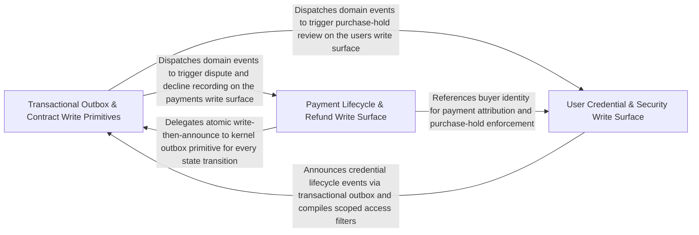

---
tags:
  - 2brain
  - 2brain/arch
  - project/boilerplate-node-backend
type: architecture
component: Kernel_Write_Surface_Primitives
---

## Details

The transactional and contract-level write primitives that seeders invoke to produce the same side effects a real service call would — transactional outbox announcements (announceInTransaction, announceWithin), the translation write plan (TranslationWritePlan, applyTranslations.resolved), the access query collapse, and the module-level PII/email helpers (e.g. encryptOrderPii, decryptOrderAddress, withdrawalCase). Seeders deliberately route through these primitives (e.g. planTranslations/writeTranslations) rather than raw driver writes so that the seeded rows are indistinguishable from rows a human editor would have produced.

### Transactional Outbox & Contract Write Primitives
The kernel-level shared write surface that guarantees atomic write-then-announce semantics and provides contract-level helpers (translation write plans, access query collapse, PII encryption/decryption, email case helpers) that both production services and seeders invoke. announceInTransaction opens a transaction, runs the caller's write, enqueues the domain event in the same session, commits, and nudges the relay. TranslationWritePlan provides the locale-aware write plan so a seeder's translation rows carry the same origin, version, and fallback-chain semantics as a human editor's PATCH. collapse resolves the access query into a single MongoDB filter. encryptOrderPii binds PII fields to their order via AAD so a seeder's encrypted rows are cryptographically identical to production rows.

**Related Classes/Methods**:

- `src.kernel.outbox.announceInTransaction`:492-499
- `src.kernel.outbox.announceWithin`:471-479
- `src.kernel.access.query.collapse`:122-135
- `src.modules.orders.pii.encryptOrderPii`:78-90

**Source Files:**

- `src/kernel/access/query.ts`
  - `src.kernel.access.query.collapse` (L122-L135) - Class
  - `src.kernel.access.query.collapse.branches.some() callback` (L129-L129) - Function
- `src/kernel/outbox.ts`
  - `src.kernel.outbox.announceWithin` (L471-L479) - Class
  - `src.kernel.outbox.announceWithin.then() callback` (L476-L479) - Function
  - `src.kernel.outbox.announceWithin.then() callback.then() callback` (L478-L478) - Function
  - `src.kernel.outbox.announceInTransaction` (L492-L499) - Class
  - `src.kernel.outbox.announceInTransaction.withTransaction() callback` (L496-L496) - Function
  - `src.kernel.outbox.announceInTransaction.then() callback` (L496-L499) - Function
- `src/kernel/translation.ts`
  - `src.kernel.translation.TranslationWritePlan` (L179-L182) - Interface
  - `src.kernel.translation.applyTranslations.resolved` (L378-L383) - Class
  - `src.kernel.translation.applyTranslations.resolved.items.map() callback` (L380-L380) - Function
- `src/modules/locales/repository.ts`
  - `src.modules.locales.repository.importEntries.withTransaction() callback.changedEntries` (L341-L341) - Class
  - `src.modules.locales.repository.importEntries.withTransaction() callback.changedEntries.filter() callback` (L341-L341) - Function
  - `src.modules.locales.repository.localeRepository` (L679-L701) - Class
  - `src.modules.locales.repository.localeRepository.save` (L689-L694) - Method
  - `src.modules.locales.repository.localeRepository.save.fencedSave() callback` (L692-L692) - Function
- `src/modules/orders/domain/lifecycle.ts`
  - `src.modules.orders.domain.lifecycle.OrderEvent` (L31-L35) - Interface
  - `src.modules.orders.domain.lifecycle.statusesReachableFrom` (L259-L263) - Class
  - `src.modules.orders.domain.lifecycle.statusesReachableFrom.filter() callback` (L263-L263) - Function
  - `src.modules.orders.domain.lifecycle.statusesLeadingTo` (L270-L271) - Class
  - `src.modules.orders.domain.lifecycle.statusesLeadingTo.filter() callback` (L271-L271) - Function
- `src/modules/orders/domain/rules.ts`
  - `src.modules.orders.domain.rules.OrderLineCandidate` (L8-L11) - Interface
  - `src.modules.orders.domain.rules.HasBuyer` (L33-L35) - Interface
  - `src.modules.orders.domain.rules.ShippableLineCandidate` (L56-L58) - Interface
  - `src.modules.orders.domain.rules.isDigitalOnlyOrder` (L74-L75) - Class
  - `src.modules.orders.domain.rules.isDigitalOnlyOrder.lines.every() callback` (L75-L75) - Function
- `src/modules/orders/emails.ts`
  - `src.modules.orders.emails.withdrawalCase` (L84-L88) - Class
  - `src.modules.orders.emails.withdrawalCase.withdrawable` (L85-L85) - Class
  - `src.modules.orders.emails.withdrawalCase.withdrawable.order.items.filter() callback` (L85-L85) - Function
  - `src.modules.orders.emails.withdrawalCase.withdrawable.some() callback` (L87-L87) - Function
  - `src.modules.orders.emails.withdrawalNotice.excluded` (L143-L143) - Class
  - `src.modules.orders.emails.withdrawalNotice.excluded.order.items.filter() callback` (L143-L143) - Function
- `src/modules/orders/pii.ts`
  - `src.modules.orders.pii.OrderPiiFields` (L37-L41) - Interface
  - `src.modules.orders.pii.encryptOrderPii` (L78-L90) - Class
  - `src.modules.orders.pii.encryptOrderPii.mapAddress() callback` (L84-L85) - Function
  - `src.modules.orders.pii.decryptOrderAddress` (L97-L104) - Class
  - `src.modules.orders.pii.decryptOrderAddress.mapAddress() callback` (L102-L103) - Function
- `src/modules/orders/repository.ts`
  - `src.modules.orders.repository.search` (L157-L188) - Class
  - `src.modules.orders.repository.search.then() callback` (L175-L186) - Function
  - `src.modules.orders.repository.search.then() callback.then() callback` (L182-L185) - Function
  - `src.modules.orders.repository.countMatching` (L197-L204) - Class
  - `src.modules.orders.repository.countMatching.then() callback` (L204-L204) - Function
  - `src.modules.orders.repository.streamMatching` (L214-L227) - Function
  - `src.modules.orders.repository.extendConformity` (L344-L362) - Class
  - `src.modules.orders.repository.extendConformity.then() callback` (L362-L362) - Function
  - `src.modules.orders.repository.markMoneyReceived` (L409-L418) - Class
  - `src.modules.orders.repository.markMoneyReceived.then() callback` (L418-L418) - Function
  - `src.modules.orders.repository.findOpenUnpaidIdsOf` (L555-L567) - Class
  - `src.modules.orders.repository.findOpenUnpaidIdsOf.then() callback` (L567-L567) - Function
  - `src.modules.orders.repository.findOpenUnpaidIdsOf.then() callback.orders.map() callback` (L567-L567) - Function
  - `src.modules.orders.repository.findCanceledIdsOf` (L577-L584) - Class
  - `src.modules.orders.repository.findCanceledIdsOf.then() callback` (L581-L584) - Function
  - `src.modules.orders.repository.findCanceledIdsOf.then() callback.paid.map() callback` (L582-L582) - Function
  - `src.modules.orders.repository.findCanceledIdsOf.then() callback.paid.orders.filter() callback` (L582-L582) - Function
  - `src.modules.orders.repository.findCanceledIdsOf.then() callback.unpaid.map() callback` (L583-L583) - Function
  - `src.modules.orders.repository.findCanceledIdsOf.then() callback.unpaid.orders.filter() callback` (L583-L583) - Function
  - `src.modules.orders.repository.PiiClaimWindow` (L589-L594) - Interface
  - `src.modules.orders.repository.startPiiClock` (L679-L687) - Class
  - `src.modules.orders.repository.startPiiClock.then() callback` (L687-L687) - Function
  - `src.modules.orders.repository.scrubBatch` (L708-L750) - Class
  - `src.modules.orders.repository.announceInTransaction() callback` (L710-L743) - Function
  - `src.modules.orders.repository.scrubBatch.announceInTransaction() callback.then() callback` (L716-L742) - Function
  - `src.modules.orders.repository.scrubBatch.announceInTransaction() callback.then() callback._id.$in.due.map() callback` (L719-L719) - Function
  - `src.modules.orders.repository.scrubBatch.announceInTransaction() callback.then() callback.then() callback.orderId.$in.due.map() callback` (L736-L736) - Function
  - `src.modules.orders.repository.scrubBatch.announceInTransaction() callback.then() callback.then() callback` (L742-L742) - Function
  - `src.modules.orders.repository.scrubBatch.announceInTransaction() callback.then() callback.then() callback.due.map() callback` (L742-L742) - Function
  - `src.modules.orders.repository.scrubBatch.announceInTransaction() callback` (L744-L749) - Function
  - `src.modules.orders.repository.scrubBatch.announceInTransaction() callback.scrubbedIds.map() callback` (L745-L749) - Function
  - `src.modules.orders.repository.scrubBatch.then() callback` (L750-L750) - Function
  - `src.modules.orders.repository.scrubDueForAnonymization.scrubbed` (L784-L788) - Class
  - `src.modules.orders.repository.scrubDueForAnonymization.scrubbed.due.map() callback` (L785-L785) - Function
- `src/modules/orders/services/actions.ts`
  - `src.modules.orders.services.actions.withActions` (L215-L223) - Class
  - `src.modules.orders.services.actions.withActions.then() callback` (L216-L222) - Function
  - `src.modules.orders.services.actions.withListActions` (L233-L252) - Class
  - `src.modules.orders.services.actions.withListActions.then() callback` (L239-L252) - Function
  - `src.modules.orders.services.actions.withListActions.then() callback.items.page.items.flatMap() callback` (L244-L249) - Function
- `src/modules/orders/services/address.ts`
  - `src.modules.orders.services.address.correctShippingAddress` (L50-L85) - Class
  - `src.modules.orders.services.address.correctShippingAddress.then() callback` (L55-L85) - Function
  - `src.modules.orders.services.address.then() callback.withTimeline() callback` (L69-L70) - Function
  - `src.modules.orders.services.address.correctShippingAddress.then() callback.withTimeline() callback` (L71-L71) - Function
  - `src.modules.orders.services.address.correctShippingAddress.then() callback.then() callback` (L73-L84) - Function
- `src/modules/orders/services/cancel.ts`
  - `src.modules.orders.services.cancel.moveToCanceled` (L74-L116) - Class
  - `src.modules.orders.services.cancel.moveToCanceled.write.order` (L85-L98) - Class
  - `src.modules.orders.services.cancel.moveToCanceled.write.order.withTimeline() callback` (L91-L97) - Function
  - `src.modules.orders.services.cancel.moveToCanceled.then() callback` (L113-L114) - Function
  - `src.modules.orders.services.cancel.moveToCanceled.then() callback.then() callback` (L114-L114) - Function
  - `src.modules.orders.services.cancel.CauseRules` (L133-L153) - Interface
  - `src.modules.orders.services.cancel.cancel` (L343-L354) - Class
  - `src.modules.orders.services.cancel.cancel.then() callback` (L352-L353) - Function
- `src/modules/orders/services/crud.ts`
  - `src.modules.orders.services.crud.create.details.productIds.removed.map() callback` (L144-L144) - Function
  - `src.modules.orders.services.crud.create.details.lines.outcome.shortfalls.map() callback` (L171-L172) - Function
  - `src.modules.orders.services.crud.update` (L194-L201) - Class
  - `src.modules.orders.services.crud.update.then() callback` (L200-L200) - Function
  - `src.modules.orders.services.crud.updateById` (L206-L230) - Class
  - `src.modules.orders.services.crud.updateById.then() callback` (L211-L230) - Function
  - `src.modules.orders.services.crud.updateById.then() callback.then() callback` (L219-L229) - Function
- `src/modules/orders/services/current.ts`
  - `src.modules.orders.services.current.OrderLineCurrent` (L14-L17) - Interface
  - `src.modules.orders.services.current.OrderLineShape` (L20-L23) - Interface
  - `src.modules.orders.services.current.OrderShape` (L26-L28) - Interface
  - `src.modules.orders.services.current.resolveCurrentImages` (L50-L73) - Class
  - `src.modules.orders.services.current.resolveCurrentImages.then() callback` (L56-L72) - Function
- `src/modules/orders/services/digest.ts`
  - `src.modules.orders.services.digest.OrdersDigest` (L14-L19) - Interface
  - `src.modules.orders.services.digest.shippingMethodsOf` (L58-L68) - Class
  - `src.modules.orders.services.digest.shippingMethodsOf.then() callback` (L66-L67) - Function
  - `src.modules.orders.services.digest.shippingMethodsOf.then() callback.orders.map() callback` (L67-L67) - Function
- `src/modules/orders/services/export.ts`
  - `src.modules.orders.services.export.OrderExport` (L53-L58) - Interface
  - `src.modules.orders.services.export.csvRows` (L66-L72) - Function
  - `src.modules.orders.services.export.openOrderExport` (L86-L115) - Class
  - `src.modules.orders.services.export.openOrderExport.then() callback` (L94-L114) - Function
- `src/modules/orders/services/fulfillment.ts`
  - `src.modules.orders.services.fulfillment.isPayableNow` (L130-L137) - Class
  - `src.modules.orders.services.fulfillment.isPayableNow.then() callback` (L133-L136) - Function
  - `src.modules.orders.services.fulfillment.isPayableNow.then() callback.then() callback` (L135-L135) - Function
- `src/modules/orders/services/override.ts`
  - `src.modules.orders.services.override.applyOverride` (L46-L117) - Class
  - `src.modules.orders.services.override.applyOverride.write` (L78-L90) - Class
  - `src.modules.orders.services.override.write.withTimeline() callback` (L79-L80) - Function
  - `src.modules.orders.services.override.applyOverride.write.withTimeline() callback` (L81-L89) - Function
  - `src.modules.orders.services.override.applyOverride.move.then() callback` (L104-L116) - Function
  - `src.modules.orders.services.override.overrideStatus` (L142-L166) - Class
  - `src.modules.orders.services.override.overrideStatus.then() callback` (L148-L166) - Function
  - `src.modules.orders.services.override.overrideStatus.then() callback.then() callback` (L161-L164) - Function
- `src/modules/orders/services/place.ts`
  - `src.modules.orders.services.place.withOwedLines` (L111-L128) - Class
  - `src.modules.orders.services.place.withOwedLines.items.map() callback` (L117-L127) - Function
  - `src.modules.orders.services.place.placeOrder` (L147-L270) - Class
  - `src.modules.orders.services.place.placeOrder.order.announceInTransaction() callback.then() callback` (L243-L250) - Function
  - `src.modules.orders.services.place.placeOrder.order.announceInTransaction() callback.then() callback.then() callback` (L246-L249) - Function
  - `src.modules.orders.services.place.placeOrder.order.announceInTransaction() callback` (L252-L252) - Function
  - `src.modules.orders.services.place.placeOrder.catch() callback` (L259-L266) - Function
- `src/modules/orders/services/read.ts`
  - `src.modules.orders.services.read.search` (L64-L82) - Class
  - `src.modules.orders.services.read.search.then() callback` (L72-L81) - Function
  - `src.modules.orders.services.read.search.then() callback.then() callback` (L74-L81) - Function
  - `src.modules.orders.services.read.orderBriefsByIds` (L119-L136) - Class
  - `src.modules.orders.services.read.orderBriefsByIds.then() callback` (L123-L135) - Function
  - `src.modules.orders.services.read.orderBriefsByIds.then() callback.orders.map() callback` (L125-L134) - Function
  - `src.modules.orders.services.read.findOwnOrders` (L146-L153) - Class
  - `src.modules.orders.services.read.findOwnOrders.readAll() callback` (L148-L151) - Function
  - `src.modules.orders.services.read.findOwnOrders.readAll() callback.then() callback` (L150-L150) - Function
- `src/modules/orders/services/reencrypt.ts`
  - `src.modules.orders.services.reencrypt.fieldsOf.addresses.ADDRESS_PATHS.flatMap() callback` (L18-L31) - Function
  - `src.modules.orders.services.reencrypt.fieldsOf.addresses` (L18-L32) - Class
  - `src.modules.orders.services.reencrypt.fieldsOf.addresses.ADDRESS_PATHS.flatMap() callback.POSTAL_ADDRESS_FIELDS.flatMap() callback` (L19-L31) - Function
  - `src.modules.orders.services.reencrypt.reencryptOrders` (L66-L80) - Class
  - `src.modules.orders.services.reencrypt.reencryptOrders.then() callback` (L69-L79) - Function
  - `src.modules.orders.services.reencrypt.reencryptOrders.then() callback.then() callback` (L79-L79) - Function
- `src/modules/orders/services/remove.ts`
  - `src.modules.orders.services.remove.restoreById` (L143-L164) - Class
  - `src.modules.orders.services.remove.restoreById.then() callback` (L147-L164) - Function
  - `src.modules.orders.services.remove.restoreById.then() callback.then() callback` (L155-L163) - Function
- `src/modules/orders/services/ship-stock.ts`
  - `src.modules.orders.services.ship-stock.announceMoveShippingStock` (L30-L43) - Class
  - `src.modules.orders.services.ship-stock.announceMoveShippingStock.announceInTransaction() callback` (L36-L39) - Function
  - `src.modules.orders.services.ship-stock.announceMoveShippingStock.announceInTransaction() callback.then() callback` (L37-L38) - Function
  - `src.modules.orders.services.ship-stock.announceMoveShippingStock.announceInTransaction() callback.then() callback.then() callback` (L38-L38) - Function
  - `src.modules.orders.services.ship-stock.announceMoveShippingStock.then() callback` (L41-L42) - Function
  - `src.modules.orders.services.ship-stock.announceMoveShippingStock.then() callback.then() callback` (L42-L42) - Function
- `src/modules/orders/services/status.ts`
  - `src.modules.orders.services.status.markSystemMove` (L80-L99) - Class
  - `src.modules.orders.services.status.markSystemMove.withTimeline() callback` (L92-L95) - Function
  - `src.modules.orders.services.status.markSystemMove.announceMove() callback` (L97-L97) - Function
  - `src.modules.orders.services.status.settleRetaken` (L117-L127) - Class
  - `src.modules.orders.services.status.settleRetaken.then() callback` (L123-L127) - Function
  - `src.modules.orders.services.status.settleRetaken.then() callback.then() callback` (L126-L126) - Function
  - `src.modules.orders.services.status.markPaid` (L159-L197) - Class
  - `src.modules.orders.services.status.markPaid.movePaid` (L166-L173) - Class
  - `src.modules.orders.services.status.movePaid.withTimeline() callback` (L167-L167) - Function
  - `src.modules.orders.services.status.markPaid.movePaid.withTimeline() callback` (L168-L172) - Function
  - `src.modules.orders.services.status.markPaid.announceMove() callback.then() callback` (L180-L194) - Function
  - `src.modules.orders.services.status.markPaid.announceMove() callback.then() callback.then() callback` (L189-L192) - Function
  - `src.modules.orders.services.status.markPaid.announceMove() callback.then() callback.then() callback.settleRetaken() callback` (L192-L192) - Function
  - `src.modules.orders.services.status.markPaid.announceMove() callback` (L195-L195) - Function
  - `src.modules.orders.services.status.markDelivered` (L295-L315) - Class
  - `src.modules.orders.services.status.withTimeline() callback` (L309-L309) - Function
  - `src.modules.orders.services.status.markDelivered.withTimeline() callback` (L311-L311) - Function
  - `src.modules.orders.services.status.markDelivered.announceMove() callback` (L313-L313) - Function
  - `src.modules.orders.services.status.markFulfillmentComplete` (L332-L361) - Class
  - `src.modules.orders.services.status.markFulfillmentComplete.then() callback` (L338-L361) - Function
  - `src.modules.orders.services.status.then() callback.withTimeline() callback` (L350-L350) - Function
  - `src.modules.orders.services.status.markFulfillmentComplete.then() callback.withTimeline() callback` (L351-L354) - Function
  - `src.modules.orders.services.status.markFulfillmentComplete.then() callback.announceWithin() callback` (L356-L359) - Function
  - `src.modules.orders.services.status.markFulfillmentComplete.then() callback.announceWithin() callback.events.map() callback` (L357-L358) - Function
  - `src.modules.orders.services.status.markUndeliverable` (L377-L412) - Class
  - `src.modules.orders.services.status.markUndeliverable.withTimeline() callback` (L391-L396) - Function
  - `src.modules.orders.services.status.markUndeliverable.announceWithin() callback` (L398-L402) - Function
  - `src.modules.orders.services.status.markUndeliverable.then() callback` (L403-L411) - Function
  - `src.modules.orders.services.status.markUndeliverable.then() callback.reportCanceled` (L407-L409) - Method
  - `src.modules.orders.services.status.FulfillmentSettlement` (L415-L418) - Interface
  - `src.modules.orders.services.status.settleFulfillment` (L435-L457) - Class
  - `src.modules.orders.services.status.settleFulfillment.then() callback` (L441-L457) - Function
  - `src.modules.orders.services.status.settleFulfillment.then() callback.then() callback` (L447-L448) - Function
  - `src.modules.orders.services.status.settleFulfillment.then() callback.moved.then() callback` (L456-L456) - Function
  - `src.modules.orders.services.status.reopenForFulfillment` (L468-L482) - Class
  - `src.modules.orders.services.status.reopenForFulfillment.then() callback` (L473-L482) - Function
  - `src.modules.orders.services.status.reopenForFulfillment.then() callback.move.then() callback` (L481-L481) - Function
- `src/modules/orders/services/timeline.ts`
  - `src.modules.orders.services.timeline.withTimeline` (L115-L125) - Class
  - `src.modules.orders.services.timeline.withTimeline.<function>` (L120-L125) - Function
  - `src.modules.orders.services.timeline.withTimeline.<function>.then() callback` (L121-L124) - Function
  - `src.modules.orders.services.timeline.withTimeline.<function>.then() callback.then() callback` (L123-L123) - Function
  - `src.modules.orders.services.timeline.addNote` (L136-L156) - Class
  - `src.modules.orders.services.timeline.addNote.then() callback` (L141-L156) - Function
  - `src.modules.orders.services.timeline.addNote.then() callback.withTransaction() callback` (L144-L145) - Function
  - `src.modules.orders.services.timeline.addNote.then() callback.then() callback` (L146-L155) - Function
  - `src.modules.orders.services.timeline.deleteNote` (L167-L184) - Class
  - `src.modules.orders.services.timeline.deleteNote.then() callback` (L172-L184) - Function
- `src/modules/payments/services/disputes.ts`
  - `src.modules.payments.services.disputes.storeDispute` (L137-L157) - Class
  - `src.modules.payments.services.disputes.announceInTransaction() callback` (L142-L151) - Function
  - `src.modules.payments.services.disputes.storeDispute.announceInTransaction() callback.then() callback` (L145-L150) - Function
  - `src.modules.payments.services.disputes.storeDispute.announceInTransaction() callback.then() callback.then() callback` (L148-L148) - Function
  - `src.modules.payments.services.disputes.storeDispute.announceInTransaction() callback` (L152-L156) - Function
- `src/modules/stock-alerts/repository.ts`
  - `src.modules.stock-alerts.repository.upsertRequest` (L29-L45) - Class
  - `src.modules.stock-alerts.repository.upsertRequest.then() callback` (L42-L45) - Function
  - `src.modules.stock-alerts.repository.stockAlertRepository` (L51-L139) - Class
  - `src.modules.stock-alerts.repository.stockAlertRepository.ask` (L74-L85) - Method
  - `src.modules.stock-alerts.repository.stockAlertRepository.ask.then() callback` (L81-L84) - Function
  - `src.modules.stock-alerts.repository.stockAlertRepository.cancel` (L88-L92) - Method
  - `src.modules.stock-alerts.repository.stockAlertRepository.cancel.then() callback` (L92-L92) - Function
  - `src.modules.stock-alerts.repository.stockAlertRepository.findByUserId` (L95-L99) - Method
  - `src.modules.stock-alerts.repository.stockAlertRepository.findByProductId` (L102-L106) - Method
  - `src.modules.stock-alerts.repository.stockAlertRepository.distinctProductIds` (L109-L113) - Method
  - `src.modules.stock-alerts.repository.stockAlertRepository.distinctProductIds.then() callback` (L113-L113) - Function
  - `src.modules.stock-alerts.repository.stockAlertRepository.deleteById` (L116-L120) - Method
  - `src.modules.stock-alerts.repository.stockAlertRepository.deleteById.then() callback` (L120-L120) - Function
  - `src.modules.stock-alerts.repository.stockAlertRepository.deleteByUserId` (L123-L129) - Method
  - `src.modules.stock-alerts.repository.stockAlertRepository.deleteByUserId.then() callback` (L127-L129) - Function
  - `src.modules.stock-alerts.repository.stockAlertRepository.deleteByProductId` (L132-L138) - Method
  - `src.modules.stock-alerts.repository.stockAlertRepository.deleteByProductId.then() callback` (L136-L138) - Function
- `src/modules/stock-alerts/service.ts`
  - `src.modules.stock-alerts.service.list` (L33-L34) - Class
  - `src.modules.stock-alerts.service.list.then() callback` (L34-L34) - Function
  - `src.modules.stock-alerts.service.ask` (L46-L70) - Class
  - `src.modules.stock-alerts.service.ask.then() callback` (L50-L70) - Function
  - `src.modules.stock-alerts.service.ask.then() callback.then() callback` (L60-L68) - Function
  - `src.modules.stock-alerts.service.ask.then() callback.then() callback.then() callback` (L68-L68) - Function
  - `src.modules.stock-alerts.service.cancel` (L78-L85) - Class
  - `src.modules.stock-alerts.service.cancel.then() callback` (L82-L85) - Function
  - `src.modules.stock-alerts.service.cancel.then() callback.then() callback` (L84-L84) - Function
  - `src.modules.stock-alerts.service.exportRows` (L91-L92) - Class
  - `src.modules.stock-alerts.service.exportRows.then() callback` (L92-L92) - Function
  - `src.modules.stock-alerts.service.answerOne` (L129-L146) - Class
  - `src.modules.stock-alerts.service.announceInTransaction() callback` (L134-L137) - Function
  - `src.modules.stock-alerts.service.answerOne.announceInTransaction() callback.then() callback` (L137-L137) - Function
  - `src.modules.stock-alerts.service.answerOne.announceInTransaction() callback` (L138-L142) - Function
  - `src.modules.stock-alerts.service.answerOne.then() callback` (L143-L146) - Function
  - `src.modules.stock-alerts.service.answerOne.then() callback.then() callback` (L145-L145) - Function
- `src/modules/tasks/access.ts`
  - `src.modules.tasks.access.roleMayWorkRouteSet.set` (L86-L86) - Class
  - `src.modules.tasks.access.roleMayWorkRouteSet.set.PERMISSION_SETS.find() callback` (L86-L86) - Function
  - `src.modules.tasks.access.roleMayWorkRouteSet.set.rules.every() callback` (L87-L87) - Function
- `src/modules/tasks/domain/actions.ts`
  - `src.modules.tasks.domain.actions.ActionFacts` (L11-L18) - Interface
  - `src.modules.tasks.domain.actions.TaskActionFlags` (L21-L29) - Interface
- `src/modules/tasks/domain/lifecycle.ts`
  - `src.modules.tasks.domain.lifecycle.TaskFacts` (L18-L26) - Interface
  - `src.modules.tasks.domain.lifecycle.TaskPatch` (L29-L32) - Interface
- `src/modules/tasks/domain/ownership.ts`
  - `src.modules.tasks.domain.ownership.OwnerRef` (L8-L12) - Interface
  - `src.modules.tasks.domain.ownership.OwnTasksFilter` (L18-L21) - Interface
- `src/modules/tasks/domain/system.ts`
  - `src.modules.tasks.domain.system.SystemOpening` (L22-L44) - Interface
- `src/modules/tasks/repository.ts`
  - `src.modules.tasks.repository.forgetStaff.then() callback` (L313-L322) - Function
- `src/modules/tasks/services/contact.ts`
  - `src.modules.tasks.services.contact.create.then() callback.announceInTransaction() callback` (L94-L101) - Function
- `src/modules/tasks/services/personal-data.ts`
  - `src.modules.tasks.services.personal-data.findSystemTasksForExport` (L123-L136) - Class
  - `src.modules.tasks.services.personal-data.findSystemTasksForExport.readAll() callback` (L127-L134) - Function
  - `src.modules.tasks.services.personal-data.findSystemTasksForExport.then() callback` (L136-L136) - Function
  - `src.modules.tasks.services.personal-data.findSystemTasksForExport.then() callback.tasks.map() callback` (L136-L136) - Function
- `src/modules/tasks/services/read.ts`
  - `src.modules.tasks.services.read.search` (L77-L92) - Class
  - `src.modules.tasks.services.read.search.then() callback` (L83-L90) - Function
  - `src.modules.tasks.services.read.search.then() callback.items.map() callback` (L84-L84) - Function
  - `src.modules.tasks.services.read.search.then() callback.then() callback` (L84-L90) - Function
  - `src.modules.tasks.services.read.search.then() callback.then() callback.items.items.map() callback` (L87-L87) - Function
  - `src.modules.tasks.services.read.getById` (L103-L122) - Class
  - `src.modules.tasks.services.read.getById.then() callback` (L107-L122) - Function
  - `src.modules.tasks.services.read.getById.then() callback.then() callback` (L114-L120) - Function
  - `src.modules.tasks.services.read.earlierThan` (L131-L150) - Class
  - `src.modules.tasks.services.read.earlierThan.then() callback` (L143-L149) - Function
  - `src.modules.tasks.services.read.earlierThan.then() callback.rows.map() callback` (L144-L149) - Function
- `src/modules/tasks/services/remove.ts`
  - `src.modules.tasks.services.remove.removeById` (L32-L51) - Class
  - `src.modules.tasks.services.remove.removeById.then() callback` (L36-L51) - Function
  - `src.modules.tasks.services.remove.removeById.then() callback.then() callback` (L42-L50) - Function
- `src/modules/users/services/activation.ts`
  - `src.modules.users.services.activation.activate` (L40-L65) - Class
  - `src.modules.users.services.activation.activate.withClearedAccount() callback` (L44-L65) - Function
  - `src.modules.users.services.activation.activate.withClearedAccount() callback.then() callback` (L56-L64) - Function
  - `src.modules.users.services.activation.deactivate` (L76-L121) - Class
  - `src.modules.users.services.activation.deactivate.withClearedAccount() callback` (L80-L121) - Function
  - `src.modules.users.services.activation.deactivate.withClearedAccount() callback.withTransaction() callback` (L93-L102) - Function
  - `src.modules.users.services.activation.withClearedAccount() callback.withTransaction() callback.announceWithin() callback` (L96-L96) - Function
  - `src.modules.users.services.activation.deactivate.withClearedAccount() callback.withTransaction() callback.announceWithin() callback` (L97-L101) - Function
  - `src.modules.users.services.activation.deactivate.withClearedAccount() callback.then() callback` (L103-L120) - Function
- `src/modules/users/services/cleared-account.ts`
  - `src.modules.users.services.cleared-account.withClearedAccount` (L30-L42) - Class
  - `src.modules.users.services.cleared-account.withClearedAccount.then() callback` (L35-L42) - Function
  - `src.modules.users.services.cleared-account.withClearedAccount.then() callback.then() callback` (L41-L41) - Function
- `src/modules/users/services/credentials.ts`
  - `src.modules.users.services.credentials.saveAnnouncingEmail` (L99-L108) - Class
  - `src.modules.users.services.credentials.saveAnnouncingEmail.announceWithin() callback` (L103-L107) - Function
- `src/modules/users/services/purchase-hold.ts`
  - `src.modules.users.services.purchase-hold.saveAnnouncingReview` (L155-L166) - Class
  - `src.modules.users.services.purchase-hold.saveAnnouncingReview.announceInTransaction() callback` (L158-L165) - Function
  - `src.modules.users.services.purchase-hold.setPurchaseHold` (L179-L226) - Class
  - `src.modules.users.services.purchase-hold.setPurchaseHold.withClearedAccount() callback` (L184-L226) - Function
  - `src.modules.users.services.purchase-hold.setPurchaseHold.withClearedAccount() callback.then() callback` (L215-L225) - Function
  - `src.modules.users.services.purchase-hold.liftPurchaseHold` (L239-L268) - Class
  - `src.modules.users.services.purchase-hold.liftPurchaseHold.withClearedAccount() callback` (L243-L268) - Function
  - `src.modules.users.services.purchase-hold.liftPurchaseHold.withClearedAccount() callback.then() callback` (L258-L267) - Function
  - `src.modules.users.services.purchase-hold.flagPurchaseHoldReview` (L333-L354) - Class
  - `src.modules.users.services.purchase-hold.flagPurchaseHoldReview.announceInTransaction() callback.then() callback` (L338-L338) - Function
  - `src.modules.users.services.purchase-hold.flagPurchaseHoldReview.announceInTransaction() callback` (L339-L343) - Function
  - `src.modules.users.services.purchase-hold.flagPurchaseHoldReview.then() callback` (L344-L354) - Function
- `src/modules/users/services/remove.ts`
  - `src.modules.users.services.remove.restoreById.withClearedAccount() callback` (L230-L248) - Function
  - `src.modules.users.services.remove.restoreById.withClearedAccount() callback.then() callback` (L239-L247) - Function
- `src/modules/users/services/update.ts`
  - `src.modules.users.services.update.saveInTransaction` (L157-L166) - Class
  - `src.modules.users.services.update.saveInTransaction.withTransaction() callback` (L158-L166) - Function
  - `src.modules.users.services.update.saveInTransaction.withTransaction() callback.then() callback.then() callback` (L165-L165) - Function
  - `src.modules.users.services.update.saveThenClean.then() callback.imageCleanup` (L182-L184) - Class
  - `src.modules.users.services.update.saveThenClean.then() callback.imageCleanup.then() callback` (L186-L186) - Function

### User Credential & Security Write Surface
The users module's repository-level write operations that manage the full credential and security lifecycle: 2FA enrollment and code delivery, session invalidation, purchase-hold claiming and review, scheduled erasure, and daily activity stamping. The two-factor-write pipeline computes the exact field diff for a 2FA write so the repository can apply a minimal, auditable update. clearedCode builds the $unset document that atomically clears a delivered-code slot. These operations are the write surface a seeder must invoke to produce user rows with the same credential state, epoch counters, and hold records that a real sign-in flow would create.

**Related Classes/Methods**:

- `src.modules.users.repository.userRepository`:158-1023
- `src.modules.users.repository.userRepository.claimPurchaseHold`:794-810
- `src.modules.users.two-factor-write.modifiedFieldsOf`:119-123
- `src.modules.users.repository.clearedCode`:150-151
- `src.modules.users.repository.stampDaily`:81-95

**Source Files:**

- `src/modules/users/repository.ts`
  - `src.modules.users.repository.stampDaily` (L81-L95) - Class
  - `src.modules.users.repository.stampDaily.then() callback` (L95-L95) - Function
  - `src.modules.users.repository.clearedCode` (L150-L151) - Class
  - `src.modules.users.repository.clearedCode.DELIVERED_CODE_FIELDS.map() callback` (L151-L151) - Function
  - `src.modules.users.repository.userRepository` (L158-L1023) - Class
  - `src.modules.users.repository.userRepository.updateMany` (L253-L254) - Method
  - `src.modules.users.repository.userRepository.findByIdWithCredentials` (L259-L264) - Method
  - `src.modules.users.repository.userRepository.findOneWithCredentials` (L269-L270) - Method
  - `src.modules.users.repository.userRepository.findByIdWithPendingEmail` (L277-L277) - Method
  - `src.modules.users.repository.userRepository.emailOrPendingEmailTaken` (L289-L296) - Method
  - `src.modules.users.repository.userRepository.emailOrPendingEmailTaken.then() callback` (L296-L296) - Function
  - `src.modules.users.repository.userRepository.emailTaken` (L304-L308) - Method
  - `src.modules.users.repository.userRepository.emailTaken.then() callback` (L308-L308) - Function
  - `src.modules.users.repository.userRepository.findStaffContacts` (L316-L324) - Method
  - `src.modules.users.repository.userRepository.findStaffContacts._id.$in.ids.map() callback` (L319-L319) - Function
  - `src.modules.users.repository.userRepository.findAuthenticatableById` (L334-L337) - Method
  - `src.modules.users.repository.userRepository.findForSignInByEmail` (L346-L351) - Method
  - `src.modules.users.repository.userRepository.findForSignInByOAuthIdentity` (L358-L367) - Method
  - `src.modules.users.repository.userRepository.clearLapsedPreviousEmail` (L379-L390) - Method
  - `src.modules.users.repository.userRepository.clearLapsedPreviousEmail._id.$nin.keepUserIds.map() callback` (L384-L384) - Function
  - `src.modules.users.repository.userRepository.clearLapsedPreviousEmail.then() callback` (L390-L390) - Function
  - `src.modules.users.repository.userRepository.linkOAuthAccount` (L402-L412) - Method
  - `src.modules.users.repository.userRepository.linkOAuthAccount.then() callback` (L412-L412) - Function
  - `src.modules.users.repository.userRepository.unlinkOAuthAccount` (L422-L430) - Method
  - `src.modules.users.repository.userRepository.unlinkOAuthAccount.then() callback` (L430-L430) - Function
  - `src.modules.users.repository.userRepository.reserveMfaAttempt` (L447-L496) - Method
  - `src.modules.users.repository.userRepository.reserveMfaAttempt.then() callback` (L491-L494) - Function
  - `src.modules.users.repository.userRepository.resetMfaAttempts` (L502-L513) - Method
  - `src.modules.users.repository.userRepository.resetMfaAttempts.then() callback` (L513-L513) - Function
  - `src.modules.users.repository.userRepository.bumpSessionEpoch` (L520-L532) - Method
  - `src.modules.users.repository.userRepository.bumpSessionEpoch.then() callback` (L532-L532) - Function
  - `src.modules.users.repository.userRepository.claimTotpStep` (L542-L558) - Method
  - `src.modules.users.repository.userRepository.claimTotpStep.then() callback` (L558-L558) - Function
  - `src.modules.users.repository.userRepository.spendBackupCode` (L570-L578) - Method
  - `src.modules.users.repository.userRepository.spendBackupCode.then() callback` (L578-L578) - Function
  - `src.modules.users.repository.userRepository.spendDeliveredCode` (L592-L607) - Method
  - `src.modules.users.repository.userRepository.spendDeliveredCode.codeSlotFilter() callback` (L595-L602) - Function
  - `src.modules.users.repository.userRepository.spendDeliveredCode.then() callback` (L607-L607) - Function
  - `src.modules.users.repository.userRepository.recordDeliveredMiss` (L619-L645) - Method
  - `src.modules.users.repository.userRepository.recordDeliveredMiss.codeSlotFilter() callback` (L622-L628) - Function
  - `src.modules.users.repository.recordDeliveredMiss.then() callback` (L633-L643) - Function
  - `src.modules.users.repository.userRepository.recordDeliveredMiss.then() callback.codeSlotFilter() callback` (L636-L639) - Function
  - `src.modules.users.repository.userRepository.recordDeliveredMiss.then() callback` (L645-L645) - Function
  - `src.modules.users.repository.userRepository.armReauthCode` (L655-L663) - Method
  - `src.modules.users.repository.userRepository.armReauthCode.then() callback` (L663-L663) - Function
  - `src.modules.users.repository.userRepository.writeTwoFactor` (L678-L708) - Method
  - `src.modules.users.repository.userRepository.writeTwoFactor.then() callback` (L700-L707) - Function
  - `src.modules.users.repository.userRepository.touchLastActive` (L726-L726) - Method
  - `src.modules.users.repository.userRepository.touchApiKeyUse` (L735-L735) - Method
  - `src.modules.users.repository.userRepository.markInactivityMinimised` (L744-L752) - Method
  - `src.modules.users.repository.userRepository.markInactivityMinimised.then() callback` (L752-L752) - Function
  - `src.modules.users.repository.userRepository.claimPurchaseHold` (L794-L810) - Method
  - `src.modules.users.repository.userRepository.claimPurchaseHold.then() callback` (L810-L810) - Function
  - `src.modules.users.repository.userRepository.claimPurchaseHoldReview` (L823-L831) - Method
  - `src.modules.users.repository.userRepository.claimPurchaseHoldReview.then() callback` (L831-L831) - Function
  - `src.modules.users.repository.userRepository.reduceExpiredPurchaseHolds` (L843-L865) - Method
  - `src.modules.users.repository.userRepository.reduceExpiredPurchaseHolds.then() callback` (L865-L865) - Function
  - `src.modules.users.repository.userRepository.findInactiveUnminimised` (L874-L890) - Method
  - `src.modules.users.repository.userRepository.findInactiveUnwarned` (L896-L902) - Method
  - `src.modules.users.repository.userRepository.findWarnedStillInactive` (L909-L916) - Method
  - `src.modules.users.repository.userRepository.findReaperSoftDeletedPastGrace` (L919-L928) - Method
  - `src.modules.users.repository.userRepository.forgetHoldSetter` (L937-L945) - Method
  - `src.modules.users.repository.userRepository.forgetHoldSetter.then() callback` (L945-L945) - Function
  - `src.modules.users.repository.userRepository.findScheduledDeletionsDue` (L948-L949) - Method
  - `src.modules.users.repository.userRepository.restoreScheduledDeletion` (L959-L968) - Method
  - `src.modules.users.repository.userRepository.restoreScheduledDeletion.then() callback` (L968-L968) - Function
  - `src.modules.users.repository.userRepository.claimScheduledErasure` (L1014-L1022) - Method
  - `src.modules.users.repository.userRepository.claimScheduledErasure.then() callback` (L1022-L1022) - Function
- `src/modules/users/services/credentials.ts`
  - `src.modules.users.services.credentials.persistTwoFactorWrite` (L226-L244) - Class
  - `src.modules.users.services.credentials.persistTwoFactorWrite.then() callback` (L238-L243) - Function
  - `src.modules.users.services.credentials.persistTwoFactorMethods` (L263-L266) - Class
  - `src.modules.users.services.credentials.persistTwoFactorMethods.then() callback` (L266-L266) - Function
  - `src.modules.users.services.credentials.armReauthCode` (L275-L283) - Class
  - `src.modules.users.services.credentials.armReauthCode.then() callback` (L279-L282) - Function
  - `src.modules.users.services.credentials.spendDeliveredCode` (L311-L321) - Class
  - `src.modules.users.services.credentials.spendDeliveredCode.then() callback` (L318-L321) - Function
  - `src.modules.users.services.credentials.spendBackupCode` (L372-L381) - Class
  - `src.modules.users.services.credentials.spendBackupCode.then() callback` (L373-L381) - Function
  - `src.modules.users.services.credentials.spendBackupCode.then() callback.user.twoFactorBackupCodes.filter() callback` (L376-L376) - Function
- `src/modules/users/services/own-account.ts`
  - `src.modules.users.services.own-account.softDeleteInactive` (L61-L73) - Class
  - `src.modules.users.services.own-account.softDeleteInactive.then() callback` (L72-L72) - Function
  - `src.modules.users.services.own-account.softDeleteInactive.then() callback.then() callback` (L72-L72) - Function
  - `src.modules.users.services.own-account.eraseScheduledDeletion` (L154-L159) - Class
  - `src.modules.users.services.own-account.eraseScheduledDeletion.erase() callback` (L159-L159) - Function
- `src/modules/users/services/purchase-hold.ts`
  - `src.modules.users.services.purchase-hold.purchaseHoldOf` (L88-L92) - Class
  - `src.modules.users.services.purchase-hold.purchaseHoldOf.then() callback` (L92-L92) - Function
  - `src.modules.users.services.purchase-hold.takeAutomaticPurchaseHold` (L291-L321) - Class
  - `src.modules.users.services.purchase-hold.takeAutomaticPurchaseHold.then() callback` (L299-L320) - Function
  - `src.modules.users.services.purchase-hold.takeAutomaticPurchaseHold.then() callback.catch() callback` (L316-L317) - Function
  - `src.modules.users.services.purchase-hold.takeAutomaticPurchaseHold.then() callback.then() callback` (L319-L319) - Function
- `src/modules/users/services/read.ts`
  - `src.modules.users.services.read.staffContacts` (L67-L76) - Class
  - `src.modules.users.services.read.staffContacts.then() callback` (L70-L75) - Function
  - `src.modules.users.services.read.staffContacts.then() callback.users.map() callback` (L71-L75) - Function
  - `src.modules.users.services.read.toUserContract` (L87-L101) - Class
  - `src.modules.users.services.read.toUserContract.then() callback` (L90-L100) - Function
- `src/modules/users/services/remove.ts`
  - `src.modules.users.services.remove.erase` (L95-L122) - Class
  - `src.modules.users.services.remove.erase.withTransaction() callback` (L101-L104) - Function
  - `src.modules.users.services.remove.erase.withTransaction() callback.then() callback` (L102-L103) - Function
  - `src.modules.users.services.remove.erase.then() callback` (L105-L122) - Function
  - `src.modules.users.services.remove.then() callback.then() callback` (L109-L109) - Function
  - `src.modules.users.services.remove.erase.then() callback.then() callback` (L121-L121) - Function
  - `src.modules.users.services.remove.remove` (L141-L169) - Class
  - `src.modules.users.services.remove.remove.then() callback` (L157-L168) - Function
  - `src.modules.users.services.remove.restoreScheduled` (L181-L215) - Class
  - `src.modules.users.services.remove.announceInTransaction() callback` (L192-L195) - Function
  - `src.modules.users.services.remove.restoreScheduled.announceInTransaction() callback.then() callback` (L195-L195) - Function
  - `src.modules.users.services.remove.restoreScheduled.announceInTransaction() callback` (L196-L200) - Function
  - `src.modules.users.services.remove.restoreScheduled.then() callback` (L201-L214) - Function
  - `src.modules.users.services.remove.restoreScheduled.then() callback.then() callback` (L213-L213) - Function
  - `src.modules.users.services.remove.restoreById` (L226-L248) - Class
  - `src.modules.users.services.remove.removeById` (L255-L260) - Class
  - `src.modules.users.services.remove.removeById.withClearedAccount() callback` (L260-L260) - Function
- `src/modules/users/services/sign-in-methods.ts`
  - `src.modules.users.services.sign-in-methods.exportSignInMethods` (L24-L40) - Class
  - `src.modules.users.services.sign-in-methods.exportSignInMethods.then() callback` (L25-L39) - Function
  - `src.modules.users.services.sign-in-methods.exportSignInMethods.then() callback.providers.user.oauthAccounts.map() callback` (L28-L32) - Function
  - `src.modules.users.services.sign-in-methods.exportSignInMethods.then() callback.twoFactor.user.twoFactorMethods.flatMap() callback` (L35-L36) - Function
- `src/modules/users/services/update.ts`
  - `src.modules.users.services.update.updateById.withClearedAccount() callback` (L236-L236) - Function
- `src/modules/users/two-factor-write.ts`
  - `src.modules.users.two-factor-write.modifiedFieldsOf` (L119-L123) - Class
  - `src.modules.users.two-factor-write.modifiedFieldsOf.ENTRY_FIELDS.filter() callback` (L122-L122) - Function

### Payment Lifecycle & Refund Write Surface
The payments module's repository-level write operations that manage the full payment and refund state machine: intent upserts, provider reference attachment, refund lifecycle transitions, user detachment, and retention cleanup. aggregateRefundRows provides the $unwind-based aggregation that flattens embedded refund arrays into rows for the staff Refunds tab. The webhook-signature module validates inbound provider webhooks before the repository applies state changes. announce.ts and intent.ts provide the outbox-announcement and payment-intent write helpers that a seeder uses to produce payment rows with the same provider refs, status transitions, and outbox events that a real checkout flow would create.

**Related Classes/Methods**:

- `src.modules.payments.repository.paymentRepository`:313-1197
- `src.modules.payments.repository.upsertOutcome`:250-269
- `src.modules.payments.repository.paymentRepository.claimRefund`:833-851
- `src.modules.payments.repository.aggregateRefundRows`:219-223
- `src.modules.payments.repository.paymentRepository.attachProviderRef`:500-508

**Source Files:**

- `src/modules/account/services/profile.ts`
  - `src.modules.account.services.profile.writeProfile.announceWithdrawal` (L76-L84) - Class
  - `src.modules.account.services.profile.writeProfile.announceWithdrawal.<function>` (L77-L83) - Function
- `src/modules/inventory/repository.ts`
  - `src.modules.inventory.repository.reservationRepository.pushItems` (L775-L783) - Method
  - `src.modules.inventory.repository.reservationRepository.pushItems.then() callback` (L783-L783) - Function
- `src/modules/inventory/services/reserve.ts`
  - `src.modules.inventory.services.reserve.giveBack` (L32-L42) - Class
  - `src.modules.inventory.services.reserve.giveBack.then() callback` (L34-L34) - Function
  - `src.modules.inventory.services.reserve.giveBack.catch() callback` (L35-L42) - Function
- `src/modules/payments/providers/webhook-signature.ts`
  - `src.modules.payments.providers.webhook-signature.verifyWebhookSignature.matches` (L122-L125) - Class
  - `src.modules.payments.providers.webhook-signature.verifyWebhookSignature.matches.flatMap() callback` (L122-L125) - Function
  - `src.modules.payments.providers.webhook-signature.verifyWebhookSignature.matches.flatMap() callback.provided.map() callback` (L124-L124) - Function
- `src/modules/payments/repository.ts`
  - `src.modules.payments.repository.aggregateRefundRows` (L219-L223) - Class
  - `src.modules.payments.repository.aggregateRefundRows.then() callback` (L220-L223) - Function
  - `src.modules.payments.repository.upsertOutcome` (L250-L269) - Class
  - `src.modules.payments.repository.upsertOutcome.then() callback` (L258-L264) - Function
  - `src.modules.payments.repository.upsertOutcome.catch() callback` (L266-L269) - Function
  - `src.modules.payments.repository.paymentRepository` (L313-L1197) - Class
  - `src.modules.payments.repository.paymentRepository.ownerScope` (L452-L452) - Method
  - `src.modules.payments.repository.paymentRepository.attachProviderRef` (L500-L508) - Method
  - `src.modules.payments.repository.paymentRepository.attachProviderRef.then() callback` (L508-L508) - Function
  - `src.modules.payments.repository.paymentRepository.upsertIntent` (L519-L531) - Method
  - `src.modules.payments.repository.paymentRepository.upsertOffline` (L540-L555) - Method
  - `src.modules.payments.repository.paymentRepository.openTransfer` (L564-L579) - Method
  - `src.modules.payments.repository.paymentRepository.updateStatusIfIn` (L586-L590) - Method
  - `src.modules.payments.repository.paymentRepository.detachUserId` (L601-L609) - Method
  - `src.modules.payments.repository.paymentRepository.detachUserId.then() callback` (L609-L609) - Function
  - `src.modules.payments.repository.paymentRepository.deleteAbandonedBefore` (L622-L634) - Method
  - `src.modules.payments.repository.paymentRepository.deleteAbandonedBefore.then() callback` (L634-L634) - Function
  - `src.modules.payments.repository.paymentRepository.addRefund` (L655-L672) - Method
  - `src.modules.payments.repository.paymentRepository.markCancelEventHandled` (L681-L688) - Method
  - `src.modules.payments.repository.paymentRepository.markCancelEventHandled.then() callback` (L688-L688) - Function
  - `src.modules.payments.repository.paymentRepository.importRefund` (L704-L716) - Method
  - `src.modules.payments.repository.paymentRepository.findOverRefunded` (L725-L735) - Method
  - `src.modules.payments.repository.paymentRepository.settleRefund` (L749-L781) - Method
  - `src.modules.payments.repository.paymentRepository.failRefund` (L795-L819) - Method
  - `src.modules.payments.repository.paymentRepository.claimRefund` (L833-L851) - Method
  - `src.modules.payments.repository.paymentRepository.attachRefundRef` (L863-L880) - Method
  - `src.modules.payments.repository.paymentRepository.reverseRefund` (L896-L924) - Method
  - `src.modules.payments.repository.paymentRepository.cancelRefund` (L940-L965) - Method
  - `src.modules.payments.repository.paymentRepository.searchStaff` (L974-L993) - Method
  - `src.modules.payments.repository.paymentRepository.sumMix` (L999-L1014) - Method
  - `src.modules.payments.repository.paymentRepository.searchRefunds` (L1022-L1045) - Method
  - `src.modules.payments.repository.paymentRepository.findOpenRefundRows` (L1055-L1077) - Method
  - `src.modules.payments.repository.paymentRepository.findWithOpenRefunds` (L1087-L1107) - Method
  - `src.modules.payments.repository.paymentRepository.recordDispute` (L1121-L1164) - Method
  - `src.modules.payments.repository.paymentRepository.recordDispute.then() callback` (L1146-L1163) - Function
  - `src.modules.payments.repository.paymentRepository.recordDispute.then() callback.previous.before.disputes.find() callback` (L1151-L1151) - Function
  - `src.modules.payments.repository.paymentRepository.recordDispute.then() callback.then() callback` (L1160-L1161) - Function
  - `src.modules.payments.repository.paymentRepository.findWithOpenDisputes` (L1171-L1172) - Method
- `src/modules/payments/services/announce.ts`
  - `src.modules.payments.services.announce.recordDecline` (L35-L73) - Class
  - `src.modules.payments.services.announce.announceInTransaction() callback` (L41-L67) - Function
  - `src.modules.payments.services.announce.recordDecline.announceInTransaction() callback.SETTLEABLE_PAYMENT_STATUSES.filter() callback` (L47-L47) - Function
  - `src.modules.payments.services.announce.recordDecline.announceInTransaction() callback.then() callback` (L54-L66) - Function
  - `src.modules.payments.services.announce.recordDecline.announceInTransaction() callback.then() callback.then() callback` (L65-L65) - Function
  - `src.modules.payments.services.announce.recordDecline.announceInTransaction() callback` (L68-L72) - Function
- `src/modules/payments/services/deadline.ts`
  - `src.modules.payments.services.deadline.refundLegalDue.then() callback.refund` (L26-L26) - Class
  - `src.modules.payments.services.deadline.refundLegalDue.then() callback.refund.payment.refunds.find() callback` (L26-L26) - Function
- `src/modules/payments/services/intent.ts`
  - `src.modules.payments.services.intent.cancelOpenIntentForOrder` (L196-L223) - Class
  - `src.modules.payments.services.intent.cancelOpenIntentForOrder.then() callback` (L197-L223) - Function
  - `src.modules.payments.services.intent.cancelOpenIntentForOrder.then() callback.then() callback` (L204-L205) - Function
  - `src.modules.payments.services.intent.cancelOpenIntentForOrder.then() callback.catch() callback.then() callback` (L213-L213) - Function
  - `src.modules.payments.services.intent.cancelOpenIntentForOrder.then() callback.catch() callback` (L215-L222) - Function
- `src/modules/payments/services/list.ts`
  - `src.modules.payments.services.list.listPayments` (L79-L115) - Class
  - `src.modules.payments.services.list.listPayments.labels` (L94-L97) - Class
  - `src.modules.payments.services.list.listPayments.labels.filter() callback` (L97-L97) - Function
  - `src.modules.payments.services.list.listPayments.then() callback` (L104-L113) - Function
  - `src.modules.payments.services.list.listPayments.then() callback.items.map() callback` (L105-L105) - Function
  - `src.modules.payments.services.list.listPayments.then() callback.then() callback` (L105-L113) - Function
  - `src.modules.payments.services.list.listPayments.then() callback.then() callback.items.items.map() callback` (L108-L109) - Function
  - `src.modules.payments.services.list.listRefunds` (L141-L146) - Class
  - `src.modules.payments.services.list.listRefunds.then() callback` (L146-L146) - Function
  - `src.modules.payments.services.list.listRefunds.then() callback.items.items.map() callback` (L146-L146) - Function
  - `src.modules.payments.services.list.listAttention` (L257-L305) - Class
  - `src.modules.payments.services.list.listAttention.then() callback` (L283-L304) - Function
  - `src.modules.payments.services.list.listAttention.then() callback.items.stale.filter() callback` (L289-L289) - Function
  - `src.modules.payments.services.list.then() callback.items.map() callback` (L290-L290) - Function
  - `src.modules.payments.services.list.listAttention.then() callback.items.refused.filter() callback` (L292-L292) - Function
  - `src.modules.payments.services.list.listAttention.then() callback.items.map() callback` (L293-L293) - Function
  - `src.modules.payments.services.list.listAttention.then() callback.items.reversed.map() callback` (L294-L295) - Function
  - `src.modules.payments.services.list.listAttention.then() callback.items.manual.map() callback` (L299-L300) - Function
  - `src.modules.payments.services.list.listAttention.then() callback.items.toSorted() callback` (L302-L302) - Function
- `src/modules/payments/services/notify.ts`
  - `src.modules.payments.services.notify.mailTransferExpired` (L207-L212) - Class
  - `src.modules.payments.services.notify.mailTransferExpired.orderService.mailBuyerOfOrder() callback` (L208-L212) - Function
- `src/modules/payments/services/offline.ts`
  - `src.modules.payments.services.offline.OfflinePaymentInput` (L35-L39) - Interface
  - `src.modules.payments.services.offline.recordOfflinePayment.refusal` (L82-L90) - Class
  - `src.modules.payments.services.offline.recordOfflinePayment.refusal.then() callback` (L83-L83) - Function
  - `src.modules.payments.services.offline.recordOfflinePayment.refusal.catch() callback` (L84-L90) - Function
- `src/modules/payments/services/retention.ts`
  - `src.modules.payments.services.retention.findOwnPayments` (L43-L51) - Class
  - `src.modules.payments.services.retention.findOwnPayments.readAll() callback` (L45-L49) - Function
  - `src.modules.payments.services.retention.findOwnPaymentsForExport` (L90-L91) - Class
  - `src.modules.payments.services.retention.findOwnPaymentsForExport.then() callback` (L91-L91) - Function
  - `src.modules.payments.services.retention.findOwnPaymentsForExport.then() callback.payments.map() callback` (L91-L91) - Function
- `src/modules/payments/services/settlement.ts`
  - `src.modules.payments.services.settlement.settleMismatch` (L152-L225) - Class
  - `src.modules.payments.services.settlement.settleMismatch.withTransaction() callback` (L160-L186) - Function
  - `src.modules.payments.services.settlement.settleMismatch.then() callback` (L186-L224) - Function
  - `src.modules.payments.services.settlement.settlePayment` (L379-L443) - Class
  - `src.modules.payments.services.settlement.settlePayment.then() callback.catch() callback` (L410-L417) - Function
  - `src.modules.payments.services.settlement.settlePayment.withTransaction() callback` (L440-L441) - Function
  - `src.modules.payments.services.settlement.settlePayment.then() callback` (L442-L442) - Function
- `src/modules/payments/services/view.ts`
  - `src.modules.payments.services.view.listForOrder` (L64-L75) - Class
  - `src.modules.payments.services.view.listForOrder.then() callback` (L68-L75) - Function
  - `src.modules.payments.services.view.listForOrder.then() callback.then() callback` (L74-L74) - Function
  - `src.modules.payments.services.view.settleableByHand` (L216-L221) - Class
  - `src.modules.payments.services.view.settleableByHand.payment.refunds.filter() callback` (L219-L219) - Function
  - `src.modules.payments.services.view.settleableByHand.map() callback` (L220-L220) - Function
