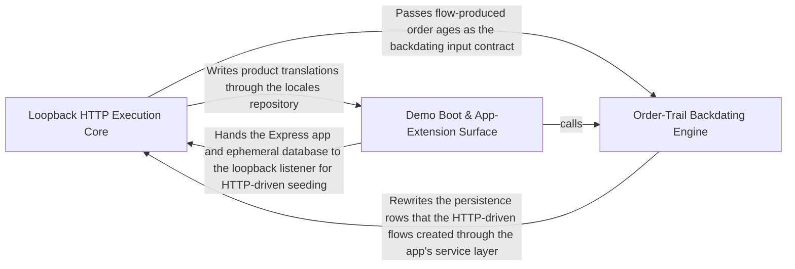

---
tags:
  - 2brain
  - 2brain/arch
  - project/boilerplate-node-backend
type: architecture
component: Loopback_Flow_Execution_Engine
---

## Details

The core engine room that makes the flow runner work. It provides three tightly-coupled capabilities: (1) the ephemeral loopback listener (withLoopbackServer) that binds the Express app to 127.0.0.1:0 for the duration of one seed, (2) the HTTP client (readAttempt, send) that issues fetch calls against that listener and unwraps the API's { data, errors } envelope, and (3) the backdate mechanism (mover, shiftStage, TRAILS) that rewrites the date columns on six unrelated collections (orders, payments, shipments, reservations, stock movements, audit logs) per-order using MongoDB aggregation-pipeline $dateSubtract. Supporting infrastructure includes the ephemeral MongoDB, product seeding with translations, seed-image generation, and the AppExtension hook in src/app.ts that exposes the Express app to the scenario layer.

### Loopback HTTP Execution Core
The engine room that makes the flow runner work. It owns the ephemeral loopback listener (withLoopbackServer) that binds the Express app to 127.0.0.1:0 for the duration of one seed, the HTTP client (readAttempt, send, signIn) that issues fetch calls against that listener and unwraps the API's { data, errors } envelope into a typed Attempt, and the product seeding pass (seedProductsCollection, writeSeedTranslations) that populates the shop through the app's own planTranslations/writeTranslations primitives. Supporting infrastructure in this group includes the ephemeral in-process MongoDB (ephemeral-mongod.ts), seed-image generation (generate-seed-images.ts), and the route/security/outbox install hooks the listener serves. This is the primary flow-representation component: it is where a request enters the app over real HTTP and where the seeded dataset is produced.

**Related Classes/Methods**:

- `scenarios.flows.client.readAttempt`:75-92
- `scenarios.products.writeSeedTranslations`:444-459

**Source Files:**

- `scenarios/flows/client.ts`
  - `scenarios.flows.client.readAttempt` (L75-L92) - Class
  - `scenarios.flows.client.readAttempt.then() callback.errorMessages.map() callback` (L83-L83) - Function
  - `scenarios.flows.client.readAttempt.then() callback` (L86-L91) - Function
- `scenarios/flows/loopback.ts`
  - `scenarios.flows.loopback.withLoopbackServer.<function>.server` (L30-L37) - Class
  - `scenarios.flows.loopback.withLoopbackServer.<function>.server.app.listen('127.0.0.1') callback` (L30-L37) - Function
  - `scenarios.flows.loopback.withLoopbackServer.<function>.server.app.listen('127.0.0.1') callback.close` (L35-L35) - Method
  - `scenarios.flows.loopback.withLoopbackServer.<function>.server.app.listen('127.0.0.1') callback.close.<function>` (L35-L35) - Function
  - `scenarios.flows.loopback.withLoopbackServer.<function>.server.app.listen('127.0.0.1') callback.close.<function>.server.close() callback` (L35-L35) - Function
- `scenarios/products.ts`
  - `scenarios.products.ProductCopy` (L51-L54) - Interface
  - `scenarios.products.writeSeedTranslations` (L444-L459) - Class
  - `scenarios.products.writeSeedTranslations.then() callback` (L450-L458) - Function
  - `scenarios.products.writeSeedTranslations.then() callback.then() callback` (L457-L457) - Function
- `scenarios/support/ephemeral-mongod.ts`
  - `scenarios.support.ephemeral-mongod.startInProcessMongod.timeout` (L51-L63) - Class
  - `scenarios.support.ephemeral-mongod.startInProcessMongod.timeout.<function>` (L51-L63) - Function
  - `scenarios.support.ephemeral-mongod.startInProcessMongod.timeout.<function>.setTimeout() callback` (L53-L60) - Function
- `scenarios/tools/generate-seed-images.ts`
  - `scenarios.tools.generate-seed-images.ImageEntry` (L36-L39) - Interface
  - `scenarios.tools.generate-seed-images.main` (L149-L174) - Class
  - `scenarios.tools.generate-seed-images.written.map() callback` (L160-L160) - Function
  - `scenarios.tools.generate-seed-images.main.written.map() callback` (L164-L164) - Function
  - `scenarios.tools.generate-seed-images.catch() callback` (L177-L180) - Function
- `src/app/routes.ts`
  - `src.app.routes.installRoutes` (L24-L64) - Class
  - `src.app.routes.app.use() callback` (L36-L39) - Function
  - `src.app.routes.installRoutes.app.use() callback` (L61-L63) - Function
- `src/app/security.ts`
  - `src.app.security.installSecurity` (L97-L192) - Class
  - `src.app.security.installSecurity.app.use() callback` (L129-L132) - Function
- `src/kernel/outbox.ts`
  - `src.kernel.outbox.enqueueOutboxEvent` (L142-L152) - Class
  - `src.kernel.outbox.enqueueOutboxEvent.then() callback` (L152-L152) - Function
- `src/kernel/registry.ts`
  - `src.kernel.registry.resolvePersonalDataSections` (L531-L536) - Class
  - `src.kernel.registry.resolvePersonalDataSections.appModules.flatMap() callback` (L534-L535) - Function
- `src/modules/products/services/crud.ts`
  - `src.modules.products.services.crud.insertProduct` (L94-L117) - Class
  - `src.modules.products.services.crud.insertProduct.then() callback` (L110-L116) - Function
  - `src.modules.products.services.crud.insertProduct.then() callback.then() callback` (L116-L116) - Function
  - `src.modules.products.services.crud.create` (L160-L163) - Class
  - `src.modules.products.services.crud.create.withTransaction() callback` (L161-L161) - Function
  - `src.modules.products.services.crud.create.then() callback` (L161-L162) - Function
  - `src.modules.products.services.crud.ProductUpdateOutcome` (L166-L171) - Interface
  - `src.modules.products.services.crud.applyUpdate` (L180-L222) - Class
  - `src.modules.products.services.crud.applyUpdate.then() callback` (L221-L221) - Function
  - `src.modules.products.services.crud.update` (L251-L255) - Class
  - `src.modules.products.services.crud.update.withTransaction() callback` (L255-L255) - Function
  - `src.modules.products.services.crud.updateByIdInTransaction` (L266-L292) - Class
  - `src.modules.products.services.crud.updateByIdInTransaction.then() callback` (L275-L291) - Function
  - `src.modules.products.services.crud.updateByIdInTransaction.then() callback.then() callback` (L284-L289) - Function
  - `src.modules.products.services.crud.updateByIdInTransaction.then() callback.then() callback.then() callback` (L287-L287) - Function
- `src/modules/products/services/translated-write.ts`
  - `src.modules.products.services.translated-write.toUpsertTranslationsRequest` (L40-L57) - Class
  - `src.modules.products.services.translated-write.toUpsertTranslationsRequest.map() callback` (L44-L56) - Function
  - `src.modules.products.services.translated-write.writeCreate.product.withTransaction() callback` (L122-L141) - Function
  - `src.modules.products.services.translated-write.writeCreate.product` (L122-L142) - Class
  - `src.modules.products.services.translated-write.writeCreate.product.withTransaction() callback.then() callback` (L133-L140) - Function
  - `src.modules.products.services.translated-write.writeCreate.product.withTransaction() callback.then() callback.then() callback` (L140-L140) - Function
  - `src.modules.products.services.translated-write.writeUpdate.result.withTransaction() callback` (L185-L200) - Function
  - `src.modules.products.services.translated-write.writeUpdate.result` (L185-L201) - Class
  - `src.modules.products.services.translated-write.writeUpdate.result.withTransaction() callback.then() callback` (L190-L199) - Function
  - `src.modules.products.services.translated-write.writeUpdate.result.withTransaction() callback.then() callback.then() callback` (L198-L198) - Function
- `src/modules/products/services/validation.ts`
  - `src.modules.products.services.validation.sanitizeStringArray` (L32-L35) - Class
  - `src.modules.products.services.validation.sanitizeStringArray.values.map() callback` (L34-L34) - Function
- `src/modules/returns/services/receive.ts`
  - `src.modules.returns.services.receive.carriesWholeOrder` (L63-L71) - Class
  - `src.modules.returns.services.receive.carriesWholeOrder.order.items.every() callback` (L69-L69) - Function

### Order-Trail Backdating Engine
The mechanism that ages a flow-produced order and everything the application wrote because of it. Because the flows run at boot, without this every order in the demo shop is dated the minute the container started — no analytics trend, no 'last 30 days' filter with anything outside it. This sub-component rewrites the date columns on six unrelated collections (orders, payments, shipments, reservations, stock movements, audit logs) per order using MongoDB aggregation-pipeline $dateSubtract, keeping the order, its payment, its shipment, its hold, its stock movements, and its audit rows mutually consistent about when any of it happened. It is a distinct architectural role from the HTTP execution core: it operates directly on the persistence layer (Mongoose models) rather than over HTTP, and it is the only component in the subsystem that mutates seeded history after the fact.

**Related Classes/Methods**:

- `scenarios.flows.backdate.mover`:36-53
- `scenarios.flows.backdate.shiftStage`:87-98
- `scenarios.flows.backdate.TRAILS`:65-77

**Source Files:**

- `scenarios/flows/backdate.ts`
  - `scenarios.flows.backdate.mover` (L36-L53) - Class
  - `scenarios.flows.backdate.mover.<function>` (L38-L53) - Function
  - `scenarios.flows.backdate.TRAILS` (L65-L77) - Class
  - `scenarios.flows.backdate.TRAILS.mover() callback` (L76-L76) - Function
  - `scenarios.flows.backdate.shiftStage` (L87-L98) - Class
  - `scenarios.flows.backdate.shiftStage.dates.map() callback` (L89-L97) - Function
- `src/app/config.ts`
  - `src.app.config.APP_CONFIG_SLICES` (L101-L136) - Class
  - `src.app.config.APP_CONFIG_SLICES.map() callback` (L136-L136) - Function
- `src/app/security-txt.ts`
  - `src.app.security-txt.SecurityTxtSettings` (L13-L22) - Interface
  - `src.app.security-txt.buildSecurityTxt` (L47-L73) - Class
  - `src.app.security-txt.buildSecurityTxt.filter() callback` (L70-L70) - Function
- `src/app/security.ts`
  - `src.app.security.RAW_BODY_PATHS.enabledModules.flatMap() callback` (L40-L41) - Function
  - `src.app.security.RAW_BODY_PATHS` (L40-L42) - Class
  - `src.app.security.RAW_BODY_PATHS.enabledModules.flatMap() callback.map() callback` (L41-L41) - Function
- `src/app/system-routes.ts`
  - `src.app.system-routes.router.get('/livez') callback` (L31-L33) - Function
  - `src.app.system-routes.router.get('/.well-known/security.txt') callback` (L50-L58) - Function
- `src/app/telemetry.ts`
  - `src.app.telemetry.installTelemetry` (L22-L44) - Class
  - `src.app.telemetry.installTelemetry.app.use() callback` (L26-L43) - Function
  - `src.app.telemetry.installTelemetry.app.use() callback.response.once('finish') callback` (L32-L41) - Function
- `src/kernel/outbox.ts`
  - `src.kernel.outbox.nudgeOutbox` (L336-L346) - Class
- `src/modules/payments/services/announce.ts`
  - `src.modules.payments.services.announce.announcePaymentSucceeded` (L34-L52) - Class
  - `src.modules.payments.services.announce.announcePaymentSucceeded.withTransaction() callback` (L35-L47) - Function
  - `src.modules.payments.services.announce.announcePaymentSucceeded.withTransaction() callback.then() callback` (L38-L46) - Function
  - `src.modules.payments.services.announce.announcePaymentSucceeded.withTransaction() callback.then() callback.then() callback` (L45-L45) - Function
  - `src.modules.payments.services.announce.announcePaymentSucceeded.then() callback` (L48-L52) - Function
- `src/modules/payments/services/settlement.ts`
  - `src.modules.payments.services.settlement.reportAttempt.declined` (L392-L393) - Class
  - `src.modules.payments.services.settlement.reportAttempt.declined.result.errors.some() callback` (L393-L393) - Function
- `src/modules/products/services/crud.ts`
  - `src.modules.products.services.crud.afterCommitStep` (L73-L79) - Class
  - `src.modules.products.services.crud.afterCommitStep.then() callback` (L76-L76) - Function
  - `src.modules.products.services.crud.afterCommitStep.catch() callback` (L77-L79) - Function
  - `src.modules.products.services.crud.finishCreate` (L126-L154) - Class
  - `src.modules.products.services.crud.finishCreate.then() callback` (L136-L152) - Function
  - `src.modules.products.services.crud.finishCreate.then() callback.afterCommitStep('audit') callback` (L137-L143) - Function
  - `src.modules.products.services.crud.finishCreate.then() callback.then() callback` (L145-L145) - Function
  - `src.modules.products.services.crud.finishCreate.then() callback.catch() callback` (L146-L152) - Function
  - `src.modules.products.services.crud.finishUpdate` (L230-L245) - Class
  - `src.modules.products.services.crud.finishUpdate.afterCommitStep('old image removal') callback` (L234-L235) - Function
  - `src.modules.products.services.crud.finishUpdate.then() callback` (L237-L237) - Function
  - `src.modules.products.services.crud.finishUpdate.catch() callback` (L238-L244) - Function
  - `src.modules.products.services.crud.finishUpdateById` (L302-L316) - Class
  - `src.modules.products.services.crud.finishUpdateById.afterCommitStep('audit') callback` (L307-L313) - Function
  - `src.modules.products.services.crud.finishUpdateById.then() callback` (L316-L316) - Function
  - `src.modules.products.services.crud.updateById` (L322-L330) - Class
  - `src.modules.products.services.crud.updateById.withTransaction() callback` (L327-L327) - Function
  - `src.modules.products.services.crud.updateById.then() callback` (L328-L329) - Function
- `src/modules/returns/domain/quantities.ts`
  - `src.modules.returns.domain.quantities.lines` (L83-L85) - Class
  - `src.modules.returns.domain.quantities.lines.map() callback` (L85-L85) - Function
- `src/modules/returns/domain/status-projection.ts`
  - `src.modules.returns.domain.status-projection.projectReturnStatus.holding` (L38-L40) - Class
  - `src.modules.returns.domain.status-projection.projectReturnStatus.holding.returns.filter() callback` (L39-L39) - Function
  - `src.modules.returns.domain.status-projection.projectReturnStatus.holding.some() callback` (L43-L43) - Function
- `src/modules/returns/services/create.ts`
  - `src.modules.returns.services.create.writeReturn.byProduct` (L239-L239) - Class
  - `src.modules.returns.services.create.writeReturn.byProduct.order.items.map() callback` (L239-L239) - Function

### Demo Boot & App-Extension Surface
The entry-point and app-assembly surface that hands the production Express app to the scenario layer. It owns the demo profile entry (run-server.ts) that boots the real application against an in-memory MongoDB, seeds it from the shop scenario, and serves on NODE_PORT; the AppExtension hook in src/app.ts that exposes the built Express app (plus an afterBoot step) to the scenario layer without anything under src/ knowing it exists; and the locales repository write path (bumpRevision, createEntry, currentRevision, importEntries) that the product seeding pass depends on. This sub-component is the architectural bridge between the production app assembly and the scenario layer: it is where the AppExtension contract is defined and where the demo profile decides to serve traffic, distinct from the loopback execution core (which drives the app over HTTP) and the backdating engine (which rewrites history).

**Related Classes/Methods**:

- `src.app.AppExtension`:92-105
- `src.app.static-assets.installStatic`:19-52
- `src.kernel.module-config.moduleConfigSlices`:39-40
- `src.modules.locales.repository.importEntries`:231-279

**Source Files:**

- `scenarios/run-server.ts`
  - `scenarios.run-server.then() callback` (L169-L243) - Function
  - `scenarios.run-server.then() callback.then() callback.extension.afterBoot` (L236-L236) - Method
- `src/app.ts`
  - `src.app.AppExtension` (L92-L105) - Interface
- `src/app/static-assets.ts`
  - `src.app.static-assets.installStatic` (L19-L52) - Class
  - `src.app.static-assets.installStatic.setHeaders` (L44-L49) - Method
- `src/kernel/module-config.ts`
  - `src.kernel.module-config.moduleConfigSlices` (L39-L40) - Class
  - `src.kernel.module-config.moduleConfigSlices.appModules.flatMap() callback` (L40-L40) - Function
- `src/kernel/outbox.ts`
  - `src.kernel.outbox.announceInTransaction` (L369-L382) - Class
  - `src.kernel.outbox.announceInTransaction.withTransaction() callback` (L373-L378) - Function
  - `src.kernel.outbox.announceInTransaction.withTransaction() callback.then() callback` (L374-L378) - Function
  - `src.kernel.outbox.announceInTransaction.withTransaction() callback.then() callback.then() callback` (L377-L377) - Function
  - `src.kernel.outbox.announceInTransaction.then() callback` (L379-L382) - Function
- `src/modules/locales/repository.ts`
  - `src.modules.locales.repository.bumpRevision` (L154-L158) - Class
  - `src.modules.locales.repository.bumpRevision.then() callback` (L158-L158) - Function
  - `src.modules.locales.repository.valuesByKey` (L164-L170) - Class
  - `src.modules.locales.repository.valuesByKey.then() callback` (L170-L170) - Function
  - `src.modules.locales.repository.valuesByKey.then() callback.rows.map() callback` (L170-L170) - Function
  - `src.modules.locales.repository.currentRevision` (L176-L182) - Class
  - `src.modules.locales.repository.currentRevision.then() callback` (L182-L182) - Function
  - `src.modules.locales.repository.createEntry` (L185-L196) - Class
  - `src.modules.locales.repository.createEntry.then() callback.then() callback` (L196-L196) - Function
  - `src.modules.locales.repository.saveEntryValue` (L199-L211) - Class
  - `src.modules.locales.repository.saveEntryValue.then() callback` (L208-L209) - Function
  - `src.modules.locales.repository.saveEntryValue.then() callback.then() callback` (L209-L209) - Function
  - `src.modules.locales.repository.removeEntry` (L214-L215) - Class
  - `src.modules.locales.repository.removeEntry.then() callback` (L215-L215) - Function
  - `src.modules.locales.repository.importEntries` (L231-L279) - Class
  - `src.modules.locales.repository.importEntries.withTransaction() callback` (L245-L264) - Function
  - `src.modules.locales.repository.importEntries.withTransaction() callback.changedEntries.map() callback` (L250-L256) - Function
- `src/modules/orders/domain/lifecycle.ts`
  - `src.modules.orders.domain.lifecycle.statusesLeadingTo` (L171-L172) - Class
  - `src.modules.orders.domain.lifecycle.statusesLeadingTo.filter() callback` (L172-L172) - Function
- `src/modules/orders/services/cancel.ts`
  - `src.modules.orders.services.cancel.moveToCancelled` (L74-L97) - Class
  - `src.modules.orders.services.cancel.moveToCancelled.announceInTransaction() callback` (L94-L94) - Function
  - `src.modules.orders.services.cancel.moveToCancelled.then() callback` (L95-L96) - Function
  - `src.modules.orders.services.cancel.moveToCancelled.then() callback.then() callback` (L96-L96) - Function
- `src/modules/orders/services/override.ts`
  - `src.modules.orders.services.override.applyOverride` (L56-L120) - Class
  - `src.modules.orders.services.override.applyOverride.announceInTransaction() callback` (L106-L106) - Function
  - `src.modules.orders.services.override.applyOverride.then() callback` (L107-L119) - Function
- `src/modules/orders/services/status.ts`
  - `src.modules.orders.services.status.markSystemMove` (L42-L49) - Class
  - `src.modules.orders.services.status.markSystemMove.announceInTransaction() callback` (L47-L47) - Function
  - `src.modules.orders.services.status.markPaid` (L66-L75) - Class
  - `src.modules.orders.services.status.markPaid.announceInTransaction() callback` (L73-L73) - Function
  - `src.modules.orders.services.status.markArrived` (L105-L113) - Class
  - `src.modules.orders.services.status.announceInTransaction() callback` (L111-L111) - Function
  - `src.modules.orders.services.status.markArrived.announceInTransaction() callback` (L112-L112) - Function
  - `src.modules.orders.services.status.markFulfilled` (L149-L160) - Class
  - `src.modules.orders.services.status.markFulfilled.then() callback` (L150-L160) - Function
- `src/modules/returns/domain/quantities.ts`
  - `src.modules.returns.domain.quantities.ProductIdLike` (L14-L16) - Interface
  - `src.modules.returns.domain.quantities.ProductIdLike.toString` (L15-L15) - Method
- `src/modules/returns/domain/status-projection.ts`
  - `src.modules.returns.domain.status-projection.projectReturnStatus.everything` (L50-L52) - Class
  - `src.modules.returns.domain.status-projection.projectReturnStatus.everything.every() callback` (L51-L51) - Function
