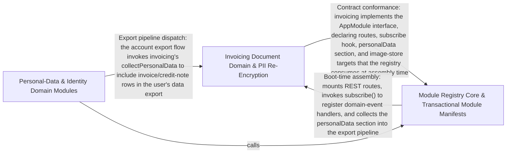

---
tags:
  - 2brain
  - 2brain/arch
  - project/boilerplate-node-backend
type: architecture
component: Module_Registry_Domain_Service_Runtime
---

## Details

The kernel's module registry that turns the explicit module list into a running application: each module declares its routes, consumers, image targets, translatables, and personal-data sections in a single typed AppModule manifest. This group also contains the domain module implementations (account, addresses, api-keys, audit-logs) with their repositories and services, plus the security infrastructure (JWT, OAuth, two-factor, re-encryption) that the contract's authorization keys reference. It is the runtime target that the contract describes.

### Invoicing Document Domain & PII Re-Encryption
The invoicing bounded context and its PII lifecycle. It owns the invoice/credit-note/tax document models, the invoice number counter, and the encrypt/decrypt of invoice party PII, plus the ReencryptJob that re-encrypts stored PII when the key rotates. This is the module whose documents carry uploaded images and rendered PDF templates, and whose personal-data section participates in POST /account/export. It is a self-contained domain module whose manifest entry registers its routes, consumers, image targets, and PII handlers.

**Related Classes/Methods**:

- `src.modules.invoicing.module.default`:33-66
- `src.modules.invoicing.model.InvoiceDocument`
- `src.modules.invoicing.repository.invoicingRepository`:127-140
- `src.modules.invoicing.pii.encryptInvoiceParty`:50-55
- `src.infrastructure.security.reencrypt.ReencryptJob`:54-65

**Source Files:**

- `src/infrastructure/security/reencrypt.ts`
  - `src.infrastructure.security.reencrypt.ReencryptJob` (L54-L65) - Interface
- `src/modules/invoicing/emails.ts`
  - `src.modules.invoicing.emails.buildVatBlock.shippingTaxAt` (L144-L144) - Class
  - `src.modules.invoicing.emails.buildVatBlock.shippingTaxAt.document.shippingByRate.map() callback` (L144-L144) - Function
  - `src.modules.invoicing.emails.buildVatBlock.goodsTaxByRate` (L145-L150) - Class
  - `src.modules.invoicing.emails.buildVatBlock.goodsTaxByRate.document.taxSummary.map() callback` (L146-L149) - Function
- `src/modules/invoicing/model.ts`
  - `src.modules.invoicing.model.InvoiceLine` (L28-L41) - Interface
  - `src.modules.invoicing.model.InvoiceParty` (L44-L50) - Interface
  - `src.modules.invoicing.model.FrozenTaxDocument` (L62-L91) - Interface
  - `src.modules.invoicing.model.InvoiceDocument` (L94-L94) - Interface
  - `src.modules.invoicing.model.CreditNoteDocument` (L104-L111) - Interface
  - `src.modules.invoicing.model.NumberCounterDocument` (L228-L230) - Interface
- `src/modules/invoicing/module.ts`
  - `src.modules.invoicing.module.default` (L33-L66) - Class
  - `src.modules.invoicing.module.default.personalData.collect` (L42-L42) - Method
  - `src.modules.invoicing.module.default.subscribe` (L52-L63) - Method
  - `src.modules.invoicing.module.subscribe.onDomainEvent() callback` (L53-L59) - Function
  - `src.modules.invoicing.module.default.subscribe.onDomainEvent() callback.then() callback` (L58-L58) - Function
  - `src.modules.invoicing.module.default.subscribe.onDomainEvent() callback` (L60-L61) - Function
- `src/modules/invoicing/pii.ts`
  - `src.modules.invoicing.pii.encryptInvoiceParty` (L50-L55) - Class
  - `src.modules.invoicing.pii.encryptInvoiceParty.mapParty() callback` (L55-L55) - Function
  - `src.modules.invoicing.pii.decryptInvoiceParty` (L62-L69) - Class
  - `src.modules.invoicing.pii.decryptInvoiceParty.mapParty() callback` (L67-L68) - Function
- `src/modules/invoicing/repository.ts`
  - `src.modules.invoicing.repository.incrementCounter` (L112-L124) - Class
  - `src.modules.invoicing.repository.incrementCounter.then() callback` (L124-L124) - Function
  - `src.modules.invoicing.repository.invoicingRepository` (L127-L140) - Class
  - `src.modules.invoicing.repository.invoicingRepository.incrementInvoiceNumberCounter` (L136-L137) - Method
  - `src.modules.invoicing.repository.invoicingRepository.incrementCreditNoteNumberCounter` (L138-L139) - Method
- `src/modules/invoicing/services/issue-credit-note.ts`
  - `src.modules.invoicing.services.issue-credit-note.RefundedInput` (L24-L31) - Interface
  - `src.modules.invoicing.services.issue-credit-note.reversedFigures.grandTotal.items.lines.map() callback` (L81-L84) - Function
  - `src.modules.invoicing.services.issue-credit-note.readWinner` (L97-L103) - Class
  - `src.modules.invoicing.services.issue-credit-note.readWinner.<function>` (L97-L103) - Function
  - `src.modules.invoicing.services.issue-credit-note.readWinner.<function>.then() callback` (L99-L102) - Function
  - `src.modules.invoicing.services.issue-credit-note.issueCreditNote` (L118-L160) - Class
  - `src.modules.invoicing.services.issue-credit-note.issueCreditNote.then() callback` (L119-L160) - Function
  - `src.modules.invoicing.services.issue-credit-note.issueCreditNote.then() callback.withTransaction() callback` (L125-L158) - Function
  - `src.modules.invoicing.services.issue-credit-note.issueCreditNote.then() callback.withTransaction() callback.then() callback` (L126-L157) - Function
- `src/modules/invoicing/services/issue-invoice.ts`
  - `src.modules.invoicing.services.issue-invoice.frozenLines` (L40-L47) - Class
  - `src.modules.invoicing.services.issue-invoice.frozenLines.order.items.map() callback` (L41-L47) - Function
  - `src.modules.invoicing.services.issue-invoice.readWinner` (L55-L63) - Class
  - `src.modules.invoicing.services.issue-invoice.readWinner.<function>` (L55-L63) - Function
  - `src.modules.invoicing.services.issue-invoice.readWinner.<function>.then() callback` (L57-L62) - Function
  - `src.modules.invoicing.services.issue-invoice.issueInvoice` (L77-L130) - Class
  - `src.modules.invoicing.services.issue-invoice.issueInvoice.withTransaction() callback` (L92-L128) - Function
  - `src.modules.invoicing.services.issue-invoice.issueInvoice.withTransaction() callback.then() callback` (L93-L127) - Function
- `src/modules/invoicing/services/numbering.ts`
  - `src.modules.invoicing.services.numbering.allocateInvoiceNumber` (L28-L33) - Class
  - `src.modules.invoicing.services.numbering.allocateInvoiceNumber.then() callback` (L32-L32) - Function
  - `src.modules.invoicing.services.numbering.allocateCreditNoteNumber` (L41-L46) - Class
  - `src.modules.invoicing.services.numbering.allocateCreditNoteNumber.then() callback` (L45-L45) - Function
- `src/modules/invoicing/services/personal-data.ts`
  - `src.modules.invoicing.services.personal-data.collectPersonalData` (L19-L38) - Class
  - `src.modules.invoicing.services.personal-data.collectPersonalData.then() callback` (L22-L37) - Function
  - `src.modules.invoicing.services.personal-data.collectPersonalData.then() callback.orders.map() callback` (L24-L28) - Function
  - `src.modules.invoicing.services.personal-data.collectPersonalData.then() callback.then() callback` (L30-L37) - Function
  - `src.modules.invoicing.services.personal-data.collectPersonalData.then() callback.then() callback.invoices.pairs.flatMap() callback` (L31-L32) - Function
  - `src.modules.invoicing.services.personal-data.collectPersonalData.then() callback.then() callback.creditNotes.pairs.flatMap() callback` (L34-L35) - Function
  - `src.modules.invoicing.services.personal-data.collectPersonalData.then() callback.then() callback.creditNotes.pairs.flatMap() callback.creditNotes.map() callback` (L35-L35) - Function
- `src/modules/invoicing/services/reencrypt.ts`
  - `src.modules.invoicing.services.reencrypt.partyFields` (L15-L31) - Class
  - `src.modules.invoicing.services.reencrypt.partyFields.PARTY_FIELDS.flatMap() callback` (L19-L31) - Function
  - `src.modules.invoicing.services.reencrypt.reencryptInvoices` (L39-L60) - Class
  - `src.modules.invoicing.services.reencrypt.fieldsOf` (L47-L47) - Method
  - `src.modules.invoicing.services.reencrypt.reencryptInvoices.fieldsOf` (L55-L55) - Method
  - `src.modules.invoicing.services.reencrypt.reencryptInvoices.then() callback` (L59-L59) - Function
- `src/modules/orders/module.ts`
  - `src.modules.orders.module.default` (L66-L135) - Class
  - `src.modules.orders.module.default.personalData.collect` (L76-L76) - Method
  - `src.modules.orders.module.default.subscribe` (L91-L95) - Method
  - `src.modules.orders.module.default.subscribe.onDomainEvent() callback` (L92-L93) - Function
- `src/modules/orders/services/current.ts`
  - `src.modules.orders.services.current.OrderShape` (L23-L25) - Interface
  - `src.modules.orders.services.current.resolveCurrentImages` (L47-L71) - Class
  - `src.modules.orders.services.current.resolveCurrentImages.then() callback` (L53-L70) - Function
- `src/modules/orders/services/read.ts`
  - `src.modules.orders.services.read.search` (L27-L45) - Class
  - `src.modules.orders.services.read.search.then() callback` (L35-L44) - Function
  - `src.modules.orders.services.read.search.then() callback.then() callback` (L37-L44) - Function
  - `src.modules.orders.services.read.findOwnOrders` (L71-L78) - Class
  - `src.modules.orders.services.read.findOwnOrders.readAll() callback` (L73-L76) - Function
  - `src.modules.orders.services.read.findOwnOrders.readAll() callback.then() callback` (L75-L75) - Function
- `src/modules/users/services/reencrypt.ts`
  - `src.modules.users.services.reencrypt.reencryptUserPhones` (L19-L37) - Class
  - `src.modules.users.services.reencrypt.reencryptUserPhones.fieldsOf` (L24-L34) - Method
  - `src.modules.users.services.reencrypt.TwoFactorSecretRing` (L46-L49) - Interface
  - `src.modules.users.services.reencrypt.reencryptTwoFactorSecrets` (L58-L80) - Class
  - `src.modules.users.services.reencrypt.reencryptTwoFactorSecrets.fieldsOf` (L65-L77) - Method
  - `src.modules.users.services.reencrypt.reencryptTwoFactorSecrets.fieldsOf.user.twoFactorMethods.flatMap() callback` (L66-L76) - Function

### Module Registry Core & Transactional Module Manifests
The kernel registry contract (AppModule, ModuleConsumer) that defines the single typed manifest every module conforms to, plus the transactional/identity module manifests that plug into it: account (auth lifecycle, export consumer, auth-resolver install), api-keys, notifications, payments (webhook event claiming), returns, and wishlist. This is the runtime target axis — the registry types and the module manifests that declare routes, consumers, config slices, rate limits, and onRegistered/subscribe hooks. It is the central spine of the subsystem: the contract the app tier assembles into a running application.

**Related Classes/Methods**:

- `src.kernel.registry.AppModule`:279-417
- `src.kernel.registry.ModuleConsumer`:63-79
- `src.modules.account.module.default`:60-106
- `src.modules.payments.module.default`:70-111
- `src.modules.wishlist.module.default`:21-40

**Source Files:**

- `src/kernel/registry.ts`
  - `src.kernel.registry.ModuleConsumer` (L63-L79) - Interface
  - `src.kernel.registry.ModuleConsumer.handler` (L68-L68) - Method
  - `src.kernel.registry.AppModule` (L279-L417) - Interface
- `src/modules/account/module.ts`
  - `src.modules.account.module.default` (L60-L106) - Class
  - `src.modules.account.module.default.subscribe` (L94-L103) - Method
  - `src.modules.account.module.default.subscribe.onDomainEvent() callback` (L100-L101) - Function
  - `src.modules.account.module.default.subscribe.onDomainEvent() callback.then() callback` (L101-L101) - Function
- `src/modules/account/services/two-factor.ts`
  - `src.modules.account.services.two-factor.buildLoginChallenge.ttlMs.armed.some() callback` (L422-L422) - Function
  - `src.modules.account.services.two-factor.buildLoginChallenge.ttlMs` (L422-L424) - Class
  - `src.modules.account.services.two-factor.sendMethodCode.outcome.then() callback.armed` (L567-L567) - Class
  - `src.modules.account.services.two-factor.sendMethodCode.outcome.then() callback.armed.find() callback` (L567-L567) - Function
- `src/modules/account/session/jwt.ts`
  - `src.modules.account.session.jwt.TokenData` (L32-L54) - Interface
  - `src.modules.account.session.jwt.RotatedSession` (L60-L64) - Interface
  - `src.modules.account.session.jwt.then() callback.then() callback` (L361-L362) - Function
  - `src.modules.account.session.jwt.then() callback.then() callback.then() callback` (L362-L362) - Function
  - `src.modules.account.session.jwt.resolveLostRotation.then() callback.entry` (L396-L396) - Class
  - `src.modules.account.session.jwt.resolveLostRotation.then() callback.entry.user.tokens.find() callback` (L396-L396) - Function
- `src/modules/api-keys/module.ts`
  - `src.modules.api-keys.module.default` (L34-L61) - Class
  - `src.modules.api-keys.module.default.subscribe` (L39-L46) - Method
  - `src.modules.api-keys.module.default.subscribe.onDomainEvent() callback` (L43-L44) - Function
  - `src.modules.api-keys.module.default.personalData.collect` (L52-L52) - Method
- `src/modules/api-keys/services/api-keys.ts`
  - `src.modules.api-keys.services.api-keys.findOwnApiKeys` (L107-L118) - Class
  - `src.modules.api-keys.services.api-keys.findOwnApiKeys.readAll() callback` (L109-L116) - Function
  - `src.modules.api-keys.services.api-keys.findOwnApiKeys.readAll() callback.then() callback` (L116-L116) - Function
- `src/modules/api-keys/services/resolver.ts`
  - `src.modules.api-keys.services.resolver.fromBearerToken.then() callback.then() callback.held` (L96-L98) - Class
  - `src.modules.api-keys.services.resolver.fromBearerToken.then() callback.then() callback.held.apiKey.permissions.filter() callback` (L97-L97) - Function
- `src/modules/example/module.ts`
  - `src.modules.example.module.default.subscribe` (L58-L60) - Method
- `src/modules/notifications/module.ts`
  - `src.modules.notifications.module.default` (L29-L48) - Class
  - `src.modules.notifications.module.default.personalData.collect.then() callback` (L37-L37) - Function
  - `src.modules.notifications.module.default.subscribe` (L42-L46) - Method
- `src/modules/orders/services/read.ts`
  - `src.modules.orders.services.read.ownOrderIds` (L54-L61) - Class
  - `src.modules.orders.services.read.ownOrderIds.readAll() callback` (L56-L59) - Function
  - `src.modules.orders.services.read.ownOrderIds.readAll() callback.then() callback` (L59-L59) - Function
  - `src.modules.orders.services.read.ownOrderIds.then() callback` (L61-L61) - Function
  - `src.modules.orders.services.read.ownOrderIds.then() callback.orders.map() callback` (L61-L61) - Function
- `src/modules/payments/module.ts`
  - `src.modules.payments.module.default` (L70-L111) - Class
  - `src.modules.payments.module.default.personalData.collect` (L86-L86) - Method
  - `src.modules.payments.module.default.subscribe` (L92-L100) - Method
  - `src.modules.payments.module.subscribe.onDomainEvent() callback` (L95-L95) - Function
  - `src.modules.payments.module.default.subscribe.onDomainEvent() callback` (L99-L99) - Function
- `src/modules/payments/repository.ts`
  - `src.modules.payments.repository.claimWebhookEvent` (L469-L476) - Class
  - `src.modules.payments.repository.claimWebhookEvent.then() callback` (L472-L472) - Function
  - `src.modules.payments.repository.claimWebhookEvent.catch() callback` (L473-L476) - Function
- `src/modules/payments/services/retention.ts`
  - `src.modules.payments.services.retention.findOwnPayments` (L41-L49) - Class
  - `src.modules.payments.services.retention.findOwnPayments.readAll() callback` (L43-L47) - Function
  - `src.modules.payments.services.retention.toExportPayment.refunds.payment.refunds.map() callback` (L64-L73) - Function
  - `src.modules.payments.services.retention.findOwnPaymentsForExport` (L88-L89) - Class
  - `src.modules.payments.services.retention.findOwnPaymentsForExport.then() callback` (L89-L89) - Function
  - `src.modules.payments.services.retention.findOwnPaymentsForExport.then() callback.payments.map() callback` (L89-L89) - Function
- `src/modules/returns/module.ts`
  - `src.modules.returns.module.default` (L59-L91) - Class
  - `src.modules.returns.module.default.subscribe` (L71-L75) - Method
  - `src.modules.returns.module.default.subscribe.onDomainEvent() callback` (L72-L73) - Function
  - `src.modules.returns.module.default.subscribe.onDomainEvent() callback.then() callback` (L73-L73) - Function
  - `src.modules.returns.module.default.personalData.collect` (L79-L79) - Method
- `src/modules/returns/services/personal-data.ts`
  - `src.modules.returns.services.personal-data.toExportReturn.lines.returned.lines.map() callback` (L25-L29) - Function
  - `src.modules.returns.services.personal-data.collectPersonalData` (L38-L41) - Class
  - `src.modules.returns.services.personal-data.then() callback` (L40-L40) - Function
  - `src.modules.returns.services.personal-data.collectPersonalData.then() callback` (L41-L41) - Function
  - `src.modules.returns.services.personal-data.collectPersonalData.then() callback.returns.map() callback` (L41-L41) - Function
- `src/modules/returns/services/receive.ts`
  - `src.modules.returns.services.receive.carriesWholeOrder.returnedBy` (L64-L66) - Class
  - `src.modules.returns.services.receive.carriesWholeOrder.returnedBy.returned.lines.map() callback` (L65-L65) - Function
- `src/modules/wishlist/module.ts`
  - `src.modules.wishlist.module.default` (L21-L40) - Class
  - `src.modules.wishlist.module.default.personalData.collect.then() callback` (L29-L29) - Function
  - `src.modules.wishlist.module.default.subscribe` (L34-L38) - Method
  - `src.modules.wishlist.module.default.subscribe.onDomainEvent() callback` (L35-L36) - Function
- `src/modules/wishlist/repository.ts`
  - `src.modules.wishlist.repository.wishlistRepository` (L32-L132) - Class
  - `src.modules.wishlist.repository.wishlistRepository.findByUserId` (L50-L51) - Method
  - `src.modules.wishlist.repository.wishlistRepository.addLine` (L70-L91) - Method
  - `src.modules.wishlist.repository.wishlistRepository.addLine.added.before.items.some() callback` (L89-L89) - Function
  - `src.modules.wishlist.repository.wishlistRepository.removeLine` (L98-L105) - Method
  - `src.modules.wishlist.repository.wishlistRepository.deleteByUserId` (L111-L117) - Method
  - `src.modules.wishlist.repository.wishlistRepository.deleteByUserId.then() callback` (L115-L117) - Function
  - `src.modules.wishlist.repository.wishlistRepository.removeProductFromAll` (L124-L131) - Method
- `src/modules/wishlist/service.ts`
  - `src.modules.wishlist.service.wishlistMoveToCart.then() callback.saved` (L103-L103) - Class
  - `src.modules.wishlist.service.wishlistMoveToCart.then() callback.saved.wishlist.items.some() callback` (L103-L103) - Function
  - `src.modules.wishlist.service.productRemoveFromWishlistsById` (L140-L149) - Class
  - `src.modules.wishlist.service.productRemoveFromWishlistsById.then() callback` (L144-L149) - Function
  - `src.modules.wishlist.service.productRemoveFromWishlistsById.then() callback.then() callback` (L147-L147) - Function

### Personal-Data & Identity Domain Modules
The identity/personal-data domain modules and the registry's PersonalDataSection contract they implement. It covers the account repository (delete/erase for GDPR), the addresses module (with PII re-encryption field mapping and addressesGet service), audit-logs (incident search), users (own-sessions), feedback (own-ticket export), and the example module. This group is the data-ownership axis: each module declares how it collects and erases a person's data for POST /account/export, and the registry's PersonalDataSection type is the shared contract that ties them together.

**Related Classes/Methods**:

- `src.kernel.registry.PersonalDataSection`:231-251
- `src.modules.account.repository.deleteById`:86-90
- `src.modules.addresses.service.addressesGet`:31-32
- `src.modules.audit-logs.service.searchIncidents`:118-133
- `src.modules.users.module.ownSessions`:41-49

**Source Files:**

- `src/kernel/registry.ts`
  - `src.kernel.registry.PersonalDataSection` (L231-L251) - Interface
- `src/modules/account/module.ts`
  - `src.modules.account.module.default.personalData.collect` (L75-L75) - Method
- `src/modules/account/repository.ts`
  - `src.modules.account.repository.deleteById` (L86-L90) - Class
  - `src.modules.account.repository.deleteById.then() callback` (L90-L90) - Function
  - `src.modules.account.repository.deleteByUserId` (L100-L110) - Class
  - `src.modules.account.repository.deleteByUserId.then() callback` (L105-L109) - Function
  - `src.modules.account.repository.deleteByUserId.then() callback.then() callback` (L109-L109) - Function
  - `src.modules.account.repository.deleteByUserId.then() callback.then() callback.rows.map() callback` (L109-L109) - Function
- `src/modules/account/services/oauth.ts`
  - `src.modules.account.services.oauth.listOAuthLinks` (L280-L289) - Class
  - `src.modules.account.services.oauth.listOAuthLinks.then() callback` (L284-L288) - Function
  - `src.modules.account.services.oauth.listOAuthLinks.then() callback.map() callback` (L285-L288) - Function
- `src/modules/addresses/module.ts`
  - `src.modules.addresses.module.default.personalData.collect` (L32-L32) - Method
  - `src.modules.addresses.module.default.personalData.collect.then() callback` (L32-L32) - Function
- `src/modules/addresses/reencrypt.ts`
  - `src.modules.addresses.reencrypt.fieldsOf` (L17-L32) - Class
  - `src.modules.addresses.reencrypt.fieldsOf.book.items.flatMap() callback` (L18-L31) - Function
  - `src.modules.addresses.reencrypt.fieldsOf.book.items.flatMap() callback.ENTRY_FIELDS.flatMap() callback` (L19-L31) - Function
- `src/modules/addresses/service.ts`
  - `src.modules.addresses.service.addressesGet` (L31-L32) - Class
  - `src.modules.addresses.service.addressesGet.then() callback` (L32-L32) - Function
- `src/modules/audit-logs/module.ts`
  - `src.modules.audit-logs.module.default.personalData.collect` (L44-L44) - Method
- `src/modules/audit-logs/service.ts`
  - `src.modules.audit-logs.service.searchIncidents` (L118-L133) - Class
  - `src.modules.audit-logs.service.searchIncidents.then() callback` (L127-L133) - Function
  - `src.modules.audit-logs.service.searchIncidents.then() callback.items.page.items.map() callback` (L129-L132) - Function
  - `src.modules.audit-logs.service.findOwnAuditEntries.readFrom` (L149-L153) - Class
  - `src.modules.audit-logs.service.findOwnAuditEntries.readFrom.then() callback` (L150-L153) - Function
- `src/modules/delivery/domain/rates.ts`
  - `src.modules.delivery.domain.rates.cheapestStandardShipping.prices.SHIPPING_METHODS.filter() callback` (L84-L84) - Function
  - `src.modules.delivery.domain.rates.cheapestStandardShipping.prices.map() callback` (L84-L85) - Function
  - `src.modules.delivery.domain.rates.cheapestStandardShipping.prices` (L84-L86) - Class
- `src/modules/delivery/module.ts`
  - `src.modules.delivery.module.default.personalData.collect` (L30-L31) - Method
  - `src.modules.delivery.module.default.personalData.collect.then() callback` (L31-L31) - Function
- `src/modules/example/module.ts`
  - `src.modules.example.module.default` (L50-L78) - Class
- `src/modules/example/repository.ts`
  - `src.modules.example.repository.exampleRepository` (L28-L154) - Class
  - `src.modules.example.repository.exampleRepository.deleteAllOf` (L69-L80) - Method
  - `src.modules.example.repository.exampleRepository.deleteAllOf.then() callback` (L75-L79) - Function
  - `src.modules.example.repository.exampleRepository.deleteAllOf.then() callback.then() callback` (L79-L79) - Function
  - `src.modules.example.repository.exampleRepository.deleteAllOf.then() callback.then() callback.withCover.flatMap() callback` (L79-L79) - Function
  - `src.modules.example.repository.exampleRepository.existsById` (L87-L87) - Method
  - `src.modules.example.repository.exampleRepository.writeTranslatedFields` (L97-L110) - Method
  - `src.modules.example.repository.exampleRepository.writeTranslatedFields.$set.map() callback` (L103-L103) - Function
  - `src.modules.example.repository.exampleRepository.writeTranslatedFields.then() callback` (L110-L110) - Function
  - `src.modules.example.repository.exampleRepository.markEdited` (L119-L127) - Method
  - `src.modules.example.repository.exampleRepository.markEdited.then() callback` (L127-L127) - Function
  - `src.modules.example.repository.exampleRepository.writebackImage` (L133-L153) - Method
  - `src.modules.example.repository.exampleRepository.writebackImage.then() callback` (L144-L152) - Function
  - `src.modules.example.repository.exampleRepository.writebackImage.then() callback.then() callback` (L152-L152) - Function
- `src/modules/example/services/crud.ts`
  - `src.modules.example.services.crud.search` (L161-L179) - Class
  - `src.modules.example.services.crud.search.then() callback` (L174-L178) - Function
  - `src.modules.example.services.crud.search.then() callback.items.map() callback` (L175-L175) - Function
  - `src.modules.example.services.crud.search.then() callback.then() callback` (L175-L178) - Function
  - `src.modules.example.services.crud.search.then() callback.then() callback.items.items.map() callback` (L176-L176) - Function
- `src/modules/example/services/owner.ts`
  - `src.modules.example.services.owner.ownerNameOf` (L22-L23) - Class
  - `src.modules.example.services.owner.ownerNameOf.then() callback` (L23-L23) - Function
  - `src.modules.example.services.owner.ownerNamesOf` (L31-L36) - Class
  - `src.modules.example.services.owner.ownerNamesOf.map() callback` (L33-L34) - Function
  - `src.modules.example.services.owner.ownerNamesOf.map() callback.then() callback` (L34-L34) - Function
  - `src.modules.example.services.owner.ownerNamesOf.then() callback` (L36-L36) - Function
- `src/modules/example/services/personal-data.ts`
  - `src.modules.example.services.personal-data.collectPersonalData` (L25-L42) - Class
  - `src.modules.example.services.personal-data.collectPersonalData.readAll() callback` (L28-L36) - Function
  - `src.modules.example.services.personal-data.collectPersonalData.then() callback` (L40-L41) - Function
  - `src.modules.example.services.personal-data.collectPersonalData.then() callback.map() callback` (L41-L41) - Function
- `src/modules/feedback/module.ts`
  - `src.modules.feedback.module.default.personalData.collect` (L33-L36) - Method
- `src/modules/feedback/service.ts`
  - `src.modules.feedback.service.findOwnTickets` (L248-L256) - Class
  - `src.modules.feedback.service.findOwnTickets.readAll() callback` (L250-L254) - Function
  - `src.modules.feedback.service.findOwnTicketsForExport` (L284-L285) - Class
  - `src.modules.feedback.service.findOwnTicketsForExport.then() callback` (L285-L285) - Function
  - `src.modules.feedback.service.findOwnTicketsForExport.then() callback.tickets.map() callback` (L285-L285) - Function
- `src/modules/notifications/module.ts`
  - `src.modules.notifications.module.default.personalData.collect` (L37-L37) - Method
- `src/modules/users/module.ts`
  - `src.modules.users.module.ownSessions` (L41-L49) - Class
  - `src.modules.users.module.ownSessions.tokens.filter() callback` (L43-L43) - Function
  - `src.modules.users.module.ownSessions.map() callback` (L44-L49) - Function
  - `src.modules.users.module.personalData.collect` (L68-L68) - Method
  - `src.modules.users.module.default.personalData.collect` (L75-L78) - Method
  - `src.modules.users.module.default.personalData.collect.then() callback` (L78-L78) - Function
- `src/modules/wishlist/module.ts`
  - `src.modules.wishlist.module.default.personalData.collect` (L28-L29) - Method
