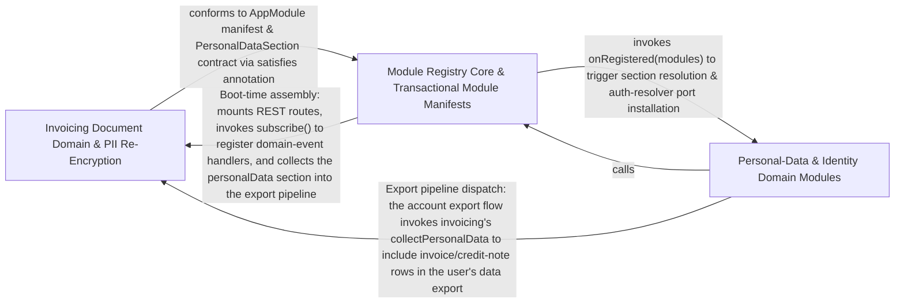

---
tags:
  - 2brain
  - 2brain/arch
  - project/boilerplate-node-backend
type: architecture
component: Module_Registry_Domain_Service_Runtime
---

## Details

The kernel's module registry that turns the explicit module list into a running application: each module declares its routes, consumers, image targets, translatables, and personal-data sections in a single typed AppModule manifest. This group also contains the domain module implementations (account, addresses, api-keys, audit-logs) with their repositories and services, plus the security infrastructure (JWT, OAuth, two-factor, re-encryption) that the contract's authorization keys reference. It is the runtime target that the contract describes.

### Invoicing Document Domain & PII Re-Encryption
The invoicing bounded context and its PII lifecycle. It owns the invoice/credit-note/tax document models, the invoice number counter, and the encrypt/decrypt of invoice party PII, plus the ReencryptJob that re-encrypts stored PII when the key rotates. This is the module whose documents carry uploaded images and rendered PDF templates, and whose personal-data section participates in POST /account/export. It is a self-contained domain module whose manifest entry registers its routes, consumers, image targets, and PII handlers.

**Related Classes/Methods**:

- `src.modules.invoicing.module.default`:34-70
- `src.modules.invoicing.model.InvoiceDocument`
- `src.modules.invoicing.repository.invoicingRepository`:182-197
- `src.modules.invoicing.pii.encryptInvoiceParty`:50-55
- `src.infrastructure.security.reencrypt.ReencryptJob`:54-65

**Source Files:**

- `src/infrastructure/security/reencrypt.ts`
  - `src.infrastructure.security.reencrypt.ReencryptJob` (L54-L65) - Interface
- `src/modules/cart/services/shelf.ts`
  - `src.modules.cart.services.shelf.readShelf.then() callback.then() callback.ids.map() callback` (L44-L47) - Function
- `src/modules/invoicing/emails.ts`
  - `src.modules.invoicing.emails.buildVatBlock.shippingTaxAt` (L148-L148) - Class
  - `src.modules.invoicing.emails.buildVatBlock.shippingTaxAt.document.shippingByRate.map() callback` (L148-L148) - Function
  - `src.modules.invoicing.emails.buildVatBlock.goodsTaxByRate` (L149-L154) - Class
  - `src.modules.invoicing.emails.buildVatBlock.goodsTaxByRate.document.taxSummary.map() callback` (L150-L153) - Function
- `src/modules/invoicing/model.ts`
  - `src.modules.invoicing.model.InvoiceLine` (L29-L47) - Interface
  - `src.modules.invoicing.model.InvoiceParty` (L50-L56) - Interface
  - `src.modules.invoicing.model.FrozenTaxDocument` (L68-L97) - Interface
  - `src.modules.invoicing.model.InvoiceDocument` (L100-L100) - Interface
  - `src.modules.invoicing.model.CreditNoteDocument` (L110-L117) - Interface
  - `src.modules.invoicing.model.NumberCounterDocument` (L251-L253) - Interface
- `src/modules/invoicing/module.ts`
  - `src.modules.invoicing.module.default` (L34-L70) - Class
  - `src.modules.invoicing.module.default.personalData.collect` (L46-L46) - Method
  - `src.modules.invoicing.module.default.subscribe` (L56-L67) - Method
  - `src.modules.invoicing.module.subscribe.onDomainEvent() callback` (L57-L63) - Function
  - `src.modules.invoicing.module.default.subscribe.onDomainEvent() callback.then() callback` (L62-L62) - Function
  - `src.modules.invoicing.module.default.subscribe.onDomainEvent() callback` (L64-L65) - Function
- `src/modules/invoicing/pii.ts`
  - `src.modules.invoicing.pii.encryptInvoiceParty` (L50-L55) - Class
  - `src.modules.invoicing.pii.encryptInvoiceParty.mapParty() callback` (L55-L55) - Function
  - `src.modules.invoicing.pii.decryptInvoiceParty` (L62-L69) - Class
  - `src.modules.invoicing.pii.decryptInvoiceParty.mapParty() callback` (L67-L68) - Function
- `src/modules/invoicing/repository.ts`
  - `src.modules.invoicing.repository.sumDocuments` (L46-L80) - Class
  - `src.modules.invoicing.repository.sumDocuments.then() callback` (L74-L79) - Function
  - `src.modules.invoicing.repository.sumDocuments.then() callback.rows.map() callback` (L75-L79) - Function
  - `src.modules.invoicing.repository.incrementCounter` (L167-L179) - Class
  - `src.modules.invoicing.repository.incrementCounter.then() callback` (L179-L179) - Function
  - `src.modules.invoicing.repository.invoicingRepository` (L182-L197) - Class
  - `src.modules.invoicing.repository.invoicingRepository.sumInvoices` (L186-L186) - Method
  - `src.modules.invoicing.repository.invoicingRepository.sumCreditNotes` (L187-L187) - Method
  - `src.modules.invoicing.repository.invoicingRepository.incrementInvoiceNumberCounter` (L193-L194) - Method
  - `src.modules.invoicing.repository.invoicingRepository.incrementCreditNoteNumberCounter` (L195-L196) - Method
- `src/modules/invoicing/services/issue-credit-note.ts`
  - `src.modules.invoicing.services.issue-credit-note.RefundedInput` (L25-L34) - Interface
  - `src.modules.invoicing.services.issue-credit-note.reversedFigures.grandTotal.items.lines.map() callback` (L101-L104) - Function
  - `src.modules.invoicing.services.issue-credit-note.readWinner` (L117-L123) - Class
  - `src.modules.invoicing.services.issue-credit-note.readWinner.<function>` (L117-L123) - Function
  - `src.modules.invoicing.services.issue-credit-note.readWinner.<function>.then() callback` (L119-L122) - Function
  - `src.modules.invoicing.services.issue-credit-note.issueCreditNote` (L138-L200) - Class
  - `src.modules.invoicing.services.issue-credit-note.issueCreditNote.then() callback` (L139-L200) - Function
  - `src.modules.invoicing.services.issue-credit-note.issueCreditNote.then() callback.withTransaction() callback` (L147-L198) - Function
  - `src.modules.invoicing.services.issue-credit-note.issueCreditNote.then() callback.withTransaction() callback.then() callback` (L148-L197) - Function
  - `src.modules.invoicing.services.issue-credit-note.issueCreditNote.then() callback.withTransaction() callback.then() callback.then() callback` (L182-L196) - Function
  - `src.modules.invoicing.services.issue-credit-note.issueCreditNote.then() callback.withTransaction() callback.then() callback.then() callback.then() callback` (L196-L196) - Function
- `src/modules/invoicing/services/issue-invoice.ts`
  - `src.modules.invoicing.services.issue-invoice.frozenLines` (L41-L49) - Class
  - `src.modules.invoicing.services.issue-invoice.frozenLines.order.items.map() callback` (L42-L49) - Function
  - `src.modules.invoicing.services.issue-invoice.readWinner` (L57-L65) - Class
  - `src.modules.invoicing.services.issue-invoice.readWinner.<function>` (L57-L65) - Function
  - `src.modules.invoicing.services.issue-invoice.readWinner.<function>.then() callback` (L59-L64) - Function
  - `src.modules.invoicing.services.issue-invoice.issueInvoice` (L79-L154) - Class
  - `src.modules.invoicing.services.issue-invoice.issueInvoice.withTransaction() callback` (L96-L152) - Function
  - `src.modules.invoicing.services.issue-invoice.issueInvoice.withTransaction() callback.then() callback` (L97-L151) - Function
  - `src.modules.invoicing.services.issue-invoice.issueInvoice.withTransaction() callback.then() callback.then() callback` (L140-L150) - Function
  - `src.modules.invoicing.services.issue-invoice.issueInvoice.withTransaction() callback.then() callback.then() callback.then() callback` (L150-L150) - Function
- `src/modules/invoicing/services/numbering.ts`
  - `src.modules.invoicing.services.numbering.allocateInvoiceNumber` (L33-L38) - Class
  - `src.modules.invoicing.services.numbering.allocateInvoiceNumber.then() callback` (L37-L37) - Function
  - `src.modules.invoicing.services.numbering.allocateCreditNoteNumber` (L47-L55) - Class
  - `src.modules.invoicing.services.numbering.allocateCreditNoteNumber.then() callback` (L54-L54) - Function
- `src/modules/invoicing/services/personal-data.ts`
  - `src.modules.invoicing.services.personal-data.collectPersonalData` (L19-L38) - Class
  - `src.modules.invoicing.services.personal-data.collectPersonalData.then() callback` (L22-L37) - Function
  - `src.modules.invoicing.services.personal-data.collectPersonalData.then() callback.orders.map() callback` (L24-L28) - Function
  - `src.modules.invoicing.services.personal-data.collectPersonalData.then() callback.then() callback` (L30-L37) - Function
  - `src.modules.invoicing.services.personal-data.collectPersonalData.then() callback.then() callback.invoices.pairs.flatMap() callback` (L31-L32) - Function
  - `src.modules.invoicing.services.personal-data.collectPersonalData.then() callback.then() callback.creditNotes.pairs.flatMap() callback` (L34-L35) - Function
  - `src.modules.invoicing.services.personal-data.collectPersonalData.then() callback.then() callback.creditNotes.pairs.flatMap() callback.creditNotes.map() callback` (L35-L35) - Function
- `src/modules/invoicing/services/reencrypt.ts`
  - `src.modules.invoicing.services.reencrypt.partyFields` (L15-L31) - Class
  - `src.modules.invoicing.services.reencrypt.partyFields.PARTY_FIELDS.flatMap() callback` (L19-L31) - Function
  - `src.modules.invoicing.services.reencrypt.reencryptInvoices` (L39-L60) - Class
  - `src.modules.invoicing.services.reencrypt.fieldsOf` (L47-L47) - Method
  - `src.modules.invoicing.services.reencrypt.reencryptInvoices.fieldsOf` (L55-L55) - Method
  - `src.modules.invoicing.services.reencrypt.reencryptInvoices.then() callback` (L59-L59) - Function
- `src/modules/invoicing/services/stats.ts`
  - `src.modules.invoicing.services.stats.moneyBuckets` (L62-L82) - Class
  - `src.modules.invoicing.services.stats.moneyBuckets.then() callback` (L66-L82) - Function
- `src/modules/orders/module.ts`
  - `src.modules.orders.module.default` (L72-L159) - Class
  - `src.modules.orders.module.default.personalData.collect` (L99-L99) - Method
  - `src.modules.orders.module.default.subscribe` (L110-L114) - Method
  - `src.modules.orders.module.default.subscribe.onDomainEvent() callback` (L111-L112) - Function
- `src/modules/orders/services/current.ts`
  - `src.modules.orders.services.current.OrderShape` (L23-L25) - Interface
  - `src.modules.orders.services.current.resolveCurrentImages` (L47-L71) - Class
  - `src.modules.orders.services.current.resolveCurrentImages.then() callback` (L53-L70) - Function
- `src/modules/orders/services/read.ts`
  - `src.modules.orders.services.read.search` (L49-L67) - Class
  - `src.modules.orders.services.read.search.then() callback` (L57-L66) - Function
  - `src.modules.orders.services.read.search.then() callback.then() callback` (L59-L66) - Function
  - `src.modules.orders.services.read.findOwnOrders` (L136-L143) - Class
  - `src.modules.orders.services.read.findOwnOrders.readAll() callback` (L138-L141) - Function
  - `src.modules.orders.services.read.findOwnOrders.readAll() callback.then() callback` (L140-L140) - Function
- `src/modules/users/services/reencrypt.ts`
  - `src.modules.users.services.reencrypt.reencryptUserPhones` (L19-L37) - Class
  - `src.modules.users.services.reencrypt.reencryptUserPhones.fieldsOf` (L24-L34) - Method
  - `src.modules.users.services.reencrypt.TwoFactorSecretRing` (L46-L49) - Interface
  - `src.modules.users.services.reencrypt.reencryptTwoFactorSecrets` (L58-L80) - Class
  - `src.modules.users.services.reencrypt.reencryptTwoFactorSecrets.fieldsOf` (L65-L77) - Method
  - `src.modules.users.services.reencrypt.reencryptTwoFactorSecrets.fieldsOf.user.twoFactorMethods.flatMap() callback` (L66-L76) - Function

### Module Registry Core & Transactional Module Manifests
The kernel registry contract (AppModule, ModuleConsumer) that defines the single typed manifest every module conforms to, plus the transactional/identity module manifests that plug into it: account (auth lifecycle, export consumer, auth-resolver install), api-keys, notifications, payments (webhook event claiming), returns, and wishlist. This is the runtime target axis — the registry types and the module manifests that declare routes, consumers, config slices, rate limits, and onRegistered/subscribe hooks. It is the central spine of the subsystem: the contract the app tier assembles into a running application.

**Related Classes/Methods**:

- `src.kernel.registry.AppModule`:364-526
- `src.kernel.registry.ModuleConsumer`:65-81
- `src.modules.account.module.default`:64-120
- `src.modules.payments.module.default`:72-118
- `src.modules.wishlist.module.default`:21-39

**Source Files:**

- `src/kernel/registry.ts`
  - `src.kernel.registry.ModuleConsumer` (L65-L81) - Interface
  - `src.kernel.registry.ModuleConsumer.handler` (L70-L70) - Method
  - `src.kernel.registry.AppModule` (L364-L526) - Interface
- `src/modules/account/module.ts`
  - `src.modules.account.module.default` (L64-L120) - Class
  - `src.modules.account.module.default.subscribe` (L108-L117) - Method
  - `src.modules.account.module.default.subscribe.onDomainEvent() callback` (L114-L115) - Function
  - `src.modules.account.module.default.subscribe.onDomainEvent() callback.then() callback` (L115-L115) - Function
- `src/modules/account/session/jwt.ts`
  - `src.modules.account.session.jwt.TokenData` (L44-L79) - Interface
  - `src.modules.account.session.jwt.RotatedSession` (L94-L98) - Interface
  - `src.modules.account.session.jwt.then() callback.then() callback.then() callback` (L402-L402) - Function
- `src/modules/api-keys/module.ts`
  - `src.modules.api-keys.module.default` (L34-L61) - Class
  - `src.modules.api-keys.module.default.subscribe` (L39-L46) - Method
  - `src.modules.api-keys.module.default.subscribe.onDomainEvent() callback` (L43-L44) - Function
  - `src.modules.api-keys.module.default.personalData.collect` (L52-L52) - Method
- `src/modules/api-keys/services/api-keys.ts`
  - `src.modules.api-keys.services.api-keys.findOwnApiKeys` (L116-L127) - Class
  - `src.modules.api-keys.services.api-keys.findOwnApiKeys.readAll() callback` (L118-L125) - Function
  - `src.modules.api-keys.services.api-keys.findOwnApiKeys.readAll() callback.then() callback` (L125-L125) - Function
- `src/modules/api-keys/services/resolver.ts`
  - `src.modules.api-keys.services.resolver.fromBearerToken.then() callback.then() callback.held` (L106-L108) - Class
  - `src.modules.api-keys.services.resolver.fromBearerToken.then() callback.then() callback.held.apiKey.permissions.filter() callback` (L107-L107) - Function
- `src/modules/cart/domain/availability.ts`
  - `src.modules.cart.domain.availability.AvailabilityProduct` (L21-L30) - Interface
- `src/modules/cart/domain/rules.ts`
  - `src.modules.cart.domain.rules.evaluateCheckout.judged` (L161-L168) - Class
  - `src.modules.cart.domain.rules.evaluateCheckout.judged.lines.map() callback` (L161-L168) - Function
  - `src.modules.cart.domain.rules.evaluateCheckout.unavailable.judged.filter() callback` (L171-L171) - Function
  - `src.modules.cart.domain.rules.evaluateCheckout.shortfalls.judged.flatMap() callback` (L177-L187) - Function
- `src/modules/cart/services/checkout.ts`
  - `src.modules.cart.services.checkout.runCheckout.shortfalls.outcome.shortfalls.map() callback` (L585-L590) - Function
- `src/modules/cart/services/merge.ts`
  - `src.modules.cart.services.merge.announceRemoved` (L163-L174) - Class
  - `src.modules.cart.services.merge.announceRemoved.removed` (L164-L164) - Class
  - `src.modules.cart.services.merge.announceRemoved.removed.results.filter() callback` (L164-L164) - Function
  - `src.modules.cart.services.merge.announceRemoved.removed.map() callback` (L168-L171) - Function
  - `src.modules.cart.services.merge.announceRemoved.removed.map() callback.then() callback` (L171-L171) - Function
  - `src.modules.cart.services.merge.announceRemoved.then() callback` (L173-L173) - Function
- `src/modules/cart/services/preorder.ts`
  - `src.modules.cart.services.preorder.preorderIdsOf` (L28-L35) - Class
  - `src.modules.cart.services.preorder.preorderIdsOf.lines.filter() callback` (L33-L33) - Function
  - `src.modules.cart.services.preorder.preorderIdsOf.map() callback` (L34-L34) - Function
- `src/modules/cart/services/shelf.ts`
  - `src.modules.cart.services.shelf.readShelf.then() callback.preorders` (L36-L38) - Class
  - `src.modules.cart.services.shelf.readShelf.then() callback.preorders.ids.map() callback` (L37-L37) - Function
  - `src.modules.cart.services.shelf.readShelf.then() callback.then() callback` (L42-L48) - Function
  - `src.modules.cart.services.shelf.productAvailabilityFor` (L74-L80) - Class
  - `src.modules.cart.services.shelf.productAvailabilityFor.then() callback` (L78-L79) - Function
  - `src.modules.cart.services.shelf.productAvailabilityFor.then() callback.map() callback` (L79-L79) - Function
- `src/modules/example/module.ts`
  - `src.modules.example.module.default.subscribe` (L58-L60) - Method
- `src/modules/notifications/module.ts`
  - `src.modules.notifications.module.default` (L32-L52) - Class
  - `src.modules.notifications.module.default.personalData.collect.then() callback` (L40-L40) - Function
  - `src.modules.notifications.module.default.subscribe` (L45-L50) - Method
- `src/modules/orders/presenter.ts`
  - `src.modules.orders.presenter.presentTimeline` (L44-L50) - Class
  - `src.modules.orders.presenter.presentTimeline.events.filter() callback` (L49-L49) - Function
  - `src.modules.orders.presenter.presentTimeline.map() callback` (L50-L50) - Function
- `src/modules/orders/repository.ts`
  - `src.modules.orders.repository.findManyReferences` (L473-L484) - Class
  - `src.modules.orders.repository.findManyReferences._id.$in.ids.map() callback` (L475-L475) - Function
  - `src.modules.orders.repository.findManyReferences.then() callback` (L478-L483) - Function
  - `src.modules.orders.repository.findManyReferences.then() callback.rows.map() callback` (L479-L483) - Function
- `src/modules/orders/services/export.ts`
  - `src.modules.orders.services.export.csvRows` (L66-L72) - Function
  - `src.modules.orders.services.export.openOrderExport` (L86-L115) - Class
  - `src.modules.orders.services.export.openOrderExport.then() callback` (L94-L114) - Function
- `src/modules/orders/services/fulfillment.ts`
  - `src.modules.orders.services.fulfillment.recordForcedFulfilment` (L69-L88) - Class
  - `src.modules.orders.services.fulfillment.recordForcedFulfilment.then() callback` (L74-L87) - Function
  - `src.modules.orders.services.fulfillment.recordForcedFulfilment.then() callback.then() callback` (L86-L86) - Function
- `src/modules/orders/services/read.ts`
  - `src.modules.orders.services.read.ownOrderIds` (L76-L83) - Class
  - `src.modules.orders.services.read.ownOrderIds.readAll() callback` (L78-L81) - Function
  - `src.modules.orders.services.read.ownOrderIds.readAll() callback.then() callback` (L81-L81) - Function
  - `src.modules.orders.services.read.ownOrderIds.then() callback` (L83-L83) - Function
  - `src.modules.orders.services.read.ownOrderIds.then() callback.orders.map() callback` (L83-L83) - Function
  - `src.modules.orders.services.read.orderBriefsByIds` (L104-L126) - Class
  - `src.modules.orders.services.read.orderBriefsByIds._id.$in.orderIds.map() callback` (L109-L109) - Function
  - `src.modules.orders.services.read.orderBriefsByIds.then() callback` (L113-L125) - Function
  - `src.modules.orders.services.read.orderBriefsByIds.then() callback.orders.map() callback` (L115-L124) - Function
- `src/modules/orders/services/timeline.ts`
  - `src.modules.orders.services.timeline.appendTimeline` (L37-L54) - Class
  - `src.modules.orders.services.timeline.appendTimeline.then() callback` (L54-L54) - Function
  - `src.modules.orders.services.timeline.collectTimelineOf` (L126-L136) - Class
  - `src.modules.orders.services.timeline.collectTimelineOf.then() callback` (L129-L135) - Function
  - `src.modules.orders.services.timeline.collectTimelineOf.then() callback.then() callback` (L130-L134) - Function
  - `src.modules.orders.services.timeline.collectTimelineOf.then() callback.then() callback.events.map() callback` (L131-L134) - Function
- `src/modules/payments/module.ts`
  - `src.modules.payments.module.default` (L72-L118) - Class
  - `src.modules.payments.module.default.personalData.collect` (L89-L89) - Method
  - `src.modules.payments.module.default.subscribe` (L95-L106) - Method
  - `src.modules.payments.module.subscribe.onDomainEvent() callback` (L98-L98) - Function
  - `src.modules.payments.module.default.subscribe.onDomainEvent() callback` (L102-L102) - Function
- `src/modules/payments/services/retention.ts`
  - `src.modules.payments.services.retention.findOwnPayments` (L41-L49) - Class
  - `src.modules.payments.services.retention.findOwnPayments.readAll() callback` (L43-L47) - Function
  - `src.modules.payments.services.retention.toExportPayment.refunds.payment.refunds.map() callback` (L64-L73) - Function
  - `src.modules.payments.services.retention.findOwnPaymentsForExport` (L88-L89) - Class
  - `src.modules.payments.services.retention.findOwnPaymentsForExport.then() callback` (L89-L89) - Function
  - `src.modules.payments.services.retention.findOwnPaymentsForExport.then() callback.payments.map() callback` (L89-L89) - Function
- `src/modules/returns/module.ts`
  - `src.modules.returns.module.default` (L63-L102) - Class
  - `src.modules.returns.module.default.subscribe` (L77-L86) - Method
  - `src.modules.returns.module.default.subscribe.onDomainEvent() callback.then() callback` (L79-L79) - Function
  - `src.modules.returns.module.default.subscribe.onDomainEvent() callback` (L83-L84) - Function
  - `src.modules.returns.module.default.personalData.collect` (L90-L90) - Method
- `src/modules/returns/services/personal-data.ts`
  - `src.modules.returns.services.personal-data.toExportReturn.lines.returned.lines.map() callback` (L28-L32) - Function
  - `src.modules.returns.services.personal-data.collectPersonalData` (L41-L44) - Class
  - `src.modules.returns.services.personal-data.then() callback` (L43-L43) - Function
  - `src.modules.returns.services.personal-data.collectPersonalData.then() callback` (L44-L44) - Function
  - `src.modules.returns.services.personal-data.collectPersonalData.then() callback.returns.map() callback` (L44-L44) - Function
- `src/modules/wishlist/module.ts`
  - `src.modules.wishlist.module.default` (L21-L39) - Class
  - `src.modules.wishlist.module.default.subscribe` (L33-L37) - Method
  - `src.modules.wishlist.module.default.subscribe.onDomainEvent() callback` (L34-L35) - Function
- `src/modules/wishlist/repository.ts`
  - `src.modules.wishlist.repository.wishlistRepository` (L32-L132) - Class
  - `src.modules.wishlist.repository.wishlistRepository.findByUserId` (L50-L51) - Method
  - `src.modules.wishlist.repository.wishlistRepository.addLine` (L70-L91) - Method
  - `src.modules.wishlist.repository.wishlistRepository.addLine.added.before.items.some() callback` (L89-L89) - Function
  - `src.modules.wishlist.repository.wishlistRepository.removeLine` (L98-L105) - Method
  - `src.modules.wishlist.repository.wishlistRepository.deleteByUserId` (L111-L117) - Method
  - `src.modules.wishlist.repository.wishlistRepository.deleteByUserId.then() callback` (L115-L117) - Function
  - `src.modules.wishlist.repository.wishlistRepository.removeProductFromAll` (L124-L131) - Method
- `src/modules/wishlist/service.ts`
  - `src.modules.wishlist.service.wishlistMoveToCart.then() callback.saved` (L124-L124) - Class
  - `src.modules.wishlist.service.wishlistMoveToCart.then() callback.saved.wishlist.items.some() callback` (L124-L124) - Function
  - `src.modules.wishlist.service.productRemoveFromWishlistsById` (L163-L172) - Class
  - `src.modules.wishlist.service.productRemoveFromWishlistsById.then() callback` (L167-L172) - Function
  - `src.modules.wishlist.service.productRemoveFromWishlistsById.then() callback.then() callback` (L170-L170) - Function

### Personal-Data & Identity Domain Modules
The identity/personal-data domain modules and the registry's PersonalDataSection contract they implement. It covers the account repository (delete/erase for GDPR), the addresses module (with PII re-encryption field mapping and addressesGet service), audit-logs (incident search), users (own-sessions), feedback (own-ticket export), and the example module. This group is the data-ownership axis: each module declares how it collects and erases a person's data for POST /account/export, and the registry's PersonalDataSection type is the shared contract that ties them together.

**Related Classes/Methods**:

- `src.kernel.registry.PersonalDataSection`:303-333
- `src.modules.account.repository.deleteById`:97-101
- `src.modules.addresses.service.addressesGet`:31-32
- `src.modules.audit-logs.service.searchIncidents`:118-133

**Source Files:**

- `src/kernel/registry.ts`
  - `src.kernel.registry.PersonalDataSection` (L303-L333) - Interface
- `src/modules/account/module.ts`
  - `src.modules.account.module.personalData.collect` (L80-L80) - Method
  - `src.modules.account.module.default.personalData.collect` (L87-L87) - Method
- `src/modules/account/repository.ts`
  - `src.modules.account.repository.deleteById` (L97-L101) - Class
  - `src.modules.account.repository.deleteById.then() callback` (L101-L101) - Function
  - `src.modules.account.repository.deleteByUserId` (L111-L121) - Class
  - `src.modules.account.repository.deleteByUserId.then() callback` (L116-L120) - Function
  - `src.modules.account.repository.deleteByUserId.then() callback.then() callback` (L120-L120) - Function
  - `src.modules.account.repository.deleteByUserId.then() callback.then() callback.rows.map() callback` (L120-L120) - Function
  - `src.modules.account.repository.removeSessionFamily` (L285-L289) - Class
  - `src.modules.account.repository.removeSessionFamily.then() callback` (L289-L289) - Function
  - `src.modules.account.repository.removeSessionFamilyExcept` (L299-L311) - Class
  - `src.modules.account.repository.removeSessionFamilyExcept.then() callback` (L311-L311) - Function
  - `src.modules.account.repository.sessionFamilyActivity` (L332-L363) - Class
  - `src.modules.account.repository.sessionFamilyActivity.then() callback` (L350-L363) - Function
  - `src.modules.account.repository.sessionFamilyActivity.then() callback.lastActiveAt.rows.map() callback` (L359-L359) - Function
  - `src.modules.account.repository.touchSessionFamily` (L375-L395) - Class
  - `src.modules.account.repository.touchSessionFamily.then() callback` (L395-L395) - Function
  - `src.modules.account.repository.removeSessionFamilyByHash` (L405-L408) - Class
  - `src.modules.account.repository.removeSessionFamilyByHash.then() callback` (L406-L407) - Function
  - `src.modules.account.repository.removeAllSessions` (L417-L421) - Class
  - `src.modules.account.repository.removeAllSessions.then() callback` (L421-L421) - Function
  - `src.modules.account.repository.upsertLiveToken` (L474-L499) - Class
  - `src.modules.account.repository.upsertLiveToken.catch() callback` (L492-L497) - Function
  - `src.modules.account.repository.upsertLiveToken.then() callback` (L498-L498) - Function
  - `src.modules.account.repository.issueVerificationToken` (L507-L512) - Class
  - `src.modules.account.repository.issueVerificationToken.then() callback` (L512-L512) - Function
  - `src.modules.account.repository.removeVerificationTokens` (L551-L558) - Class
  - `src.modules.account.repository.removeVerificationTokens.then() callback` (L558-L558) - Function
  - `src.modules.account.repository.lastVerificationTokenSentAt` (L567-L576) - Class
  - `src.modules.account.repository.lastVerificationTokenSentAt.then() callback` (L576-L576) - Function
  - `src.modules.account.repository.removeAllVerificationTokens` (L600-L604) - Class
  - `src.modules.account.repository.removeAllVerificationTokens.then() callback` (L604-L604) - Function
- `src/modules/account/services/oauth.ts`
  - `src.modules.account.services.oauth.listOAuthLinks` (L311-L320) - Class
  - `src.modules.account.services.oauth.listOAuthLinks.then() callback` (L315-L319) - Function
  - `src.modules.account.services.oauth.listOAuthLinks.then() callback.map() callback` (L316-L319) - Function
- `src/modules/account/services/sessions.ts`
  - `src.modules.account.services.sessions.exportSessions` (L34-L45) - Class
  - `src.modules.account.services.sessions.exportSessions.then() callback` (L35-L44) - Function
  - `src.modules.account.services.sessions.exportSessions.then() callback.map() callback` (L37-L43) - Function
- `src/modules/account/services/two-factor-outcomes.ts`
  - `src.modules.account.services.two-factor-outcomes.rejectWrongCode.catch() callback` (L106-L109) - Function
- `src/modules/addresses/module.ts`
  - `src.modules.addresses.module.default.personalData.collect` (L37-L37) - Method
  - `src.modules.addresses.module.default.personalData.collect.then() callback` (L37-L37) - Function
- `src/modules/addresses/reencrypt.ts`
  - `src.modules.addresses.reencrypt.fieldsOf` (L17-L32) - Class
  - `src.modules.addresses.reencrypt.fieldsOf.book.items.flatMap() callback` (L18-L31) - Function
  - `src.modules.addresses.reencrypt.fieldsOf.book.items.flatMap() callback.ENTRY_FIELDS.flatMap() callback` (L19-L31) - Function
- `src/modules/addresses/service.ts`
  - `src.modules.addresses.service.addressesGet` (L31-L32) - Class
  - `src.modules.addresses.service.addressesGet.then() callback` (L32-L32) - Function
- `src/modules/api-keys/services/resolver.ts`
  - `src.modules.api-keys.services.resolver.then() callback.then() callback.catch() callback` (L84-L90) - Function
- `src/modules/audit-logs/module.ts`
  - `src.modules.audit-logs.module.default.personalData.collect` (L44-L44) - Method
- `src/modules/audit-logs/service.ts`
  - `src.modules.audit-logs.service.searchIncidents` (L118-L133) - Class
  - `src.modules.audit-logs.service.searchIncidents.then() callback` (L127-L133) - Function
  - `src.modules.audit-logs.service.searchIncidents.then() callback.items.page.items.map() callback` (L129-L132) - Function
  - `src.modules.audit-logs.service.findOwnAuditEntries.readFrom` (L149-L153) - Class
  - `src.modules.audit-logs.service.findOwnAuditEntries.readFrom.then() callback` (L150-L153) - Function
- `src/modules/delivery/domain/rates.ts`
  - `src.modules.delivery.domain.rates.cheapestStandardShipping.prices.SHIPPING_METHODS.filter() callback` (L84-L84) - Function
  - `src.modules.delivery.domain.rates.cheapestStandardShipping.prices.map() callback` (L84-L85) - Function
  - `src.modules.delivery.domain.rates.cheapestStandardShipping.prices` (L84-L86) - Class
- `src/modules/delivery/module.ts`
  - `src.modules.delivery.module.shipmentData.lines.payload.lines.map() callback` (L55-L55) - Function
  - `src.modules.delivery.module.default` (L80-L131) - Class
  - `src.modules.delivery.module.personalData.collect` (L94-L99) - Method
  - `src.modules.delivery.module.personalData.collect.then() callback` (L96-L96) - Function
  - `src.modules.delivery.module.default.personalData.collect.then() callback.shipments.map() callback` (L98-L98) - Function
  - `src.modules.delivery.module.default.personalData.collect` (L103-L106) - Method
  - `src.modules.delivery.module.default.personalData.collect.then() callback` (L106-L106) - Function
  - `src.modules.delivery.module.default.personalData.collect.then() callback.all.map() callback` (L106-L106) - Function
  - `src.modules.delivery.module.subscribe.onDomainEvent() callback` (L115-L116) - Function
  - `src.modules.delivery.module.default.subscribe.onDomainEvent() callback` (L125-L126) - Function
- `src/modules/example/module.ts`
  - `src.modules.example.module.default` (L50-L76) - Class
- `src/modules/example/repository.ts`
  - `src.modules.example.repository.exampleRepository` (L33-L116) - Class
  - `src.modules.example.repository.exampleRepository.deleteAllOf` (L74-L85) - Method
  - `src.modules.example.repository.exampleRepository.deleteAllOf.then() callback` (L80-L84) - Function
  - `src.modules.example.repository.exampleRepository.deleteAllOf.then() callback.then() callback` (L84-L84) - Function
  - `src.modules.example.repository.exampleRepository.deleteAllOf.then() callback.then() callback.withCover.flatMap() callback` (L84-L84) - Function
- `src/modules/example/services/crud.ts`
  - `src.modules.example.services.crud.search` (L156-L174) - Class
  - `src.modules.example.services.crud.search.then() callback` (L169-L173) - Function
  - `src.modules.example.services.crud.search.then() callback.items.map() callback` (L170-L170) - Function
  - `src.modules.example.services.crud.search.then() callback.then() callback` (L170-L173) - Function
  - `src.modules.example.services.crud.search.then() callback.then() callback.items.items.map() callback` (L171-L171) - Function
- `src/modules/example/services/owner.ts`
  - `src.modules.example.services.owner.ownerNameOf` (L22-L23) - Class
  - `src.modules.example.services.owner.ownerNameOf.then() callback` (L23-L23) - Function
  - `src.modules.example.services.owner.ownerNamesOf` (L31-L36) - Class
  - `src.modules.example.services.owner.ownerNamesOf.map() callback` (L33-L34) - Function
  - `src.modules.example.services.owner.ownerNamesOf.map() callback.then() callback` (L34-L34) - Function
  - `src.modules.example.services.owner.ownerNamesOf.then() callback` (L36-L36) - Function
- `src/modules/example/services/personal-data.ts`
  - `src.modules.example.services.personal-data.collectPersonalData` (L25-L42) - Class
  - `src.modules.example.services.personal-data.collectPersonalData.readAll() callback` (L28-L36) - Function
  - `src.modules.example.services.personal-data.collectPersonalData.then() callback` (L40-L41) - Function
  - `src.modules.example.services.personal-data.collectPersonalData.then() callback.map() callback` (L41-L41) - Function
- `src/modules/feedback/module.ts`
  - `src.modules.feedback.module.default.personalData.collect` (L33-L36) - Method
- `src/modules/feedback/service.ts`
  - `src.modules.feedback.service.findOwnTickets` (L248-L256) - Class
  - `src.modules.feedback.service.findOwnTickets.readAll() callback` (L250-L254) - Function
  - `src.modules.feedback.service.findOwnTicketsForExport` (L283-L284) - Class
  - `src.modules.feedback.service.findOwnTicketsForExport.then() callback` (L284-L284) - Function
  - `src.modules.feedback.service.findOwnTicketsForExport.then() callback.tickets.map() callback` (L284-L284) - Function
- `src/modules/notifications/module.ts`
  - `src.modules.notifications.module.default.personalData.collect` (L40-L40) - Method
- `src/modules/orders/module.ts`
  - `src.modules.orders.module.personalData.collect` (L86-L86) - Method
- `src/modules/payments/domain/display-status.ts`
  - `src.modules.payments.domain.display-status.DisplayStatusInput` (L17-L23) - Interface
- `src/modules/payments/repository.ts`
  - `src.modules.payments.repository.paymentRepository.searchStaff` (L514-L533) - Method
- `src/modules/payments/services/list.ts`
  - `src.modules.payments.services.list.listPayments` (L50-L68) - Class
  - `src.modules.payments.services.list.listPayments.then() callback` (L60-L67) - Function
  - `src.modules.payments.services.list.listPayments.then() callback.items.map() callback` (L61-L61) - Function
  - `src.modules.payments.services.list.listPayments.then() callback.then() callback` (L61-L67) - Function
  - `src.modules.payments.services.list.listPayments.then() callback.then() callback.items.items.map() callback` (L64-L64) - Function
- `src/modules/users/module.ts`
  - `src.modules.users.module.personalData.collect` (L56-L56) - Method
  - `src.modules.users.module.default.personalData.collect` (L61-L61) - Method
- `src/modules/wishlist/module.ts`
  - `src.modules.wishlist.module.default.personalData.collect` (L28-L28) - Method
