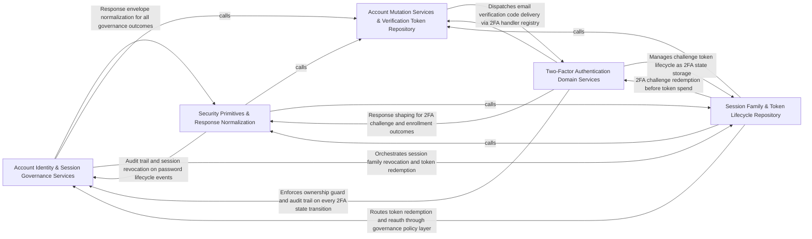

---
tags:
  - 2brain
  - 2brain/arch
  - project/boilerplate-node-backend
type: architecture
component: Module_Repositories_Domain_Services
---

## Details

The per-module repository and service layer that seeders write through — the SeedRepository / OwnedSeedRepository structural interface is satisfied by these repositories (e.g. src.modules.account.repository with deleteById, findLiveFamilyRow, issueVerificationToken, removeAllSessions, removeAllVerificationTokens), alongside the supporting domain services (password hashing verifyPassword/Derivation, mail budget, roles, cache, upload, HTTP response normalisation). This is the seam where the seeding primitive meets each bounded context: the seeder never touches the driver directly, it hands a fixture to the module's own create(), which is what guarantees pre-save hooks (password hashing, PII encryption) still fire.

### Account Identity & Session Governance Services
The governance layer that controls who can do what across the account lifecycle. It orchestrates OAuth provider linking (with a rich error taxonomy: OAuthAccountExistsError, OAuthIdentityTakenError, OAuthLinkExpiredError), enforces role-based caller restrictions (isUnrestrictedCaller), executes session revocation (logoutEverywhere, SessionRevocation), and records every sensitive operation into the audit trail (recordAccountAudit). This is the policy-enforcement node in any flow diagram: every mutation or authentication event passes through here before reaching the repository. Separating governance from raw data operations is the DDD strategic boundary between policy and mechanism. The seeder must call through this layer to ensure audit records and role checks fire identically to production traffic.

**Related Classes/Methods**:

- `src.modules.account.services.oauth.linkProviderToSignedInAccount`:183-231
- `src.modules.account.services.logout.logoutEverywhere`:112-147
- `src.modules.account.roles.isUnrestrictedCaller`:16-19
- `src.modules.account.services.caller.recordAccountAudit`:49-60

**Source Files:**

- `src/modules/account/roles.ts`
  - `src.modules.account.roles.isUnrestrictedCaller` (L16-L19) - Class
  - `src.modules.account.roles.isUnrestrictedCaller.then() callback` (L19-L19) - Function
- `src/modules/account/services/caller.ts`
  - `src.modules.account.services.caller.recordAccountAudit` (L49-L60) - Class
  - `src.modules.account.services.caller.recordAccountAudit.then() callback` (L54-L60) - Function
- `src/modules/account/services/logout.ts`
  - `src.modules.account.services.logout.SessionRevocation` (L25-L30) - Interface
  - `src.modules.account.services.logout.logoutEverywhere` (L112-L147) - Class
  - `src.modules.account.services.logout.logoutEverywhere.then() callback.then() callback` (L128-L129) - Function
  - `src.modules.account.services.logout.logoutEverywhere.catch() callback` (L133-L133) - Function
  - `src.modules.account.services.logout.logoutEverywhere.then() callback` (L134-L147) - Function
- `src/modules/account/services/oauth.ts`
  - `src.modules.account.services.oauth.OAuthEmailUnverifiedError` (L38-L44) - Class
  - `src.modules.account.services.oauth.OAuthEmailUnverifiedError.constructor` (L40-L43) - Constructor
  - `src.modules.account.services.oauth.OAuthAccountUnverifiedError` (L57-L63) - Class
  - `src.modules.account.services.oauth.OAuthAccountUnverifiedError.constructor` (L59-L62) - Constructor
  - `src.modules.account.services.oauth.OAuthAccountUnavailableError` (L71-L77) - Class
  - `src.modules.account.services.oauth.OAuthAccountUnavailableError.constructor` (L73-L76) - Constructor
  - `src.modules.account.services.oauth.OAuthAccountExistsError` (L87-L95) - Class
  - `src.modules.account.services.oauth.OAuthAccountExistsError.constructor` (L89-L94) - Constructor
  - `src.modules.account.services.oauth.OAuthIdentityTakenError` (L102-L108) - Class
  - `src.modules.account.services.oauth.OAuthIdentityTakenError.constructor` (L104-L107) - Constructor
  - `src.modules.account.services.oauth.OAuthLinkExpiredError` (L114-L119) - Class
  - `src.modules.account.services.oauth.OAuthLinkExpiredError.constructor` (L115-L118) - Constructor
  - `src.modules.account.services.oauth.linkProviderToSignedInAccount` (L183-L231) - Class
  - `src.modules.account.services.oauth.linkProviderToSignedInAccount.then() callback` (L192-L231) - Function
  - `src.modules.account.services.oauth.linkProviderToSignedInAccount.then() callback.then() callback` (L217-L230) - Function
  - `src.modules.account.services.oauth.linkProviderToSignedInAccount.then() callback.then() callback.then() callback` (L226-L229) - Function
  - `src.modules.account.services.oauth.signupFromOAuth` (L256-L305) - Class
  - `src.modules.account.services.oauth.signupFromOAuth.then() callback` (L263-L304) - Function
  - `src.modules.account.services.oauth.signupFromOAuth.then() callback.catch() callback` (L289-L289) - Function
  - `src.modules.account.services.oauth.signupFromOAuth.then() callback.then() callback` (L290-L304) - Function
  - `src.modules.account.services.oauth.loginOrCreateFromOAuth` (L339-L383) - Class
  - `src.modules.account.services.oauth.loginOrCreateFromOAuth.then() callback` (L349-L383) - Function
  - `src.modules.account.services.oauth.loginOrCreateFromOAuth.then() callback.then() callback` (L360-L382) - Function
  - `src.modules.account.services.oauth.loginOrCreateFromOAuth.then() callback.then() callback.then() callback` (L371-L374) - Function
- `src/modules/account/services/password-reset.ts`
  - `src.modules.account.services.password-reset.afterReset` (L53-L98) - Class
  - `src.modules.account.services.password-reset.afterReset.catch() callback` (L66-L74) - Function
- `src/modules/account/services/revocation.ts`
  - `src.modules.account.services.revocation.moveEpoch` (L71-L81) - Class
  - `src.modules.account.services.revocation.announceInTransaction() callback` (L77-L78) - Function
  - `src.modules.account.services.revocation.moveEpoch.announceInTransaction() callback.then() callback` (L78-L78) - Function
  - `src.modules.account.services.revocation.moveEpoch.announceInTransaction() callback` (L79-L79) - Function
  - `src.modules.account.services.revocation.moveEpoch.then() callback` (L80-L80) - Function
  - `src.modules.account.services.revocation.settle` (L91-L104) - Class
  - `src.modules.account.services.revocation.settle.then() callback` (L96-L96) - Function
  - `src.modules.account.services.revocation.settle.catch() callback` (L97-L104) - Function
  - `src.modules.account.services.revocation.revokeFor` (L114-L115) - Class
  - `src.modules.account.services.revocation.revokeFor.then() callback` (L115-L115) - Function
- `src/modules/account/services/signup.ts`
  - `src.modules.account.services.signup.signupSchema` (L37-L55) - Class
  - `src.modules.account.services.signup.signupSchema.termsAccepted.error` (L46-L46) - Method
  - `src.modules.account.services.signup.signupSchema.superRefine() callback` (L48-L55) - Function
- `src/modules/account/services/tokens.ts`
  - `src.modules.account.services.tokens.redeemLiveToken` (L183-L190) - Class
  - `src.modules.account.services.tokens.redeemLiveToken.then() callback` (L188-L189) - Function
- `src/modules/account/services/two-factor-enrollment.ts`
  - `src.modules.account.services.two-factor-enrollment.announceAuthenticatorLoss` (L75-L91) - Class
  - `src.modules.account.services.two-factor-enrollment.announceAuthenticatorLoss.user.twoFactorMethods.every() callback` (L76-L76) - Function
  - `src.modules.account.services.two-factor-enrollment.announceAuthenticatorLoss.then() callback` (L77-L90) - Function
  - `src.modules.account.services.two-factor-enrollment.announceAuthenticatorLoss.then() callback.announceInTransaction() callback` (L84-L88) - Function
  - `src.modules.account.services.two-factor-enrollment.announceAuthenticatorLoss.then() callback.then() callback` (L89-L89) - Function
  - `src.modules.account.services.two-factor-enrollment.armMethod` (L260-L292) - Class
  - `src.modules.account.services.two-factor-enrollment.armMethod.then() callback` (L281-L290) - Function
  - `src.modules.account.services.two-factor-enrollment.armMethod.then() callback.then() callback` (L282-L289) - Function
  - `src.modules.account.services.two-factor-enrollment.removeTwoFactorMethod.outcome` (L317-L358) - Class
  - `src.modules.account.services.two-factor-enrollment.removeTwoFactorMethod.outcome.withVerifiedCode() callback.user.twoFactorMethods.findIndex() callback` (L323-L323) - Function
  - `src.modules.account.services.two-factor-enrollment.removeTwoFactorMethod.outcome.withVerifiedCode() callback` (L329-L357) - Function
  - `src.modules.account.services.two-factor-enrollment.removeTwoFactorMethod.outcome.withVerifiedCode() callback.then() callback` (L346-L355) - Function
  - `src.modules.account.services.two-factor-enrollment.disableTwoFactor.outcome` (L376-L399) - Class
  - `src.modules.account.services.two-factor-enrollment.disableTwoFactor.outcome.withVerifiedCode() callback` (L384-L398) - Function
  - `src.modules.account.services.two-factor-enrollment.disableTwoFactor.outcome.withVerifiedCode() callback.then() callback` (L394-L397) - Function
  - `src.modules.account.services.two-factor-enrollment.regenerateBackupCodes.outcome` (L418-L439) - Class
  - `src.modules.account.services.two-factor-enrollment.regenerateBackupCodes.outcome.withVerifiedCode() callback` (L426-L438) - Function
  - `src.modules.account.services.two-factor-enrollment.regenerateBackupCodes.outcome.withVerifiedCode() callback.then() callback` (L431-L437) - Function
- `src/modules/account/services/two-factor-lockout.ts`
  - `src.modules.account.services.two-factor-lockout.withVerifiedCode` (L165-L179) - Class
  - `src.modules.account.services.two-factor-lockout.withVerifiedCode.withOwnAccount() callback` (L172-L179) - Function
  - `src.modules.account.services.two-factor-lockout.withVerifiedCode.withOwnAccount() callback.then() callback` (L176-L177) - Function
  - `src.modules.account.services.two-factor-lockout.withVerifiedCode.withOwnAccount() callback.then() callback.settleVerdict() callback` (L177-L177) - Function
  - `src.modules.account.services.two-factor-lockout.withVerifiedCode.catch() callback` (L179-L179) - Function
- `src/modules/account/services/verification.ts`
  - `src.modules.account.services.verification.auditProvenAddress` (L273-L278) - Class
  - `src.modules.account.services.verification.auditProvenAddress.then() callback` (L278-L278) - Function
  - `src.modules.account.services.verification.confirmEmailVerification` (L330-L344) - Class
  - `src.modules.account.services.verification.confirmEmailVerification.then() callback` (L336-L343) - Function
  - `src.modules.account.services.verification.confirmEmailVerification.then() callback.then() callback` (L342-L342) - Function
  - `src.modules.account.services.verification.confirmEmailChange` (L358-L389) - Class
  - `src.modules.account.services.verification.confirmEmailChange.then() callback` (L362-L389) - Function
  - `src.modules.account.services.verification.confirmEmailChange.then() callback.then() callback` (L373-L388) - Function
  - `src.modules.account.services.verification.undoEmailChangeByToken` (L407-L433) - Class
  - `src.modules.account.services.verification.undoEmailChangeByToken.then() callback` (L411-L432) - Function
  - `src.modules.account.services.verification.undoEmailChangeByToken.then() callback.then() callback` (L419-L430) - Function
- `src/modules/account/two-factor/backup-codes.ts`
  - `src.modules.account.two-factor.backup-codes.generateBackupCodes` (L50-L51) - Class
  - `src.modules.account.two-factor.backup-codes.generateBackupCodes.Array.from() callback` (L51-L51) - Function
  - `src.modules.account.two-factor.backup-codes.hashBackupCodes` (L54-L55) - Class
  - `src.modules.account.two-factor.backup-codes.hashBackupCodes.codes.map() callback` (L55-L55) - Function

### Two-Factor Authentication Domain Services
A self-contained 2FA domain service cluster covering the full lifecycle: enrollment (beginSetup, setupTwoFactorMethod, twoFactorStatus), challenge construction (buildLoginChallenge), verification with lockout (verifyAnyFactor, verifyInOrder, rejectWrongCode), and method dispatch via the TwoFactorMethodHandler registry (TOTP, delivered-code, email). The MethodEligibility type and armedEntries/audited outcome helpers encode the state machine that gates login. This is the most complex stateful flow in the subsystem and maps to a multi-step sequence diagram node. 2FA is a bounded-context-internal domain service with its own state machine (enrolled, armed, verified, locked-out). Isolating it as a sub-component makes the flow diagram readable: one node for 2FA gate rather than scattering verification logic across login, reauth, and enrollment flows.

**Related Classes/Methods**:

- `src.modules.account.services.two-factor-enrollment.beginSetup`:168-190
- `src.modules.account.services.two-factor-challenge.buildLoginChallenge`:64-79
- `src.modules.account.services.two-factor-lockout.verifyInOrder`:55-65
- `src.modules.account.two-factor.registry.TwoFactorMethodHandler`:29-68

**Source Files:**

- `src/modules/account/services/two-factor-challenge.ts`
  - `src.modules.account.services.two-factor-challenge.buildLoginChallenge` (L64-L79) - Class
  - `src.modules.account.services.two-factor-challenge.buildLoginChallenge.then() callback` (L72-L78) - Function
  - `src.modules.account.services.two-factor-challenge.buildLoginChallenge.then() callback.methods.armed.map() callback` (L76-L76) - Function
  - `src.modules.account.services.two-factor-challenge.redeemChallenge` (L120-L134) - Class
  - `src.modules.account.services.two-factor-challenge.redeemChallenge.spendThen() callback` (L127-L127) - Function
  - `src.modules.account.services.two-factor-challenge.redeemChallenge.then() callback` (L128-L133) - Function
  - `src.modules.account.services.two-factor-challenge.redeemChallenge.then() callback.then() callback` (L132-L132) - Function
- `src/modules/account/services/two-factor-enrollment.ts`
  - `src.modules.account.services.two-factor-enrollment.then() callback.announceInTransaction() callback` (L83-L83) - Function
  - `src.modules.account.services.two-factor-enrollment.twoFactorStatus` (L98-L121) - Class
  - `src.modules.account.services.two-factor-enrollment.twoFactorStatus.withOwnAccount() callback` (L101-L121) - Function
  - `src.modules.account.services.two-factor-enrollment.twoFactorStatus.withOwnAccount() callback.methods.enrolled.map() callback` (L109-L112) - Function
  - `src.modules.account.services.two-factor-enrollment.twoFactorStatus.withOwnAccount() callback.available.filter() callback` (L114-L114) - Function
  - `src.modules.account.services.two-factor-enrollment.twoFactorStatus.withOwnAccount() callback.available.map() callback` (L115-L118) - Function
  - `src.modules.account.services.two-factor-enrollment.twoFactorStatus.catch() callback` (L121-L121) - Function
  - `src.modules.account.services.two-factor-enrollment.setupTwoFactorMethod` (L132-L160) - Class
  - `src.modules.account.services.two-factor-enrollment.setupTwoFactorMethod.withOwnAccount() callback` (L142-L159) - Function
  - `src.modules.account.services.two-factor-enrollment.setupTwoFactorMethod.withOwnAccount() callback.then() callback` (L156-L157) - Function
  - `src.modules.account.services.two-factor-enrollment.setupTwoFactorMethod.withOwnAccount() callback.then() callback.settleVerdict() callback` (L157-L157) - Function
  - `src.modules.account.services.two-factor-enrollment.setupTwoFactorMethod.catch() callback` (L159-L159) - Function
  - `src.modules.account.services.two-factor-enrollment.beginSetup` (L168-L190) - Class
  - `src.modules.account.services.two-factor-enrollment.beginSetup.then() callback` (L182-L189) - Function
  - `src.modules.account.services.two-factor-enrollment.beginSetup.then() callback.then() callback` (L188-L188) - Function
  - `src.modules.account.services.two-factor-enrollment.confirmTwoFactorMethod.outcome` (L236-L251) - Class
  - `src.modules.account.services.two-factor-enrollment.confirmTwoFactorMethod.outcome.withOwnAccount() callback` (L236-L251) - Function
  - `src.modules.account.services.two-factor-enrollment.confirmTwoFactorMethod.outcome.withOwnAccount() callback.then() callback` (L243-L249) - Function
  - `src.modules.account.services.two-factor-enrollment.confirmTwoFactorMethod.outcome.withOwnAccount() callback.then() callback.then() callback` (L245-L248) - Function
  - `src.modules.account.services.two-factor-enrollment.confirmTwoFactorMethod.outcome.catch() callback` (L251-L251) - Function
  - `src.modules.account.services.two-factor-enrollment.outcome.withVerifiedCode() callback` (L380-L383) - Function
  - `src.modules.account.services.two-factor-enrollment.outcome.withVerifiedCode() callback.then() callback` (L392-L392) - Function
- `src/modules/account/services/two-factor-lockout.ts`
  - `src.modules.account.services.two-factor-lockout.verifyInOrder` (L55-L65) - Class
  - `src.modules.account.services.two-factor-lockout.verifyInOrder.then() callback` (L64-L64) - Function
  - `src.modules.account.services.two-factor-lockout.verifyAnyFactor` (L71-L74) - Class
  - `src.modules.account.services.two-factor-lockout.verifyAnyFactor.then() callback` (L73-L73) - Function
- `src/modules/account/services/two-factor-outcomes.ts`
  - `src.modules.account.services.two-factor-outcomes.audited` (L81-L94) - Class
  - `src.modules.account.services.two-factor-outcomes.audited.outcome.then() callback` (L87-L94) - Function
  - `src.modules.account.services.two-factor-outcomes.rejectWrongCode` (L104-L113) - Class
  - `src.modules.account.services.two-factor-outcomes.rejectWrongCode.catch() callback` (L109-L112) - Function
  - `src.modules.account.services.two-factor-outcomes.rejectWrongCode.then() callback` (L113-L113) - Function
  - `src.modules.account.services.two-factor-outcomes.armedEntries` (L181-L182) - Class
  - `src.modules.account.services.two-factor-outcomes.armedEntries.filter() callback` (L182-L182) - Function
  - `src.modules.account.services.two-factor-outcomes.deliverArmedCode.armed` (L203-L203) - Class
  - `src.modules.account.services.two-factor-outcomes.deliverArmedCode.armed.find() callback` (L203-L203) - Function
- `src/modules/account/two-factor/delivered-code-verify.ts`
  - `src.modules.account.two-factor.delivered-code-verify.verifyDeliveredCode` (L24-L48) - Class
  - `src.modules.account.two-factor.delivered-code-verify.verifyDeliveredCode.then() callback` (L46-L46) - Function
- `src/modules/account/two-factor/methods/email.ts`
  - `src.modules.account.two-factor.methods.email.deliverEmailCode` (L48-L75) - Class
  - `src.modules.account.two-factor.methods.email.deliverEmailCode.then() callback` (L67-L74) - Function
  - `src.modules.account.two-factor.methods.email.emailMethod` (L85-L114) - Class
  - `src.modules.account.two-factor.methods.email.emailMethod.available` (L93-L93) - Method
  - `src.modules.account.two-factor.methods.email.emailMethod.eligibility` (L95-L98) - Method
  - `src.modules.account.two-factor.methods.email.emailMethod.target` (L100-L100) - Method
  - `src.modules.account.two-factor.methods.email.emailMethod.setup` (L104-L108) - Method
  - `src.modules.account.two-factor.methods.email.emailMethod.setup.then() callback` (L105-L108) - Function
  - `src.modules.account.two-factor.methods.email.emailMethod.send` (L110-L110) - Method
  - `src.modules.account.two-factor.methods.email.emailMethod.verify` (L112-L113) - Method
- `src/modules/account/two-factor/methods/totp.ts`
  - `src.modules.account.two-factor.methods.totp.totpMethod` (L17-L63) - Class
  - `src.modules.account.two-factor.methods.totp.totpMethod.available` (L20-L20) - Method
  - `src.modules.account.two-factor.methods.totp.totpMethod.eligibility` (L21-L21) - Method
  - `src.modules.account.two-factor.methods.totp.totpMethod.target` (L22-L22) - Method
  - `src.modules.account.two-factor.methods.totp.totpMethod.setup` (L24-L39) - Method
  - `src.modules.account.two-factor.methods.totp.totpMethod.verify` (L41-L62) - Method
  - `src.modules.account.two-factor.methods.totp.totpMethod.verify.then() callback` (L47-L61) - Function
  - `src.modules.account.two-factor.methods.totp.totpMethod.verify.then() callback.then() callback` (L57-L60) - Function
- `src/modules/account/two-factor/registry.ts`
  - `src.modules.account.two-factor.registry.MethodEligibility` (L17-L22) - Interface
  - `src.modules.account.two-factor.registry.TwoFactorMethodHandler` (L29-L68) - Interface
  - `src.modules.account.two-factor.registry.TwoFactorMethodHandler.available` (L41-L41) - Method
  - `src.modules.account.two-factor.registry.TwoFactorMethodHandler.eligibility` (L44-L44) - Method
  - `src.modules.account.two-factor.registry.TwoFactorMethodHandler.target` (L47-L47) - Method
  - `src.modules.account.two-factor.registry.TwoFactorMethodHandler.setup` (L53-L57) - Method
  - `src.modules.account.two-factor.registry.TwoFactorMethodHandler.verify` (L60-L60) - Method
  - `src.modules.account.two-factor.registry.HANDLERS.map() callback` (L79-L79) - Function
  - `src.modules.account.two-factor.registry.availableTwoFactorMethods` (L84-L85) - Class
  - `src.modules.account.two-factor.registry.availableTwoFactorMethods.HANDLERS.filter() callback` (L85-L85) - Function
  - `src.modules.account.two-factor.registry.twoFactorMethod` (L94-L95) - Class
  - `src.modules.account.two-factor.registry.twoFactorMethod.find() callback` (L95-L95) - Function
  - `src.modules.account.two-factor.registry.orderedEntries` (L104-L110) - Class
  - `src.modules.account.two-factor.registry.orderedEntries.flatMap() callback` (L107-L110) - Function
  - `src.modules.account.two-factor.registry.flatMap() callback.entry` (L108-L108) - Class
  - `src.modules.account.two-factor.registry.orderedEntries.flatMap() callback.entry.entries.find() callback` (L108-L108) - Function
- `src/modules/account/two-factor/totp.ts`
  - `src.modules.account.two-factor.totp.verifyTotpCode` (L91-L118) - Class
  - `src.modules.account.two-factor.totp.verifyTotpCode.then() callback` (L105-L111) - Function
  - `src.modules.account.two-factor.totp.verifyTotpCode.catch() callback` (L117-L117) - Function

### Security Primitives & Response Normalization
The infrastructure seam that domain services consume but do not own. It provides: (a) password hashing/verification with Derivation (scrypt/argon2 parameter extraction) and verifyPassword (constant-time comparison), (b) breached-password assertion (assertPasswordNotBreached), (c) HTTP response normalization (normalizeErrors, validationErrors) that converts domain errors into contract-compliant OpenAPI responses, (d) cache and upload middleware (CacheOptions, upload, withLocaleRestored), and (e) the login service that orchestrates hash-verify, breach-check, session-issue, response-normalize. This is the node where the pre-save hook guarantee lives: the seeder calls login() or verifyPassword() rather than the hash driver directly. Contract-first architecture demands that response shapes are normalized in one place. Password verification is a security primitive that must be identical across all entry points (login, reauth, password-reset). Grouping these together makes the infrastructure-to-domain dependency direction explicit in the diagram.

**Related Classes/Methods**:

- `src.infrastructure.security.password-hash.verifyPassword`:106-121
- `src.infrastructure.http.response.normalizeErrors`:230-258
- `src.modules.account.services.login.login`:38-67

**Source Files:**

- `src/infrastructure/http/middlewares/cache.ts`
  - `src.infrastructure.http.middlewares.cache.CacheOptions` (L168-L231) - Interface
- `src/infrastructure/http/middlewares/upload.ts`
  - `src.infrastructure.http.middlewares.upload.withLocaleRestored` (L208-L215) - Class
  - `src.infrastructure.http.middlewares.upload.withLocaleRestored.<function>` (L210-L215) - Function
  - `src.infrastructure.http.middlewares.upload.withLocaleRestored.<function>.middleware() callback` (L211-L215) - Function
  - `src.infrastructure.http.middlewares.upload.then() callback.digested.map() callback` (L389-L389) - Function
  - `src.infrastructure.http.middlewares.upload.upload` (L505-L507) - Class
  - `src.infrastructure.http.middlewares.upload.upload.image` (L506-L506) - Method
- `src/infrastructure/http/response.ts`
  - `src.infrastructure.http.response.normalizeErrors` (L230-L258) - Class
  - `src.infrastructure.http.response.normalizeErrors.inputErrors.map() callback` (L239-L257) - Function
  - `src.infrastructure.http.response.validationErrors` (L495-L501) - Class
  - `src.infrastructure.http.response.validationErrors.error.issues.map() callback` (L496-L501) - Function
- `src/infrastructure/security/breached-passwords/index.ts`
  - `src.infrastructure.security.breached-passwords.index.assertPasswordNotBreached` (L126-L129) - Class
  - `src.infrastructure.security.breached-passwords.index.assertPasswordNotBreached.then() callback` (L127-L128) - Function
- `src/infrastructure/security/password-hash.ts`
  - `src.infrastructure.security.password-hash.Derivation` (L42-L47) - Interface
  - `src.infrastructure.security.password-hash.verifyPassword` (L106-L121) - Class
  - `src.infrastructure.security.password-hash.verifyPassword.then() callback` (L120-L120) - Function
- `src/modules/account/repository.ts`
  - `src.modules.account.repository.upsertErasureLedgerRow` (L670-L719) - Class
  - `src.modules.account.repository.upsertErasureLedgerRow.catch() callback` (L714-L717) - Function
  - `src.modules.account.repository.upsertErasureLedgerRow.then() callback` (L718-L718) - Function
- `src/modules/account/services/account-deletion.ts`
  - `src.modules.account.services.account-deletion.restoreWrites` (L123-L130) - Class
  - `src.modules.account.services.account-deletion.restoreWrites.<function>` (L125-L130) - Function
  - `src.modules.account.services.account-deletion.restoreWrites.<function>.then() callback` (L128-L129) - Function
  - `src.modules.account.services.account-deletion.restoreWrites.<function>.then() callback.then() callback` (L129-L129) - Function
  - `src.modules.account.services.account-deletion.finishRestore` (L140-L147) - Class
  - `src.modules.account.services.account-deletion.finishRestore.then() callback` (L145-L147) - Function
  - `src.modules.account.services.account-deletion.restoreAccountByLink.redeemLiveToken() callback` (L198-L199) - Function
  - `src.modules.account.services.account-deletion.restoreAccountByLink.redeemLiveToken() callback.then() callback` (L199-L199) - Function
- `src/modules/account/services/login.ts`
  - `src.modules.account.services.login.login` (L38-L67) - Class
  - `src.modules.account.services.login.login.then() callback` (L48-L64) - Function
  - `src.modules.account.services.login.login.then() callback.then() callback` (L56-L63) - Function
  - `src.modules.account.services.login.login.catch() callback` (L65-L65) - Function
  - `src.modules.account.services.login.verifyOwnPassword` (L81-L92) - Class
  - `src.modules.account.services.login.verifyOwnPassword.withOwnAccount() callback` (L86-L92) - Function
  - `src.modules.account.services.login.verifyOwnPassword.withOwnAccount() callback.then() callback` (L89-L90) - Function
- `src/modules/account/services/oauth.ts`
  - `src.modules.account.services.oauth.linkProviderToSignedInAccount.then() callback.then() callback.spendThen() callback` (L204-L209) - Function
  - `src.modules.account.services.oauth.linkProviderToSignedInAccount.then() callback.then() callback.catch() callback` (L210-L215) - Function
- `src/modules/account/services/password-reset.ts`
  - `src.modules.account.services.password-reset.resetWith` (L120-L153) - Class
  - `src.modules.account.services.password-reset.resetWith.then() callback` (L136-L152) - Function
  - `src.modules.account.services.password-reset.resetWith.then() callback.then() callback` (L145-L150) - Function
  - `src.modules.account.services.password-reset.resetWith.then() callback.then() callback.then() callback` (L147-L148) - Function
  - `src.modules.account.services.password-reset.completePasswordReset` (L172-L189) - Class
  - `src.modules.account.services.password-reset.completePasswordReset.then() callback` (L183-L186) - Function
  - `src.modules.account.services.password-reset.completePasswordReset.catch() callback` (L188-L188) - Function
- `src/modules/account/services/password.ts`
  - `src.modules.account.services.password.passwordChange` (L87-L108) - Class
  - `src.modules.account.services.password.passwordChange.then() callback` (L97-L107) - Function
  - `src.modules.account.services.password.passwordChange.then() callback.then() callback` (L102-L105) - Function
  - `src.modules.account.services.password.passwordChange.then() callback.catch() callback` (L106-L106) - Function
  - `src.modules.account.services.password.passwordWrite` (L122-L142) - Class
  - `src.modules.account.services.password.passwordWrite.<function>` (L129-L142) - Function
  - `src.modules.account.services.password.passwordWrite.<function>.write` (L131-L136) - Class
  - `src.modules.account.services.password.passwordWrite.<function>.write.then() callback` (L134-L135) - Function
  - `src.modules.account.services.password.passwordWrite.<function>.write.then() callback.then() callback` (L135-L135) - Function
  - `src.modules.account.services.password.passwordWrite.<function>.announceWithin() callback` (L138-L139) - Function
  - `src.modules.account.services.password.afterPasswordWrite` (L151-L155) - Class
  - `src.modules.account.services.password.afterPasswordWrite.then() callback` (L155-L155) - Function
  - `src.modules.account.services.password.passwordChangeWithCurrent` (L181-L209) - Class
  - `src.modules.account.services.password.passwordChangeWithCurrent.outcome` (L190-L199) - Class
  - `src.modules.account.services.password.outcome.then() callback` (L194-L197) - Function
  - `src.modules.account.services.password.passwordChangeWithCurrent.outcome.catch() callback` (L199-L199) - Function
  - `src.modules.account.services.password.passwordChangeWithCurrent.outcome.then() callback` (L201-L208) - Function
- `src/modules/account/services/signup.ts`
  - `src.modules.account.services.signup.guardBreachedPassword` (L70-L73) - Class
  - `src.modules.account.services.signup.guardBreachedPassword.then() callback` (L71-L72) - Function
  - `src.modules.account.services.signup.guardEmailPolicy` (L82-L94) - Class
  - `src.modules.account.services.signup.guardEmailPolicy.then() callback` (L83-L93) - Function
  - `src.modules.account.services.signup.createAccountIfEmailFree` (L101-L132) - Class
  - `src.modules.account.services.signup.createAccountIfEmailFree.then() callback` (L106-L131) - Function
  - `src.modules.account.services.signup.createAccountIfEmailFree.then() callback.then() callback` (L126-L129) - Function
  - `src.modules.account.services.signup.createAccountIfEmailFree.then() callback.then() callback.then() callback` (L129-L129) - Function
  - `src.modules.account.services.signup.createAccountIfEmailFree.catch() callback` (L132-L132) - Function
  - `src.modules.account.services.signup.signup` (L141-L189) - Class
  - `src.modules.account.services.signup.signup.outcome` (L149-L157) - Class
  - `src.modules.account.services.signup.outcome.then() callback` (L152-L152) - Function
  - `src.modules.account.services.signup.signup.outcome.then() callback` (L159-L188) - Function
- `src/modules/account/services/tokens.ts`
  - `src.modules.account.services.tokens.findLiveToken` (L112-L116) - Class
  - `src.modules.account.services.tokens.findLiveToken.then() callback` (L116-L116) - Function
  - `src.modules.account.services.tokens.spendThen` (L158-L169) - Class
  - `src.modules.account.services.tokens.spendThen.withTransaction() callback` (L163-L164) - Function
  - `src.modules.account.services.tokens.spendThen.withTransaction() callback.then() callback` (L164-L164) - Function
  - `src.modules.account.services.tokens.spendThen.then() callback` (L165-L169) - Function
  - `src.modules.account.services.tokens.redeemLiveToken.then() callback.spendThen() callback` (L189-L189) - Function
- `src/modules/account/services/two-factor-challenge.ts`
  - `src.modules.account.services.two-factor-challenge.sendLoginCode.outcome` (L95-L101) - Class
  - `src.modules.account.services.two-factor-challenge.sendLoginCode.outcome.then() callback` (L96-L100) - Function
  - `src.modules.account.services.two-factor-challenge.sendLoginCode.outcome.catch() callback` (L101-L101) - Function
  - `src.modules.account.services.two-factor-challenge.VerifiedChallenge` (L107-L110) - Interface
  - `src.modules.account.services.two-factor-challenge.verifyLoginChallenge` (L145-L176) - Class
- `src/modules/account/services/two-factor-enrollment.ts`
  - `src.modules.account.services.two-factor-enrollment.sendMethodCode.outcome` (L209-L211) - Class
  - `src.modules.account.services.two-factor-enrollment.sendMethodCode.outcome.withOwnAccount() callback` (L209-L211) - Function
  - `src.modules.account.services.two-factor-enrollment.sendMethodCode.outcome.catch() callback` (L211-L211) - Function
- `src/modules/account/services/two-factor-outcomes.ts`
  - `src.modules.account.services.two-factor-outcomes.deliverArmedCode` (L198-L215) - Class
  - `src.modules.account.services.two-factor-outcomes.deliverArmedCode.then() callback` (L212-L213) - Function
  - `src.modules.account.services.two-factor-outcomes.deliverArmedCode.then() callback.then() callback` (L213-L213) - Function
- `src/modules/account/services/verification.ts`
  - `src.modules.account.services.verification.undoWrite` (L311-L318) - Class
  - `src.modules.account.services.verification.undoWrite.then() callback` (L312-L318) - Function
  - `src.modules.account.services.verification.confirmEmailVerification.redeemLiveToken() callback` (L334-L335) - Function
  - `src.modules.account.services.verification.confirmEmailChange.then() callback.spendThen() callback` (L367-L372) - Function
  - `src.modules.account.services.verification.confirmEmailChange.then() callback.spendThen() callback.then() callback` (L371-L371) - Function
  - `src.modules.account.services.verification.confirmEmailChange.then() callback.then() callback.then() callback` (L387-L387) - Function
  - `src.modules.account.services.verification.undoEmailChangeByToken.then() callback.then() callback.spendThen() callback` (L415-L416) - Function
  - `src.modules.account.services.verification.undoEmailChangeByToken.then() callback.then() callback.then() callback` (L425-L425) - Function
- `src/modules/account/two-factor/registry.ts`
  - `src.modules.account.two-factor.registry.TwoFactorMethodHandler.send` (L63-L67) - Method
- `src/modules/locales/routes.ts`
  - `src.modules.locales.routes.messagesCache` (L50-L55) - Class
  - `src.modules.locales.routes.messagesCache.scopeKey` (L54-L54) - Method
  - `src.modules.locales.routes.publicLocaleCache` (L69-L74) - Class
  - `src.modules.locales.routes.publicLocaleCache.scopeKey` (L73-L73) - Method

### Account Mutation Services & Verification Token Repository
The write-path for account state transitions: account deletion, email change, password reset request, profile update, and reauth. Each service validates preconditions (mail budget via mailRecipientRefusal, verification token freshness via lastVerificationTokenSentAt), then delegates to repository write methods (deleteByUserId, removeAllVerificationTokens, removeSessionFamily, removeSessionFamilyByHash, removeVerificationTokens). This is the sub-component the seeder exercises most directly: SeedRepository.deleteByUserId and OwnedSeedRepository.removeAllVerificationTokens are satisfied by these exact methods, ensuring the same pre-save hooks (PII scrubbing, cascade deletes) fire during seeding as in production. Mutation services are the highest-risk code path (irreversible state changes). Isolating them as a flow node makes it clear where the seeder's deleteById/removeAll* calls land, and where the seeder never touches the driver invariant is enforced.

**Related Classes/Methods**:

- `src.modules.account.repository.deleteByUserId`:103-113
- `src.modules.account.repository.removeAllVerificationTokens`:630-634
- `src.modules.account.mail-budget.mailRecipientRefusal`:60-71
- `src.modules.account.repository.removeSessionFamilyByHash`:426-429

**Source Files:**

- `src/infrastructure/http/middlewares/idempotency.ts`
  - `src.infrastructure.http.middlewares.idempotency.requireIdempotencyKey` (L710-L725) - Class
  - `src.infrastructure.http.middlewares.idempotency.requireIdempotencyKey.requireIdempotencyKey` (L711-L725) - Function
- `src/modules/account/mail-budget.ts`
  - `src.modules.account.mail-budget.mailRecipientRefusal` (L60-L71) - Class
  - `src.modules.account.mail-budget.mailRecipientRefusal.then() callback` (L64-L71) - Function
- `src/modules/account/repository.ts`
  - `src.modules.account.repository.deleteByUserId` (L103-L113) - Class
  - `src.modules.account.repository.deleteByUserId.then() callback` (L108-L112) - Function
  - `src.modules.account.repository.deleteByUserId.then() callback.then() callback` (L112-L112) - Function
  - `src.modules.account.repository.deleteByUserId.then() callback.then() callback.rows.map() callback` (L112-L112) - Function
  - `src.modules.account.repository.removeSessionFamily` (L275-L279) - Class
  - `src.modules.account.repository.removeSessionFamily.then() callback` (L279-L279) - Function
  - `src.modules.account.repository.removeSessionFamilyByHash` (L426-L429) - Class
  - `src.modules.account.repository.removeSessionFamilyByHash.then() callback` (L427-L428) - Function
  - `src.modules.account.repository.removeVerificationTokens` (L581-L588) - Class
  - `src.modules.account.repository.removeVerificationTokens.then() callback` (L588-L588) - Function
  - `src.modules.account.repository.lastVerificationTokenSentAt` (L597-L606) - Class
  - `src.modules.account.repository.lastVerificationTokenSentAt.then() callback` (L606-L606) - Function
  - `src.modules.account.repository.removeAllVerificationTokens` (L630-L634) - Class
  - `src.modules.account.repository.removeAllVerificationTokens.then() callback` (L634-L634) - Function
- `src/modules/account/services/account-deletion.ts`
  - `src.modules.account.services.account-deletion.handleRestoredByStaff` (L217-L224) - Class
  - `src.modules.account.services.account-deletion.handleRestoredByStaff.then() callback` (L221-L224) - Function
- `src/modules/account/services/caller.ts`
  - `src.modules.account.services.caller.withOwnAccount` (L28-L37) - Class
  - `src.modules.account.services.caller.withOwnAccount.then() callback` (L37-L37) - Function
- `src/modules/account/services/email-change.ts`
  - `src.modules.account.services.email-change.requestEmailChange` (L58-L88) - Class
  - `src.modules.account.services.email-change.requestEmailChange.withOwnAccount() callback.then() callback` (L78-L84) - Function
  - `src.modules.account.services.email-change.requestEmailChange.catch() callback` (L87-L87) - Function
  - `src.modules.account.services.email-change.requestEmailChange.then() callback` (L88-L88) - Function
  - `src.modules.account.services.email-change.saveRequestedEmail` (L101-L125) - Class
  - `src.modules.account.services.email-change.saveRequestedEmail.then() callback` (L106-L125) - Function
  - `src.modules.account.services.email-change.saveRequestedEmail.then() callback.then() callback` (L115-L123) - Function
  - `src.modules.account.services.email-change.saveRequestedEmail.then() callback.then() callback.then() callback` (L119-L122) - Function
  - `src.modules.account.services.email-change.saveRequestedEmail.then() callback.then() callback.then() callback.then() callback` (L120-L121) - Function
  - `src.modules.account.services.email-change.then() callback.then() callback` (L147-L147) - Function
  - `src.modules.account.services.email-change.notifyEmailChangeRequested` (L201-L207) - Class
  - `src.modules.account.services.email-change.notifyEmailChangeRequested.then() callback` (L202-L207) - Function
- `src/modules/account/services/password-reset-request.ts`
  - `src.modules.account.services.password-reset-request.resetRecentlySent` (L34-L37) - Class
  - `src.modules.account.services.password-reset-request.resetRecentlySent.then() callback` (L36-L36) - Function
- `src/modules/account/services/profile.ts`
  - `src.modules.account.services.profile.getOwnProfile` (L33-L42) - Class
  - `src.modules.account.services.profile.getOwnProfile.then() callback` (L41-L41) - Function
  - `src.modules.account.services.profile.writeProfile` (L67-L90) - Class
  - `src.modules.account.services.profile.writeProfile.then() callback` (L86-L89) - Function
  - `src.modules.account.services.profile.updateProfile` (L99-L124) - Class
  - `src.modules.account.services.profile.updateProfile.withOwnAccount() callback` (L106-L119) - Function
  - `src.modules.account.services.profile.updateProfile.withOwnAccount() callback.then() callback` (L110-L118) - Function
  - `src.modules.account.services.profile.updateProfile.catch() callback` (L120-L120) - Function
  - `src.modules.account.services.profile.updateProfile.then() callback` (L121-L124) - Function
- `src/modules/account/services/reauth.ts`
  - `src.modules.account.services.reauth.ReauthProven` (L64-L66) - Interface
  - `src.modules.account.services.reauth.reauthMethods` (L88-L93) - Class
  - `src.modules.account.services.reauth.reauthMethods.withOwnAccount() callback` (L91-L91) - Function
  - `src.modules.account.services.reauth.deliverCode` (L99-L111) - Class
  - `src.modules.account.services.reauth.deliverCode.then() callback.then() callback` (L109-L109) - Function
  - `src.modules.account.services.reauth.deliverCode.then() callback` (L110-L110) - Function
  - `src.modules.account.services.reauth.sendReauthCode` (L122-L144) - Class
  - `src.modules.account.services.reauth.sendReauthCode.withOwnAccount() callback` (L127-L135) - Function
  - `src.modules.account.services.reauth.sendReauthCode.then() callback` (L137-L144) - Function
- `src/modules/account/services/two-factor-enrollment.ts`
  - `src.modules.account.services.two-factor-enrollment.twoFactorStatus.withOwnAccount() callback.enrolledNames` (L105-L105) - Class
  - `src.modules.account.services.two-factor-enrollment.twoFactorStatus.withOwnAccount() callback.enrolledNames.enrolled.map() callback` (L105-L105) - Function
  - `src.modules.account.services.two-factor-enrollment.confirmTwoFactorMethod.outcome.withOwnAccount() callback.entry` (L237-L237) - Class
  - `src.modules.account.services.two-factor-enrollment.confirmTwoFactorMethod.outcome.withOwnAccount() callback.entry.user.twoFactorMethods.find() callback` (L237-L237) - Function
  - `src.modules.account.services.two-factor-enrollment.removeTwoFactorMethod.outcome.withVerifiedCode() callback.hadAuthenticator.user.twoFactorMethods.some() callback` (L330-L331) - Function
  - `src.modules.account.services.two-factor-enrollment.removeTwoFactorMethod.outcome.withVerifiedCode() callback.hadAuthenticator` (L330-L332) - Class
- `src/modules/account/services/verification.ts`
  - `src.modules.account.services.verification.requestEmailVerification` (L115-L124) - Class
  - `src.modules.account.services.verification.requestEmailVerification.then() callback` (L119-L124) - Function
  - `src.modules.account.services.verification.resendCooldownRemaining` (L136-L140) - Class
  - `src.modules.account.services.verification.resendCooldownRemaining.then() callback` (L140-L140) - Function
  - `src.modules.account.services.verification.pacedSend` (L154-L171) - Class
  - `src.modules.account.services.verification.pacedSend.then() callback` (L161-L170) - Function
  - `src.modules.account.services.verification.pacedSend.then() callback.then() callback` (L170-L170) - Function
  - `src.modules.account.services.verification.requestEmailVerificationFor` (L185-L208) - Class
  - `src.modules.account.services.verification.requestEmailVerificationFor.then() callback` (L189-L208) - Function
  - `src.modules.account.services.verification.requestEmailVerificationFor.then() callback.pacedSend() callback` (L200-L206) - Function
  - `src.modules.account.services.verification.requestEmailVerificationFor.then() callback.pacedSend() callback.then() callback` (L201-L205) - Function
  - `src.modules.account.services.verification.resendPendingEmailVerificationFor` (L223-L245) - Class
  - `src.modules.account.services.verification.resendPendingEmailVerificationFor.withOwnAccount() callback` (L227-L245) - Function
  - `src.modules.account.services.verification.resendPendingEmailVerificationFor.withOwnAccount() callback.pacedSend() callback` (L233-L243) - Function
  - `src.modules.account.services.verification.resendPendingEmailVerificationFor.withOwnAccount() callback.pacedSend() callback.then() callback` (L234-L243) - Function

### Session Family & Token Lifecycle Repository
The session-family and token state machine at the repository level. It manages the full token lifecycle: issuance (issueVerificationToken, upsertLiveToken), liveness tracking (findLiveFamilyRow, sessionFamilyActivity, touchSessionFamily), selective revocation (removeSessionFamilyExcept, removeAllSessions), and deletion (deleteById). The services that orchestrate these (logout, reauth, deletion-sign-in, tokens) form the read-then-write flow: find the live family, validate, mutate, confirm. This is the most frequently-called repository surface in the subsystem and the primary target of the seeder's SeedRepository interface. Session families are the core security primitive (a family groups all tokens from one login event). Isolating this as a sub-component makes the flow diagram show a clear token lifecycle node distinct from account mutation (Group 4), which is critical because the seeder must issue tokens before it can revoke them, and the ordering is a correctness invariant.

**Related Classes/Methods**:

- `src.modules.account.repository.findLiveFamilyRow`:323-339
- `src.modules.account.repository.issueVerificationToken`:530-535
- `src.modules.account.repository.touchSessionFamily`:396-416
- `src.modules.account.repository.upsertLiveToken`:497-522

**Source Files:**

- `src/modules/account/repository.ts`
  - `src.modules.account.repository.deleteById` (L89-L93) - Class
  - `src.modules.account.repository.deleteById.then() callback` (L93-L93) - Function
  - `src.modules.account.repository.removeSessionFamilyExcept` (L289-L301) - Class
  - `src.modules.account.repository.removeSessionFamilyExcept.then() callback` (L301-L301) - Function
  - `src.modules.account.repository.findLiveFamilyRow` (L323-L339) - Class
  - `src.modules.account.repository.findLiveFamilyRow.then() callback` (L339-L339) - Function
  - `src.modules.account.repository.sessionFamilyActivity` (L352-L384) - Class
  - `src.modules.account.repository.sessionFamilyActivity.then() callback` (L370-L384) - Function
  - `src.modules.account.repository.sessionFamilyActivity.then() callback.lastActiveAt.rows.map() callback` (L379-L379) - Function
  - `src.modules.account.repository.sessionFamilyActivity.then() callback.startedAt.rows.map() callback` (L381-L381) - Function
  - `src.modules.account.repository.touchSessionFamily` (L396-L416) - Class
  - `src.modules.account.repository.touchSessionFamily.then() callback` (L416-L416) - Function
  - `src.modules.account.repository.removeAllSessions` (L438-L442) - Class
  - `src.modules.account.repository.removeAllSessions.then() callback` (L442-L442) - Function
  - `src.modules.account.repository.upsertLiveToken` (L497-L522) - Class
  - `src.modules.account.repository.upsertLiveToken.catch() callback` (L515-L520) - Function
  - `src.modules.account.repository.upsertLiveToken.then() callback` (L521-L521) - Function
  - `src.modules.account.repository.issueVerificationToken` (L530-L535) - Class
  - `src.modules.account.repository.issueVerificationToken.then() callback` (L535-L535) - Function
- `src/modules/account/services/account-deletion.ts`
  - `src.modules.account.services.account-deletion.restoreAccountByLink` (L193-L207) - Class
  - `src.modules.account.services.account-deletion.restoreAccountByLink.then() callback` (L200-L205) - Function
  - `src.modules.account.services.account-deletion.restoreAccountByLink.then() callback.then() callback` (L202-L203) - Function
- `src/modules/account/services/deletion-sign-in.ts`
  - `src.modules.account.services.deletion-sign-in.redeem` (L62-L79) - Class
  - `src.modules.account.services.deletion-sign-in.redeem.then() callback` (L74-L77) - Function
  - `src.modules.account.services.deletion-sign-in.redeem.then() callback.then() callback` (L76-L76) - Function
  - `src.modules.account.services.deletion-sign-in.restoreAtSignIn` (L89-L95) - Class
  - `src.modules.account.services.deletion-sign-in.restoreAtSignIn.then() callback` (L94-L94) - Function
  - `src.modules.account.services.deletion-sign-in.restoreAtSignIn.catch() callback` (L95-L95) - Function
- `src/modules/account/services/email-change.ts`
  - `src.modules.account.services.email-change.cancelPendingEmailChange` (L134-L150) - Class
  - `src.modules.account.services.email-change.cancelPendingEmailChange.then() callback` (L140-L149) - Function
  - `src.modules.account.services.email-change.cancelPendingEmailChange.then() callback.then() callback` (L148-L148) - Function
  - `src.modules.account.services.email-change.cancelPendingEmailChange.catch() callback` (L150-L150) - Function
  - `src.modules.account.services.email-change.revokeCanceledChange` (L156-L169) - Class
  - `src.modules.account.services.email-change.revokeCanceledChange.then() callback` (L162-L168) - Function
- `src/modules/account/services/logout.ts`
  - `src.modules.account.services.logout.logoutCurrentSession` (L83-L105) - Class
  - `src.modules.account.services.logout.logoutCurrentSession.then() callback` (L90-L105) - Function
- `src/modules/account/services/password.ts`
  - `src.modules.account.services.password.validatePasswordChange.parseResult` (L48-L65) - Class
  - `src.modules.account.services.password.validatePasswordChange.parseResult.superRefine() callback` (L53-L61) - Function
- `src/modules/account/services/reauth.ts`
  - `src.modules.account.services.reauth.proveMethod` (L163-L191) - Class
  - `src.modules.account.services.reauth.proveMethod.proved.then() callback` (L182-L189) - Function
  - `src.modules.account.services.reauth.proveOtp` (L198-L209) - Class
  - `src.modules.account.services.reauth.proveOtp.then() callback` (L206-L207) - Function
  - `src.modules.account.services.reauth.reauth` (L224-L242) - Class
  - `src.modules.account.services.reauth.reauth.withOwnAccount() callback` (L229-L232) - Function
  - `src.modules.account.services.reauth.reauth.withOwnAccount() callback.then() callback` (L230-L231) - Function
  - `src.modules.account.services.reauth.reauth.then() callback` (L235-L242) - Function
- `src/modules/account/services/tokens.ts`
  - `src.modules.account.services.tokens.findLiveTokenEntry` (L91-L102) - Class
  - `src.modules.account.services.tokens.findLiveTokenEntry.then() callback` (L95-L101) - Function
  - `src.modules.account.services.tokens.findLiveTokenEntry.then() callback.then() callback` (L100-L100) - Function
- `src/modules/account/services/two-factor-challenge.ts`
  - `src.modules.account.services.two-factor-challenge.verifyLoginChallenge.outcome` (L150-L163) - Class
  - `src.modules.account.services.two-factor-challenge.verifyLoginChallenge.outcome.then() callback.then() callback` (L159-L160) - Function
  - `src.modules.account.services.two-factor-challenge.verifyLoginChallenge.outcome.then() callback.then() callback.settleVerdict() callback` (L160-L160) - Function
  - `src.modules.account.services.two-factor-challenge.verifyLoginChallenge.outcome.catch() callback` (L163-L163) - Function
  - `src.modules.account.services.two-factor-challenge.verifyLoginChallenge.outcome.then() callback` (L168-L175) - Function
- `src/modules/account/services/two-factor-enrollment.ts`
  - `src.modules.account.services.two-factor-enrollment.disableTwoFactor.outcome.withVerifiedCode() callback.hadAuthenticator.user.twoFactorMethods.some() callback` (L385-L386) - Function
  - `src.modules.account.services.two-factor-enrollment.disableTwoFactor.outcome.withVerifiedCode() callback.hadAuthenticator` (L385-L387) - Class
- `src/modules/account/services/two-factor-lockout.ts`
  - `src.modules.account.services.two-factor-lockout.verifyArmedFactor` (L94-L110) - Class
  - `src.modules.account.services.two-factor-lockout.verifyArmedFactor.then() callback` (L101-L110) - Function
  - `src.modules.account.services.two-factor-lockout.verifyArmedFactor.then() callback.then() callback` (L105-L108) - Function
  - `src.modules.account.services.two-factor-lockout.verifyArmedFactor.then() callback.then() callback.then() callback` (L107-L107) - Function
  - `src.modules.account.services.two-factor-lockout.proveSecondFactor` (L137-L150) - Class
  - `src.modules.account.services.two-factor-lockout.proveSecondFactor.then() callback` (L145-L148) - Function
  - `src.modules.account.services.two-factor-lockout.proveSecondFactor.then() callback.settleVerdict() callback` (L146-L147) - Function
  - `src.modules.account.services.two-factor-lockout.proveSecondFactor.then() callback.settleVerdict() callback.then() callback` (L147-L147) - Function
