---
tags:
  - 2brain
  - 2brain/arch
  - project/boilerplate-node-backend
type: architecture
component: Module_Repositories_Domain_Services
---

```mermaid
graph LR
    Account_Identity_Session_Governance_Services["Account Identity & Session Governance Services"]
    Two_Factor_Authentication_Domain_Services["Two-Factor Authentication Domain Services"]
    Security_Primitives_Response_Normalization["Security Primitives & Response Normalization"]
    Account_Mutation_Services_Verification_Token_Repository["Account Mutation Services & Verification Token Repository"]
    Session_Family_Token_Lifecycle_Repository["Session Family & Token Lifecycle Repository"]
    Account_Identity_Session_Governance_Services -- "calls" --> Security_Primitives_Response_Normalization
    Account_Identity_Session_Governance_Services -- "calls" --> Account_Mutation_Services_Verification_Token_Repository
    Account_Identity_Session_Governance_Services -- "Orchestrates session family revocation and token redemption" --> Session_Family_Token_Lifecycle_Repository
    Two_Factor_Authentication_Domain_Services -- "Enforces ownership guard and audit trail on every 2FA state transition" --> Account_Identity_Session_Governance_Services
    Two_Factor_Authentication_Domain_Services -- "calls" --> Account_Mutation_Services_Verification_Token_Repository
    Two_Factor_Authentication_Domain_Services -- "Manages challenge token lifecycle as 2FA state storage" --> Session_Family_Token_Lifecycle_Repository
    Security_Primitives_Response_Normalization -- "Delegates caller authentication and session issuance to governance layer" --> Account_Identity_Session_Governance_Services
    Security_Primitives_Response_Normalization -- "calls" --> Account_Mutation_Services_Verification_Token_Repository
    Security_Primitives_Response_Normalization -- "calls" --> Session_Family_Token_Lifecycle_Repository
    Account_Mutation_Services_Verification_Token_Repository -- "Dispatches email verification code delivery via 2FA handler registry" --> Two_Factor_Authentication_Domain_Services
    Session_Family_Token_Lifecycle_Repository -- "Routes token redemption and reauth through governance policy layer" --> Account_Identity_Session_Governance_Services
    Session_Family_Token_Lifecycle_Repository -- "Invokes 2FA factor verification during reauth challenge" --> Two_Factor_Authentication_Domain_Services
    Session_Family_Token_Lifecycle_Repository -- "calls" --> Account_Mutation_Services_Verification_Token_Repository
```

## Details

The per-module repository and service layer that seeders write through — the SeedRepository / OwnedSeedRepository structural interface is satisfied by these repositories (e.g. src.modules.account.repository with deleteById, findLiveFamilyRow, issueVerificationToken, removeAllSessions, removeAllVerificationTokens), alongside the supporting domain services (password hashing verifyPassword/Derivation, mail budget, roles, cache, upload, HTTP response normalisation). This is the seam where the seeding primitive meets each bounded context: the seeder never touches the driver directly, it hands a fixture to the module's own create(), which is what guarantees pre-save hooks (password hashing, PII encryption) still fire.

### Account Identity & Session Governance Services
The governance layer that controls who can do what across the account lifecycle. It orchestrates OAuth provider linking (with a rich error taxonomy: OAuthAccountExistsError, OAuthIdentityTakenError, OAuthLinkExpiredError), enforces role-based caller restrictions (isUnrestrictedCaller), executes session revocation (logoutEverywhere, SessionRevocation), and records every sensitive operation into the audit trail (recordAccountAudit). This is the policy-enforcement node in any flow diagram: every mutation or authentication event passes through here before reaching the repository. Separating governance from raw data operations is the DDD strategic boundary between policy and mechanism. The seeder must call through this layer to ensure audit records and role checks fire identically to production traffic.

**Related Classes/Methods**:

- `src.modules.account.services.oauth.linkProviderToSignedInAccount`:180-216
- `src.modules.account.services.logout.logoutEverywhere`:111-146
- `src.modules.account.roles.isUnrestrictedCaller`:16-19
- `src.modules.account.services.caller.recordAccountAudit`:48-59

**Source Files:**

- `src/modules/account/roles.ts`
  - `src.modules.account.roles.isUnrestrictedCaller` (L16-L19) - Class
  - `src.modules.account.roles.isUnrestrictedCaller.then() callback` (L19-L19) - Function
- `src/modules/account/services/caller.ts`
  - `src.modules.account.services.caller.recordAccountAudit` (L48-L59) - Class
  - `src.modules.account.services.caller.recordAccountAudit.then() callback` (L53-L59) - Function
- `src/modules/account/services/logout.ts`
  - `src.modules.account.services.logout.SessionRevocation` (L24-L29) - Interface
  - `src.modules.account.services.logout.logoutEverywhere` (L111-L146) - Class
  - `src.modules.account.services.logout.logoutEverywhere.then() callback.then() callback` (L127-L128) - Function
  - `src.modules.account.services.logout.logoutEverywhere.catch() callback` (L132-L132) - Function
  - `src.modules.account.services.logout.logoutEverywhere.then() callback` (L133-L146) - Function
- `src/modules/account/services/oauth.ts`
  - `src.modules.account.services.oauth.OAuthEmailUnverifiedError` (L36-L42) - Class
  - `src.modules.account.services.oauth.OAuthEmailUnverifiedError.constructor` (L38-L41) - Constructor
  - `src.modules.account.services.oauth.OAuthAccountUnverifiedError` (L55-L61) - Class
  - `src.modules.account.services.oauth.OAuthAccountUnverifiedError.constructor` (L57-L60) - Constructor
  - `src.modules.account.services.oauth.OAuthAccountUnavailableError` (L69-L75) - Class
  - `src.modules.account.services.oauth.OAuthAccountUnavailableError.constructor` (L71-L74) - Constructor
  - `src.modules.account.services.oauth.OAuthAccountExistsError` (L85-L93) - Class
  - `src.modules.account.services.oauth.OAuthAccountExistsError.constructor` (L87-L92) - Constructor
  - `src.modules.account.services.oauth.OAuthIdentityTakenError` (L100-L106) - Class
  - `src.modules.account.services.oauth.OAuthIdentityTakenError.constructor` (L102-L105) - Constructor
  - `src.modules.account.services.oauth.OAuthLinkExpiredError` (L112-L117) - Class
  - `src.modules.account.services.oauth.OAuthLinkExpiredError.constructor` (L113-L116) - Constructor
  - `src.modules.account.services.oauth.linkProviderToSignedInAccount` (L180-L216) - Class
  - `src.modules.account.services.oauth.linkProviderToSignedInAccount.then() callback` (L187-L216) - Function
  - `src.modules.account.services.oauth.linkProviderToSignedInAccount.then() callback.then() callback` (L194-L215) - Function
  - `src.modules.account.services.oauth.linkProviderToSignedInAccount.then() callback.then() callback.then() callback` (L203-L214) - Function
  - `src.modules.account.services.oauth.linkProviderToSignedInAccount.then() callback.then() callback.then() callback.then() callback` (L210-L213) - Function
  - `src.modules.account.services.oauth.signupFromOAuth` (L241-L290) - Class
  - `src.modules.account.services.oauth.signupFromOAuth.then() callback` (L248-L289) - Function
  - `src.modules.account.services.oauth.signupFromOAuth.then() callback.catch() callback` (L274-L274) - Function
  - `src.modules.account.services.oauth.signupFromOAuth.then() callback.then() callback` (L275-L289) - Function
  - `src.modules.account.services.oauth.loginOrCreateFromOAuth` (L323-L367) - Class
  - `src.modules.account.services.oauth.loginOrCreateFromOAuth.then() callback` (L333-L367) - Function
  - `src.modules.account.services.oauth.loginOrCreateFromOAuth.then() callback.then() callback` (L344-L366) - Function
  - `src.modules.account.services.oauth.loginOrCreateFromOAuth.then() callback.then() callback.then() callback` (L355-L358) - Function
- `src/modules/account/services/password-reset.ts`
  - `src.modules.account.services.password-reset.afterReset` (L46-L91) - Class
  - `src.modules.account.services.password-reset.afterReset.catch() callback` (L59-L67) - Function
- `src/modules/account/services/revocation.ts`
  - `src.modules.account.services.revocation.moveEpoch` (L70-L79) - Class
  - `src.modules.account.services.revocation.announceInTransaction() callback` (L76-L76) - Function
  - `src.modules.account.services.revocation.moveEpoch.announceInTransaction() callback.then() callback` (L76-L76) - Function
  - `src.modules.account.services.revocation.moveEpoch.announceInTransaction() callback` (L77-L77) - Function
  - `src.modules.account.services.revocation.moveEpoch.then() callback` (L78-L78) - Function
  - `src.modules.account.services.revocation.settle` (L89-L102) - Class
  - `src.modules.account.services.revocation.settle.then() callback` (L94-L94) - Function
  - `src.modules.account.services.revocation.settle.catch() callback` (L95-L102) - Function
  - `src.modules.account.services.revocation.revokeFor` (L112-L113) - Class
  - `src.modules.account.services.revocation.revokeFor.then() callback` (L113-L113) - Function
- `src/modules/account/services/tokens.ts`
  - `src.modules.account.services.tokens.redeemLiveToken` (L140-L150) - Class
  - `src.modules.account.services.tokens.redeemLiveToken.then() callback` (L144-L150) - Function
  - `src.modules.account.services.tokens.redeemLiveToken.then() callback.then() callback` (L147-L148) - Function
- `src/modules/account/services/two-factor-enrollment.ts`
  - `src.modules.account.services.two-factor-enrollment.announceAuthenticatorLoss` (L74-L90) - Class
  - `src.modules.account.services.two-factor-enrollment.announceAuthenticatorLoss.user.twoFactorMethods.every() callback` (L75-L75) - Function
  - `src.modules.account.services.two-factor-enrollment.announceAuthenticatorLoss.then() callback` (L76-L89) - Function
  - `src.modules.account.services.two-factor-enrollment.announceAuthenticatorLoss.then() callback.announceInTransaction() callback` (L83-L87) - Function
  - `src.modules.account.services.two-factor-enrollment.announceAuthenticatorLoss.then() callback.then() callback` (L88-L88) - Function
  - `src.modules.account.services.two-factor-enrollment.armMethod` (L257-L289) - Class
  - `src.modules.account.services.two-factor-enrollment.armMethod.then() callback` (L278-L287) - Function
  - `src.modules.account.services.two-factor-enrollment.armMethod.then() callback.then() callback` (L279-L286) - Function
  - `src.modules.account.services.two-factor-enrollment.removeTwoFactorMethod.outcome` (L314-L355) - Class
  - `src.modules.account.services.two-factor-enrollment.removeTwoFactorMethod.outcome.withVerifiedCode() callback.user.twoFactorMethods.findIndex() callback` (L320-L320) - Function
  - `src.modules.account.services.two-factor-enrollment.removeTwoFactorMethod.outcome.withVerifiedCode() callback` (L326-L354) - Function
  - `src.modules.account.services.two-factor-enrollment.removeTwoFactorMethod.outcome.withVerifiedCode() callback.then() callback` (L343-L352) - Function
  - `src.modules.account.services.two-factor-enrollment.disableTwoFactor.outcome` (L373-L396) - Class
  - `src.modules.account.services.two-factor-enrollment.disableTwoFactor.outcome.withVerifiedCode() callback` (L381-L395) - Function
  - `src.modules.account.services.two-factor-enrollment.disableTwoFactor.outcome.withVerifiedCode() callback.then() callback` (L391-L394) - Function
  - `src.modules.account.services.two-factor-enrollment.regenerateBackupCodes.outcome` (L415-L436) - Class
  - `src.modules.account.services.two-factor-enrollment.regenerateBackupCodes.outcome.withVerifiedCode() callback` (L423-L435) - Function
  - `src.modules.account.services.two-factor-enrollment.regenerateBackupCodes.outcome.withVerifiedCode() callback.then() callback` (L428-L434) - Function
- `src/modules/account/services/two-factor-lockout.ts`
  - `src.modules.account.services.two-factor-lockout.withVerifiedCode` (L164-L178) - Class
  - `src.modules.account.services.two-factor-lockout.withVerifiedCode.withOwnAccount() callback` (L171-L178) - Function
  - `src.modules.account.services.two-factor-lockout.withVerifiedCode.withOwnAccount() callback.then() callback` (L175-L176) - Function
  - `src.modules.account.services.two-factor-lockout.withVerifiedCode.withOwnAccount() callback.then() callback.settleVerdict() callback` (L176-L176) - Function
  - `src.modules.account.services.two-factor-lockout.withVerifiedCode.catch() callback` (L178-L178) - Function
- `src/modules/account/services/verification.ts`
  - `src.modules.account.services.verification.auditProvenAddress` (L268-L273) - Class
  - `src.modules.account.services.verification.auditProvenAddress.then() callback` (L273-L273) - Function
  - `src.modules.account.services.verification.completeEmailVerification` (L281-L289) - Class
  - `src.modules.account.services.verification.completeEmailVerification.then() callback` (L287-L288) - Function
  - `src.modules.account.services.verification.completeEmailChange` (L304-L321) - Class
  - `src.modules.account.services.verification.completeEmailChange.then() callback.then() callback` (L317-L317) - Function
  - `src.modules.account.services.verification.completeEmailChange.then() callback` (L318-L319) - Function
  - `src.modules.account.services.verification.undoEmailChange` (L337-L353) - Class
  - `src.modules.account.services.verification.undoEmailChange.then() callback` (L351-L352) - Function
  - `src.modules.account.services.verification.confirmEmailVerification` (L364-L372) - Class
  - `src.modules.account.services.verification.confirmEmailVerification.then() callback` (L368-L371) - Function
  - `src.modules.account.services.verification.confirmEmailVerification.then() callback.then() callback` (L370-L370) - Function
  - `src.modules.account.services.verification.confirmEmailChange` (L384-L392) - Class
  - `src.modules.account.services.verification.confirmEmailChange.then() callback` (L388-L391) - Function
  - `src.modules.account.services.verification.confirmEmailChange.then() callback.then() callback` (L390-L390) - Function
  - `src.modules.account.services.verification.undoEmailChangeByToken` (L404-L412) - Class
  - `src.modules.account.services.verification.undoEmailChangeByToken.then() callback` (L408-L411) - Function
  - `src.modules.account.services.verification.undoEmailChangeByToken.then() callback.then() callback` (L410-L410) - Function
- `src/modules/account/two-factor/backup-codes.ts`
  - `src.modules.account.two-factor.backup-codes.generateBackupCodes` (L50-L51) - Class
  - `src.modules.account.two-factor.backup-codes.generateBackupCodes.Array.from() callback` (L51-L51) - Function
  - `src.modules.account.two-factor.backup-codes.hashBackupCodes` (L54-L55) - Class
  - `src.modules.account.two-factor.backup-codes.hashBackupCodes.codes.map() callback` (L55-L55) - Function

### Two-Factor Authentication Domain Services
A self-contained 2FA domain service cluster covering the full lifecycle: enrollment (beginSetup, setupTwoFactorMethod, twoFactorStatus), challenge construction (buildLoginChallenge), verification with lockout (verifyAnyFactor, verifyInOrder, rejectWrongCode), and method dispatch via the TwoFactorMethodHandler registry (TOTP, delivered-code, email). The MethodEligibility type and armedEntries/audited outcome helpers encode the state machine that gates login. This is the most complex stateful flow in the subsystem and maps to a multi-step sequence diagram node. 2FA is a bounded-context-internal domain service with its own state machine (enrolled, armed, verified, locked-out). Isolating it as a sub-component makes the flow diagram readable: one node for 2FA gate rather than scattering verification logic across login, reauth, and enrollment flows.

**Related Classes/Methods**:

- `src.modules.account.services.two-factor-enrollment.beginSetup`:167-187
- `src.modules.account.services.two-factor-challenge.buildLoginChallenge`:62-77
- `src.modules.account.services.two-factor-lockout.verifyInOrder`:54-64
- `src.modules.account.two-factor.registry.TwoFactorMethodHandler`:29-68

**Source Files:**

- `src/modules/account/services/two-factor-challenge.ts`
  - `src.modules.account.services.two-factor-challenge.buildLoginChallenge` (L62-L77) - Class
  - `src.modules.account.services.two-factor-challenge.buildLoginChallenge.then() callback` (L70-L76) - Function
  - `src.modules.account.services.two-factor-challenge.buildLoginChallenge.then() callback.methods.armed.map() callback` (L74-L74) - Function
- `src/modules/account/services/two-factor-enrollment.ts`
  - `src.modules.account.services.two-factor-enrollment.then() callback.announceInTransaction() callback` (L82-L82) - Function
  - `src.modules.account.services.two-factor-enrollment.twoFactorStatus` (L97-L120) - Class
  - `src.modules.account.services.two-factor-enrollment.twoFactorStatus.withOwnAccount() callback` (L100-L120) - Function
  - `src.modules.account.services.two-factor-enrollment.twoFactorStatus.withOwnAccount() callback.methods.enrolled.map() callback` (L108-L111) - Function
  - `src.modules.account.services.two-factor-enrollment.twoFactorStatus.withOwnAccount() callback.available.filter() callback` (L113-L113) - Function
  - `src.modules.account.services.two-factor-enrollment.twoFactorStatus.withOwnAccount() callback.available.map() callback` (L114-L117) - Function
  - `src.modules.account.services.two-factor-enrollment.twoFactorStatus.catch() callback` (L120-L120) - Function
  - `src.modules.account.services.two-factor-enrollment.setupTwoFactorMethod` (L131-L159) - Class
  - `src.modules.account.services.two-factor-enrollment.setupTwoFactorMethod.withOwnAccount() callback` (L141-L158) - Function
  - `src.modules.account.services.two-factor-enrollment.setupTwoFactorMethod.withOwnAccount() callback.then() callback` (L155-L156) - Function
  - `src.modules.account.services.two-factor-enrollment.setupTwoFactorMethod.withOwnAccount() callback.then() callback.settleVerdict() callback` (L156-L156) - Function
  - `src.modules.account.services.two-factor-enrollment.setupTwoFactorMethod.catch() callback` (L158-L158) - Function
  - `src.modules.account.services.two-factor-enrollment.beginSetup` (L167-L187) - Class
  - `src.modules.account.services.two-factor-enrollment.beginSetup.then() callback` (L181-L186) - Function
  - `src.modules.account.services.two-factor-enrollment.beginSetup.then() callback.then() callback` (L185-L185) - Function
  - `src.modules.account.services.two-factor-enrollment.confirmTwoFactorMethod.outcome` (L233-L248) - Class
  - `src.modules.account.services.two-factor-enrollment.confirmTwoFactorMethod.outcome.withOwnAccount() callback` (L233-L248) - Function
  - `src.modules.account.services.two-factor-enrollment.confirmTwoFactorMethod.outcome.withOwnAccount() callback.then() callback` (L240-L246) - Function
  - `src.modules.account.services.two-factor-enrollment.confirmTwoFactorMethod.outcome.withOwnAccount() callback.then() callback.then() callback` (L242-L245) - Function
  - `src.modules.account.services.two-factor-enrollment.confirmTwoFactorMethod.outcome.catch() callback` (L248-L248) - Function
  - `src.modules.account.services.two-factor-enrollment.outcome.withVerifiedCode() callback` (L377-L380) - Function
  - `src.modules.account.services.two-factor-enrollment.outcome.withVerifiedCode() callback.then() callback` (L389-L389) - Function
- `src/modules/account/services/two-factor-lockout.ts`
  - `src.modules.account.services.two-factor-lockout.verifyInOrder` (L54-L64) - Class
  - `src.modules.account.services.two-factor-lockout.verifyInOrder.then() callback` (L63-L63) - Function
  - `src.modules.account.services.two-factor-lockout.verifyAnyFactor` (L70-L73) - Class
  - `src.modules.account.services.two-factor-lockout.verifyAnyFactor.then() callback` (L72-L72) - Function
- `src/modules/account/services/two-factor-outcomes.ts`
  - `src.modules.account.services.two-factor-outcomes.audited` (L79-L92) - Class
  - `src.modules.account.services.two-factor-outcomes.audited.outcome.then() callback` (L85-L92) - Function
  - `src.modules.account.services.two-factor-outcomes.rejectWrongCode` (L102-L111) - Class
  - `src.modules.account.services.two-factor-outcomes.rejectWrongCode.catch() callback` (L107-L110) - Function
  - `src.modules.account.services.two-factor-outcomes.rejectWrongCode.then() callback` (L111-L111) - Function
  - `src.modules.account.services.two-factor-outcomes.armedEntries` (L168-L169) - Class
  - `src.modules.account.services.two-factor-outcomes.armedEntries.filter() callback` (L169-L169) - Function
  - `src.modules.account.services.two-factor-outcomes.deliverArmedCode.armed` (L190-L190) - Class
  - `src.modules.account.services.two-factor-outcomes.deliverArmedCode.armed.find() callback` (L190-L190) - Function
- `src/modules/account/two-factor/delivered-code-verify.ts`
  - `src.modules.account.two-factor.delivered-code-verify.verifyDeliveredCode` (L23-L41) - Class
  - `src.modules.account.two-factor.delivered-code-verify.verifyDeliveredCode.then() callback` (L39-L39) - Function
- `src/modules/account/two-factor/methods/email.ts`
  - `src.modules.account.two-factor.methods.email.deliverEmailCode` (L48-L75) - Class
  - `src.modules.account.two-factor.methods.email.deliverEmailCode.then() callback` (L67-L74) - Function
  - `src.modules.account.two-factor.methods.email.emailMethod` (L85-L114) - Class
  - `src.modules.account.two-factor.methods.email.emailMethod.available` (L93-L93) - Method
  - `src.modules.account.two-factor.methods.email.emailMethod.eligibility` (L95-L98) - Method
  - `src.modules.account.two-factor.methods.email.emailMethod.target` (L100-L100) - Method
  - `src.modules.account.two-factor.methods.email.emailMethod.setup` (L104-L108) - Method
  - `src.modules.account.two-factor.methods.email.emailMethod.setup.then() callback` (L105-L108) - Function
  - `src.modules.account.two-factor.methods.email.emailMethod.send` (L110-L110) - Method
  - `src.modules.account.two-factor.methods.email.emailMethod.verify` (L112-L113) - Method
- `src/modules/account/two-factor/methods/totp.ts`
  - `src.modules.account.two-factor.methods.totp.totpMethod` (L17-L61) - Class
  - `src.modules.account.two-factor.methods.totp.totpMethod.available` (L20-L20) - Method
  - `src.modules.account.two-factor.methods.totp.totpMethod.eligibility` (L21-L21) - Method
  - `src.modules.account.two-factor.methods.totp.totpMethod.target` (L22-L22) - Method
  - `src.modules.account.two-factor.methods.totp.totpMethod.setup` (L24-L39) - Method
  - `src.modules.account.two-factor.methods.totp.totpMethod.verify` (L41-L60) - Method
  - `src.modules.account.two-factor.methods.totp.totpMethod.verify.then() callback` (L47-L59) - Function
  - `src.modules.account.two-factor.methods.totp.totpMethod.verify.then() callback.then() callback` (L55-L58) - Function
- `src/modules/account/two-factor/registry.ts`
  - `src.modules.account.two-factor.registry.MethodEligibility` (L17-L22) - Interface
  - `src.modules.account.two-factor.registry.TwoFactorMethodHandler` (L29-L68) - Interface
  - `src.modules.account.two-factor.registry.TwoFactorMethodHandler.available` (L41-L41) - Method
  - `src.modules.account.two-factor.registry.TwoFactorMethodHandler.eligibility` (L44-L44) - Method
  - `src.modules.account.two-factor.registry.TwoFactorMethodHandler.target` (L47-L47) - Method
  - `src.modules.account.two-factor.registry.TwoFactorMethodHandler.setup` (L53-L57) - Method
  - `src.modules.account.two-factor.registry.TwoFactorMethodHandler.verify` (L60-L60) - Method
  - `src.modules.account.two-factor.registry.HANDLERS.map() callback` (L79-L79) - Function
  - `src.modules.account.two-factor.registry.availableTwoFactorMethods` (L84-L85) - Class
  - `src.modules.account.two-factor.registry.availableTwoFactorMethods.HANDLERS.filter() callback` (L85-L85) - Function
  - `src.modules.account.two-factor.registry.twoFactorMethod` (L94-L95) - Class
  - `src.modules.account.two-factor.registry.twoFactorMethod.find() callback` (L95-L95) - Function
  - `src.modules.account.two-factor.registry.orderedEntries` (L104-L110) - Class
  - `src.modules.account.two-factor.registry.orderedEntries.flatMap() callback` (L107-L110) - Function
  - `src.modules.account.two-factor.registry.flatMap() callback.entry` (L108-L108) - Class
  - `src.modules.account.two-factor.registry.orderedEntries.flatMap() callback.entry.entries.find() callback` (L108-L108) - Function
- `src/modules/account/two-factor/totp.ts`
  - `src.modules.account.two-factor.totp.verifyTotpCode` (L91-L118) - Class
  - `src.modules.account.two-factor.totp.verifyTotpCode.then() callback` (L105-L111) - Function
  - `src.modules.account.two-factor.totp.verifyTotpCode.catch() callback` (L117-L117) - Function

### Security Primitives & Response Normalization
The infrastructure seam that domain services consume but do not own. It provides: (a) password hashing/verification with Derivation (scrypt/argon2 parameter extraction) and verifyPassword (constant-time comparison), (b) breached-password assertion (assertPasswordNotBreached), (c) HTTP response normalization (normalizeErrors, validationErrors) that converts domain errors into contract-compliant OpenAPI responses, (d) cache and upload middleware (CacheOptions, upload, withLocaleRestored), and (e) the login service that orchestrates hash-verify, breach-check, session-issue, response-normalize. This is the node where the pre-save hook guarantee lives: the seeder calls login() or verifyPassword() rather than the hash driver directly. Contract-first architecture demands that response shapes are normalized in one place. Password verification is a security primitive that must be identical across all entry points (login, reauth, password-reset). Grouping these together makes the infrastructure-to-domain dependency direction explicit in the diagram.

**Related Classes/Methods**:

- `src.infrastructure.security.password-hash.verifyPassword`:106-121
- `src.infrastructure.http.response.normalizeErrors`:233-261
- `src.modules.account.services.login.login`:34-70

**Source Files:**

- `src/infrastructure/http/middlewares/cache.ts`
  - `src.infrastructure.http.middlewares.cache.CacheOptions` (L166-L229) - Interface
- `src/infrastructure/http/middlewares/upload.ts`
  - `src.infrastructure.http.middlewares.upload.withLocaleRestored` (L208-L215) - Class
  - `src.infrastructure.http.middlewares.upload.withLocaleRestored.<function>` (L210-L215) - Function
  - `src.infrastructure.http.middlewares.upload.withLocaleRestored.<function>.middleware() callback` (L211-L215) - Function
  - `src.infrastructure.http.middlewares.upload.then() callback.digested.map() callback` (L367-L367) - Function
  - `src.infrastructure.http.middlewares.upload.upload` (L481-L483) - Class
  - `src.infrastructure.http.middlewares.upload.upload.image` (L482-L482) - Method
- `src/infrastructure/http/response.ts`
  - `src.infrastructure.http.response.normalizeErrors` (L233-L261) - Class
  - `src.infrastructure.http.response.normalizeErrors.inputErrors.map() callback` (L242-L260) - Function
  - `src.infrastructure.http.response.validationErrors` (L421-L427) - Class
  - `src.infrastructure.http.response.validationErrors.error.issues.map() callback` (L422-L427) - Function
- `src/infrastructure/security/breached-passwords/index.ts`
  - `src.infrastructure.security.breached-passwords.index.assertPasswordNotBreached` (L124-L127) - Class
  - `src.infrastructure.security.breached-passwords.index.assertPasswordNotBreached.then() callback` (L125-L126) - Function
- `src/infrastructure/security/password-hash.ts`
  - `src.infrastructure.security.password-hash.Derivation` (L42-L47) - Interface
  - `src.infrastructure.security.password-hash.verifyPassword` (L106-L121) - Class
  - `src.infrastructure.security.password-hash.verifyPassword.then() callback` (L120-L120) - Function
- `src/modules/account/repository.ts`
  - `src.modules.account.repository.upsertErasureLedgerRow` (L663-L712) - Class
  - `src.modules.account.repository.upsertErasureLedgerRow.catch() callback` (L707-L710) - Function
  - `src.modules.account.repository.upsertErasureLedgerRow.then() callback` (L711-L711) - Function
- `src/modules/account/services/login.ts`
  - `src.modules.account.services.login.login` (L34-L70) - Class
  - `src.modules.account.services.login.login.then() callback` (L52-L67) - Function
  - `src.modules.account.services.login.login.then() callback.then() callback` (L58-L65) - Function
  - `src.modules.account.services.login.login.catch() callback` (L68-L68) - Function
  - `src.modules.account.services.login.verifyOwnPassword` (L84-L95) - Class
  - `src.modules.account.services.login.verifyOwnPassword.withOwnAccount() callback` (L89-L95) - Function
  - `src.modules.account.services.login.verifyOwnPassword.withOwnAccount() callback.then() callback` (L92-L93) - Function
- `src/modules/account/services/password-reset.ts`
  - `src.modules.account.services.password-reset.resetWith` (L111-L127) - Class
  - `src.modules.account.services.password-reset.resetWith.then() callback` (L117-L127) - Function
  - `src.modules.account.services.password-reset.resetWith.then() callback.then() callback` (L120-L125) - Function
  - `src.modules.account.services.password-reset.resetWith.then() callback.then() callback.then() callback` (L123-L123) - Function
  - `src.modules.account.services.password-reset.completePasswordReset` (L144-L158) - Class
  - `src.modules.account.services.password-reset.completePasswordReset.then() callback` (L154-L155) - Function
  - `src.modules.account.services.password-reset.completePasswordReset.catch() callback` (L157-L157) - Function
- `src/modules/account/services/password.ts`
  - `src.modules.account.services.password.passwordChange` (L95-L113) - Class
  - `src.modules.account.services.password.passwordChange.then() callback` (L108-L112) - Function
  - `src.modules.account.services.password.passwordAndEpochWrite` (L122-L129) - Class
  - `src.modules.account.services.password.passwordAndEpochWrite.<function>` (L124-L129) - Function
  - `src.modules.account.services.password.passwordAndEpochWrite.<function>.then() callback` (L127-L128) - Function
  - `src.modules.account.services.password.passwordAndEpochWrite.<function>.then() callback.then() callback` (L128-L128) - Function
  - `src.modules.account.services.password.writePassword` (L145-L164) - Class
  - `src.modules.account.services.password.writePassword.then() callback.announceInTransaction() callback` (L156-L157) - Function
  - `src.modules.account.services.password.writePassword.then() callback` (L161-L162) - Function
  - `src.modules.account.services.password.writePassword.then() callback.then() callback` (L162-L162) - Function
  - `src.modules.account.services.password.writePassword.catch() callback` (L164-L164) - Function
  - `src.modules.account.services.password.passwordChangeWithCurrent` (L190-L218) - Class
  - `src.modules.account.services.password.passwordChangeWithCurrent.outcome` (L199-L208) - Class
  - `src.modules.account.services.password.outcome.then() callback` (L203-L206) - Function
  - `src.modules.account.services.password.passwordChangeWithCurrent.outcome.catch() callback` (L208-L208) - Function
  - `src.modules.account.services.password.passwordChangeWithCurrent.outcome.then() callback` (L210-L217) - Function
- `src/modules/account/services/signup.ts`
  - `src.modules.account.services.signup.SignupInput` (L36-L60) - Interface
  - `src.modules.account.services.signup.guardBreachedPassword` (L68-L71) - Class
  - `src.modules.account.services.signup.guardBreachedPassword.then() callback` (L69-L70) - Function
  - `src.modules.account.services.signup.guardEmailPolicy` (L80-L92) - Class
  - `src.modules.account.services.signup.guardEmailPolicy.then() callback` (L81-L91) - Function
  - `src.modules.account.services.signup.createAccountIfEmailFree` (L99-L130) - Class
  - `src.modules.account.services.signup.createAccountIfEmailFree.then() callback` (L104-L129) - Function
  - `src.modules.account.services.signup.createAccountIfEmailFree.then() callback.then() callback` (L124-L127) - Function
  - `src.modules.account.services.signup.createAccountIfEmailFree.then() callback.then() callback.then() callback` (L127-L127) - Function
  - `src.modules.account.services.signup.createAccountIfEmailFree.catch() callback` (L130-L130) - Function
  - `src.modules.account.services.signup.signup` (L138-L215) - Class
  - `src.modules.account.services.signup.signup.outcome` (L175-L183) - Class
  - `src.modules.account.services.signup.outcome.then() callback` (L178-L178) - Function
  - `src.modules.account.services.signup.signup.outcome.then() callback` (L185-L214) - Function
- `src/modules/account/services/tokens.ts`
  - `src.modules.account.services.tokens.findLiveToken` (L108-L112) - Class
  - `src.modules.account.services.tokens.findLiveToken.then() callback` (L112-L112) - Function
- `src/modules/account/services/two-factor-challenge.ts`
  - `src.modules.account.services.two-factor-challenge.sendLoginCode.outcome` (L93-L99) - Class
  - `src.modules.account.services.two-factor-challenge.sendLoginCode.outcome.then() callback` (L94-L98) - Function
  - `src.modules.account.services.two-factor-challenge.sendLoginCode.outcome.catch() callback` (L99-L99) - Function
  - `src.modules.account.services.two-factor-challenge.VerifiedChallenge` (L105-L108) - Interface
  - `src.modules.account.services.two-factor-challenge.verifyLoginChallenge` (L119-L166) - Class
- `src/modules/account/services/two-factor-enrollment.ts`
  - `src.modules.account.services.two-factor-enrollment.sendMethodCode.outcome` (L206-L208) - Class
  - `src.modules.account.services.two-factor-enrollment.sendMethodCode.outcome.withOwnAccount() callback` (L206-L208) - Function
  - `src.modules.account.services.two-factor-enrollment.sendMethodCode.outcome.catch() callback` (L208-L208) - Function
- `src/modules/account/services/two-factor-outcomes.ts`
  - `src.modules.account.services.two-factor-outcomes.deliverArmedCode` (L185-L202) - Class
  - `src.modules.account.services.two-factor-outcomes.deliverArmedCode.then() callback` (L199-L200) - Function
  - `src.modules.account.services.two-factor-outcomes.deliverArmedCode.then() callback.then() callback` (L200-L200) - Function
- `src/modules/account/two-factor/registry.ts`
  - `src.modules.account.two-factor.registry.TwoFactorMethodHandler.send` (L63-L67) - Method
- `src/modules/locales/routes.ts`
  - `src.modules.locales.routes.messagesCache` (L50-L55) - Class
  - `src.modules.locales.routes.messagesCache.scopeKey` (L54-L54) - Method
  - `src.modules.locales.routes.publicLocaleCache` (L69-L74) - Class
  - `src.modules.locales.routes.publicLocaleCache.scopeKey` (L73-L73) - Method

### Account Mutation Services & Verification Token Repository
The write-path for account state transitions: account deletion, email change, password reset request, profile update, and reauth. Each service validates preconditions (mail budget via mailRecipientRefusal, verification token freshness via lastVerificationTokenSentAt), then delegates to repository write methods (deleteByUserId, removeAllVerificationTokens, removeSessionFamily, removeSessionFamilyByHash, removeVerificationTokens). This is the sub-component the seeder exercises most directly: SeedRepository.deleteByUserId and OwnedSeedRepository.removeAllVerificationTokens are satisfied by these exact methods, ensuring the same pre-save hooks (PII scrubbing, cascade deletes) fire during seeding as in production. Mutation services are the highest-risk code path (irreversible state changes). Isolating them as a flow node makes it clear where the seeder's deleteById/removeAll* calls land, and where the seeder never touches the driver invariant is enforced.

**Related Classes/Methods**:

- `src.modules.account.repository.deleteByUserId`:103-113
- `src.modules.account.repository.removeAllVerificationTokens`:623-627
- `src.modules.account.mail-budget.mailRecipientRefusal`:61-76
- `src.modules.account.repository.removeSessionFamilyByHash`:426-429

**Source Files:**

- `src/modules/account/mail-budget.ts`
  - `src.modules.account.mail-budget.mailRecipientRefusal` (L61-L76) - Class
  - `src.modules.account.mail-budget.mailRecipientRefusal.then() callback` (L65-L76) - Function
- `src/modules/account/repository.ts`
  - `src.modules.account.repository.deleteByUserId` (L103-L113) - Class
  - `src.modules.account.repository.deleteByUserId.then() callback` (L108-L112) - Function
  - `src.modules.account.repository.deleteByUserId.then() callback.then() callback` (L112-L112) - Function
  - `src.modules.account.repository.deleteByUserId.then() callback.then() callback.rows.map() callback` (L112-L112) - Function
  - `src.modules.account.repository.removeSessionFamily` (L275-L279) - Class
  - `src.modules.account.repository.removeSessionFamily.then() callback` (L279-L279) - Function
  - `src.modules.account.repository.removeSessionFamilyByHash` (L426-L429) - Class
  - `src.modules.account.repository.removeSessionFamilyByHash.then() callback` (L427-L428) - Function
  - `src.modules.account.repository.removeVerificationTokens` (L574-L581) - Class
  - `src.modules.account.repository.removeVerificationTokens.then() callback` (L581-L581) - Function
  - `src.modules.account.repository.lastVerificationTokenSentAt` (L590-L599) - Class
  - `src.modules.account.repository.lastVerificationTokenSentAt.then() callback` (L599-L599) - Function
  - `src.modules.account.repository.removeAllVerificationTokens` (L623-L627) - Class
  - `src.modules.account.repository.removeAllVerificationTokens.then() callback` (L627-L627) - Function
- `src/modules/account/services/account-deletion.ts`
  - `src.modules.account.services.account-deletion.handleRestoredByStaff` (L207-L214) - Class
  - `src.modules.account.services.account-deletion.handleRestoredByStaff.then() callback` (L211-L214) - Function
- `src/modules/account/services/caller.ts`
  - `src.modules.account.services.caller.withOwnAccount` (L27-L36) - Class
  - `src.modules.account.services.caller.withOwnAccount.then() callback` (L36-L36) - Function
- `src/modules/account/services/email-change.ts`
  - `src.modules.account.services.email-change.EmailChangeOutcome` (L36-L39) - Interface
  - `src.modules.account.services.email-change.then() callback.then() callback` (L101-L101) - Function
  - `src.modules.account.services.email-change.notifyEmailChangeRequested` (L155-L164) - Class
  - `src.modules.account.services.email-change.notifyEmailChangeRequested.then() callback` (L159-L164) - Function
- `src/modules/account/services/password-reset-request.ts`
  - `src.modules.account.services.password-reset-request.resetRecentlySent` (L40-L43) - Class
  - `src.modules.account.services.password-reset-request.resetRecentlySent.then() callback` (L42-L42) - Function
- `src/modules/account/services/profile.ts`
  - `src.modules.account.services.profile.getOwnProfile` (L44-L53) - Class
  - `src.modules.account.services.profile.getOwnProfile.then() callback` (L52-L52) - Function
  - `src.modules.account.services.profile.saveProfile` (L83-L122) - Class
  - `src.modules.account.services.profile.saveProfile.budget.then() callback` (L100-L121) - Function
  - `src.modules.account.services.profile.saveProfile.budget.then() callback.then() callback` (L116-L120) - Function
  - `src.modules.account.services.profile.saveProfile.budget.then() callback.then() callback.then() callback` (L119-L119) - Function
  - `src.modules.account.services.profile.writeProfile` (L130-L164) - Class
  - `src.modules.account.services.profile.writeProfile.then() callback` (L154-L163) - Function
  - `src.modules.account.services.profile.updateProfile` (L175-L206) - Class
  - `src.modules.account.services.profile.updateProfile.withOwnAccount() callback` (L182-L200) - Function
  - `src.modules.account.services.profile.updateProfile.withOwnAccount() callback.then() callback` (L183-L200) - Function
  - `src.modules.account.services.profile.updateProfile.withOwnAccount() callback.then() callback.then() callback` (L191-L199) - Function
  - `src.modules.account.services.profile.updateProfile.catch() callback` (L202-L202) - Function
  - `src.modules.account.services.profile.updateProfile.then() callback` (L203-L206) - Function
- `src/modules/account/services/reauth.ts`
  - `src.modules.account.services.reauth.ReauthProven` (L63-L65) - Interface
  - `src.modules.account.services.reauth.reauthMethods` (L87-L92) - Class
  - `src.modules.account.services.reauth.reauthMethods.withOwnAccount() callback` (L90-L90) - Function
  - `src.modules.account.services.reauth.deliverCode` (L98-L110) - Class
  - `src.modules.account.services.reauth.deliverCode.then() callback.then() callback` (L108-L108) - Function
  - `src.modules.account.services.reauth.deliverCode.then() callback` (L109-L109) - Function
  - `src.modules.account.services.reauth.sendReauthCode` (L121-L143) - Class
  - `src.modules.account.services.reauth.sendReauthCode.withOwnAccount() callback` (L126-L134) - Function
  - `src.modules.account.services.reauth.sendReauthCode.then() callback` (L136-L143) - Function
- `src/modules/account/services/signup.ts`
  - `src.modules.account.services.signup.signup.parseResult` (L144-L171) - Class
  - `src.modules.account.services.signup.signup.parseResult.termsAccepted.error` (L153-L153) - Method
  - `src.modules.account.services.signup.signup.parseResult.superRefine() callback` (L156-L163) - Function
- `src/modules/account/services/two-factor-enrollment.ts`
  - `src.modules.account.services.two-factor-enrollment.twoFactorStatus.withOwnAccount() callback.enrolledNames` (L104-L104) - Class
  - `src.modules.account.services.two-factor-enrollment.twoFactorStatus.withOwnAccount() callback.enrolledNames.enrolled.map() callback` (L104-L104) - Function
  - `src.modules.account.services.two-factor-enrollment.confirmTwoFactorMethod.outcome.withOwnAccount() callback.entry` (L234-L234) - Class
  - `src.modules.account.services.two-factor-enrollment.confirmTwoFactorMethod.outcome.withOwnAccount() callback.entry.user.twoFactorMethods.find() callback` (L234-L234) - Function
  - `src.modules.account.services.two-factor-enrollment.removeTwoFactorMethod.outcome.withVerifiedCode() callback.hadAuthenticator.user.twoFactorMethods.some() callback` (L327-L328) - Function
  - `src.modules.account.services.two-factor-enrollment.removeTwoFactorMethod.outcome.withVerifiedCode() callback.hadAuthenticator` (L327-L329) - Class
- `src/modules/account/services/verification.ts`
  - `src.modules.account.services.verification.requestEmailVerification` (L110-L119) - Class
  - `src.modules.account.services.verification.requestEmailVerification.then() callback` (L114-L119) - Function
  - `src.modules.account.services.verification.resendCooldownRemaining` (L131-L135) - Class
  - `src.modules.account.services.verification.resendCooldownRemaining.then() callback` (L135-L135) - Function
  - `src.modules.account.services.verification.pacedSend` (L149-L166) - Class
  - `src.modules.account.services.verification.pacedSend.then() callback` (L156-L165) - Function
  - `src.modules.account.services.verification.pacedSend.then() callback.then() callback` (L165-L165) - Function
  - `src.modules.account.services.verification.requestEmailVerificationFor` (L180-L203) - Class
  - `src.modules.account.services.verification.requestEmailVerificationFor.then() callback` (L184-L203) - Function
  - `src.modules.account.services.verification.requestEmailVerificationFor.then() callback.pacedSend() callback` (L195-L201) - Function
  - `src.modules.account.services.verification.requestEmailVerificationFor.then() callback.pacedSend() callback.then() callback` (L196-L200) - Function
  - `src.modules.account.services.verification.resendPendingEmailVerificationFor` (L218-L240) - Class
  - `src.modules.account.services.verification.resendPendingEmailVerificationFor.withOwnAccount() callback` (L222-L240) - Function
  - `src.modules.account.services.verification.resendPendingEmailVerificationFor.withOwnAccount() callback.pacedSend() callback` (L228-L238) - Function
  - `src.modules.account.services.verification.resendPendingEmailVerificationFor.withOwnAccount() callback.pacedSend() callback.then() callback` (L229-L238) - Function

### Session Family & Token Lifecycle Repository
The session-family and token state machine at the repository level. It manages the full token lifecycle: issuance (issueVerificationToken, upsertLiveToken), liveness tracking (findLiveFamilyRow, sessionFamilyActivity, touchSessionFamily), selective revocation (removeSessionFamilyExcept, removeAllSessions), and deletion (deleteById). The services that orchestrate these (logout, reauth, deletion-sign-in, tokens) form the read-then-write flow: find the live family, validate, mutate, confirm. This is the most frequently-called repository surface in the subsystem and the primary target of the seeder's SeedRepository interface. Session families are the core security primitive (a family groups all tokens from one login event). Isolating this as a sub-component makes the flow diagram show a clear token lifecycle node distinct from account mutation (Group 4), which is critical because the seeder must issue tokens before it can revoke them, and the ordering is a correctness invariant.

**Related Classes/Methods**:

- `src.modules.account.repository.findLiveFamilyRow`:323-339
- `src.modules.account.repository.issueVerificationToken`:530-535
- `src.modules.account.repository.touchSessionFamily`:396-416
- `src.modules.account.repository.upsertLiveToken`:497-522

**Source Files:**

- `src/modules/account/repository.ts`
  - `src.modules.account.repository.deleteById` (L89-L93) - Class
  - `src.modules.account.repository.deleteById.then() callback` (L93-L93) - Function
  - `src.modules.account.repository.removeSessionFamilyExcept` (L289-L301) - Class
  - `src.modules.account.repository.removeSessionFamilyExcept.then() callback` (L301-L301) - Function
  - `src.modules.account.repository.findLiveFamilyRow` (L323-L339) - Class
  - `src.modules.account.repository.findLiveFamilyRow.then() callback` (L339-L339) - Function
  - `src.modules.account.repository.sessionFamilyActivity` (L352-L384) - Class
  - `src.modules.account.repository.sessionFamilyActivity.then() callback` (L370-L384) - Function
  - `src.modules.account.repository.sessionFamilyActivity.then() callback.lastActiveAt.rows.map() callback` (L379-L379) - Function
  - `src.modules.account.repository.sessionFamilyActivity.then() callback.startedAt.rows.map() callback` (L381-L381) - Function
  - `src.modules.account.repository.touchSessionFamily` (L396-L416) - Class
  - `src.modules.account.repository.touchSessionFamily.then() callback` (L416-L416) - Function
  - `src.modules.account.repository.removeAllSessions` (L438-L442) - Class
  - `src.modules.account.repository.removeAllSessions.then() callback` (L442-L442) - Function
  - `src.modules.account.repository.upsertLiveToken` (L497-L522) - Class
  - `src.modules.account.repository.upsertLiveToken.catch() callback` (L515-L520) - Function
  - `src.modules.account.repository.upsertLiveToken.then() callback` (L521-L521) - Function
  - `src.modules.account.repository.issueVerificationToken` (L530-L535) - Class
  - `src.modules.account.repository.issueVerificationToken.then() callback` (L535-L535) - Function
- `src/modules/account/services/account-deletion.ts`
  - `src.modules.account.services.account-deletion.restoreAccount` (L120-L140) - Class
  - `src.modules.account.services.account-deletion.restoreAccount.userService.restoreOwnAccount() callback` (L129-L130) - Function
  - `src.modules.account.services.account-deletion.restoreAccount.then() callback` (L132-L139) - Function
  - `src.modules.account.services.account-deletion.restoreAccount.then() callback.then() callback` (L135-L138) - Function
  - `src.modules.account.services.account-deletion.restoreAccountByLink` (L185-L197) - Class
  - `src.modules.account.services.account-deletion.restoreAccountByLink.then() callback` (L189-L196) - Function
  - `src.modules.account.services.account-deletion.restoreAccountByLink.then() callback.then() callback` (L191-L194) - Function
- `src/modules/account/services/deletion-sign-in.ts`
  - `src.modules.account.services.deletion-sign-in.redeem` (L60-L78) - Class
  - `src.modules.account.services.deletion-sign-in.redeem.then() callback` (L71-L76) - Function
  - `src.modules.account.services.deletion-sign-in.redeem.then() callback.then() callback` (L73-L74) - Function
  - `src.modules.account.services.deletion-sign-in.restoreAtSignIn` (L88-L94) - Class
  - `src.modules.account.services.deletion-sign-in.restoreAtSignIn.then() callback` (L93-L93) - Function
  - `src.modules.account.services.deletion-sign-in.restoreAtSignIn.catch() callback` (L94-L94) - Function
- `src/modules/account/services/email-change.ts`
  - `src.modules.account.services.email-change.cancelPendingEmailChange` (L88-L104) - Class
  - `src.modules.account.services.email-change.cancelPendingEmailChange.then() callback` (L94-L103) - Function
  - `src.modules.account.services.email-change.cancelPendingEmailChange.then() callback.then() callback` (L102-L102) - Function
  - `src.modules.account.services.email-change.cancelPendingEmailChange.catch() callback` (L104-L104) - Function
  - `src.modules.account.services.email-change.revokeCanceledChange` (L110-L123) - Class
  - `src.modules.account.services.email-change.revokeCanceledChange.then() callback` (L116-L122) - Function
- `src/modules/account/services/logout.ts`
  - `src.modules.account.services.logout.logoutCurrentSession` (L82-L104) - Class
  - `src.modules.account.services.logout.logoutCurrentSession.then() callback` (L89-L104) - Function
- `src/modules/account/services/password.ts`
  - `src.modules.account.services.password.validatePasswordChange.parseResult` (L47-L64) - Class
  - `src.modules.account.services.password.validatePasswordChange.parseResult.superRefine() callback` (L52-L60) - Function
- `src/modules/account/services/reauth.ts`
  - `src.modules.account.services.reauth.proveMethod` (L162-L190) - Class
  - `src.modules.account.services.reauth.proveMethod.proved.then() callback` (L181-L188) - Function
  - `src.modules.account.services.reauth.proveOtp` (L197-L208) - Class
  - `src.modules.account.services.reauth.proveOtp.then() callback` (L205-L206) - Function
  - `src.modules.account.services.reauth.reauth` (L223-L241) - Class
  - `src.modules.account.services.reauth.reauth.withOwnAccount() callback` (L228-L231) - Function
  - `src.modules.account.services.reauth.reauth.withOwnAccount() callback.then() callback` (L229-L230) - Function
  - `src.modules.account.services.reauth.reauth.then() callback` (L234-L241) - Function
- `src/modules/account/services/tokens.ts`
  - `src.modules.account.services.tokens.findLiveTokenEntry` (L87-L98) - Class
  - `src.modules.account.services.tokens.findLiveTokenEntry.then() callback` (L91-L97) - Function
  - `src.modules.account.services.tokens.findLiveTokenEntry.then() callback.then() callback` (L96-L96) - Function
- `src/modules/account/services/two-factor-challenge.ts`
  - `src.modules.account.services.two-factor-challenge.verifyLoginChallenge.outcome` (L124-L153) - Class
  - `src.modules.account.services.two-factor-challenge.verifyLoginChallenge.outcome.then() callback.then() callback` (L133-L150) - Function
  - `src.modules.account.services.two-factor-challenge.verifyLoginChallenge.outcome.then() callback.then() callback.settleVerdict() callback` (L134-L149) - Function
  - `src.modules.account.services.two-factor-challenge.verifyLoginChallenge.outcome.then() callback.then() callback.settleVerdict() callback.then() callback` (L140-L148) - Function
  - `src.modules.account.services.two-factor-challenge.verifyLoginChallenge.outcome.then() callback.then() callback.settleVerdict() callback.then() callback.then() callback` (L142-L146) - Function
  - `src.modules.account.services.two-factor-challenge.verifyLoginChallenge.outcome.catch() callback` (L153-L153) - Function
  - `src.modules.account.services.two-factor-challenge.verifyLoginChallenge.outcome.then() callback` (L158-L165) - Function
- `src/modules/account/services/two-factor-enrollment.ts`
  - `src.modules.account.services.two-factor-enrollment.disableTwoFactor.outcome.withVerifiedCode() callback.hadAuthenticator.user.twoFactorMethods.some() callback` (L382-L383) - Function
  - `src.modules.account.services.two-factor-enrollment.disableTwoFactor.outcome.withVerifiedCode() callback.hadAuthenticator` (L382-L384) - Class
- `src/modules/account/services/two-factor-lockout.ts`
  - `src.modules.account.services.two-factor-lockout.verifyArmedFactor` (L93-L109) - Class
  - `src.modules.account.services.two-factor-lockout.verifyArmedFactor.then() callback` (L100-L109) - Function
  - `src.modules.account.services.two-factor-lockout.verifyArmedFactor.then() callback.then() callback` (L104-L107) - Function
  - `src.modules.account.services.two-factor-lockout.verifyArmedFactor.then() callback.then() callback.then() callback` (L106-L106) - Function
  - `src.modules.account.services.two-factor-lockout.proveSecondFactor` (L136-L149) - Class
  - `src.modules.account.services.two-factor-lockout.proveSecondFactor.then() callback` (L144-L147) - Function
  - `src.modules.account.services.two-factor-lockout.proveSecondFactor.then() callback.settleVerdict() callback` (L145-L146) - Function
  - `src.modules.account.services.two-factor-lockout.proveSecondFactor.then() callback.settleVerdict() callback.then() callback` (L146-L146) - Function
