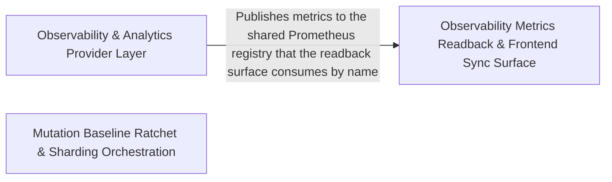

---
tags:
  - 2brain
  - 2brain/arch
  - project/boilerplate-node-backend
type: architecture
component: Mutation_Sharding_Baselining_Reaping_Ops
---

## Details

The mutation baseline comparison and sharding/wave orchestration logic, the contract section-ordering and AsyncAPI type rendering, plus the periodic reaping ops (e.g. invoice PDFs) and frontend sync. It is the baseline/scoring and housekeeping layer around the harness.

### Observability & Analytics Provider Layer
The provider/registry surface that the harness and reaping ops report into. It defines the AnalyticsProvider abstraction with concrete none/posthog/umami implementations and a shutdownAnalytics lifecycle hook, exposes the metrics registry (e.g. _jobLastSuccessGauge and its collect), and surfaces job/dependency health (jobHealth, overallStatus, buildObservabilityHealth) plus lease summaries (listLeaseSummaries). This is the layer that turns the reaping ops' lease records and the harness's job outcomes into observable health/analytics signals.

**Related Classes/Methods**:

- `src.infrastructure.observability.analytics.index.AnalyticsProvider`:83-108
- `src.infrastructure.observability.metrics-registry._jobLastSuccessGauge`:105-113
- `src.modules.observability.services.job-health.jobHealth`:19-26
- `src.infrastructure.persistence.lease.listLeaseSummaries`:99-112

**Source Files:**

- `src/infrastructure/observability/analytics/index.ts`
  - `src.infrastructure.observability.analytics.index.AnalyticsProvider` (L83-L108) - Interface
  - `src.infrastructure.observability.analytics.index.AnalyticsProvider.capture` (L91-L91) - Method
  - `src.infrastructure.observability.analytics.index.AnalyticsProvider.configured` (L99-L99) - Method
  - `src.infrastructure.observability.analytics.index.AnalyticsProvider.shutdown` (L107-L107) - Method
  - `src.infrastructure.observability.analytics.index.shutdownAnalytics` (L215-L222) - Class
  - `src.infrastructure.observability.analytics.index.shutdownAnalytics.then() callback` (L217-L221) - Function
- `src/infrastructure/observability/analytics/none.ts`
  - `src.infrastructure.observability.analytics.none.noneAnalyticsProvider` (L14-L29) - Class
  - `src.infrastructure.observability.analytics.none.noneAnalyticsProvider.capture` (L17-L19) - Method
  - `src.infrastructure.observability.analytics.none.noneAnalyticsProvider.configured` (L22-L24) - Method
  - `src.infrastructure.observability.analytics.none.noneAnalyticsProvider.shutdown` (L26-L28) - Method
- `src/infrastructure/observability/analytics/posthog.ts`
  - `src.infrastructure.observability.analytics.posthog.posthogAnalyticsProvider` (L54-L104) - Class
  - `src.infrastructure.observability.analytics.posthog.posthogAnalyticsProvider.configured` (L57-L59) - Method
  - `src.infrastructure.observability.analytics.posthog.posthogAnalyticsProvider.capture` (L61-L87) - Method
  - `src.infrastructure.observability.analytics.posthog.posthogAnalyticsProvider.shutdown` (L93-L103) - Method
- `src/infrastructure/observability/analytics/umami.ts`
  - `src.infrastructure.observability.analytics.umami.umamiAnalyticsProvider` (L78-L160) - Class
  - `src.infrastructure.observability.analytics.umami.umamiAnalyticsProvider.configured` (L83-L85) - Method
  - `src.infrastructure.observability.analytics.umami.umamiAnalyticsProvider.capture.then() callback` (L130-L142) - Function
  - `src.infrastructure.observability.analytics.umami.umamiAnalyticsProvider.capture.catch() callback` (L143-L149) - Function
  - `src.infrastructure.observability.analytics.umami.umamiAnalyticsProvider.shutdown` (L157-L159) - Method
- `src/infrastructure/observability/metrics-registry.ts`
  - `src.infrastructure.observability.metrics-registry.collectJobGauge` (L81-L95) - Class
  - `src.infrastructure.observability.metrics-registry.collectJobGauge.then() callback` (L88-L93) - Function
  - `src.infrastructure.observability.metrics-registry.collectJobGauge.catch() callback` (L94-L94) - Function
  - `src.infrastructure.observability.metrics-registry._jobLastSuccessGauge` (L105-L113) - Class
  - `src.infrastructure.observability.metrics-registry._jobLastSuccessGauge.collect` (L110-L112) - Method
  - `src.infrastructure.observability.metrics-registry._jobLastSuccessGauge.collect.collectJobGauge() callback` (L111-L111) - Function
  - `src.infrastructure.observability.metrics-registry._jobLastRunGauge` (L121-L129) - Class
  - `src.infrastructure.observability.metrics-registry._jobLastRunGauge.collect` (L126-L128) - Method
  - `src.infrastructure.observability.metrics-registry._jobLastRunGauge.collect.collectJobGauge() callback` (L127-L127) - Function
- `src/infrastructure/persistence/lease.ts`
  - `src.infrastructure.persistence.lease.listLeaseSummaries` (L99-L112) - Class
  - `src.infrastructure.persistence.lease.listLeaseSummaries.then() callback` (L105-L111) - Function
  - `src.infrastructure.persistence.lease.listLeaseSummaries.then() callback.rows.map() callback` (L106-L111) - Function
- `src/modules/observability/services/dependency-health.ts`
  - `src.modules.observability.services.dependency-health.overallStatus` (L52-L55) - Class
  - `src.modules.observability.services.dependency-health.overallStatus.every() callback` (L53-L53) - Function
- `src/modules/observability/services/health.ts`
  - `src.modules.observability.services.health.buildObservabilityHealth` (L28-L99) - Class
  - `src.modules.observability.services.health.buildObservabilityHealth.then() callback` (L29-L99) - Function
- `src/modules/observability/services/job-health.ts`
  - `src.modules.observability.services.job-health.jobHealth` (L19-L26) - Class
  - `src.modules.observability.services.job-health.jobHealth.then() callback` (L20-L25) - Function
  - `src.modules.observability.services.job-health.jobHealth.then() callback.summaries.map() callback` (L21-L25) - Function

### Observability Metrics Readback & Frontend Sync Surface
The read-side surface that exposes harness/job metrics for the observability dashboard and keeps the paired frontend in sync. getObservabilityMetricsOverview assembles the metrics overview (reading counters, summing by labels, checking for shop metrics), while http-readback provides the HTTP-level readback primitives (getHttpRequestCounters, getLatencyPercentiles, sumMetricValues, LatencyBucket) used to surface request/latency stats. sync-to-frontend and the stream surface feed the dashboard's EventSource/SSE stream.

**Related Classes/Methods**:

- `src.modules.observability.controllers.get-observability-metrics-overview.getObservabilityMetricsOverview`:86-155
- `src.modules.observability.http-readback.getLatencyPercentiles`:126-135

**Source Files:**

- `scripts/pairing/sync-to-frontend.ts`
  - `scripts.pairing.sync-to-frontend.of` (L148-L148) - Class
  - `scripts.pairing.sync-to-frontend.of.outcomes.filter() callback` (L148-L148) - Function
- `src/modules/observability/controllers/get-observability-metrics-overview.ts`
  - `src.modules.observability.controllers.get-observability-metrics-overview.MetricSample` (L21-L24) - Interface
  - `src.modules.observability.controllers.get-observability-metrics-overview.readCounter` (L40-L50) - Class
  - `src.modules.observability.controllers.get-observability-metrics-overview.readCounter.then() callback` (L47-L48) - Function
  - `src.modules.observability.controllers.get-observability-metrics-overview.hasShopMetrics` (L64-L65) - Class
  - `src.modules.observability.controllers.get-observability-metrics-overview.hasShopMetrics.SHOP_METRIC_NAMES.some() callback` (L65-L65) - Function
  - `src.modules.observability.controllers.get-observability-metrics-overview.histogramCounts` (L71-L72) - Class
  - `src.modules.observability.controllers.get-observability-metrics-overview.histogramCounts.values.filter() callback` (L72-L72) - Function
  - `src.modules.observability.controllers.get-observability-metrics-overview.sumByLabels` (L77-L80) - Class
  - `src.modules.observability.controllers.get-observability-metrics-overview.sumByLabels.values.filter() callback` (L79-L79) - Function
  - `src.modules.observability.controllers.get-observability-metrics-overview.sumByLabels.values.filter() callback.every() callback` (L79-L79) - Function
  - `src.modules.observability.controllers.get-observability-metrics-overview.sumByLabels.reduce() callback` (L80-L80) - Function
  - `src.modules.observability.controllers.get-observability-metrics-overview.getObservabilityMetricsOverview` (L86-L155) - Class
  - `src.modules.observability.controllers.get-observability-metrics-overview.getObservabilityMetricsOverview.then() callback` (L102-L153) - Function
  - `src.modules.observability.controllers.get-observability-metrics-overview.getObservabilityMetricsOverview.then() callback.data.database.errorsTotal.databaseCommands.filter() callback` (L142-L142) - Function
- `src/modules/observability/http-readback.ts`
  - `src.modules.observability.http-readback.sumMetricValues` (L23-L24) - Class
  - `src.modules.observability.http-readback.sumMetricValues.values.reduce() callback` (L24-L24) - Function
  - `src.modules.observability.http-readback.LatencyBucket` (L27-L31) - Interface
  - `src.modules.observability.http-readback.aggregateLatencyBuckets.buckets.toSorted() callback` (L70-L70) - Function
  - `src.modules.observability.http-readback.aggregateLatencyBuckets.buckets.map() callback` (L71-L71) - Function
  - `src.modules.observability.http-readback.getHttpRequestCounters` (L110-L116) - Class
  - `src.modules.observability.http-readback.getHttpRequestCounters.then() callback` (L112-L115) - Function
  - `src.modules.observability.http-readback.getLatencyPercentiles` (L126-L135) - Class
  - `src.modules.observability.http-readback.getLatencyPercentiles.then() callback` (L127-L135) - Function
- `src/modules/observability/services/stream.ts`
  - `src.modules.observability.services.stream.buildObservabilityPayload` (L64-L87) - Class
  - `src.modules.observability.services.stream.buildObservabilityPayload.then() callback` (L68-L86) - Function
  - `src.modules.observability.services.stream.writeMetricsEvent` (L95-L102) - Class
  - `src.modules.observability.services.stream.writeMetricsEvent.then() callback` (L98-L100) - Function
  - `src.modules.observability.services.stream.writeMetricsEvent.catch() callback` (L101-L101) - Function
  - `src.modules.observability.services.stream.streamObservabilityMetrics.updatesInterval` (L139-L141) - Class
  - `src.modules.observability.services.stream.streamObservabilityMetrics.updatesInterval.setInterval() callback` (L139-L141) - Function
  - `src.modules.observability.services.stream.streamObservabilityMetrics.heartbeatInterval` (L145-L147) - Class
  - `src.modules.observability.services.stream.streamObservabilityMetrics.heartbeatInterval.setInterval() callback` (L145-L147) - Function
  - `src.modules.observability.services.stream.streamObservabilityMetrics.reverifyInterval` (L151-L162) - Class
  - `src.modules.observability.services.stream.streamObservabilityMetrics.reverifyInterval.setInterval() callback` (L151-L162) - Function
  - `src.modules.observability.services.stream.streamObservabilityMetrics.reverifyInterval.setInterval() callback.catch() callback` (L153-L153) - Function
  - `src.modules.observability.services.stream.streamObservabilityMetrics.reverifyInterval.setInterval() callback.then() callback` (L154-L161) - Function

### Mutation Baseline Ratchet & Sharding Orchestration
The core of the subsystem. It owns the mutation baseline lifecycle (read/write/compare/merge), the per-file score ratchet, and the sharding/wave orchestration that splits the mutate scope into resumable, line-count-balanced shards. compareMerged is the key verdict function: it compares a merged, sharded-sweep-partial run against the baseline and deliberately suppresses the removed verdict. mergeIntoBaseline enforces the never-lower-a-score rule, and packIntoShards performs largest-file-first bin packing into TARGET_LINES_PER_SHARD bins. run-shards.ts drives the resumable local sweep, banking each shard's report and only recording the baseline once the whole scope is covered.

**Related Classes/Methods**:

- `scripts.mutation.baseline.compareMerged`:193-197

**Source Files:**

- `scripts/contracts/generate-asyncapi-types.ts`
  - `scripts.contracts.generate-asyncapi-types.renderLiteralArray.lines` (L238-L238) - Class
  - `scripts.contracts.generate-asyncapi-types.renderLiteralArray.lines.values.map() callback` (L238-L238) - Function
- `scripts/contracts/section-order.ts`
  - `scripts.contracts.section-order.orderSections.extra` (L23-L23) - Class
  - `scripts.contracts.section-order.orderSections.extra.present.filter() callback` (L23-L23) - Function
- `scripts/mutation/baseline.ts`
  - `scripts.mutation.baseline.MutationReport` (L41-L43) - Interface
  - `scripts.mutation.baseline.MutationBaseline` (L46-L51) - Interface
  - `scripts.mutation.baseline.FileComparison` (L57-L62) - Interface
  - `scripts.mutation.baseline.scoresFromReport.scored` (L82-L82) - Class
  - `scripts.mutation.baseline.scoresFromReport.scored.mutants.filter() callback` (L82-L82) - Function
  - `scripts.mutation.baseline.compareMerged` (L193-L197) - Class
- `scripts/mutation/ci/waves.ts`
  - `scripts.mutation.ci.waves.packUnits.slices` (L124-L124) - Class
  - `scripts.mutation.ci.waves.packUnits.slices.map() callback` (L124-L124) - Function
  - `scripts.mutation.ci.waves.packUnits.slices.units.filter() callback` (L124-L124) - Function
- `scripts/mutation/run-shards.ts`
  - `scripts.mutation.run-shards.main.recorded` (L200-L200) - Class
  - `scripts.mutation.run-shards.main.recorded.shards.filter() callback` (L200-L200) - Function
- `scripts/mutation/sharding.ts`
  - `scripts.mutation.sharding.packIntoShards.totalLines` (L46-L46) - Class
  - `scripts.mutation.sharding.packIntoShards.totalLines.files.reduce() callback` (L46-L46) - Function
- `scripts/scaffold/central-edits.ts`
  - `scripts.scaffold.central-edits.addParityEntry.rows` (L75-L75) - Class
  - `scripts.scaffold.central-edits.addParityEntry.rows.map() callback` (L75-L75) - Function
- `src/kernel/middlewares/authorizations.ts`
  - `src.kernel.middlewares.authorizations.stillHoldsKeyViaCookie` (L704-L708) - Class
  - `src.kernel.middlewares.authorizations.stillHoldsKeyViaCookie.then() callback` (L707-L707) - Function
  - `src.kernel.middlewares.authorizations.stillHoldsKeyViaCookie.catch() callback` (L708-L708) - Function
  - `src.kernel.middlewares.authorizations.FreshAuthOptions` (L711-L719) - Interface
  - `src.kernel.middlewares.authorizations.requireFreshAuth.<function>.hasRequiredMethods.every() callback` (L749-L750) - Function
  - `src.kernel.middlewares.authorizations.requireFreshAuth.<function>.hasRequiredMethods` (L749-L751) - Class
- `src/modules/observability/controllers/get-observability-events.ts`
  - `src.modules.observability.controllers.get-observability-events.getObservabilityEvents` (L28-L34) - Class
  - `src.modules.observability.controllers.get-observability-events.getObservabilityEvents.streamObservabilityMetrics() callback` (L31-L32) - Function
- `src/modules/observability/controllers/get-observability-metrics.ts`
  - `src.modules.observability.controllers.get-observability-metrics.getObservabilityMetrics` (L18-L29) - Class
  - `src.modules.observability.controllers.get-observability-metrics.getObservabilityMetrics.then() callback` (L20-L23) - Function
  - `src.modules.observability.controllers.get-observability-metrics.getObservabilityMetrics.catch() callback` (L24-L28) - Function
- `src/modules/observability/metrics.ts`
  - `src.modules.observability.metrics._dependencyUp` (L21-L31) - Class
  - `src.modules.observability.metrics._dependencyUp.collect` (L26-L30) - Method
