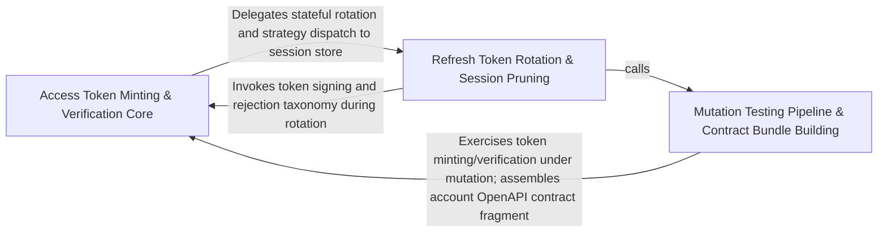

---
tags:
  - 2brain
  - 2brain/arch
  - project/boilerplate-node-backend
type: architecture
component: Mutation_Testing_Pipeline_Contract_Bundle_Building
---

## Details

The mutation-testing execution pipeline (sharding, Stryker runs, GitHub artifact baselines, CI wave/merge) together with contract bundle building and the eslint guard that keeps the unit layer free of persistence imports. It is the CI-side consumer of the test harness.

### Access Token Minting & Verification Core
The runtime heart of the account module's authentication surface. It owns the full access-token lifecycle: key-ring resolution (keyForId), JWT signing with RFC 9068 typ headers, verification against the active ring, refresh of access tokens from a valid refresh token, and the TokenRejection error taxonomy that the kernel's resolver port consumes. It also hosts the two-factor confirmation path and the GDPR export job (openOwnExport / openExport) that must still reach unfiltered user data. This is the hot path every authenticated request traverses.

**Related Classes/Methods**:

- `src.modules.account.session.jwt.createAccessToken`:467-470
- `src.modules.account.session.jwt.verifyAgainstRing`:225-240
- `src.modules.account.session.key-ring.keyForId`:30-31
- `src.modules.account.services.export.openOwnExport`:236-255

**Source Files:**

- `src/infrastructure/adapters/export-store.ts`
  - `src.infrastructure.adapters.export-store.openExport` (L98-L110) - Class
  - `src.infrastructure.adapters.export-store.openExport.then() callback` (L104-L108) - Function
- `src/kernel/authentication.ts`
  - `src.kernel.authentication.StreamWatch` (L22-L30) - Interface
- `src/modules/account/services/email-change.ts`
  - `src.modules.account.services.email-change.EmailChangeOutcome` (L37-L40) - Interface
  - `src.modules.account.services.email-change.then() callback.then() callback` (L102-L102) - Function
- `src/modules/account/services/export.ts`
  - `src.modules.account.services.export.openOwnExport` (L236-L255) - Class
  - `src.modules.account.services.export.openOwnExport.then() callback` (L241-L255) - Function
  - `src.modules.account.services.export.openOwnExport.then() callback.then() callback` (L244-L254) - Function
- `src/modules/account/services/logout.ts`
  - `src.modules.account.services.logout.SessionRevocation` (L24-L29) - Interface
  - `src.modules.account.services.logout.isOwnFamily` (L35-L47) - Class
  - `src.modules.account.services.logout.isOwnFamily.then() callback` (L44-L45) - Function
  - `src.modules.account.services.logout.sessionRevoke` (L58-L74) - Class
  - `src.modules.account.services.logout.sessionRevoke.then() callback` (L65-L73) - Function
  - `src.modules.account.services.logout.sessionRevoke.then() callback.then() callback` (L66-L73) - Function
- `src/modules/account/services/password.ts`
  - `src.modules.account.services.password.outcome.then() callback` (L182-L185) - Function
- `src/modules/account/services/reauth.ts`
  - `src.modules.account.services.reauth.then() callback` (L108-L108) - Function
- `src/modules/account/services/refresh.ts`
  - `src.modules.account.services.refresh.MissingRefreshTokenError` (L17-L23) - Class
  - `src.modules.account.services.refresh.MissingRefreshTokenError.constructor` (L19-L22) - Constructor
  - `src.modules.account.services.refresh.refreshAccessToken` (L36-L78) - Class
  - `src.modules.account.services.refresh.refreshAccessToken.then() callback` (L44-L50) - Function
  - `src.modules.account.services.refresh.refreshAccessToken.catch() callback` (L51-L78) - Function
- `src/modules/account/services/sessions.ts`
  - `src.modules.account.services.sessions.eraseSessionsAndTokens` (L54-L57) - Class
  - `src.modules.account.services.sessions.eraseSessionsAndTokens.then() callback` (L57-L57) - Function
- `src/modules/account/services/signup.ts`
  - `src.modules.account.services.signup.SignupInput` (L38-L62) - Interface
  - `src.modules.account.services.signup.outcome.then() callback` (L191-L191) - Function
- `src/modules/account/services/two-factor-challenge.ts`
  - `src.modules.account.services.two-factor-challenge.buildLoginChallenge.ttlMs.armed.some() callback` (L62-L62) - Function
  - `src.modules.account.services.two-factor-challenge.buildLoginChallenge.ttlMs` (L62-L64) - Class
  - `src.modules.account.services.two-factor-challenge.VerifiedChallenge` (L100-L103) - Interface
- `src/modules/account/services/two-factor-enrollment.ts`
  - `src.modules.account.services.two-factor-enrollment.entryFor.existing` (L55-L55) - Class
  - `src.modules.account.services.two-factor-enrollment.entryFor.existing.user.twoFactorMethods.find() callback` (L55-L55) - Function
  - `src.modules.account.services.two-factor-enrollment.outcome.withVerifiedCode() callback.then() callback` (L353-L353) - Function
- `src/modules/account/session/activity.ts`
  - `src.modules.account.session.activity.recordActivity` (L16-L20) - Class
  - `src.modules.account.session.activity.recordActivity.catch() callback` (L17-L20) - Function
- `src/modules/account/session/auth-context.ts`
  - `src.modules.account.session.auth-context.resolveProof` (L36-L70) - Class
  - `src.modules.account.session.auth-context.resolveProof.then() callback` (L40-L70) - Function
  - `src.modules.account.session.auth-context.resolveProof.then() callback.then() callback` (L44-L68) - Function
- `src/modules/account/session/cookie-strategy.ts`
  - `src.modules.account.session.cookie-strategy.findLiveRow` (L198-L208) - Class
  - `src.modules.account.session.cookie-strategy.findLiveRow.then() callback` (L203-L207) - Function
  - `src.modules.account.session.cookie-strategy.resolveSession` (L228-L259) - Class
  - `src.modules.account.session.cookie-strategy.resolveSession.then() callback` (L232-L259) - Function
  - `src.modules.account.session.cookie-strategy.resolveSession.then() callback.then() callback` (L237-L257) - Function
  - `src.modules.account.session.cookie-strategy.resolveSession.then() callback.then() callback.then() callback` (L252-L252) - Function
  - `src.modules.account.session.cookie-strategy.resolveSession.then() callback.then() callback.catch() callback` (L253-L255) - Function
  - `src.modules.account.session.cookie-strategy.watchSession` (L265-L286) - Class
  - `src.modules.account.session.cookie-strategy.watchSession.then() callback` (L266-L286) - Function
  - `src.modules.account.session.cookie-strategy.watchSession.then() callback.then() callback` (L271-L284) - Function
  - `src.modules.account.session.cookie-strategy.watchSession.then() callback.then() callback.ok.recheck` (L275-L282) - Method
  - `src.modules.account.session.cookie-strategy.watchSession.then() callback.then() callback.ok.recheck.resolveInLiveFamily('cookie') callback` (L280-L280) - Function
- `src/modules/account/session/family-liveness.ts`
  - `src.modules.account.session.family-liveness.resolveInLiveFamily` (L30-L63) - Class
  - `src.modules.account.session.family-liveness.resolveInLiveFamily.then() callback` (L42-L61) - Function
  - `src.modules.account.session.family-liveness.resolveInLiveFamily.then() callback.then() callback` (L49-L49) - Function
  - `src.modules.account.session.family-liveness.resolveInLiveFamily.then() callback.catch() callback` (L59-L59) - Function
- `src/modules/account/session/jwt-strategy.ts`
  - `src.modules.account.session.jwt-strategy.resolveWith` (L164-L177) - Class
  - `src.modules.account.session.jwt-strategy.resolveWith.<function>` (L166-L177) - Function
  - `src.modules.account.session.jwt-strategy.resolveWith.<function>.then() callback` (L173-L176) - Function
  - `src.modules.account.session.jwt-strategy.resolveBearer` (L183-L200) - Class
  - `src.modules.account.session.jwt-strategy.resolveBearer.then() callback.resolveInLiveFamily('jwt') callback` (L193-L193) - Function
  - `src.modules.account.session.jwt-strategy.resolveBearer.then() callback` (L196-L199) - Function
  - `src.modules.account.session.jwt-strategy.watchRefreshCookie` (L207-L234) - Class
  - `src.modules.account.session.jwt-strategy.watchRefreshCookie.then() callback.then() callback` (L211-L228) - Function
  - `src.modules.account.session.jwt-strategy.watchRefreshCookie.then() callback.then() callback.ok.recheck` (L214-L226) - Method
  - `src.modules.account.session.jwt-strategy.watchRefreshCookie.then() callback.then() callback.ok.recheck.resolveInLiveFamily('jwt') callback` (L219-L223) - Function
  - `src.modules.account.session.jwt-strategy.watchRefreshCookie.then() callback` (L230-L233) - Function
- `src/modules/account/session/jwt.ts`
  - `src.modules.account.session.jwt.TokenRejection` (L141-L150) - Class
  - `src.modules.account.session.jwt.TokenRejection.constructor` (L143-L149) - Constructor
  - `src.modules.account.session.jwt.ringKeyLookup` (L200-L207) - Class
  - `src.modules.account.session.jwt.ringKeyLookup.<function>` (L202-L207) - Function
  - `src.modules.account.session.jwt.verifyAgainstRing` (L225-L240) - Class
  - `src.modules.account.session.jwt.verifyAgainstRing.then() callback` (L236-L240) - Function
  - `src.modules.account.session.jwt.verifyAccessToken` (L248-L253) - Class
  - `src.modules.account.session.jwt.verifyAccessToken.then() callback` (L249-L253) - Function
  - `src.modules.account.session.jwt.verifyRefreshWithRow` (L263-L280) - Class
  - `src.modules.account.session.jwt.verifyRefreshWithRow.then() callback` (L266-L279) - Function
  - `src.modules.account.session.jwt.verifyRefreshWithRow.then() callback.then() callback` (L267-L279) - Function
  - `src.modules.account.session.jwt.verifyRefreshWithRow.then() callback.then() callback.then() callback` (L274-L278) - Function
  - `src.modules.account.session.jwt.verifyRefreshToken` (L288-L289) - Class
  - `src.modules.account.session.jwt.verifyRefreshToken.then() callback` (L289-L289) - Function
  - `src.modules.account.session.jwt.createAccessToken` (L467-L470) - Class
  - `src.modules.account.session.jwt.createAccessToken.then() callback` (L468-L469) - Function
  - `src.modules.account.session.jwt.storeSuccessor` (L496-L524) - Class
  - `src.modules.account.session.jwt.storeSuccessor.then() callback` (L518-L523) - Function
  - `src.modules.account.session.jwt.rotateRefreshToken` (L618-L633) - Class
  - `src.modules.account.session.jwt.rotateRefreshToken.then() callback` (L620-L633) - Function
  - `src.modules.account.session.jwt.rotateRefreshToken.then() callback.then() callback` (L628-L631) - Function
  - `src.modules.account.session.jwt.rememberOfRefreshToken` (L647-L656) - Class
  - `src.modules.account.session.jwt.rememberOfRefreshToken.then() callback` (L653-L653) - Function
  - `src.modules.account.session.jwt.rememberOfRefreshToken.catch() callback` (L655-L655) - Function
- `src/modules/account/session/key-ring.ts`
  - `src.modules.account.session.key-ring.keyForId` (L30-L31) - Class
  - `src.modules.account.session.key-ring.keyForId.ring.find() callback` (L31-L31) - Function

### Refresh Token Rotation & Session Pruning
The write-side of the session lifecycle: creating refresh tokens at login, rotating them on each refresh (with reuse detection via TokenReuseError), resolving lost-rotation edge cases (resolveLostRotation), revoking all tokens for a user (revokeAllRefreshTokens), and the periodic pruning of expired tokens (pruneOwnExpiredTokens). It also includes the get-my-abilities controller (the introspection endpoint that reports the caller's effective permissions) and the account repository's insert path. This group is the state-mutating counterpart to Group 1's state-reading verification.

**Related Classes/Methods**:

- `src.modules.account.session.jwt.reissueRotated`:537-556
- `src.modules.account.session.jwt.TokenReuseError`:478-484

**Source Files:**

- `src/modules/account/controllers/get-my-abilities.ts`
  - `src.modules.account.controllers.get-my-abilities.modelVersion` (L40-L40) - Class
  - `src.modules.account.controllers.get-my-abilities.modelVersion.PERMISSION_KEYS.map() callback` (L40-L40) - Function
- `src/modules/account/repository.ts`
  - `src.modules.account.repository.insert` (L64-L66) - Class
  - `src.modules.account.repository.insert.then() callback` (L66-L66) - Function
- `src/modules/account/session/cookie-strategy.ts`
  - `src.modules.account.session.cookie-strategy.rememberOf` (L49-L50) - Class
  - `src.modules.account.session.cookie-strategy.rememberOf.find() callback` (L50-L50) - Function
  - `src.modules.account.session.cookie-strategy.storeSession` (L64-L91) - Class
  - `src.modules.account.session.cookie-strategy.storeSession.then() callback` (L90-L90) - Function
  - `src.modules.account.session.cookie-strategy.snapshotOf` (L132-L147) - Class
  - `src.modules.account.session.cookie-strategy.snapshotOf.then() callback` (L135-L144) - Function
  - `src.modules.account.session.cookie-strategy.replaceSession` (L153-L170) - Class
  - `src.modules.account.session.cookie-strategy.replaceSession.then() callback` (L162-L168) - Function
  - `src.modules.account.session.cookie-strategy.replaceSession.then() callback.then() callback` (L164-L164) - Function
  - `src.modules.account.session.cookie-strategy.replaceSession.then() callback.catch() callback` (L165-L168) - Function
  - `src.modules.account.session.cookie-strategy.retirePresentedSession` (L177-L186) - Class
  - `src.modules.account.session.cookie-strategy.retirePresentedSession.then() callback` (L182-L182) - Function
  - `src.modules.account.session.cookie-strategy.retirePresentedSession.catch() callback` (L183-L185) - Function
  - `src.modules.account.session.cookie-strategy.cookieStrategy` (L289-L344) - Class
  - `src.modules.account.session.cookie-strategy.cookieStrategy.issue` (L294-L308) - Method
  - `src.modules.account.session.cookie-strategy.cookieStrategy.issue.then() callback` (L296-L307) - Function
  - `src.modules.account.session.cookie-strategy.cookieStrategy.issue.then() callback.then() callback` (L302-L305) - Function
  - `src.modules.account.session.cookie-strategy.cookieStrategy.issue.then() callback.then() callback.then() callback` (L303-L304) - Function
  - `src.modules.account.session.cookie-strategy.cookieStrategy.reissue` (L312-L318) - Method
  - `src.modules.account.session.cookie-strategy.cookieStrategy.reissue.then() callback` (L314-L317) - Function
  - `src.modules.account.session.cookie-strategy.cookieStrategy.reissue.then() callback.then() callback` (L315-L316) - Function
  - `src.modules.account.session.cookie-strategy.cookieStrategy.remint` (L320-L335) - Method
  - `src.modules.account.session.cookie-strategy.cookieStrategy.remint.then() callback` (L322-L326) - Function
  - `src.modules.account.session.cookie-strategy.cookieStrategy.remint.then() callback.then() callback` (L323-L325) - Function
  - `src.modules.account.session.cookie-strategy.cookieStrategy.remint.catch() callback` (L328-L335) - Function
  - `src.modules.account.session.cookie-strategy.cookieStrategy.list` (L343-L343) - Method
- `src/modules/account/session/jwt-strategy.ts`
  - `src.modules.account.session.jwt-strategy.unlessOtherMode` (L240-L243) - Class
  - `src.modules.account.session.jwt-strategy.unlessOtherMode.<function>` (L242-L243) - Function
  - `src.modules.account.session.jwt-strategy.jwtStrategy` (L246-L312) - Class
  - `src.modules.account.session.jwt-strategy.jwtStrategy.issue.mintSession() callback` (L253-L254) - Function
  - `src.modules.account.session.jwt-strategy.jwtStrategy.issue.then() callback` (L255-L256) - Function
  - `src.modules.account.session.jwt-strategy.jwtStrategy.issue.then() callback.then() callback` (L256-L256) - Function
  - `src.modules.account.session.jwt-strategy.jwtStrategy.reissue.ready.then() callback` (L266-L280) - Function
  - `src.modules.account.session.jwt-strategy.jwtStrategy.reissue.ready.then() callback.then() callback` (L274-L279) - Function
  - `src.modules.account.session.jwt-strategy.jwtStrategy.reissue.ready.then() callback.then() callback.then() callback` (L279-L279) - Function
  - `src.modules.account.session.jwt-strategy.jwtStrategy.remint.then() callback` (L286-L295) - Function
  - `src.modules.account.session.jwt-strategy.jwtStrategy.remint.then() callback.then() callback` (L290-L293) - Function
  - `src.modules.account.session.jwt-strategy.jwtStrategy.remint.catch() callback` (L296-L303) - Function
  - `src.modules.account.session.jwt-strategy.jwtStrategy.list` (L311-L311) - Method
- `src/modules/account/session/jwt.ts`
  - `src.modules.account.session.jwt.TokenReuseError` (L478-L484) - Class
  - `src.modules.account.session.jwt.TokenReuseError.constructor` (L480-L483) - Constructor
  - `src.modules.account.session.jwt.reissueRotated` (L537-L556) - Class
  - `src.modules.account.session.jwt.reissueRotated.then() callback` (L542-L556) - Function
  - `src.modules.account.session.jwt.reissueRotated.then() callback.then() callback` (L549-L555) - Function
  - `src.modules.account.session.jwt.reissueRotated.then() callback.then() callback.then() callback` (L552-L553) - Function
  - `src.modules.account.session.jwt.resolveLostRotation` (L570-L603) - Class
  - `src.modules.account.session.jwt.resolveLostRotation.then() callback` (L575-L603) - Function
  - `src.modules.account.session.jwt.resolveLostRotation.then() callback.then() callback` (L600-L602) - Function
- `src/modules/account/session/listing.ts`
  - `src.modules.account.session.listing.newestPerFamily` (L25-L34) - Class
  - `src.modules.account.session.listing.newestPerFamily.rows.filter() callback` (L33-L33) - Function
  - `src.modules.account.session.listing.listSessions` (L61-L85) - Class
  - `src.modules.account.session.listing.listSessions.then() callback` (L70-L85) - Function
  - `src.modules.account.session.listing.listSessions.then() callback.map() callback` (L84-L84) - Function
- `src/modules/account/session/resolver.ts`
  - `src.modules.account.session.resolver.accountAuthResolver` (L24-L32) - Class
  - `src.modules.account.session.resolver.accountAuthResolver.fromBearer` (L25-L25) - Method
  - `src.modules.account.session.resolver.accountAuthResolver.fromCookie` (L26-L26) - Method
  - `src.modules.account.session.resolver.accountAuthResolver.watchCookie` (L27-L27) - Method
  - `src.modules.account.session.resolver.accountAuthResolver.cookieAuthenticates` (L28-L28) - Method
- `src/modules/account/session/strategy.ts`
  - `src.modules.account.session.strategy.SessionStrategy` (L85-L151) - Interface
  - `src.modules.account.session.strategy.SessionStrategy.issue` (L97-L102) - Method
  - `src.modules.account.session.strategy.SessionStrategy.snapshot` (L105-L105) - Method
  - `src.modules.account.session.strategy.SessionStrategy.reissue` (L108-L113) - Method
  - `src.modules.account.session.strategy.SessionStrategy.remint` (L121-L126) - Method
  - `src.modules.account.session.strategy.SessionStrategy.resolveBearer` (L129-L132) - Method
  - `src.modules.account.session.strategy.SessionStrategy.resolveCookie` (L135-L138) - Method
  - `src.modules.account.session.strategy.SessionStrategy.watchCookie` (L144-L144) - Method
  - `src.modules.account.session.strategy.SessionStrategy.credentialOf` (L147-L147) - Method
  - `src.modules.account.session.strategy.SessionStrategy.list` (L150-L150) - Method

### Mutation Testing Pipeline & Contract Bundle Building
The CI-side quality gate and contract-assembly pipeline. It comprises three tightly-coupled concerns: (a) Stryker execution — runStryker spawns the mutation-testing engine with machine-aware concurrency/heap settings and an OOM watchdog; (b) CI orchestration — sharding (run-shards), wave scheduling (waves), result merging (merge), and GitHub-artifact baselines (github-artifacts, pull-baseline, baseline) that track mutation-score regressions across PRs; and (c) contract bundle building — build-bundles assembles the seven OpenAPI/AsyncAPI documents from their per-module fragments, with a --check mode for CI staleness gates. The eslint rule no-persistence-imports enforces the architectural invariant that the unit-test layer never imports Mongoose/persistence adapters. Together these form the build-time enforcement layer that keeps the runtime modules structurally sound.

**Related Classes/Methods**:

- `scripts.mutation.stryker-run.runStryker`:90-186
- `scripts.mutation.github-artifacts.newestBaseline`:44-53

**Source Files:**

- `scripts/contracts/build-bundles.ts`
  - `scripts.contracts.build-bundles.named` (L39-L39) - Class
  - `scripts.contracts.build-bundles.named.arguments_.filter() callback` (L39-L39) - Function
- `scripts/eslint/no-persistence-imports.ts`
  - `scripts.eslint.no-persistence-imports.noPersistenceImports.create.ImportDeclaration.name.find() callback` (L129-L130) - Function
  - `scripts.eslint.no-persistence-imports.noPersistenceImports.create.ImportDeclaration.name` (L129-L131) - Class
  - `scripts.eslint.no-persistence-imports.noPersistenceImports.create.ImportDeclaration.name.find() callback.bindings.some() callback` (L130-L130) - Function
- `scripts/mutation/baseline.ts`
  - `scripts.mutation.baseline.formatRegressions.lines` (L265-L268) - Class
  - `scripts.mutation.baseline.formatRegressions.lines.regressed.map() callback` (L266-L267) - Function
- `scripts/mutation/ci/merge.ts`
  - `scripts.mutation.ci.merge.ReportMutant` (L20-L30) - Interface
  - `scripts.mutation.ci.merge.ReportTest` (L33-L38) - Interface
  - `scripts.mutation.ci.merge.StrykerReport` (L41-L45) - Interface
  - `scripts.mutation.ci.merge.ShardReport` (L48-L51) - Interface
  - `scripts.mutation.ci.merge.MergeResult` (L54-L57) - Interface
  - `scripts.mutation.ci.merge.mergeTests.idMaps.reports.map() callback` (L102-L118) - Function
  - `scripts.mutation.ci.merge.FileMutants` (L124-L131) - Interface
  - `scripts.mutation.ci.merge.mergeReports.incomplete.finished.map() callback` (L167-L167) - Function
  - `scripts.mutation.ci.merge.formatSummary.mutantCount` (L244-L244) - Class
  - `scripts.mutation.ci.merge.formatSummary.mutantCount.reduce() callback` (L244-L244) - Function
  - `scripts.mutation.ci.merge.tally` (L288-L302) - Class
  - `scripts.mutation.ci.merge.tally.flatMap() callback` (L292-L292) - Function
  - `scripts.mutation.ci.merge.tally.count` (L295-L296) - Class
  - `scripts.mutation.ci.merge.tally.count.statuses.reduce() callback` (L296-L296) - Function
- `scripts/mutation/ci/waves.ts`
  - `scripts.mutation.ci.waves.scheduleWave.named` (L144-L147) - Class
  - `scripts.mutation.ci.waves.scheduleWave.named.queue.map() callback` (L144-L147) - Function
- `scripts/mutation/github-artifacts.ts`
  - `scripts.mutation.github-artifacts.GitHubArtifact` (L20-L34) - Interface
  - `scripts.mutation.github-artifacts.newestBaseline` (L44-L53) - Class
  - `scripts.mutation.github-artifacts.newestBaseline.artifacts.filter() callback` (L47-L50) - Function
  - `scripts.mutation.github-artifacts.newestBaseline.toSorted() callback` (L52-L52) - Function
- `scripts/mutation/pull-baseline.ts`
  - `scripts.mutation.pull-baseline.install` (L46-L57) - Class
  - `scripts.mutation.pull-baseline.install.then() callback` (L47-L56) - Function
  - `scripts.mutation.pull-baseline.install.then() callback.finally() callback` (L50-L50) - Function
  - `scripts.mutation.pull-baseline.install.then() callback.then() callback` (L51-L56) - Function
  - `scripts.mutation.pull-baseline.then() callback` (L61-L66) - Function
- `scripts/mutation/run-shards.ts`
  - `scripts.mutation.run-shards.completed` (L83-L83) - Class
  - `scripts.mutation.run-shards.completed.filter() callback` (L83-L83) - Function
  - `scripts.mutation.run-shards.completed.shards.map() callback` (L83-L83) - Function
- `scripts/mutation/stryker-run.ts`
  - `scripts.mutation.stryker-run.runStryker` (L90-L186) - Class
  - `scripts.mutation.stryker-run.runStryker.then() callback` (L131-L184) - Function
  - `scripts.mutation.stryker-run.runStryker.then() callback.<function>` (L132-L184) - Function
  - `scripts.mutation.stryker-run.runStryker.then() callback.<function>.stryker.stdout.on('data') callback` (L160-L179) - Function
  - `scripts.mutation.stryker-run.runStryker.then() callback.<function>.stryker.on('exit') callback` (L181-L182) - Function
- `scripts/scaffold/registry.ts`
  - `scripts.scaffold.registry.insertInRun.offset` (L33-L33) - Class
  - `scripts.scaffold.registry.insertInRun.offset.findIndex() callback` (L33-L33) - Function
- `scripts/scaffold/templates-code.ts`
  - `scripts.scaffold.templates-code.authorizationYaml` (L100-L112) - Class
  - `scripts.scaffold.templates-code.authorizationYaml.KEY_ACTIONS.flatMap() callback` (L103-L110) - Function
- `src/modules/account/session/jwt-strategy.ts`
  - `src.modules.account.session.jwt-strategy.mintSession` (L49-L69) - Class
  - `src.modules.account.session.jwt-strategy.mintSession.then() callback` (L62-L69) - Function
  - `src.modules.account.session.jwt-strategy.mintSession.then() callback.then() callback` (L65-L68) - Function
  - `src.modules.account.session.jwt-strategy.retireRefreshToken` (L91-L99) - Class
  - `src.modules.account.session.jwt-strategy.retireRefreshToken.then() callback` (L95-L95) - Function
  - `src.modules.account.session.jwt-strategy.retireRefreshToken.catch() callback` (L96-L98) - Function
  - `src.modules.account.session.jwt-strategy.retireRestOfFamily` (L105-L115) - Class
  - `src.modules.account.session.jwt-strategy.retireRestOfFamily.then() callback` (L112-L112) - Function
  - `src.modules.account.session.jwt-strategy.retireRestOfFamily.catch() callback` (L113-L115) - Function
  - `src.modules.account.session.jwt-strategy.retirePresentedSession` (L123-L134) - Class
  - `src.modules.account.session.jwt-strategy.retirePresentedSession.then() callback` (L127-L127) - Function
  - `src.modules.account.session.jwt-strategy.retirePresentedSession.catch() callback` (L128-L133) - Function
  - `src.modules.account.session.jwt-strategy.snapshotOf` (L141-L157) - Class
  - `src.modules.account.session.jwt-strategy.snapshotOf.then() callback` (L143-L155) - Function
  - `src.modules.account.session.jwt-strategy.snapshotOf.then() callback.then() callback` (L147-L155) - Function
  - `src.modules.account.session.jwt-strategy.jwtStrategy.issue` (L252-L257) - Method
  - `src.modules.account.session.jwt-strategy.jwtStrategy.reissue` (L261-L282) - Method
  - `src.modules.account.session.jwt-strategy.jwtStrategy.remint` (L284-L303) - Method
- `src/modules/account/session/jwt.ts`
  - `src.modules.account.session.jwt.mintRefreshToken` (L353-L405) - Class
  - `src.modules.account.session.jwt.mintRefreshToken.then() callback` (L360-L405) - Function
  - `src.modules.account.session.jwt.mintRefreshToken.then() callback.then() callback` (L385-L404) - Function
  - `src.modules.account.session.jwt.mintRefreshToken.then() callback.then() callback.then() callback` (L403-L403) - Function
  - `src.modules.account.session.jwt.startSession` (L424-L433) - Class
  - `src.modules.account.session.jwt.startSession.mintRefreshToken() callback` (L430-L433) - Function
  - `src.modules.account.session.jwt.continueSession` (L445-L453) - Class
  - `src.modules.account.session.jwt.continueSession.mintRefreshToken() callback` (L453-L453) - Function
