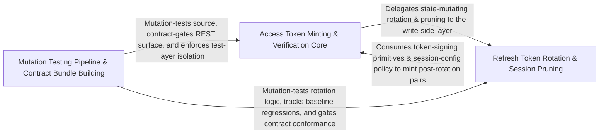

---
tags:
  - 2brain
  - 2brain/arch
  - project/boilerplate-node-backend
type: architecture
component: Mutation_Testing_Pipeline_Contract_Bundle_Building
---

## Details

The mutation-testing execution pipeline (sharding, Stryker runs, GitHub artifact baselines, CI wave/merge) together with contract bundle building and the eslint guard that keeps the unit layer free of persistence imports. It is the CI-side consumer of the test harness.

### Access Token Minting & Verification Core
The runtime heart of the account module's authentication surface. It owns the full access-token lifecycle: key-ring resolution (keyForId), JWT signing with RFC 9068 typ headers, verification against the active ring, refresh of access tokens from a valid refresh token, and the TokenRejection error taxonomy that the kernel's resolver port consumes. It also hosts the two-factor confirmation path and the GDPR export job (openOwnExport / openExport) that must still reach unfiltered user data. This is the hot path every authenticated request traverses.

**Related Classes/Methods**:

- `src.modules.account.session.jwt.createAccessToken`:309-310
- `src.modules.account.session.jwt.verifyAgainstRing`:135-171
- `src.modules.account.session.key-ring.keyForId`:30-31
- `src.modules.account.services.authentication.refreshAccessToken`:304-346
- `src.modules.account.services.export.openOwnExport`:234-253

**Source Files:**

- `src/infrastructure/adapters/export-store.ts`
  - `src.infrastructure.adapters.export-store.openExport` (L98-L110) - Class
  - `src.infrastructure.adapters.export-store.openExport.then() callback` (L104-L108) - Function
- `src/modules/account/services/authentication.ts`
  - `src.modules.account.services.authentication.MissingRefreshTokenError` (L285-L291) - Class
  - `src.modules.account.services.authentication.MissingRefreshTokenError.constructor` (L287-L290) - Constructor
  - `src.modules.account.services.authentication.refreshAccessToken` (L304-L346) - Class
  - `src.modules.account.services.authentication.refreshAccessToken.then() callback` (L312-L318) - Function
  - `src.modules.account.services.authentication.refreshAccessToken.catch() callback` (L319-L346) - Function
- `src/modules/account/services/export.ts`
  - `src.modules.account.services.export.openOwnExport` (L234-L253) - Class
  - `src.modules.account.services.export.openOwnExport.then() callback` (L239-L253) - Function
  - `src.modules.account.services.export.openOwnExport.then() callback.then() callback` (L242-L252) - Function
- `src/modules/account/services/two-factor.ts`
  - `src.modules.account.services.two-factor.twoFactorStatus.then() callback.enrolledNames` (L456-L456) - Class
  - `src.modules.account.services.two-factor.twoFactorStatus.then() callback.enrolledNames.enrolled.map() callback` (L456-L456) - Function
  - `src.modules.account.services.two-factor.confirmTwoFactorMethod.outcome.then() callback.entry` (L614-L614) - Class
  - `src.modules.account.services.two-factor.confirmTwoFactorMethod.outcome.then() callback.entry.user.twoFactorMethods.find() callback` (L614-L614) - Function
- `src/modules/account/session/jwt.ts`
  - `src.modules.account.session.jwt.TokenRejection` (L103-L112) - Class
  - `src.modules.account.session.jwt.TokenRejection.constructor` (L105-L111) - Constructor
  - `src.modules.account.session.jwt.verifyAgainstRing` (L135-L171) - Class
  - `src.modules.account.session.jwt.verifyAgainstRing.<function>` (L140-L171) - Function
  - `src.modules.account.session.jwt.verifyAgainstRing.<function>.verify() callback` (L160-L170) - Function
  - `src.modules.account.session.jwt.verifyRefreshToken` (L190-L204) - Class
  - `src.modules.account.session.jwt.verifyRefreshToken.then() callback` (L191-L203) - Function
  - `src.modules.account.session.jwt.verifyRefreshToken.then() callback.then() callback` (L192-L203) - Function
  - `src.modules.account.session.jwt.createAccessToken` (L309-L310) - Class
  - `src.modules.account.session.jwt.createAccessToken.then() callback` (L310-L310) - Function
  - `src.modules.account.session.jwt.rotateRefreshToken` (L438-L454) - Class
  - `src.modules.account.session.jwt.rotateRefreshToken.then() callback` (L440-L454) - Function
  - `src.modules.account.session.jwt.rotateRefreshToken.then() callback.then() callback` (L449-L452) - Function
  - `src.modules.account.session.jwt.rememberOfRefreshToken` (L468-L477) - Class
  - `src.modules.account.session.jwt.rememberOfRefreshToken.then() callback` (L474-L474) - Function
  - `src.modules.account.session.jwt.rememberOfRefreshToken.catch() callback` (L476-L476) - Function
- `src/modules/account/session/key-ring.ts`
  - `src.modules.account.session.key-ring.keyForId` (L30-L31) - Class
  - `src.modules.account.session.key-ring.keyForId.ring.find() callback` (L31-L31) - Function

### Refresh Token Rotation & Session Pruning
The write-side of the session lifecycle: creating refresh tokens at login, rotating them on each refresh (with reuse detection via TokenReuseError), resolving lost-rotation edge cases (resolveLostRotation), revoking all tokens for a user (revokeAllRefreshTokens), and the periodic pruning of expired tokens (pruneOwnExpiredTokens). It also includes the get-my-abilities controller (the introspection endpoint that reports the caller's effective permissions) and the account repository's insert path. This group is the state-mutating counterpart to Group 1's state-reading verification.

**Related Classes/Methods**:

- `src.modules.account.session.jwt.createRefreshToken`:243-280
- `src.modules.account.session.jwt.reissueRotated`:348-375
- `src.modules.account.session.jwt.TokenReuseError`:318-324
- `src.modules.account.session.jwt.revokeAllRefreshTokens`:331-335
- `src.modules.account.session.prune.pruneOwnExpiredTokens`:27-35

**Source Files:**

- `src/modules/account/controllers/get-my-abilities.ts`
  - `src.modules.account.controllers.get-my-abilities.modelVersion` (L40-L40) - Class
  - `src.modules.account.controllers.get-my-abilities.modelVersion.PERMISSION_KEYS.map() callback` (L40-L40) - Function
- `src/modules/account/repository.ts`
  - `src.modules.account.repository.insert` (L53-L55) - Class
  - `src.modules.account.repository.insert.then() callback` (L55-L55) - Function
- `src/modules/account/session/jwt.ts`
  - `src.modules.account.session.jwt.verifyRefreshToken.then() callback.then() callback.entry` (L199-L199) - Class
  - `src.modules.account.session.jwt.verifyRefreshToken.then() callback.then() callback.entry.user.tokens.find() callback` (L199-L199) - Function
  - `src.modules.account.session.jwt.createRefreshToken` (L243-L280) - Class
  - `src.modules.account.session.jwt.createRefreshToken.then() callback` (L251-L280) - Function
  - `src.modules.account.session.jwt.recordRefreshTokenUse` (L291-L295) - Class
  - `src.modules.account.session.jwt.recordRefreshTokenUse.then() callback` (L294-L294) - Function
  - `src.modules.account.session.jwt.recordRefreshTokenUse.catch() callback` (L295-L295) - Function
  - `src.modules.account.session.jwt.TokenReuseError` (L318-L324) - Class
  - `src.modules.account.session.jwt.TokenReuseError.constructor` (L320-L323) - Constructor
  - `src.modules.account.session.jwt.revokeAllRefreshTokens` (L331-L335) - Class
  - `src.modules.account.session.jwt.revokeAllRefreshTokens.then() callback` (L335-L335) - Function
  - `src.modules.account.session.jwt.reissueRotated` (L348-L375) - Class
  - `src.modules.account.session.jwt.reissueRotated.then() callback` (L349-L375) - Function
  - `src.modules.account.session.jwt.reissueRotated.then() callback.then() callback.then() callback` (L367-L367) - Function
  - `src.modules.account.session.jwt.reissueRotated.then() callback.then() callback` (L368-L373) - Function
  - `src.modules.account.session.jwt.resolveLostRotation` (L389-L423) - Class
  - `src.modules.account.session.jwt.resolveLostRotation.then() callback` (L394-L423) - Function
  - `src.modules.account.session.jwt.resolveLostRotation.then() callback.then() callback` (L420-L422) - Function
- `src/modules/account/session/prune.ts`
  - `src.modules.account.session.prune.pruneOwnExpiredTokens` (L27-L35) - Class
  - `src.modules.account.session.prune.pruneOwnExpiredTokens.then() callback` (L30-L30) - Function
  - `src.modules.account.session.prune.pruneOwnExpiredTokens.catch() callback` (L31-L35) - Function

### Mutation Testing Pipeline & Contract Bundle Building
The CI-side quality gate and contract-assembly pipeline. It comprises three tightly-coupled concerns: (a) Stryker execution — runStryker spawns the mutation-testing engine with machine-aware concurrency/heap settings and an OOM watchdog; (b) CI orchestration — sharding (run-shards), wave scheduling (waves), result merging (merge), and GitHub-artifact baselines (github-artifacts, pull-baseline, baseline) that track mutation-score regressions across PRs; and (c) contract bundle building — build-bundles assembles the seven OpenAPI/AsyncAPI documents from their per-module fragments, with a --check mode for CI staleness gates. The eslint rule no-persistence-imports enforces the architectural invariant that the unit-test layer never imports Mongoose/persistence adapters. Together these form the build-time enforcement layer that keeps the runtime modules structurally sound.

**Related Classes/Methods**:

- `scripts.mutation.stryker-run.runStryker`:92-188
- `scripts.mutation.github-artifacts.newestBaseline`:44-53

**Source Files:**

- `scripts/contracts/build-bundles.ts`
  - `scripts.contracts.build-bundles.named` (L39-L39) - Class
  - `scripts.contracts.build-bundles.named.arguments_.filter() callback` (L39-L39) - Function
- `scripts/eslint/no-persistence-imports.ts`
  - `scripts.eslint.no-persistence-imports.noPersistenceImports.create.ImportDeclaration.name.find() callback` (L129-L130) - Function
  - `scripts.eslint.no-persistence-imports.noPersistenceImports.create.ImportDeclaration.name` (L129-L131) - Class
  - `scripts.eslint.no-persistence-imports.noPersistenceImports.create.ImportDeclaration.name.find() callback.bindings.some() callback` (L130-L130) - Function
- `scripts/mutation/baseline.ts`
  - `scripts.mutation.baseline.formatRegressions.lines` (L280-L283) - Class
  - `scripts.mutation.baseline.formatRegressions.lines.regressed.map() callback` (L281-L282) - Function
- `scripts/mutation/ci/merge.ts`
  - `scripts.mutation.ci.merge.ReportMutant` (L20-L30) - Interface
  - `scripts.mutation.ci.merge.ReportTest` (L33-L38) - Interface
  - `scripts.mutation.ci.merge.StrykerReport` (L41-L45) - Interface
  - `scripts.mutation.ci.merge.ShardReport` (L48-L51) - Interface
  - `scripts.mutation.ci.merge.MergeResult` (L54-L57) - Interface
  - `scripts.mutation.ci.merge.mergeTests.idMaps.reports.map() callback` (L102-L118) - Function
  - `scripts.mutation.ci.merge.FileMutants` (L124-L131) - Interface
  - `scripts.mutation.ci.merge.mergeReports.incomplete.finished.map() callback` (L167-L167) - Function
  - `scripts.mutation.ci.merge.formatSummary.mutantCount` (L244-L244) - Class
  - `scripts.mutation.ci.merge.formatSummary.mutantCount.reduce() callback` (L244-L244) - Function
  - `scripts.mutation.ci.merge.tally` (L288-L302) - Class
  - `scripts.mutation.ci.merge.tally.flatMap() callback` (L292-L292) - Function
  - `scripts.mutation.ci.merge.tally.count` (L295-L296) - Class
  - `scripts.mutation.ci.merge.tally.count.statuses.reduce() callback` (L296-L296) - Function
- `scripts/mutation/ci/waves.ts`
  - `scripts.mutation.ci.waves.scheduleWave.named` (L146-L149) - Class
  - `scripts.mutation.ci.waves.scheduleWave.named.queue.map() callback` (L146-L149) - Function
- `scripts/mutation/github-artifacts.ts`
  - `scripts.mutation.github-artifacts.GitHubArtifact` (L20-L34) - Interface
  - `scripts.mutation.github-artifacts.newestBaseline` (L44-L53) - Class
  - `scripts.mutation.github-artifacts.newestBaseline.artifacts.filter() callback` (L47-L50) - Function
  - `scripts.mutation.github-artifacts.newestBaseline.toSorted() callback` (L52-L52) - Function
- `scripts/mutation/pull-baseline.ts`
  - `scripts.mutation.pull-baseline.install` (L46-L57) - Class
  - `scripts.mutation.pull-baseline.install.then() callback` (L47-L56) - Function
  - `scripts.mutation.pull-baseline.install.then() callback.finally() callback` (L50-L50) - Function
  - `scripts.mutation.pull-baseline.install.then() callback.then() callback` (L51-L56) - Function
  - `scripts.mutation.pull-baseline.then() callback` (L61-L66) - Function
- `scripts/mutation/run-shards.ts`
  - `scripts.mutation.run-shards.completed` (L84-L84) - Class
  - `scripts.mutation.run-shards.completed.filter() callback` (L84-L84) - Function
  - `scripts.mutation.run-shards.completed.shards.map() callback` (L84-L84) - Function
- `scripts/mutation/stryker-run.ts`
  - `scripts.mutation.stryker-run.runStryker` (L92-L188) - Class
  - `scripts.mutation.stryker-run.runStryker.then() callback` (L133-L186) - Function
  - `scripts.mutation.stryker-run.runStryker.then() callback.<function>` (L134-L186) - Function
  - `scripts.mutation.stryker-run.runStryker.then() callback.<function>.stryker.stdout.on('data') callback` (L162-L181) - Function
  - `scripts.mutation.stryker-run.runStryker.then() callback.<function>.stryker.on('exit') callback` (L183-L184) - Function
- `scripts/ops/demo-remove-authorization.ts`
  - `scripts.ops.demo-remove-authorization.RemovedAuthorization` (L21-L26) - Interface
  - `scripts.ops.demo-remove-authorization.FragmentKey` (L29-L32) - Interface
  - `scripts.ops.demo-remove-authorization.readRemovedAuthorization.keys.removed.map() callback` (L59-L59) - Function
  - `scripts.ops.demo-remove-authorization.readRemovedAuthorization.subjects.filter() callback` (L61-L61) - Function
  - `scripts.ops.demo-remove-authorization.readRemovedAuthorization.subjects.removed.map() callback` (L61-L61) - Function
  - `scripts.ops.demo-remove-authorization.pruneCase.lists.map() callback` (L107-L111) - Function
  - `scripts.ops.demo-remove-authorization.pruneCase.lists` (L107-L112) - Class
  - `scripts.ops.demo-remove-authorization.pruneCase.lists.map() callback.map() callback` (L110-L110) - Function
  - `scripts.ops.demo-remove-authorization.stripConformanceCases.headKept` (L139-L142) - Class
  - `scripts.ops.demo-remove-authorization.stripConformanceCases.headKept.filter() callback` (L141-L141) - Function
- `scripts/scaffold/registry.ts`
  - `scripts.scaffold.registry.insertInRun.offset` (L33-L33) - Class
  - `scripts.scaffold.registry.insertInRun.offset.findIndex() callback` (L33-L33) - Function
- `scripts/scaffold/templates-code.ts`
  - `scripts.scaffold.templates-code.authorizationYaml` (L100-L112) - Class
  - `scripts.scaffold.templates-code.authorizationYaml.KEY_ACTIONS.flatMap() callback` (L103-L110) - Function
