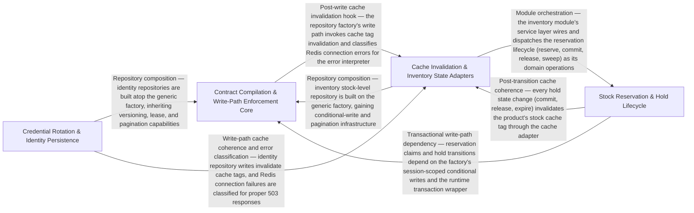

---
tags:
  - 2brain
  - 2brain/arch
  - project/boilerplate-node-backend
type: architecture
component: OpenAPI_Fragment_Compilation_Runtime_Contract_Enforcement
---

## Details

The core compilation step that discovers per-module openapi.yaml fragments on disk, assembles the root document's path index and tag list, invokes redocly bundle to resolve $refs, then post-processes the bundle (merging app-level 429/400/413/415 responses, hanging ETag/If-Match/412 on versioned paths, stamping x-module on every operation, collecting x-error-codes into a single catalogue). It also emits the error-codes.ts constants file. At runtime, the infrastructure adapters (cache invalidation, idempotency keys, error mapping, Redis session store) enforce the contract's promises on every request.

### Contract Compilation & Write-Path Enforcement Core
The backbone of the subsystem. At build time, it owns the full OpenAPI fragment compilation pipeline: discovering module fragments on disk, assembling the root document's path index and tag list, invoking redocly bundle, then post-processing the bundle (app-level response merging, ETag/If-Match/412 hanging, x-module stamping, x-error-codes catalogue collection) and emitting the error-codes.ts constants file. At runtime, it provides the write-path enforcement infrastructure: the database-error interpreter, the generic repository factory, the versioning module (ETag derivation, If-Match precondition scoping, fenced writes), the lease mechanism, and the shared pagination/filter helpers.

**Related Classes/Methods**:

- `src.infrastructure.persistence.create-repository.createRepository`:315-466

**Source Files:**

- `scripts/contracts/generate-error-codes.ts`
  - `scripts.contracts.generate-error-codes.ErrorCodeEntry` (L29-L32) - Interface
  - `scripts.contracts.generate-error-codes.OpenApiDocument` (L35-L37) - Interface
- `scripts/contracts/openapi-bundle.ts`
  - `scripts.contracts.openapi-bundle.filter() callback` (L75-L75) - Function
  - `scripts.contracts.openapi-bundle.AppLevelResponse` (L147-L150) - Interface
  - `scripts.contracts.openapi-bundle.Operation` (L153-L156) - Interface
  - `scripts.contracts.openapi-bundle.ErrorCodeEntry` (L159-L162) - Interface
  - `scripts.contracts.openapi-bundle.BundledDocument` (L165-L171) - Interface
  - `scripts.contracts.openapi-bundle.FragmentWithErrorCodes` (L345-L347) - Interface
- `src/infrastructure/http/errors.ts`
  - `src.infrastructure.http.errors.databaseErrorInterpreter` (L60-L102) - Function
- `src/infrastructure/persistence/create-repository.ts`
  - `src.infrastructure.persistence.create-repository.buildWhere.ids` (L142-L144) - Class
  - `src.infrastructure.persistence.create-repository.buildWhere.ids.value.filter() callback` (L143-L143) - Function
  - `src.infrastructure.persistence.create-repository.buildWhere.ids.map() callback` (L144-L144) - Function
  - `src.infrastructure.persistence.create-repository.Repository` (L215-L278) - Interface
  - `src.infrastructure.persistence.create-repository.createRepository` (L315-L466) - Function
  - `src.infrastructure.persistence.create-repository.createRepository.buildWhere` (L464-L464) - Method
- `src/infrastructure/persistence/lease.ts`
  - `src.infrastructure.persistence.lease.acquireLease` (L141-L156) - Class
  - `src.infrastructure.persistence.lease.acquireLease.then() callback` (L151-L151) - Function
  - `src.infrastructure.persistence.lease.acquireLease.catch() callback` (L152-L155) - Function
- `src/infrastructure/persistence/metrics.ts`
  - `src.infrastructure.persistence.metrics.trackDatabaseQuery` (L28-L38) - Class
  - `src.infrastructure.persistence.metrics.trackDatabaseQuery.<function>` (L32-L38) - Function
  - `src.infrastructure.persistence.metrics.trackDatabaseQuery.<function>.catch() callback` (L34-L37) - Function
- `src/infrastructure/persistence/search.ts`
  - `src.infrastructure.persistence.search.readAll.collectFrom` (L98-L102) - Class
  - `src.infrastructure.persistence.search.readAll.collectFrom.then() callback` (L99-L102) - Function
- `src/infrastructure/persistence/versioning.ts`
  - `src.infrastructure.persistence.versioning.PreconditionFailedError` (L38-L40) - Class
  - `src.infrastructure.persistence.versioning.armed` (L159-L164) - Class
  - `src.infrastructure.persistence.versioning.armed.finally() callback` (L161-L163) - Function
  - `src.infrastructure.persistence.versioning.fencedSave` (L180-L192) - Class
  - `src.infrastructure.persistence.versioning.fencedSave.catch() callback` (L189-L191) - Function
  - `src.infrastructure.persistence.versioning.checkedDelete` (L211-L223) - Class
  - `src.infrastructure.persistence.versioning.checkedDelete.then() callback` (L220-L222) - Function
- `src/modules/cart/domain/merge.ts`
  - `src.modules.cart.domain.merge.MergeLineFacts` (L12-L21) - Interface
  - `src.modules.cart.domain.merge.MergePlan` (L24-L29) - Interface
- `src/modules/delivery/repository.ts`
  - `src.modules.delivery.repository.shipmentRepository` (L20-L85) - Class
  - `src.modules.delivery.repository.shipmentRepository.findByOrderId` (L36-L37) - Method
  - `src.modules.delivery.repository.shipmentRepository.findByOrderIds` (L44-L45) - Method
  - `src.modules.delivery.repository.shipmentRepository.findByOrderIds.orderId.$in.orderIds.map() callback` (L45-L45) - Function
  - `src.modules.delivery.repository.shipmentRepository.upsertForOrder` (L53-L65) - Method
  - `src.modules.delivery.repository.shipmentRepository.updateStatusIfIn` (L77-L84) - Method
- `src/modules/delivery/service.ts`
  - `src.modules.delivery.service.moveAndStampDelivered.moveOrder.then() callback` (L381-L394) - Function
  - `src.modules.delivery.service.recordDelivery.then() callback.then() callback` (L421-L433) - Function
- `src/modules/inventory/domain/transitions.ts`
  - `src.modules.inventory.domain.transitions.CounterDelta` (L22-L25) - Interface
- `src/modules/invoicing/services/partial-credit.ts`
  - `src.modules.invoicing.services.partial-credit.PartialCredit` (L22-L25) - Interface
  - `src.modules.invoicing.services.partial-credit.partialCredit.lines.taxSummary.flatMap() callback` (L46-L56) - Function
  - `src.modules.invoicing.services.partial-credit.lines` (L46-L57) - Class
  - `src.modules.invoicing.services.partial-credit.partialCredit.breakdown.items.lines.map() callback` (L60-L63) - Function
- `src/modules/invoicing/services/render.ts`
  - `src.modules.invoicing.services.render.then() callback.then() callback.then() callback` (L78-L78) - Function
- `src/modules/notifications/presenter.ts`
  - `src.modules.notifications.presenter.NotificationsView` (L11-L13) - Interface
  - `src.modules.notifications.presenter.presentNotifications.items.notifications.map() callback` (L44-L44) - Function
- `src/modules/notifications/repository.ts`
  - `src.modules.notifications.repository.notificationRepository` (L31-L123) - Class
  - `src.modules.notifications.repository.notificationRepository.listByUserId` (L48-L52) - Method
  - `src.modules.notifications.repository.notificationRepository.insertMany` (L60-L61) - Method
  - `src.modules.notifications.repository.notificationRepository.deleteOwned` (L67-L71) - Method
  - `src.modules.notifications.repository.notificationRepository.deleteOwned.then() callback` (L71-L71) - Function
  - `src.modules.notifications.repository.notificationRepository.deleteAllOwned` (L74-L80) - Method
  - `src.modules.notifications.repository.notificationRepository.deleteAllOwned.then() callback` (L78-L80) - Function
  - `src.modules.notifications.repository.notificationRepository.deleteByUserId` (L83-L89) - Method
  - `src.modules.notifications.repository.notificationRepository.deleteByUserId.then() callback` (L87-L89) - Function
  - `src.modules.notifications.repository.notificationRepository.markAllRead` (L92-L101) - Method
  - `src.modules.notifications.repository.notificationRepository.markAllRead.then() callback` (L99-L101) - Function
  - `src.modules.notifications.repository.notificationRepository.trimToNewest` (L108-L122) - Method
- `src/modules/notifications/services/inbox.ts`
  - `src.modules.notifications.services.inbox.trimInbox` (L30-L36) - Class
  - `src.modules.notifications.services.inbox.trimInbox.then() callback` (L33-L36) - Function
  - `src.modules.notifications.services.inbox.notificationsCreate` (L46-L57) - Class
  - `src.modules.notifications.services.inbox.notificationsCreate.created.map() callback` (L55-L55) - Function
  - `src.modules.notifications.services.inbox.notificationsDismissAll` (L75-L79) - Class
  - `src.modules.notifications.services.inbox.notificationsReadAll` (L82-L88) - Class
  - `src.modules.notifications.services.inbox.notificationsReadAll.then() callback` (L84-L87) - Function
- `src/modules/notifications/services/stream.ts`
  - `src.modules.notifications.services.stream.openStreamCount` (L61-L62) - Class
  - `src.modules.notifications.services.stream.openStreamCount.reduce() callback` (L62-L62) - Function
  - `src.modules.notifications.services.stream.streamNotifications.heartbeat` (L92-L94) - Class
  - `src.modules.notifications.services.stream.streamNotifications.heartbeat.setInterval() callback` (L92-L94) - Function
  - `src.modules.notifications.services.stream.streamNotifications.reverifyTimer` (L97-L106) - Class
  - `src.modules.notifications.services.stream.streamNotifications.reverifyTimer.setInterval() callback` (L97-L106) - Function
  - `src.modules.notifications.services.stream.streamNotifications.reverifyTimer.setInterval() callback.catch() callback` (L99-L99) - Function
  - `src.modules.notifications.services.stream.streamNotifications.reverifyTimer.setInterval() callback.then() callback` (L100-L105) - Function
- `src/modules/notifications/services/subscribers.ts`
  - `src.modules.notifications.services.subscribers.removedFor` (L17-L26) - Class
  - `src.modules.notifications.services.subscribers.removedFor.userIds.map() callback` (L21-L26) - Function
- `src/modules/orders/config.ts`
  - `src.modules.orders.config.ShopIdentity` (L94-L108) - Interface
  - `src.modules.orders.config.ReturnAddress` (L131-L139) - Interface
- `src/modules/orders/repository.ts`
  - `src.modules.orders.repository.search` (L105-L136) - Class
  - `src.modules.orders.repository.search.then() callback` (L123-L134) - Function
  - `src.modules.orders.repository.search.then() callback.then() callback` (L130-L133) - Function
- `src/modules/products/repository.ts`
  - `src.modules.products.repository.productRepository` (L33-L239) - Class
  - `src.modules.products.repository.productRepository.publicScope` (L75-L75) - Method
  - `src.modules.products.repository.productRepository.findByIdScoped` (L89-L90) - Method
  - `src.modules.products.repository.productRepository.findPublicById` (L99-L100) - Method
  - `src.modules.products.repository.productRepository.facets` (L109-L137) - Method
  - `src.modules.products.repository.productRepository.facets.then() callback` (L131-L137) - Function
  - `src.modules.products.repository.productRepository.facets.then() callback.categories.map() callback` (L132-L135) - Function
  - `src.modules.products.repository.productRepository.facets.then() callback.tags.map() callback` (L136-L136) - Function
  - `src.modules.products.repository.productRepository.syncStockCache` (L147-L151) - Method
  - `src.modules.products.repository.productRepository.syncStockCache.then() callback` (L151-L151) - Function
  - `src.modules.products.repository.productRepository.writeTranslatedFields` (L160-L179) - Method
  - `src.modules.products.repository.productRepository.writeTranslatedFields.$set.map() callback` (L172-L172) - Function
  - `src.modules.products.repository.productRepository.writeTranslatedFields.then() callback` (L179-L179) - Function
  - `src.modules.products.repository.productRepository.markEdited` (L189-L197) - Method
  - `src.modules.products.repository.productRepository.markEdited.then() callback` (L197-L197) - Function
  - `src.modules.products.repository.productRepository.existsById` (L207-L208) - Method
  - `src.modules.products.repository.productRepository.writebackImage` (L218-L238) - Method
  - `src.modules.products.repository.productRepository.writebackImage.then() callback` (L229-L237) - Function
  - `src.modules.products.repository.productRepository.writebackImage.then() callback.then() callback` (L237-L237) - Function
- `src/modules/products/services/lookups.ts`
  - `src.modules.products.services.lookups.findManyByIds` (L33-L36) - Class
  - `src.modules.products.services.lookups.findManyByIds.then() callback` (L34-L35) - Function
  - `src.modules.products.services.lookups.findManyByIds.then() callback._id.$in.ids.map() callback` (L35-L35) - Function
  - `src.modules.products.services.lookups.countPublic` (L48-L56) - Class
  - `src.modules.products.services.lookups.countPublic.then() callback` (L51-L55) - Function
  - `src.modules.products.services.lookups.countPublic.then() callback._id.$in.ids.map() callback` (L54-L54) - Function
- `src/modules/products/services/search.ts`
  - `src.modules.products.services.search.searchWithTranslatedText` (L68-L93) - Class
  - `src.modules.products.services.search.searchWithTranslatedText.then() callback` (L82-L92) - Function
  - `src.modules.products.services.search.searchWithTranslatedText.then() callback.union.$or._id.$in.translatedIds.map() callback` (L87-L87) - Function
- `src/modules/returns/repository.ts`
  - `src.modules.returns.repository.returnRepository` (L33-L113) - Class
  - `src.modules.returns.repository.returnRepository.claimStatus` (L66-L73) - Method
  - `src.modules.returns.repository.returnRepository.findByOrderId` (L80-L85) - Method
  - `src.modules.returns.repository.returnRepository.lockOrder` (L94-L102) - Method
  - `src.modules.returns.repository.returnRepository.lockOrder.then() callback` (L102-L102) - Function
  - `src.modules.returns.repository.returnRepository.findByOrderIds` (L108-L112) - Method
  - `src.modules.returns.repository.returnRepository.findByOrderIds.orderId.$in.orderIds.map() callback` (L110-L110) - Function
- `src/modules/returns/services/create.ts`
  - `src.modules.returns.services.create.CreateReturnInput` (L53-L59) - Interface
  - `src.modules.returns.services.create.writeReturn.lines.lines.map() callback` (L249-L258) - Function
  - `src.modules.returns.services.create.withTransaction() callback.then() callback` (L283-L283) - Function
- `src/modules/returns/services/decide.ts`
  - `src.modules.returns.services.decide.decide` (L77-L94) - Class
  - `src.modules.returns.services.decide.decide.then() callback` (L84-L93) - Function
  - `src.modules.returns.services.decide.decide.then() callback.then() callback` (L91-L92) - Function
  - `src.modules.returns.services.decide.refusalForDecision` (L106-L118) - Class
  - `src.modules.returns.services.decide.refusalForDecision.then() callback` (L111-L118) - Function
- `src/modules/users/model.ts`
  - `src.modules.users.model.tokenAdd` (L781-L805) - Function
  - `src.modules.users.model.tokenRemoveAll` (L810-L820) - Function

### Credential Rotation & Identity Persistence
The security-backed persistence layer for identity-related data. It owns the reencryption pipeline (rotating encrypted secrets across a collection when the encryption key changes), the versioned-secret decryption (reading a secret that may have been written under a prior key version), and the module repositories that depend on these primitives: the addresses repository, the users repository, and the token/update operations that manage credential lifecycles.

**Related Classes/Methods**:

- `src.infrastructure.security.reencrypt.reencryptCollection`:146-178
- `src.modules.addresses.repository.addressBookRepository`:105-275
- `src.modules.users.repository.userRepository`:59-583

**Source Files:**

- `src/infrastructure/security/reencrypt.ts`
  - `src.infrastructure.security.reencrypt.reencryptOf` (L79-L82) - Class
  - `src.infrastructure.security.reencrypt.reencryptOf.<function>` (L81-L82) - Function
  - `src.infrastructure.security.reencrypt.reencryptCollection` (L146-L178) - Class
  - `src.infrastructure.security.reencrypt.reencryptCollection.then() callback` (L165-L177) - Function
  - `src.infrastructure.security.reencrypt.reencryptCollection.then() callback.apply.then() callback` (L171-L176) - Function
- `src/infrastructure/security/versioned-secret.ts`
  - `src.infrastructure.security.versioned-secret.decryptVersionedSecret.configured` (L124-L124) - Class
  - `src.infrastructure.security.versioned-secret.decryptVersionedSecret.configured.ring.find() callback` (L124-L124) - Function
- `src/modules/addresses/repository.ts`
  - `src.modules.addresses.repository.addressBookRepository` (L105-L275) - Class
  - `src.modules.addresses.repository.addressBookRepository.create.items.map() callback` (L140-L141) - Function
  - `src.modules.addresses.repository.addressBookRepository.findByUserId` (L150-L154) - Method
  - `src.modules.addresses.repository.addressBookRepository.findByUserId.then() callback` (L154-L154) - Function
  - `src.modules.addresses.repository.addressBookRepository.addEntry` (L169-L198) - Method
  - `src.modules.addresses.repository.addressBookRepository.addEntry.catch() callback` (L184-L197) - Function
  - `src.modules.addresses.repository.addressBookRepository.addEntry.catch() callback.then() callback` (L189-L196) - Function
  - `src.modules.addresses.repository.addressBookRepository.updateEntry` (L205-L231) - Method
  - `src.modules.addresses.repository.addressBookRepository.setDefault` (L238-L248) - Method
  - `src.modules.addresses.repository.addressBookRepository.removeEntry` (L254-L263) - Method
  - `src.modules.addresses.repository.addressBookRepository.removeEntry.book.items.filter() callback` (L259-L259) - Function
  - `src.modules.addresses.repository.addressBookRepository.deleteByUserId` (L268-L274) - Method
  - `src.modules.addresses.repository.addressBookRepository.deleteByUserId.then() callback` (L272-L274) - Function
- `src/modules/addresses/service.ts`
  - `src.modules.addresses.service.addressForCheckout` (L97-L105) - Class
  - `src.modules.addresses.service.addressForCheckout.then() callback` (L101-L105) - Function
  - `src.modules.addresses.service.addressForCheckout.then() callback.book.items.find() callback` (L104-L104) - Function
- `src/modules/users/repository.ts`
  - `src.modules.users.repository.userRepository` (L59-L583) - Class
  - `src.modules.users.repository.userRepository.updateMany` (L114-L115) - Method
  - `src.modules.users.repository.userRepository.findByIdWithCredentials` (L120-L121) - Method
  - `src.modules.users.repository.userRepository.findOneWithCredentials` (L126-L127) - Method
  - `src.modules.users.repository.userRepository.findByIdWithPendingEmail` (L134-L134) - Method
  - `src.modules.users.repository.userRepository.emailOrPendingEmailTaken` (L146-L152) - Method
  - `src.modules.users.repository.userRepository.emailOrPendingEmailTaken.then() callback` (L152-L152) - Function
  - `src.modules.users.repository.userRepository.findByToken` (L166-L170) - Method
  - `src.modules.users.repository.userRepository.findAuthenticatableById` (L180-L181) - Method
  - `src.modules.users.repository.userRepository.findAuthenticatableByEmail` (L189-L193) - Method
  - `src.modules.users.repository.userRepository.tokenRemove` (L203-L212) - Method
  - `src.modules.users.repository.userRepository.tokenRemoveByValue` (L222-L231) - Method
  - `src.modules.users.repository.userRepository.tokenRemoveExpired` (L257-L271) - Method
  - `src.modules.users.repository.userRepository.tokenRemoveExpired.then() callback` (L270-L270) - Function
  - `src.modules.users.repository.userRepository.findByTokenValue` (L283-L287) - Method
  - `src.modules.users.repository.userRepository.tokenTouch` (L295-L302) - Method
  - `src.modules.users.repository.userRepository.tokenSupersede` (L321-L333) - Method
  - `src.modules.users.repository.userRepository.tokenSupersede.then() callback` (L333-L333) - Function
  - `src.modules.users.repository.userRepository.sessionRemove` (L342-L349) - Method
  - `src.modules.users.repository.userRepository.linkOAuthAccount` (L361-L369) - Method
  - `src.modules.users.repository.userRepository.linkOAuthAccount.then() callback` (L369-L369) - Function
  - `src.modules.users.repository.userRepository.unlinkOAuthAccount` (L379-L387) - Method
  - `src.modules.users.repository.userRepository.unlinkOAuthAccount.then() callback` (L387-L387) - Function
  - `src.modules.users.repository.userRepository.reserveMfaAttempt` (L404-L453) - Method
  - `src.modules.users.repository.userRepository.reserveMfaAttempt.then() callback` (L448-L451) - Function
  - `src.modules.users.repository.userRepository.resetMfaAttempts` (L459-L470) - Method
  - `src.modules.users.repository.userRepository.resetMfaAttempts.then() callback` (L470-L470) - Function
  - `src.modules.users.repository.userRepository.bumpSessionEpoch` (L477-L488) - Method
  - `src.modules.users.repository.userRepository.bumpSessionEpoch.then() callback` (L488-L488) - Function
  - `src.modules.users.repository.userRepository.claimTotpStep` (L498-L514) - Method
  - `src.modules.users.repository.userRepository.claimTotpStep.then() callback` (L514-L514) - Function
  - `src.modules.users.repository.userRepository.writebackImage` (L523-L543) - Method
  - `src.modules.users.repository.userRepository.writebackImage.then() callback` (L534-L542) - Function
  - `src.modules.users.repository.userRepository.writebackImage.then() callback.then() callback` (L542-L542) - Function
  - `src.modules.users.repository.userRepository.findInactiveUnwarned` (L549-L557) - Method
  - `src.modules.users.repository.userRepository.findWarnedStillInactive` (L563-L570) - Method
  - `src.modules.users.repository.userRepository.findReaperSoftDeletedPastGrace` (L573-L582) - Method
- `src/modules/users/services/tokens.ts`
  - `src.modules.users.services.tokens.consumeToken` (L21-L31) - Class
  - `src.modules.users.services.tokens.consumeToken.then() callback` (L22-L31) - Function
  - `src.modules.users.services.tokens.consumeToken.then() callback.user.tokens.filter() callback` (L26-L26) - Function
- `src/modules/users/services/update.ts`
  - `src.modules.users.services.update.saveWithRole.then() callback.revoke` (L164-L167) - Class
  - `src.modules.users.services.update.saveWithRole.then() callback.revoke.catch() callback` (L166-L166) - Function
  - `src.modules.users.services.update.saveWithRole.then() callback.revoke.then() callback` (L184-L184) - Function

### Cache Invalidation & Inventory State Adapters
The runtime adapters that enforce the contract's cache and idempotency promises on every request, plus the inventory module that is their primary consumer. The cache adapter clears Redis tag-indexed entries after writes and escalates to a metric + error log when Redis is unreachable. The Redis adapter classifies connection errors so the error interpreter can answer 503 rather than 500. The idempotency middleware deduplicates replayed writes. The inventory module wires these adapters together: every stock-level mutation invalidates the inventory cache tag, every reservation write is idempotency-keyed, and the module's Prometheus metrics make the contract's observability promises measurable.

**Related Classes/Methods**:

- `src.infrastructure.adapters.cache.invalidateCacheTagsLogged`:329-344
- `src.infrastructure.adapters.redis.isRedisConnectionError`:140-141
- `src.modules.inventory.module.default`:29-68
- `src.modules.inventory.repository.stockLevelRepository`:108-288

**Source Files:**

- `src/infrastructure/adapters/cache.ts`
  - `src.infrastructure.adapters.cache.invalidateCacheTagsLogged` (L329-L344) - Class
  - `src.infrastructure.adapters.cache.invalidateCacheTagsLogged.then() callback` (L330-L344) - Function
- `src/infrastructure/adapters/logger.ts`
  - `src.infrastructure.adapters.logger.isSensitiveKey` (L130-L132) - Class
  - `src.infrastructure.adapters.logger.isSensitiveKey.SENSITIVE_KEY_FRAGMENTS.some() callback` (L132-L132) - Function
  - `src.infrastructure.adapters.logger.redactSensitiveFields.result` (L217-L219) - Class
  - `src.infrastructure.adapters.logger.redactSensitiveFields.result.input.map() callback` (L218-L218) - Function
  - `src.infrastructure.adapters.logger.redactFormat` (L286-L309) - Class
  - `src.infrastructure.adapters.logger.redactFormat.winston.format() callback` (L286-L309) - Function
  - `src.infrastructure.adapters.logger.prettyFormat` (L343-L356) - Class
  - `src.infrastructure.adapters.logger.prettyFormat.winston.format.printf() callback` (L349-L355) - Function
- `src/infrastructure/adapters/redis.ts`
  - `src.infrastructure.adapters.redis.isRedisConnectionError` (L140-L141) - Class
  - `src.infrastructure.adapters.redis.isRedisConnectionError.REDIS_CONNECTION_ERRORS.some() callback` (L141-L141) - Function
- `src/infrastructure/http/middlewares/cache.ts`
  - `src.infrastructure.http.middlewares.cache.invalidateCache` (L586-L596) - Class
  - `src.infrastructure.http.middlewares.cache.invalidateCache.<function>` (L587-L596) - Function
  - `src.infrastructure.http.middlewares.cache.invalidateCache.<function>.response.on('finish') callback` (L588-L593) - Function
- `src/infrastructure/http/middlewares/idempotency.ts`
  - `src.infrastructure.http.middlewares.idempotency.hasPrototypeKey` (L56-L61) - Class
  - `src.infrastructure.http.middlewares.idempotency.hasPrototypeKey.value.some() callback` (L57-L57) - Function
  - `src.infrastructure.http.middlewares.idempotency.hasPrototypeKey.some() callback` (L60-L60) - Function
  - `src.infrastructure.http.middlewares.idempotency.reclaimAbandoned` (L135-L161) - Class
  - `src.infrastructure.http.middlewares.idempotency.reclaimAbandoned.then() callback` (L149-L161) - Function
  - `src.infrastructure.http.middlewares.idempotency.armOutcomeCapture` (L175-L208) - Class
  - `src.infrastructure.http.middlewares.idempotency.armOutcomeCapture.<function>` (L177-L207) - Function
  - `src.infrastructure.http.middlewares.idempotency.armOutcomeCapture.<function>.catch() callback` (L192-L204) - Function
  - `src.infrastructure.http.middlewares.idempotency.onDuplicateKey` (L259-L294) - Class
  - `src.infrastructure.http.middlewares.idempotency.onDuplicateKey.then() callback` (L271-L287) - Function
  - `src.infrastructure.http.middlewares.idempotency.onDuplicateKey.catch() callback` (L288-L294) - Function
  - `src.infrastructure.http.middlewares.idempotency.claimIdempotencyKey` (L301-L323) - Class
  - `src.infrastructure.http.middlewares.idempotency.claimIdempotencyKey.then() callback` (L311-L314) - Function
  - `src.infrastructure.http.middlewares.idempotency.claimIdempotencyKey.catch() callback` (L315-L322) - Function
- `src/infrastructure/surfaces/create-update-controller.ts`
  - `src.infrastructure.surfaces.create-update-controller.clearableFields` (L103-L107) - Class
  - `src.infrastructure.surfaces.create-update-controller.clearableFields.filter() callback` (L106-L106) - Function
  - `src.infrastructure.surfaces.create-update-controller.clearableFields.map() callback` (L107-L107) - Function
  - `src.infrastructure.surfaces.create-update-controller.createUpdateController.replaceFills` (L163-L165) - Class
  - `src.infrastructure.surfaces.create-update-controller.createUpdateController.replaceFills.filter() callback` (L164-L164) - Function
- `src/modules/inventory/metrics.ts`
  - `src.modules.inventory.metrics._productsLowStockTotal` (L24-L31) - Class
  - `src.modules.inventory.metrics._productsLowStockTotal.collect` (L28-L30) - Method
  - `src.modules.inventory.metrics._inventoryReservedUnitsTotal` (L38-L45) - Class
  - `src.modules.inventory.metrics._inventoryReservedUnitsTotal.collect` (L42-L44) - Method
- `src/modules/inventory/module.ts`
  - `src.modules.inventory.module.default` (L29-L68) - Class
  - `src.modules.inventory.module.default.subscribe` (L46-L57) - Method
  - `src.modules.inventory.module.subscribe.onDomainEvent() callback` (L47-L50) - Function
  - `src.modules.inventory.module.default.subscribe.onDomainEvent() callback.then() callback` (L48-L49) - Function
  - `src.modules.inventory.module.default.subscribe.onDomainEvent() callback` (L54-L55) - Function
- `src/modules/inventory/repository.ts`
  - `src.modules.inventory.repository.StockLevelRow` (L82-L87) - Interface
  - `src.modules.inventory.repository.stockLevelRepository` (L108-L288) - Class
  - `src.modules.inventory.repository.stockLevelRepository.ensure` (L147-L154) - Method
  - `src.modules.inventory.repository.stockLevelRepository.findManyByProductIds` (L162-L163) - Method
  - `src.modules.inventory.repository.stockLevelRepository.findManyByProductIds.productId.$in.productIds.map() callback` (L163-L163) - Function
  - `src.modules.inventory.repository.stockLevelRepository.findByProductId` (L170-L174) - Method
  - `src.modules.inventory.repository.stockLevelRepository.deleteByProductId` (L184-L188) - Method
  - `src.modules.inventory.repository.stockLevelRepository.deleteByProductId.then() callback` (L188-L188) - Function
  - `src.modules.inventory.repository.stockLevelRepository.applyDelta` (L204-L224) - Method
  - `src.modules.inventory.repository.stockLevelRepository.applyDelta.then() callback` (L224-L224) - Function
  - `src.modules.inventory.repository.stockLevelRepository.stockBoard` (L238-L260) - Method
  - `src.modules.inventory.repository.stockLevelRepository.stockBoard.then() callback` (L251-L259) - Function
  - `src.modules.inventory.repository.stockLevelRepository.stockBoard.then() callback.items.rows.map() callback` (L252-L257) - Function
  - `src.modules.inventory.repository.stockLevelRepository.lowAvailabilityProductIds` (L272-L277) - Method
  - `src.modules.inventory.repository.stockLevelRepository.lowAvailabilityProductIds.then() callback` (L277-L277) - Function
  - `src.modules.inventory.repository.stockLevelRepository.lowAvailabilityProductIds.then() callback.rows.map() callback` (L277-L277) - Function
  - `src.modules.inventory.repository.stockLevelRepository.sumReserved` (L284-L287) - Method
  - `src.modules.inventory.repository.stockLevelRepository.sumReserved.then() callback` (L287-L287) - Function
- `src/modules/inventory/services/levels.ts`
  - `src.modules.inventory.services.levels.ensureLevel` (L26-L27) - Class
  - `src.modules.inventory.services.levels.ensureLevel.then() callback` (L27-L27) - Function
  - `src.modules.inventory.services.levels.availableFor` (L50-L55) - Class
  - `src.modules.inventory.services.levels.availableFor.then() callback` (L54-L54) - Function
  - `src.modules.inventory.services.levels.availableFor.then() callback.levels.map() callback` (L54-L54) - Function
  - `src.modules.inventory.services.levels.lowStockCount` (L98-L101) - Class
  - `src.modules.inventory.services.levels.lowStockCount.then() callback` (L101-L101) - Function
- `src/modules/inventory/services/transition.ts`
  - `src.modules.inventory.services.transition.syncStockCache` (L27-L41) - Class
  - `src.modules.inventory.services.transition.syncStockCache.then() callback` (L32-L32) - Function
  - `src.modules.inventory.services.transition.syncStockCache.catch() callback` (L33-L40) - Function

### Stock Reservation & Hold Lifecycle
The inventory reservation domain logic: the full lifecycle of a stock hold from insertion through claim, extension, and expiry. The reservationRepository owns the persistence contract for holds. The holds service implements the domain transitions (claimAndApply, extendHoldForOrder, isHoldReleased). The sweep service reclaims expired holds. The levels service reads current stock levels. The reserve service orchestrates the reservation flow. This sub-component enforces the contract's promise that stock is never oversold: every reservation is a fenced, time-bounded hold that either claims or expires.

**Related Classes/Methods**:

- `src.modules.inventory.repository.reservationRepository`:312-444
- `src.modules.inventory.services.holds.claimAndApply`:34-54
- `src.modules.inventory.services.holds.extendHoldForOrder`:166-169
- `src.infrastructure.persistence.search.PaginationInput`:11-17

**Source Files:**

- `src/infrastructure/persistence/search.ts`
  - `src.infrastructure.persistence.search.PaginationInput` (L11-L17) - Interface
- `src/modules/inventory/repository.ts`
  - `src.modules.inventory.repository.toReservationItems` (L95-L101) - Class
  - `src.modules.inventory.repository.toReservationItems.lines.map() callback` (L98-L101) - Function
  - `src.modules.inventory.repository.reservationRepository` (L312-L444) - Class
  - `src.modules.inventory.repository.reservationRepository.insertHold` (L345-L357) - Method
  - `src.modules.inventory.repository.reservationRepository.insertHold.then() callback` (L353-L353) - Function
  - `src.modules.inventory.repository.reservationRepository.insertHold.catch() callback` (L354-L357) - Function
  - `src.modules.inventory.repository.reservationRepository.findByOrderId` (L365-L366) - Method
  - `src.modules.inventory.repository.reservationRepository.claimStatus` (L378-L391) - Method
  - `src.modules.inventory.repository.reservationRepository.findExpired` (L401-L406) - Method
  - `src.modules.inventory.repository.reservationRepository.narrowToTaken` (L418-L425) - Method
  - `src.modules.inventory.repository.reservationRepository.narrowToTaken.then() callback` (L425-L425) - Function
  - `src.modules.inventory.repository.reservationRepository.extendExpiry` (L436-L443) - Method
- `src/modules/inventory/services/holds.ts`
  - `src.modules.inventory.services.holds.claimAndApply` (L34-L54) - Class
  - `src.modules.inventory.services.holds.claimAndApply.claimAndMove` (L41-L47) - Class
  - `src.modules.inventory.services.holds.claimAndApply.claimAndMove.then() callback` (L42-L47) - Function
  - `src.modules.inventory.services.holds.claimAndApply.claimAndMove.then() callback.then() callback` (L45-L45) - Function
  - `src.modules.inventory.services.holds.claimAndApply.then() callback` (L51-L52) - Function
  - `src.modules.inventory.services.holds.claimAndApply.then() callback.then() callback` (L52-L52) - Function
  - `src.modules.inventory.services.holds.refreshStockCacheForOrder` (L147-L154) - Class
  - `src.modules.inventory.services.holds.refreshStockCacheForOrder.then() callback` (L150-L153) - Function
  - `src.modules.inventory.services.holds.refreshStockCacheForOrder.then() callback.map() callback` (L152-L152) - Function
  - `src.modules.inventory.services.holds.extendHoldForOrder` (L166-L169) - Class
  - `src.modules.inventory.services.holds.extendHoldForOrder.then() callback` (L169-L169) - Function
  - `src.modules.inventory.services.holds.isHoldReleased` (L181-L182) - Class
  - `src.modules.inventory.services.holds.isHoldReleased.then() callback` (L182-L182) - Function
  - `src.modules.inventory.services.holds.isStockBoundToOrder` (L194-L197) - Class
  - `src.modules.inventory.services.holds.isStockBoundToOrder.then() callback` (L197-L197) - Function
- `src/modules/inventory/services/levels.ts`
  - `src.modules.inventory.services.levels.listLevels.products` (L80-L80) - Class
  - `src.modules.inventory.services.levels.listLevels.products.items.map() callback` (L80-L80) - Function
  - `src.modules.inventory.services.levels.listLevels.titleOf` (L81-L81) - Class
  - `src.modules.inventory.services.levels.listLevels.titleOf.products.map() callback` (L81-L81) - Function
  - `src.modules.inventory.services.levels.listLevels.items.items.map() callback` (L84-L87) - Function
- `src/modules/inventory/services/reserve.ts`
  - `src.modules.inventory.services.reserve.giveBackAndDeleteHold` (L30-L60) - Class
  - `src.modules.inventory.services.reserve.giveBackAndDeleteHold.taken.map() callback` (L38-L49) - Function
  - `src.modules.inventory.services.reserve.giveBackAndDeleteHold.taken.map() callback.catch() callback` (L42-L49) - Function
  - `src.modules.inventory.services.reserve.giveBackAndDeleteHold.catch() callback` (L52-L59) - Function
  - `src.modules.inventory.services.reserve.inLockOrder` (L73-L75) - Class
  - `src.modules.inventory.services.reserve.inLockOrder.lines.toSorted() callback` (L75-L75) - Function
- `src/modules/inventory/services/sweep.ts`
  - `src.modules.inventory.services.sweep.expireOne` (L38-L52) - Class
  - `src.modules.inventory.services.sweep.announceInTransaction() callback` (L40-L43) - Function
  - `src.modules.inventory.services.sweep.expireOne.announceInTransaction() callback.then() callback` (L41-L42) - Function
  - `src.modules.inventory.services.sweep.expireOne.announceInTransaction() callback` (L44-L48) - Function
  - `src.modules.inventory.services.sweep.expireOne.then() callback` (L49-L51) - Function
  - `src.modules.inventory.services.sweep.expireOne.then() callback.then() callback` (L51-L51) - Function
- `src/modules/inventory/services/types.ts`
  - `src.modules.inventory.services.types.StockLine` (L10-L13) - Interface
  - `src.modules.inventory.services.types.StockShortfall` (L16-L21) - Interface
  - `src.modules.inventory.services.types.LevelFilters` (L34-L36) - Interface
  - `src.modules.inventory.services.types.MovementFilters` (L39-L42) - Interface
