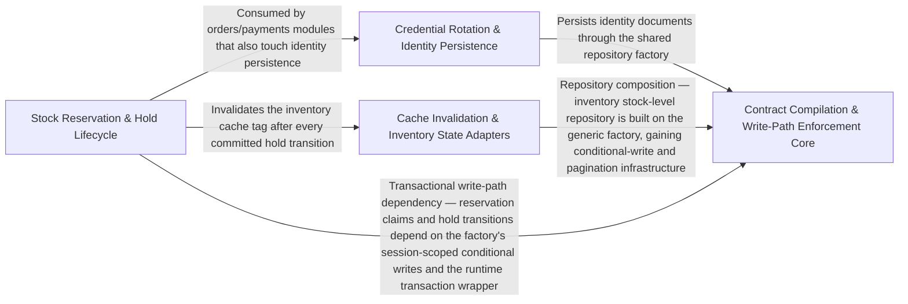

---
tags:
  - 2brain
  - 2brain/arch
  - project/boilerplate-node-backend
type: architecture
component: OpenAPI_Fragment_Compilation_Runtime_Contract_Enforcement
---

## Details

The core compilation step that discovers per-module openapi.yaml fragments on disk, assembles the root document's path index and tag list, invokes redocly bundle to resolve $refs, then post-processes the bundle (merging app-level 429/400/413/415 responses, hanging ETag/If-Match/412 on versioned paths, stamping x-module on every operation, collecting x-error-codes into a single catalogue). It also emits the error-codes.ts constants file. At runtime, the infrastructure adapters (cache invalidation, idempotency keys, error mapping, Redis session store) enforce the contract's promises on every request.

### Contract Compilation & Write-Path Enforcement Core
The backbone of the subsystem. At build time, it owns the full OpenAPI fragment compilation pipeline: discovering module fragments on disk, assembling the root document's path index and tag list, invoking redocly bundle, then post-processing the bundle (app-level response merging, ETag/If-Match/412 hanging, x-module stamping, x-error-codes catalogue collection) and emitting the error-codes.ts constants file. At runtime, it provides the write-path enforcement infrastructure: the database-error interpreter, the generic repository factory, the versioning module (ETag derivation, If-Match precondition scoping, fenced writes), the lease mechanism, and the shared pagination/filter helpers.

**Related Classes/Methods**:

- `src.infrastructure.persistence.create-repository.createRepository`:337-484

**Source Files:**

- `scripts/contracts/generate-error-codes.ts`
  - `scripts.contracts.generate-error-codes.ErrorCodeEntry` (L30-L33) - Interface
  - `scripts.contracts.generate-error-codes.OpenApiDocument` (L36-L38) - Interface
- `scripts/contracts/openapi-bundle.ts`
  - `scripts.contracts.openapi-bundle.AppLevelResponse` (L144-L147) - Interface
  - `scripts.contracts.openapi-bundle.Operation` (L150-L153) - Interface
  - `scripts.contracts.openapi-bundle.ErrorCodeEntry` (L156-L159) - Interface
  - `scripts.contracts.openapi-bundle.BundledDocument` (L162-L168) - Interface
- `src/infrastructure/http/errors.ts`
  - `src.infrastructure.http.errors.databaseErrorInterpreter` (L60-L102) - Function
- `src/infrastructure/persistence/create-repository.ts`
  - `src.infrastructure.persistence.create-repository.buildWhere.ids` (L154-L156) - Class
  - `src.infrastructure.persistence.create-repository.buildWhere.ids.value.filter() callback` (L155-L155) - Function
  - `src.infrastructure.persistence.create-repository.buildWhere.ids.map() callback` (L156-L156) - Function
  - `src.infrastructure.persistence.create-repository.Repository` (L237-L300) - Interface
  - `src.infrastructure.persistence.create-repository.createRepository` (L337-L484) - Function
  - `src.infrastructure.persistence.create-repository.createRepository.buildWhere` (L482-L482) - Method
- `src/infrastructure/persistence/image-writeback.ts`
  - `src.infrastructure.persistence.image-writeback.imageWritebackFor` (L26-L51) - Class
  - `src.infrastructure.persistence.image-writeback.imageWritebackFor.<function>` (L28-L51) - Function
  - `src.infrastructure.persistence.image-writeback.imageWritebackFor.<function>.then() callback` (L41-L50) - Function
  - `src.infrastructure.persistence.image-writeback.imageWritebackFor.<function>.then() callback.then() callback` (L50-L50) - Function
- `src/infrastructure/persistence/lease.ts`
  - `src.infrastructure.persistence.lease.acquireLease` (L124-L139) - Class
  - `src.infrastructure.persistence.lease.acquireLease.then() callback` (L134-L134) - Function
  - `src.infrastructure.persistence.lease.acquireLease.catch() callback` (L135-L138) - Function
- `src/infrastructure/persistence/search.ts`
  - `src.infrastructure.persistence.search.readAll.collectFrom` (L98-L102) - Class
  - `src.infrastructure.persistence.search.readAll.collectFrom.then() callback` (L99-L102) - Function
- `src/infrastructure/persistence/translatable-columns.ts`
  - `src.infrastructure.persistence.translatable-columns.TranslatableColumns` (L17-L35) - Interface
  - `src.infrastructure.persistence.translatable-columns.translatableColumnsOf` (L42-L76) - Class
  - `src.infrastructure.persistence.translatable-columns.translatableColumnsOf.exists` (L46-L48) - Method
  - `src.infrastructure.persistence.translatable-columns.translatableColumnsOf.writeDerived` (L50-L65) - Method
  - `src.infrastructure.persistence.translatable-columns.translatableColumnsOf.writeDerived.$set.map() callback` (L58-L58) - Function
  - `src.infrastructure.persistence.translatable-columns.translatableColumnsOf.writeDerived.then() callback` (L65-L65) - Function
  - `src.infrastructure.persistence.translatable-columns.translatableColumnsOf.markEdited` (L67-L75) - Method
  - `src.infrastructure.persistence.translatable-columns.translatableColumnsOf.markEdited.then() callback` (L75-L75) - Function
- `src/infrastructure/persistence/versioning.ts`
  - `src.infrastructure.persistence.versioning.PreconditionFailedError` (L38-L40) - Class
  - `src.infrastructure.persistence.versioning.armed` (L159-L164) - Class
  - `src.infrastructure.persistence.versioning.armed.finally() callback` (L161-L163) - Function
  - `src.infrastructure.persistence.versioning.fencedSave` (L180-L192) - Class
  - `src.infrastructure.persistence.versioning.fencedSave.catch() callback` (L189-L191) - Function
  - `src.infrastructure.persistence.versioning.checkedDelete` (L211-L223) - Class
  - `src.infrastructure.persistence.versioning.checkedDelete.then() callback` (L220-L222) - Function
- `src/modules/cart/domain/merge.ts`
  - `src.modules.cart.domain.merge.MergeLineFacts` (L12-L24) - Interface
  - `src.modules.cart.domain.merge.MergePlan` (L27-L32) - Interface
- `src/modules/delivery/repository.ts`
  - `src.modules.delivery.repository.shipmentRepository` (L498-L608) - Class
  - `src.modules.delivery.repository.shipmentRepository.findByOrderId` (L522-L527) - Method
  - `src.modules.delivery.repository.shipmentRepository.findByOrderIds` (L535-L539) - Method
  - `src.modules.delivery.repository.shipmentRepository.findByOrderIds.orderId.$in.orderIds.map() callback` (L537-L537) - Function
- `src/modules/inventory/domain/transitions.ts`
  - `src.modules.inventory.domain.transitions.CounterDelta` (L29-L34) - Interface
- `src/modules/invoicing/services/render.ts`
  - `src.modules.invoicing.services.render.then() callback.then() callback.then() callback` (L78-L78) - Function
- `src/modules/notifications/presenter.ts`
  - `src.modules.notifications.presenter.NotificationsView` (L11-L13) - Interface
  - `src.modules.notifications.presenter.presentNotifications.items.notifications.map() callback` (L48-L48) - Function
- `src/modules/notifications/repository.ts`
  - `src.modules.notifications.repository.notificationRepository` (L31-L123) - Class
  - `src.modules.notifications.repository.notificationRepository.listByUserId` (L48-L52) - Method
  - `src.modules.notifications.repository.notificationRepository.insertMany` (L60-L61) - Method
  - `src.modules.notifications.repository.notificationRepository.deleteOwned` (L67-L71) - Method
  - `src.modules.notifications.repository.notificationRepository.deleteOwned.then() callback` (L71-L71) - Function
  - `src.modules.notifications.repository.notificationRepository.deleteAllOwned` (L74-L80) - Method
  - `src.modules.notifications.repository.notificationRepository.deleteAllOwned.then() callback` (L78-L80) - Function
  - `src.modules.notifications.repository.notificationRepository.deleteByUserId` (L83-L89) - Method
  - `src.modules.notifications.repository.notificationRepository.deleteByUserId.then() callback` (L87-L89) - Function
  - `src.modules.notifications.repository.notificationRepository.markAllRead` (L92-L101) - Method
  - `src.modules.notifications.repository.notificationRepository.markAllRead.then() callback` (L99-L101) - Function
  - `src.modules.notifications.repository.notificationRepository.trimToNewest` (L108-L122) - Method
- `src/modules/notifications/services/inbox.ts`
  - `src.modules.notifications.services.inbox.trimInbox` (L30-L36) - Class
  - `src.modules.notifications.services.inbox.trimInbox.then() callback` (L33-L36) - Function
  - `src.modules.notifications.services.inbox.notificationsCreate` (L46-L57) - Class
  - `src.modules.notifications.services.inbox.notificationsCreate.created.map() callback` (L55-L55) - Function
  - `src.modules.notifications.services.inbox.notificationsDismissAll` (L75-L79) - Class
  - `src.modules.notifications.services.inbox.notificationsReadAll` (L82-L88) - Class
  - `src.modules.notifications.services.inbox.notificationsReadAll.then() callback` (L84-L87) - Function
- `src/modules/notifications/services/stream.ts`
  - `src.modules.notifications.services.stream.openStreamCount` (L61-L62) - Class
  - `src.modules.notifications.services.stream.openStreamCount.reduce() callback` (L62-L62) - Function
  - `src.modules.notifications.services.stream.streamNotifications.heartbeat` (L92-L94) - Class
  - `src.modules.notifications.services.stream.streamNotifications.heartbeat.setInterval() callback` (L92-L94) - Function
  - `src.modules.notifications.services.stream.streamNotifications.reverifyTimer` (L97-L106) - Class
  - `src.modules.notifications.services.stream.streamNotifications.reverifyTimer.setInterval() callback` (L97-L106) - Function
  - `src.modules.notifications.services.stream.streamNotifications.reverifyTimer.setInterval() callback.catch() callback` (L99-L99) - Function
  - `src.modules.notifications.services.stream.streamNotifications.reverifyTimer.setInterval() callback.then() callback` (L100-L105) - Function
- `src/modules/notifications/services/subscribers.ts`
  - `src.modules.notifications.services.subscribers.removedFor` (L17-L26) - Class
  - `src.modules.notifications.services.subscribers.removedFor.userIds.map() callback` (L21-L26) - Function
- `src/modules/orders/repository.ts`
  - `src.modules.orders.repository.search` (L147-L178) - Class
  - `src.modules.orders.repository.search.then() callback` (L165-L176) - Function
  - `src.modules.orders.repository.search.then() callback.then() callback` (L172-L175) - Function
  - `src.modules.orders.repository.countMatching` (L187-L194) - Class
  - `src.modules.orders.repository.countMatching.then() callback` (L194-L194) - Function
  - `src.modules.orders.repository.streamMatching` (L204-L217) - Function
  - `src.modules.orders.repository.startPiiClock` (L629-L638) - Class
  - `src.modules.orders.repository.startPiiClock.then() callback` (L638-L638) - Function
  - `src.modules.orders.repository.deleteCancelledUnpaid` (L702-L722) - Class
  - `src.modules.orders.repository.deleteCancelledUnpaid.checkedDelete() callback` (L705-L721) - Function
  - `src.modules.orders.repository.deleteCancelledUnpaid.checkedDelete() callback.then() callback` (L714-L717) - Function
  - `src.modules.orders.repository.deleteCancelledUnpaid.checkedDelete() callback.finally() callback` (L718-L720) - Function
  - `src.modules.orders.repository.deleteCancelledUnpaid.then() callback` (L721-L721) - Function
  - `src.modules.orders.repository.orderEventRepository` (L838-L912) - Class
  - `src.modules.orders.repository.orderEventRepository.findByOrderId` (L858-L862) - Method
  - `src.modules.orders.repository.orderEventRepository.findByOrderIds` (L869-L873) - Method
  - `src.modules.orders.repository.orderEventRepository.findByOrderIds.orderId.$in.orderIds.map() callback` (L871-L871) - Function
  - `src.modules.orders.repository.orderEventRepository.clearActor` (L882-L886) - Method
  - `src.modules.orders.repository.orderEventRepository.clearActor.then() callback` (L886-L886) - Function
  - `src.modules.orders.repository.orderEventRepository.scrubTextBefore` (L895-L899) - Method
  - `src.modules.orders.repository.orderEventRepository.scrubTextBefore.then() callback` (L899-L899) - Function
  - `src.modules.orders.repository.orderEventRepository.deleteByOrderId` (L907-L911) - Method
  - `src.modules.orders.repository.orderEventRepository.deleteByOrderId.then() callback` (L911-L911) - Function
- `src/modules/orders/services/timeline.ts`
  - `src.modules.orders.services.timeline.deleteTimelineOf` (L168-L169) - Class
  - `src.modules.orders.services.timeline.deleteTimelineOf.then() callback` (L169-L169) - Function
- `src/modules/products/repository.ts`
  - `src.modules.products.repository.productRepository` (L37-L162) - Class
  - `src.modules.products.repository.productRepository.publicScope` (L73-L73) - Method
  - `src.modules.products.repository.productRepository.findByIdScoped` (L87-L88) - Method
  - `src.modules.products.repository.productRepository.findPublicById` (L97-L98) - Method
  - `src.modules.products.repository.productRepository.facets` (L107-L135) - Method
  - `src.modules.products.repository.productRepository.facets.then() callback` (L129-L135) - Function
  - `src.modules.products.repository.productRepository.facets.then() callback.categories.map() callback` (L130-L133) - Function
  - `src.modules.products.repository.productRepository.facets.then() callback.tags.map() callback` (L134-L134) - Function
  - `src.modules.products.repository.productRepository.syncStockCache` (L145-L149) - Method
  - `src.modules.products.repository.productRepository.syncStockCache.then() callback` (L149-L149) - Function
- `src/modules/products/services/lookups.ts`
  - `src.modules.products.services.lookups.findManyByIds` (L34-L37) - Class
  - `src.modules.products.services.lookups.findManyByIds.then() callback` (L35-L36) - Function
  - `src.modules.products.services.lookups.findManyByIds.then() callback._id.$in.ids.map() callback` (L36-L36) - Function
  - `src.modules.products.services.lookups.countPublic` (L51-L70) - Class
  - `src.modules.products.services.lookups.countPublic.then() callback` (L57-L69) - Function
  - `src.modules.products.services.lookups.countPublic.then() callback._id.$in.ids.map() callback` (L60-L60) - Function
- `src/modules/products/services/search.ts`
  - `src.modules.products.services.search.searchWithTranslatedText` (L66-L91) - Class
  - `src.modules.products.services.search.searchWithTranslatedText.then() callback` (L80-L90) - Function
  - `src.modules.products.services.search.searchWithTranslatedText.then() callback.union.$or._id.$in.translatedIds.map() callback` (L85-L85) - Function
- `src/modules/returns/repository.ts`
  - `src.modules.returns.repository.returnRepository` (L35-L172) - Class
  - `src.modules.returns.repository.returnRepository.claimStatus` (L74-L81) - Method
  - `src.modules.returns.repository.returnRepository.findByOrderId` (L88-L93) - Method
  - `src.modules.returns.repository.returnRepository.lockOrder` (L102-L110) - Method
  - `src.modules.returns.repository.returnRepository.lockOrder.then() callback` (L110-L110) - Function
  - `src.modules.returns.repository.returnRepository.findByOrderIds` (L143-L147) - Method
  - `src.modules.returns.repository.returnRepository.findByOrderIds.orderId.$in.orderIds.map() callback` (L145-L145) - Function
- `src/modules/returns/services/create.ts`
  - `src.modules.returns.services.create.writeReturn.lines.lines.map() callback` (L226-L235) - Function
  - `src.modules.returns.services.create.withTransaction() callback.then() callback` (L264-L264) - Function
- `src/modules/returns/services/decide.ts`
  - `src.modules.returns.services.decide.decide` (L79-L120) - Class
  - `src.modules.returns.services.decide.decide.then() callback` (L86-L119) - Function
  - `src.modules.returns.services.decide.decide.then() callback.then() callback` (L117-L118) - Function
  - `src.modules.returns.services.decide.refusalForDecision` (L132-L144) - Class
  - `src.modules.returns.services.decide.refusalForDecision.then() callback` (L137-L144) - Function

### Credential Rotation & Identity Persistence
The security-backed persistence layer for identity-related data. It owns the reencryption pipeline (rotating encrypted secrets across a collection when the encryption key changes), the versioned-secret decryption (reading a secret that may have been written under a prior key version), and the module repositories that depend on these primitives: the addresses repository, the users repository, and the token/update operations that manage credential lifecycles.

**Related Classes/Methods**:

- `src.infrastructure.security.reencrypt.reencryptCollection`:146-178
- `src.modules.addresses.repository.addressBookRepository`:105-275
- `src.modules.users.repository.userRepository`:131-714

**Source Files:**

- `src/infrastructure/security/reencrypt.ts`
  - `src.infrastructure.security.reencrypt.reencryptOf` (L79-L82) - Class
  - `src.infrastructure.security.reencrypt.reencryptOf.<function>` (L81-L82) - Function
  - `src.infrastructure.security.reencrypt.reencryptCollection` (L146-L178) - Class
  - `src.infrastructure.security.reencrypt.reencryptCollection.then() callback` (L165-L177) - Function
  - `src.infrastructure.security.reencrypt.reencryptCollection.then() callback.apply.then() callback` (L171-L176) - Function
- `src/infrastructure/security/versioned-secret.ts`
  - `src.infrastructure.security.versioned-secret.decryptVersionedSecret.configured` (L117-L117) - Class
  - `src.infrastructure.security.versioned-secret.decryptVersionedSecret.configured.ring.find() callback` (L117-L117) - Function
- `src/modules/addresses/repository.ts`
  - `src.modules.addresses.repository.addressBookRepository` (L105-L275) - Class
  - `src.modules.addresses.repository.addressBookRepository.create.items.map() callback` (L140-L141) - Function
  - `src.modules.addresses.repository.addressBookRepository.findByUserId` (L150-L154) - Method
  - `src.modules.addresses.repository.addressBookRepository.findByUserId.then() callback` (L154-L154) - Function
  - `src.modules.addresses.repository.addressBookRepository.addEntry` (L169-L198) - Method
  - `src.modules.addresses.repository.addressBookRepository.addEntry.catch() callback` (L184-L197) - Function
  - `src.modules.addresses.repository.addressBookRepository.addEntry.catch() callback.then() callback` (L189-L196) - Function
  - `src.modules.addresses.repository.addressBookRepository.updateEntry` (L205-L231) - Method
  - `src.modules.addresses.repository.addressBookRepository.setDefault` (L238-L248) - Method
  - `src.modules.addresses.repository.addressBookRepository.removeEntry` (L254-L263) - Method
  - `src.modules.addresses.repository.addressBookRepository.removeEntry.book.items.filter() callback` (L259-L259) - Function
  - `src.modules.addresses.repository.addressBookRepository.deleteByUserId` (L268-L274) - Method
  - `src.modules.addresses.repository.addressBookRepository.deleteByUserId.then() callback` (L272-L274) - Function
- `src/modules/addresses/service.ts`
  - `src.modules.addresses.service.addressForCheckout` (L97-L105) - Class
  - `src.modules.addresses.service.addressForCheckout.then() callback` (L101-L105) - Function
  - `src.modules.addresses.service.addressForCheckout.then() callback.book.items.find() callback` (L104-L104) - Function
- `src/modules/users/repository.ts`
  - `src.modules.users.repository.stampDaily` (L76-L90) - Class
  - `src.modules.users.repository.stampDaily.then() callback` (L90-L90) - Function
  - `src.modules.users.repository.clearedCode` (L123-L124) - Class
  - `src.modules.users.repository.clearedCode.DELIVERED_CODE_FIELDS.map() callback` (L124-L124) - Function
  - `src.modules.users.repository.userRepository` (L131-L714) - Class
  - `src.modules.users.repository.userRepository.updateMany` (L202-L203) - Method
  - `src.modules.users.repository.userRepository.findByIdWithCredentials` (L208-L209) - Method
  - `src.modules.users.repository.userRepository.findOneWithCredentials` (L214-L215) - Method
  - `src.modules.users.repository.userRepository.findByIdWithPendingEmail` (L222-L222) - Method
  - `src.modules.users.repository.userRepository.emailOrPendingEmailTaken` (L234-L240) - Method
  - `src.modules.users.repository.userRepository.emailOrPendingEmailTaken.then() callback` (L240-L240) - Function
  - `src.modules.users.repository.userRepository.findAuthenticatableById` (L250-L253) - Method
  - `src.modules.users.repository.userRepository.findAuthenticatableByEmail` (L261-L265) - Method
  - `src.modules.users.repository.userRepository.clearLapsedPreviousEmail` (L277-L288) - Method
  - `src.modules.users.repository.userRepository.clearLapsedPreviousEmail._id.$nin.keepUserIds.map() callback` (L282-L282) - Function
  - `src.modules.users.repository.userRepository.clearLapsedPreviousEmail.then() callback` (L288-L288) - Function
  - `src.modules.users.repository.userRepository.linkOAuthAccount` (L300-L310) - Method
  - `src.modules.users.repository.userRepository.linkOAuthAccount.then() callback` (L310-L310) - Function
  - `src.modules.users.repository.userRepository.unlinkOAuthAccount` (L320-L328) - Method
  - `src.modules.users.repository.userRepository.unlinkOAuthAccount.then() callback` (L328-L328) - Function
  - `src.modules.users.repository.userRepository.reserveMfaAttempt` (L345-L394) - Method
  - `src.modules.users.repository.userRepository.reserveMfaAttempt.then() callback` (L389-L392) - Function
  - `src.modules.users.repository.userRepository.resetMfaAttempts` (L400-L411) - Method
  - `src.modules.users.repository.userRepository.resetMfaAttempts.then() callback` (L411-L411) - Function
  - `src.modules.users.repository.userRepository.bumpSessionEpoch` (L418-L430) - Method
  - `src.modules.users.repository.userRepository.bumpSessionEpoch.then() callback` (L430-L430) - Function
  - `src.modules.users.repository.userRepository.claimTotpStep` (L440-L456) - Method
  - `src.modules.users.repository.userRepository.claimTotpStep.then() callback` (L456-L456) - Function
  - `src.modules.users.repository.userRepository.spendBackupCode` (L468-L476) - Method
  - `src.modules.users.repository.userRepository.spendBackupCode.then() callback` (L476-L476) - Function
  - `src.modules.users.repository.userRepository.spendDeliveredCode` (L490-L505) - Method
  - `src.modules.users.repository.userRepository.spendDeliveredCode.codeSlotFilter() callback` (L493-L500) - Function
  - `src.modules.users.repository.userRepository.spendDeliveredCode.then() callback` (L505-L505) - Function
  - `src.modules.users.repository.userRepository.recordDeliveredMiss` (L517-L543) - Method
  - `src.modules.users.repository.userRepository.recordDeliveredMiss.codeSlotFilter() callback` (L520-L526) - Function
  - `src.modules.users.repository.recordDeliveredMiss.then() callback` (L531-L541) - Function
  - `src.modules.users.repository.userRepository.recordDeliveredMiss.then() callback.codeSlotFilter() callback` (L534-L537) - Function
  - `src.modules.users.repository.userRepository.recordDeliveredMiss.then() callback` (L543-L543) - Function
  - `src.modules.users.repository.userRepository.armReauthCode` (L553-L561) - Method
  - `src.modules.users.repository.userRepository.armReauthCode.then() callback` (L561-L561) - Function
  - `src.modules.users.repository.userRepository.writeTwoFactor` (L576-L606) - Method
  - `src.modules.users.repository.userRepository.writeTwoFactor.then() callback` (L598-L605) - Function
  - `src.modules.users.repository.userRepository.touchLastActive` (L624-L624) - Method
  - `src.modules.users.repository.userRepository.touchApiKeyUse` (L633-L633) - Method
  - `src.modules.users.repository.userRepository.markInactivityMinimised` (L642-L650) - Method
  - `src.modules.users.repository.userRepository.markInactivityMinimised.then() callback` (L650-L650) - Function
  - `src.modules.users.repository.userRepository.findInactiveUnminimised` (L659-L675) - Method
  - `src.modules.users.repository.userRepository.findInactiveUnwarned` (L681-L687) - Method
  - `src.modules.users.repository.userRepository.findWarnedStillInactive` (L694-L701) - Method
  - `src.modules.users.repository.userRepository.findReaperSoftDeletedPastGrace` (L704-L713) - Method
- `src/modules/users/services/credentials.ts`
  - `src.modules.users.services.credentials.armReauthCode` (L208-L216) - Class
  - `src.modules.users.services.credentials.armReauthCode.then() callback` (L212-L215) - Function
  - `src.modules.users.services.credentials.mirrorSpentCode.entry` (L228-L228) - Class
  - `src.modules.users.services.credentials.mirrorSpentCode.entry.user.twoFactorMethods.find() callback` (L228-L228) - Function
  - `src.modules.users.services.credentials.spendBackupCode` (L305-L314) - Class
  - `src.modules.users.services.credentials.spendBackupCode.then() callback` (L306-L314) - Function
  - `src.modules.users.services.credentials.spendBackupCode.then() callback.user.twoFactorBackupCodes.filter() callback` (L309-L309) - Function
- `src/modules/users/services/reaper.ts`
  - `src.modules.users.services.reaper.minimiseInactiveBefore` (L69-L84) - Class
  - `src.modules.users.services.reaper.minimiseInactiveBefore.then() callback` (L72-L84) - Function
  - `src.modules.users.services.reaper.minimiseInactiveBefore.then() callback.catch() callback` (L75-L82) - Function
- `src/modules/users/services/sign-in-methods.ts`
  - `src.modules.users.services.sign-in-methods.exportSignInMethods` (L24-L40) - Class
  - `src.modules.users.services.sign-in-methods.exportSignInMethods.then() callback` (L25-L39) - Function
  - `src.modules.users.services.sign-in-methods.exportSignInMethods.then() callback.providers.user.oauthAccounts.map() callback` (L28-L32) - Function
  - `src.modules.users.services.sign-in-methods.exportSignInMethods.then() callback.twoFactor.user.twoFactorMethods.flatMap() callback` (L35-L36) - Function

### Cache Invalidation & Inventory State Adapters
The runtime adapters that enforce the contract's cache and idempotency promises on every request, plus the inventory module that is their primary consumer. The cache adapter clears Redis tag-indexed entries after writes and escalates to a metric + error log when Redis is unreachable. The Redis adapter classifies connection errors so the error interpreter can answer 503 rather than 500. The idempotency middleware deduplicates replayed writes. The inventory module wires these adapters together: every stock-level mutation invalidates the inventory cache tag, every reservation write is idempotency-keyed, and the module's Prometheus metrics make the contract's observability promises measurable.

**Related Classes/Methods**:

- `src.infrastructure.adapters.cache.invalidateCacheTagsLogged`:329-344
- `src.infrastructure.adapters.redis.isRedisConnectionError`:149-150
- `src.modules.inventory.module.default`:30-62
- `src.modules.inventory.repository.stockLevelRepository`:204-468

**Source Files:**

- `src/infrastructure/adapters/cache.ts`
  - `src.infrastructure.adapters.cache.invalidateCacheTagsLogged` (L329-L344) - Class
  - `src.infrastructure.adapters.cache.invalidateCacheTagsLogged.then() callback` (L330-L344) - Function
- `src/infrastructure/adapters/logger.ts`
  - `src.infrastructure.adapters.logger.isSensitiveKey` (L131-L133) - Class
  - `src.infrastructure.adapters.logger.isSensitiveKey.SENSITIVE_KEY_FRAGMENTS.some() callback` (L133-L133) - Function
  - `src.infrastructure.adapters.logger.redactSensitiveFields.result` (L218-L220) - Class
  - `src.infrastructure.adapters.logger.redactSensitiveFields.result.input.map() callback` (L219-L219) - Function
  - `src.infrastructure.adapters.logger.redactFormat` (L287-L310) - Class
  - `src.infrastructure.adapters.logger.redactFormat.winston.format() callback` (L287-L310) - Function
  - `src.infrastructure.adapters.logger.semanticNamesFormat` (L320-L324) - Class
  - `src.infrastructure.adapters.logger.semanticNamesFormat.winston.format() callback` (L320-L324) - Function
  - `src.infrastructure.adapters.logger.prettyFormat` (L359-L373) - Class
  - `src.infrastructure.adapters.logger.prettyFormat.winston.format.printf() callback` (L366-L372) - Function
- `src/infrastructure/adapters/redis.ts`
  - `src.infrastructure.adapters.redis.isRedisConnectionError` (L149-L150) - Class
  - `src.infrastructure.adapters.redis.isRedisConnectionError.REDIS_CONNECTION_ERRORS.some() callback` (L150-L150) - Function
- `src/infrastructure/http/middlewares/cache.ts`
  - `src.infrastructure.http.middlewares.cache.invalidateCache` (L586-L596) - Class
  - `src.infrastructure.http.middlewares.cache.invalidateCache.<function>` (L587-L596) - Function
  - `src.infrastructure.http.middlewares.cache.invalidateCache.<function>.response.on('finish') callback` (L588-L593) - Function
- `src/infrastructure/http/middlewares/idempotency.ts`
  - `src.infrastructure.http.middlewares.idempotency.hasPrototypeKey` (L56-L61) - Class
  - `src.infrastructure.http.middlewares.idempotency.hasPrototypeKey.value.some() callback` (L57-L57) - Function
  - `src.infrastructure.http.middlewares.idempotency.hasPrototypeKey.some() callback` (L60-L60) - Function
  - `src.infrastructure.http.middlewares.idempotency.reclaimAbandoned` (L135-L161) - Class
  - `src.infrastructure.http.middlewares.idempotency.reclaimAbandoned.then() callback` (L149-L161) - Function
  - `src.infrastructure.http.middlewares.idempotency.armOutcomeCapture` (L175-L208) - Class
  - `src.infrastructure.http.middlewares.idempotency.armOutcomeCapture.<function>` (L177-L207) - Function
  - `src.infrastructure.http.middlewares.idempotency.armOutcomeCapture.<function>.catch() callback` (L192-L204) - Function
  - `src.infrastructure.http.middlewares.idempotency.onDuplicateKey` (L259-L294) - Class
  - `src.infrastructure.http.middlewares.idempotency.onDuplicateKey.then() callback` (L271-L287) - Function
  - `src.infrastructure.http.middlewares.idempotency.onDuplicateKey.catch() callback` (L288-L294) - Function
  - `src.infrastructure.http.middlewares.idempotency.claimIdempotencyKey` (L301-L323) - Class
  - `src.infrastructure.http.middlewares.idempotency.claimIdempotencyKey.then() callback` (L311-L314) - Function
  - `src.infrastructure.http.middlewares.idempotency.claimIdempotencyKey.catch() callback` (L315-L322) - Function
- `src/infrastructure/surfaces/create-update-controller.ts`
  - `src.infrastructure.surfaces.create-update-controller.clearableFields` (L109-L113) - Class
  - `src.infrastructure.surfaces.create-update-controller.clearableFields.filter() callback` (L112-L112) - Function
  - `src.infrastructure.surfaces.create-update-controller.clearableFields.map() callback` (L113-L113) - Function
  - `src.infrastructure.surfaces.create-update-controller.createUpdateController.replaceFills` (L170-L172) - Class
  - `src.infrastructure.surfaces.create-update-controller.createUpdateController.replaceFills.filter() callback` (L171-L171) - Function
- `src/modules/inventory/metrics.ts`
  - `src.modules.inventory.metrics._productsLowStockTotal` (L24-L31) - Class
  - `src.modules.inventory.metrics._productsLowStockTotal.collect` (L28-L30) - Method
  - `src.modules.inventory.metrics._inventoryReservedUnitsTotal` (L38-L45) - Class
  - `src.modules.inventory.metrics._inventoryReservedUnitsTotal.collect` (L42-L44) - Method
- `src/modules/inventory/module.ts`
  - `src.modules.inventory.module.default` (L30-L62) - Class
  - `src.modules.inventory.module.default.subscribe` (L44-L51) - Method
  - `src.modules.inventory.module.subscribe.onDomainEvent() callback` (L45-L45) - Function
  - `src.modules.inventory.module.default.subscribe.onDomainEvent() callback` (L48-L49) - Function
- `src/modules/inventory/repository.ts`
  - `src.modules.inventory.repository.StockLevelRow` (L102-L109) - Interface
  - `src.modules.inventory.repository.orderedByProduct` (L146-L155) - Class
  - `src.modules.inventory.repository.orderedByProduct.then() callback` (L155-L155) - Function
  - `src.modules.inventory.repository.orderedByProduct.then() callback.rows.map() callback` (L155-L155) - Function
  - `src.modules.inventory.repository.outstandingByProduct` (L164-L197) - Class
  - `src.modules.inventory.repository.outstandingByProduct.then() callback` (L187-L197) - Function
  - `src.modules.inventory.repository.stockLevelRepository` (L204-L468) - Class
  - `src.modules.inventory.repository.stockLevelRepository.insertIfAbsent` (L248-L264) - Method
  - `src.modules.inventory.repository.stockLevelRepository.insertIfAbsent.then() callback` (L264-L264) - Function
  - `src.modules.inventory.repository.stockLevelRepository.findManyByProductIds` (L272-L273) - Method
  - `src.modules.inventory.repository.stockLevelRepository.findManyByProductIds.productId.$in.productIds.map() callback` (L273-L273) - Function
  - `src.modules.inventory.repository.stockLevelRepository.findByProductId` (L280-L284) - Method
  - `src.modules.inventory.repository.stockLevelRepository.deleteByProductId` (L294-L298) - Method
  - `src.modules.inventory.repository.stockLevelRepository.deleteByProductId.then() callback` (L298-L298) - Function
  - `src.modules.inventory.repository.stockLevelRepository.applyDelta` (L315-L337) - Method
  - `src.modules.inventory.repository.stockLevelRepository.applyDelta.then() callback` (L337-L337) - Function
  - `src.modules.inventory.repository.stockLevelRepository.stockBoard` (L351-L375) - Method
  - `src.modules.inventory.repository.stockLevelRepository.stockBoard.then() callback` (L364-L374) - Function
  - `src.modules.inventory.repository.stockLevelRepository.stockBoard.then() callback.items.rows.map() callback` (L365-L372) - Function
  - `src.modules.inventory.repository.stockLevelRepository.setPreorderLimit` (L386-L397) - Method
  - `src.modules.inventory.repository.stockLevelRepository.setPreorderLimit.then() callback` (L397-L397) - Function
  - `src.modules.inventory.repository.stockLevelRepository.preorderBoard` (L407-L440) - Method
  - `src.modules.inventory.repository.stockLevelRepository.preorderBoard.then() callback` (L421-L439) - Function
  - `src.modules.inventory.repository.stockLevelRepository.preorderBoard.then() callback.then() callback` (L424-L437) - Function
  - `src.modules.inventory.repository.stockLevelRepository.preorderBoard.then() callback.then() callback.items.rows.map() callback` (L425-L435) - Function
  - `src.modules.inventory.repository.stockLevelRepository.lowAvailabilityProductIds` (L452-L457) - Method
  - `src.modules.inventory.repository.stockLevelRepository.lowAvailabilityProductIds.then() callback` (L457-L457) - Function
  - `src.modules.inventory.repository.stockLevelRepository.lowAvailabilityProductIds.then() callback.rows.map() callback` (L457-L457) - Function
  - `src.modules.inventory.repository.stockLevelRepository.sumReserved` (L464-L467) - Method
  - `src.modules.inventory.repository.stockLevelRepository.sumReserved.then() callback` (L467-L467) - Function
- `src/modules/inventory/services/admin.ts`
  - `src.modules.inventory.services.admin.receiveAndAllocate` (L57-L74) - Class
  - `src.modules.inventory.services.admin.receiveAndAllocate.withTransaction() callback` (L62-L69) - Function
  - `src.modules.inventory.services.admin.receiveAndAllocate.withTransaction() callback.then() callback.then() callback` (L69-L69) - Function
  - `src.modules.inventory.services.admin.receiveAndAllocate.then() callback` (L70-L74) - Function
  - `src.modules.inventory.services.admin.receiveAndAllocate.then() callback.then() callback` (L73-L73) - Function
- `src/modules/inventory/services/levels.ts`
  - `src.modules.inventory.services.levels.openLevel` (L37-L52) - Class
  - `src.modules.inventory.services.levels.openLevel.withTransaction() callback` (L38-L51) - Function
  - `src.modules.inventory.services.levels.openLevel.withTransaction() callback.then() callback` (L41-L50) - Function
  - `src.modules.inventory.services.levels.openLevel.then() callback` (L52-L52) - Function
  - `src.modules.inventory.services.levels.availableFor` (L79-L95) - Class
  - `src.modules.inventory.services.levels.availableFor.then() callback` (L86-L94) - Function
  - `src.modules.inventory.services.levels.availableFor.then() callback.levels.map() callback` (L88-L93) - Function
  - `src.modules.inventory.services.levels.lowStockCount` (L173-L177) - Class
  - `src.modules.inventory.services.levels.lowStockCount.then() callback` (L177-L177) - Function
- `src/modules/inventory/services/transition.ts`
  - `src.modules.inventory.services.transition.syncStockCache` (L27-L41) - Class
  - `src.modules.inventory.services.transition.syncStockCache.then() callback` (L32-L32) - Function
  - `src.modules.inventory.services.transition.syncStockCache.catch() callback` (L33-L40) - Function

### Stock Reservation & Hold Lifecycle
The inventory reservation domain logic: the full lifecycle of a stock hold from insertion through claim, extension, and expiry. The reservationRepository owns the persistence contract for holds. The holds service implements the domain transitions (claimAndApply, extendHoldForOrder, isHoldReleased). The sweep service reclaims expired holds. The levels service reads current stock levels. The reserve service orchestrates the reservation flow. This sub-component enforces the contract's promise that stock is never oversold: every reservation is a fenced, time-bounded hold that either claims or expires.

**Related Classes/Methods**:

- `src.modules.inventory.repository.reservationRepository`:492-702
- `src.modules.inventory.services.holds.claimAndApply`:37-57
- `src.modules.inventory.services.holds.extendHoldForOrder`:331-334
- `src.infrastructure.persistence.search.PaginationInput`:11-17

**Source Files:**

- `src/infrastructure/persistence/search.ts`
  - `src.infrastructure.persistence.search.PaginationInput` (L11-L17) - Interface
- `src/modules/example/repository.ts`
  - `src.modules.example.repository.exampleRepository.publishFrom` (L98-L107) - Method
- `src/modules/inventory/domain/hold-lines.ts`
  - `src.modules.inventory.domain.hold-lines.HoldLine` (L14-L18) - Interface
  - `src.modules.inventory.domain.hold-lines.HoldTake` (L21-L26) - Interface
  - `src.modules.inventory.domain.hold-lines.takeFromHold.toLines` (L77-L84) - Class
  - `src.modules.inventory.domain.hold-lines.takeFromHold.toLines.filter() callback` (L79-L79) - Function
  - `src.modules.inventory.domain.hold-lines.takeFromHold.toLines.map() callback` (L80-L84) - Function
- `src/modules/inventory/repository.ts`
  - `src.modules.inventory.repository.toReservationItems` (L130-L137) - Class
  - `src.modules.inventory.repository.toReservationItems.lines.map() callback` (L133-L137) - Function
  - `src.modules.inventory.repository.reservationRepository` (L492-L702) - Class
  - `src.modules.inventory.repository.reservationRepository.insertHold` (L539-L551) - Method
  - `src.modules.inventory.repository.reservationRepository.insertHold.then() callback` (L547-L547) - Function
  - `src.modules.inventory.repository.reservationRepository.insertHold.catch() callback` (L548-L551) - Function
  - `src.modules.inventory.repository.reservationRepository.findByOrderId` (L559-L560) - Method
  - `src.modules.inventory.repository.reservationRepository.claimStatus` (L572-L588) - Method
  - `src.modules.inventory.repository.reservationRepository.findOpenByOrderId` (L598-L602) - Method
  - `src.modules.inventory.repository.reservationRepository.replaceItems` (L615-L627) - Method
  - `src.modules.inventory.repository.reservationRepository.findPaidPreorderHolds` (L638-L646) - Method
  - `src.modules.inventory.repository.reservationRepository.findExpired` (L656-L661) - Method
  - `src.modules.inventory.repository.reservationRepository.narrowToTaken` (L673-L683) - Method
  - `src.modules.inventory.repository.reservationRepository.narrowToTaken.then() callback` (L683-L683) - Function
  - `src.modules.inventory.repository.reservationRepository.extendExpiry` (L694-L701) - Method
- `src/modules/inventory/services/holds.ts`
  - `src.modules.inventory.services.holds.claimAndApply` (L37-L57) - Class
  - `src.modules.inventory.services.holds.claimAndApply.claimAndMove` (L44-L50) - Class
  - `src.modules.inventory.services.holds.claimAndApply.claimAndMove.then() callback` (L45-L50) - Function
  - `src.modules.inventory.services.holds.claimAndApply.claimAndMove.then() callback.then() callback` (L48-L48) - Function
  - `src.modules.inventory.services.holds.claimAndApply.then() callback` (L54-L55) - Function
  - `src.modules.inventory.services.holds.claimAndApply.then() callback.then() callback` (L55-L55) - Function
  - `src.modules.inventory.services.holds.takeLines` (L190-L216) - Class
  - `src.modules.inventory.services.holds.takeLines.then() callback` (L197-L216) - Function
  - `src.modules.inventory.services.holds.takeLines.then() callback.then() callback` (L210-L215) - Function
  - `src.modules.inventory.services.holds.takeLines.then() callback.then() callback.then() callback` (L213-L213) - Function
  - `src.modules.inventory.services.holds.shipLinesForOrder` (L232-L245) - Class
  - `src.modules.inventory.services.holds.shipLinesForOrder.then() callback` (L237-L245) - Function
  - `src.modules.inventory.services.holds.shipLinesForOrder.then() callback.then() callback` (L240-L244) - Function
  - `src.modules.inventory.services.holds.refreshStockCacheForOrder` (L312-L319) - Class
  - `src.modules.inventory.services.holds.refreshStockCacheForOrder.then() callback` (L315-L318) - Function
  - `src.modules.inventory.services.holds.refreshStockCacheForOrder.then() callback.map() callback` (L317-L317) - Function
  - `src.modules.inventory.services.holds.extendHoldForOrder` (L331-L334) - Class
  - `src.modules.inventory.services.holds.extendHoldForOrder.then() callback` (L334-L334) - Function
  - `src.modules.inventory.services.holds.isHoldReleased` (L346-L347) - Class
  - `src.modules.inventory.services.holds.isHoldReleased.then() callback` (L347-L347) - Function
  - `src.modules.inventory.services.holds.isStockBoundToOrder` (L359-L362) - Class
  - `src.modules.inventory.services.holds.isStockBoundToOrder.then() callback` (L362-L362) - Function
- `src/modules/inventory/services/levels.ts`
  - `src.modules.inventory.services.levels.listLevels.products` (L155-L155) - Class
  - `src.modules.inventory.services.levels.listLevels.products.items.map() callback` (L155-L155) - Function
  - `src.modules.inventory.services.levels.listLevels.titleOf` (L156-L156) - Class
  - `src.modules.inventory.services.levels.listLevels.titleOf.products.map() callback` (L156-L156) - Function
  - `src.modules.inventory.services.levels.listLevels.items.items.map() callback` (L159-L162) - Function
- `src/modules/inventory/services/reserve.ts`
  - `src.modules.inventory.services.reserve.giveBackAndDeleteHold` (L30-L61) - Class
  - `src.modules.inventory.services.reserve.giveBackAndDeleteHold.taken.map() callback` (L38-L50) - Function
  - `src.modules.inventory.services.reserve.giveBackAndDeleteHold.taken.map() callback.catch() callback` (L43-L50) - Function
  - `src.modules.inventory.services.reserve.giveBackAndDeleteHold.catch() callback` (L53-L60) - Function
  - `src.modules.inventory.services.reserve.inLockOrder` (L74-L76) - Class
  - `src.modules.inventory.services.reserve.inLockOrder.lines.toSorted() callback` (L76-L76) - Function
- `src/modules/inventory/services/sweep.ts`
  - `src.modules.inventory.services.sweep.expireOne` (L38-L52) - Class
  - `src.modules.inventory.services.sweep.announceInTransaction() callback` (L40-L43) - Function
  - `src.modules.inventory.services.sweep.expireOne.announceInTransaction() callback.then() callback` (L41-L42) - Function
  - `src.modules.inventory.services.sweep.expireOne.announceInTransaction() callback` (L44-L48) - Function
  - `src.modules.inventory.services.sweep.expireOne.then() callback` (L49-L51) - Function
  - `src.modules.inventory.services.sweep.expireOne.then() callback.then() callback` (L51-L51) - Function
- `src/modules/inventory/services/types.ts`
  - `src.modules.inventory.services.types.StockLine` (L16-L20) - Interface
  - `src.modules.inventory.services.types.StockShortfall` (L26-L31) - Interface
  - `src.modules.inventory.services.types.LevelFilters` (L44-L46) - Interface
  - `src.modules.inventory.services.types.MovementFilters` (L49-L52) - Interface
- `src/modules/wishlist/presenter.ts`
  - `src.modules.wishlist.presenter.savedProductIds` (L17-L18) - Class
  - `src.modules.wishlist.presenter.savedProductIds.map() callback` (L18-L18) - Function
- `src/modules/wishlist/service.ts`
  - `src.modules.wishlist.service.wishlistExportLines` (L48-L51) - Class
  - `src.modules.wishlist.service.wishlistExportLines.then() callback` (L51-L51) - Function
  - `src.modules.wishlist.service.wishlistExportLines.then() callback.map() callback` (L51-L51) - Function
