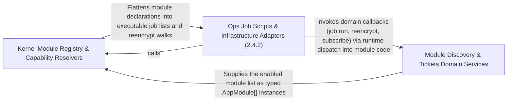

---
tags:
  - 2brain
  - 2brain/arch
  - project/boilerplate-node-backend
type: architecture
component: Ops_Job_Scripts_Infrastructure_Adapters
---

## Details

The one-shot operational scripts and the infrastructure adapters they lean on: data-migration/security jobs (re-encryption, breached-password refresh, generic job runner) plus the persistence/queue/mail/image adapters (cache, queue, mail-spool, image-signatures, export-store) that the seeded flows and the demo profile exercise. This is the operational surface the subsystem touches when it rewrites or inspects stored data.

### Kernel Module Registry & Capability Resolvers
The contract backbone that every ops script depends on. AppModule is the single manifest interface a domain module implements to declare its jobs, reencrypt walks, personal-data sections, translatable targets, browser-event projections, route mounts, and event subscriptions. The resolver functions extract those declarations from the registered module list so that scripts can discover work without naming any module. This is the contract-first seam: the script knows the shape of the work, not the identity of the module that owns it.

**Related Classes/Methods**:

- `src.kernel.registry.AppModule`:382-546
- `src.kernel.registry.resolvePersonalDataSections`:676-681
- `src.infrastructure.object-guards.stripUndefined`:29-32

**Source Files:**

- `src/infrastructure/object-guards.ts`
  - `src.infrastructure.object-guards.stripUndefined` (L29-L32) - Class
  - `src.infrastructure.object-guards.stripUndefined.filter() callback` (L32-L32) - Function
- `src/kernel/registry.ts`
  - `src.kernel.registry.ImageTarget` (L31-L49) - Interface
  - `src.kernel.registry.TranslatableTarget` (L93-L159) - Interface
  - `src.kernel.registry.TranslationFieldIssue` (L162-L167) - Interface
  - `src.kernel.registry.PublicEventProjection` (L175-L181) - Interface
  - `src.kernel.registry.PersonalDataSubject` (L236-L253) - Interface
  - `src.kernel.registry.PersonalDataSection` (L310-L340) - Interface
  - `src.kernel.registry.RouteMount` (L364-L370) - Interface
  - `src.kernel.registry.AppModule` (L382-L546) - Interface
  - `src.kernel.registry.resolvePersonalDataSections` (L676-L681) - Class
  - `src.kernel.registry.resolvePersonalDataSections.appModules.flatMap() callback` (L679-L680) - Function
  - `src.kernel.registry.resolvePersonalDataErasers` (L693-L698) - Class
  - `src.kernel.registry.resolvePersonalDataErasers.flatMap() callback` (L696-L697) - Function
  - `src.kernel.registry.resolvePersonalDataMinimisers` (L707-L712) - Class
  - `src.kernel.registry.resolvePersonalDataMinimisers.flatMap() callback` (L710-L711) - Function
- `src/modules/access/module.ts`
  - `src.modules.access.module.default.personalData.collect` (L27-L33) - Method
  - `src.modules.access.module.default.personalData.collect.then() callback` (L28-L32) - Function
  - `src.modules.access.module.default.personalData.collect.then() callback.memberships.map() callback` (L29-L32) - Function
  - `src.modules.access.module.default.personalData.erase` (L35-L35) - Method
- `src/modules/account/emails.ts`
  - `src.modules.account.emails.reauthCodeEmail` (L222-L239) - Class
  - `src.modules.account.emails.reauthCodeEmail.body` (L232-L237) - Method
- `src/modules/account/module.ts`
  - `src.modules.account.module.personalData.collect` (L89-L89) - Method
  - `src.modules.account.module.personalData.erase` (L90-L90) - Method
  - `src.modules.account.module.default.personalData.collect` (L106-L106) - Method
- `src/modules/account/services/sessions.ts`
  - `src.modules.account.services.sessions.exportSessions` (L50-L53) - Class
  - `src.modules.account.services.sessions.exportSessions.then() callback` (L53-L53) - Function
  - `src.modules.account.services.sessions.exportSessions.then() callback.map() callback` (L53-L53) - Function
- `src/modules/account/session/listing.ts`
  - `src.modules.account.session.listing.newestPerFamily` (L26-L35) - Class
  - `src.modules.account.session.listing.newestPerFamily.rows.filter() callback` (L34-L34) - Function
- `src/modules/addresses/module.ts`
  - `src.modules.addresses.module.default.personalData.collect` (L31-L32) - Method
  - `src.modules.addresses.module.default.personalData.collect.then() callback` (L32-L32) - Function
  - `src.modules.addresses.module.default.personalData.erase` (L35-L35) - Method
- `src/modules/api-keys/module.ts`
  - `src.modules.api-keys.module.default` (L34-L64) - Class
  - `src.modules.api-keys.module.default.subscribe` (L38-L49) - Method
  - `src.modules.api-keys.module.subscribe.onDomainEvent() callback` (L42-L43) - Function
  - `src.modules.api-keys.module.default.subscribe.onDomainEvent() callback` (L46-L47) - Function
  - `src.modules.api-keys.module.default.personalData.collect` (L55-L55) - Method
  - `src.modules.api-keys.module.default.personalData.erase` (L61-L61) - Method
- `src/modules/api-keys/services/api-keys.ts`
  - `src.modules.api-keys.services.api-keys.notifyRevoked.then() callback.mail` (L323-L327) - Class
  - `src.modules.api-keys.services.api-keys.notifyRevoked.then() callback.mail.revoked.map() callback` (L326-L326) - Function
  - `src.modules.api-keys.services.api-keys.revokeAllMintedBy` (L351-L370) - Class
  - `src.modules.api-keys.services.api-keys.revokeAllMintedBy.then() callback` (L352-L370) - Function
  - `src.modules.api-keys.services.api-keys.revokeAllMintedBy.then() callback.live.map() callback` (L357-L357) - Function
  - `src.modules.api-keys.services.api-keys.revokeAllMintedBy.then() callback.then() callback` (L360-L369) - Function
- `src/modules/api-keys/services/resolver.ts`
  - `src.modules.api-keys.services.resolver.fromBearerToken.then() callback.then() callback.held` (L108-L108) - Class
  - `src.modules.api-keys.services.resolver.fromBearerToken.then() callback.then() callback.held.apiKey.permissions.filter() callback` (L108-L108) - Function
- `src/modules/audit-logs/module.ts`
  - `src.modules.audit-logs.module.default.personalData.collect` (L43-L43) - Method
- `src/modules/cart/module.ts`
  - `src.modules.cart.module.default` (L25-L58) - Class
  - `src.modules.cart.module.default.personalData.collect` (L36-L41) - Method
  - `src.modules.cart.module.default.personalData.collect.then() callback` (L39-L40) - Function
  - `src.modules.cart.module.default.personalData.collect.then() callback.lines.map() callback` (L40-L40) - Function
  - `src.modules.cart.module.default.personalData.erase` (L43-L43) - Method
  - `src.modules.cart.module.default.subscribe` (L46-L56) - Method
  - `src.modules.cart.module.default.subscribe.onDomainEvent() callback` (L49-L54) - Function
  - `src.modules.cart.module.default.subscribe.onDomainEvent() callback.then() callback` (L52-L53) - Function
- `src/modules/cart/services/cleanup.ts`
  - `src.modules.cart.services.cleanup.productRemoveFromCartsById` (L39-L48) - Class
  - `src.modules.cart.services.cleanup.productRemoveFromCartsById.then() callback` (L43-L48) - Function
  - `src.modules.cart.services.cleanup.productRemoveFromCartsById.then() callback.then() callback` (L46-L46) - Function
- `src/modules/cart/services/merge.ts`
  - `src.modules.cart.services.merge.announceRemoved` (L145-L156) - Class
  - `src.modules.cart.services.merge.announceRemoved.then() callback` (L155-L155) - Function
- `src/modules/delivery/module.ts`
  - `src.modules.delivery.module.default` (L88-L157) - Class
  - `src.modules.delivery.module.personalData.collect` (L107-L113) - Method
  - `src.modules.delivery.module.default.personalData.collect.then() callback.shipments.map() callback` (L112-L112) - Function
  - `src.modules.delivery.module.default.personalData.collect` (L117-L121) - Method
  - `src.modules.delivery.module.default.personalData.collect.then() callback` (L121-L121) - Function
  - `src.modules.delivery.module.default.personalData.collect.then() callback.all.map() callback` (L121-L121) - Function
  - `src.modules.delivery.module.default.subscribe` (L129-L154) - Method
  - `src.modules.delivery.module.default.subscribe.onDomainEvent() callback` (L151-L152) - Function
- `src/modules/example/module.ts`
  - `src.modules.example.module.default` (L55-L86) - Class
  - `src.modules.example.module.default.subscribe` (L62-L64) - Method
  - `src.modules.example.module.default.personalData.erase` (L81-L81) - Method
- `src/modules/inventory/module.ts`
  - `src.modules.inventory.module.default` (L31-L74) - Class
  - `src.modules.inventory.module.default.subscribe` (L44-L63) - Method
  - `src.modules.inventory.module.subscribe.onDomainEvent() callback` (L45-L45) - Function
  - `src.modules.inventory.module.default.subscribe.onDomainEvent() callback` (L62-L62) - Function
- `src/modules/invoicing/module.ts`
  - `src.modules.invoicing.module.default` (L32-L80) - Class
  - `src.modules.invoicing.module.default.personalData.collect` (L43-L43) - Method
  - `src.modules.invoicing.module.default.subscribe` (L53-L77) - Method
  - `src.modules.invoicing.module.subscribe.onDomainEvent() callback` (L54-L67) - Function
  - `src.modules.invoicing.module.subscribe.onDomainEvent() callback.then() callback` (L62-L62) - Function
  - `src.modules.invoicing.module.default.subscribe.onDomainEvent() callback.then() callback` (L65-L65) - Function
  - `src.modules.invoicing.module.default.subscribe.onDomainEvent() callback` (L68-L75) - Function
- `src/modules/invoicing/services/issue-credit-note.ts`
  - `src.modules.invoicing.services.issue-credit-note.creditSettledRefunds` (L216-L221) - Class
  - `src.modules.invoicing.services.issue-credit-note.creditSettledRefunds.then() callback` (L217-L221) - Function
- `src/modules/invoicing/services/personal-data.ts`
  - `src.modules.invoicing.services.personal-data.collectPersonalData` (L19-L38) - Class
  - `src.modules.invoicing.services.personal-data.collectPersonalData.then() callback` (L22-L37) - Function
  - `src.modules.invoicing.services.personal-data.collectPersonalData.then() callback.orders.map() callback` (L24-L28) - Function
  - `src.modules.invoicing.services.personal-data.collectPersonalData.then() callback.then() callback` (L30-L37) - Function
  - `src.modules.invoicing.services.personal-data.collectPersonalData.then() callback.then() callback.invoices.pairs.flatMap() callback` (L31-L32) - Function
  - `src.modules.invoicing.services.personal-data.collectPersonalData.then() callback.then() callback.creditNotes.pairs.flatMap() callback` (L34-L35) - Function
  - `src.modules.invoicing.services.personal-data.collectPersonalData.then() callback.then() callback.creditNotes.pairs.flatMap() callback.creditNotes.map() callback` (L35-L35) - Function
- `src/modules/locales/apps.ts`
  - `src.modules.locales.apps.extraFrontendApps` (L28-L32) - Class
  - `src.modules.locales.apps.extraFrontendApps.NODE_LOCALE_APPS_EXTRA.map() callback` (L29-L32) - Function
  - `src.modules.locales.apps.listApps` (L35-L46) - Class
  - `src.modules.locales.apps.listApps.rows.filter() callback` (L45-L45) - Function
  - `src.modules.locales.apps.frontendAppIds` (L49-L52) - Class
  - `src.modules.locales.apps.frontendAppIds.filter() callback` (L51-L51) - Function
  - `src.modules.locales.apps.frontendAppIds.map() callback` (L52-L52) - Function
  - `src.modules.locales.apps.isKnownApp` (L55-L55) - Class
  - `src.modules.locales.apps.isKnownApp.some() callback` (L55-L55) - Function
- `src/modules/locales/module.ts`
  - `src.modules.locales.module.default.personalData.collect` (L90-L90) - Method
  - `src.modules.locales.module.default.personalData.erase` (L91-L91) - Method
- `src/modules/locales/repository.ts`
  - `src.modules.locales.repository.countEntriesByLocale` (L119-L129) - Class
  - `src.modules.locales.repository.countEntriesByLocale.then() callback` (L129-L129) - Function
  - `src.modules.locales.repository.countEntriesByLocale.then() callback.rows.map() callback` (L129-L129) - Function
  - `src.modules.locales.repository.servedTags` (L378-L387) - Class
  - `src.modules.locales.repository.servedTags.then() callback` (L387-L387) - Function
  - `src.modules.locales.repository.findServedEntityTranslations` (L393-L403) - Class
  - `src.modules.locales.repository.findServedEntityTranslations.then() callback` (L397-L402) - Function
  - `src.modules.locales.repository.resolveEntityFields` (L415-L454) - Class
  - `src.modules.locales.repository.resolveEntityFields.then() callback.locale.$in.localeCandidates.filter() callback` (L427-L427) - Function
  - `src.modules.locales.repository.resolveEntityFields.then() callback` (L433-L454) - Function
  - `src.modules.locales.repository.findEntityIdsByFieldMatch` (L467-L488) - Class
  - `src.modules.locales.repository.findEntityIdsByFieldMatch.then() callback.locale.$in.localeCandidates.filter() callback` (L479-L479) - Function
  - `src.modules.locales.repository.findEntityIdsByFieldMatch.then() callback.$or.fields.map() callback` (L480-L482) - Function
  - `src.modules.locales.repository.findEntityIdsByFieldMatch.then() callback` (L488-L488) - Function
  - `src.modules.locales.repository.findEntityIdsByFieldMatch.then() callback.rows.map() callback` (L488-L488) - Function
- `src/modules/notifications/module.ts`
  - `src.modules.notifications.module.default` (L27-L58) - Class
  - `src.modules.notifications.module.personalData.collect` (L34-L35) - Method
  - `src.modules.notifications.module.default.personalData.collect.then() callback` (L35-L35) - Function
  - `src.modules.notifications.module.default.personalData.erase` (L37-L37) - Method
  - `src.modules.notifications.module.default.personalData.collect` (L42-L42) - Method
  - `src.modules.notifications.module.default.subscribe` (L45-L55) - Method
- `src/modules/orders/config.ts`
  - `src.modules.orders.config.orderPagePath` (L104-L106) - Class
  - `src.modules.orders.config.orderPagePath.NODE_FRONTEND_LINK_ORDER.replaceAll('{id}') callback` (L106-L106) - Function
- `src/modules/orders/factories.ts`
  - `src.modules.orders.factories.makeOrder.items.map() callback` (L144-L150) - Function
- `src/modules/orders/module.ts`
  - `src.modules.orders.module.default` (L71-L171) - Class
  - `src.modules.orders.module.personalData.collect` (L84-L84) - Method
  - `src.modules.orders.module.default.personalData.erase` (L88-L88) - Method
  - `src.modules.orders.module.default.personalData.collect` (L97-L97) - Method
  - `src.modules.orders.module.default.subscribe` (L108-L124) - Method
  - `src.modules.orders.module.default.subscribe.onDomainEvent() callback` (L118-L122) - Function
  - `src.modules.orders.module.default.subscribe.onDomainEvent() callback.then() callback` (L122-L122) - Function
- `src/modules/payments/module.ts`
  - `src.modules.payments.module.default` (L114-L172) - Class
  - `src.modules.payments.module.default.personalData.collect` (L134-L134) - Method
  - `src.modules.payments.module.default.personalData.erase` (L137-L137) - Method
  - `src.modules.payments.module.default.subscribe` (L140-L160) - Method
  - `src.modules.payments.module.default.subscribe.onDomainEvent() callback.then() callback` (L146-L147) - Function
  - `src.modules.payments.module.default.subscribe.onDomainEvent() callback` (L152-L152) - Function
- `src/modules/returns/module.ts`
  - `src.modules.returns.module.default` (L69-L106) - Class
  - `src.modules.returns.module.default.subscribe` (L82-L90) - Method
  - `src.modules.returns.module.default.subscribe.onDomainEvent() callback` (L83-L84) - Function
  - `src.modules.returns.module.default.subscribe.onDomainEvent() callback.then() callback` (L84-L84) - Function
  - `src.modules.returns.module.default.personalData.collect` (L94-L94) - Method
- `src/modules/stock-alerts/module.ts`
  - `src.modules.stock-alerts.module.default` (L21-L43) - Class
  - `src.modules.stock-alerts.module.default.personalData.collect` (L28-L28) - Method
  - `src.modules.stock-alerts.module.default.personalData.erase` (L30-L30) - Method
  - `src.modules.stock-alerts.module.default.subscribe` (L33-L40) - Method
  - `src.modules.stock-alerts.module.subscribe.onDomainEvent() callback` (L34-L35) - Function
  - `src.modules.stock-alerts.module.default.subscribe.onDomainEvent() callback` (L37-L38) - Function
- `src/modules/tasks/module.ts`
  - `src.modules.tasks.module.default` (L23-L55) - Class
  - `src.modules.tasks.module.personalData.collect` (L35-L35) - Method
  - `src.modules.tasks.module.default.personalData.erase` (L37-L37) - Method
  - `src.modules.tasks.module.default.personalData.collect` (L43-L43) - Method
- `src/modules/users/module.ts`
  - `src.modules.users.module.personalData.collect` (L89-L89) - Method
  - `src.modules.users.module.default.personalData.collect` (L94-L94) - Method
- `src/modules/webhooks/module.ts`
  - `src.modules.webhooks.module.default.personalData.collect` (L81-L81) - Method
  - `src.modules.webhooks.module.default.personalData.erase` (L82-L82) - Method
- `src/modules/wishlist/module.ts`
  - `src.modules.wishlist.module.default` (L21-L44) - Class
  - `src.modules.wishlist.module.default.personalData.collect` (L27-L27) - Method
  - `src.modules.wishlist.module.default.personalData.erase` (L29-L29) - Method
  - `src.modules.wishlist.module.default.subscribe` (L32-L42) - Method
  - `src.modules.wishlist.module.default.subscribe.onDomainEvent() callback` (L35-L40) - Function
  - `src.modules.wishlist.module.default.subscribe.onDomainEvent() callback.then() callback` (L38-L39) - Function
- `src/modules/wishlist/service.ts`
  - `src.modules.wishlist.service.removeByProductId` (L159-L165) - Class
  - `src.modules.wishlist.service.removeByProductId.then() callback` (L160-L165) - Function
  - `src.modules.wishlist.service.removeByProductId.then() callback.then() callback` (L163-L163) - Function

### Ops Job Scripts & Infrastructure Adapters (2.4.2)
The operational surface itself. Three one-shot scripts form the entry points: run-job.ts (the generic runner for every scheduled job), reencrypt.ts (the key-rotation sweep), and refresh-breached-passwords.ts (the corpus rebuild). These scripts exercise five infrastructure adapters: the Redis cache, the RabbitMQ queue, the mail-spool, image-signatures, and the export-store. Together they form the rewrite-or-inspect-stored-data path: the scripts decide what to do via the registry, the adapters decide how to persist, queue, or transmit the result.

**Related Classes/Methods**:

- `scripts.ops.run-job.execute`:54-61
- `scripts.ops.reencrypt.walks`:34-36
- `scripts.security.refresh-breached-passwords.downloadCorpus`:70-77

**Source Files:**

- `scripts/ops/reapply-erasures.ts`
  - `scripts.ops.reapply-erasures.runScript() callback` (L98-L98) - Function
- `scripts/ops/reencrypt.ts`
  - `scripts.ops.reencrypt.walks.enabledModules.flatMap() callback` (L34-L35) - Function
  - `scripts.ops.reencrypt.walks` (L34-L36) - Class
  - `scripts.ops.reencrypt.then() callback` (L56-L56) - Function
- `scripts/ops/run-job.ts`
  - `scripts.ops.run-job.execute` (L54-L61) - Class
  - `scripts.ops.run-job.then() callback` (L57-L57) - Function
  - `scripts.ops.run-job.execute.then() callback` (L61-L61) - Function
  - `scripts.ops.run-job.runScript() callback` (L89-L89) - Function
- `scripts/security/refresh-breached-passwords.ts`
  - `scripts.security.refresh-breached-passwords.downloadCorpus` (L70-L77) - Class
  - `scripts.security.refresh-breached-passwords.downloadCorpus.map() callback` (L76-L76) - Function
  - `scripts.security.refresh-breached-passwords.main.survivors.lines.filter() callback` (L85-L85) - Function
  - `scripts.security.refresh-breached-passwords.survivors` (L85-L85) - Class
  - `scripts.security.refresh-breached-passwords.runScript() callback` (L100-L100) - Function
- `src/infrastructure/adapters/cache.ts`
  - `src.infrastructure.adapters.cache.startCache` (L92-L92) - Class
  - `src.infrastructure.adapters.cache.startCache.then() callback` (L92-L92) - Function
- `src/infrastructure/adapters/export-store.ts`
  - `src.infrastructure.adapters.export-store.openExport` (L87-L99) - Class
  - `src.infrastructure.adapters.export-store.then() callback` (L92-L92) - Function
  - `src.infrastructure.adapters.export-store.openExport.then() callback` (L93-L97) - Function
- `src/infrastructure/adapters/image-signatures.ts`
  - `src.infrastructure.adapters.image-signatures.ImageFormat` (L20-L33) - Interface
  - `src.infrastructure.adapters.image-signatures.extensionForImage` (L142-L143) - Class
  - `src.infrastructure.adapters.image-signatures.extensionForImage.SUPPORTED_IMAGE_FORMATS.find() callback` (L143-L143) - Function
- `src/infrastructure/adapters/mail-spool.ts`
  - `src.infrastructure.adapters.mail-spool.spoolAttachment` (L46-L51) - Class
  - `src.infrastructure.adapters.mail-spool.spoolAttachment.then() callback` (L50-L50) - Function
- `src/infrastructure/adapters/queue.ts`
  - `src.infrastructure.adapters.queue.stopQueue` (L312-L335) - Class
  - `src.infrastructure.adapters.queue.stopQueue.then() callback` (L329-L332) - Function
  - `src.infrastructure.adapters.queue.stopQueue.catch() callback` (L333-L333) - Function
  - `src.infrastructure.adapters.queue.cancelConsumers` (L345-L350) - Class
  - `src.infrastructure.adapters.queue.cancelConsumers.tags.map() callback` (L349-L349) - Function
  - `src.infrastructure.adapters.queue.cancelConsumers.then() callback` (L349-L349) - Function
- `src/infrastructure/adapters/ssrf-guard.ts`
  - `src.infrastructure.adapters.ssrf-guard.rejectOnAbort` (L210-L218) - Class
  - `src.infrastructure.adapters.ssrf-guard.rejectOnAbort.<function>` (L211-L218) - Function
  - `src.infrastructure.adapters.ssrf-guard.rejectOnAbort.<function>.signal.addEventListener('abort') callback` (L217-L217) - Function
- `src/infrastructure/observability/analytics/index.ts`
  - `src.infrastructure.observability.analytics.index.AnalyticsProvider` (L83-L119) - Interface
  - `src.infrastructure.observability.analytics.index.AnalyticsProvider.capture` (L91-L91) - Method
  - `src.infrastructure.observability.analytics.index.AnalyticsProvider.configured` (L99-L99) - Method
  - `src.infrastructure.observability.analytics.index.AnalyticsProvider.forget` (L110-L110) - Method
  - `src.infrastructure.observability.analytics.index.AnalyticsProvider.shutdown` (L118-L118) - Method
  - `src.infrastructure.observability.analytics.index.shutdownAnalytics` (L222-L229) - Class
  - `src.infrastructure.observability.analytics.index.shutdownAnalytics.then() callback` (L224-L228) - Function
- `src/infrastructure/observability/analytics/none.ts`
  - `src.infrastructure.observability.analytics.none.noneAnalyticsProvider` (L14-L34) - Class
  - `src.infrastructure.observability.analytics.none.noneAnalyticsProvider.capture` (L17-L19) - Method
  - `src.infrastructure.observability.analytics.none.noneAnalyticsProvider.forget` (L22-L24) - Method
  - `src.infrastructure.observability.analytics.none.noneAnalyticsProvider.configured` (L27-L29) - Method
  - `src.infrastructure.observability.analytics.none.noneAnalyticsProvider.shutdown` (L31-L33) - Method
- `src/infrastructure/observability/analytics/posthog.ts`
  - `src.infrastructure.observability.analytics.posthog.BulkDeleteResponse` (L54-L57) - Interface
  - `src.infrastructure.observability.analytics.posthog.posthogAnalyticsProvider` (L79-L165) - Class
  - `src.infrastructure.observability.analytics.posthog.posthogAnalyticsProvider.configured` (L82-L84) - Method
  - `src.infrastructure.observability.analytics.posthog.posthogAnalyticsProvider.capture` (L86-L112) - Method
  - `src.infrastructure.observability.analytics.posthog.posthogAnalyticsProvider.forget` (L122-L148) - Method
  - `src.infrastructure.observability.analytics.posthog.posthogAnalyticsProvider.forget.then() callback` (L140-L147) - Function
  - `src.infrastructure.observability.analytics.posthog.posthogAnalyticsProvider.forget.then() callback.then() callback` (L143-L146) - Function
  - `src.infrastructure.observability.analytics.posthog.posthogAnalyticsProvider.shutdown` (L154-L164) - Method
- `src/infrastructure/observability/analytics/umami.ts`
  - `src.infrastructure.observability.analytics.umami.umamiAnalyticsProvider` (L78-L165) - Class
  - `src.infrastructure.observability.analytics.umami.umamiAnalyticsProvider.configured` (L83-L85) - Method
  - `src.infrastructure.observability.analytics.umami.umamiAnalyticsProvider.capture.then() callback` (L130-L142) - Function
  - `src.infrastructure.observability.analytics.umami.umamiAnalyticsProvider.capture.catch() callback` (L143-L149) - Function
  - `src.infrastructure.observability.analytics.umami.umamiAnalyticsProvider.forget` (L153-L155) - Method
  - `src.infrastructure.observability.analytics.umami.umamiAnalyticsProvider.shutdown` (L162-L164) - Method
- `src/infrastructure/observability/metrics-outbox.ts`
  - `src.infrastructure.observability.metrics-outbox._outboxPendingGauge` (L57-L72) - Class
  - `src.infrastructure.observability.metrics-outbox._outboxPendingGauge.collect` (L60-L71) - Method
  - `src.infrastructure.observability.metrics-outbox._outboxPendingGauge.collect.then() callback` (L67-L69) - Function
  - `src.infrastructure.observability.metrics-outbox._outboxPendingGauge.collect.catch() callback` (L70-L70) - Function
- `src/infrastructure/observability/metrics-registry.ts`
  - `src.infrastructure.observability.metrics-registry._processUptimeGauge` (L40-L46) - Class
  - `src.infrastructure.observability.metrics-registry._processUptimeGauge.collect` (L43-L45) - Method
  - `src.infrastructure.observability.metrics-registry._heapSizeLimitGauge` (L56-L62) - Class
  - `src.infrastructure.observability.metrics-registry._heapSizeLimitGauge.collect` (L59-L61) - Method
  - `src.infrastructure.observability.metrics-registry.collectJobGauge` (L81-L95) - Class
  - `src.infrastructure.observability.metrics-registry.collectJobGauge.then() callback` (L88-L93) - Function
  - `src.infrastructure.observability.metrics-registry.collectJobGauge.catch() callback` (L94-L94) - Function
  - `src.infrastructure.observability.metrics-registry._jobLastSuccessGauge` (L105-L111) - Class
  - `src.infrastructure.observability.metrics-registry._jobLastSuccessGauge.collect` (L108-L110) - Method
  - `src.infrastructure.observability.metrics-registry._jobLastSuccessGauge.collect.collectJobGauge() callback` (L109-L109) - Function
  - `src.infrastructure.observability.metrics-registry._jobLastRunGauge` (L119-L125) - Class
  - `src.infrastructure.observability.metrics-registry._jobLastRunGauge.collect` (L122-L124) - Method
  - `src.infrastructure.observability.metrics-registry._jobLastRunGauge.collect.collectJobGauge() callback` (L123-L123) - Function
- `src/infrastructure/persistence/lease.ts`
  - `src.infrastructure.persistence.lease.LeaseDocument` (L36-L43) - Interface
  - `src.infrastructure.persistence.lease.LeaseSummary` (L84-L89) - Interface
  - `src.infrastructure.persistence.lease.listLeaseSummaries` (L99-L112) - Class
  - `src.infrastructure.persistence.lease.listLeaseSummaries.then() callback` (L105-L111) - Function
  - `src.infrastructure.persistence.lease.listLeaseSummaries.then() callback.rows.map() callback` (L106-L111) - Function
  - `src.infrastructure.persistence.lease.then() callback.then() callback.then() callback` (L259-L259) - Function
- `src/infrastructure/runtime/database.ts`
  - `src.infrastructure.runtime.database.stopDatabase` (L202-L220) - Class
  - `src.infrastructure.runtime.database.stopDatabase.then() callback` (L208-L215) - Function
  - `src.infrastructure.runtime.database.stopDatabase.finally() callback` (L217-L219) - Function
- `src/infrastructure/runtime/otel-sdk.ts`
  - `src.infrastructure.runtime.otel-sdk.publicEndpointPropagator` (L103-L113) - Class
  - `src.infrastructure.runtime.otel-sdk.publicEndpointPropagator.inject` (L106-L108) - Method
  - `src.infrastructure.runtime.otel-sdk.publicEndpointPropagator.extract` (L110-L110) - Method
  - `src.infrastructure.runtime.otel-sdk.publicEndpointPropagator.fields` (L111-L111) - Method
- `src/infrastructure/runtime/server-lifecycle.ts`
  - `src.infrastructure.runtime.server-lifecycle.listenOn` (L43-L53) - Class
  - `src.infrastructure.runtime.server-lifecycle.listenOn.<function>` (L44-L53) - Function
  - `src.infrastructure.runtime.server-lifecycle.closeServer` (L104-L121) - Class
  - `src.infrastructure.runtime.server-lifecycle.closeServer.<function>` (L105-L121) - Function
  - `src.infrastructure.runtime.server-lifecycle.closeServer.<function>.cutTimer` (L106-L109) - Class
  - `src.infrastructure.runtime.server-lifecycle.closeServer.<function>.cutTimer.setTimeout() callback` (L107-L107) - Function
  - `src.infrastructure.runtime.server-lifecycle.closeServer.<function>.server.close() callback` (L112-L119) - Function
  - `src.infrastructure.runtime.server-lifecycle.shutdownInfra` (L134-L161) - Class
  - `src.infrastructure.runtime.server-lifecycle.shutdownInfra.then() callback` (L161-L161) - Function
  - `src.infrastructure.runtime.server-lifecycle.onProcessSignal.then() callback` (L197-L197) - Function
- `src/infrastructure/runtime/settle.ts`
  - `src.infrastructure.runtime.settle.settleWithin` (L14-L30) - Class
  - `src.infrastructure.runtime.settle.settleWithin.then() callback` (L27-L27) - Function
  - `src.infrastructure.runtime.settle.settleWithin.finally() callback` (L27-L28) - Function
- `src/kernel/registry.ts`
  - `src.kernel.registry.ModuleConsumer` (L65-L81) - Interface
  - `src.kernel.registry.ModuleConsumer.handler` (L70-L70) - Method
  - `src.kernel.registry.resolveTranslatables` (L616-L624) - Class
  - `src.kernel.registry.resolveTranslatables.appModules.flatMap() callback` (L622-L622) - Function
  - `src.kernel.registry.resolveBrowserEvents` (L656-L663) - Class
  - `src.kernel.registry.resolveBrowserEvents.appModules.flatMap() callback` (L661-L661) - Function
- `src/modules/account/emails.ts`
  - `src.modules.account.emails.verifyRequestEmail` (L101-L118) - Class
  - `src.modules.account.emails.verifyRequestEmail.body` (L111-L116) - Method
  - `src.modules.account.emails.emailChangeNoticeEmail` (L129-L146) - Class
  - `src.modules.account.emails.emailChangeNoticeEmail.body` (L139-L143) - Method
  - `src.modules.account.emails.setupRequestEmail` (L169-L181) - Class
  - `src.modules.account.emails.setupRequestEmail.body` (L174-L179) - Method
  - `src.modules.account.emails.resetConfirmEmail` (L332-L358) - Class
  - `src.modules.account.emails.resetConfirmEmail.body` (L341-L355) - Method
  - `src.modules.account.emails.resetConfirmEmail.body.providers.providers.providers.map() callback` (L349-L349) - Function
  - `src.modules.account.emails.deletionScheduledEmail` (L407-L427) - Class
  - `src.modules.account.emails.deletionScheduledEmail.body` (L417-L424) - Method
  - `src.modules.account.emails.accountRestoredEmail` (L435-L451) - Class
  - `src.modules.account.emails.accountRestoredEmail.body` (L444-L448) - Method
- `src/modules/account/module.ts`
  - `src.modules.account.module.default` (L74-L158) - Class
  - `src.modules.account.module.default.personalData.erase` (L107-L107) - Method
  - `src.modules.account.module.default.subscribe` (L127-L155) - Method
  - `src.modules.account.module.subscribe.onDomainEvent() callback` (L133-L134) - Function
  - `src.modules.account.module.default.subscribe.onDomainEvent() callback.then() callback` (L134-L134) - Function
  - `src.modules.account.module.default.subscribe.onDomainEvent() callback` (L152-L153) - Function
- `src/modules/account/services/account-deletion.ts`
  - `src.modules.account.services.account-deletion.AccountDeletionSchedule` (L37-L42) - Interface
  - `src.modules.account.services.account-deletion.scheduleAccountDeletion` (L59-L107) - Class
  - `src.modules.account.services.account-deletion.scheduleAccountDeletion.userService.scheduleOwnDeletion() callback` (L69-L70) - Function
  - `src.modules.account.services.account-deletion.scheduleAccountDeletion.then() callback` (L80-L105) - Function
  - `src.modules.account.services.account-deletion.then() callback` (L209-L209) - Function
- `src/modules/account/services/deletion-sign-in.ts`
  - `src.modules.account.services.deletion-sign-in.buildDeletionPending` (L33-L45) - Class
  - `src.modules.account.services.deletion-sign-in.buildDeletionPending.then() callback` (L38-L44) - Function
  - `src.modules.account.services.deletion-sign-in.RestoredSignIn` (L48-L51) - Interface
- `src/modules/account/services/email-change.ts`
  - `src.modules.account.services.email-change.sendEmailChangeMail` (L135-L148) - Class
  - `src.modules.account.services.email-change.sendEmailChangeMail.then() callback` (L148-L148) - Function
- `src/modules/account/services/export.ts`
  - `src.modules.account.services.export.ExportRowChoice` (L137-L140) - Interface
  - `src.modules.account.services.export.openOwnExport` (L247-L265) - Class
  - `src.modules.account.services.export.openOwnExport.then() callback` (L251-L265) - Function
  - `src.modules.account.services.export.openOwnExport.then() callback.then() callback` (L254-L264) - Function
  - `src.modules.account.services.export.eraseExports` (L275-L281) - Class
  - `src.modules.account.services.export.eraseExports.then() callback` (L279-L280) - Function
  - `src.modules.account.services.export.eraseExports.then() callback.<function>` (L279-L280) - Function
  - `src.modules.account.services.export.eraseExports.then() callback.<function>.files.map() callback` (L280-L280) - Function
  - `src.modules.account.services.export.eraseExports.then() callback.<function>.then() callback` (L280-L280) - Function
- `src/modules/account/services/password-reset-request.ts`
  - `src.modules.account.services.password-reset-request.requestAccountSetup` (L145-L155) - Class
  - `src.modules.account.services.password-reset-request.requestAccountSetup.then() callback` (L146-L155) - Function
- `src/modules/account/services/password-reset.ts`
  - `src.modules.account.services.password-reset.afterReset.mail` (L78-L85) - Class
  - `src.modules.account.services.password-reset.afterReset.mail.map() callback` (L84-L84) - Function
- `src/modules/account/services/previous-email-cleanup.ts`
  - `src.modules.account.services.previous-email-cleanup.reapLapsedPreviousEmails` (L22-L25) - Class
  - `src.modules.account.services.previous-email-cleanup.reapLapsedPreviousEmails.then() callback` (L25-L25) - Function
- `src/modules/account/services/sessions.ts`
  - `src.modules.account.services.sessions.eraseSessionsAndTokens` (L62-L65) - Class
  - `src.modules.account.services.sessions.eraseSessionsAndTokens.then() callback` (L65-L65) - Function
- `src/modules/account/services/tokens.ts`
  - `src.modules.account.services.tokens.issueToken` (L35-L54) - Class
  - `src.modules.account.services.tokens.issueToken.then() callback` (L53-L53) - Function
- `src/modules/account/services/verification.ts`
  - `src.modules.account.services.verification.VERIFICATION_TARGETS.[EMAIL_VERIFY_TOKEN_TYPE].addressOf` (L63-L63) - Method
  - `src.modules.account.services.verification.VERIFICATION_TARGETS.[EMAIL_CHANGE_TOKEN_TYPE].addressOf` (L64-L64) - Method
  - `src.modules.account.services.verification.sendVerificationEmail` (L75-L102) - Class
  - `src.modules.account.services.verification.sendVerificationEmail.then() callback` (L87-L101) - Function
- `src/modules/observability/metrics.ts`
  - `src.modules.observability.metrics._dependencyUp` (L21-L31) - Class
  - `src.modules.observability.metrics._dependencyUp.collect` (L26-L30) - Method
- `src/modules/observability/services/dependency-health.ts`
  - `src.modules.observability.services.dependency-health.DependencyHealth` (L18-L22) - Interface
  - `src.modules.observability.services.dependency-health.overallStatus` (L52-L55) - Class
  - `src.modules.observability.services.dependency-health.overallStatus.every() callback` (L53-L53) - Function
- `src/modules/observability/services/health.ts`
  - `src.modules.observability.services.health.buildObservabilityHealth` (L28-L99) - Class
  - `src.modules.observability.services.health.buildObservabilityHealth.then() callback` (L29-L99) - Function
- `src/modules/observability/services/job-health.ts`
  - `src.modules.observability.services.job-health.jobHealth` (L19-L26) - Class
  - `src.modules.observability.services.job-health.jobHealth.then() callback` (L20-L25) - Function
  - `src.modules.observability.services.job-health.jobHealth.then() callback.summaries.map() callback` (L21-L25) - Function
- `src/modules/users/module.ts`
  - `src.modules.users.module.default` (L64-L101) - Class
  - `src.modules.users.module.default.subscribe` (L72-L78) - Method
  - `src.modules.users.module.default.subscribe.onDomainEvent() callback` (L77-L77) - Function

### Module Discovery & Tickets Domain Services
The bridge between the static module list on disk and the dynamic runtime registration that the ops scripts consume. enabledModuleDirectories resolves which module folders are active, and the tickets module's system/workflow services represent the domain logic that the seeded demo flows and the run-job runner exercise when they emit events or sweep stale records. The tickets module's subscribe hook registers event handlers that the run-job.ts prepare step installs before running a sweep. This group is the module-knows-its-own-work side of the contract.

**Related Classes/Methods**:

- `src.modules.enabledModuleDirectories`:84-87

**Source Files:**

- `scripts/ops/reapply-erasures.ts`
  - `scripts.ops.reapply-erasures.replay` (L69-L78) - Class
  - `scripts.ops.reapply-erasures.replay.then() callback.then() callback` (L76-L76) - Function
- `src/modules.ts`
  - `src.modules.enabledModuleDirectories` (L84-L87) - Class
  - `src.modules.enabledModuleDirectories.enabledModules.map() callback` (L86-L86) - Function
  - `src.modules.enabledModuleDirectories.filter() callback` (L87-L87) - Function
