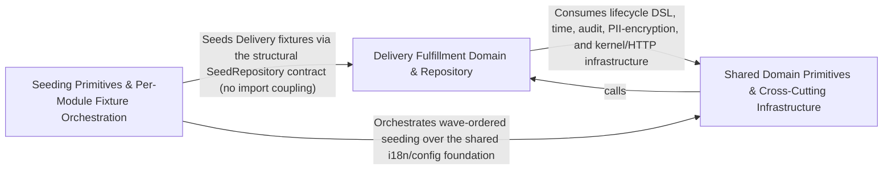

---
tags:
  - 2brain
  - 2brain/arch
  - project/boilerplate-node-backend
type: architecture
component: Per_Module_Seeders_Scenario_Entry_Points
---

## Details

The heart of the subsystem — the shared seeding primitive and the per-module seeders that compose it. scenarios/seed.ts defines SeedRepository, OwnedSeedRepository, insertIfAbsent (keyed by pinned _id) and insertIfAbsentForOwner (keyed by userId for carts/wishlists/address books). Each module file (accounts.ts, addresses.ts, products.ts, example.ts, blank.ts, locales.ts, …) declares its fixtures with pinned ids, exposes a seed*Collection function, and registers a shopModule entry (regenerated into shop-modules.generated.ts). The scenario entry points seedBlank and seedExampleCollection (and the shop runner) orchestrate the waves: access model first, then users + baseline modules concurrently, then domain modules in dependency order. This is the only group that is the seeding subsystem proper; the others are its environment and consumers.

### Delivery Fulfillment Domain & Repository
The delivery bounded context's domain logic and persistence layer. The fulfillment domain module encapsulates order-line grouping (groupOrderLines), remainder computation and cancellation (remainderLines, withRemainderCancelled), promised-date derivation (promisedAt), and status projection (statusOfLines, kindOf). The repository layer (fulfillmentOrderRepository) exposes query shapes (BoardFilters, ProductSummaryRow, LossRecord) for the delivery board and loss-tracking views. PII handling is co-located: encryptDestination encrypts delivery addresses at the domain boundary so that stored rows never carry plaintext. Supporting domain files (lost.ts, preorder.ts, rates.ts, cancel-remainder.ts, cut.ts) model the delivery lifecycle states (lost, pre-order, rate calculation, remainder cancellation, cut-off) that the scenario seeders populate with pinned fixture rows. This is the unit of value the seeding subsystem targets: one self-contained, deletable domain module whose repository satisfies the SeedRepository contract without importing it.

**Related Classes/Methods**:

- `src.modules.delivery.domain.fulfillment.groupOrderLines`:170-223
- `src.modules.delivery.repository.fulfillmentOrderRepository`:177-496
- `src.modules.delivery.pii.encryptDestination`:45-51
- `src.modules.delivery.domain.fulfillment.promisedAt`:145-146

**Source Files:**

- `src/modules/delivery/domain/fulfillment.ts`
  - `src.modules.delivery.domain.fulfillment.remainingOf` (L81-L82) - Class
  - `src.modules.delivery.domain.fulfillment.remainingOf.lines.reduce() callback` (L82-L82) - Function
  - `src.modules.delivery.domain.fulfillment.kindOf` (L88-L89) - Class
  - `src.modules.delivery.domain.fulfillment.kindOf.lines.some() callback` (L89-L89) - Function
  - `src.modules.delivery.domain.fulfillment.promisedAt` (L145-L146) - Class
  - `src.modules.delivery.domain.fulfillment.promisedAt.group.map() callback` (L146-L146) - Function
  - `src.modules.delivery.domain.fulfillment.groupOrderLines` (L170-L223) - Class
  - `src.modules.delivery.domain.fulfillment.groupOrderLines.openGroup.lines.group.map() callback` (L195-L195) - Function
  - `src.modules.delivery.domain.fulfillment.groupOrderLines.drafts` (L200-L220) - Class
  - `src.modules.delivery.domain.fulfillment.groupOrderLines.drafts.toSorted() callback` (L204-L204) - Function
  - `src.modules.delivery.domain.fulfillment.groupOrderLines.drafts.map() callback.lines.group.map() callback` (L206-L206) - Function
  - `src.modules.delivery.domain.fulfillment.groupOrderLines.drafts.map() callback.lines.lines.map() callback` (L212-L212) - Function
  - `src.modules.delivery.domain.fulfillment.groupOrderLines.drafts.map() callback` (L222-L222) - Function
  - `src.modules.delivery.domain.fulfillment.statusOfLines` (L233-L248) - Class
  - `src.modules.delivery.domain.fulfillment.statusOfLines.lines.some() callback` (L245-L245) - Function
  - `src.modules.delivery.domain.fulfillment.checkShipLines.left` (L275-L275) - Class
  - `src.modules.delivery.domain.fulfillment.checkShipLines.left.lines.map() callback` (L275-L275) - Function
  - `src.modules.delivery.domain.fulfillment.withShipped` (L317-L326) - Class
  - `src.modules.delivery.domain.fulfillment.withShipped.lines.map() callback` (L322-L325) - Function
  - `src.modules.delivery.domain.fulfillment.withRemainderCanceled` (L332-L336) - Class
  - `src.modules.delivery.domain.fulfillment.withRemainderCanceled.lines.map() callback` (L333-L336) - Function
  - `src.modules.delivery.domain.fulfillment.remainderLines` (L343-L346) - Class
  - `src.modules.delivery.domain.fulfillment.remainderLines.lines.filter() callback` (L345-L345) - Function
  - `src.modules.delivery.domain.fulfillment.remainderLines.map() callback` (L346-L346) - Function
  - `src.modules.delivery.domain.fulfillment.summarize.units` (L383-L384) - Class
  - `src.modules.delivery.domain.fulfillment.summarize.units.group.reduce() callback` (L384-L384) - Function
- `src/modules/delivery/domain/lost.ts`
  - `src.modules.delivery.domain.lost.withLoss` (L66-L80) - Class
  - `src.modules.delivery.domain.lost.withLoss.lines.map() callback` (L74-L78) - Function
  - `src.modules.delivery.domain.lost.withLoss.filter() callback` (L79-L79) - Function
  - `src.modules.delivery.domain.lost.withRestoration.updated` (L143-L152) - Class
  - `src.modules.delivery.domain.lost.withRestoration.updated.lines.map() callback` (L143-L152) - Function
- `src/modules/delivery/domain/preorder.ts`
  - `src.modules.delivery.domain.preorder.SlipFacts` (L35-L42) - Interface
  - `src.modules.delivery.domain.preorder.expectedDateOf` (L68-L79) - Class
  - `src.modules.delivery.domain.preorder.expectedDateOf.dates` (L72-L74) - Class
  - `src.modules.delivery.domain.preorder.expectedDateOf.dates.lines.filter() callback` (L73-L73) - Function
  - `src.modules.delivery.domain.preorder.expectedDateOf.dates.map() callback` (L74-L74) - Function
  - `src.modules.delivery.domain.preorder.MoveFacts` (L103-L108) - Interface
- `src/modules/delivery/domain/rates.ts`
  - `src.modules.delivery.domain.rates.cheapestStandardShipping.prices.SHIPPING_METHODS.filter() callback` (L123-L123) - Function
  - `src.modules.delivery.domain.rates.cheapestStandardShipping.prices.map() callback` (L123-L124) - Function
  - `src.modules.delivery.domain.rates.cheapestStandardShipping.prices` (L123-L125) - Class
- `src/modules/delivery/pii.ts`
  - `src.modules.delivery.pii.encryptDestination` (L45-L51) - Class
  - `src.modules.delivery.pii.encryptDestination.mapDestination() callback` (L49-L50) - Function
- `src/modules/delivery/repository.ts`
  - `src.modules.delivery.repository.BoardFilters` (L45-L56) - Interface
  - `src.modules.delivery.repository.ProductSummaryRow` (L59-L69) - Interface
  - `src.modules.delivery.repository.boardWhere.orderId.$in.filters.orderIds.map() callback` (L144-L144) - Function
  - `src.modules.delivery.repository.fulfillmentOrderRepository` (L177-L496) - Class
  - `src.modules.delivery.repository.fulfillmentOrderRepository.findByOrderId` (L226-L231) - Method
  - `src.modules.delivery.repository.fulfillmentOrderRepository.findByOrderIds` (L238-L242) - Method
  - `src.modules.delivery.repository.fulfillmentOrderRepository.findByOrderIds.orderId.$in.orderIds.map() callback` (L240-L240) - Function
  - `src.modules.delivery.repository.fulfillmentOrderRepository.findInSession` (L249-L250) - Method
  - `src.modules.delivery.repository.fulfillmentOrderRepository.insertIfAbsent` (L263-L287) - Method
  - `src.modules.delivery.repository.fulfillmentOrderRepository.insertIfAbsent.then() callback` (L287-L287) - Function
  - `src.modules.delivery.repository.fulfillmentOrderRepository.claim` (L299-L312) - Method
  - `src.modules.delivery.repository.fulfillmentOrderRepository.findWaitingForProduct` (L319-L328) - Method
  - `src.modules.delivery.repository.fulfillmentOrderRepository.findDatePassed` (L336-L343) - Method
  - `src.modules.delivery.repository.fulfillmentOrderRepository.searchBoard` (L353-L364) - Method
  - `src.modules.delivery.repository.fulfillmentOrderRepository.searchBoard.then() callback` (L363-L363) - Function
  - `src.modules.delivery.repository.fulfillmentOrderRepository.summarizeProducts` (L377-L474) - Method
  - `src.modules.delivery.repository.fulfillmentOrderRepository.summarizeProducts.then() callback` (L469-L472) - Function
  - `src.modules.delivery.repository.fulfillmentOrderRepository.summarizeProducts.then() callback.items.result.items.map() callback` (L470-L470) - Function
  - `src.modules.delivery.repository.fulfillmentOrderRepository.scrubHoldNotesBefore` (L487-L495) - Method
  - `src.modules.delivery.repository.fulfillmentOrderRepository.scrubHoldNotesBefore.then() callback` (L495-L495) - Function
  - `src.modules.delivery.repository.LossRecord` (L499-L506) - Interface
- `src/modules/delivery/services/cancel-remainder.ts`
  - `src.modules.delivery.services.cancel-remainder.cancelRemainder.otherLive` (L96-L99) - Class
  - `src.modules.delivery.services.cancel-remainder.cancelRemainder.otherLive.others.some() callback` (L97-L98) - Function
  - `src.modules.delivery.services.cancel-remainder.cancelAllForOrder` (L135-L156) - Class
  - `src.modules.delivery.services.cancel-remainder.cancelAllForOrder.runAct() callback` (L136-L156) - Function
  - `src.modules.delivery.services.cancel-remainder.cancelAllForOrder.then() callback` (L156-L156) - Function
- `src/modules/delivery/services/cut.ts`
  - `src.modules.delivery.services.cut.CutInput` (L21-L36) - Interface
  - `src.modules.delivery.services.cut.Cut` (L39-L42) - Interface
  - `src.modules.delivery.services.cut.destinationFor` (L51-L61) - Class
  - `src.modules.delivery.services.cut.destinationFor.then() callback` (L57-L60) - Function
  - `src.modules.delivery.services.cut.cutShipment` (L111-L148) - Class
  - `src.modules.delivery.services.cut.cutShipment.then() callback` (L128-L147) - Function
  - `src.modules.delivery.services.cut.cutShipment.then() callback.then() callback` (L134-L145) - Function
  - `src.modules.delivery.services.cut.cutShipment.then() callback.then() callback.then() callback` (L140-L144) - Function
  - `src.modules.delivery.services.cut.cutShipment.then() callback.then() callback.then() callback.then() callback` (L144-L144) - Function
- `src/modules/delivery/services/digest.ts`
  - `src.modules.delivery.services.digest.countAwaitingTracking` (L47-L63) - Class
  - `src.modules.delivery.services.digest.countAwaitingTracking.shipments.filter() callback` (L60-L61) - Function
  - `src.modules.delivery.services.digest.deliveryDigest` (L71-L97) - Class
  - `src.modules.delivery.services.digest.deliveryDigest.holdReason.$in.filter() callback` (L82-L82) - Function
  - `src.modules.delivery.services.digest.deliveryDigest.then() callback` (L92-L97) - Function
- `src/modules/delivery/services/ensure.ts`
  - `src.modules.delivery.services.ensure.groupableLinesOf` (L26-L44) - Class
  - `src.modules.delivery.services.ensure.groupableLinesOf.order.items.map() callback` (L27-L44) - Function
  - `src.modules.delivery.services.ensure.ensureFulfillmentOrders` (L57-L88) - Class
  - `src.modules.delivery.services.ensure.ensureFulfillmentOrders.then() callback` (L58-L88) - Function
  - `src.modules.delivery.services.ensure.ensureFulfillmentOrders.then() callback.then() callback` (L61-L87) - Function
  - `src.modules.delivery.services.ensure.ensureFulfillmentOrders.then() callback.then() callback.withTransaction() callback` (L65-L82) - Function
  - `src.modules.delivery.services.ensure.ensureFulfillmentOrders.then() callback.then() callback.catch() callback` (L82-L86) - Function
- `src/modules/delivery/services/found.ts`
  - `src.modules.delivery.services.found.closeOwed` (L111-L132) - Class
  - `src.modules.delivery.services.found.closeOwed.orders.filter() callback` (L116-L116) - Function
  - `src.modules.delivery.services.found.restoreLostShipment` (L144-L185) - Class
  - `src.modules.delivery.services.found.restoreLostShipment.facts.lines.flatMap() callback` (L175-L181) - Function
- `src/modules/delivery/services/lost.ts`
  - `src.modules.delivery.services.lost.lostAct` (L66-L158) - Class
  - `src.modules.delivery.services.lost.lostAct.owed.taken.filter() callback` (L108-L108) - Function
  - `src.modules.delivery.services.lost.lostAct.owed.map() callback` (L109-L109) - Function
  - `src.modules.delivery.services.lost.lostAct.titleOf` (L128-L129) - Method
  - `src.modules.delivery.services.lost.lostAct.titleOf.shipment.lines.find() callback` (L129-L129) - Function
  - `src.modules.delivery.services.lost.lostAct.owed.owed.map() callback` (L148-L151) - Function
  - `src.modules.delivery.services.lost.lostAct.owed.owed.map() callback.title.shipment.lines.find() callback` (L149-L149) - Function
- `src/modules/delivery/services/override-sync.ts`
  - `src.modules.delivery.services.override-sync.shipRemainder` (L31-L49) - Class
  - `src.modules.delivery.services.override-sync.shipRemainder.then() callback` (L49-L49) - Function
  - `src.modules.delivery.services.override-sync.syncWithOverride` (L76-L86) - Class
  - `src.modules.delivery.services.override-sync.syncWithOverride.runAct() callback` (L79-L85) - Function
  - `src.modules.delivery.services.override-sync.syncWithOverride.then() callback` (L85-L85) - Function
- `src/modules/delivery/services/owed.ts`
  - `src.modules.delivery.services.owed.Owed` (L21-L24) - Interface
  - `src.modules.delivery.services.owed.OwedOrigin` (L27-L33) - Interface
  - `src.modules.delivery.services.owed.promiseFor` (L40-L50) - Class
  - `src.modules.delivery.services.owed.promiseFor.owed.map() callback` (L41-L41) - Function
  - `src.modules.delivery.services.owed.promiseFor.then() callback` (L41-L49) - Function
  - `src.modules.delivery.services.owed.promiseFor.then() callback.owed.map() callback` (L44-L45) - Function
  - `src.modules.delivery.services.owed.promiseFor.then() callback.owed.map() callback.products.find() callback` (L45-L45) - Function
  - `src.modules.delivery.services.owed.createOwedFulfillmentOrder.lines.owed.map() callback` (L72-L78) - Function
  - `src.modules.delivery.services.owed.lines` (L72-L78) - Class
  - `src.modules.delivery.services.owed.createOwedFulfillmentOrder.number.siblings.map() callback` (L82-L82) - Function
- `src/modules/delivery/services/process.ts`
  - `src.modules.delivery.services.process.listMethods.methods.SHIPPING_METHODS.map() callback` (L36-L36) - Function
  - `src.modules.delivery.services.process.processOrder` (L56-L80) - Class
  - `src.modules.delivery.services.process.processOrder.then() callback` (L61-L80) - Function
  - `src.modules.delivery.services.process.then() callback.then() callback` (L68-L68) - Function
  - `src.modules.delivery.services.process.processOrder.then() callback.then() callback` (L69-L79) - Function
- `src/modules/delivery/services/progress.ts`
  - `src.modules.delivery.services.progress.ProgressReport` (L19-L25) - Interface
  - `src.modules.delivery.services.progress.reportProgress` (L36-L53) - Class
  - `src.modules.delivery.services.progress.reportProgress.then() callback` (L38-L52) - Function
  - `src.modules.delivery.services.progress.reportProgress.then() callback.then() callback` (L39-L52) - Function
  - `src.modules.delivery.services.progress.reportProgress.then() callback.then() callback.then() callback` (L43-L51) - Function
  - `src.modules.delivery.services.progress.settleOrder` (L87-L97) - Class
  - `src.modules.delivery.services.progress.settleOrder.then() callback` (L93-L97) - Function
- `src/modules/delivery/services/read.ts`
  - `src.modules.delivery.services.read.listFulfillmentOrdersForOrder` (L40-L62) - Class
  - `src.modules.delivery.services.read.listFulfillmentOrdersForOrder.then() callback` (L44-L62) - Function
  - `src.modules.delivery.services.read.listFulfillmentOrdersForOrder.then() callback.then() callback` (L51-L60) - Function
  - `src.modules.delivery.services.read.listFulfillmentOrdersForOrder.then() callback.then() callback.fulfillmentOrders.map() callback` (L53-L58) - Function
  - `src.modules.delivery.services.read.shippedQuantities` (L168-L177) - Class
  - `src.modules.delivery.services.read.shippedQuantities.then() callback` (L169-L177) - Function
  - `src.modules.delivery.services.read.shippedQuantities.then() callback.filter() callback` (L175-L175) - Function
  - `src.modules.delivery.services.read.shippedQuantities.then() callback.map() callback` (L176-L176) - Function
  - `src.modules.delivery.services.read.RemainderOption` (L180-L185) - Interface
  - `src.modules.delivery.services.read.remainderOptions.then() callback.live` (L198-L198) - Class
  - `src.modules.delivery.services.read.remainderOptions.then() callback.live.all.filter() callback` (L198-L198) - Function
  - `src.modules.delivery.services.read.remainderOptions.then() callback.live.map() callback` (L201-L211) - Function
  - `src.modules.delivery.services.read.remainderOptions.then() callback.live.map() callback.lines.fulfillmentOrder.lines.filter() callback` (L205-L205) - Function
  - `src.modules.delivery.services.read.remainderOptions.then() callback.live.map() callback.lines.map() callback` (L206-L210) - Function
- `src/modules/delivery/services/release-allocated.ts`
  - `src.modules.delivery.services.release-allocated.waitingOn` (L27-L30) - Class
  - `src.modules.delivery.services.release-allocated.waitingOn.fulfillmentOrder.lines.filter() callback` (L29-L29) - Function
  - `src.modules.delivery.services.release-allocated.waitingOn.reduce() callback` (L30-L30) - Function
  - `src.modules.delivery.services.release-allocated.heldFor` (L39-L55) - Class
  - `src.modules.delivery.services.release-allocated.heldFor.then() callback` (L42-L54) - Function
  - `src.modules.delivery.services.release-allocated.heldFor.then() callback.all.filter() callback` (L45-L48) - Function
  - `src.modules.delivery.services.release-allocated.heldFor.then() callback.toSorted() callback` (L51-L53) - Function
  - `src.modules.delivery.services.release-allocated.releaseAllocated` (L65-L83) - Class
  - `src.modules.delivery.services.release-allocated.releaseAllocated.then() callback` (L73-L83) - Function
  - `src.modules.delivery.services.release-allocated.releaseAllocated.then() callback.total` (L74-L74) - Class
  - `src.modules.delivery.services.release-allocated.releaseAllocated.then() callback.total.held.reduce() callback` (L74-L74) - Function
- `src/modules/delivery/services/release-date-impact.ts`
  - `src.modules.delivery.services.release-date-impact.verdictsFor` (L66-L90) - Class
  - `src.modules.delivery.services.release-date-impact.verdictsFor.then() callback` (L75-L89) - Function
  - `src.modules.delivery.services.release-date-impact.verdictsFor.then() callback.waiting.flatMap() callback` (L81-L88) - Function
  - `src.modules.delivery.services.release-date-impact.previewDateImpact` (L111-L126) - Class
  - `src.modules.delivery.services.release-date-impact.previewDateImpact.then() callback` (L116-L126) - Function
  - `src.modules.delivery.services.release-date-impact.previewDateImpact.then() callback.then() callback` (L125-L125) - Function
- `src/modules/delivery/services/reship.ts`
  - `src.modules.delivery.services.reship.reopenForReplacement` (L67-L112) - Class
  - `src.modules.delivery.services.reship.reopenForReplacement.titleOf` (L98-L100) - Method
  - `src.modules.delivery.services.reship.reopenForReplacement.titleOf.find() callback` (L99-L99) - Function
  - `src.modules.delivery.services.reship.reopenForReplacement.titleOf.orders.flatMap() callback` (L99-L99) - Function
- `src/modules/delivery/services/split.ts`
  - `src.modules.delivery.services.split.Split` (L28-L33) - Interface
  - `src.modules.delivery.services.split.splitAct.released.number.siblings.map() callback` (L133-L133) - Function
  - `src.modules.delivery.services.split.splitForAllocation` (L163-L177) - Class
  - `src.modules.delivery.services.split.splitForAllocation.then() callback` (L167-L177) - Function
  - `src.modules.delivery.services.split.splitForAllocation.then() callback.then() callback` (L170-L176) - Function
  - `src.modules.delivery.services.split.splitForAllocation.then() callback.then() callback.runAct() callback` (L173-L173) - Function
  - `src.modules.delivery.services.split.splitForAllocation.then() callback.then() callback.then() callback` (L174-L174) - Function

### Shared Domain Primitives & Cross-Cutting Infrastructure
The kernel-level primitives and infrastructure utilities that every domain module (including delivery) composes. The lifecycle primitive (defineLifecycle, Lifecycle, LifecycleEvent, LifecycleTable) provides a declarative state-machine DSL: modules declare their states and transitions once, then query canTransition, reachableFrom, fromOf, toOf at runtime — this is the same mechanism the delivery module uses to model its fulfillment states. The time primitive (dayInZone) gives zone-aware date fields used across modules for cut-off and promised-date logic. The audit-changes infrastructure (AuditChanges, AuditedFields) tracks which fields changed on a document for audit-log emission. PII re-encryption (reencrypt.ts) and password hashing (password-hash.ts) are the security primitives that the seeding path deliberately routes through create() (rather than updateOne({upsert:true})) so these hooks still fire on first insert. Reship logic and presenter helpers round out the shared surface. This group is the kernel + infrastructure backbone: it knows no domain, and every module above it depends on it.

**Related Classes/Methods**:

- `src.domain-primitives.lifecycle.defineLifecycle`:65-112
- `src.domain-primitives.lifecycle.Lifecycle`:36-55

**Source Files:**

- `src/domain-primitives/lifecycle.ts`
  - `src.domain-primitives.lifecycle.LifecycleEvent` (L14-L21) - Interface
  - `src.domain-primitives.lifecycle.LifecycleTable` (L24-L33) - Interface
  - `src.domain-primitives.lifecycle.Lifecycle` (L36-L55) - Interface
  - `src.domain-primitives.lifecycle.defineLifecycle` (L65-L112) - Class
  - `src.domain-primitives.lifecycle.eventsFrom` (L97-L98) - Class
  - `src.domain-primitives.lifecycle.defineLifecycle.eventsFrom.names.filter() callback` (L98-L98) - Function
  - `src.domain-primitives.lifecycle.defineLifecycle.fromOf` (L103-L103) - Method
  - `src.domain-primitives.lifecycle.defineLifecycle.toOf` (L104-L104) - Method
  - `src.domain-primitives.lifecycle.defineLifecycle.reachableFrom` (L106-L108) - Method
  - `src.domain-primitives.lifecycle.defineLifecycle.reachableFrom.map() callback` (L107-L107) - Function
  - `src.domain-primitives.lifecycle.defineLifecycle.canTransition` (L109-L110) - Method
  - `src.domain-primitives.lifecycle.defineLifecycle.canTransition.some() callback` (L110-L110) - Function
- `src/domain-primitives/time.ts`
  - `src.domain-primitives.time.dayInZone.field` (L78-L79) - Class
  - `src.domain-primitives.time.dayInZone.field.parts.find() callback` (L79-L79) - Function
- `src/infrastructure/observability/audit-changes.ts`
  - `src.infrastructure.observability.audit-changes.FieldChange` (L16-L19) - Interface
  - `src.infrastructure.observability.audit-changes.AuditChanges` (L34-L39) - Interface
  - `src.infrastructure.observability.audit-changes.AuditedFields` (L42-L47) - Interface
  - `src.infrastructure.observability.audit-changes.auditChanges.changes` (L78-L82) - Class
  - `src.infrastructure.observability.audit-changes.auditChanges.changes.fields.valued.filter() callback` (L80-L80) - Function
  - `src.infrastructure.observability.audit-changes.auditChanges.changes.map() callback` (L81-L81) - Function
- `src/infrastructure/security/password-hash.ts`
  - `src.infrastructure.security.password-hash.hashPassword` (L70-L81) - Class
  - `src.infrastructure.security.password-hash.hashPassword.then() callback` (L78-L79) - Function
- `src/infrastructure/security/reencrypt.ts`
  - `src.infrastructure.security.reencrypt.reencryptOf` (L79-L82) - Class
  - `src.infrastructure.security.reencrypt.reencryptOf.<function>` (L81-L82) - Function
  - `src.infrastructure.security.reencrypt.reencryptCollection` (L146-L177) - Class
  - `src.infrastructure.security.reencrypt.reencryptCollection.then() callback` (L164-L176) - Function
  - `src.infrastructure.security.reencrypt.reencryptCollection.then() callback.apply.then() callback` (L170-L175) - Function
- `src/modules/delivery/domain/reship.ts`
  - `src.modules.delivery.domain.reship.planReopening` (L37-L59) - Class
  - `src.modules.delivery.domain.reship.planReopening.map() callback` (L58-L58) - Function
- `src/modules/delivery/pii.ts`
  - `src.modules.delivery.pii.decryptDestination` (L58-L61) - Class
  - `src.modules.delivery.pii.decryptDestination.mapDestination() callback` (L59-L60) - Function
- `src/modules/delivery/presenter.ts`
  - `src.modules.delivery.presenter.presentLines` (L30-L38) - Class
  - `src.modules.delivery.presenter.presentLines.lines.map() callback` (L31-L38) - Function
  - `src.modules.delivery.presenter.presentExportShipment.lines.shipment.lines.map() callback` (L77-L81) - Function
- `src/modules/delivery/repository.ts`
  - `src.modules.delivery.repository.shipmentRepository` (L509-L716) - Class
  - `src.modules.delivery.repository.shipmentRepository.findByOrderId` (L551-L556) - Method
  - `src.modules.delivery.repository.shipmentRepository.findByOrderIds` (L564-L568) - Method
  - `src.modules.delivery.repository.shipmentRepository.findByOrderIds.orderId.$in.orderIds.map() callback` (L566-L566) - Function
  - `src.modules.delivery.repository.shipmentRepository.findByFulfillmentOrderIds` (L575-L580) - Method
  - `src.modules.delivery.repository.shipmentRepository.findByFulfillmentOrderIds.fulfillmentOrderId.$in.fulfillmentOrderIds.map() callback` (L578-L578) - Function
  - `src.modules.delivery.repository.shipmentRepository.findInSession` (L587-L587) - Method
  - `src.modules.delivery.repository.shipmentRepository.nextNumber` (L596-L601) - Method
  - `src.modules.delivery.repository.shipmentRepository.nextNumber.then() callback` (L601-L601) - Function
  - `src.modules.delivery.repository.shipmentRepository.markDelivered` (L614-L624) - Method
  - `src.modules.delivery.repository.shipmentRepository.markLost` (L633-L648) - Method
  - `src.modules.delivery.repository.shipmentRepository.markFound` (L657-L667) - Method
  - `src.modules.delivery.repository.shipmentRepository.scrubLostNotesBefore` (L676-L684) - Method
  - `src.modules.delivery.repository.shipmentRepository.scrubLostNotesBefore.then() callback` (L684-L684) - Function
  - `src.modules.delivery.repository.shipmentRepository.setTrackingCode` (L692-L699) - Method
  - `src.modules.delivery.repository.shipmentRepository.unsetDestinations` (L707-L715) - Method
  - `src.modules.delivery.repository.shipmentRepository.unsetDestinations.then() callback` (L715-L715) - Function
- `src/modules/delivery/services/act.ts`
  - `src.modules.delivery.services.act.ActRefusal` (L27-L38) - Class
  - `src.modules.delivery.services.act.ActRefusal.constructor` (L34-L37) - Constructor
  - `src.modules.delivery.services.act.runAct` (L71-L80) - Class
  - `src.modules.delivery.services.act.runAct.then() callback` (L73-L76) - Function
  - `src.modules.delivery.services.act.runAct.catch() callback` (L77-L80) - Function
- `src/modules/delivery/services/deliver.ts`
  - `src.modules.delivery.services.deliver.Delivered` (L35-L40) - Interface
  - `src.modules.delivery.services.deliver.deliverShipment` (L88-L114) - Class
  - `src.modules.delivery.services.deliver.deliverShipment.runAct() callback` (L93-L93) - Function
  - `src.modules.delivery.services.deliver.deliverShipment.then() callback` (L93-L113) - Function
- `src/modules/delivery/services/found.ts`
  - `src.modules.delivery.services.found.planFor.facts.lines.shipment.lines.map() callback` (L38-L42) - Function
  - `src.modules.delivery.services.found.planFor.restoration.orders.map() callback` (L48-L52) - Function
  - `src.modules.delivery.services.found.restorableIds` (L63-L79) - Class
  - `src.modules.delivery.services.found.restorableIds.then() callback` (L72-L77) - Function
  - `src.modules.delivery.services.found.restorableIds.then() callback.lost.filter() callback` (L75-L75) - Function
  - `src.modules.delivery.services.found.restorableIds.then() callback.map() callback` (L76-L76) - Function
  - `src.modules.delivery.services.found.viewShipmentOf` (L88-L95) - Class
  - `src.modules.delivery.services.found.viewShipmentOf.then() callback` (L93-L94) - Function
  - `src.modules.delivery.services.found.restoreLostShipment.origin` (L157-L157) - Class
  - `src.modules.delivery.services.found.restoreLostShipment.origin.orders.find() callback` (L157-L157) - Function
- `src/modules/delivery/services/fulfill.ts`
  - `src.modules.delivery.services.fulfill.Fulfilled` (L38-L41) - Interface
  - `src.modules.delivery.services.fulfill.fulfillFulfillmentOrder` (L97-L127) - Class
  - `src.modules.delivery.services.fulfill.fulfillFulfillmentOrder.runAct() callback` (L104-L104) - Function
  - `src.modules.delivery.services.fulfill.fulfillFulfillmentOrder.then() callback` (L105-L125) - Function
  - `src.modules.delivery.services.fulfill.fulfillFulfillmentOrder.then() callback.shipment.lines.map() callback` (L112-L112) - Function
  - `src.modules.delivery.services.fulfill.then() callback.then() callback` (L113-L121) - Function
  - `src.modules.delivery.services.fulfill.fulfillFulfillmentOrder.then() callback.then() callback` (L122-L123) - Function
- `src/modules/delivery/services/holds.ts`
  - `src.modules.delivery.services.holds.HoldInput` (L33-L40) - Interface
  - `src.modules.delivery.services.holds.Changed` (L43-L48) - Interface
  - `src.modules.delivery.services.holds.guarded` (L134-L160) - Class
  - `src.modules.delivery.services.holds.guarded.then() callback` (L141-L160) - Function
  - `src.modules.delivery.services.holds.guarded.then() callback.then() callback` (L155-L158) - Function
  - `src.modules.delivery.services.holds.holdFulfillmentOrder` (L170-L182) - Class
  - `src.modules.delivery.services.holds.holdFulfillmentOrder.guarded() callback` (L178-L178) - Function
  - `src.modules.delivery.services.holds.releaseFulfillmentOrder` (L191-L202) - Class
  - `src.modules.delivery.services.holds.releaseFulfillmentOrder.guarded() callback` (L198-L198) - Function
- `src/modules/delivery/services/lost.ts`
  - `src.modules.delivery.services.lost.LostInput` (L37-L44) - Interface
  - `src.modules.delivery.services.lost.Lost` (L47-L50) - Interface
  - `src.modules.delivery.services.lost.lostAct.lines` (L102-L105) - Class
  - `src.modules.delivery.services.lost.lostAct.lines.shipment.lines.map() callback` (L102-L105) - Function
  - `src.modules.delivery.services.lost.owed` (L107-L109) - Class
  - `src.modules.delivery.services.lost.markShipmentLost` (L169-L195) - Class
  - `src.modules.delivery.services.lost.markShipmentLost.runAct() callback` (L175-L175) - Function
  - `src.modules.delivery.services.lost.markShipmentLost.then() callback` (L175-L195) - Function
  - `src.modules.delivery.services.lost.then() callback.then() callback` (L189-L189) - Function
  - `src.modules.delivery.services.lost.markShipmentLost.then() callback.then() callback` (L190-L193) - Function
- `src/modules/delivery/services/preorder-sweep.ts`
  - `src.modules.delivery.services.preorder-sweep.noticeOne` (L38-L52) - Class
  - `src.modules.delivery.services.preorder-sweep.noticeOne.runAct() callback` (L39-L52) - Function
  - `src.modules.delivery.services.preorder-sweep.noticeOne.then() callback` (L52-L52) - Function
- `src/modules/delivery/services/read.ts`
  - `src.modules.delivery.services.read.listShipmentsForOrder` (L71-L95) - Class
  - `src.modules.delivery.services.read.listShipmentsForOrder.then() callback` (L75-L95) - Function
  - `src.modules.delivery.services.read.listShipmentsForOrder.then() callback.then() callback` (L80-L93) - Function
  - `src.modules.delivery.services.read.listShipmentsForOrder.then() callback.then() callback.then() callback` (L82-L92) - Function
  - `src.modules.delivery.services.read.listShipmentsForOrder.then() callback.then() callback.then() callback.shipments.map() callback` (L84-L90) - Function
  - `src.modules.delivery.services.read.getShipment` (L120-L136) - Class
  - `src.modules.delivery.services.read.getShipment.then() callback` (L124-L136) - Function
  - `src.modules.delivery.services.read.getShipment.then() callback.then() callback` (L129-L134) - Function
  - `src.modules.delivery.services.read.getShipment.then() callback.then() callback.then() callback` (L131-L132) - Function
  - `src.modules.delivery.services.read.getFulfillmentOrder` (L146-L160) - Class
  - `src.modules.delivery.services.read.getFulfillmentOrder.then() callback` (L150-L160) - Function
  - `src.modules.delivery.services.read.getFulfillmentOrder.then() callback.then() callback` (L155-L158) - Function
  - `src.modules.delivery.services.read.remainderOptions` (L196-L212) - Class
  - `src.modules.delivery.services.read.remainderOptions.then() callback` (L197-L212) - Function
- `src/modules/delivery/services/reencrypt.ts`
  - `src.modules.delivery.services.reencrypt.fieldsOf` (L15-L28) - Class
  - `src.modules.delivery.services.reencrypt.fieldsOf.POSTAL_ADDRESS_FIELDS.flatMap() callback` (L16-L28) - Function
- `src/modules/delivery/services/reship.ts`
  - `src.modules.delivery.services.reship.reopenForReplacement.reopenings` (L76-L84) - Class
  - `src.modules.delivery.services.reship.reopenForReplacement.reopenings.orders.map() callback` (L77-L82) - Function
  - `src.modules.delivery.services.reship.reopenForReplacement.owed` (L89-L91) - Class
  - `src.modules.delivery.services.reship.reopenForReplacement.owed.taken.filter() callback` (L90-L90) - Function
  - `src.modules.delivery.services.reship.reopenForReplacement.owed.map() callback` (L91-L91) - Function
- `src/modules/delivery/services/ship.ts`
  - `src.modules.delivery.services.ship.ShipInput` (L43-L48) - Interface
  - `src.modules.delivery.services.ship.Shipped` (L51-L55) - Interface
  - `src.modules.delivery.services.ship.afterShipped` (L142-L151) - Class
  - `src.modules.delivery.services.ship.afterShipped.shipped.shipment.lines.map() callback` (L143-L143) - Function
  - `src.modules.delivery.services.ship.afterShipped.then() callback` (L143-L151) - Function
  - `src.modules.delivery.services.ship.shipFulfillmentOrder` (L162-L185) - Class
  - `src.modules.delivery.services.ship.shipFulfillmentOrder.runAct() callback` (L171-L171) - Function
  - `src.modules.delivery.services.ship.shipFulfillmentOrder.then() callback` (L172-L183) - Function
  - `src.modules.delivery.services.ship.shipFulfillmentOrder.then() callback.then() callback` (L177-L181) - Function
- `src/modules/delivery/services/slip.ts`
  - `src.modules.delivery.services.slip.expectedFrom` (L39-L49) - Class
  - `src.modules.delivery.services.slip.expectedFrom.fulfillmentOrder.lines.map() callback` (L41-L41) - Function
  - `src.modules.delivery.services.slip.expectedFrom.then() callback` (L42-L48) - Function
  - `src.modules.delivery.services.slip.expectedFrom.then() callback.expectedDateOfWaiting() callback` (L43-L48) - Function
  - `src.modules.delivery.services.slip.judgeOne` (L132-L143) - Class
  - `src.modules.delivery.services.slip.judgeOne.runAct() callback` (L133-L143) - Function
  - `src.modules.delivery.services.slip.judgeOne.then() callback` (L143-L143) - Function
- `src/modules/delivery/services/split.ts`
  - `src.modules.delivery.services.split.splitAct.covers` (L98-L101) - Class
  - `src.modules.delivery.services.split.splitAct.covers.held.lines.every() callback` (L98-L101) - Function
- `src/modules/delivery/services/tracking.ts`
  - `src.modules.delivery.services.tracking.editShipmentTracking` (L76-L104) - Class
  - `src.modules.delivery.services.tracking.editShipmentTracking.then() callback` (L82-L104) - Function
  - `src.modules.delivery.services.tracking.editShipmentTracking.then() callback.then() callback` (L89-L103) - Function
  - `src.modules.delivery.services.tracking.then() callback.then() callback.then() callback` (L93-L94) - Function
  - `src.modules.delivery.services.tracking.editShipmentTracking.then() callback.then() callback.then() callback` (L97-L102) - Function
  - `src.modules.delivery.services.tracking.then() callback.then() callback.then() callback.then() callback` (L100-L100) - Function
  - `src.modules.delivery.services.tracking.editShipmentTracking.then() callback.then() callback.then() callback.then() callback` (L101-L101) - Function
- `src/modules/invoicing/pii.ts`
  - `src.modules.invoicing.pii.encryptInvoiceParty` (L60-L65) - Class
  - `src.modules.invoicing.pii.encryptInvoiceParty.mapParty() callback` (L65-L65) - Function
  - `src.modules.invoicing.pii.decryptInvoiceParty` (L72-L79) - Class
  - `src.modules.invoicing.pii.decryptInvoiceParty.mapParty() callback` (L77-L78) - Function
- `src/modules/invoicing/services/for-caller.ts`
  - `src.modules.invoicing.services.for-caller.ReadFor` (L28-L31) - Interface
  - `src.modules.invoicing.services.for-caller.invoiceForCaller` (L77-L94) - Class
  - `src.modules.invoicing.services.for-caller.invoiceForCaller.then() callback` (L81-L94) - Function
  - `src.modules.invoicing.services.for-caller.invoiceForCaller.then() callback.then() callback` (L84-L92) - Function
  - `src.modules.invoicing.services.for-caller.creditNotesForCaller` (L104-L114) - Class
  - `src.modules.invoicing.services.for-caller.creditNotesForCaller.then() callback` (L109-L114) - Function
  - `src.modules.invoicing.services.for-caller.creditNotesForCaller.then() callback.then() callback` (L113-L113) - Function
  - `src.modules.invoicing.services.for-caller.creditNoteForCaller` (L126-L140) - Class
  - `src.modules.invoicing.services.for-caller.creditNoteForCaller.then() callback` (L132-L140) - Function
  - `src.modules.invoicing.services.for-caller.creditNoteForCaller.then() callback.then() callback` (L137-L138) - Function
- `src/modules/invoicing/services/issue-credit-note.ts`
  - `src.modules.invoicing.services.issue-credit-note.appendIssuedRow` (L116-L131) - Class
  - `src.modules.invoicing.services.issue-credit-note.appendIssuedRow.then() callback` (L131-L131) - Function
- `src/modules/products/controllers/post-product-restore.ts`
  - `src.modules.products.controllers.post-product-restore.restoreProducts.present` (L18-L18) - Method
- `src/modules/products/controllers/post-product.ts`
  - `src.modules.products.controllers.post-product.createProduct.then() callback` (L76-L89) - Function
- `src/modules/shop-tasks/domain/openings.ts`
  - `src.modules.shop-tasks.domain.openings.LegalDeadline` (L107-L112) - Interface
- `src/modules/shop-tasks/services/outcome-unknown.ts`
  - `src.modules.shop-tasks.services.outcome-unknown.OperationTelling` (L35-L42) - Interface
  - `src.modules.shop-tasks.services.outcome-unknown.OPERATIONS.refund.name` (L73-L73) - Method
  - `src.modules.shop-tasks.services.outcome-unknown.OPERATIONS.ship.name` (L78-L79) - Method
  - `src.modules.shop-tasks.services.outcome-unknown.tellOutcomeUnknown` (L99-L143) - Class
  - `src.modules.shop-tasks.services.outcome-unknown.tellOutcomeUnknown.then() callback` (L135-L135) - Function
  - `src.modules.shop-tasks.services.outcome-unknown.tellOutcomeUnknown.catch() callback` (L136-L142) - Function
- `src/modules/stats/services/sales.ts`
  - `src.modules.stats.services.sales.rawFiguresFor` (L38-L64) - Class
  - `src.modules.stats.services.sales.rawFiguresFor.then() callback` (L43-L64) - Function
  - `src.modules.stats.services.sales.getSalesStats` (L84-L107) - Class
  - `src.modules.stats.services.sales.getSalesStats.then() callback` (L86-L106) - Function
  - `src.modules.stats.services.sales.getSalesStats.then() callback.currencies.map() callback` (L90-L104) - Function
  - `src.modules.stats.services.sales.getSalesStats.then() callback.currencies.map() callback.buckets.period.bucketStarts.map() callback` (L96-L102) - Function
- `src/modules/users/model.ts`
  - `src.modules.users.model.userSchema.pre('save') callback` (L727-L736) - Function

### Seeding Primitives & Per-Module Fixture Orchestration
The seeding subsystem proper — the shared write primitive, the per-module fixture seeders, and the wave-orchestrated entry points. scenarios/seed.ts defines the structural SeedRepository / OwnedSeedRepository contracts (so any module repository satisfies them without coupling) and the two idempotent insert policies: insertIfAbsent (keyed by pinned _id) and insertIfAbsentForOwner (keyed by userId for carts, wishlists, address books). Both route through create() rather than updateOne({upsert:true}) so pre-save hooks (password hashing, PII encryption) still run, and both SKIP rather than rewrite an existing row. Each per-module file (accounts.ts, addresses.ts, products.ts, example.ts, blank.ts, locales.ts, …) declares its fixtures with pinned ids, exposes a seed*Collection function, and registers a shopModule entry (regenerated into shop-modules.generated.ts by npm run regenerate, so deleting the file deletes the entry). The entry points seedBlank and seedExampleCollection orchestrate the waves: access model first (nothing can resolve a caller until a shop exists), then seedNamedUsersCollection concurrently with runInWaves(asWaveEntries(baselineShopModules())), then domain modules in declared dependency order (e.g. locales before products). This is the single seam that makes every per-module seeder idempotent and owner-aware without each module re-implementing the policy.

**Related Classes/Methods**:

- `scenarios.seed.insertIfAbsent`:60-64
- `scenarios.seed.insertIfAbsentForOwner`:76-80
- `scenarios.products.seedProductsCollection`:510-520
- `scenarios.accounts.seedAccessModel`:154-171
- `scenarios.blank.seedBlank`:24-32

**Source Files:**

- `scenarios/accounts.ts`
  - `scenarios.accounts.seedAccessModel` (L154-L171) - Class
  - `scenarios.accounts.seedAccessModel.then() callback.PERSONA_NAMES.flatMap() callback` (L159-L167) - Function
  - `scenarios.accounts.seedAccessModel.then() callback.PERSONA_NAMES.flatMap() callback.memberships.map() callback` (L160-L166) - Function
  - `scenarios.accounts.seedAccessModel.then() callback` (L171-L171) - Function
- `scenarios/addresses.ts`
  - `scenarios.addresses.seedAddressBooksCollection` (L103-L106) - Class
  - `scenarios.addresses.seedAddressBooksCollection.addressBookFixtures.map() callback` (L105-L105) - Function
- `scenarios/blank.ts`
  - `scenarios.blank.seedBlank` (L24-L32) - Class
  - `scenarios.blank.then() callback` (L26-L30) - Function
  - `scenarios.blank.seedBlank.then() callback` (L32-L32) - Function
- `scenarios/example.ts`
  - `scenarios.example.seedExampleCollection` (L70-L71) - Class
  - `scenarios.example.seedExampleCollection.exampleFixtures.map() callback` (L71-L71) - Function
- `scenarios/flows/actions.ts`
  - `scenarios.flows.actions.receiveStock` (L52-L55) - Class
  - `scenarios.flows.actions.receiveStock.then() callback` (L55-L55) - Function
  - `scenarios.flows.actions.ensureAddress` (L63-L78) - Class
  - `scenarios.flows.actions.ensureAddress.then() callback` (L78-L78) - Function
- `scenarios/locales.ts`
  - `scenarios.locales.seedLocalesCollection.languages` (L225-L227) - Class
  - `scenarios.locales.seedLocalesCollection.languages.localeFixtures.map() callback` (L226-L226) - Function
  - `scenarios.locales.seedLocalesCollection.entries` (L228-L230) - Class
  - `scenarios.locales.seedLocalesCollection.entries.localeEntryFixtures.map() callback` (L229-L229) - Function
- `scenarios/products.ts`
  - `scenarios.products.fillerProductRows` (L376-L387) - Class
  - `scenarios.products.fillerProductRows.FILLER_PRODUCTS.map() callback` (L377-L386) - Function
  - `scenarios.products.OPENING_STOCK` (L400-L414) - Class
  - `scenarios.products.OPENING_STOCK.FILLER_PRODUCTS.map() callback` (L412-L412) - Function
  - `scenarios.products.PRODUCT_COPY_BY_ID` (L431-L438) - Class
  - `scenarios.products.PRODUCT_COPY_BY_ID.map() callback` (L433-L433) - Function
  - `scenarios.products.PRODUCT_COPY_BY_ID.FILLER_PRODUCTS.map() callback` (L436-L436) - Function
  - `scenarios.products.writeSeedTranslations` (L473-L488) - Class
  - `scenarios.products.writeSeedTranslations.then() callback` (L479-L487) - Function
  - `scenarios.products.writeSeedTranslations.then() callback.then() callback` (L486-L486) - Function
  - `scenarios.products.seedProductsCollection` (L510-L520) - Class
  - `scenarios.products.seedProductsCollection.productFixtures.map() callback` (L511-L511) - Function
  - `scenarios.products.seedProductsCollection.then() callback` (L512-L519) - Function
  - `scenarios.products.seedProductsCollection.then() callback.productFixtures.map() callback` (L514-L517) - Function
  - `scenarios.products.seedProductsCollection.then() callback.then() callback` (L519-L519) - Function
- `scenarios/seed.ts`
  - `scenarios.seed.SeedRepository` (L19-L22) - Interface
  - `scenarios.seed.OwnedSeedRepository` (L27-L30) - Interface
  - `scenarios.seed.insertIfAbsentBy` (L45-L52) - Class
  - `scenarios.seed.insertIfAbsentBy.then() callback` (L50-L51) - Function
  - `scenarios.seed.insertIfAbsentBy.then() callback.then() callback` (L51-L51) - Function
  - `scenarios.seed.insertIfAbsent` (L60-L64) - Class
  - `scenarios.seed.insertIfAbsent.insertIfAbsentBy() callback` (L64-L64) - Function
  - `scenarios.seed.insertIfAbsentForOwner` (L76-L80) - Class
  - `scenarios.seed.insertIfAbsentForOwner.insertIfAbsentBy() callback` (L80-L80) - Function
- `scenarios/shop-modules.ts`
  - `scenarios.shop-modules.ShopModuleEntry` (L16-L38) - Interface
  - `scenarios.shop-modules.asWaveEntries` (L60-L68) - Class
  - `scenarios.shop-modules.asWaveEntries.map() callback` (L64-L67) - Function
  - `scenarios.shop-modules.historyEdits` (L74-L81) - Class
  - `scenarios.shop-modules.historyEdits.flatMap() callback` (L78-L79) - Function
  - `scenarios.shop-modules.baselineShopModules` (L88-L96) - Class
  - `scenarios.shop-modules.baselineShopModules.filter() callback` (L95-L95) - Function
- `scenarios/shop.scenario.ts`
  - `scenarios.shop.scenario.seedShop` (L26-L29) - Class
  - `scenarios.shop.scenario.then() callback` (L28-L28) - Function
  - `scenarios.shop.scenario.seedShop.then() callback` (L29-L29) - Function
- `scenarios/users.ts`
  - `scenarios.users.seedUsersCollection` (L217-L218) - Class
  - `scenarios.users.seedUsersCollection.userFixtures.map() callback` (L218-L218) - Function
  - `scenarios.users.seedNamedUsersCollection` (L224-L225) - Class
  - `scenarios.users.seedNamedUsersCollection.namedUsers.map() callback` (L225-L225) - Function
- `scenarios/waves.ts`
  - `scenarios.waves.WaveEntry` (L11-L15) - Interface
  - `scenarios.waves.runInWaves` (L57-L65) - Class
  - `scenarios.waves.runInWaves.wave.map() callback` (L62-L62) - Function
- `scenarios/webhooks.ts`
  - `scenarios.webhooks.seedWebhooksCollection` (L61-L83) - Class
  - `scenarios.webhooks.seedWebhooksCollection.then() callback` (L82-L82) - Function
- `scenarios/wishlist.ts`
  - `scenarios.wishlist.seedWishlistsCollection` (L36-L39) - Class
  - `scenarios.wishlist.seedWishlistsCollection.wishlistFixtures.map() callback` (L38-L38) - Function
