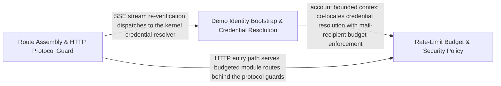

---
tags:
  - 2brain
  - 2brain/arch
  - project/boilerplate-node-backend
type: architecture
component: Route_Assembly_Middleware_Demo_Identity_Bootstrap
---

## Details

The assembly layer that the scenario runner invokes to bring the application to life. installRoutes is the single entry point that registers all domain-module routes, system routes (health, metrics, docs), and cross-cutting middleware (idempotency key enforcement, rate-limit budget via RateLimitBudget, method-not-allowed guard) onto the Express app in the correct order. resolveBearer and resolveCookie are the concrete credential-extraction strategies that plug into the CredentialResolver from Group 1, bridging the kernel abstraction to the actual HTTP header/cookie parsing. fakeOAuthProvider is the deterministic OAuth 2.0 provider used by the demo profile so that scenario flows can exercise the full auth-code to token to bearer cycle without an external IdP. namedUsers / customerUsers define the fixed persona set that flows reference by name, giving the scenario runner stable identities to assert against.

### Demo Identity Bootstrap & Credential Resolution
The deterministic identity layer: fixed persona accounts (namedUsers, customerUsers), the fake OAuth 2.0 provider that exercises the full auth-code → PKCE → token cycle offline, and the kernel's concrete credential-extraction strategies (resolveBearer, resolveCookie, resolveCredential) that bridge the AuthResolver / CredentialResolver ports to actual HTTP header/cookie parsing.

**Related Classes/Methods**:

- `scenarios.users.namedUsers`
- `scenarios.users.customerUsers`:188-200
- `scenarios.support.doubles.oauth-fake.fakeOAuthProvider`:32-53
- `src.kernel.authentication.resolveBearer`:138-142
- `src.kernel.authentication.resolveCredential`:174-177

**Source Files:**

- `scenarios/support/doubles/oauth-fake.ts`
  - `scenarios.support.doubles.oauth-fake.fakeOAuthProvider` (L32-L53) - Class
  - `scenarios.support.doubles.oauth-fake.fakeOAuthProvider.authorizeUrl` (L38-L39) - Method
  - `scenarios.support.doubles.oauth-fake.fakeOAuthProvider.exchangeCode` (L41-L52) - Method
- `scenarios/users.ts`
  - `scenarios.users.namedUsers` (L147-L147) - Class
  - `scenarios.users.namedUsers.PERSONA_NAMES.map() callback` (L147-L147) - Function
  - `scenarios.users.customerUsers.CUSTOMER_NAMES.map() callback` (L188-L199) - Function
  - `scenarios.users.customerUsers` (L188-L200) - Class
- `src/infrastructure/http/read-capped-body.ts`
  - `src.infrastructure.http.read-capped-body.readCappedJson` (L67-L68) - Class
  - `src.infrastructure.http.read-capped-body.readCappedJson.then() callback` (L68-L68) - Function
- `src/kernel/authentication.ts`
  - `src.kernel.authentication.resolveBearer` (L138-L142) - Class
  - `src.kernel.authentication.resolveBearer.then() callback` (L142-L142) - Function
  - `src.kernel.authentication.resolveCookie` (L149-L153) - Class
  - `src.kernel.authentication.resolveCookie.then() callback` (L153-L153) - Function
  - `src.kernel.authentication.resolveCredential` (L174-L177) - Class
  - `src.kernel.authentication.resolveCredential.then() callback` (L176-L176) - Function
- `src/kernel/middlewares/authorizations.ts`
  - `src.kernel.middlewares.authorizations.continueWithSession` (L188-L210) - Class
  - `src.kernel.middlewares.authorizations.continueWithSession.resolution.then() callback` (L197-L208) - Function
  - `src.kernel.middlewares.authorizations.takesNoSignIn.operation` (L225-L227) - Class
  - `src.kernel.middlewares.authorizations.takesNoSignIn.operation.OPERATION_ROUTES.find() callback` (L226-L226) - Function
  - `src.kernel.middlewares.authorizations.continueWithCookie.resolveFromCookie` (L278-L290) - Class
  - `src.kernel.middlewares.authorizations.continueWithCookie.resolveFromCookie.continueWithSession('cookie') callback` (L286-L288) - Function
  - `src.kernel.middlewares.authorizations.getAuth` (L338-L383) - Class
  - `src.kernel.middlewares.authorizations.getAuth.then() callback` (L361-L370) - Function
  - `src.kernel.middlewares.authorizations.getAuth.continueWithSession('bearer') callback` (L381-L381) - Function
  - `src.kernel.middlewares.authorizations.requireSessionViaCookie` (L835-L842) - Class
  - `src.kernel.middlewares.authorizations.requireSessionViaCookie.cookieGuard('requireSessionViaCookieGuard') callback` (L836-L842) - Function
  - `src.kernel.middlewares.authorizations.stillSignedInViaCookie` (L876-L880) - Class
  - `src.kernel.middlewares.authorizations.stillSignedInViaCookie.then() callback` (L879-L879) - Function
  - `src.kernel.middlewares.authorizations.stillSignedInViaCookie.catch() callback` (L880-L880) - Function
  - `src.kernel.middlewares.authorizations.requireFreshAuth.<function>.hasRequiredMethods.every() callback` (L936-L937) - Function
  - `src.kernel.middlewares.authorizations.requireFreshAuth.<function>.hasRequiredMethods` (L936-L938) - Class
- `src/modules/account/controllers/delete-account.ts`
  - `src.modules.account.controllers.delete-account.deleteAccount` (L22-L50) - Class
  - `src.modules.account.controllers.delete-account.deleteAccount.then() callback` (L28-L48) - Function
  - `src.modules.account.controllers.delete-account.deleteAccount.then() callback.then() callback` (L37-L47) - Function
- `src/modules/account/controllers/delete-email-change.ts`
  - `src.modules.account.controllers.delete-email-change.cancelPendingEmail` (L18-L28) - Class
  - `src.modules.account.controllers.delete-email-change.cancelPendingEmail.then() callback` (L23-L26) - Function
- `src/modules/account/controllers/delete-oauth-link.ts`
  - `src.modules.account.controllers.delete-oauth-link.deleteOAuthLink` (L22-L40) - Class
  - `src.modules.account.controllers.delete-oauth-link.deleteOAuthLink.then() callback` (L29-L39) - Function
  - `src.modules.account.controllers.delete-oauth-link.deleteOAuthLink.then() callback.then() callback` (L36-L37) - Function
- `src/modules/account/controllers/get-2fa.ts`
  - `src.modules.account.controllers.get-2fa.get2fa` (L17-L31) - Class
  - `src.modules.account.controllers.get-2fa.get2fa.then() callback` (L22-L29) - Function
- `src/modules/account/controllers/get-account-export.ts`
  - `src.modules.account.controllers.get-account-export.getAccountExportStatus` (L22-L34) - Class
  - `src.modules.account.controllers.get-account-export.getAccountExportStatus.then() callback` (L27-L32) - Function
  - `src.modules.account.controllers.get-account-export.getAccountExport` (L44-L78) - Class
  - `src.modules.account.controllers.get-account-export.getAccountExport.then() callback` (L49-L68) - Function
  - `src.modules.account.controllers.get-account-export.getAccountExport.catch() callback` (L69-L77) - Function
- `src/modules/account/controllers/get-account.ts`
  - `src.modules.account.controllers.get-account.getAccount` (L21-L43) - Class
  - `src.modules.account.controllers.get-account.getAccount.then() callback` (L29-L41) - Function
- `src/modules/account/controllers/get-oauth-callback.ts`
  - `src.modules.account.controllers.get-oauth-callback.signedInUserId` (L81-L88) - Class
  - `src.modules.account.controllers.get-oauth-callback.signedInUserId.then() callback` (L85-L86) - Function
  - `src.modules.account.controllers.get-oauth-callback.getOAuthCallback` (L97-L329) - Class
  - `src.modules.account.controllers.get-oauth-callback.then() callback` (L176-L185) - Function
  - `src.modules.account.controllers.get-oauth-callback.then() callback.then() callback` (L177-L184) - Function
  - `src.modules.account.controllers.get-oauth-callback.catch() callback` (L195-L217) - Function
  - `src.modules.account.controllers.get-oauth-callback.getOAuthCallback.then() callback` (L226-L293) - Function
  - `src.modules.account.controllers.get-oauth-callback.getOAuthCallback.then() callback.then() callback.then() callback` (L273-L280) - Function
  - `src.modules.account.controllers.get-oauth-callback.getOAuthCallback.then() callback.then() callback` (L284-L292) - Function
  - `src.modules.account.controllers.get-oauth-callback.getOAuthCallback.catch() callback` (L294-L328) - Function
- `src/modules/account/controllers/get-oauth-links.ts`
  - `src.modules.account.controllers.get-oauth-links.getOAuthLinks` (L17-L21) - Class
  - `src.modules.account.controllers.get-oauth-links.getOAuthLinks.then() callback` (L20-L20) - Function
- `src/modules/account/controllers/get-reauth-methods.ts`
  - `src.modules.account.controllers.get-reauth-methods.getReauthMethods` (L17-L27) - Class
  - `src.modules.account.controllers.get-reauth-methods.getReauthMethods.then() callback` (L22-L25) - Function
- `src/modules/account/controllers/get-refresh-token.ts`
  - `src.modules.account.controllers.get-refresh-token.getRefreshToken` (L28-L76) - Class
  - `src.modules.account.controllers.get-refresh-token.getRefreshToken.then() callback` (L41-L54) - Function
  - `src.modules.account.controllers.get-refresh-token.getRefreshToken.catch() callback` (L59-L74) - Function
- `src/modules/account/controllers/get-sessions.ts`
  - `src.modules.account.controllers.get-sessions.getSessions` (L17-L27) - Class
  - `src.modules.account.controllers.get-sessions.getSessions.then() callback` (L23-L25) - Function
- `src/modules/account/controllers/post-2fa-backup-codes.ts`
  - `src.modules.account.controllers.post-2fa-backup-codes.post2faBackupCodes` (L20-L44) - Class
  - `src.modules.account.controllers.post-2fa-backup-codes.post2faBackupCodes.then() callback` (L34-L42) - Function
- `src/modules/account/controllers/post-2fa-confirm.ts`
  - `src.modules.account.controllers.post-2fa-confirm.post2faConfirm` (L22-L67) - Class
  - `src.modules.account.controllers.post-2fa-confirm.post2faConfirm.then() callback` (L40-L64) - Function
  - `src.modules.account.controllers.post-2fa-confirm.post2faConfirm.then() callback.then() callback` (L43-L64) - Function
  - `src.modules.account.controllers.post-2fa-confirm.post2faConfirm.then() callback.then() callback.then() callback` (L57-L63) - Function
- `src/modules/account/controllers/post-2fa-disable.ts`
  - `src.modules.account.controllers.post-2fa-disable.post2faDisable` (L22-L58) - Class
  - `src.modules.account.controllers.post-2fa-disable.post2faDisable.then() callback` (L36-L55) - Function
  - `src.modules.account.controllers.post-2fa-disable.post2faDisable.then() callback.then() callback` (L39-L55) - Function
  - `src.modules.account.controllers.post-2fa-disable.post2faDisable.then() callback.then() callback.then() callback` (L52-L54) - Function
- `src/modules/account/controllers/post-2fa-method-remove.ts`
  - `src.modules.account.controllers.post-2fa-method-remove.post2faMethodRemove` (L23-L63) - Class
  - `src.modules.account.controllers.post-2fa-method-remove.post2faMethodRemove.then() callback` (L41-L60) - Function
  - `src.modules.account.controllers.post-2fa-method-remove.post2faMethodRemove.then() callback.then() callback` (L44-L60) - Function
  - `src.modules.account.controllers.post-2fa-method-remove.post2faMethodRemove.then() callback.then() callback.then() callback` (L57-L59) - Function
- `src/modules/account/controllers/post-2fa-method-send.ts`
  - `src.modules.account.controllers.post-2fa-method-send.post2faMethodSend` (L20-L33) - Class
  - `src.modules.account.controllers.post-2fa-method-send.post2faMethodSend.then() callback` (L28-L31) - Function
- `src/modules/account/controllers/post-2fa-setup.ts`
  - `src.modules.account.controllers.post-2fa-setup.post2faSetup` (L21-L41) - Class
  - `src.modules.account.controllers.post-2fa-setup.post2faSetup.then() callback` (L33-L39) - Function
- `src/modules/account/controllers/post-account-export.ts`
  - `src.modules.account.controllers.post-account-export.postAccountExport` (L19-L31) - Class
  - `src.modules.account.controllers.post-account-export.postAccountExport.then() callback` (L24-L29) - Function
- `src/modules/account/controllers/post-account-restore.ts`
  - `src.modules.account.controllers.post-account-restore.postAccountRestore` (L20-L38) - Class
  - `src.modules.account.controllers.post-account-restore.postAccountRestore.then() callback` (L29-L33) - Function
  - `src.modules.account.controllers.post-account-restore.postAccountRestore.catch() callback` (L34-L37) - Function
- `src/modules/account/controllers/post-email-change-confirm.ts`
  - `src.modules.account.controllers.post-email-change-confirm.postEmailChangeConfirm` (L24-L52) - Class
  - `src.modules.account.controllers.post-email-change-confirm.postEmailChangeConfirm.then() callback` (L36-L43) - Function
  - `src.modules.account.controllers.post-email-change-confirm.postEmailChangeConfirm.catch() callback` (L44-L51) - Function
- `src/modules/account/controllers/post-email-change-resend.ts`
  - `src.modules.account.controllers.post-email-change-resend.postPendingEmailResend` (L18-L29) - Class
  - `src.modules.account.controllers.post-email-change-resend.postPendingEmailResend.then() callback` (L24-L27) - Function
- `src/modules/account/controllers/post-email-change-undo.ts`
  - `src.modules.account.controllers.post-email-change-undo.postEmailChangeUndo` (L22-L48) - Class
  - `src.modules.account.controllers.post-email-change-undo.postEmailChangeUndo.then() callback` (L35-L42) - Function
  - `src.modules.account.controllers.post-email-change-undo.postEmailChangeUndo.catch() callback` (L43-L47) - Function
- `src/modules/account/controllers/post-login-2fa-send.ts`
  - `src.modules.account.controllers.post-login-2fa-send.postLoginTwoFactorSend` (L23-L54) - Class
  - `src.modules.account.controllers.post-login-2fa-send.postLoginTwoFactorSend.then() callback` (L42-L49) - Function
  - `src.modules.account.controllers.post-login-2fa-send.postLoginTwoFactorSend.catch() callback` (L50-L53) - Function
- `src/modules/account/controllers/post-login-2fa.ts`
  - `src.modules.account.controllers.post-login-2fa.postLoginTwoFactor` (L34-L100) - Class
  - `src.modules.account.controllers.post-login-2fa.postLoginTwoFactor.then() callback` (L57-L95) - Function
  - `src.modules.account.controllers.post-login-2fa.then() callback.then() callback` (L71-L75) - Function
  - `src.modules.account.controllers.post-login-2fa.postLoginTwoFactor.then() callback.then() callback` (L84-L93) - Function
  - `src.modules.account.controllers.post-login-2fa.then() callback.then() callback.then() callback` (L86-L86) - Function
  - `src.modules.account.controllers.post-login-2fa.postLoginTwoFactor.then() callback.then() callback.then() callback` (L87-L93) - Function
  - `src.modules.account.controllers.post-login-2fa.postLoginTwoFactor.catch() callback` (L96-L99) - Function
- `src/modules/account/controllers/post-login-restore.ts`
  - `src.modules.account.controllers.post-login-restore.postLoginRestore` (L31-L71) - Class
  - `src.modules.account.controllers.post-login-restore.postLoginRestore.then() callback` (L47-L67) - Function
  - `src.modules.account.controllers.post-login-restore.postLoginRestore.then() callback.then() callback` (L58-L65) - Function
  - `src.modules.account.controllers.post-login-restore.then() callback.then() callback.then() callback` (L60-L60) - Function
  - `src.modules.account.controllers.post-login-restore.postLoginRestore.then() callback.then() callback.then() callback` (L61-L65) - Function
  - `src.modules.account.controllers.post-login-restore.postLoginRestore.catch() callback` (L68-L70) - Function
- `src/modules/account/controllers/post-login.ts`
  - `src.modules.account.controllers.post-login.postLogin` (L35-L134) - Class
  - `src.modules.account.controllers.post-login.postLogin.then() callback` (L79-L128) - Function
  - `src.modules.account.controllers.post-login.then() callback.then() callback` (L96-L98) - Function
  - `src.modules.account.controllers.post-login.postLogin.then() callback.then() callback` (L118-L126) - Function
  - `src.modules.account.controllers.post-login.then() callback.then() callback.then() callback` (L120-L120) - Function
  - `src.modules.account.controllers.post-login.postLogin.then() callback.then() callback.then() callback` (L121-L126) - Function
  - `src.modules.account.controllers.post-login.postLogin.catch() callback` (L129-L133) - Function
- `src/modules/account/controllers/post-logout-everywhere.ts`
  - `src.modules.account.controllers.post-logout-everywhere.postLogoutEverywhere` (L19-L35) - Class
  - `src.modules.account.controllers.post-logout-everywhere.postLogoutEverywhere.then() callback` (L22-L33) - Function
- `src/modules/account/controllers/post-logout.ts`
  - `src.modules.account.controllers.post-logout.postLogout` (L20-L31) - Class
  - `src.modules.account.controllers.post-logout.postLogout.then() callback` (L25-L29) - Function
- `src/modules/account/controllers/post-oauth-link-start.ts`
  - `src.modules.account.controllers.post-oauth-link-start.postOAuthLinkStart` (L37-L66) - Class
  - `src.modules.account.controllers.post-oauth-link-start.postOAuthLinkStart.then() callback` (L46-L64) - Function
- `src/modules/account/controllers/post-password-change.ts`
  - `src.modules.account.controllers.post-password-change.postPasswordChange` (L26-L91) - Class
  - `src.modules.account.controllers.post-password-change.then() callback` (L46-L55) - Function
  - `src.modules.account.controllers.post-password-change.then() callback.then() callback` (L55-L55) - Function
  - `src.modules.account.controllers.post-password-change.postPasswordChange.then() callback` (L57-L86) - Function
  - `src.modules.account.controllers.post-password-change.postPasswordChange.then() callback.then() callback` (L71-L74) - Function
  - `src.modules.account.controllers.post-password-change.postPasswordChange.then() callback.catch() callback` (L75-L85) - Function
  - `src.modules.account.controllers.post-password-change.postPasswordChange.catch() callback` (L87-L90) - Function
- `src/modules/account/controllers/post-password-check.ts`
  - `src.modules.account.controllers.post-password-check.postPasswordCheck` (L16-L25) - Class
  - `src.modules.account.controllers.post-password-check.postPasswordCheck.then() callback` (L21-L23) - Function
- `src/modules/account/controllers/post-reauth-method-send.ts`
  - `src.modules.account.controllers.post-reauth-method-send.postReauthMethodSend` (L20-L33) - Class
  - `src.modules.account.controllers.post-reauth-method-send.postReauthMethodSend.then() callback` (L28-L31) - Function
- `src/modules/account/controllers/post-reauth.ts`
  - `src.modules.account.controllers.post-reauth.postReauth` (L25-L65) - Class
  - `src.modules.account.controllers.post-reauth.postReauth.then() callback` (L40-L60) - Function
  - `src.modules.account.controllers.post-reauth.postReauth.then() callback.then() callback` (L55-L58) - Function
  - `src.modules.account.controllers.post-reauth.postReauth.catch() callback` (L61-L64) - Function
- `src/modules/account/controllers/post-reset-confirm.ts`
  - `src.modules.account.controllers.post-reset-confirm.postResetConfirm` (L21-L49) - Class
  - `src.modules.account.controllers.post-reset-confirm.postResetConfirm.then() callback` (L35-L44) - Function
  - `src.modules.account.controllers.post-reset-confirm.postResetConfirm.catch() callback` (L45-L48) - Function
- `src/modules/account/controllers/post-session-touch.ts`
  - `src.modules.account.controllers.post-session-touch.postSessionTouch` (L18-L23) - Class
  - `src.modules.account.controllers.post-session-touch.postSessionTouch.then() callback` (L20-L22) - Function
- `src/modules/account/controllers/post-signup.ts`
  - `src.modules.account.controllers.post-signup.postSignup` (L31-L140) - Class
  - `src.modules.account.controllers.post-signup.postSignup.then() callback` (L72-L135) - Function
  - `src.modules.account.controllers.post-signup.postSignup.then() callback.catch() callback` (L107-L113) - Function
  - `src.modules.account.controllers.post-signup.postSignup.then() callback.then() callback` (L127-L134) - Function
  - `src.modules.account.controllers.post-signup.postSignup.catch() callback` (L136-L139) - Function
- `src/modules/account/controllers/post-verify-confirm.ts`
  - `src.modules.account.controllers.post-verify-confirm.postVerifyConfirm` (L21-L45) - Class
  - `src.modules.account.controllers.post-verify-confirm.postVerifyConfirm.then() callback` (L33-L40) - Function
  - `src.modules.account.controllers.post-verify-confirm.postVerifyConfirm.catch() callback` (L41-L44) - Function
- `src/modules/account/controllers/post-verify-request.ts`
  - `src.modules.account.controllers.post-verify-request.postVerifyRequest` (L18-L29) - Class
  - `src.modules.account.controllers.post-verify-request.postVerifyRequest.then() callback` (L24-L27) - Function
- `src/modules/account/oauth/providers/github.ts`
  - `src.modules.account.oauth.providers.github.GithubUser` (L30-L35) - Interface
  - `src.modules.account.oauth.providers.github.GithubEmail` (L38-L42) - Interface
  - `src.modules.account.oauth.providers.github.githubApiGet` (L48-L62) - Class
  - `src.modules.account.oauth.providers.github.githubApiGet.then() callback` (L58-L62) - Function
  - `src.modules.account.oauth.providers.github.githubOAuthProvider` (L98-L121) - Class
  - `src.modules.account.oauth.providers.github.githubOAuthProvider.authorizeUrl` (L104-L110) - Method
  - `src.modules.account.oauth.providers.github.githubOAuthProvider.exchangeCode` (L112-L120) - Method
  - `src.modules.account.oauth.providers.github.exchangeCode.then() callback` (L114-L118) - Function
  - `src.modules.account.oauth.providers.github.githubOAuthProvider.exchangeCode.then() callback` (L120-L120) - Function
- `src/modules/account/oauth/providers/google.ts`
  - `src.modules.account.oauth.providers.google.googleOAuthProvider` (L62-L79) - Class
  - `src.modules.account.oauth.providers.google.googleOAuthProvider.authorizeUrl` (L67-L73) - Method
  - `src.modules.account.oauth.providers.google.googleOAuthProvider.exchangeCode` (L75-L78) - Method
  - `src.modules.account.oauth.providers.google.googleOAuthProvider.exchangeCode.then() callback` (L76-L77) - Function
- `src/modules/account/oauth/providers/index.ts`
  - `src.modules.account.oauth.providers.index.registry` (L25-L28) - Class
  - `src.modules.account.oauth.providers.index.registry.google` (L26-L26) - Method
  - `src.modules.account.oauth.providers.index.registry.github` (L27-L27) - Method
- `src/modules/account/oauth/providers/port.ts`
  - `src.modules.account.oauth.providers.port.OAuthIdentity` (L13-L27) - Interface
  - `src.modules.account.oauth.providers.port.OAuthExpectation` (L30-L38) - Interface
  - `src.modules.account.oauth.providers.port.OAuthProvider` (L41-L69) - Interface
  - `src.modules.account.oauth.providers.port.OAuthProvider.authorizeUrl` (L55-L55) - Method
  - `src.modules.account.oauth.providers.port.OAuthProvider.exchangeCode` (L68-L68) - Method
- `src/modules/account/session/account-view.ts`
  - `src.modules.account.session.account-view.withAccountView` (L134-L144) - Class
  - `src.modules.account.session.account-view.withAccountView.then() callback` (L142-L143) - Function
- `src/modules/account/session/login-observability.ts`
  - `src.modules.account.session.login-observability.recordLoginSuccess` (L55-L83) - Class
  - `src.modules.account.session.login-observability.recordLoginSuccess.then() callback` (L61-L82) - Function

### Rate-Limit Budget & Security Policy
The declarative policy layer: every budget constant, versioned-secret binding, mail-recipient limiter, and antibot challenge parameter that constrains domain operations. Modules import these constants; they never compute their own limits.

**Related Classes/Methods**:

- `src.types.rate-limit-budget.RateLimitBudget`:22-93
- `src.infrastructure.security.versioned-secret.parseVersionedKeyRing`:32-41
- `src.modules.account.mail-budget.mailRecipientLimiter`:89-104
- `src.infrastructure.config.fields.versionedKeyRing`:524-528

**Source Files:**

- `src/infrastructure/adapters/antibot-providers/index.ts`
  - `src.infrastructure.adapters.antibot-providers.index.IssuedChallenge` (L24-L28) - Interface
  - `src.infrastructure.adapters.antibot-providers.index.ChallengeParameters` (L31-L45) - Interface
  - `src.infrastructure.adapters.antibot-providers.index.HumanChallengeProvider.issueChallenge` (L80-L80) - Method
- `src/infrastructure/config/fields.ts`
  - `src.infrastructure.config.fields.versionedKeyRing` (L524-L528) - Class
  - `src.infrastructure.config.fields.versionedKeyRing.transform() callback` (L526-L526) - Function
- `src/infrastructure/http/middlewares/rate-limit.ts`
  - `src.infrastructure.http.middlewares.rate-limit.refuseRateLimited` (L157-L180) - Class
  - `src.infrastructure.http.middlewares.rate-limit.refuseRateLimited.<function>` (L159-L180) - Function
  - `src.infrastructure.http.middlewares.rate-limit.buildRateLimiter` (L220-L258) - Class
  - `src.infrastructure.http.middlewares.rate-limit.buildRateLimiter.<function>` (L253-L257) - Function
  - `src.infrastructure.http.middlewares.rate-limit.buildRateLimiter.<function>.limiter() callback` (L254-L257) - Function
  - `src.infrastructure.http.middlewares.rate-limit.GLOBAL_RATE_LIMIT_BUDGET` (L430-L442) - Class
  - `src.infrastructure.http.middlewares.rate-limit.GLOBAL_RATE_LIMIT_BUDGET.requestWasSuccessful` (L437-L437) - Method
  - `src.infrastructure.http.middlewares.rate-limit.GLOBAL_RATE_LIMIT_BUDGET.skip` (L440-L441) - Method
  - `src.infrastructure.http.middlewares.rate-limit.API_KEY_RATE_LIMIT_BUDGET` (L453-L459) - Class
  - `src.infrastructure.http.middlewares.rate-limit.API_KEY_RATE_LIMIT_BUDGET.keyGenerator` (L458-L458) - Method
- `src/infrastructure/security/versioned-secret.ts`
  - `src.infrastructure.security.versioned-secret.parseVersionedKeyRing` (L32-L41) - Class
  - `src.infrastructure.security.versioned-secret.parseVersionedKeyRing.filter() callback` (L35-L35) - Function
  - `src.infrastructure.security.versioned-secret.parseVersionedKeyRing.map() callback` (L36-L41) - Function
- `src/modules/account/mail-budget.ts`
  - `src.modules.account.mail-budget.mailRecipientLimiter` (L89-L104) - Class
  - `src.modules.account.mail-budget.mailRecipientLimiter.then() callback` (L96-L103) - Function
- `src/modules/account/rate-limits.ts`
  - `src.modules.account.rate-limits.CREDENTIAL_IDENTITY_BUDGET` (L65-L73) - Class
  - `src.modules.account.rate-limits.CREDENTIAL_IDENTITY_BUDGET.skip` (L72-L72) - Method
  - `src.modules.account.rate-limits.CREDENTIAL_DEVICE_BUDGET` (L94-L99) - Class
  - `src.modules.account.rate-limits.CREDENTIAL_DEVICE_BUDGET.skip` (L98-L98) - Method
- `src/modules/account/session/config.ts`
  - `src.modules.account.session.config.sessionConfig` (L53-L114) - Class
  - `src.modules.account.session.config.sessionConfig.check` (L106-L113) - Method
- `src/modules/account/session/device-cookie.ts`
  - `src.modules.account.session.device-cookie.holdsDeviceCookie` (L78-L85) - Class
  - `src.modules.account.session.device-cookie.holdsDeviceCookie.some() callback` (L83-L83) - Function
- `src/modules/antibot/controllers/get-antibot-challenge.ts`
  - `src.modules.antibot.controllers.get-antibot-challenge.getAntibotChallenge` (L20-L38) - Class
  - `src.modules.antibot.controllers.get-antibot-challenge.then() callback` (L22-L22) - Function
  - `src.modules.antibot.controllers.get-antibot-challenge.getAntibotChallenge.then() callback` (L23-L37) - Function
  - `src.modules.antibot.controllers.get-antibot-challenge.getAntibotChallenge.then() callback.then() callback` (L36-L36) - Function
- `src/modules/cart/controllers/post-checkout.ts`
  - `src.modules.cart.controllers.post-checkout.postCheckout` (L23-L50) - Class
  - `src.modules.cart.controllers.post-checkout.postCheckout.then() callback` (L32-L44) - Function
  - `src.modules.cart.controllers.post-checkout.postCheckout.then() callback.then() callback` (L39-L43) - Function
  - `src.modules.cart.controllers.post-checkout.postCheckout.catch() callback` (L45-L49) - Function
- `src/modules/locales/controllers/get-locale-entries.ts`
  - `src.modules.locales.controllers.get-locale-entries.listEntries` (L52-L72) - Class
  - `src.modules.locales.controllers.get-locale-entries.listEntries.then() callback` (L65-L70) - Function
- `src/modules/locales/controllers/get-locales.ts`
  - `src.modules.locales.controllers.get-locales.getLocale` (L35-L47) - Class
  - `src.modules.locales.controllers.get-locales.getLocale.then() callback` (L42-L46) - Function
- `src/modules/locales/controllers/post-locale-activation.ts`
  - `src.modules.locales.controllers.post-locale-activation.switchLanguage` (L23-L34) - Class
  - `src.modules.locales.controllers.post-locale-activation.switchLanguage.<function>` (L25-L34) - Function
  - `src.modules.locales.controllers.post-locale-activation.switchLanguage.<function>.then() callback` (L27-L33) - Function
  - `src.modules.locales.controllers.post-locale-activation.switchLanguage.<function>.then() callback.then() callback` (L32-L32) - Function
- `src/modules/locales/controllers/post-locale-entry.ts`
  - `src.modules.locales.controllers.post-locale-entry.createLocaleEntry` (L25-L45) - Class
  - `src.modules.locales.controllers.post-locale-entry.createLocaleEntry.then() callback` (L34-L43) - Function
- `src/modules/locales/controllers/post-locale.ts`
  - `src.modules.locales.controllers.post-locale.createLocale` (L24-L50) - Class
  - `src.modules.locales.controllers.post-locale.createLocale.then() callback` (L40-L48) - Function
  - `src.modules.locales.controllers.post-locale.createLocale.then() callback.then() callback` (L45-L46) - Function
- `src/modules/locales/controllers/update-locale-entries.ts`
  - `src.modules.locales.controllers.update-locale-entries.importEntries` (L28-L57) - Class
  - `src.modules.locales.controllers.update-locale-entries.importEntries.<function>` (L30-L57) - Function
  - `src.modules.locales.controllers.update-locale-entries.importEntries.<function>.then() callback` (L49-L53) - Function
- `src/modules/notifications/controllers/delete-notifications.ts`
  - `src.modules.notifications.controllers.delete-notifications.deleteNotifications` (L16-L26) - Class
  - `src.modules.notifications.controllers.delete-notifications.deleteNotifications.then() callback` (L22-L24) - Function
- `src/modules/notifications/controllers/post-read-all.ts`
  - `src.modules.notifications.controllers.post-read-all.postReadAll` (L15-L22) - Class
  - `src.modules.notifications.controllers.post-read-all.postReadAll.then() callback` (L18-L20) - Function
- `src/modules/payments/rate-limits.ts`
  - `src.modules.payments.rate-limits.CONFIRM_DECLINE_BUDGET` (L81-L88) - Class
  - `src.modules.payments.rate-limits.CONFIRM_DECLINE_BUDGET.requestWasSuccessful` (L86-L86) - Method
  - `src.modules.payments.rate-limits.CONFIRM_DECLINE_BLOCK_BUDGET` (L125-L132) - Class
  - `src.modules.payments.rate-limits.CONFIRM_DECLINE_BLOCK_BUDGET.requestWasSuccessful` (L130-L130) - Method
- `src/modules/sitemap/service.ts`
  - `src.modules.sitemap.service.entriesFor.links` (L58-L61) - Class
  - `src.modules.sitemap.service.entriesFor.links.languages.tags.map() callback` (L59-L59) - Function
- `src/modules/stock-alerts/controllers/post-stock-alerts.ts`
  - `src.modules.stock-alerts.controllers.post-stock-alerts.postStockAlerts` (L18-L33) - Class
  - `src.modules.stock-alerts.controllers.post-stock-alerts.postStockAlerts.then() callback` (L28-L31) - Function
- `src/modules/wishlist/controllers/post-wishlist-items.ts`
  - `src.modules.wishlist.controllers.post-wishlist-items.postWishlistItems` (L20-L38) - Class
  - `src.modules.wishlist.controllers.post-wishlist-items.postWishlistItems.then() callback` (L32-L36) - Function
- `src/types/rate-limit-budget.ts`
  - `src.types.rate-limit-budget.RateLimitBudget` (L22-L93) - Interface

### Route Assembly & HTTP Protocol Guard
The single entry point (installRoutes) that registers all domain-module routes, system routes, and cross-cutting HTTP middleware onto the Express app in the correct order; plus the protocol-level guards (405 method-not-allowed, SSE stream lifecycle, request-body parsing) that every domain route depends on.

**Related Classes/Methods**:

- `src.app.routes.installRoutes`:27-81
- `src.infrastructure.http.middlewares.method-not-allowed.methodNotAllowed`:59-80
- `src.infrastructure.http.sse.openSseStream`:38-81
- `src.infrastructure.http.request.parseFormCsvList`:74-82
- `src.infrastructure.http.schemas.optionalBooleanSchema`:121-124

**Source Files:**

- `src/app/routes.ts`
  - `src.app.routes.installRoutes` (L27-L81) - Class
  - `src.app.routes.installRoutes.app.use() callback` (L78-L80) - Function
- `src/infrastructure/adapters/logger.ts`
  - `src.infrastructure.adapters.logger.isSensitiveKey` (L105-L107) - Class
  - `src.infrastructure.adapters.logger.isSensitiveKey.SENSITIVE_KEY_FRAGMENTS.some() callback` (L107-L107) - Function
  - `src.infrastructure.adapters.logger.redactSensitiveFields.result` (L192-L194) - Class
  - `src.infrastructure.adapters.logger.redactSensitiveFields.result.input.map() callback` (L193-L193) - Function
  - `src.infrastructure.adapters.logger.redactFormat` (L261-L284) - Class
  - `src.infrastructure.adapters.logger.redactFormat.winston.format() callback` (L261-L284) - Function
  - `src.infrastructure.adapters.logger.semanticNamesFormat` (L294-L298) - Class
  - `src.infrastructure.adapters.logger.semanticNamesFormat.winston.format() callback` (L294-L298) - Function
  - `src.infrastructure.adapters.logger.prettyFormat` (L333-L347) - Class
  - `src.infrastructure.adapters.logger.prettyFormat.winston.format.printf() callback` (L340-L346) - Function
- `src/infrastructure/http/frontend-link.ts`
  - `src.infrastructure.http.frontend-link.fillPath` (L46-L52) - Class
  - `src.infrastructure.http.frontend-link.fillPath.path.replaceAll(`{${name}}`) callback` (L50-L50) - Function
- `src/infrastructure/http/middlewares/idempotency.ts`
  - `src.infrastructure.http.middlewares.idempotency.hasPrototypeKey` (L57-L62) - Class
  - `src.infrastructure.http.middlewares.idempotency.hasPrototypeKey.value.some() callback` (L58-L58) - Function
  - `src.infrastructure.http.middlewares.idempotency.hasPrototypeKey.some() callback` (L61-L61) - Function
  - `src.infrastructure.http.middlewares.idempotency.replayedHeadersOf` (L128-L134) - Class
  - `src.infrastructure.http.middlewares.idempotency.replayedHeadersOf.REPLAYED_HEADERS.flatMap() callback` (L130-L133) - Function
  - `src.infrastructure.http.middlewares.idempotency.reclaimAbandoned` (L162-L188) - Class
  - `src.infrastructure.http.middlewares.idempotency.reclaimAbandoned.then() callback` (L176-L188) - Function
  - `src.infrastructure.http.middlewares.idempotency.armOutcomeCapture` (L228-L282) - Class
  - `src.infrastructure.http.middlewares.idempotency.armOutcomeCapture.record` (L232-L265) - Class
  - `src.infrastructure.http.middlewares.idempotency.armOutcomeCapture.record.catch() callback` (L252-L264) - Function
  - `src.infrastructure.http.middlewares.idempotency.onDuplicateKey` (L338-L373) - Class
  - `src.infrastructure.http.middlewares.idempotency.onDuplicateKey.then() callback` (L350-L366) - Function
  - `src.infrastructure.http.middlewares.idempotency.onDuplicateKey.catch() callback` (L367-L373) - Function
  - `src.infrastructure.http.middlewares.idempotency.claimIdempotencyKey` (L380-L402) - Class
  - `src.infrastructure.http.middlewares.idempotency.claimIdempotencyKey.then() callback` (L390-L393) - Function
  - `src.infrastructure.http.middlewares.idempotency.claimIdempotencyKey.catch() callback` (L394-L401) - Function
- `src/infrastructure/http/middlewares/method-not-allowed.ts`
  - `src.infrastructure.http.middlewares.method-not-allowed.methodNotAllowed` (L59-L80) - Class
  - `src.infrastructure.http.middlewares.method-not-allowed.methodNotAllowed.<function>` (L64-L79) - Function
- `src/infrastructure/http/request.ts`
  - `src.infrastructure.http.request.parseFormCsvList` (L74-L82) - Class
  - `src.infrastructure.http.request.parseFormCsvList.entries.every() callback` (L76-L76) - Function
- `src/infrastructure/http/schemas.ts`
  - `src.infrastructure.http.schemas.optionalBooleanSchema` (L121-L124) - Class
  - `src.infrastructure.http.schemas.optionalBooleanSchema.z.preprocess() callback` (L122-L122) - Function
- `src/infrastructure/http/sse.ts`
  - `src.infrastructure.http.sse.SseStream` (L21-L27) - Interface
  - `src.infrastructure.http.sse.openSseStream` (L38-L81) - Class
  - `src.infrastructure.http.sse.openSseStream.onClose` (L77-L79) - Method
- `src/infrastructure/security/versioned-secret.ts`
  - `src.infrastructure.security.versioned-secret.VersionedKey` (L18-L21) - Interface
  - `src.infrastructure.security.versioned-secret.SecretBinding` (L57-L60) - Interface
  - `src.infrastructure.security.versioned-secret.decryptVersionedSecret.configured` (L117-L117) - Class
  - `src.infrastructure.security.versioned-secret.decryptVersionedSecret.configured.ring.find() callback` (L117-L117) - Function
- `src/modules/notifications/services/staff.ts`
  - `src.modules.notifications.services.staff.StaffNoticeFacts` (L29-L38) - Interface
- `src/modules/notifications/services/stream.ts`
  - `src.modules.notifications.services.stream.streamNotifications` (L67-L91) - Class
  - `src.modules.notifications.services.stream.streamNotifications.stream.onClose() callback` (L86-L90) - Function
- `src/modules/observability/services/stream.ts`
  - `src.modules.observability.services.stream.streamObservabilityMetrics` (L107-L138) - Class
  - `src.modules.observability.services.stream.streamObservabilityMetrics.stream.onClose() callback` (L133-L137) - Function
- `src/modules/shop-tasks/emails.ts`
  - `src.modules.shop-tasks.emails.DigestItem` (L15-L18) - Interface
- `src/modules/shop-tasks/services/digest.ts`
  - `src.modules.shop-tasks.services.digest.Figures` (L33-L39) - Interface
  - `src.modules.shop-tasks.services.digest.then() callback` (L103-L104) - Function
  - `src.modules.shop-tasks.services.digest.DigestResult` (L120-L127) - Interface
