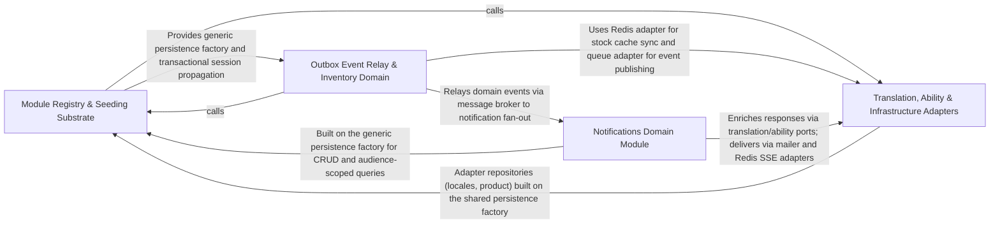

---
tags:
  - 2brain
  - 2brain/arch
  - project/boilerplate-node-backend
type: architecture
component: Runtime_Kernel_Backbone
---

## Details

The shared runtime and kernel services the seeding subsystem executes against — the module registry that resolves repositories, the outbox kernel (event enqueue/relay), the translation kernel (Translatable, TranslationPort, applyTranslations), the ability/permission kernel (permitsOnRows), rate-limiting, Redis, the image worker, and the development doubles (e.g. registerOAuthProvider('fake')) that stand in for external systems during seeding. This is the substrate every seeder and flow action depends on; it is not seeding-specific but is the fixed environment the fixtures are written into.

### Module Registry & Seeding Substrate
The broadest layer of the backbone — the module registry that turns the static module list into a running application, the generic persistence primitives every module's repository builds on, rate-limiting budgets, locale context, and the development doubles that replace external systems during seeding.

**Related Classes/Methods**:

- `src.infrastructure.persistence.create-repository.createRepository`:338-486
- `src.infrastructure.persistence.serialize.applySerialization`:64-115

**Source Files:**

- `scenarios/support/development-doubles.ts`
  - `scenarios.support.development-doubles.registerOAuthProvider('fake') callback` (L46-L46) - Function
- `scripts/ops/check-config.ts`
  - `scripts.ops.check-config.runScript() callback` (L20-L20) - Function
- `src/globals.d.ts`
  - `src.globals.d.'express-serve-static-core'.Request` (L12-L84) - Interface
- `src/infrastructure/config/shared-rules/registry.ts`
  - `src.infrastructure.config.shared-rules.registry.SharedRuleEntry` (L26-L31) - Interface
- `src/infrastructure/http/middlewares/rate-limit.ts`
  - `src.infrastructure.http.middlewares.rate-limit.BudgetCharge` (L285-L290) - Interface
- `src/infrastructure/i18n/context.ts`
  - `src.infrastructure.i18n.context.LocaleContext` (L22-L32) - Interface
- `src/infrastructure/persistence/changes.ts`
  - `src.infrastructure.persistence.changes.SetAndUnset` (L19-L22) - Interface
- `src/infrastructure/persistence/conditional-status.ts`
  - `src.infrastructure.persistence.conditional-status.ConditionalStatusOptions` (L14-L19) - Interface
- `src/infrastructure/persistence/create-repository.ts`
  - `src.infrastructure.persistence.create-repository.createRepository` (L338-L486) - Function
- `src/infrastructure/persistence/serialize.ts`
  - `src.infrastructure.persistence.serialize.SerializeOptions` (L24-L44) - Interface
  - `src.infrastructure.persistence.serialize.SerializableSchema` (L53-L55) - Interface
  - `src.infrastructure.persistence.serialize.applySerialization` (L64-L115) - Class
  - `src.infrastructure.persistence.serialize.transform` (L70-L96) - Class
  - `src.infrastructure.persistence.serialize.applySerialization.transform.toString` (L74-L74) - Method
  - `src.infrastructure.persistence.serialize.applySerialization.transform` (L105-L111) - Method
- `src/infrastructure/persistence/versioning.ts`
  - `src.infrastructure.persistence.versioning.Precondition` (L27-L32) - Interface
  - `src.infrastructure.persistence.versioning.PreconditionFailedError` (L38-L40) - Class
  - `src.infrastructure.persistence.versioning.armed` (L159-L164) - Class
  - `src.infrastructure.persistence.versioning.armed.finally() callback` (L161-L163) - Function
  - `src.infrastructure.persistence.versioning.fencedSave` (L180-L192) - Class
  - `src.infrastructure.persistence.versioning.fencedSave.catch() callback` (L189-L191) - Function
  - `src.infrastructure.persistence.versioning.DeleteOutcome` (L197-L200) - Interface
  - `src.infrastructure.persistence.versioning.checkedDelete` (L211-L223) - Class
  - `src.infrastructure.persistence.versioning.then() callback` (L216-L216) - Function
  - `src.infrastructure.persistence.versioning.checkedDelete.then() callback` (L220-L222) - Function
- `src/infrastructure/runtime/database.ts`
  - `src.infrastructure.runtime.database.attemptConnect.then() callback` (L139-L139) - Function
- `src/kernel/translation.ts`
  - `src.kernel.translation.TranslationPort` (L60-L166) - Interface
- `src/modules/access/audit.ts`
  - `src.modules.access.audit.'@infrastructure/observability/audit'.AuditActionMap` (L19-L21) - Interface
- `src/modules/access/model.ts`
  - `src.modules.access.model.TenantDocument` (L33-L39) - Interface
  - `src.modules.access.model.MembershipDocument` (L49-L56) - Interface
- `src/modules/account/analytics.ts`
  - `src.modules.account.analytics.'@infrastructure/observability/analytics'.AnalyticsEventMap` (L26-L28) - Interface
- `src/modules/account/audit.ts`
  - `src.modules.account.audit.'@infrastructure/observability/audit'.AuditActionMap` (L93-L95) - Interface
- `src/modules/account/domain/email-change.ts`
  - `src.modules.account.domain.email-change.EmailChangeFields` (L46-L52) - Interface
- `src/modules/account/domain/revocation.ts`
  - `src.modules.account.domain.revocation.RevocationRow` (L20-L26) - Interface
- `src/modules/account/events.ts`
  - `src.modules.account.events.'@kernel/events'.DomainEventMap` (L14-L51) - Interface
- `src/modules/account/model.ts`
  - `src.modules.account.model.AccountExportDocument` (L30-L39) - Interface
  - `src.modules.account.model.SessionDocument` (L75-L108) - Interface
  - `src.modules.account.model.VerificationTokenDocument` (L151-L163) - Interface
- `src/modules/addresses/model.ts`
  - `src.modules.addresses.model.AddressItem` (L14-L29) - Interface
  - `src.modules.addresses.model.AddressBookDocument` (L32-L37) - Interface
- `src/modules/addresses/pii.ts`
  - `src.modules.addresses.pii.decryptAddressItem` (L105-L111) - Class
  - `src.modules.addresses.pii.decryptAddressItem.mapPiiFields() callback` (L108-L109) - Function
- `src/modules/addresses/presenter.ts`
  - `src.modules.addresses.presenter.AddressesView` (L12-L14) - Interface
  - `src.modules.addresses.presenter.presentAddresses.addresses.map() callback` (L46-L46) - Function
- `src/modules/addresses/reencrypt.ts`
  - `src.modules.addresses.reencrypt.fieldsOf` (L14-L29) - Class
  - `src.modules.addresses.reencrypt.fieldsOf.book.items.flatMap() callback` (L15-L28) - Function
  - `src.modules.addresses.reencrypt.fieldsOf.book.items.flatMap() callback.ADDRESS_PII_FIELDS.flatMap() callback` (L16-L28) - Function
- `src/modules/addresses/repository.ts`
  - `src.modules.addresses.repository.loadEntry.entry.book.items.find() callback` (L101-L101) - Function
  - `src.modules.addresses.repository.addressBookRepository` (L117-L282) - Class
  - `src.modules.addresses.repository.addressBookRepository.create` (L148-L156) - Method
  - `src.modules.addresses.repository.addressBookRepository.create.items.map() callback` (L152-L153) - Function
  - `src.modules.addresses.repository.addressBookRepository.findByUserId` (L162-L166) - Method
  - `src.modules.addresses.repository.addressBookRepository.findByUserId.then() callback` (L166-L166) - Function
  - `src.modules.addresses.repository.addressBookRepository.addEntry` (L181-L211) - Method
  - `src.modules.addresses.repository.addressBookRepository.addEntry.catch() callback` (L196-L210) - Function
  - `src.modules.addresses.repository.addressBookRepository.addEntry.catch() callback.then() callback` (L201-L209) - Function
  - `src.modules.addresses.repository.addressBookRepository.updateEntry` (L218-L238) - Method
  - `src.modules.addresses.repository.addressBookRepository.setDefault` (L245-L255) - Method
  - `src.modules.addresses.repository.addressBookRepository.removeEntry` (L261-L270) - Method
  - `src.modules.addresses.repository.addressBookRepository.removeEntry.book.items.filter() callback` (L266-L266) - Function
  - `src.modules.addresses.repository.addressBookRepository.deleteByUserId` (L275-L281) - Method
  - `src.modules.addresses.repository.addressBookRepository.deleteByUserId.then() callback` (L279-L281) - Function
- `src/modules/addresses/service.ts`
  - `src.modules.addresses.service.list` (L31-L32) - Class
  - `src.modules.addresses.service.list.then() callback` (L32-L32) - Function
  - `src.modules.addresses.service.get` (L41-L48) - Class
  - `src.modules.addresses.service.get.then() callback` (L45-L48) - Function
  - `src.modules.addresses.service.create` (L54-L66) - Class
  - `src.modules.addresses.service.create.then() callback` (L58-L66) - Function
  - `src.modules.addresses.service.update` (L72-L81) - Class
  - `src.modules.addresses.service.update.then() callback` (L77-L81) - Function
  - `src.modules.addresses.service.setDefault` (L87-L95) - Class
  - `src.modules.addresses.service.setDefault.then() callback` (L91-L95) - Function
  - `src.modules.addresses.service.remove` (L101-L108) - Class
  - `src.modules.addresses.service.remove.then() callback` (L105-L108) - Function
  - `src.modules.addresses.service.forCheckout` (L116-L121) - Class
  - `src.modules.addresses.service.forCheckout.then() callback` (L117-L121) - Function
  - `src.modules.addresses.service.then() callback.book.items.find() callback` (L119-L119) - Function
  - `src.modules.addresses.service.forCheckout.then() callback.book.items.find() callback` (L120-L120) - Function
- `src/modules/api-keys/audit.ts`
  - `src.modules.api-keys.audit.'@infrastructure/observability/audit'.AuditActionMap` (L18-L20) - Interface
- `src/modules/api-keys/credentials.ts`
  - `src.modules.api-keys.credentials.MintedApiKey` (L34-L38) - Interface
- `src/modules/api-keys/model.ts`
  - `src.modules.api-keys.model.ApiKeyDocument` (L15-L27) - Interface
  - `src.modules.api-keys.model.apiKeySchema.permissions.validate.validator` (L62-L62) - Method
- `src/modules/api-keys/services/api-keys.ts`
  - `src.modules.api-keys.services.api-keys.mint` (L220-L275) - Class
  - `src.modules.api-keys.services.api-keys.mint.then() callback` (L258-L274) - Function
- `src/modules/audit-logs/model.ts`
  - `src.modules.audit-logs.model.AuditLogDocument` (L40-L42) - Interface
  - `src.modules.audit-logs.model.applyAuditLogTransform` (L180-L187) - Class
  - `src.modules.audit-logs.model.applyAuditLogTransform.after` (L183-L186) - Method
- `src/modules/cart/analytics.ts`
  - `src.modules.cart.analytics.'@infrastructure/observability/analytics'.AnalyticsEventMap` (L34-L36) - Interface
- `src/modules/cart/audit.ts`
  - `src.modules.cart.audit.'@infrastructure/observability/audit'.AuditActionMap` (L21-L23) - Interface
- `src/modules/cart/domain/availability.ts`
  - `src.modules.cart.domain.availability.AvailabilityProduct` (L13-L24) - Interface
  - `src.modules.cart.domain.availability.AvailabilityFacts` (L27-L39) - Interface
- `src/modules/cart/domain/merge.ts`
  - `src.modules.cart.domain.merge.MergeLineFacts` (L11-L23) - Interface
  - `src.modules.cart.domain.merge.MergePlan` (L26-L31) - Interface
- `src/modules/cart/domain/rules.ts`
  - `src.modules.cart.domain.rules.CartLineCandidate` (L17-L40) - Interface
  - `src.modules.cart.domain.rules.UnavailableCartLine` (L43-L47) - Interface
  - `src.modules.cart.domain.rules.CheckoutShortfall` (L53-L59) - Interface
  - `src.modules.cart.domain.rules.WeighedCartLine` (L62-L65) - Interface
  - `src.modules.cart.domain.rules.needsShipping` (L102-L103) - Class
  - `src.modules.cart.domain.rules.needsShipping.lines.some() callback` (L103-L103) - Function
  - `src.modules.cart.domain.rules.evaluateCheckout.judged` (L166-L174) - Class
  - `src.modules.cart.domain.rules.evaluateCheckout.judged.lines.map() callback` (L166-L174) - Function
  - `src.modules.cart.domain.rules.evaluateCheckout.unavailable` (L176-L178) - Class
  - `src.modules.cart.domain.rules.evaluateCheckout.unavailable.judged.filter() callback` (L177-L177) - Function
  - `src.modules.cart.domain.rules.evaluateCheckout.unavailable.map() callback` (L178-L178) - Function
  - `src.modules.cart.domain.rules.evaluateCheckout.shortfalls.judged.flatMap() callback` (L183-L193) - Function
  - `src.modules.cart.domain.rules.shortfalls` (L183-L194) - Class
- `src/modules/cart/events.ts`
  - `src.modules.cart.events.'@kernel/events'.DomainEventMap` (L9-L43) - Interface
- `src/modules/cart/factories.ts`
  - `src.modules.cart.factories.CartOverrides` (L17-L22) - Interface
- `src/modules/cart/model.ts`
  - `src.modules.cart.model.CartDocument` (L36-L59) - Interface
- `src/modules/cart/presenter.ts`
  - `src.modules.cart.presenter.JudgedCartLine` (L15-L19) - Interface
  - `src.modules.cart.presenter.CartFacts` (L22-L35) - Interface
  - `src.modules.cart.presenter.presentCart.items.lines.map() callback` (L54-L59) - Function
  - `src.modules.cart.presenter.presentCart.checkoutable.lines.every() callback` (L69-L69) - Function
- `src/modules/cart/repository.ts`
  - `src.modules.cart.repository.LineWrite` (L30-L33) - Interface
  - `src.modules.cart.repository.pushNewLine` (L52-L64) - Class
  - `src.modules.cart.repository.pushNewLine.then() callback` (L64-L64) - Function
  - `src.modules.cart.repository.unchangedOrPushed` (L72-L82) - Class
  - `src.modules.cart.repository.unchangedOrPushed.then() callback` (L80-L81) - Function
  - `src.modules.cart.repository.unchangedOrMissing` (L92-L104) - Class
  - `src.modules.cart.repository.unchangedOrMissing.then() callback` (L100-L104) - Function
  - `src.modules.cart.repository.resolveAddMiss` (L117-L140) - Class
  - `src.modules.cart.repository.resolveAddMiss.then() callback` (L126-L140) - Function
  - `src.modules.cart.repository.upsertLine` (L160-L230) - Class
  - `src.modules.cart.repository.upsertLine.then() callback` (L213-L224) - Function
  - `src.modules.cart.repository.then() callback.then() callback` (L217-L218) - Function
  - `src.modules.cart.repository.upsertLine.then() callback.then() callback` (L221-L222) - Function
  - `src.modules.cart.repository.upsertLine.catch() callback` (L225-L228) - Function
  - `src.modules.cart.repository.cartRepository` (L238-L397) - Class
  - `src.modules.cart.repository.cartRepository.findByUserId` (L268-L268) - Method
  - `src.modules.cart.repository.cartRepository.removeLine` (L281-L288) - Method
  - `src.modules.cart.repository.cartRepository.clearLines` (L296-L303) - Method
  - `src.modules.cart.repository.cartRepository.clearLinesIfUnchanged` (L322-L341) - Method
  - `src.modules.cart.repository.cartRepository.setShippingMethod` (L350-L359) - Method
  - `src.modules.cart.repository.cartRepository.deleteByUserId` (L368-L374) - Method
  - `src.modules.cart.repository.cartRepository.deleteByUserId.then() callback` (L372-L374) - Function
  - `src.modules.cart.repository.cartRepository.removeProductFromAll` (L386-L396) - Method
- `src/modules/cart/services/checkout.ts`
  - `src.modules.cart.services.checkout.resolvePaymentMethod.methodInfo.find() callback` (L112-L112) - Function
  - `src.modules.cart.services.checkout.buildStockRefusal.details.lines.refusal.shortfalls.map() callback` (L314-L319) - Function
  - `src.modules.cart.services.checkout.refuseOverLimit.details.productIds.overLimit.map() callback` (L422-L422) - Function
  - `src.modules.cart.services.checkout.placeLinesOf` (L459-L470) - Class
  - `src.modules.cart.services.checkout.placeLinesOf.joined.map() callback` (L461-L469) - Function
  - `src.modules.cart.services.checkout.CheckoutPlacement` (L473-L486) - Interface
  - `src.modules.cart.services.checkout.placeOrderInputOf` (L496-L538) - Class
  - `src.modules.cart.services.checkout.placeOrderInputOf.commitWith` (L534-L537) - Method
  - `src.modules.cart.services.checkout.placeOrderInputOf.commitWith.then() callback` (L537-L537) - Function
  - `src.modules.cart.services.checkout.refusalForPlaceOrder.shortfalls.outcome.shortfalls.map() callback` (L558-L563) - Function
  - `src.modules.cart.services.checkout.runCheckout.positionByProduct` (L635-L639) - Class
  - `src.modules.cart.services.checkout.runCheckout.positionByProduct.lines.map() callback` (L636-L636) - Function
  - `src.modules.cart.services.checkout.runCheckout.verdict` (L640-L650) - Class
  - `src.modules.cart.services.checkout.runCheckout.verdict.lines.map() callback` (L641-L649) - Function
  - `src.modules.cart.services.checkout.orderConfirm` (L712-L741) - Class
  - `src.modules.cart.services.checkout.orderConfirm.catch() callback` (L718-L718) - Function
  - `src.modules.cart.services.checkout.orderConfirm.then() callback` (L719-L741) - Function
- `src/modules/cart/services/items.ts`
  - `src.modules.cart.services.items.cartGet` (L36-L37) - Class
  - `src.modules.cart.services.items.cartGet.then() callback` (L37-L37) - Function
  - `src.modules.cart.services.items.cartViewOf` (L45-L46) - Class
  - `src.modules.cart.services.items.cartViewOf.then() callback` (L46-L46) - Function
  - `src.modules.cart.services.items.cartGetForView` (L52-L59) - Class
  - `src.modules.cart.services.items.cartGetForView.then() callback` (L53-L59) - Function
  - `src.modules.cart.services.items.upsertCartItem` (L87-L106) - Class
  - `src.modules.cart.services.items.upsertCartItem.then() callback` (L93-L106) - Function
  - `src.modules.cart.services.items.upsertCartItem.then() callback.then() callback` (L97-L105) - Function
  - `src.modules.cart.services.items.upsertCartItem.then() callback.then() callback.then() callback` (L102-L103) - Function
  - `src.modules.cart.services.items.cartItemAdd` (L172-L180) - Class
  - `src.modules.cart.services.items.cartItemAdd.then() callback` (L178-L179) - Function
  - `src.modules.cart.services.items.cartItemUpdateQuantity` (L186-L194) - Class
  - `src.modules.cart.services.items.cartItemUpdateQuantity.then() callback` (L192-L193) - Function
  - `src.modules.cart.services.items.cartItemRemoveById` (L213-L233) - Class
  - `src.modules.cart.services.items.cartItemRemoveById.then() callback` (L218-L233) - Function
  - `src.modules.cart.services.items.cartItemRemoveById.then() callback.then() callback` (L232-L232) - Function
  - `src.modules.cart.services.items.cartRemove` (L241-L251) - Class
  - `src.modules.cart.services.items.cartRemove.then() callback` (L242-L250) - Function
  - `src.modules.cart.services.items.cartRemove.then() callback.then() callback` (L243-L250) - Function
  - `src.modules.cart.services.items.cartShippingMethodSet` (L266-L306) - Class
  - `src.modules.cart.services.items.cartShippingMethodSet.then() callback` (L282-L305) - Function
  - `src.modules.cart.services.items.cartShippingMethodSet.then() callback.then() callback` (L304-L304) - Function
- `src/modules/cart/services/merge.ts`
  - `src.modules.cart.services.merge.MergeResult` (L27-L30) - Interface
  - `src.modules.cart.services.merge.MergeStep` (L33-L36) - Interface
  - `src.modules.cart.services.merge.heldIn` (L39-L40) - Class
  - `src.modules.cart.services.merge.heldIn.cart.items.find() callback` (L40-L40) - Function
  - `src.modules.cart.services.merge.writeAdd` (L47-L59) - Class
  - `src.modules.cart.services.merge.writeAdd.then() callback` (L53-L59) - Function
  - `src.modules.cart.services.merge.writeAdd.then() callback.then() callback` (L56-L56) - Function
  - `src.modules.cart.services.merge.mergeLine` (L67-L103) - Class
  - `src.modules.cart.services.merge.mergeLine.written.then() callback` (L86-L102) - Function
  - `src.modules.cart.services.merge.mergeLines.shelves` (L117-L117) - Class
  - `src.modules.cart.services.merge.mergeLines.shelves.lines.map() callback` (L117-L117) - Function
  - `src.modules.cart.services.merge.cartMerge` (L170-L179) - Class
  - `src.modules.cart.services.merge.cartMerge.then() callback` (L175-L178) - Function
  - `src.modules.cart.services.merge.then() callback.then() callback` (L177-L177) - Function
  - `src.modules.cart.services.merge.cartMerge.then() callback.then() callback` (L178-L178) - Function
- `src/modules/cart/services/preorder.ts`
  - `src.modules.cart.services.preorder.preorderIdsOf` (L28-L35) - Class
  - `src.modules.cart.services.preorder.preorderIdsOf.lines.filter() callback` (L33-L33) - Function
  - `src.modules.cart.services.preorder.preorderIdsOf.map() callback` (L34-L34) - Function
  - `src.modules.cart.services.preorder.backorderIdsOf` (L43-L50) - Class
  - `src.modules.cart.services.preorder.backorderIdsOf.lines.filter() callback` (L48-L48) - Function
  - `src.modules.cart.services.preorder.backorderIdsOf.map() callback` (L49-L49) - Function
- `src/modules/cart/services/reorder.ts`
  - `src.modules.cart.services.reorder.reorderIntoCart` (L45-L92) - Class
  - `src.modules.cart.services.reorder.then() callback` (L54-L75) - Function
  - `src.modules.cart.services.reorder.reorderIntoCart.then() callback.then() callback` (L62-L74) - Function
  - `src.modules.cart.services.reorder.reorderIntoCart.then() callback.then() callback.lines.every() callback` (L63-L63) - Function
  - `src.modules.cart.services.reorder.reorderIntoCart.then() callback.then() callback.then() callback` (L71-L72) - Function
  - `src.modules.cart.services.reorder.reorderIntoCart.catch() callback` (L76-L76) - Function
  - `src.modules.cart.services.reorder.reorderIntoCart.then() callback` (L77-L91) - Function
- `src/modules/cart/services/shelf.ts`
  - `src.modules.cart.services.shelf.Shelf` (L18-L25) - Interface
  - `src.modules.cart.services.shelf.readShelf` (L34-L55) - Class
  - `src.modules.cart.services.shelf.readShelf.then() callback` (L36-L54) - Function
  - `src.modules.cart.services.shelf.readShelf.then() callback.then() callback` (L42-L52) - Function
  - `src.modules.cart.services.shelf.readShelf.then() callback.then() callback.ids.map() callback` (L44-L51) - Function
  - `src.modules.cart.services.shelf.productAvailabilityFor` (L86-L92) - Class
  - `src.modules.cart.services.shelf.productAvailabilityFor.then() callback` (L90-L91) - Function
  - `src.modules.cart.services.shelf.productAvailabilityFor.then() callback.map() callback` (L91-L91) - Function
- `src/modules/cart/services/view.ts`
  - `src.modules.cart.services.view.readCartLines` (L59-L74) - Class
  - `src.modules.cart.services.view.readCartLines.then() callback` (L65-L73) - Function
  - `src.modules.cart.services.view.readCartLines.then() callback.cart.items.map() callback` (L68-L72) - Function
  - `src.modules.cart.services.view.shippingOptionsFor.options.SHIPPING_METHODS.filter() callback` (L108-L108) - Function
  - `src.modules.cart.services.view.shippingOptionsFor.options.map() callback` (L109-L114) - Function
  - `src.modules.cart.services.view.effectiveShippingChoice` (L128-L132) - Class
  - `src.modules.cart.services.view.effectiveShippingChoice.options.some() callback` (L132-L132) - Function
  - `src.modules.cart.services.view.shippingCost` (L147-L149) - Class
  - `src.modules.cart.services.view.buildView.shippingCost.options.find() callback` (L148-L148) - Function
  - `src.modules.cart.services.view.buildView.lines.lines.map() callback` (L151-L160) - Function
  - `src.modules.cart.services.view.toCartView` (L183-L192) - Class
  - `src.modules.cart.services.view.toCartView.then() callback` (L184-L191) - Function
  - `src.modules.cart.services.view.toCartView.then() callback.lines.map() callback` (L187-L187) - Function
  - `src.modules.cart.services.view.toCartView.then() callback.then() callback` (L191-L191) - Function
- `src/modules/delivery/audit.ts`
  - `src.modules.delivery.audit.'@infrastructure/observability/audit'.AuditActionMap` (L33-L35) - Interface
- `src/modules/delivery/domain/rates.ts`
  - `src.modules.delivery.domain.rates.findShippingMethod` (L49-L50) - Class
  - `src.modules.delivery.domain.rates.findShippingMethod.SHIPPING_METHODS.find() callback` (L50-L50) - Function
- `src/modules/delivery/domain/tracking.ts`
  - `src.modules.delivery.domain.tracking.TrackingFacts` (L11-L16) - Interface
- `src/modules/delivery/model.ts`
  - `src.modules.delivery.model.ShipmentLineDocument` (L34-L38) - Interface
  - `src.modules.delivery.model.FulfillmentOrderDocument` (L41-L100) - Interface
  - `src.modules.delivery.model.ShipmentDocument` (L103-L133) - Interface
- `src/modules/delivery/services/actions.ts`
  - `src.modules.delivery.services.actions.Standing` (L33-L38) - Interface
- `src/modules/delivery/services/board.ts`
  - `src.modules.delivery.services.board.listPreorderFulfillmentOrders.items.items.map() callback.shipments.filter() callback` (L108-L108) - Function
- `src/modules/example/analytics.ts`
  - `src.modules.example.analytics.'@infrastructure/observability/analytics'.AnalyticsEventMap` (L18-L20) - Interface
- `src/modules/example/audit.ts`
  - `src.modules.example.audit.'@infrastructure/observability/audit'.AuditActionMap` (L17-L19) - Interface
- `src/modules/example/events.ts`
  - `src.modules.example.events.'@kernel/events'.DomainEventMap` (L13-L16) - Interface
- `src/modules/example/factories.ts`
  - `src.modules.example.factories.ExampleOverrides` (L15-L28) - Interface
- `src/modules/example/model.ts`
  - `src.modules.example.model.ExampleDocument` (L25-L38) - Interface
  - `src.modules.example.model.applyExampleTransform` (L77-L82) - Class
  - `src.modules.example.model.applyExampleTransform.after` (L79-L81) - Method
- `src/modules/example/services/crud.ts`
  - `src.modules.example.services.crud.create` (L76-L104) - Class
  - `src.modules.example.services.crud.create.then() callback` (L103-L103) - Function
- `src/modules/inventory/audit.ts`
  - `src.modules.inventory.audit.'@infrastructure/observability/audit'.AuditActionMap` (L25-L27) - Interface
- `src/modules/inventory/domain/transitions.ts`
  - `src.modules.inventory.domain.transitions.CounterDelta` (L29-L34) - Interface
- `src/modules/inventory/events.ts`
  - `src.modules.inventory.events.'@kernel/events'.DomainEventMap` (L16-L51) - Interface
- `src/modules/inventory/model.ts`
  - `src.modules.inventory.model.StockMovementDocument` (L31-L36) - Interface
  - `src.modules.inventory.model.StockLevelDocument` (L115-L142) - Interface
  - `src.modules.inventory.model.ReservationItem` (L211-L216) - Interface
  - `src.modules.inventory.model.ReservationDocument` (L233-L245) - Interface
- `src/modules/inventory/presenter.ts`
  - `src.modules.inventory.presenter.PreorderProductFacts` (L14-L20) - Interface
- `src/modules/inventory/services/allocate.ts`
  - `src.modules.inventory.services.allocate.Allocation` (L24-L29) - Interface
  - `src.modules.inventory.services.allocate.waiting` (L80-L82) - Class
  - `src.modules.inventory.services.allocate.allocateProduct.waiting.hold.items.filter() callback` (L81-L81) - Function
  - `src.modules.inventory.services.allocate.allocateProduct.waiting.reduce() callback` (L82-L82) - Function
- `src/modules/invoicing/audit.ts`
  - `src.modules.invoicing.audit.'@infrastructure/observability/audit'.AuditActionMap` (L17-L19) - Interface
- `src/modules/invoicing/services/issue-credit-note.ts`
  - `src.modules.invoicing.services.issue-credit-note.RefundedInput` (L25-L34) - Interface
  - `src.modules.invoicing.services.issue-credit-note.creditableOf.lines.invoice.lines.map() callback` (L42-L46) - Function
- `src/modules/locales/audit.ts`
  - `src.modules.locales.audit.'@infrastructure/observability/audit'.AuditActionMap` (L35-L37) - Interface
- `src/modules/locales/model.ts`
  - `src.modules.locales.model.LocaleDocument` (L48-L54) - Interface
  - `src.modules.locales.model.LocaleEntryDocument` (L57-L61) - Interface
  - `src.modules.locales.model.TranslationDocument` (L64-L68) - Interface
  - `src.modules.locales.model.derivesBaseLanguage` (L153-L155) - Function
  - `src.modules.locales.model.translationSchema.fields.default` (L264-L264) - Method
- `src/modules/locales/module.ts`
  - `src.modules.locales.module.onRegistered` (L35-L68) - Class
  - `src.modules.locales.module.onRegistered.registerLocaleOverrideProvider() callback` (L40-L40) - Function
  - `src.modules.locales.module.onRegistered.readAll` (L55-L58) - Method
  - `src.modules.locales.module.onRegistered.readAll.then() callback` (L58-L58) - Function
  - `src.modules.locales.module.onRegistered.readAll.then() callback.rows.map() callback` (L58-L58) - Function
  - `src.modules.locales.module.onRegistered.canPreviewDrafts` (L60-L60) - Method
  - `src.modules.locales.module.onRegistered.readServed` (L61-L64) - Method
  - `src.modules.locales.module.onRegistered.readServed.then() callback` (L64-L64) - Function
  - `src.modules.locales.module.onRegistered.readServed.then() callback.rows.map() callback` (L64-L64) - Function
- `src/modules/locales/repository.ts`
  - `src.modules.locales.repository.EntryInput` (L37-L40) - Interface
  - `src.modules.locales.repository.EntryChange` (L43-L46) - Interface
  - `src.modules.locales.repository.ImportCounts` (L49-L53) - Interface
  - `src.modules.locales.repository.bumpRevision` (L172-L176) - Class
  - `src.modules.locales.repository.bumpRevision.then() callback` (L176-L176) - Function
  - `src.modules.locales.repository.valuesByKey` (L182-L188) - Class
  - `src.modules.locales.repository.valuesByKey.then() callback` (L188-L188) - Function
  - `src.modules.locales.repository.valuesByKey.then() callback.rows.map() callback` (L188-L188) - Function
  - `src.modules.locales.repository.currentRevision` (L194-L200) - Class
  - `src.modules.locales.repository.currentRevision.then() callback` (L200-L200) - Function
  - `src.modules.locales.repository.createEntry` (L203-L214) - Class
  - `src.modules.locales.repository.createEntry.then() callback.then() callback` (L214-L214) - Function
  - `src.modules.locales.repository.saveEntryValue` (L217-L229) - Class
  - `src.modules.locales.repository.saveEntryValue.then() callback` (L226-L227) - Function
  - `src.modules.locales.repository.saveEntryValue.then() callback.then() callback` (L227-L227) - Function
  - `src.modules.locales.repository.removeEntry` (L232-L233) - Class
  - `src.modules.locales.repository.removeEntry.then() callback` (L233-L233) - Function
  - `src.modules.locales.repository.importEntries` (L249-L305) - Class
  - `src.modules.locales.repository.importEntries.withTransaction() callback` (L271-L290) - Function
  - `src.modules.locales.repository.importEntries.withTransaction() callback.changedEntries.map() callback` (L276-L282) - Function
  - `src.modules.locales.repository.LocaleCascadeCounts` (L308-L313) - Interface
- `src/modules/locales/services/capabilities.ts`
  - `src.modules.locales.services.capabilities.readLanguage` (L250-L259) - Class
  - `src.modules.locales.services.capabilities.readLanguage.then() callback` (L255-L259) - Function
- `src/modules/locales/services/entries.ts`
  - `src.modules.locales.services.entries.findEntryInLanguage` (L44-L51) - Class
  - `src.modules.locales.services.entries.findEntryInLanguage.then() callback` (L51-L51) - Function
  - `src.modules.locales.services.entries.searchEntries` (L59-L83) - Class
  - `src.modules.locales.services.entries.searchEntries.then() callback` (L68-L83) - Function
  - `src.modules.locales.services.entries.searchEntries.then() callback.then() callback` (L82-L82) - Function
  - `src.modules.locales.services.entries.getEntry` (L149-L160) - Class
  - `src.modules.locales.services.entries.getEntry.then() callback` (L157-L158) - Function
  - `src.modules.locales.services.entries.updateEntry` (L166-L201) - Class
  - `src.modules.locales.services.entries.updateEntry.then() callback` (L176-L200) - Function
  - `src.modules.locales.services.entries.updateEntry.then() callback.then() callback` (L184-L199) - Function
  - `src.modules.locales.services.entries.removeEntry` (L209-L236) - Class
  - `src.modules.locales.services.entries.removeEntry.then() callback` (L218-L235) - Function
  - `src.modules.locales.services.entries.removeEntry.then() callback.then() callback` (L222-L234) - Function
- `src/modules/locales/services/languages.ts`
  - `src.modules.locales.services.languages.createLanguage` (L77-L114) - Class
  - `src.modules.locales.services.languages.createLanguage.then() callback` (L85-L113) - Function
  - `src.modules.locales.services.languages.createLanguage.then() callback.then() callback` (L102-L112) - Function
  - `src.modules.locales.services.languages.createLanguage.then() callback.then() callback.then() callback` (L111-L111) - Function
  - `src.modules.locales.services.languages.updateLanguage` (L124-L160) - Class
  - `src.modules.locales.services.languages.updateLanguage.then() callback` (L129-L160) - Function
  - `src.modules.locales.services.languages.updateLanguage.then() callback.then() callback` (L147-L159) - Function
  - `src.modules.locales.services.languages.updateLanguage.then() callback.then() callback.then() callback` (L158-L158) - Function
  - `src.modules.locales.services.languages.setActive` (L172-L219) - Class
  - `src.modules.locales.services.languages.setActive.then() callback` (L177-L219) - Function
  - `src.modules.locales.services.languages.setActive.then() callback.then() callback` (L203-L218) - Function
  - `src.modules.locales.services.languages.setActive.then() callback.then() callback.then() callback` (L217-L217) - Function
  - `src.modules.locales.services.languages.removeLanguage` (L240-L271) - Class
  - `src.modules.locales.services.languages.removeLanguage.then() callback` (L246-L271) - Function
  - `src.modules.locales.services.languages.removeLanguage.then() callback.then() callback` (L258-L270) - Function
  - `src.modules.locales.services.languages.removeLanguage.then() callback.then() callback.then() callback` (L267-L268) - Function
- `src/modules/locales/services/translations.ts`
  - `src.modules.locales.services.translations.EntityTranslationsResult` (L38-L44) - Interface
  - `src.modules.locales.services.translations.planSlot` (L99-L150) - Class
  - `src.modules.locales.services.translations.planSlot.then() callback` (L142-L149) - Function
  - `src.modules.locales.services.translations.clearOmittedInPayload` (L385-L396) - Class
  - `src.modules.locales.services.translations.clearOmittedInPayload.map() callback` (L390-L395) - Function
- `src/modules/notifications/factories.ts`
  - `src.modules.notifications.factories.NotificationOverrides` (L13-L29) - Interface
- `src/modules/notifications/model.ts`
  - `src.modules.notifications.model.NotificationCommon` (L36-L51) - Interface
- `src/modules/notifications/presenter.ts`
  - `src.modules.notifications.presenter.NotificationsView` (L11-L13) - Interface
  - `src.modules.notifications.presenter.presentNotifications.items.notifications.map() callback` (L38-L38) - Function
- `src/modules/notifications/repository.ts`
  - `src.modules.notifications.repository.notificationRepository.deleteByAudience` (L177-L193) - Method
  - `src.modules.notifications.repository.notificationRepository.deleteByAudience.then() callback` (L184-L192) - Function
  - `src.modules.notifications.repository.notificationRepository.deleteByAudience.then() callback.then() callback` (L191-L191) - Function
- `src/modules/notifications/services/subscribers.ts`
  - `src.modules.notifications.services.subscribers.onTaskOpened` (L113-L116) - Class
  - `src.modules.notifications.services.subscribers.onTaskOpened.then() callback` (L114-L115) - Function
  - `src.modules.notifications.services.subscribers.onTaskOverdue` (L123-L128) - Class
  - `src.modules.notifications.services.subscribers.onTaskOverdue.then() callback` (L124-L127) - Function
  - `src.modules.notifications.services.subscribers.onTaskDueSoon` (L135-L140) - Class
  - `src.modules.notifications.services.subscribers.onTaskDueSoon.then() callback` (L136-L139) - Function
- `src/modules/observability/audit.ts`
  - `src.modules.observability.audit.'@infrastructure/observability/audit'.AuditActionMap` (L19-L21) - Interface
- `src/modules/orders/analytics.ts`
  - `src.modules.orders.analytics.'@infrastructure/observability/analytics'.AnalyticsEventMap` (L26-L28) - Interface
- `src/modules/orders/audit.ts`
  - `src.modules.orders.audit.'@infrastructure/observability/audit'.AuditActionMap` (L39-L41) - Interface
- `src/modules/orders/domain/backorder.ts`
  - `src.modules.orders.domain.backorder.OwedLine` (L11-L20) - Interface
- `src/modules/orders/domain/deletion.ts`
  - `src.modules.orders.domain.deletion.DeletionCandidate` (L12-L19) - Interface
- `src/modules/orders/domain/fulfillment.ts`
  - `src.modules.orders.domain.fulfillment.FulfillmentSummary` (L20-L33) - Interface
- `src/modules/orders/events.ts`
  - `src.modules.orders.events.'@kernel/events'.DomainEventMap` (L14-L101) - Interface
- `src/modules/orders/model.ts`
  - `src.modules.orders.model.applyOrderTransform` (L635-L650) - Class
  - `src.modules.orders.model.applyOrderTransform.after` (L639-L649) - Method
- `src/modules/orders/presenter.ts`
  - `src.modules.orders.presenter.presentTimeline` (L64-L70) - Class
  - `src.modules.orders.presenter.presentTimeline.events.filter() callback` (L69-L69) - Function
  - `src.modules.orders.presenter.presentTimeline.map() callback` (L70-L70) - Function
- `src/modules/orders/repository.ts`
  - `src.modules.orders.repository.deleteCanceledUnpaid` (L804-L830) - Class
  - `src.modules.orders.repository.deleteCanceledUnpaid.checkedDelete() callback` (L807-L829) - Function
  - `src.modules.orders.repository.deleteCanceledUnpaid.checkedDelete() callback.then() callback` (L822-L825) - Function
  - `src.modules.orders.repository.deleteCanceledUnpaid.checkedDelete() callback.finally() callback` (L826-L828) - Function
  - `src.modules.orders.repository.deleteCanceledUnpaid.then() callback` (L829-L829) - Function
  - `src.modules.orders.repository.orderEventRepository` (L945-L1082) - Class
  - `src.modules.orders.repository.orderEventRepository.findByOrderId` (L975-L979) - Method
  - `src.modules.orders.repository.orderEventRepository.findByOrderIds` (L986-L990) - Method
  - `src.modules.orders.repository.orderEventRepository.findByOrderIds.orderId.$in.orderIds.map() callback` (L988-L988) - Function
  - `src.modules.orders.repository.orderEventRepository.findBuyerCancelTimes` (L1004-L1017) - Method
  - `src.modules.orders.repository.orderEventRepository.findBuyerCancelTimes.orderId.$in.orderIds.map() callback` (L1007-L1007) - Function
  - `src.modules.orders.repository.orderEventRepository.findBuyerCancelTimes.then() callback` (L1017-L1017) - Function
  - `src.modules.orders.repository.orderEventRepository.findBuyerCancelTimes.then() callback.rows.map() callback` (L1017-L1017) - Function
  - `src.modules.orders.repository.orderEventRepository.clearActor` (L1026-L1030) - Method
  - `src.modules.orders.repository.orderEventRepository.clearActor.then() callback` (L1030-L1030) - Function
  - `src.modules.orders.repository.orderEventRepository.scrubTextBefore` (L1039-L1043) - Method
  - `src.modules.orders.repository.orderEventRepository.scrubTextBefore.then() callback` (L1043-L1043) - Function
  - `src.modules.orders.repository.orderEventRepository.deleteByOrderId` (L1075-L1079) - Method
  - `src.modules.orders.repository.orderEventRepository.deleteByOrderId.then() callback` (L1079-L1079) - Function
- `src/modules/orders/services/place.ts`
  - `src.modules.orders.services.place.PlaceOrderLine` (L39-L49) - Interface
  - `src.modules.orders.services.place.PlaceOrderShipping` (L60-L65) - Interface
  - `src.modules.orders.services.place.PlaceOrderInput` (L68-L87) - Interface
  - `src.modules.orders.services.place.OrderSuperseded` (L98-L98) - Class
  - `src.modules.orders.services.place.orderItems.input.lines.map() callback` (L153-L153) - Function
- `src/modules/orders/services/read.ts`
  - `src.modules.orders.services.read.ownOrderIds` (L92-L99) - Class
  - `src.modules.orders.services.read.ownOrderIds.readAll() callback` (L94-L97) - Function
  - `src.modules.orders.services.read.ownOrderIds.readAll() callback.then() callback` (L97-L97) - Function
  - `src.modules.orders.services.read.ownOrderIds.then() callback` (L99-L99) - Function
  - `src.modules.orders.services.read.ownOrderIds.then() callback.orders.map() callback` (L99-L99) - Function
  - `src.modules.orders.services.read.OrderBrief` (L102-L110) - Interface
- `src/modules/orders/services/remove.ts`
  - `src.modules.orders.services.remove.then() callback.then() callback` (L72-L72) - Function
  - `src.modules.orders.services.remove.remove` (L100-L142) - Class
  - `src.modules.orders.services.remove.remove.then() callback` (L132-L141) - Function
  - `src.modules.orders.services.remove.removeById` (L177-L186) - Class
  - `src.modules.orders.services.remove.removeById.then() callback` (L182-L186) - Function
- `src/modules/orders/services/timeline.ts`
  - `src.modules.orders.services.timeline.appendTimeline` (L80-L84) - Class
  - `src.modules.orders.services.timeline.appendTimeline.then() callback` (L84-L84) - Function
  - `src.modules.orders.services.timeline.readTimeline` (L198-L206) - Class
  - `src.modules.orders.services.timeline.readTimeline.then() callback` (L204-L205) - Function
  - `src.modules.orders.services.timeline.collectTimelineOf` (L217-L229) - Class
  - `src.modules.orders.services.timeline.collectTimelineOf.then() callback` (L220-L228) - Function
  - `src.modules.orders.services.timeline.collectTimelineOf.then() callback.then() callback` (L221-L227) - Function
  - `src.modules.orders.services.timeline.collectTimelineOf.then() callback.then() callback.events.map() callback` (L222-L227) - Function
  - `src.modules.orders.services.timeline.deleteTimelineOf` (L262-L263) - Class
  - `src.modules.orders.services.timeline.deleteTimelineOf.then() callback` (L263-L263) - Function
- `src/modules/payments/analytics.ts`
  - `src.modules.payments.analytics.'@infrastructure/observability/analytics'.AnalyticsEventMap` (L26-L28) - Interface
- `src/modules/payments/audit.ts`
  - `src.modules.payments.audit.'@infrastructure/observability/audit'.AuditActionMap` (L61-L63) - Interface
- `src/modules/payments/domain/display-status.ts`
  - `src.modules.payments.domain.display-status.DisplayStatusInput` (L22-L28) - Interface
- `src/modules/payments/events.ts`
  - `src.modules.payments.events.DisputeEventPayload` (L15-L27) - Interface
  - `src.modules.payments.events.'@kernel/events'.DomainEventMap` (L31-L193) - Interface
- `src/modules/payments/globals.d.ts`
  - `src.modules.payments.globals.d.'express-serve-static-core'.Request` (L15-L24) - Interface
- `src/modules/payments/model.ts`
  - `src.modules.payments.model.applyPaymentTransform` (L416-L427) - Class
  - `src.modules.payments.model.applyPaymentTransform.after` (L418-L426) - Method
  - `src.modules.payments.model.applyPaymentTransform.after.serialized.refunds.map() callback` (L423-L424) - Function
- `src/modules/payments/services/refunds.ts`
  - `src.modules.payments.services.refunds.RefundRequest` (L84-L104) - Interface
  - `src.modules.payments.services.refunds.OpenedRefund` (L116-L119) - Interface
  - `src.modules.payments.services.refunds.RefundOutcome` (L122-L132) - Interface
  - `src.modules.payments.services.refunds.write.then() callback.then() callback` (L329-L329) - Function
  - `src.modules.payments.services.refunds.then() callback.then() callback.then() callback` (L676-L676) - Function
  - `src.modules.payments.services.refunds.RefundRequested` (L768-L773) - Interface
  - `src.modules.payments.services.refunds.then() callback.announceInTransaction() callback` (L1073-L1073) - Function
  - `src.modules.payments.services.refunds.OpenedReturnRefund` (L1154-L1159) - Interface
- `src/modules/products/analytics.ts`
  - `src.modules.products.analytics.'@infrastructure/observability/analytics'.AnalyticsEventMap` (L19-L21) - Interface
- `src/modules/products/audit.ts`
  - `src.modules.products.audit.'@infrastructure/observability/audit'.AuditActionMap` (L18-L20) - Interface
- `src/modules/products/events.ts`
  - `src.modules.products.events.'@kernel/events'.DomainEventMap` (L10-L76) - Interface
- `src/modules/products/model.ts`
  - `src.modules.products.model.RefinableProduct` (L224-L229) - Interface
- `src/modules/returns/audit.ts`
  - `src.modules.returns.audit.'@infrastructure/observability/audit'.AuditActionMap` (L23-L25) - Interface
- `src/modules/returns/domain/reasons.ts`
  - `src.modules.returns.domain.reasons.FrozenDeadlines` (L32-L37) - Interface
- `src/modules/returns/domain/refund-amount.ts`
  - `src.modules.returns.domain.refund-amount.RefundInputs` (L33-L46) - Interface
  - `src.modules.returns.domain.refund-amount.RefundBreakdown` (L49-L54) - Interface
  - `src.modules.returns.domain.refund-amount.CancellationInputs` (L118-L126) - Interface
- `src/modules/returns/domain/statement.ts`
  - `src.modules.returns.domain.statement.StatementInput` (L17-L28) - Interface
- `src/modules/returns/events.ts`
  - `src.modules.returns.events.'@kernel/events'.DomainEventMap` (L12-L54) - Interface
- `src/modules/returns/services/outcome.ts`
  - `src.modules.returns.services.outcome.CreateReturnInput` (L31-L47) - Interface
  - `src.modules.returns.services.outcome.Opener` (L50-L55) - Interface
- `src/modules/stats/services/figures.ts`
  - `src.modules.stats.services.figures.RawFigures` (L20-L32) - Interface
  - `src.modules.stats.services.figures.Figures` (L35-L49) - Interface
- `src/modules/stock-alerts/events.ts`
  - `src.modules.stock-alerts.events.'@kernel/events'.DomainEventMap` (L9-L21) - Interface
- `src/modules/stock-alerts/model.ts`
  - `src.modules.stock-alerts.model.StockAlertDocument` (L14-L19) - Interface
- `src/modules/stock-alerts/presenter.ts`
  - `src.modules.stock-alerts.presenter.presentStockAlerts.items.alerts.map() callback` (L12-L15) - Function
- `src/modules/users/analytics.ts`
  - `src.modules.users.analytics.'@infrastructure/observability/analytics'.AnalyticsEventMap` (L21-L23) - Interface
- `src/modules/users/audit.ts`
  - `src.modules.users.audit.'@infrastructure/observability/audit'.AuditActionMap` (L52-L54) - Interface
- `src/modules/users/events.ts`
  - `src.modules.users.events.'@kernel/events'.DomainEventMap` (L16-L58) - Interface
- `src/modules/users/model.ts`
  - `src.modules.users.model.applyUserTransform` (L778-L796) - Class
  - `src.modules.users.model.applyUserTransform.after` (L787-L795) - Method
- `src/modules/webhooks/audit.ts`
  - `src.modules.webhooks.audit.'@infrastructure/observability/audit'.AuditActionMap` (L27-L29) - Interface
- `src/modules/webhooks/events.ts`
  - `src.modules.webhooks.events.'@kernel/events'.DomainEventMap` (L9-L23) - Interface
- `src/modules/webhooks/model.ts`
  - `src.modules.webhooks.model.WebhookSecretRingEntry` (L25-L29) - Interface
  - `src.modules.webhooks.model.WebhookSubscriptionDocument` (L32-L64) - Interface
  - `src.modules.webhooks.model.webhookSubscriptionSchema.eventTypes.validate.validator` (L96-L96) - Method
  - `src.modules.webhooks.model.applyWebhookSubscriptionTransform` (L153-L163) - Class
  - `src.modules.webhooks.model.applyWebhookSubscriptionTransform.after` (L155-L162) - Method
  - `src.modules.webhooks.model.applyWebhookSubscriptionTransform.after.map() callback` (L158-L158) - Function
  - `src.modules.webhooks.model.WebhookDeliveryDocument` (L186-L211) - Interface
- `src/modules/webhooks/repository.ts`
  - `src.modules.webhooks.repository.findEnabledIdsAmong` (L70-L75) - Class
  - `src.modules.webhooks.repository.findEnabledIdsAmong._id.$in.ids.map() callback` (L72-L72) - Function
  - `src.modules.webhooks.repository.findEnabledIdsAmong.then() callback` (L75-L75) - Function
  - `src.modules.webhooks.repository.findEnabledIdsAmong.then() callback.rows.map() callback` (L75-L75) - Function
  - `src.modules.webhooks.repository.recordFailure` (L96-L111) - Class
  - `src.modules.webhooks.repository.recordFailure.then() callback` (L103-L110) - Function
- `src/modules/webhooks/secrets.ts`
  - `src.modules.webhooks.secrets.liveRingEntries` (L86-L96) - Class
  - `src.modules.webhooks.secrets.liveRingEntries.ring.filter() callback` (L92-L94) - Function
  - `src.modules.webhooks.secrets.retiringRingSecrets` (L105-L119) - Class
  - `src.modules.webhooks.secrets.retiringRingSecrets.map() callback` (L112-L118) - Function
  - `src.modules.webhooks.secrets.retiringRingSecrets.map() callback.retiresAt.ring.findIndex() callback` (L115-L115) - Function
  - `src.modules.webhooks.secrets.activeRingSecrets` (L130-L134) - Class
  - `src.modules.webhooks.secrets.activeRingSecrets.map() callback` (L134-L134) - Function
  - `src.modules.webhooks.secrets.removeRingSecret` (L137-L140) - Class
  - `src.modules.webhooks.secrets.removeRingSecret.ring.filter() callback` (L140-L140) - Function
- `src/modules/webhooks/services/actions.ts`
  - `src.modules.webhooks.services.actions.Standing` (L22-L27) - Interface
  - `src.modules.webhooks.services.actions.SubscriptionState` (L39-L44) - Interface
- `src/modules/webhooks/services/attempt.ts`
  - `src.modules.webhooks.services.attempt.recordSuccess` (L93-L115) - Class
  - `src.modules.webhooks.services.attempt.recordSuccess.then() callback` (L108-L113) - Function
  - `src.modules.webhooks.services.attempt.recordSuccess.then() callback.then() callback` (L112-L112) - Function
  - `src.modules.webhooks.services.attempt.attemptDelivery` (L203-L231) - Class
  - `src.modules.webhooks.services.attempt.attemptDelivery.then() callback` (L226-L229) - Function
  - `src.modules.webhooks.services.attempt.processDeliveryJob` (L252-L260) - Class
  - `src.modules.webhooks.services.attempt.processDeliveryJob.then() callback` (L253-L260) - Function
  - `src.modules.webhooks.services.attempt.processDeliveryJob.then() callback.then() callback` (L259-L259) - Function
- `src/modules/webhooks/services/deliveries.ts`
  - `src.modules.webhooks.services.deliveries.DeliveryListFilters` (L30-L35) - Interface
  - `src.modules.webhooks.services.deliveries.list` (L51-L78) - Class
  - `src.modules.webhooks.services.deliveries.list.then() callback` (L66-L78) - Function
  - `src.modules.webhooks.services.deliveries.list.then() callback.items.map() callback` (L70-L70) - Function
  - `src.modules.webhooks.services.deliveries.list.then() callback.then() callback` (L71-L77) - Function
  - `src.modules.webhooks.services.deliveries.list.then() callback.then() callback.items.items.map() callback` (L72-L75) - Function
  - `src.modules.webhooks.services.deliveries.get` (L87-L107) - Class
  - `src.modules.webhooks.services.deliveries.get.then() callback` (L91-L107) - Function
  - `src.modules.webhooks.services.deliveries.get.then() callback.then() callback` (L96-L105) - Function
- `src/modules/webhooks/services/publish.ts`
  - `src.modules.webhooks.services.publish.createDeliveryRow` (L36-L55) - Class
  - `src.modules.webhooks.services.publish.createDeliveryRow.catch() callback` (L52-L55) - Function
- `src/modules/webhooks/services/reencrypt.ts`
  - `src.modules.webhooks.services.reencrypt.fieldsOf` (L14-L20) - Class
  - `src.modules.webhooks.services.reencrypt.fieldsOf.subscription.secrets.map() callback` (L15-L20) - Function
- `src/modules/webhooks/services/subscriptions.ts`
  - `src.modules.webhooks.services.subscriptions.refuseUnsafeUrl` (L61-L75) - Class
  - `src.modules.webhooks.services.subscriptions.refuseUnsafeUrl.then() callback` (L63-L63) - Function
  - `src.modules.webhooks.services.subscriptions.refuseUnsafeUrl.catch() callback` (L64-L75) - Function
  - `src.modules.webhooks.services.subscriptions.list` (L111-L133) - Class
  - `src.modules.webhooks.services.subscriptions.list.then() callback` (L129-L132) - Function
  - `src.modules.webhooks.services.subscriptions.list.then() callback.items.items.map() callback` (L130-L130) - Function
  - `src.modules.webhooks.services.subscriptions.create` (L223-L252) - Class
  - `src.modules.webhooks.services.subscriptions.create.then() callback` (L231-L251) - Function
  - `src.modules.webhooks.services.subscriptions.create.then() callback.then() callback` (L250-L250) - Function
  - `src.modules.webhooks.services.subscriptions.update` (L271-L310) - Class
  - `src.modules.webhooks.services.subscriptions.update.then() callback` (L278-L310) - Function
  - `src.modules.webhooks.services.subscriptions.update.then() callback.then() callback` (L300-L309) - Function
  - `src.modules.webhooks.services.subscriptions.enable` (L327-L357) - Class
  - `src.modules.webhooks.services.subscriptions.enable.then() callback` (L333-L357) - Function
  - `src.modules.webhooks.services.subscriptions.enable.then() callback.then() callback` (L348-L356) - Function
  - `src.modules.webhooks.services.subscriptions.disable` (L366-L391) - Class
  - `src.modules.webhooks.services.subscriptions.disable.then() callback` (L372-L391) - Function
  - `src.modules.webhooks.services.subscriptions.disable.then() callback.then() callback` (L382-L390) - Function
  - `src.modules.webhooks.services.subscriptions.createSecret` (L400-L426) - Class
  - `src.modules.webhooks.services.subscriptions.createSecret.then() callback` (L406-L426) - Function
  - `src.modules.webhooks.services.subscriptions.createSecret.then() callback.then() callback` (L417-L425) - Function
  - `src.modules.webhooks.services.subscriptions.removeSecret` (L435-L466) - Class
  - `src.modules.webhooks.services.subscriptions.removeSecret.then() callback` (L442-L466) - Function
  - `src.modules.webhooks.services.subscriptions.removeSecret.then() callback.then() callback` (L457-L465) - Function
  - `src.modules.webhooks.services.subscriptions.remove` (L469-L487) - Class
  - `src.modules.webhooks.services.subscriptions.remove.then() callback` (L475-L487) - Function
  - `src.modules.webhooks.services.subscriptions.remove.then() callback.then() callback` (L478-L486) - Function
- `src/modules/wishlist/analytics.ts`
  - `src.modules.wishlist.analytics.'@infrastructure/observability/analytics'.AnalyticsEventMap` (L19-L21) - Interface
- `src/modules/wishlist/events.ts`
  - `src.modules.wishlist.events.'@kernel/events'.DomainEventMap` (L9-L22) - Interface
- `src/modules/wishlist/model.ts`
  - `src.modules.wishlist.model.WishlistItem` (L22-L24) - Interface
  - `src.modules.wishlist.model.WishlistDocument` (L32-L37) - Interface
- `src/modules/wishlist/presenter.ts`
  - `src.modules.wishlist.presenter.WishlistView` (L12-L14) - Interface
  - `src.modules.wishlist.presenter.savedProductIds` (L17-L18) - Class
  - `src.modules.wishlist.presenter.savedProductIds.map() callback` (L18-L18) - Function
  - `src.modules.wishlist.presenter.presentWishlist.items.map() callback` (L30-L33) - Function
- `src/modules/wishlist/repository.ts`
  - `src.modules.wishlist.repository.wishlistRepository` (L32-L132) - Class
  - `src.modules.wishlist.repository.wishlistRepository.findByUserId` (L50-L51) - Method
  - `src.modules.wishlist.repository.wishlistRepository.addLine` (L70-L91) - Method
  - `src.modules.wishlist.repository.wishlistRepository.addLine.added.before.items.some() callback` (L89-L89) - Function
  - `src.modules.wishlist.repository.wishlistRepository.removeLine` (L98-L105) - Method
  - `src.modules.wishlist.repository.wishlistRepository.deleteByUserId` (L111-L117) - Method
  - `src.modules.wishlist.repository.wishlistRepository.deleteByUserId.then() callback` (L115-L117) - Function
  - `src.modules.wishlist.repository.wishlistRepository.removeProductFromAll` (L124-L131) - Method
- `src/modules/wishlist/service.ts`
  - `src.modules.wishlist.service.present` (L33-L36) - Class
  - `src.modules.wishlist.service.present.then() callback` (L36-L36) - Function
  - `src.modules.wishlist.service.exportLines` (L48-L51) - Class
  - `src.modules.wishlist.service.exportLines.then() callback` (L51-L51) - Function
  - `src.modules.wishlist.service.exportLines.then() callback.map() callback` (L51-L51) - Function
  - `src.modules.wishlist.service.add` (L61-L78) - Class
  - `src.modules.wishlist.service.add.then() callback` (L66-L78) - Function
  - `src.modules.wishlist.service.add.then() callback.then() callback` (L68-L77) - Function
  - `src.modules.wishlist.service.add.then() callback.then() callback.then() callback` (L76-L76) - Function
  - `src.modules.wishlist.service.remove` (L86-L99) - Class
  - `src.modules.wishlist.service.remove.then() callback` (L91-L99) - Function
  - `src.modules.wishlist.service.remove.then() callback.then() callback` (L98-L98) - Function
  - `src.modules.wishlist.service.moveToCart` (L116-L144) - Class
  - `src.modules.wishlist.service.moveToCart.then() callback` (L121-L144) - Function
  - `src.modules.wishlist.service.moveToCart.then() callback.saved` (L122-L122) - Class
  - `src.modules.wishlist.service.moveToCart.then() callback.saved.wishlist.items.some() callback` (L122-L122) - Function
  - `src.modules.wishlist.service.moveToCart.then() callback.then() callback` (L125-L143) - Function
  - `src.modules.wishlist.service.moveToCart.then() callback.then() callback.added.errors.some() callback` (L131-L131) - Function
  - `src.modules.wishlist.service.moveToCart.then() callback.then() callback.then() callback` (L135-L142) - Function
  - `src.modules.wishlist.service.moveToCart.then() callback.then() callback.then() callback.then() callback` (L141-L141) - Function
- `src/types/server-image.ts`
  - `src.types.server-image.ServerImageFields` (L10-L17) - Interface

### Outbox Event Relay & Inventory Domain
The transactional outbox kernel that writes domain events atomically with the business transaction and relays them to the message broker with per-aggregate ordering, exponential backoff, lease-based concurrency, and dead-letter parking, alongside the inventory domain module whose metrics and repository are the primary consumers of the outbox for stock-mutation events.

**Related Classes/Methods**:

- `src.kernel.outbox.enqueueOutboxEvent`:153-163
- `src.modules.inventory.metrics._inventoryReservedUnitsTotal`:38-45

**Source Files:**

- `src/kernel/outbox.ts`
  - `src.kernel.outbox.'./events'.DomainEventMap` (L41-L48) - Interface
  - `src.kernel.outbox.OutboxEventDocument` (L61-L79) - Interface
  - `src.kernel.outbox.enqueueOutboxEvent` (L153-L163) - Class
  - `src.kernel.outbox.enqueueOutboxEvent.then() callback` (L163-L163) - Function
  - `src.kernel.outbox.OutboxRow` (L166-L173) - Interface
  - `src.kernel.outbox.RelayResult` (L176-L180) - Interface
  - `src.kernel.outbox.OutboxAnnouncement` (L370-L377) - Interface
  - `src.kernel.outbox.setOutboxPendingReader() callback` (L457-L457) - Function
- `src/modules/account/services/profile.ts`
  - `src.modules.account.services.profile.saveProfile.budget.then() callback.announceWithdrawal` (L104-L112) - Class
  - `src.modules.account.services.profile.saveProfile.budget.then() callback.announceWithdrawal.<function>` (L105-L111) - Function
- `src/modules/delivery/services/announce.ts`
  - `src.modules.delivery.services.announce.shipmentPayload.lines.shipment.lines.map() callback` (L36-L36) - Function
  - `src.modules.delivery.services.announce.announceShipped` (L47-L79) - Class
  - `src.modules.delivery.services.announce.announceShipped.then() callback` (L69-L78) - Function
  - `src.modules.delivery.services.announce.announceDelivered` (L88-L115) - Class
  - `src.modules.delivery.services.announce.announceDelivered.then() callback` (L108-L114) - Function
  - `src.modules.delivery.services.announce.LossNotice` (L118-L127) - Interface
  - `src.modules.delivery.services.announce.announceLost` (L138-L176) - Class
  - `src.modules.delivery.services.announce.announceLost.then() callback` (L161-L174) - Function
  - `src.modules.delivery.services.announce.announceHeld` (L217-L248) - Class
  - `src.modules.delivery.services.announce.announceHeld.then() callback` (L248-L248) - Function
  - `src.modules.delivery.services.announce.announceReleased` (L256-L281) - Class
  - `src.modules.delivery.services.announce.announceReleased.then() callback` (L271-L280) - Function
  - `src.modules.delivery.services.announce.announceDelayed` (L331-L353) - Class
  - `src.modules.delivery.services.announce.announceDelayed.then() callback` (L351-L352) - Function
- `src/modules/inventory/domain/hold-lines.ts`
  - `src.modules.inventory.domain.hold-lines.HoldLine` (L14-L18) - Interface
  - `src.modules.inventory.domain.hold-lines.HoldTake` (L21-L26) - Interface
  - `src.modules.inventory.domain.hold-lines.takeFromHold.toLines` (L77-L84) - Class
  - `src.modules.inventory.domain.hold-lines.takeFromHold.toLines.filter() callback` (L79-L79) - Function
  - `src.modules.inventory.domain.hold-lines.takeFromHold.toLines.map() callback` (L80-L84) - Function
  - `src.modules.inventory.domain.hold-lines.withAdded` (L98-L106) - Class
  - `src.modules.inventory.domain.hold-lines.withAdded.filter() callback` (L105-L105) - Function
- `src/modules/inventory/metrics.ts`
  - `src.modules.inventory.metrics._inventoryReservedUnitsTotal` (L38-L45) - Class
  - `src.modules.inventory.metrics._inventoryReservedUnitsTotal.collect` (L42-L44) - Method
- `src/modules/inventory/repository.ts`
  - `src.modules.inventory.repository.StockLevelRow` (L114-L121) - Interface
  - `src.modules.inventory.repository.PreorderLevelRow` (L124-L134) - Interface
  - `src.modules.inventory.repository.toReservationItems` (L142-L149) - Class
  - `src.modules.inventory.repository.toReservationItems.lines.map() callback` (L145-L149) - Function
  - `src.modules.inventory.repository.orderedByProduct` (L158-L167) - Class
  - `src.modules.inventory.repository.orderedByProduct.then() callback` (L167-L167) - Function
  - `src.modules.inventory.repository.orderedByProduct.then() callback.rows.map() callback` (L167-L167) - Function
  - `src.modules.inventory.repository.outstandingByProduct` (L176-L209) - Class
  - `src.modules.inventory.repository.outstandingByProduct.then() callback` (L199-L209) - Function
  - `src.modules.inventory.repository.stockLevelRepository` (L216-L488) - Class
  - `src.modules.inventory.repository.stockLevelRepository.insertIfAbsent` (L260-L276) - Method
  - `src.modules.inventory.repository.stockLevelRepository.insertIfAbsent.then() callback` (L276-L276) - Function
  - `src.modules.inventory.repository.stockLevelRepository.findManyByProductIds` (L284-L285) - Method
  - `src.modules.inventory.repository.stockLevelRepository.findManyByProductIds.productId.$in.productIds.map() callback` (L285-L285) - Function
  - `src.modules.inventory.repository.stockLevelRepository.findByProductId` (L292-L296) - Method
  - `src.modules.inventory.repository.stockLevelRepository.deleteByProductId` (L306-L310) - Method
  - `src.modules.inventory.repository.stockLevelRepository.deleteByProductId.then() callback` (L310-L310) - Function
  - `src.modules.inventory.repository.stockLevelRepository.applyDelta` (L327-L352) - Method
  - `src.modules.inventory.repository.stockLevelRepository.applyDelta.then() callback` (L352-L352) - Function
  - `src.modules.inventory.repository.stockLevelRepository.stockBoard` (L366-L390) - Method
  - `src.modules.inventory.repository.stockLevelRepository.stockBoard.then() callback` (L379-L389) - Function
  - `src.modules.inventory.repository.stockLevelRepository.stockBoard.then() callback.items.rows.map() callback` (L380-L387) - Function
  - `src.modules.inventory.repository.stockLevelRepository.setBackorderLimit` (L401-L412) - Method
  - `src.modules.inventory.repository.stockLevelRepository.setBackorderLimit.then() callback` (L412-L412) - Function
  - `src.modules.inventory.repository.stockLevelRepository.preorderBoard` (L422-L460) - Method
  - `src.modules.inventory.repository.stockLevelRepository.preorderBoard.then() callback` (L441-L459) - Function
  - `src.modules.inventory.repository.stockLevelRepository.preorderBoard.then() callback.then() callback` (L444-L457) - Function
  - `src.modules.inventory.repository.stockLevelRepository.preorderBoard.then() callback.then() callback.items.rows.map() callback` (L445-L455) - Function
  - `src.modules.inventory.repository.stockLevelRepository.lowAvailabilityProductIds` (L472-L477) - Method
  - `src.modules.inventory.repository.stockLevelRepository.lowAvailabilityProductIds.then() callback` (L477-L477) - Function
  - `src.modules.inventory.repository.stockLevelRepository.lowAvailabilityProductIds.then() callback.rows.map() callback` (L477-L477) - Function
  - `src.modules.inventory.repository.stockLevelRepository.sumReserved` (L484-L487) - Method
  - `src.modules.inventory.repository.stockLevelRepository.sumReserved.then() callback` (L487-L487) - Function
  - `src.modules.inventory.repository.reservationRepository` (L512-L789) - Class
  - `src.modules.inventory.repository.reservationRepository.insertHold` (L564-L576) - Method
  - `src.modules.inventory.repository.reservationRepository.insertHold.then() callback` (L572-L572) - Function
  - `src.modules.inventory.repository.reservationRepository.insertHold.catch() callback` (L573-L576) - Function
  - `src.modules.inventory.repository.reservationRepository.findByOrderId` (L584-L585) - Method
  - `src.modules.inventory.repository.reservationRepository.claimStatus` (L597-L607) - Method
  - `src.modules.inventory.repository.reservationRepository.findOpenByOrderId` (L617-L621) - Method
  - `src.modules.inventory.repository.reservationRepository.replaceItems` (L634-L646) - Method
  - `src.modules.inventory.repository.reservationRepository.topUpItems` (L660-L714) - Method
  - `src.modules.inventory.repository.reservationRepository.topUpItems.then() callback` (L665-L714) - Function
  - `src.modules.inventory.repository.topUpItems.then() callback.then() callback` (L680-L680) - Function
  - `src.modules.inventory.repository.topUpItems.then() callback.items` (L682-L695) - Class
  - `src.modules.inventory.repository.reservationRepository.topUpItems.then() callback.items.hold.items.map() callback` (L684-L688) - Function
  - `src.modules.inventory.repository.reservationRepository.topUpItems.then() callback.items.added.map() callback` (L690-L694) - Function
  - `src.modules.inventory.repository.reservationRepository.topUpItems.then() callback.then() callback` (L713-L713) - Function
  - `src.modules.inventory.repository.reservationRepository.findPaidPreorderHolds` (L725-L733) - Method
  - `src.modules.inventory.repository.reservationRepository.findExpired` (L743-L748) - Method
  - `src.modules.inventory.repository.reservationRepository.narrowToTaken` (L760-L770) - Method
  - `src.modules.inventory.repository.reservationRepository.narrowToTaken.then() callback` (L770-L770) - Function
  - `src.modules.inventory.repository.reservationRepository.extendExpiry` (L781-L788) - Method
- `src/modules/inventory/services/admin.ts`
  - `src.modules.inventory.services.admin.levelFor` (L33-L36) - Class
  - `src.modules.inventory.services.admin.levelFor.then() callback` (L36-L36) - Function
  - `src.modules.inventory.services.admin.receiveAndAllocate` (L50-L68) - Class
  - `src.modules.inventory.services.admin.receiveAndAllocate.withTransaction() callback` (L56-L63) - Function
  - `src.modules.inventory.services.admin.receiveAndAllocate.withTransaction() callback.then() callback.then() callback` (L63-L63) - Function
  - `src.modules.inventory.services.admin.receiveAndAllocate.then() callback` (L64-L68) - Function
  - `src.modules.inventory.services.admin.receiveAndAllocate.then() callback.then() callback` (L67-L67) - Function
  - `src.modules.inventory.services.admin.AdminStockTransition` (L74-L92) - Interface
  - `src.modules.inventory.services.admin.applyAdminStockTransition` (L98-L140) - Class
  - `src.modules.inventory.services.admin.applyAdminStockTransition.then() callback` (L112-L140) - Function
  - `src.modules.inventory.services.admin.applyAdminStockTransition.then() callback.applied.then() callback` (L119-L139) - Function
  - `src.modules.inventory.services.admin.applyAdminStockTransition.then() callback.applied.then() callback.then() callback` (L126-L138) - Function
  - `src.modules.inventory.services.admin.receive` (L153-L168) - Class
  - `src.modules.inventory.services.admin.receive.buildAuditMetadata` (L167-L167) - Method
  - `src.modules.inventory.services.admin.adjust` (L181-L214) - Class
  - `src.modules.inventory.services.admin.adjust.onFailure` (L201-L211) - Method
  - `src.modules.inventory.services.admin.adjust.onFailure.then() callback` (L202-L211) - Function
  - `src.modules.inventory.services.admin.adjust.buildAuditMetadata` (L213-L213) - Method
  - `src.modules.inventory.services.admin.setBackorderLimit` (L226-L270) - Class
  - `src.modules.inventory.services.admin.setBackorderLimit.then() callback` (L231-L270) - Function
  - `src.modules.inventory.services.admin.then() callback.then() callback.then() callback` (L241-L246) - Function
  - `src.modules.inventory.services.admin.setBackorderLimit.then() callback.then() callback.then() callback` (L254-L254) - Function
  - `src.modules.inventory.services.admin.setBackorderLimit.then() callback.then() callback` (L256-L268) - Function
- `src/modules/inventory/services/holds.ts`
  - `src.modules.inventory.services.holds.serveQueueAfter` (L34-L49) - Class
  - `src.modules.inventory.services.holds.serveQueueAfter.then() callback` (L48-L48) - Function
  - `src.modules.inventory.services.holds.claimAndApply` (L67-L89) - Class
  - `src.modules.inventory.services.holds.claimAndApply.claimAndMove` (L74-L80) - Class
  - `src.modules.inventory.services.holds.claimAndApply.claimAndMove.then() callback` (L75-L80) - Function
  - `src.modules.inventory.services.holds.claimAndApply.claimAndMove.then() callback.then() callback` (L79-L79) - Function
  - `src.modules.inventory.services.holds.claimAndApply.then() callback` (L84-L88) - Function
  - `src.modules.inventory.services.holds.claimAndApply.then() callback.then() callback` (L87-L87) - Function
  - `src.modules.inventory.services.holds.commitWithin` (L214-L249) - Class
  - `src.modules.inventory.services.holds.commitWithin.then() callback` (L242-L242) - Function
  - `src.modules.inventory.services.holds.commitForOrder` (L273-L283) - Class
  - `src.modules.inventory.services.holds.commitForOrder.withTransaction() callback` (L276-L276) - Function
  - `src.modules.inventory.services.holds.commitForOrder.then() callback` (L277-L281) - Function
  - `src.modules.inventory.services.holds.commitForOrder.then() callback.then() callback` (L280-L280) - Function
  - `src.modules.inventory.services.holds.takeLines` (L324-L350) - Class
  - `src.modules.inventory.services.holds.takeLines.then() callback` (L331-L350) - Function
  - `src.modules.inventory.services.holds.takeLines.then() callback.then() callback` (L344-L349) - Function
  - `src.modules.inventory.services.holds.takeLines.then() callback.then() callback.then() callback` (L348-L348) - Function
  - `src.modules.inventory.services.holds.shipLinesForOrder` (L366-L379) - Class
  - `src.modules.inventory.services.holds.shipLinesForOrder.then() callback` (L371-L379) - Function
  - `src.modules.inventory.services.holds.shipLinesForOrder.then() callback.then() callback` (L375-L378) - Function
  - `src.modules.inventory.services.holds.refreshStockCacheForOrder` (L465-L480) - Class
  - `src.modules.inventory.services.holds.refreshStockCacheForOrder.then() callback` (L468-L471) - Function
  - `src.modules.inventory.services.holds.refreshStockCacheForOrder.then() callback.map() callback` (L470-L470) - Function
  - `src.modules.inventory.services.holds.refreshStockCacheForOrder.catch() callback` (L473-L480) - Function
  - `src.modules.inventory.services.holds.extendHoldForOrder` (L492-L495) - Class
  - `src.modules.inventory.services.holds.extendHoldForOrder.then() callback` (L495-L495) - Function
  - `src.modules.inventory.services.holds.isHoldReleased` (L507-L508) - Class
  - `src.modules.inventory.services.holds.isHoldReleased.then() callback` (L508-L508) - Function
  - `src.modules.inventory.services.holds.isStockBoundToOrder` (L520-L523) - Class
  - `src.modules.inventory.services.holds.isStockBoundToOrder.then() callback` (L523-L523) - Function
- `src/modules/inventory/services/levels.ts`
  - `src.modules.inventory.services.levels.openLevel` (L38-L39) - Class
  - `src.modules.inventory.services.levels.openLevel.then() callback` (L39-L39) - Function
  - `src.modules.inventory.services.levels.availableFor` (L70-L84) - Class
  - `src.modules.inventory.services.levels.availableFor.then() callback` (L75-L84) - Function
  - `src.modules.inventory.services.levels.availableFor.then() callback.levels.map() callback` (L83-L83) - Function
  - `src.modules.inventory.services.levels.listPreorders.items.items.map() callback` (L109-L119) - Function
  - `src.modules.inventory.services.levels.listLevels.items.items.map() callback` (L151-L152) - Function
  - `src.modules.inventory.services.levels.getLevel` (L165-L178) - Class
  - `src.modules.inventory.services.levels.getLevel.then() callback` (L168-L178) - Function
  - `src.modules.inventory.services.levels.getLevel.then() callback.then() callback` (L173-L176) - Function
  - `src.modules.inventory.services.levels.lowStockCount` (L186-L190) - Class
  - `src.modules.inventory.services.levels.lowStockCount.then() callback` (L190-L190) - Function
- `src/modules/inventory/services/reserve.ts`
  - `src.modules.inventory.services.reserve.giveBackAndDeleteHold` (L33-L64) - Class
  - `src.modules.inventory.services.reserve.giveBackAndDeleteHold.taken.map() callback` (L41-L53) - Function
  - `src.modules.inventory.services.reserve.giveBackAndDeleteHold.taken.map() callback.catch() callback` (L46-L53) - Function
  - `src.modules.inventory.services.reserve.giveBackAndDeleteHold.catch() callback` (L56-L63) - Function
  - `src.modules.inventory.services.reserve.inLockOrder` (L77-L79) - Class
  - `src.modules.inventory.services.reserve.inLockOrder.lines.toSorted() callback` (L79-L79) - Function
  - `src.modules.inventory.services.reserve.OwedRefused` (L101-L101) - Class
  - `src.modules.inventory.services.reserve.takeSpillLine.parts.withTransaction() callback` (L115-L170) - Function
  - `src.modules.inventory.services.reserve.takeSpillLine.parts` (L115-L174) - Class
  - `src.modules.inventory.services.reserve.takeSpillLine.parts.catch() callback` (L170-L174) - Function
  - `src.modules.inventory.services.reserve.owedPartsOf` (L188-L196) - Class
  - `src.modules.inventory.services.reserve.owedPartsOf.parts.filter() callback` (L195-L195) - Function
  - `src.modules.inventory.services.reserve.owedPartsOf.map() callback` (L196-L196) - Function
- `src/modules/inventory/services/returns.ts`
  - `src.modules.inventory.services.returns.restockReturnedLines` (L26-L39) - Class
  - `src.modules.inventory.services.returns.then() callback` (L33-L37) - Function
  - `src.modules.inventory.services.returns.restockReturnedLines.then() callback.lines.map() callback` (L35-L35) - Function
  - `src.modules.inventory.services.returns.restockReturnedLines.then() callback` (L39-L39) - Function
- `src/modules/inventory/services/sweep.ts`
  - `src.modules.inventory.services.sweep.expireOne` (L38-L52) - Class
  - `src.modules.inventory.services.sweep.announceInTransaction() callback` (L40-L43) - Function
  - `src.modules.inventory.services.sweep.expireOne.announceInTransaction() callback.then() callback` (L41-L42) - Function
  - `src.modules.inventory.services.sweep.expireOne.announceInTransaction() callback` (L44-L48) - Function
  - `src.modules.inventory.services.sweep.expireOne.then() callback` (L49-L51) - Function
  - `src.modules.inventory.services.sweep.expireOne.then() callback.then() callback` (L51-L51) - Function
- `src/modules/inventory/services/top-up.ts`
  - `src.modules.inventory.services.top-up.linesOf` (L76-L80) - Class
  - `src.modules.inventory.services.top-up.linesOf.taken.flatMap() callback` (L77-L80) - Function
  - `src.modules.inventory.services.top-up.reserveMoreForOrder` (L94-L110) - Class
  - `src.modules.inventory.services.top-up.reserveMoreForOrder.lines.toSorted() callback` (L101-L101) - Function
- `src/modules/inventory/services/transition.ts`
  - `src.modules.inventory.services.transition.refreshStockCache` (L28-L50) - Class
  - `src.modules.inventory.services.transition.refreshStockCache.then() callback` (L31-L41) - Function
  - `src.modules.inventory.services.transition.refreshStockCache.then() callback.then() callback` (L40-L40) - Function
  - `src.modules.inventory.services.transition.refreshStockCache.catch() callback` (L43-L50) - Function
- `src/modules/products/services/crud.ts`
  - `src.modules.products.services.crud.sanitizeStringArray` (L43-L46) - Class
  - `src.modules.products.services.crud.sanitizeStringArray.values.map() callback` (L45-L45) - Function
  - `src.modules.products.services.crud.insertProduct` (L152-L182) - Class
  - `src.modules.products.services.crud.insertProduct.then() callback` (L175-L181) - Function
  - `src.modules.products.services.crud.insertProduct.then() callback.then() callback` (L181-L181) - Function
  - `src.modules.products.services.crud.ProductUpdateOutcome` (L256-L265) - Interface
  - `src.modules.products.services.crud.DateChange` (L295-L298) - Interface
  - `src.modules.products.services.crud.applyUpdate` (L352-L442) - Class
  - `src.modules.products.services.crud.then() callback` (L414-L439) - Function
  - `src.modules.products.services.crud.then() callback.then() callback` (L421-L427) - Function
  - `src.modules.products.services.crud.applyUpdate.then() callback.then() callback` (L439-L439) - Function
  - `src.modules.products.services.crud.applyUpdate.then() callback` (L441-L441) - Function
  - `src.modules.products.services.crud.updateByIdInTransaction` (L468-L484) - Class
  - `src.modules.products.services.crud.updateByIdInTransaction.then() callback` (L477-L483) - Function
- `src/modules/products/services/lookups.ts`
  - `src.modules.products.services.lookups.syncStockCache` (L107-L119) - Class
  - `src.modules.products.services.lookups.syncStockCache.withTransaction() callback` (L108-L117) - Function
  - `src.modules.products.services.lookups.syncStockCache.then() callback` (L117-L119) - Function
- `src/modules/products/services/translated-write.ts`
  - `src.modules.products.services.translated-write.create.product.withTransaction() callback` (L99-L119) - Function
  - `src.modules.products.services.translated-write.create.product` (L99-L120) - Class
  - `src.modules.products.services.translated-write.create.product.withTransaction() callback.then() callback` (L111-L118) - Function
  - `src.modules.products.services.translated-write.create.product.withTransaction() callback.then() callback.then() callback` (L118-L118) - Function
  - `src.modules.products.services.translated-write.updateById.result.withTransaction() callback` (L163-L178) - Function
  - `src.modules.products.services.translated-write.updateById.result` (L163-L179) - Class
  - `src.modules.products.services.translated-write.updateById.result.withTransaction() callback.then() callback` (L168-L177) - Function
  - `src.modules.products.services.translated-write.updateById.result.withTransaction() callback.then() callback.then() callback` (L176-L176) - Function
- `src/modules/users/repository.ts`
  - `src.modules.users.repository.userRepository.setOwnerDeletionState` (L940-L962) - Method
- `src/modules/users/services/own-account.ts`
  - `src.modules.users.services.own-account.restoreDeletionState` (L240-L260) - Class
  - `src.modules.users.services.own-account.restoreDeletionState.then() callback` (L246-L259) - Function
  - `src.modules.users.services.own-account.restoreDeletionState.then() callback.then() callback` (L248-L258) - Function
- `src/modules/users/services/update.ts`
  - `src.modules.users.services.update.update` (L42-L104) - Class
  - `src.modules.users.services.update.update.then() callback` (L99-L103) - Function
  - `src.modules.users.services.update.rectifiedFields` (L116-L137) - Class
  - `src.modules.users.services.update.rectifiedFields.filter() callback` (L135-L135) - Function
  - `src.modules.users.services.update.announcing` (L147-L162) - Class
  - `src.modules.users.services.update.announcing.<function>` (L154-L162) - Function
  - `src.modules.users.services.update.announcing.<function>.then() callback` (L155-L161) - Function
  - `src.modules.users.services.update.changedRole` (L198-L205) - Class
  - `src.modules.users.services.update.changedRole.then() callback` (L201-L205) - Function
  - `src.modules.users.services.update.saveAndGrant` (L271-L293) - Class
  - `src.modules.users.services.update.saveAndGrant.then() callback` (L288-L291) - Function
  - `src.modules.users.services.update.saveAndGrant.then() callback.then() callback` (L291-L291) - Function
  - `src.modules.users.services.update.finishUpdate` (L303-L333) - Class
  - `src.modules.users.services.update.imageCleanup.then() callback` (L311-L311) - Function
  - `src.modules.users.services.update.saveWithRole` (L343-L371) - Class
  - `src.modules.users.services.update.saveWithRole.then() callback.withTransaction() callback` (L368-L368) - Function
  - `src.modules.users.services.update.saveWithRole.then() callback` (L370-L370) - Function
  - `src.modules.users.services.update.applyUpdate` (L385-L405) - Class
  - `src.modules.users.services.update.applyUpdate.then() callback` (L394-L404) - Function
  - `src.modules.users.services.update.updateById` (L415-L433) - Class
  - `src.modules.users.services.update.updateById.then() callback` (L422-L433) - Function
  - `src.modules.users.services.update.updateById.then() callback.then() callback` (L428-L431) - Function
  - `src.modules.users.services.update.updateById.then() callback.then() callback.then() callback` (L431-L431) - Function

### Translation, Ability & Infrastructure Adapters
The three kernel ports that resolve user-facing content and permissions at read time, plus the infrastructure adapters they depend on. The translation kernel resolves multilingual content into the caller's locale chain, the ability kernel answers per-row permission questions using CASL-compiled rules, and the infrastructure adapters provide concrete implementations for Redis, image processing, i18n catalog, and search.

**Related Classes/Methods**:

- `src.kernel.translation.applyTranslations`:371-391
- `src.kernel.ability.permitsOnRows`:216-232
- `src.infrastructure.adapters.redis.isRedisConnectionError`:149-150
- `src.infrastructure.persistence.image-writeback.imageWritebackFor`:26-51

**Source Files:**

- `src/infrastructure/adapters/image.worker.ts`
  - `src.infrastructure.adapters.image.worker.enqueueIfImagePending` (L335-L359) - Class
  - `src.infrastructure.adapters.image.worker.enqueueIfImagePending.then() callback` (L351-L358) - Function
- `src/infrastructure/adapters/redis.ts`
  - `src.infrastructure.adapters.redis.then() callback` (L123-L123) - Function
  - `src.infrastructure.adapters.redis.isRedisConnectionError` (L149-L150) - Class
  - `src.infrastructure.adapters.redis.isRedisConnectionError.REDIS_CONNECTION_ERRORS.some() callback` (L150-L150) - Function
- `src/infrastructure/i18n/catalog.ts`
  - `src.infrastructure.i18n.catalog.localeCandidatesFor` (L40-L43) - Class
  - `src.infrastructure.i18n.catalog.localeCandidatesFor.filter() callback` (L42-L42) - Function
- `src/infrastructure/persistence/create-repository.ts`
  - `src.infrastructure.persistence.create-repository.buildWhere.ids` (L155-L157) - Class
  - `src.infrastructure.persistence.create-repository.buildWhere.ids.value.filter() callback` (L156-L156) - Function
  - `src.infrastructure.persistence.create-repository.buildWhere.ids.map() callback` (L157-L157) - Function
  - `src.infrastructure.persistence.create-repository.Repository` (L238-L301) - Interface
  - `src.infrastructure.persistence.create-repository.createRepository.buildWhere` (L484-L484) - Method
- `src/infrastructure/persistence/image-writeback.ts`
  - `src.infrastructure.persistence.image-writeback.imageWritebackFor` (L26-L51) - Class
  - `src.infrastructure.persistence.image-writeback.imageWritebackFor.<function>` (L28-L51) - Function
  - `src.infrastructure.persistence.image-writeback.imageWritebackFor.<function>.then() callback` (L41-L50) - Function
  - `src.infrastructure.persistence.image-writeback.imageWritebackFor.<function>.then() callback.then() callback` (L50-L50) - Function
- `src/infrastructure/persistence/money-field.ts`
  - `src.infrastructure.persistence.money-field.isWritableAmount` (L95-L101) - Class
  - `src.infrastructure.persistence.money-field.isWritableAmount.<function>` (L97-L101) - Function
  - `src.infrastructure.persistence.money-field.moneyPlugin` (L139-L149) - Class
  - `src.infrastructure.persistence.money-field.moneyPlugin.reviveLean` (L145-L147) - Function
- `src/infrastructure/persistence/search.ts`
  - `src.infrastructure.persistence.search.readAll.collectFrom` (L98-L102) - Class
  - `src.infrastructure.persistence.search.readAll.collectFrom.then() callback` (L99-L102) - Function
  - `src.infrastructure.persistence.search.addTextFilter` (L150-L160) - Class
  - `src.infrastructure.persistence.search.addTextFilter.fields.map() callback` (L157-L159) - Function
- `src/infrastructure/persistence/translatable-columns.ts`
  - `src.infrastructure.persistence.translatable-columns.TranslatableColumns` (L17-L35) - Interface
  - `src.infrastructure.persistence.translatable-columns.translatableColumnsOf` (L42-L76) - Class
  - `src.infrastructure.persistence.translatable-columns.translatableColumnsOf.exists` (L46-L48) - Method
  - `src.infrastructure.persistence.translatable-columns.translatableColumnsOf.writeDerived` (L50-L65) - Method
  - `src.infrastructure.persistence.translatable-columns.translatableColumnsOf.writeDerived.$set.map() callback` (L58-L58) - Function
  - `src.infrastructure.persistence.translatable-columns.translatableColumnsOf.writeDerived.then() callback` (L65-L65) - Function
  - `src.infrastructure.persistence.translatable-columns.translatableColumnsOf.markEdited` (L67-L75) - Method
  - `src.infrastructure.persistence.translatable-columns.translatableColumnsOf.markEdited.then() callback` (L75-L75) - Function
- `src/infrastructure/runtime/after-commit.ts`
  - `src.infrastructure.runtime.after-commit.afterCommit` (L20-L31) - Class
  - `src.infrastructure.runtime.after-commit.afterCommit.catch() callback` (L28-L31) - Function
- `src/kernel/ability.ts`
  - `src.kernel.ability.permitsOnRows` (L216-L232) - Class
  - `src.kernel.ability.permitsOnRows.<function>` (L225-L231) - Function
  - `src.kernel.ability.permitsOnRows.<function>.actions.map() callback` (L227-L230) - Function
- `src/kernel/translation.ts`
  - `src.kernel.translation.Translatable` (L352-L354) - Interface
  - `src.kernel.translation.applyTranslations` (L371-L391) - Class
  - `src.kernel.translation.applyTranslations.items.map() callback` (L387-L390) - Function
- `src/modules/api-keys/services/actions.ts`
  - `src.modules.api-keys.services.actions.actionsForRows` (L22-L30) - Class
  - `src.modules.api-keys.services.actions.actionsForRows.<function>` (L29-L29) - Function
- `src/modules/api-keys/services/api-keys.ts`
  - `src.modules.api-keys.services.api-keys.withStatus` (L159-L176) - Class
  - `src.modules.api-keys.services.api-keys.withStatus.rows.map() callback` (L160-L160) - Function
  - `src.modules.api-keys.services.api-keys.withStatus.then() callback` (L160-L175) - Function
  - `src.modules.api-keys.services.api-keys.withStatus.then() callback.map() callback` (L162-L165) - Function
  - `src.modules.api-keys.services.api-keys.withStatus.then() callback.map() callback.then() callback` (L165-L165) - Function
  - `src.modules.api-keys.services.api-keys.withStatus.then() callback.then() callback` (L167-L175) - Function
  - `src.modules.api-keys.services.api-keys.withStatus.then() callback.then() callback.rows.map() callback` (L170-L174) - Function
  - `src.modules.api-keys.services.api-keys.list` (L182-L192) - Class
  - `src.modules.api-keys.services.api-keys.list.then() callback` (L186-L191) - Function
  - `src.modules.api-keys.services.api-keys.list.then() callback.then() callback` (L187-L191) - Function
  - `src.modules.api-keys.services.api-keys.get` (L201-L209) - Class
  - `src.modules.api-keys.services.api-keys.get.then() callback` (L205-L209) - Function
  - `src.modules.api-keys.services.api-keys.get.then() callback.then() callback` (L208-L208) - Function
- `src/modules/example/repository.ts`
  - `src.modules.example.repository.exampleRepository` (L34-L112) - Class
  - `src.modules.example.repository.exampleRepository.findScoped` (L65-L65) - Method
  - `src.modules.example.repository.exampleRepository.deleteAllOf` (L75-L86) - Method
  - `src.modules.example.repository.exampleRepository.deleteAllOf.then() callback` (L81-L85) - Function
  - `src.modules.example.repository.exampleRepository.deleteAllOf.then() callback.then() callback` (L85-L85) - Function
  - `src.modules.example.repository.exampleRepository.deleteAllOf.then() callback.then() callback.withCover.flatMap() callback` (L85-L85) - Function
  - `src.modules.example.repository.exampleRepository.moveFrom` (L99-L103) - Method
- `src/modules/example/services/actions.ts`
  - `src.modules.example.services.actions.ActionRow` (L18-L23) - Interface
  - `src.modules.example.services.actions.actionsForRows` (L30-L34) - Class
  - `src.modules.example.services.actions.actionsForRows.<function>` (L33-L33) - Function
- `src/modules/example/services/cover.ts`
  - `src.modules.example.services.cover.applyCover` (L45-L81) - Class
  - `src.modules.example.services.cover.then() callback` (L56-L68) - Function
  - `src.modules.example.services.cover.applyCover.then() callback.afterCommit('image enqueue') callback` (L60-L65) - Function
  - `src.modules.example.services.cover.applyCover.then() callback.then() callback` (L70-L70) - Function
  - `src.modules.example.services.cover.applyCover.then() callback` (L80-L80) - Function
  - `src.modules.example.services.cover.setCover` (L92-L103) - Class
  - `src.modules.example.services.cover.setCover.then() callback` (L99-L103) - Function
- `src/modules/example/services/crud.ts`
  - `src.modules.example.services.crud.publishedById` (L113-L116) - Class
  - `src.modules.example.services.crud.publishedById.then() callback` (L116-L116) - Function
  - `src.modules.example.services.crud.translatedOne` (L125-L128) - Class
  - `src.modules.example.services.crud.translatedOne.then() callback` (L127-L127) - Function
  - `src.modules.example.services.crud.getById` (L139-L143) - Class
  - `src.modules.example.services.crud.getById.then() callback` (L142-L142) - Function
  - `src.modules.example.services.crud.search` (L151-L174) - Class
  - `src.modules.example.services.crud.search.then() callback` (L164-L174) - Function
  - `src.modules.example.services.crud.search.then() callback.items.map() callback` (L166-L166) - Function
  - `src.modules.example.services.crud.search.then() callback.then() callback.items.map() callback` (L168-L169) - Function
  - `src.modules.example.services.crud.search.then() callback.then() callback` (L173-L173) - Function
  - `src.modules.example.services.crud.applyUpdate` (L185-L210) - Class
  - `src.modules.example.services.crud.applyUpdate.then() callback` (L200-L209) - Function
  - `src.modules.example.services.crud.applyUpdate.then() callback.then() callback` (L208-L208) - Function
  - `src.modules.example.services.crud.updateById` (L223-L236) - Class
  - `src.modules.example.services.crud.updateById.then() callback` (L231-L235) - Function
  - `src.modules.example.services.crud.deleteLoaded` (L244-L259) - Class
  - `src.modules.example.services.crud.deleteLoaded.then() callback` (L251-L259) - Function
  - `src.modules.example.services.crud.removeById` (L268-L276) - Class
  - `src.modules.example.services.crud.removeById.then() callback` (L272-L276) - Function
- `src/modules/example/services/owner.ts`
  - `src.modules.example.services.owner.ownerNameOf` (L27-L28) - Class
  - `src.modules.example.services.owner.ownerNameOf.then() callback` (L28-L28) - Function
  - `src.modules.example.services.owner.ownerNamesOf` (L36-L41) - Class
  - `src.modules.example.services.owner.ownerNamesOf.map() callback` (L38-L39) - Function
  - `src.modules.example.services.owner.ownerNamesOf.map() callback.then() callback` (L39-L39) - Function
  - `src.modules.example.services.owner.ownerNamesOf.then() callback` (L41-L41) - Function
  - `src.modules.example.services.owner.presentForCaller` (L49-L59) - Class
  - `src.modules.example.services.owner.presentForCaller.then() callback` (L53-L58) - Function
  - `src.modules.example.services.owner.presentPublic` (L66-L69) - Class
  - `src.modules.example.services.owner.presentPublic.then() callback` (L67-L68) - Function
- `src/modules/example/services/personal-data.ts`
  - `src.modules.example.services.personal-data.collectPersonalData` (L27-L44) - Class
  - `src.modules.example.services.personal-data.collectPersonalData.readAll() callback` (L30-L38) - Function
  - `src.modules.example.services.personal-data.collectPersonalData.then() callback` (L42-L43) - Function
  - `src.modules.example.services.personal-data.collectPersonalData.then() callback.map() callback` (L43-L43) - Function
- `src/modules/example/services/transition.ts`
  - `src.modules.example.services.transition.writeMove` (L95-L124) - Class
  - `src.modules.example.services.transition.announceInTransaction() callback` (L110-L110) - Function
  - `src.modules.example.services.transition.writeMove.announceInTransaction() callback` (L111-L119) - Function
  - `src.modules.example.services.transition.writeMove.then() callback` (L120-L123) - Function
  - `src.modules.example.services.transition.applyEvent` (L139-L165) - Class
  - `src.modules.example.services.transition.applyEvent.then() callback` (L146-L165) - Function
  - `src.modules.example.services.transition.applyEvent.then() callback.then() callback` (L152-L164) - Function
  - `src.modules.example.services.transition.applyEvent.then() callback.then() callback.then() callback` (L161-L162) - Function
- `src/modules/orders/services/place.ts`
  - `src.modules.orders.services.place.placeOrder.orderItems` (L150-L155) - Class
  - `src.modules.orders.services.place.placeOrder.orderItems.input.lines.map() callback` (L154-L154) - Function
- `src/modules/orders/services/snapshot.ts`
  - `src.modules.orders.services.snapshot.resolveSnapshotProducts` (L37-L52) - Class
  - `src.modules.orders.services.snapshot.resolveSnapshotProducts.runWithLocale() callback` (L41-L51) - Function
  - `src.modules.orders.services.snapshot.resolveSnapshotProducts.runWithLocale() callback.products.map() callback` (L44-L44) - Function
  - `src.modules.orders.services.snapshot.resolveSnapshotProducts.runWithLocale() callback.then() callback` (L46-L50) - Function
  - `src.modules.orders.services.snapshot.resolveSnapshotProducts.runWithLocale() callback.then() callback.products.map() callback` (L47-L50) - Function
  - `src.modules.orders.services.snapshot.freezeOrderLines` (L65-L99) - Class
  - `src.modules.orders.services.snapshot.freezeOrderLines.then() callback` (L70-L98) - Function
  - `src.modules.orders.services.snapshot.freezeOrderLines.then() callback.resolvedProducts.map() callback` (L71-L98) - Function
- `src/modules/products/repository.ts`
  - `src.modules.products.repository.ListedProduct` (L40-L45) - Interface
  - `src.modules.products.repository.StockCounters` (L51-L60) - Interface
  - `src.modules.products.repository.productRepository` (L63-L235) - Class
  - `src.modules.products.repository.productRepository.publicScope` (L105-L105) - Method
  - `src.modules.products.repository.productRepository.findByIdScoped` (L119-L120) - Method
  - `src.modules.products.repository.productRepository.findByIdRawScoped` (L131-L135) - Method
  - `src.modules.products.repository.productRepository.findPublicById` (L144-L145) - Method
  - `src.modules.products.repository.productRepository.listedPage` (L156-L165) - Method
  - `src.modules.products.repository.productRepository.listedPage.then() callback` (L165-L165) - Function
  - `src.modules.products.repository.productRepository.listedPage.then() callback.rows.map() callback` (L165-L165) - Function
  - `src.modules.products.repository.productRepository.facets` (L174-L202) - Method
  - `src.modules.products.repository.productRepository.facets.then() callback` (L196-L202) - Function
  - `src.modules.products.repository.productRepository.facets.then() callback.categories.map() callback` (L197-L200) - Function
  - `src.modules.products.repository.productRepository.facets.then() callback.tags.map() callback` (L201-L201) - Function
  - `src.modules.products.repository.productRepository.syncStockCache` (L214-L222) - Method
- `src/modules/products/services/crud.ts`
  - `src.modules.products.services.crud.enqueuePendingImage` (L123-L129) - Class
  - `src.modules.products.services.crud.enqueuePendingImage.afterCommit('image enqueue') callback` (L126-L126) - Function
  - `src.modules.products.services.crud.finishCreate` (L191-L217) - Class
  - `src.modules.products.services.crud.finishCreate.afterCommit('re-read') callback` (L200-L200) - Function
  - `src.modules.products.services.crud.finishCreate.afterCommit('re-read') callback.then() callback` (L200-L200) - Function
  - `src.modules.products.services.crud.finishCreate.then() callback` (L203-L215) - Function
  - `src.modules.products.services.crud.finishCreate.then() callback.afterCommit('audit') callback` (L206-L212) - Function
  - `src.modules.products.services.crud.finishCreate.then() callback.then() callback` (L215-L215) - Function
  - `src.modules.products.services.crud.finishUpdate` (L450-L458) - Class
  - `src.modules.products.services.crud.finishUpdate.then() callback` (L455-L456) - Function
  - `src.modules.products.services.crud.finishUpdateById` (L494-L524) - Class
  - `src.modules.products.services.crud.finishUpdateById.afterCommit('audit') callback` (L501-L519) - Function
  - `src.modules.products.services.crud.finishUpdateById.then() callback` (L524-L524) - Function
- `src/modules/products/services/lookups.ts`
  - `src.modules.products.services.lookups.findManyByIds` (L59-L62) - Class
  - `src.modules.products.services.lookups.findManyByIds.then() callback` (L60-L61) - Function
  - `src.modules.products.services.lookups.findManyByIds.then() callback._id.$in.ids.map() callback` (L61-L61) - Function
  - `src.modules.products.services.lookups.countPublic` (L76-L95) - Class
  - `src.modules.products.services.lookups.countPublic.then() callback` (L82-L94) - Function
  - `src.modules.products.services.lookups.countPublic.then() callback._id.$in.ids.map() callback` (L85-L85) - Function
  - `src.modules.products.services.lookups.translationsWithFallback` (L162-L167) - Class
  - `src.modules.products.services.lookups.translationsWithFallback.then() callback` (L165-L166) - Function
  - `src.modules.products.services.lookups.titlesOf` (L177-L185) - Class
  - `src.modules.products.services.lookups.titlesOf.then() callback` (L178-L184) - Function
  - `src.modules.products.services.lookups.titlesOf.then() callback.map() callback` (L180-L183) - Function
  - `src.modules.products.services.lookups.titlesById` (L193-L194) - Class
  - `src.modules.products.services.lookups.titlesById.then() callback` (L194-L194) - Function
- `src/modules/products/services/read.ts`
  - `src.modules.products.services.read.resolveToLocale` (L35-L36) - Class
  - `src.modules.products.services.read.resolveToLocale.then() callback` (L36-L36) - Function
  - `src.modules.products.services.read.getById` (L50-L60) - Class
  - `src.modules.products.services.read.getById.then() callback` (L59-L59) - Function
  - `src.modules.products.services.read.getByIdForCaller` (L74-L88) - Class
  - `src.modules.products.services.read.getByIdForCaller.then() callback` (L81-L87) - Function
  - `src.modules.products.services.read.then() callback.then() callback` (L85-L85) - Function
  - `src.modules.products.services.read.getByIdForCaller.then() callback.then() callback` (L86-L86) - Function
  - `src.modules.products.services.read.withTranslations` (L98-L108) - Class
  - `src.modules.products.services.read.withTranslations.then() callback` (L105-L106) - Function
- `src/modules/products/services/remove.ts`
  - `src.modules.products.services.remove.removeById` (L114-L125) - Class
  - `src.modules.products.services.remove.removeById.then() callback` (L121-L124) - Function
  - `src.modules.products.services.remove.restoreById` (L136-L156) - Class
  - `src.modules.products.services.remove.restoreById.then() callback` (L140-L156) - Function
  - `src.modules.products.services.remove.restoreById.then() callback.then() callback` (L147-L155) - Function
- `src/modules/products/services/search.ts`
  - `src.modules.products.services.search.search` (L35-L57) - Class
  - `src.modules.products.services.search.search.resultPromise.then() callback` (L54-L55) - Function
  - `src.modules.products.services.search.search.resultPromise.then() callback.then() callback` (L55-L55) - Function
  - `src.modules.products.services.search.searchWithTranslatedText` (L66-L92) - Class
  - `src.modules.products.services.search.searchWithTranslatedText.then() callback` (L81-L91) - Function
  - `src.modules.products.services.search.searchWithTranslatedText.then() callback.union.$or._id.$in.translatedIds.map() callback` (L86-L86) - Function
  - `src.modules.products.services.search.searchForCaller` (L102-L113) - Class
  - `src.modules.products.services.search.searchForCaller.then() callback` (L107-L113) - Function
  - `src.modules.products.services.search.searchForCaller.then() callback.items.result.items.map() callback` (L111-L111) - Function
- `src/modules/products/services/translated-write.ts`
  - `src.modules.products.services.translated-write.toUpsertTranslationsRequest` (L36-L53) - Class
  - `src.modules.products.services.translated-write.toUpsertTranslationsRequest.map() callback` (L40-L52) - Function
  - `src.modules.products.services.translated-write.prefixTranslationErrors.errors.rejection.errors.map() callback` (L62-L68) - Function
  - `src.modules.products.services.translated-write.clearOmittedLocales` (L197-L212) - Class
  - `src.modules.products.services.translated-write.clearOmittedLocales.then() callback` (L201-L212) - Function
  - `src.modules.products.services.translated-write.then() callback.translations` (L203-L208) - Class
  - `src.modules.products.services.translated-write.clearOmittedLocales.then() callback.translations.map() callback` (L204-L207) - Function
- `src/modules/users/repository.ts`
  - `src.modules.users.repository.userRepository.setOwnerDeletionState.then() callback` (L962-L962) - Function
- `src/modules/users/services/create.ts`
  - `src.modules.users.services.create.create` (L43-L138) - Class
  - `src.modules.users.services.create.then() callback` (L67-L106) - Function
  - `src.modules.users.services.create.then() callback.announceInTransaction() callback` (L73-L100) - Function
  - `src.modules.users.services.create.create.then() callback.announceInTransaction() callback.then() callback` (L86-L99) - Function
  - `src.modules.users.services.create.create.then() callback.announceInTransaction() callback.then() callback.then() callback` (L99-L99) - Function
  - `src.modules.users.services.create.create.then() callback.announceInTransaction() callback` (L101-L105) - Function
  - `src.modules.users.services.create.create.then() callback` (L137-L137) - Function
- `src/modules/users/services/image.ts`
  - `src.modules.users.services.image.enqueueIfPending` (L19-L25) - Class
  - `src.modules.users.services.image.enqueueIfPending.afterCommit('image enqueue') callback` (L22-L22) - Function
- `src/modules/users/services/own-account.ts`
  - `src.modules.users.services.own-account.restoreOwnAccount` (L155-L165) - Class
  - `src.modules.users.services.own-account.restoreOwnAccount.withTransaction() callback` (L160-L164) - Function
  - `src.modules.users.services.own-account.restoreOwnAccount.withTransaction() callback.then() callback` (L161-L164) - Function
  - `src.modules.users.services.own-account.restoreOwnAccount.withTransaction() callback.then() callback.then() callback` (L163-L163) - Function

### Notifications Domain Module
The notifications module — the fan-out target that most domain events ultimately reach. It provides a unified repository with distinct read paths for the user's inbox and the staff console, plus a digest aggregation and subscriber management. Seeding populates this module to give the flow runner realistic notification state to assert against; the outbox relay is the primary producer of its rows.

**Related Classes/Methods**:

- `src.modules.notifications.repository.notificationRepository`:39-232
- `src.modules.notifications.repository.notificationRepository.insertStaffOnce`:107-114

**Source Files:**

- `src/modules/notifications/repository.ts`
  - `src.modules.notifications.repository.notificationRepository` (L39-L232) - Class
  - `src.modules.notifications.repository.notificationRepository.listOwn` (L72-L76) - Method
  - `src.modules.notifications.repository.notificationRepository.listStaff` (L82-L90) - Method
  - `src.modules.notifications.repository.notificationRepository.insertMany` (L98-L99) - Method
  - `src.modules.notifications.repository.notificationRepository.insertStaffOnce` (L107-L114) - Method
  - `src.modules.notifications.repository.notificationRepository.insertStaffOnce.then() callback` (L110-L110) - Function
  - `src.modules.notifications.repository.notificationRepository.insertStaffOnce.catch() callback` (L111-L114) - Function
  - `src.modules.notifications.repository.notificationRepository.findSummary` (L117-L118) - Method
  - `src.modules.notifications.repository.notificationRepository.writeSummary` (L126-L136) - Method
  - `src.modules.notifications.repository.notificationRepository.deleteSummaries` (L139-L147) - Method
  - `src.modules.notifications.repository.notificationRepository.deleteSummaries.rows.map() callback` (L146-L146) - Function
  - `src.modules.notifications.repository.notificationRepository.findOwned` (L150-L151) - Method
  - `src.modules.notifications.repository.notificationRepository.deleteOwned` (L157-L161) - Method
  - `src.modules.notifications.repository.notificationRepository.deleteOwned.then() callback` (L161-L161) - Function
  - `src.modules.notifications.repository.notificationRepository.deleteByUserId` (L165-L171) - Method
  - `src.modules.notifications.repository.notificationRepository.deleteByUserId.then() callback` (L169-L171) - Function
  - `src.modules.notifications.repository.notificationRepository.markAllRead` (L196-L205) - Method
  - `src.modules.notifications.repository.notificationRepository.markAllRead.then() callback` (L203-L205) - Function
  - `src.modules.notifications.repository.notificationRepository.trimToNewest` (L213-L231) - Method
- `src/modules/notifications/services/inbox.ts`
  - `src.modules.notifications.services.inbox.notificationsListStaffNotices` (L38-L45) - Class
  - `src.modules.notifications.services.inbox.notificationsListStaffNotices.then() callback` (L39-L44) - Function
  - `src.modules.notifications.services.inbox.notificationsListStaffNotices.then() callback.rows.map() callback` (L40-L44) - Function
  - `src.modules.notifications.services.inbox.notificationsListVisible` (L64-L76) - Class
  - `src.modules.notifications.services.inbox.notificationsListVisible.then() callback` (L70-L75) - Function
  - `src.modules.notifications.services.inbox.notificationsListVisible.then() callback.filter() callback` (L73-L73) - Function
  - `src.modules.notifications.services.inbox.notificationsListVisible.then() callback.toSorted() callback` (L74-L74) - Function
  - `src.modules.notifications.services.inbox.notificationGet` (L82-L92) - Class
  - `src.modules.notifications.services.inbox.notificationGet.then() callback` (L88-L91) - Function
  - `src.modules.notifications.services.inbox.trimInbox` (L99-L111) - Class
  - `src.modules.notifications.services.inbox.trimInbox.then() callback` (L108-L111) - Function
  - `src.modules.notifications.services.inbox.notificationsCreate` (L121-L132) - Class
  - `src.modules.notifications.services.inbox.notificationsCreate.created.map() callback` (L130-L130) - Function
  - `src.modules.notifications.services.inbox.notificationsCreateStaffOnce` (L141-L150) - Class
  - `src.modules.notifications.services.inbox.notificationsCreateStaffOnce.then() callback` (L142-L150) - Function
  - `src.modules.notifications.services.inbox.notificationsClearSummary` (L205-L209) - Class
  - `src.modules.notifications.services.inbox.notificationsClearSummary.then() callback` (L206-L209) - Function
  - `src.modules.notifications.services.inbox.notificationDelete` (L215-L224) - Class
  - `src.modules.notifications.services.inbox.notificationDelete.then() callback` (L219-L224) - Function
  - `src.modules.notifications.services.inbox.notificationsDismissAll` (L233-L248) - Class
  - `src.modules.notifications.services.inbox.notificationsDismissAll.then() callback` (L243-L247) - Function
  - `src.modules.notifications.services.inbox.notificationsReadAll` (L251-L257) - Class
  - `src.modules.notifications.services.inbox.notificationsReadAll.then() callback` (L253-L256) - Function
- `src/modules/notifications/services/staff.ts`
  - `src.modules.notifications.services.staff.tell` (L59-L73) - Class
  - `src.modules.notifications.services.staff.tell.then() callback` (L70-L73) - Function
  - `src.modules.notifications.services.staff.staffRecipients` (L82-L88) - Class
  - `src.modules.notifications.services.staff.staffRecipients.then() callback` (L88-L88) - Function
  - `src.modules.notifications.services.staff.notifyStaffMember` (L114-L117) - Class
  - `src.modules.notifications.services.staff.notifyStaffMember.then() callback` (L115-L117) - Function
- `src/modules/notifications/services/subscribers.ts`
  - `src.modules.notifications.services.subscribers.onWebhookSubscriptionAutoDisabled` (L20-L30) - Class
  - `src.modules.notifications.services.subscribers.onWebhookSubscriptionAutoDisabled.then() callback` (L30-L30) - Function
  - `src.modules.notifications.services.subscribers.onOutboxEventDead` (L33-L43) - Class
  - `src.modules.notifications.services.subscribers.onOutboxEventDead.then() callback` (L43-L43) - Function
- `src/modules/orders/repository.ts`
  - `src.modules.orders.repository.orderEventRepository.clearNoteText` (L1054-L1067) - Method
