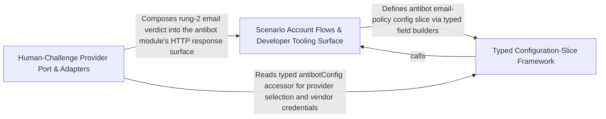

---
tags:
  - 2brain
  - 2brain/arch
  - project/boilerplate-node-backend
type: architecture
component: Scenario_Account_Flows_Cross_Cutting_Tooling
---

## Details

The scenario-side account flow entry points plus the scattered cross-cutting tooling that the harness touches — contract breaking-change checks, mutation diff reporting, module-scaffold option parsing, the app's system routes (/readyz), and the antibot provider adapters (altcha store, email/MX policy). It is the 'scenario + tooling' surface that the demo server exercises.

### Scenario Account Flows & Developer Tooling Surface
The scenario-side account flow entry points plus the scattered cross-cutting tooling the harness touches: the seed-account persona registry, the contract breaking-change gate, the mutation diff reporter, the module-scaffold CLI option parser, the app's system routes, and the antibot rung-2 email/MX policy. It is the entry-point layer that the demo server and developer tooling drive, kept out of src/modules because it belongs to nobody's business logic.

**Related Classes/Methods**:

- `src.infrastructure.adapters.antibot.checkEmailPolicy`:55-86

**Source Files:**

- `scenarios/accounts.ts`
  - `scenarios.accounts.then() callback` (L200-L219) - Function
- `scenarios/support/doubles/payments/fake.ts`
  - `scenarios.support.doubles.payments.fake.parseWebhook.then() callback` (L262-L262) - Function
- `scripts/contracts/check-asyncapi-breaking.ts`
  - `scripts.contracts.check-asyncapi-breaking.catch() callback` (L132-L135) - Function
- `scripts/mutation/run-diff.ts`
  - `scripts.mutation.run-diff.then() callback` (L106-L106) - Function
- `scripts/scaffold/options.ts`
  - `scripts.scaffold.options.ScaffoldOptions` (L11-L24) - Interface
  - `scripts.scaffold.options.ParseRefusal` (L39-L41) - Interface
- `scripts/scaffold/scaffold-module.ts`
  - `scripts.scaffold.scaffold-module.then() callback` (L67-L70) - Function
- `src/app/system-routes.ts`
  - `src.app.system-routes.router.get('/readyz') callback` (L40-L42) - Function
- `src/infrastructure/adapters/antibot-providers/altcha.ts`
  - `src.infrastructure.adapters.antibot-providers.altcha.issue` (L47-L59) - Class
  - `src.infrastructure.adapters.antibot-providers.altcha.issue.then() callback` (L56-L59) - Function
- `src/infrastructure/adapters/antibot-providers/index.ts`
  - `src.infrastructure.adapters.antibot-providers.index.humanChallengeProviderProbe` (L135-L139) - Class
  - `src.infrastructure.adapters.antibot-providers.index.humanChallengeProviderProbe.check` (L138-L138) - Method
- `src/infrastructure/adapters/antibot.ts`
  - `src.infrastructure.adapters.antibot.hasMxRecord` (L39-L43) - Class
  - `src.infrastructure.adapters.antibot.hasMxRecord.then() callback` (L42-L42) - Function
  - `src.infrastructure.adapters.antibot.hasMxRecord.catch() callback` (L43-L43) - Function
  - `src.infrastructure.adapters.antibot.checkEmailPolicy` (L55-L86) - Class
  - `src.infrastructure.adapters.antibot.checkEmailPolicy.then() callback` (L56-L86) - Function
  - `src.infrastructure.adapters.antibot.checkEmailPolicy.then() callback.then() callback` (L85-L85) - Function
- `src/infrastructure/adapters/config.ts`
  - `src.infrastructure.adapters.config.mailConfig` (L27-L51) - Class
  - `src.infrastructure.adapters.config.mailConfig.check` (L39-L50) - Method
  - `src.infrastructure.adapters.config.mailConfig.check.SMTP_COMPANIONS.filter() callback` (L42-L42) - Function
  - `src.infrastructure.adapters.config.antibotConfig` (L139-L167) - Class
  - `src.infrastructure.adapters.config.antibotConfig.check` (L151-L166) - Method
- `src/infrastructure/adapters/mail-transports.ts`
  - `src.infrastructure.adapters.mail-transports.mailTransportProbe` (L116-L120) - Class
  - `src.infrastructure.adapters.mail-transports.mailTransportProbe.check` (L119-L119) - Method
- `src/infrastructure/adapters/pdf.ts`
  - `src.infrastructure.adapters.pdf.then() callback.then() callback` (L240-L240) - Function
- `src/infrastructure/config/define.ts`
  - `src.infrastructure.config.define.FieldInfo` (L26-L33) - Interface
  - `src.infrastructure.config.define.SliceProblems` (L36-L43) - Interface
  - `src.infrastructure.config.define.ConfigSlice` (L46-L58) - Interface
  - `src.infrastructure.config.define.ConfigSlice.inspect` (L57-L57) - Method
  - `src.infrastructure.config.define.ConfigDefinition` (L194-L204) - Interface
  - `src.infrastructure.config.define.ConfigDefinition.check` (L203-L203) - Method
  - `src.infrastructure.config.define.presenceProblems.presence.map() callback` (L226-L226) - Function
  - `src.infrastructure.config.define.slice` (L242-L255) - Class
  - `src.infrastructure.config.define.defineConfig.slice.inspect` (L245-L254) - Method
  - `src.infrastructure.config.define.configProblems.all` (L293-L293) - Class
  - `src.infrastructure.config.define.configProblems.all.slices.map() callback` (L293-L293) - Function
  - `src.infrastructure.config.define.configProblems.invalid.merged() callback` (L300-L300) - Function
  - `src.infrastructure.config.define.configProblems.presence.merged() callback` (L301-L301) - Function
  - `src.infrastructure.config.define.configProblems.checks.merged() callback` (L302-L302) - Function
- `src/infrastructure/config/fields.ts`
  - `src.infrastructure.config.fields.int` (L165-L176) - Function
  - `src.infrastructure.config.fields.choice` (L239-L261) - Function
  - `src.infrastructure.config.fields.text` (L292-L298) - Function
- `src/infrastructure/http/config.ts`
  - `src.infrastructure.http.config.rateLimitBudgetConfig.shape.budgets.map() callback` (L92-L95) - Function
- `src/infrastructure/http/middlewares/cache.ts`
  - `src.infrastructure.http.middlewares.cache.CachedResponse` (L35-L39) - Interface
- `src/infrastructure/http/middlewares/idempotency-model.ts`
  - `src.infrastructure.http.middlewares.idempotency-model.IdempotencyRecordDocument` (L27-L38) - Interface
- `src/infrastructure/observability/analytics/index.ts`
  - `src.infrastructure.observability.analytics.index.analyticsProviderProbe` (L229-L233) - Class
  - `src.infrastructure.observability.analytics.index.analyticsProviderProbe.check` (L232-L232) - Method
- `src/infrastructure/runtime/provider-registry.ts`
  - `src.infrastructure.runtime.provider-registry.ProviderRegistry` (L18-L35) - Interface
  - `src.infrastructure.runtime.provider-registry.ProviderRegistry.register` (L24-L24) - Method
  - `src.infrastructure.runtime.provider-registry.ProviderRegistry.names` (L27-L27) - Method
  - `src.infrastructure.runtime.provider-registry.ProviderRegistry.resolve` (L34-L34) - Method
  - `src.infrastructure.runtime.provider-registry.registryOver` (L42-L48) - Class
  - `src.infrastructure.runtime.provider-registry.registryOver.register` (L43-L45) - Method
  - `src.infrastructure.runtime.provider-registry.registryOver.names` (L46-L46) - Method
  - `src.infrastructure.runtime.provider-registry.registryOver.resolve` (L47-L47) - Method
- `src/modules/account/oauth/config.ts`
  - `src.modules.account.oauth.config.oauthConfig` (L33-L52) - Class
  - `src.modules.account.oauth.config.oauthConfig.check` (L44-L51) - Method
  - `src.modules.account.oauth.config.oauthConfig.check.PROVIDER_PAIRS.some() callback` (L46-L46) - Function
- `src/modules/account/oauth/providers/index.ts`
  - `src.modules.account.oauth.providers.index.enabledProviders` (L35-L36) - Class
  - `src.modules.account.oauth.providers.index.enabledProviders.filter() callback` (L36-L36) - Function
- `src/modules/invoicing/emails.ts`
  - `src.modules.invoicing.emails.DocumentVatRow` (L43-L53) - Interface
  - `src.modules.invoicing.emails.DocumentTaxSummaryRow` (L56-L62) - Interface
  - `src.modules.invoicing.emails.DocumentVatBlock` (L65-L93) - Interface
  - `src.modules.invoicing.emails.buildVatBlock.rows.document.lines.map() callback` (L164-L173) - Function
  - `src.modules.invoicing.emails.rows` (L164-L173) - Class
  - `src.modules.invoicing.emails.buildVatBlock.shipping.rows.shippingByRate.map() callback` (L212-L218) - Function
  - `src.modules.invoicing.emails.buildVatBlock.summaryRows.taxSummary.map() callback` (L222-L226) - Function
- `src/modules/invoicing/providers/index.ts`
  - `src.modules.invoicing.providers.index.invoicingProviderProbe` (L102-L106) - Class
  - `src.modules.invoicing.providers.index.invoicingProviderProbe.check` (L105-L105) - Method
- `src/modules/observability/services/process-snapshot.ts`
  - `src.modules.observability.services.process-snapshot.ProcessMemorySnapshot` (L11-L23) - Interface
  - `src.modules.observability.services.process-snapshot.ProcessSnapshot` (L26-L33) - Interface
- `src/modules/payments/config.ts`
  - `src.modules.payments.config.webhookSecretRing` (L86-L87) - Class
  - `src.modules.payments.config.webhookSecretRing.map() callback` (L87-L87) - Function
  - `src.modules.payments.config.paymentsConfig` (L98-L123) - Class
  - `src.modules.payments.config.paymentsConfig.check` (L114-L122) - Method
  - `src.modules.payments.config.paymentsConfig.check.some() callback` (L117-L117) - Function
- `src/modules/payments/providers/index.ts`
  - `src.modules.payments.providers.index.paymentProviderProbe` (L239-L243) - Class
  - `src.modules.payments.providers.index.paymentProviderProbe.check` (L242-L242) - Method
- `src/modules/payments/providers/webhook-signature.ts`
  - `src.modules.payments.providers.webhook-signature.verifyWebhookSignature.pairs` (L86-L89) - Class
  - `src.modules.payments.providers.webhook-signature.verifyWebhookSignature.pairs.map() callback` (L86-L89) - Function
  - `src.modules.payments.providers.webhook-signature.verifyWebhookSignature.timestamp` (L91-L91) - Class
  - `src.modules.payments.providers.webhook-signature.verifyWebhookSignature.timestamp.pairs.find() callback` (L91-L91) - Function
  - `src.modules.payments.providers.webhook-signature.verifyWebhookSignature.provided` (L94-L94) - Class
  - `src.modules.payments.providers.webhook-signature.verifyWebhookSignature.provided.map() callback` (L94-L94) - Function
  - `src.modules.payments.providers.webhook-signature.verifyWebhookSignature.provided.pairs.filter() callback` (L94-L94) - Function
- `src/modules/payments/services/intent.ts`
  - `src.modules.payments.services.intent.then() callback.then() callback` (L183-L188) - Function
  - `src.modules.payments.services.intent.then() callback.catch() callback` (L191-L198) - Function
- `src/modules/payments/services/list.ts`
  - `src.modules.payments.services.list.listPayments.then() callback.then() callback.byId` (L62-L62) - Class
  - `src.modules.payments.services.list.listPayments.then() callback.then() callback.byId.orders.map() callback` (L62-L62) - Function
- `src/modules/payments/services/notify.ts`
  - `src.modules.payments.services.notify.mailRefundIssued.then() callback.refund` (L93-L93) - Class
  - `src.modules.payments.services.notify.mailRefundIssued.then() callback.refund.payment.refunds.find() callback` (L93-L93) - Function
- `src/modules/payments/services/settlement.ts`
  - `src.modules.payments.services.settlement.then() callback` (L296-L300) - Function
  - `src.modules.payments.services.settlement.catch() callback` (L306-L314) - Function
- `src/modules/payments/services/stats.ts`
  - `src.modules.payments.services.stats.MixRow` (L12-L18) - Interface

### Human-Challenge Provider Port & Adapters
Rung 3 of the anti-automation ladder — the HumanChallengeProvider port and its concrete adapters (none, turnstile, altcha), the single-use altcha-store, the humanChallengeGate middleware, and the antibot module's getAntibotChallenge controller. A clean ports-and-adapters boundary where the module owns the HTTP surface and infrastructure owns the provider implementations.

**Related Classes/Methods**:

- `src.infrastructure.adapters.antibot-providers.index.HumanChallengeProvider`:58-90
- `src.infrastructure.adapters.antibot-providers.turnstile.turnstileProvider`:60-67
- `src.infrastructure.adapters.antibot-providers.altcha-store.claim`:94-100
- `src.infrastructure.http.middlewares.human-challenge.humanChallengeGate`:36-64
- `src.modules.antibot.controllers.get-antibot-challenge.getAntibotChallenge`:20-38

**Source Files:**

- `src/infrastructure/adapters/antibot-providers/altcha-store.ts`
  - `src.infrastructure.adapters.antibot-providers.altcha-store.claim` (L94-L100) - Class
  - `src.infrastructure.adapters.antibot-providers.altcha-store.claim.then() callback` (L99-L99) - Function
- `src/infrastructure/adapters/antibot-providers/altcha.ts`
  - `src.infrastructure.adapters.antibot-providers.altcha.check` (L106-L125) - Class
  - `src.infrastructure.adapters.antibot-providers.altcha.check.then() callback.then() callback` (L119-L119) - Function
  - `src.infrastructure.adapters.antibot-providers.altcha.check.then() callback` (L123-L123) - Function
  - `src.infrastructure.adapters.antibot-providers.altcha.altchaProvider` (L128-L135) - Class
  - `src.infrastructure.adapters.antibot-providers.altcha.altchaProvider.publicParameters` (L132-L132) - Method
  - `src.infrastructure.adapters.antibot-providers.altcha.altchaProvider.verify` (L134-L134) - Method
  - `src.infrastructure.adapters.antibot-providers.altcha.altchaProvider.verify.catch() callback` (L134-L134) - Function
- `src/infrastructure/adapters/antibot-providers/index.ts`
  - `src.infrastructure.adapters.antibot-providers.index.IssuedChallenge` (L24-L28) - Interface
  - `src.infrastructure.adapters.antibot-providers.index.ChallengeParameters` (L31-L45) - Interface
  - `src.infrastructure.adapters.antibot-providers.index.HumanChallengeProvider` (L58-L90) - Interface
  - `src.infrastructure.adapters.antibot-providers.index.HumanChallengeProvider.publicParameters` (L71-L71) - Method
  - `src.infrastructure.adapters.antibot-providers.index.HumanChallengeProvider.issueChallenge` (L80-L80) - Method
  - `src.infrastructure.adapters.antibot-providers.index.HumanChallengeProvider.verify` (L89-L89) - Method
- `src/infrastructure/adapters/antibot-providers/none.ts`
  - `src.infrastructure.adapters.antibot-providers.none.noneProvider` (L11-L15) - Class
  - `src.infrastructure.adapters.antibot-providers.none.noneProvider.publicParameters` (L13-L13) - Method
  - `src.infrastructure.adapters.antibot-providers.none.noneProvider.verify` (L14-L14) - Method
- `src/infrastructure/adapters/antibot-providers/turnstile.ts`
  - `src.infrastructure.adapters.antibot-providers.turnstile.siteverify` (L38-L57) - Class
  - `src.infrastructure.adapters.antibot-providers.turnstile.then() callback` (L52-L53) - Function
  - `src.infrastructure.adapters.antibot-providers.turnstile.siteverify.then() callback` (L55-L56) - Function
  - `src.infrastructure.adapters.antibot-providers.turnstile.turnstileProvider` (L60-L67) - Class
  - `src.infrastructure.adapters.antibot-providers.turnstile.turnstileProvider.publicParameters` (L62-L65) - Method
  - `src.infrastructure.adapters.antibot-providers.turnstile.turnstileProvider.verify` (L66-L66) - Method
  - `src.infrastructure.adapters.antibot-providers.turnstile.turnstileProvider.verify.catch() callback` (L66-L66) - Function
- `src/infrastructure/http/middlewares/human-challenge.ts`
  - `src.infrastructure.http.middlewares.human-challenge.humanChallengeGate` (L36-L64) - Class
  - `src.infrastructure.http.middlewares.human-challenge.humanChallengeGate.then() callback` (L55-L61) - Function
  - `src.infrastructure.http.middlewares.human-challenge.humanChallengeGate.catch() callback` (L63-L63) - Function
- `src/modules/antibot/controllers/get-antibot-challenge.ts`
  - `src.modules.antibot.controllers.get-antibot-challenge.getAntibotChallenge` (L20-L38) - Class
  - `src.modules.antibot.controllers.get-antibot-challenge.then() callback` (L22-L22) - Function
  - `src.modules.antibot.controllers.get-antibot-challenge.getAntibotChallenge.then() callback` (L23-L37) - Function
  - `src.modules.antibot.controllers.get-antibot-challenge.getAntibotChallenge.then() callback.then() callback` (L36-L36) - Function
- `src/modules/antibot/controllers/get-antibot-config.ts`
  - `src.modules.antibot.controllers.get-antibot-config.getAntibotConfig` (L29-L42) - Class
  - `src.modules.antibot.controllers.get-antibot-config.then() callback` (L31-L31) - Function
  - `src.modules.antibot.controllers.get-antibot-config.getAntibotConfig.then() callback` (L32-L40) - Function

### Typed Configuration-Slice Framework
The single layer that reads, validates, and types the environment — the foundation every adapter slice is written against. defineConfig turns an owner's slice into a typed, memoised accessor. Field builders enforce the 'blank is unset, a set-and-wrong value is an issue, never a silent fallback' rule. versioned-secret.parseVersionedKeyRing handles the vN: versioned key-ring format. The boot gate validates every slice at once.

**Related Classes/Methods**:

- `src.infrastructure.config.fields.build`:105-116
- `src.infrastructure.security.versioned-secret.parseVersionedKeyRing`:32-41
- `src.infrastructure.adapters.config.outboundConfig`:107-116

**Source Files:**

- `src/infrastructure/adapters/config.ts`
  - `src.infrastructure.adapters.config.outboundConfig` (L107-L116) - Class
  - `src.infrastructure.adapters.config.outboundConfig.check` (L112-L115) - Method
  - `src.infrastructure.adapters.config.outboundConfig.check.config.NODE_OUTBOUND_ALLOWED_PORTS.filter() callback` (L114-L114) - Function
  - `src.infrastructure.adapters.config.outboundConfig.check.map() callback` (L115-L115) - Function
- `src/infrastructure/config/define.ts`
  - `src.infrastructure.config.define.presenceBroken` (L146-L158) - Class
  - `src.infrastructure.config.define.presenceBroken.members` (L148-L148) - Class
  - `src.infrastructure.config.define.presenceBroken.members.filter() callback` (L148-L148) - Function
  - `src.infrastructure.config.define.presenceBroken.members.some() callback` (L152-L155) - Function
  - `src.infrastructure.config.define.describeShape` (L161-L166) - Class
  - `src.infrastructure.config.define.describeShape.map() callback` (L162-L166) - Function
  - `src.infrastructure.config.define.presenceProblems.presence.info.filter() callback` (L220-L224) - Function
- `src/infrastructure/config/fields.ts`
  - `src.infrastructure.config.fields.build` (L105-L116) - Function
  - `src.infrastructure.config.fields.build.rule` (L109-L109) - Class
  - `src.infrastructure.config.fields.build.rule.transform() callback` (L109-L109) - Function
  - `src.infrastructure.config.fields.decimal` (L185-L199) - Function
  - `src.infrastructure.config.fields.email` (L307-L312) - Function
  - `src.infrastructure.config.fields.timeZone` (L345-L357) - Function
  - `src.infrastructure.config.fields.timeZone.transform() callback` (L349-L354) - Function
  - `src.infrastructure.config.fields.listRule` (L395-L401) - Class
  - `src.infrastructure.config.fields.listRule.transform() callback` (L396-L400) - Function
  - `src.infrastructure.config.fields.listRule.transform() callback.map() callback` (L399-L399) - Function
  - `src.infrastructure.config.fields.listRule.transform() callback.filter() callback` (L400-L400) - Function
  - `src.infrastructure.config.fields.csv` (L408-L412) - Class
  - `src.infrastructure.config.fields.csv.listRule() callback` (L410-L410) - Function
  - `src.infrastructure.config.fields.keyRing` (L420-L424) - Class
  - `src.infrastructure.config.fields.keyRing.listRule() callback` (L422-L422) - Function
  - `src.infrastructure.config.fields.versionedKeyRing` (L431-L435) - Class
  - `src.infrastructure.config.fields.versionedKeyRing.transform() callback` (L433-L433) - Function
- `src/infrastructure/security/versioned-secret.ts`
  - `src.infrastructure.security.versioned-secret.parseVersionedKeyRing` (L32-L41) - Class
  - `src.infrastructure.security.versioned-secret.parseVersionedKeyRing.filter() callback` (L35-L35) - Function
  - `src.infrastructure.security.versioned-secret.parseVersionedKeyRing.map() callback` (L36-L41) - Function
- `src/modules/account/domain/email-change.ts`
  - `src.modules.account.domain.email-change.EmailChangeFields` (L46-L52) - Interface
- `src/modules/account/domain/revocation.ts`
  - `src.modules.account.domain.revocation.RevocationRow` (L20-L26) - Interface
- `src/modules/account/session/auth-context.ts`
  - `src.modules.account.session.auth-context.SessionProof` (L16-L21) - Interface
- `src/modules/account/session/config.ts`
  - `src.modules.account.session.config.sessionConfig` (L70-L129) - Class
  - `src.modules.account.session.config.sessionConfig.check` (L121-L128) - Method
- `src/modules/account/session/jwt-strategy.ts`
  - `src.modules.account.session.jwt-strategy.<function>.then() callback` (L168-L169) - Function
- `src/modules/account/session/listing.ts`
  - `src.modules.account.session.listing.listSessions.then() callback.rows` (L74-L79) - Class
  - `src.modules.account.session.listing.listSessions.then() callback.rows.allRows.filter() callback` (L75-L78) - Function
  - `src.modules.account.session.listing.listSessions.then() callback.current` (L81-L83) - Class
  - `src.modules.account.session.listing.listSessions.then() callback.current.map() callback` (L82-L82) - Function
  - `src.modules.account.session.listing.listSessions.then() callback.current.rows.filter() callback` (L82-L82) - Function
- `src/modules/account/session/mint-guard.ts`
  - `src.modules.account.session.mint-guard.SecondFactorRequiredError` (L20-L26) - Class
  - `src.modules.account.session.mint-guard.SecondFactorRequiredError.constructor` (L22-L25) - Constructor
  - `src.modules.account.session.mint-guard.StaleProofError` (L49-L55) - Class
  - `src.modules.account.session.mint-guard.StaleProofError.constructor` (L51-L54) - Constructor
- `src/modules/account/session/strategy.ts`
  - `src.modules.account.session.strategy.IssueOptions` (L41-L54) - Interface
  - `src.modules.account.session.strategy.SessionSnapshot` (L61-L67) - Interface
  - `src.modules.account.session.strategy.IssuedSession` (L70-L75) - Interface
  - `src.modules.account.session.strategy.ReissueOptions` (L78-L82) - Interface
- `src/modules/account/two-factor/registry.ts`
  - `src.modules.account.two-factor.registry.HANDLERS.map() callback` (L79-L79) - Function
