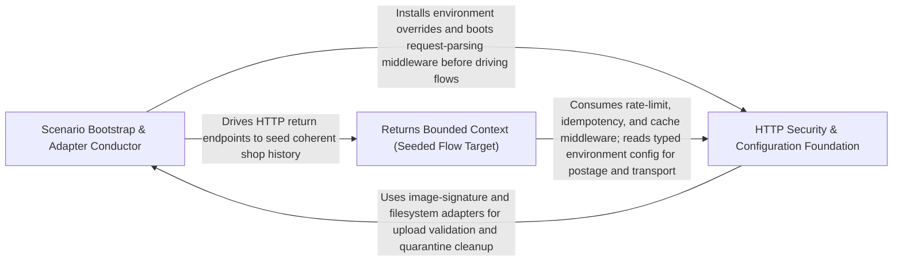

---
tags:
  - 2brain
  - 2brain/arch
  - project/boilerplate-node-backend
type: architecture
component: Scenario_Application_Orchestrator
---

## Details

The entry-point and environment-bootstrap layer of the flow driver. scenarios/apply.ts is the single command that the demo profile invokes (npm run db:bootstrap → scenario:apply); it wires together the security middleware (installRequestParsing, isRawBodyPath), the kernel authentication resolvers (AuthResolver, CredentialResolver, ResolvedCredential), the filesystem and image-store adapters, and the scaffold/mutation-CI planning utilities, then hands control to the execution engine. It is the conductor that ensures the app is in a fully configured, authenticated, and filesystem-ready state before any HTTP flow is driven.

### Scenario Bootstrap & Adapter Conductor
The entry-point and environment-bootstrap layer of the flow driver. `scenarios/apply.ts` is the single command the demo profile invokes; it wires together the security middleware, the kernel authentication resolvers, the filesystem and image-store adapters, and the scaffold/mutation-CI planning utilities, then hands control to the execution engine (`buildScenario`). It is the conductor that ensures the app is in a fully configured, authenticated, and filesystem-ready state before any HTTP flow is driven. It also owns the pure planning data (`ScaffoldPlan`/`PlannedFile`) and the content-based image identification pipeline (`identifyImage`, `ImageFormat`) that the seeded flows' upload paths depend on.

**Related Classes/Methods**:

- `src.infrastructure.adapters.image-signatures.identifyImage`:107-112
- `src.infrastructure.adapters.filesystem.deleteFile`:49-59

**Source Files:**

- `scenarios/apply.ts`
  - `scenarios.apply.filter() callback` (L91-L91) - Function
- `scripts/contracts/check-asyncapi-breaking.ts`
  - `scripts.contracts.check-asyncapi-breaking.then() callback` (L90-L131) - Function
- `scripts/mutation/ci/slice-ignorer.ts`
  - `scripts.mutation.ci.slice-ignorer.LineSlice` (L17-L20) - Interface
  - `scripts.mutation.ci.slice-ignorer.NodeLocation` (L23-L26) - Interface
  - `scripts.mutation.ci.slice-ignorer.IgnorerPath` (L29-L31) - Interface
  - `scripts.mutation.ci.slice-ignorer.strykerPlugins.value.shouldIgnore` (L84-L87) - Method
- `scripts/scaffold/plan.ts`
  - `scripts.scaffold.plan.PlannedFile` (L15-L20) - Interface
  - `scripts.scaffold.plan.ScaffoldPlan` (L23-L28) - Interface
- `src/infrastructure/adapters/filesystem.ts`
  - `src.infrastructure.adapters.filesystem.deleteFile` (L49-L59) - Class
  - `src.infrastructure.adapters.filesystem.deleteFile.toolkitDeleteFile() callback` (L51-L58) - Function
- `src/infrastructure/adapters/image-signatures.ts`
  - `src.infrastructure.adapters.image-signatures.ImageFormat` (L19-L32) - Interface
  - `src.infrastructure.adapters.image-signatures.hasMarker` (L97-L99) - Class
  - `src.infrastructure.adapters.image-signatures.hasMarker.marker.bytes.every() callback` (L99-L99) - Function
  - `src.infrastructure.adapters.image-signatures.identifyImage` (L107-L112) - Class
  - `src.infrastructure.adapters.image-signatures.identifyImage.SUPPORTED_IMAGE_FORMATS.find() callback` (L109-L111) - Function
  - `src.infrastructure.adapters.image-signatures.identifyImage.SUPPORTED_IMAGE_FORMATS.find() callback.every() callback` (L111-L111) - Function
  - `src.infrastructure.adapters.image-signatures.extensionForImage` (L153-L154) - Class
  - `src.infrastructure.adapters.image-signatures.extensionForImage.SUPPORTED_IMAGE_FORMATS.find() callback` (L154-L154) - Function
- `src/infrastructure/adapters/image-store.ts`
  - `src.infrastructure.adapters.image-store.ImageStore` (L25-L103) - Interface
  - `src.infrastructure.adapters.image-store.ImageStore.quarantine` (L35-L35) - Method
  - `src.infrastructure.adapters.image-store.ImageStore.readQuarantined` (L44-L44) - Method
  - `src.infrastructure.adapters.image-store.ImageStore.removeQuarantined` (L55-L55) - Method
  - `src.infrastructure.adapters.image-store.ImageStore.promote` (L76-L76) - Method
  - `src.infrastructure.adapters.image-store.ImageStore.putDerivative` (L90-L90) - Method
  - `src.infrastructure.adapters.image-store.ImageStore.remove` (L102-L102) - Method
  - `src.infrastructure.adapters.image-store.filesystemImageStore` (L195-L254) - Class
  - `src.infrastructure.adapters.image-store.filesystemImageStore.quarantine` (L196-L204) - Method
  - `src.infrastructure.adapters.image-store.filesystemImageStore.readQuarantined` (L206-L206) - Method
  - `src.infrastructure.adapters.image-store.filesystemImageStore.removeQuarantined` (L208-L208) - Method
  - `src.infrastructure.adapters.image-store.filesystemImageStore.promote` (L210-L220) - Method
  - `src.infrastructure.adapters.image-store.filesystemImageStore.putDerivative` (L222-L229) - Method
  - `src.infrastructure.adapters.image-store.filesystemImageStore.remove` (L231-L253) - Method
  - `src.infrastructure.adapters.image-store.filesystemImageStore.remove.then() callback` (L251-L251) - Function
- `src/infrastructure/adapters/image.worker.ts`
  - `src.infrastructure.adapters.image.worker.UnsupportedImageFormatError` (L44-L46) - Class
  - `src.infrastructure.adapters.image.worker.DigestedImageUrls` (L74-L79) - Interface
  - `src.infrastructure.adapters.image.worker.digestQuarantinedImage` (L133-L164) - Class
  - `src.infrastructure.adapters.image.worker.digestQuarantinedImage.then() callback` (L134-L164) - Function
  - `src.infrastructure.adapters.image.worker.then() callback.then() callback` (L144-L145) - Function
  - `src.infrastructure.adapters.image.worker.digestQuarantinedImage.then() callback.then() callback.then() callback` (L145-L145) - Function
  - `src.infrastructure.adapters.image.worker.digestQuarantinedImage.then() callback.catch() callback` (L147-L155) - Function
  - `src.infrastructure.adapters.image.worker.digestQuarantinedImage.then() callback.then() callback` (L163-L163) - Function
  - `src.infrastructure.adapters.image.worker.settleWriteback` (L186-L214) - Class
  - `src.infrastructure.adapters.image.worker.settleWriteback.then() callback` (L193-L214) - Function
  - `src.infrastructure.adapters.image.worker.then() callback.clearQuarantine.then() callback` (L209-L209) - Function
  - `src.infrastructure.adapters.image.worker.settleWriteback.then() callback.then() callback` (L210-L210) - Function
  - `src.infrastructure.adapters.image.worker.settleWriteback.then() callback.clearQuarantine.then() callback` (L213-L213) - Function
  - `src.infrastructure.adapters.image.worker.handleImageDigestJob` (L226-L266) - Class
  - `src.infrastructure.adapters.image.worker.handleImageDigestJob.then() callback` (L247-L248) - Function
  - `src.infrastructure.adapters.image.worker.handleImageDigestJob.then() callback.then() callback` (L248-L248) - Function
  - `src.infrastructure.adapters.image.worker.handleImageDigestJob.catch() callback` (L250-L265) - Function
  - `src.infrastructure.adapters.image.worker.handleImageDigestJob.catch() callback.then() callback` (L256-L256) - Function
  - `src.infrastructure.adapters.image.worker.enqueueImageDigest` (L284-L313) - Class
  - `src.infrastructure.adapters.image.worker.enqueueImageDigest.runInline` (L288-L297) - Class
  - `src.infrastructure.adapters.image.worker.enqueueImageDigest.runInline.then() callback` (L289-L296) - Function
  - `src.infrastructure.adapters.image.worker.enqueueImageDigest.runInline.then() callback.then() callback` (L296-L296) - Function
  - `src.infrastructure.adapters.image.worker.enqueueImageDigest.then() callback` (L305-L312) - Function
  - `src.infrastructure.adapters.image.worker.enqueueIfImagePending` (L333-L357) - Class
  - `src.infrastructure.adapters.image.worker.enqueueIfImagePending.then() callback` (L349-L356) - Function
- `src/infrastructure/adapters/remote-image.ts`
  - `src.infrastructure.adapters.remote-image.digestBytes` (L78-L95) - Class
  - `src.infrastructure.adapters.remote-image.digestBytes.then() callback` (L84-L88) - Function
  - `src.infrastructure.adapters.remote-image.digestBytes.then() callback.finally() callback` (L86-L87) - Function
  - `src.infrastructure.adapters.remote-image.digestBytes.catch() callback` (L90-L93) - Function
  - `src.infrastructure.adapters.remote-image.digestBytes.catch() callback.then() callback` (L91-L93) - Function
- `src/infrastructure/http/middlewares/upload.ts`
  - `src.infrastructure.http.middlewares.upload.releaseUnclaimedUpload` (L297-L304) - Class
  - `src.infrastructure.http.middlewares.upload.releaseUnclaimedUpload.response.once('close') callback` (L298-L303) - Function
- `src/infrastructure/http/uploads.ts`
  - `src.infrastructure.http.uploads.RequestImage` (L29-L58) - Interface
  - `src.infrastructure.http.uploads.deleteUpload` (L88-L88) - Method
  - `src.infrastructure.http.uploads.readUploadedImage.deleteUpload` (L111-L111) - Method
- `src/infrastructure/observability/metrics-http.ts`
  - `src.infrastructure.observability.metrics-http.RequestMetricInput` (L95-L101) - Interface
- `src/infrastructure/observability/tracer.ts`
  - `src.infrastructure.observability.tracer.tracer.startActiveSpan() callback.then() callback` (L51-L51) - Function
- `src/kernel/authentication.ts`
  - `src.kernel.authentication.AuthResolver` (L37-L60) - Interface
  - `src.kernel.authentication.ResolvedCredential` (L82-L85) - Interface
  - `src.kernel.authentication.CredentialResolver` (L88-L90) - Interface
- `src/modules/account/services/oauth.ts`
  - `src.modules.account.services.oauth.discardAvatar` (L133-L136) - Class
  - `src.modules.account.services.oauth.discardAvatar.then() callback` (L134-L136) - Function
- `src/modules/account/services/signup.ts`
  - `src.modules.account.services.signup.createAccountIfEmailFree.then() callback.then() callback` (L137-L140) - Function
- `src/modules/example/services/personal-data.ts`
  - `src.modules.example.services.personal-data.eraseForUser` (L51-L59) - Class
  - `src.modules.example.services.personal-data.eraseForUser.then() callback` (L55-L58) - Function
  - `src.modules.example.services.personal-data.eraseForUser.then() callback.<function>` (L55-L58) - Function
  - `src.modules.example.services.personal-data.eraseForUser.then() callback.<function>.imageUrls.map() callback` (L56-L56) - Function
  - `src.modules.example.services.personal-data.eraseForUser.then() callback.<function>.then() callback` (L57-L57) - Function
- `src/modules/users/services/lookups.ts`
  - `src.modules.users.services.lookups.emailTaken` (L55-L56) - Class
  - `src.modules.users.services.lookups.emailTaken.then() callback` (L56-L56) - Function
- `src/modules/users/services/read.ts`
  - `src.modules.users.services.read.getById` (L24-L27) - Class
  - `src.modules.users.services.read.getById.then() callback` (L26-L26) - Function
- `src/modules/users/services/update.ts`
  - `src.modules.users.services.update.changedRole` (L116-L122) - Class
  - `src.modules.users.services.update.changedRole.then() callback` (L119-L121) - Function
  - `src.modules.users.services.update.saveAndGrant` (L133-L164) - Class
  - `src.modules.users.services.update.saveAndGrant.then() callback` (L151-L162) - Function
  - `src.modules.users.services.update.saveAndGrant.then() callback.then() callback` (L162-L162) - Function
  - `src.modules.users.services.update.finishUpdate.imageCleanup` (L182-L184) - Class
  - `src.modules.users.services.update.imageCleanup.then() callback` (L183-L183) - Function
  - `src.modules.users.services.update.finishUpdate.imageCleanup.then() callback` (L196-L196) - Function
  - `src.modules.users.services.update.saveWithRole` (L205-L227) - Class
  - `src.modules.users.services.update.saveWithRole.then() callback.withTransaction() callback` (L226-L226) - Function
  - `src.modules.users.services.update.saveWithRole.then() callback` (L227-L227) - Function
  - `src.modules.users.services.update.refusalFor.missing` (L308-L308) - Class
  - `src.modules.users.services.update.refusalFor.missing.find() callback` (L308-L308) - Function

### HTTP Security & Configuration Foundation
The request-path foundation the conductor boots into. `src/app/security.ts` installs the request-parsing middleware (`installRequestParsing`) and the raw-body path predicate (`isRawBodyPath`) that every seeded flow's HTTP request must traverse. `src/infrastructure/config/*` provides the typed environment store (`define`, `fields`, `store`) that `apply.ts`'s `installEnvironment` overrides (rate-limit budgets, mail transport, broker off, bank-transfer beneficiary) read from. `src/infrastructure/http/uploads.ts` and `http/middlewares/upload.ts` expose the multipart form-file extraction the seeded image-upload flows rely on. This sub-component is the horizontal band the conductor depends on — it is not demo-specific, but it is the surface the demo profile must be in a known state before driving any flow.

**Related Classes/Methods**:

- `src.app.security.installRequestParsing`:200-239
- `src.app.security.isRawBodyPath`:48-51
- `src.infrastructure.config.store.overrideEnvironment`:113-129
- `src.infrastructure.config.fields.BuildOptions`:88-93
- `src.infrastructure.http.uploads.getFormFiles`:24-26

**Source Files:**

- `src/app/security.ts`
  - `src.app.security.isRawBodyPath` (L48-L51) - Class
  - `src.app.security.isRawBodyPath.RAW_BODY_PATHS.some() callback` (L50-L50) - Function
  - `src.app.security.installRequestParsing` (L200-L239) - Class
  - `src.app.security.installRequestParsing.verify` (L219-L225) - Method
- `src/infrastructure/config/define.ts`
  - `src.infrastructure.config.define.ConfigError` (L77-L83) - Class
  - `src.infrastructure.config.define.ConfigError.constructor` (L79-L82) - Constructor
  - `src.infrastructure.config.define.configProblems.merged` (L296-L298) - Class
  - `src.infrastructure.config.define.configProblems.merged.all.flatMap() callback` (L297-L297) - Function
  - `src.infrastructure.config.define.assertConfigIn.clauses` (L316-L322) - Class
  - `src.infrastructure.config.define.assertConfigIn.clauses.filter() callback` (L322-L322) - Function
- `src/infrastructure/config/fields.ts`
  - `src.infrastructure.config.fields.CommonOptions` (L62-L67) - Interface
  - `src.infrastructure.config.fields.BuildOptions` (L88-L93) - Interface
  - `src.infrastructure.config.fields.RangeOptions` (L119-L126) - Interface
  - `src.infrastructure.config.fields.TextOptions` (L278-L283) - Interface
  - `src.infrastructure.config.fields.CsvOptions` (L381-L386) - Interface
- `src/infrastructure/config/store.ts`
  - `src.infrastructure.config.store.StoreState` (L24-L37) - Interface
  - `src.infrastructure.config.store.overrideEnvironment` (L113-L129) - Class
  - `src.infrastructure.config.store.overrideEnvironment.before` (L116-L118) - Class
  - `src.infrastructure.config.store.overrideEnvironment.before.map() callback` (L117-L117) - Function
  - `src.infrastructure.config.store.overrideEnvironment.<function>` (L122-L128) - Function
- `src/infrastructure/http/middlewares/content-type.ts`
  - `src.infrastructure.http.middlewares.content-type.requireDeclaredContentType` (L41-L62) - Class
  - `src.infrastructure.http.middlewares.content-type.requireDeclaredContentType.<function>` (L44-L61) - Function
- `src/infrastructure/http/middlewares/request-logger.ts`
  - `src.infrastructure.http.middlewares.request-logger.requestLogger` (L17-L43) - Class
  - `src.infrastructure.http.middlewares.request-logger.requestLogger.response.once('finish') callback` (L21-L40) - Function
- `src/infrastructure/http/middlewares/upload.ts`
  - `src.infrastructure.http.middlewares.upload.resolveUploadDestination` (L66-L84) - Class
  - `src.infrastructure.http.middlewares.upload.resolveUploadDestination.then() callback` (L82-L82) - Function
  - `src.infrastructure.http.middlewares.upload.resolveUploadDestination.catch() callback` (L83-L83) - Function
  - `src.infrastructure.http.middlewares.upload.validateUploadedImages` (L221-L264) - Class
  - `src.infrastructure.http.middlewares.upload.validateUploadedImages.paths.map() callback` (L235-L235) - Function
  - `src.infrastructure.http.middlewares.upload.validateUploadedImages.then() callback` (L236-L262) - Function
  - `src.infrastructure.http.middlewares.upload.validateUploadedImages.then() callback.then() callback` (L259-L261) - Function
  - `src.infrastructure.http.middlewares.upload.validateUploadedImages.catch() callback` (L263-L263) - Function
  - `src.infrastructure.http.middlewares.upload.cleanupAfterPartialQuarantine` (L276-L285) - Class
  - `src.infrastructure.http.middlewares.upload.cleanupAfterPartialQuarantine.staged.map() callback` (L281-L281) - Function
  - `src.infrastructure.http.middlewares.upload.cleanupAfterPartialQuarantine.results.filter() callback` (L283-L283) - Function
  - `src.infrastructure.http.middlewares.upload.cleanupAfterPartialQuarantine.map() callback` (L284-L284) - Function
  - `src.infrastructure.http.middlewares.upload.digestQuarantinedKeysInline` (L317-L345) - Class
  - `src.infrastructure.http.middlewares.upload.digestQuarantinedKeysInline.keys.map() callback` (L329-L329) - Function
  - `src.infrastructure.http.middlewares.upload.digestQuarantinedKeysInline.then() callback` (L331-L340) - Function
  - `src.infrastructure.http.middlewares.upload.digestQuarantinedKeysInline.then() callback.digested.map() callback` (L333-L333) - Function
  - `src.infrastructure.http.middlewares.upload.digestQuarantinedKeysInline.then() callback.keys.map() callback` (L337-L337) - Function
  - `src.infrastructure.http.middlewares.upload.digestQuarantinedKeysInline.then() callback.then() callback` (L337-L338) - Function
  - `src.infrastructure.http.middlewares.upload.digestQuarantinedKeysInline.catch() callback` (L341-L344) - Function
  - `src.infrastructure.http.middlewares.upload.digestQuarantinedKeysInline.catch() callback.keys.map() callback` (L342-L342) - Function
  - `src.infrastructure.http.middlewares.upload.digestQuarantinedKeysInline.catch() callback.then() callback` (L342-L343) - Function
  - `src.infrastructure.http.middlewares.upload.quarantineUploadedImages` (L359-L423) - Class
  - `src.infrastructure.http.middlewares.upload.quarantineUploadedImages.staged.map() callback` (L369-L369) - Function
  - `src.infrastructure.http.middlewares.upload.quarantineUploadedImages.then() callback` (L371-L417) - Function
  - `src.infrastructure.http.middlewares.upload.quarantineUploadedImages.then() callback.then() callback` (L374-L375) - Function
  - `src.infrastructure.http.middlewares.upload.quarantineUploadedImages.catch() callback` (L422-L422) - Function
- `src/infrastructure/http/uploads.ts`
  - `src.infrastructure.http.uploads.getFormFiles` (L24-L26) - Function
- `src/infrastructure/observability/metrics-outbox.ts`
  - `src.infrastructure.observability.metrics-outbox._outboxPendingGauge` (L58-L74) - Class
  - `src.infrastructure.observability.metrics-outbox._outboxPendingGauge.collect` (L62-L73) - Method
  - `src.infrastructure.observability.metrics-outbox._outboxPendingGauge.collect.then() callback` (L69-L71) - Function
  - `src.infrastructure.observability.metrics-outbox._outboxPendingGauge.collect.catch() callback` (L72-L72) - Function
- `src/infrastructure/observability/metrics-registry.ts`
  - `src.infrastructure.observability.metrics-registry._processUptimeGauge` (L38-L45) - Class
  - `src.infrastructure.observability.metrics-registry._processUptimeGauge.collect` (L42-L44) - Method
- `src/infrastructure/runtime/otel-sdk.ts`
  - `src.infrastructure.runtime.otel-sdk.redactUrlSecrets.secrets` (L66-L66) - Class
  - `src.infrastructure.runtime.otel-sdk.redactUrlSecrets.secrets.QUERY_SECRETS.filter() callback` (L66-L66) - Function
- `src/infrastructure/runtime/server-lifecycle.ts`
  - `src.infrastructure.runtime.server-lifecycle.listenOn` (L43-L53) - Class
  - `src.infrastructure.runtime.server-lifecycle.listenOn.<function>` (L44-L53) - Function
  - `src.infrastructure.runtime.server-lifecycle.closeServer.<function>.cutTimer` (L106-L109) - Class
  - `src.infrastructure.runtime.server-lifecycle.closeServer.<function>.cutTimer.setTimeout() callback` (L107-L107) - Function
  - `src.infrastructure.runtime.server-lifecycle.registerSignalHandlers.onProcessSignal.forcedExitTimer` (L185-L189) - Class
  - `src.infrastructure.runtime.server-lifecycle.registerSignalHandlers.onProcessSignal.forcedExitTimer.setTimeout() callback` (L185-L189) - Function

### Returns Bounded Context (Seeded Flow Target)
The returns domain module — one of the bounded contexts whose endpoints the seeded flows exercise end-to-end. It owns the returnable-quantity computation (`returnableLinesOf`, `wireLines`, `ProductQuantity`), the status projection (`projectReturnStatus`, `ProjectedReturn`), and the two service operations the demo flow drives: `create` (with `alreadyReturned` guard and `openUnderLock`) and `receive` (with `claimAndRestock` and `ReceiveReturnInput`). This sub-component is the domain-side target of the conductor's HTTP flows: the conductor drives the real `POST /returns` and `POST /returns/:id/receive` endpoints, and this module is what answers them. It is included in the subsystem because the demo profile's shop history is incomplete without a returns leg, and the conductor's `buildScenario` registry maps the `shop` scenario to flows that hit these endpoints.

**Related Classes/Methods**:

- `src.modules.returns.domain.quantities.returnableLinesOf`:36-44
- `src.modules.returns.domain.status-projection.projectReturnStatus`:36-61
- `src.modules.returns.services.create.alreadyReturned`:177-182
- `src.modules.returns.services.receive.claimAndRestock`:124-177

**Source Files:**

- `src/modules/returns/domain/accounting.ts`
  - `src.modules.returns.domain.accounting.AccountedReturn` (L15-L21) - Interface
  - `src.modules.returns.domain.accounting.OrderAccounts` (L24-L29) - Interface
  - `src.modules.returns.domain.accounting.accountsOf.settled` (L50-L50) - Class
  - `src.modules.returns.domain.accounting.accountsOf.settled.returns.filter() callback` (L50-L50) - Function
  - `src.modules.returns.domain.accounting.accountsOf.accountedFor.settled.flatMap() callback` (L56-L56) - Function
- `src/modules/returns/domain/quantities.ts`
  - `src.modules.returns.domain.quantities.ProductQuantity` (L8-L11) - Interface
  - `src.modules.returns.domain.quantities.wireLines` (L24-L27) - Class
  - `src.modules.returns.domain.quantities.wireLines.lines.map() callback` (L27-L27) - Function
  - `src.modules.returns.domain.quantities.returnableLinesOf` (L36-L44) - Class
  - `src.modules.returns.domain.quantities.returnableLinesOf.items.filter() callback` (L43-L43) - Function
  - `src.modules.returns.domain.quantities.returnableLinesOf.map() callback` (L44-L44) - Function
  - `src.modules.returns.domain.quantities.checkRequestedLines.lines.filter() callback` (L84-L84) - Function
  - `src.modules.returns.domain.quantities.checkRequestedLines.lines.map() callback` (L100-L100) - Function
  - `src.modules.returns.domain.quantities.takesLastUnit` (L113-L128) - Class
  - `src.modules.returns.domain.quantities.takesLastUnit.every() callback` (L126-L126) - Function
- `src/modules/returns/domain/refund-amount.ts`
  - `src.modules.returns.domain.refund-amount.RefundBreakdown` (L40-L45) - Interface
- `src/modules/returns/domain/status-projection.ts`
  - `src.modules.returns.domain.status-projection.ProjectedReturn` (L12-L17) - Interface
  - `src.modules.returns.domain.status-projection.projectReturnStatus` (L36-L61) - Class
  - `src.modules.returns.domain.status-projection.holding.some() callback` (L49-L49) - Function
- `src/modules/returns/repository.ts`
  - `src.modules.returns.repository.returnRepository.sumReceived` (L120-L137) - Method
  - `src.modules.returns.repository.returnRepository.scrubFreeTextBefore` (L160-L171) - Method
  - `src.modules.returns.repository.returnRepository.scrubFreeTextBefore.then() callback` (L171-L171) - Function
- `src/modules/returns/services/cancel-remainder.ts`
  - `src.modules.returns.services.cancel-remainder.Cancelled` (L57-L60) - Interface
  - `src.modules.returns.services.cancel-remainder.rowFor.byProduct` (L85-L85) - Class
  - `src.modules.returns.services.cancel-remainder.rowFor.byProduct.order.items.map() callback` (L85-L85) - Function
  - `src.modules.returns.services.cancel-remainder.rowFor.lines.lines.map() callback` (L95-L104) - Function
  - `src.modules.returns.services.cancel-remainder.then() callback` (L219-L219) - Function
  - `src.modules.returns.services.cancel-remainder.createCancellation.then() callback.then() callback.option` (L294-L294) - Class
  - `src.modules.returns.services.cancel-remainder.createCancellation.then() callback.then() callback.option.options.find() callback` (L294-L294) - Function
- `src/modules/returns/services/cancellation-refund.ts`
  - `src.modules.returns.services.cancellation-refund.cancellationRefundOn.ordered` (L32-L35) - Class
  - `src.modules.returns.services.cancellation-refund.cancellationRefundOn.ordered.order.items.map() callback` (L32-L35) - Function
  - `src.modules.returns.services.cancellation-refund.cancellationRefundOn.price` (L36-L38) - Class
  - `src.modules.returns.services.cancellation-refund.cancellationRefundOn.price.order.items.map() callback` (L37-L37) - Function
  - `src.modules.returns.services.cancellation-refund.cancellationRefundOn.lines.lines.map() callback` (L41-L44) - Function
- `src/modules/returns/services/close.ts`
  - `src.modules.returns.services.close.closeReturn.announceInTransaction() callback.then() callback` (L39-L55) - Function
  - `src.modules.returns.services.close.closeReturn.announceInTransaction() callback.then() callback.then() callback` (L54-L54) - Function
  - `src.modules.returns.services.close.closeReturn.announceInTransaction() callback` (L57-L66) - Function
- `src/modules/returns/services/create.ts`
  - `src.modules.returns.services.create.writeWithdrawalRecord.withTransaction() callback` (L91-L124) - Function
  - `src.modules.returns.services.create.writeWithdrawalRecord.withTransaction() callback.then() callback` (L108-L123) - Function
  - `src.modules.returns.services.create.writeWithdrawalRecord.withTransaction() callback.then() callback.then() callback` (L123-L123) - Function
  - `src.modules.returns.services.create.alreadyReturned` (L177-L182) - Class
  - `src.modules.returns.services.create.alreadyReturned.then() callback` (L180-L181) - Function
  - `src.modules.returns.services.create.alreadyReturned.then() callback.flatMap() callback` (L181-L181) - Function
  - `src.modules.returns.services.create.writeReturn` (L209-L244) - Class
  - `src.modules.returns.services.create.writeReturn.then() callback.then() callback` (L243-L243) - Function
  - `src.modules.returns.services.create.openUnderLock` (L256-L276) - Class
  - `src.modules.returns.services.create.openUnderLock.withTransaction() callback` (L261-L275) - Function
  - `src.modules.returns.services.create.openUnderLock.withTransaction() callback.then() callback` (L265-L275) - Function
  - `src.modules.returns.services.create.openUnderLock.withTransaction() callback.then() callback.then() callback` (L273-L273) - Function
  - `src.modules.returns.services.create.openReturn.then() callback.then() callback.returnable` (L349-L349) - Class
  - `src.modules.returns.services.create.openReturn.then() callback.then() callback.returnable.shipped.filter() callback` (L349-L349) - Function
- `src/modules/returns/services/decide.ts`
  - `src.modules.returns.services.decide.decide.then() callback.withTransaction() callback` (L90-L116) - Function
  - `src.modules.returns.services.decide.decide.then() callback.withTransaction() callback.then() callback` (L99-L115) - Function
  - `src.modules.returns.services.decide.decide.then() callback.withTransaction() callback.then() callback.then() callback` (L114-L114) - Function
- `src/modules/returns/services/options.ts`
  - `src.modules.returns.services.options.optionLines` (L49-L60) - Class
  - `src.modules.returns.services.options.optionLines.filter() callback` (L54-L54) - Function
  - `src.modules.returns.services.options.optionLines.map() callback` (L55-L59) - Function
  - `src.modules.returns.services.options.getReturnOptions` (L69-L108) - Class
  - `src.modules.returns.services.options.getReturnOptions.then() callback` (L73-L108) - Function
  - `src.modules.returns.services.options.getReturnOptions.then() callback.then() callback` (L80-L107) - Function
  - `src.modules.returns.services.options.getReturnOptions.then() callback.then() callback.returnable.shipped.filter() callback` (L87-L87) - Function
  - `src.modules.returns.services.options.getReturnOptions.then() callback.then() callback.back` (L88-L90) - Class
  - `src.modules.returns.services.options.getReturnOptions.then() callback.then() callback.back.flatMap() callback` (L90-L90) - Function
  - `src.modules.returns.services.options.getReturnOptions.then() callback.then() callback.cancellable.remainders.map() callback` (L96-L105) - Function
- `src/modules/returns/services/outcome.ts`
  - `src.modules.returns.services.outcome.CreateReturnInput` (L22-L32) - Interface
- `src/modules/returns/services/projection.ts`
  - `src.modules.returns.services.projection.syncReturnStatus.then() callback.cancelled` (L27-L29) - Class
  - `src.modules.returns.services.projection.syncReturnStatus.then() callback.cancelled.returns.filter() callback` (L28-L28) - Function
  - `src.modules.returns.services.projection.syncReturnStatus.then() callback.cancelled.flatMap() callback` (L29-L29) - Function
  - `src.modules.returns.services.projection.syncReturnStatus.then() callback.status` (L30-L40) - Class
  - `src.modules.returns.services.projection.syncReturnStatus.then() callback.status.returns.map() callback` (L31-L35) - Function
- `src/modules/returns/services/receive.ts`
  - `src.modules.returns.services.receive.ReceiveReturnInput` (L55-L58) - Interface
  - `src.modules.returns.services.receive.quote.ordered` (L89-L92) - Class
  - `src.modules.returns.services.receive.quote.ordered.order.items.map() callback` (L89-L92) - Function
  - `src.modules.returns.services.receive.claimAndRestock` (L124-L177) - Class
  - `src.modules.returns.services.receive.claimAndRestock.withTransaction() callback` (L130-L174) - Function
  - `src.modules.returns.services.receive.claimAndRestock.withTransaction() callback.others` (L134-L134) - Class
  - `src.modules.returns.services.receive.claimAndRestock.withTransaction() callback.others.everyReturn.filter() callback` (L134-L134) - Function
  - `src.modules.returns.services.receive.refundAndClose.lines.received.lines.map() callback` (L207-L210) - Function
  - `src.modules.returns.services.receive.then() callback.then() callback` (L264-L264) - Function
- `src/modules/returns/services/stats.ts`
  - `src.modules.returns.services.stats.ReturnedBucket` (L12-L16) - Interface
  - `src.modules.returns.services.stats.returnedByProduct` (L40-L48) - Class
  - `src.modules.returns.services.stats.returnedByProduct.then() callback` (L48-L48) - Function
  - `src.modules.returns.services.stats.returnedByProduct.then() callback.rows.map() callback` (L48-L48) - Function
