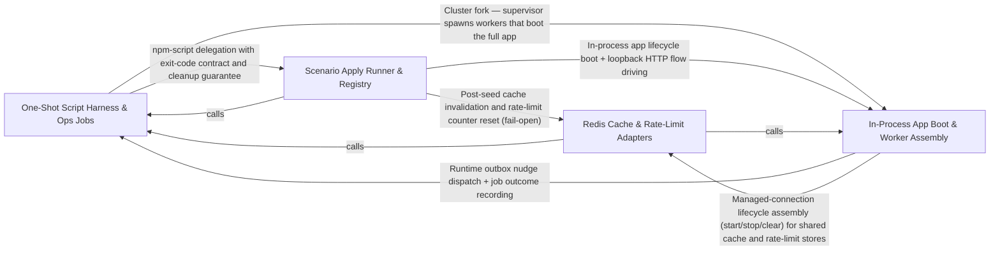

---
tags:
  - 2brain
  - 2brain/arch
  - project/boilerplate-node-backend
type: architecture
component: Scenario_Apply_Runner_Registry
---

## Details

The npm run scenario:apply entry point and the scenario registry it delegates to. This is the spine of the subsystem: it owns the CLI gates (scenario-name validation, --reset emptying, non-empty-database refusal, --describe-to output), the in-process app boot, the single call into buildScenario, and the post-seed cache invalidation. buildScenario is the one function that knows the legitimate ordering of seed → drive → backdate, and the SCENARIOS registry is the single place a new scenario is added. runScript is the shared one-shot harness that gives every db:/ops: script a non-zero exit code, guaranteed cleanup, and a recorded job outcome.

### One-Shot Script Harness & Ops Jobs
The shared one-shot harness that every db: and ops: npm script delegates to. runScript validates the process configuration first (refusing to run on bad env), executes the script body, records a job outcome (recordJobOutcome) for health/observability, and guarantees cleanup on both success and failure paths. refuseToRun handles the configuration-validation failure path specifically. The group also carries the operational jobs that share this harness — outbox relay/sweep, breached-password refresh, role-matrix generation, and store export — as well as the cluster supervisor that wraps the long-running server. This is the spine that gives the scenario apply runner (and every other one-shot script) its exit-code contract, cleanup guarantee, and recorded outcome.

**Related Classes/Methods**:

- `scripts.run-script.runScript`:106-118
- `scripts.run-script.refuseToRun`:32-48
- `src.cluster.supervise`:41-174
- `src.kernel.outbox.relayOutbox`:309-325

**Source Files:**

- `scenarios/support/doubles/mail-outbox.ts`
  - `scenarios.support.doubles.mail-outbox.DemoOutboxEmail` (L17-L37) - Interface
  - `scenarios.support.doubles.mail-outbox.recordDemoEmail.lines.filter() callback` (L61-L61) - Function
  - `scenarios.support.doubles.mail-outbox.recordDemoEmail.lines.map() callback` (L62-L62) - Function
  - `scenarios.support.doubles.mail-outbox.recordDemoEmail.attachments.request.attachments.map() callback` (L64-L64) - Function
- `scripts/docs/generate-role-matrix.ts`
  - `scripts.docs.generate-role-matrix.then() callback` (L172-L174) - Function
- `scripts/ops/refresh-breached-passwords.ts`
  - `scripts.ops.refresh-breached-passwords.main.survivors.lines.filter() callback` (L88-L88) - Function
  - `scripts.ops.refresh-breached-passwords.survivors` (L88-L88) - Class
  - `scripts.ops.refresh-breached-passwords.runScript() callback` (L102-L102) - Function
- `scripts/ops/sweep-outbox.ts`
  - `scripts.ops.sweep-outbox.main` (L31-L40) - Class
  - `scripts.ops.sweep-outbox.then() callback` (L33-L35) - Function
  - `scripts.ops.sweep-outbox.main.then() callback` (L37-L40) - Function
- `scripts/run-script.ts`
  - `scripts.run-script.refuseToRun` (L32-L48) - Class
  - `scripts.run-script.then() callback` (L39-L39) - Function
  - `scripts.run-script.refuseToRun.then() callback` (L40-L46) - Function
  - `scripts.run-script.runScript` (L106-L118) - Class
  - `scripts.run-script.runScript.then() callback` (L117-L117) - Function
- `src/cluster.ts`
  - `src.cluster.supervise` (L41-L174) - Class
  - `src.cluster.supervise.startPrimaryShutdown.forceShutdownTimer` (L105-L113) - Class
  - `src.cluster.supervise.startPrimaryShutdown.forceShutdownTimer.setTimeout() callback` (L105-L113) - Function
  - `src.cluster.supervise.cluster.on('exit') callback` (L121-L170) - Function
  - `src.cluster.supervise.process.on('SIGTERM') callback` (L172-L172) - Function
  - `src.cluster.supervise.process.on('SIGINT') callback` (L173-L173) - Function
- `src/infrastructure/adapters/export-store.ts`
  - `src.infrastructure.adapters.export-store.then() callback` (L103-L103) - Function
- `src/infrastructure/adapters/logger.ts`
  - `src.infrastructure.adapters.logger.Logger` (L29-L44) - Interface
  - `src.infrastructure.adapters.logger.Logger.warn` (L37-L37) - Method
  - `src.infrastructure.adapters.logger.Logger.log` (L43-L43) - Method
- `src/infrastructure/adapters/pinned-https.ts`
  - `src.infrastructure.adapters.pinned-https.PinnedHttpsRequestOptions` (L17-L26) - Interface
  - `src.infrastructure.adapters.pinned-https.pinnedHttpsRequest` (L41-L72) - Class
  - `src.infrastructure.adapters.pinned-https.pinnedHttpsRequest.then() callback` (L46-L71) - Function
  - `src.infrastructure.adapters.pinned-https.pinnedHttpsRequest.then() callback.<function>` (L47-L71) - Function
- `src/infrastructure/adapters/remote-image.ts`
  - `src.infrastructure.adapters.remote-image.readCapped` (L38-L52) - Class
  - `src.infrastructure.adapters.remote-image.readCapped.<function>` (L39-L52) - Function
  - `src.infrastructure.adapters.remote-image.readCapped.<function>.response.on('data') callback` (L42-L49) - Function
  - `src.infrastructure.adapters.remote-image.readCapped.<function>.response.on('end') callback` (L50-L50) - Function
  - `src.infrastructure.adapters.remote-image.download` (L61-L71) - Class
  - `src.infrastructure.adapters.remote-image.download.then() callback` (L65-L71) - Function
  - `src.infrastructure.adapters.remote-image.rehostRemoteImage` (L104-L117) - Class
  - `src.infrastructure.adapters.remote-image.rehostRemoteImage.catch() callback` (L110-L116) - Function
- `src/infrastructure/adapters/ssrf-guard.ts`
  - `src.infrastructure.adapters.ssrf-guard.SsrfRefusedError` (L30-L43) - Class
  - `src.infrastructure.adapters.ssrf-guard.SsrfRefusedError.constructor` (L38-L42) - Constructor
  - `src.infrastructure.adapters.ssrf-guard.resolveAllAddresses.lookup` (L165-L175) - Class
  - `src.infrastructure.adapters.ssrf-guard.resolveAllAddresses.lookup.then() callback` (L165-L175) - Function
  - `src.infrastructure.adapters.ssrf-guard.buildPinnedLookup` (L229-L240) - Class
  - `src.infrastructure.adapters.ssrf-guard.buildPinnedLookup.<function>` (L231-L239) - Function
  - `src.infrastructure.adapters.ssrf-guard.resolveSafeOutboundTarget` (L261-L298) - Class
  - `src.infrastructure.adapters.ssrf-guard.resolveSafeOutboundTarget.then() callback` (L278-L297) - Function
  - `src.infrastructure.adapters.ssrf-guard.resolveSafeOutboundTarget.then() callback.then() callback` (L279-L297) - Function
- `src/infrastructure/http/middlewares/rate-limit.ts`
  - `src.infrastructure.http.middlewares.rate-limit.limiterLogger` (L96-L101) - Class
  - `src.infrastructure.http.middlewares.rate-limit.limiterLogger.warn` (L97-L98) - Method
  - `src.infrastructure.http.middlewares.rate-limit.limiterLogger.error` (L99-L100) - Method
- `src/infrastructure/persistence/lease.ts`
  - `src.infrastructure.persistence.lease.recordJobOutcome` (L222-L251) - Class
  - `src.infrastructure.persistence.lease.recordJobOutcome.catch() callback` (L242-L251) - Function
- `src/infrastructure/runtime/cluster-policy.ts`
  - `src.infrastructure.runtime.cluster-policy.CrashPolicy` (L27-L36) - Interface
  - `src.infrastructure.runtime.cluster-policy.recentCrashes` (L51-L54) - Class
  - `src.infrastructure.runtime.cluster-policy.crashVerdict.recentCrashes.history.filter() callback` (L52-L52) - Function
- `src/infrastructure/runtime/database.ts`
  - `src.infrastructure.runtime.database.start.attemptConnect` (L125-L152) - Class
  - `src.infrastructure.runtime.database.attemptConnect.then() callback` (L130-L130) - Function
  - `src.infrastructure.runtime.database.start.attemptConnect.then() callback` (L131-L151) - Function
  - `src.infrastructure.runtime.database.start.attemptConnect.then() callback.then() callback` (L150-L150) - Function
  - `src.infrastructure.runtime.database.watchConnection` (L175-L184) - Class
  - `src.infrastructure.runtime.database.watchConnection.mongoose.connection.on('disconnected') callback` (L179-L181) - Function
  - `src.infrastructure.runtime.database.watchConnection.mongoose.connection.on('reconnected') callback` (L182-L182) - Function
- `src/kernel/outbox.ts`
  - `src.kernel.outbox.relayOutbox` (L309-L325) - Class
  - `src.kernel.outbox.nudgeOutbox.pass` (L337-L343) - Class
  - `src.kernel.outbox.nudgeOutbox.pass.catch() callback` (L337-L343) - Function
  - `src.kernel.outbox.nudgeOutbox.pass.finally() callback` (L345-L345) - Function
- `src/modules/account/services/two-factor.ts`
  - `src.modules.account.services.two-factor.notifyChange` (L86-L104) - Class
  - `src.modules.account.services.two-factor.notifyChange.catch() callback` (L101-L103) - Function
  - `src.modules.account.services.two-factor.notifyLocked` (L157-L169) - Class
  - `src.modules.account.services.two-factor.notifyLocked.catch() callback` (L166-L168) - Function
- `src/modules/account/session/device-cookie.ts`
  - `src.modules.account.session.device-cookie.holdsDeviceCookie` (L77-L84) - Class
  - `src.modules.account.session.device-cookie.holdsDeviceCookie.some() callback` (L82-L82) - Function
  - `src.modules.account.session.device-cookie.rememberDevice.tokens.filter() callback` (L109-L109) - Function
  - `src.modules.account.session.device-cookie.rememberDevice.tokens` (L109-L112) - Class
- `src/modules/account/session/session.ts`
  - `src.modules.account.session.session.retireRefreshToken` (L73-L81) - Class
  - `src.modules.account.session.session.retireRefreshToken.then() callback` (L77-L77) - Function
  - `src.modules.account.session.session.retireRefreshToken.catch() callback` (L78-L80) - Function
- `src/modules/api-keys/services/api-keys.ts`
  - `src.modules.api-keys.services.api-keys.notifyMinted` (L70-L96) - Class
  - `src.modules.api-keys.services.api-keys.notifyMinted.catch() callback` (L93-L95) - Function
  - `src.modules.api-keys.services.api-keys.notifyRevoked` (L245-L271) - Class
  - `src.modules.api-keys.services.api-keys.notifyRevoked.then() callback` (L252-L264) - Function
  - `src.modules.api-keys.services.api-keys.notifyRevoked.then() callback.mail` (L254-L258) - Class
  - `src.modules.api-keys.services.api-keys.notifyRevoked.catch() callback` (L265-L271) - Function
  - `src.modules.api-keys.services.api-keys.revokeAllMintedBy` (L282-L301) - Class
  - `src.modules.api-keys.services.api-keys.revokeAllMintedBy.then() callback` (L283-L301) - Function
  - `src.modules.api-keys.services.api-keys.revokeAllMintedBy.then() callback.live.map() callback` (L288-L288) - Function
  - `src.modules.api-keys.services.api-keys.revokeAllMintedBy.then() callback.then() callback` (L291-L300) - Function
- `src/modules/audit-logs/service.ts`
  - `src.modules.audit-logs.service.record` (L34-L46) - Class
  - `src.modules.audit-logs.service.record.catch() callback` (L35-L45) - Function
- `src/modules/feedback/emails.ts`
  - `src.modules.feedback.emails.ContactRequest` (L15-L21) - Interface
- `src/modules/observability/services/dependency-health.ts`
  - `src.modules.observability.services.dependency-health.DependencyHealth` (L18-L22) - Interface
- `src/modules/orders/domain/totals.ts`
  - `src.modules.orders.domain.totals.LineItem` (L21-L25) - Interface
  - `src.modules.orders.domain.totals.LineItemTotals` (L28-L35) - Interface
  - `src.modules.orders.domain.totals.OrderTotalInput` (L63-L75) - Interface
- `src/modules/orders/emails.ts`
  - `src.modules.orders.emails.OrderLines` (L32-L48) - Interface
  - `src.modules.orders.emails.WithdrawalNotice` (L67-L77) - Interface
  - `src.modules.orders.emails.withdrawalNotice.excludedNote.titles.excluded.map() callback` (L159-L159) - Function
  - `src.modules.orders.emails.orderConfirmEmail.data.lines.order.items.map() callback` (L233-L238) - Function
  - `src.modules.orders.emails.paymentSucceededEmail.data.lines.order.items.map() callback` (L276-L281) - Function
- `src/modules/orders/factories.ts`
  - `src.modules.orders.factories.makeOrder.items.map() callback` (L146-L150) - Function
- `src/modules/payments/config.ts`
  - `src.modules.payments.config.PaymentMethodInfo` (L29-L33) - Interface
- `src/modules/payments/services/intent.ts`
  - `src.modules.payments.services.intent.resolvePayerId` (L79-L94) - Class
  - `src.modules.payments.services.intent.resolvePayerId.then() callback` (L84-L92) - Function
  - `src.modules.payments.services.intent.resolvePayerId.catch() callback` (L93-L93) - Function
- `src/modules/returns/services/refund-amount.ts`
  - `src.modules.returns.services.refund-amount.RefundInputs` (L22-L35) - Interface
  - `src.modules.returns.services.refund-amount.RefundBreakdown` (L38-L43) - Interface
- `src/modules/webhooks/services/attempt.ts`
  - `src.modules.webhooks.services.attempt.recordSuccess` (L117-L139) - Class
  - `src.modules.webhooks.services.attempt.recordSuccess.then() callback` (L132-L137) - Function
  - `src.modules.webhooks.services.attempt.recordSuccess.then() callback.then() callback` (L136-L136) - Function
  - `src.modules.webhooks.services.attempt.attemptDelivery` (L228-L256) - Class
  - `src.modules.webhooks.services.attempt.attemptDelivery.then() callback` (L251-L254) - Function
- `src/modules/webhooks/transport/webhook-delivery.ts`
  - `src.modules.webhooks.transport.webhook-delivery.WebhookDeliveryAttempt` (L31-L42) - Interface
  - `src.modules.webhooks.transport.webhook-delivery.WebhookDeliveryResult` (L45-L54) - Interface
  - `src.modules.webhooks.transport.webhook-delivery.deliverWebhook` (L98-L150) - Class
  - `src.modules.webhooks.transport.webhook-delivery.then() callback` (L106-L123) - Function
  - `src.modules.webhooks.transport.webhook-delivery.deliverWebhook.then() callback` (L124-L142) - Function
  - `src.modules.webhooks.transport.webhook-delivery.deliverWebhook.catch() callback` (L144-L148) - Function
- `src/modules/webhooks/transport/webhook-signing.ts`
  - `src.modules.webhooks.transport.webhook-signing.WebhookSignatureHeaders` (L33-L40) - Interface
  - `src.modules.webhooks.transport.webhook-signing.SignWebhookPayloadInput` (L43-L55) - Interface
  - `src.modules.webhooks.transport.webhook-signing.signWebhookPayload.signatures` (L119-L123) - Class
  - `src.modules.webhooks.transport.webhook-signing.signWebhookPayload.signatures.input.secrets.map() callback` (L120-L121) - Function

### Scenario Apply Runner & Registry
The core of the subsystem. seed (in apply.ts) is the CLI entry: it validates the scenario name against the registry, boots the app in-process, enforces the --reset / non-empty-database gates, calls buildScenario, and performs post-seed cache invalidation. buildScenario (in index.ts) is the single function that knows the legitimate ordering — seed rows → drive flows over a loopback HTTP listener → backdate order timestamps — and returns the merged subject map. The SCENARIOS registry is the one place a new scenario is added; isScenarioName is the type guard that narrows unvalidated strings. bootAppInProcess imports src/app, calls createApp(), and boots it, handing back the Express instance for loopback flow driving. The backdate flow (backdateHistory) rewrites order timestamps into the past so the seeded shop has a believable history.

**Related Classes/Methods**:

- `scenarios.apply.seed`:126-198
- `scenarios.apply.bootAppInProcess`:118-123
- `scenarios.index.buildScenario`:107-133
- `scenarios.flows.backdate.backdateHistory`:140-145

**Source Files:**

- `scenarios/apply.ts`
  - `scenarios.apply.bootAppInProcess` (L118-L123) - Class
  - `scenarios.apply.bootAppInProcess.then() callback` (L119-L123) - Function
  - `scenarios.apply.bootAppInProcess.then() callback.then() callback` (L122-L122) - Function
  - `scenarios.apply.seed` (L126-L198) - Function
  - `scenarios.apply.runScript() callback` (L227-L227) - Function
  - `scenarios.apply.then() callback` (L227-L228) - Function
- `scenarios/flows/backdate.ts`
  - `scenarios.flows.backdate.mover() callback` (L66-L66) - Function
  - `scenarios.flows.backdate.backdateOrder` (L106-L109) - Class
  - `scenarios.flows.backdate.backdateOrder.TRAILS.map() callback` (L109-L109) - Function
  - `scenarios.flows.backdate.backdateOrder.then() callback` (L109-L109) - Function
  - `scenarios.flows.backdate.backdateHistory` (L140-L145) - Class
  - `scenarios.flows.backdate.then() callback` (L142-L143) - Function
  - `scenarios.flows.backdate.backdateHistory.then() callback.map() callback` (L143-L143) - Function
  - `scenarios.flows.backdate.backdateHistory.then() callback` (L145-L145) - Function
- `scenarios/flows/loopback.ts`
  - `scenarios.flows.loopback.withLoopbackServer` (L25-L47) - Class
  - `scenarios.flows.loopback.withLoopbackServer.<function>` (L29-L39) - Function
  - `scenarios.flows.loopback.withLoopbackServer.then() callback` (L39-L46) - Function
  - `scenarios.flows.loopback.then() callback.then() callback.then() callback` (L41-L41) - Function
  - `scenarios.flows.loopback.withLoopbackServer.then() callback.then() callback` (L42-L45) - Function
  - `scenarios.flows.loopback.withLoopbackServer.then() callback.then() callback.then() callback` (L43-L45) - Function
- `scenarios/index.ts`
  - `scenarios.index.Scenario` (L46-L58) - Interface
  - `scenarios.index.buildScenario` (L107-L133) - Class
  - `scenarios.index.then() callback` (L119-L122) - Function
  - `scenarios.index.buildScenario.then() callback.withoutHumanChallenge() callback` (L121-L121) - Function
  - `scenarios.index.buildScenario.then() callback` (L124-L130) - Function
  - `scenarios.index.buildScenario.then() callback.then() callback` (L126-L129) - Function
- `scenarios/support/database-snapshot.ts`
  - `scenarios.support.database-snapshot.emptyDatabase` (L28-L31) - Class
  - `scenarios.support.database-snapshot.emptyDatabase.map() callback` (L30-L30) - Function
  - `scenarios.support.database-snapshot.emptyDatabase.then() callback` (L31-L31) - Function
  - `scenarios.support.database-snapshot.captureDatabase` (L64-L72) - Class
  - `scenarios.support.database-snapshot.captureDatabase.map() callback` (L66-L70) - Function
  - `scenarios.support.database-snapshot.captureDatabase.map() callback.then() callback` (L70-L70) - Function
  - `scenarios.support.database-snapshot.captureDatabase.then() callback` (L72-L72) - Function
  - `scenarios.support.database-snapshot.restoreDatabaseCopy` (L85-L96) - Class
  - `scenarios.support.database-snapshot.restoreDatabaseCopy.then() callback.filter() callback` (L90-L90) - Function
  - `scenarios.support.database-snapshot.restoreDatabaseCopy.then() callback.map() callback` (L91-L92) - Function
  - `scenarios.support.database-snapshot.restoreDatabaseCopy.then() callback` (L96-L96) - Function
- `scenarios/support/demo-clock.ts`
  - `scenarios.support.demo-clock.DemoClock` (L21-L35) - Interface
  - `scenarios.support.demo-clock.installDemoClock` (L64-L87) - Class
  - `scenarios.support.demo-clock.installDemoClock.uninstall` (L74-L74) - Method
  - `scenarios.support.demo-clock.installDemoClock.now` (L75-L75) - Method
  - `scenarios.support.demo-clock.installDemoClock.offsetMs` (L76-L76) - Method
  - `scenarios.support.demo-clock.installDemoClock.advance` (L77-L82) - Method
  - `scenarios.support.demo-clock.installDemoClock.reset` (L83-L85) - Method
- `scenarios/support/demo.ts`
  - `scenarios.support.demo.UnknownScenarioError` (L43-L48) - Class
  - `scenarios.support.demo.UnknownScenarioError.constructor` (L45-L47) - Constructor
  - `scenarios.support.demo.ScenarioCopy` (L51-L56) - Interface
  - `scenarios.support.demo.buildOnce` (L84-L101) - Class
  - `scenarios.support.demo.buildOnce.then() callback` (L85-L101) - Function
  - `scenarios.support.demo.then() callback.then() callback` (L93-L93) - Function
  - `scenarios.support.demo.buildOnce.then() callback.then() callback` (L94-L99) - Function
  - `scenarios.support.demo.buildOnce.then() callback.then() callback.then() callback` (L95-L99) - Function
  - `scenarios.support.demo.runRestore` (L120-L134) - Class
  - `scenarios.support.demo.runRestore.then() callback.then() callback` (L123-L125) - Function
  - `scenarios.support.demo.runRestore.then() callback` (L134-L134) - Function
  - `scenarios.support.demo.restoreScenario` (L148-L155) - Class
  - `scenarios.support.demo.restoreScenario.outcome` (L149-L149) - Class
  - `scenarios.support.demo.restoreScenario.outcome.restoreQueue.then() callback` (L149-L149) - Function
  - `scenarios.support.demo.outcome.then() callback` (L151-L151) - Function
  - `scenarios.support.demo.restoreScenario.outcome.then() callback` (L152-L152) - Function
  - `scenarios.support.demo.installDemo` (L186-L265) - Class
  - `scenarios.support.demo.installDemo.app.post('/__test/restore') callback` (L191-L212) - Function
  - `scenarios.support.demo.installDemo.app.post('/__test/restore') callback.then() callback` (L202-L202) - Function
  - `scenarios.support.demo.installDemo.app.post('/__test/restore') callback.catch() callback` (L203-L211) - Function
  - `scenarios.support.demo.installDemo.app.get('/__test/scenario') callback` (L214-L216) - Function
  - `scenarios.support.demo.installDemo.app.get('/__test/clock') callback` (L218-L222) - Function
  - `scenarios.support.demo.installDemo.app.post('/__test/clock') callback` (L224-L238) - Function
  - `scenarios.support.demo.installDemo.app.post('/__test/jobs/:name') callback` (L240-L260) - Function
  - `scenarios.support.demo.installDemo.app.post('/__test/jobs/:name') callback.then() callback` (L245-L254) - Function
  - `scenarios.support.demo.installDemo.app.post('/__test/jobs/:name') callback.then() callback.then() callback` (L251-L253) - Function
  - `scenarios.support.demo.installDemo.app.post('/__test/jobs/:name') callback.catch() callback` (L255-L259) - Function
  - `scenarios.support.demo.installDemo.app.get('/__test/emails') callback` (L262-L264) - Function
- `scripts/db/cache-clear.ts`
  - `scripts.db.cache-clear.runScript() callback` (L45-L45) - Function
- `src/infrastructure/adapters/cache.ts`
  - `src.infrastructure.adapters.cache.clearCache` (L404-L436) - Class
  - `src.infrastructure.adapters.cache.clearCache.then() callback` (L407-L421) - Function
  - `src.infrastructure.adapters.cache.clearCache.then() callback.then() callback` (L417-L420) - Function
  - `src.infrastructure.adapters.cache.clearCache.catch() callback` (L422-L436) - Function
- `src/infrastructure/i18n/overrides.ts`
  - `src.infrastructure.i18n.overrides.refreshLocaleOverrides` (L106-L121) - Class
  - `src.infrastructure.i18n.overrides.refreshLocaleOverrides.then() callback` (L110-L110) - Function
  - `src.infrastructure.i18n.overrides.refreshLocaleOverrides.catch() callback` (L111-L120) - Function
  - `src.infrastructure.i18n.overrides.startLocaleOverrideRefresh` (L146-L150) - Class
  - `src.infrastructure.i18n.overrides.startLocaleOverrideRefresh.setInterval() callback` (L148-L148) - Function

### Redis Cache & Rate-Limit Adapters
The Redis-backed infrastructure adapters that the scenario apply runner depends on for two post-seed operations: (1) invalidating cached module responses that were written directly to Mongo by seed fixtures (bypassing the API's cache-invalidation path), and (2) clearing rate-limit counters when --reset empties the database. The adapters expose a managed-connection lifecycle (startCache, cacheConnection), tag-based invalidation (invalidateCacheTags, indexUnderTag), and rate-limit key management (buildLimitsClient, claimLimitsKey, clearRateLimitCounters). All operations are fail-open: an unreachable Redis logs a warning but never blocks seeding.

**Related Classes/Methods**:

- `src.infrastructure.adapters.cache.invalidateCacheTags`:272-317
- `src.infrastructure.adapters.cache.claimCacheRefresh`:241-260
- `src.infrastructure.http.middlewares.rate-limit-store.clearRateLimitCounters`:332-350
- `src.infrastructure.adapters.cache.startCache`

**Source Files:**

- `src/infrastructure/adapters/cache.ts`
  - `src.infrastructure.adapters.cache.cacheConnection` (L44-L69) - Class
  - `src.infrastructure.adapters.cache.cacheConnection.isReady` (L50-L50) - Method
  - `src.infrastructure.adapters.cache.cacheConnection.connect` (L51-L67) - Method
  - `src.infrastructure.adapters.cache.cacheConnection.connect.then() callback` (L66-L66) - Function
  - `src.infrastructure.adapters.cache.startCache` (L92-L92) - Class
  - `src.infrastructure.adapters.cache.startCache.then() callback` (L92-L92) - Function
  - `src.infrastructure.adapters.cache.getCacheValue` (L105-L124) - Class
  - `src.infrastructure.adapters.cache.getCacheValue.then() callback` (L108-L114) - Function
  - `src.infrastructure.adapters.cache.getCacheValue.then() callback.then() callback` (L113-L113) - Function
  - `src.infrastructure.adapters.cache.getCacheValue.catch() callback` (L115-L124) - Function
  - `src.infrastructure.adapters.cache.setCacheValue` (L135-L190) - Class
  - `src.infrastructure.adapters.cache.setCacheValue.then() callback` (L151-L180) - Function
  - `src.infrastructure.adapters.cache.setCacheValue.then() callback.then() callback.cacheTags.map() callback` (L167-L173) - Function
  - `src.infrastructure.adapters.cache.setCacheValue.then() callback.then() callback` (L178-L178) - Function
  - `src.infrastructure.adapters.cache.setCacheValue.catch() callback` (L181-L189) - Function
  - `src.infrastructure.adapters.cache.indexUnderTag` (L208-L225) - Class
  - `src.infrastructure.adapters.cache.indexUnderTag.then() callback` (L223-L223) - Function
  - `src.infrastructure.adapters.cache.claimCacheRefresh` (L241-L260) - Class
  - `src.infrastructure.adapters.cache.claimCacheRefresh.then() callback` (L244-L250) - Function
  - `src.infrastructure.adapters.cache.claimCacheRefresh.then() callback.then() callback` (L249-L249) - Function
  - `src.infrastructure.adapters.cache.claimCacheRefresh.catch() callback` (L251-L260) - Function
  - `src.infrastructure.adapters.cache.invalidateCacheTags` (L272-L317) - Class
  - `src.infrastructure.adapters.cache.invalidateCacheTags.then() callback` (L278-L306) - Function
  - `src.infrastructure.adapters.cache.invalidateCacheTags.then() callback.cacheTags.map() callback` (L285-L301) - Function
  - `src.infrastructure.adapters.cache.then() callback.cacheTags.map() callback.then() callback` (L295-L295) - Function
  - `src.infrastructure.adapters.cache.invalidateCacheTags.then() callback.cacheTags.map() callback.then() callback.then() callback` (L299-L299) - Function
  - `src.infrastructure.adapters.cache.invalidateCacheTags.then() callback.then() callback` (L302-L305) - Function
  - `src.infrastructure.adapters.cache.invalidateCacheTags.then() callback.then() callback.deleted.perTag.reduce() callback` (L303-L303) - Function
  - `src.infrastructure.adapters.cache.invalidateCacheTags.catch() callback` (L307-L316) - Function
  - `src.infrastructure.adapters.cache.ClearCacheResult` (L353-L364) - Interface
- `src/infrastructure/adapters/limits-redis.ts`
  - `src.infrastructure.adapters.limits-redis.buildLimitsClient` (L48-L56) - Class
  - `src.infrastructure.adapters.limits-redis.buildLimitsClient.redisClient.on('error') callback` (L53-L53) - Function
  - `src.infrastructure.adapters.limits-redis.connectionFor` (L66-L114) - Class
  - `src.infrastructure.adapters.limits-redis.connectionFor.connection` (L75-L103) - Class
  - `src.infrastructure.adapters.limits-redis.connectionFor.connection.isEnabled` (L81-L81) - Method
  - `src.infrastructure.adapters.limits-redis.connectionFor.connection.connect` (L82-L94) - Method
  - `src.infrastructure.adapters.limits-redis.connection.connect.then() callback` (L87-L87) - Function
  - `src.infrastructure.adapters.limits-redis.connectionFor.connection.connect.then() callback` (L88-L92) - Function
  - `src.infrastructure.adapters.limits-redis.connectionFor.connection.isReady` (L95-L95) - Method
  - `src.infrastructure.adapters.limits-redis.connectionFor.connection.close` (L96-L99) - Method
  - `src.infrastructure.adapters.limits-redis.connectionFor.connection.onRecovered` (L100-L102) - Method
  - `src.infrastructure.adapters.limits-redis.connectionFor.forget` (L107-L110) - Method
  - `src.infrastructure.adapters.limits-redis.sendToLimits` (L127-L138) - Class
  - `src.infrastructure.adapters.limits-redis.sendToLimits.then() callback` (L130-L136) - Function
  - `src.infrastructure.adapters.limits-redis.sendToLimits.then() callback.catch() callback` (L131-L136) - Function
  - `src.infrastructure.adapters.limits-redis.claimLimitsKey` (L160-L174) - Class
  - `src.infrastructure.adapters.limits-redis.claimLimitsKey.then() callback` (L168-L168) - Function
  - `src.infrastructure.adapters.limits-redis.claimLimitsKey.catch() callback` (L169-L173) - Function
  - `src.infrastructure.adapters.limits-redis.isLimitsKeyClaimed` (L184-L195) - Class
  - `src.infrastructure.adapters.limits-redis.isLimitsKeyClaimed.then() callback` (L189-L189) - Function
  - `src.infrastructure.adapters.limits-redis.isLimitsKeyClaimed.catch() callback` (L190-L194) - Function
- `src/infrastructure/adapters/managed-connection.ts`
  - `src.infrastructure.adapters.managed-connection.ManagedConnectionOptions` (L63-L112) - Interface
  - `src.infrastructure.adapters.managed-connection.ManagedConnection` (L115-L158) - Interface
  - `src.infrastructure.adapters.managed-connection.manageConnection` (L167-L282) - Class
  - `src.infrastructure.adapters.managed-connection.get` (L233-L240) - Class
  - `src.infrastructure.adapters.managed-connection.manageConnection.get.catch() callback` (L239-L239) - Function
  - `src.infrastructure.adapters.managed-connection.manageConnection.state` (L246-L253) - Method
  - `src.infrastructure.adapters.managed-connection.manageConnection.forget` (L255-L257) - Method
  - `src.infrastructure.adapters.managed-connection.manageConnection.stop` (L261-L280) - Method
  - `src.infrastructure.adapters.managed-connection.manageConnection.stop.catch() callback` (L273-L273) - Function
  - `src.infrastructure.adapters.managed-connection.manageConnection.stop.finally() callback` (L274-L278) - Function
- `src/infrastructure/adapters/redis.ts`
  - `src.infrastructure.adapters.redis.closeRedisClient` (L111-L117) - Class
  - `src.infrastructure.adapters.redis.then() callback` (L114-L114) - Function
  - `src.infrastructure.adapters.redis.closeRedisClient.then() callback` (L115-L115) - Function
- `src/infrastructure/http/middlewares/cache.ts`
  - `src.infrastructure.http.middlewares.cache.armCacheWrite` (L333-L361) - Class
  - `src.infrastructure.http.middlewares.cache.armCacheWrite.<function>` (L341-L360) - Function
  - `src.infrastructure.http.middlewares.cache.serveOrArm` (L436-L511) - Class
  - `src.infrastructure.http.middlewares.cache.serveOrArm.then() callback` (L466-L504) - Function
  - `src.infrastructure.http.middlewares.cache.serveOrArm.then() callback.then() callback` (L491-L503) - Function
- `src/infrastructure/http/middlewares/rate-limit-store.ts`
  - `src.infrastructure.http.middlewares.rate-limit-store.lazyRedisStore.store.sendCommand` (L62-L62) - Method
  - `src.infrastructure.http.middlewares.rate-limit-store.clearRateLimitCounters` (L332-L350) - Class
  - `src.infrastructure.http.middlewares.rate-limit-store.clearRateLimitCounters.then() callback` (L342-L342) - Function
  - `src.infrastructure.http.middlewares.rate-limit-store.clearRateLimitCounters.catch() callback` (L343-L348) - Function
  - `src.infrastructure.http.middlewares.rate-limit-store.clearRateLimitCounters.finally() callback` (L349-L349) - Function

### In-Process App Boot & Worker Assembly
The production app assembly that bootAppInProcess imports and boots. createApp wires the Express instance, mounts all module routes, registers middleware (security, observability, error handling), and exposes a boot()/stop() lifecycle. AppInstance is the returned handle that the scenario runner holds for cleanup. registerWorkers wires the RabbitMQ consumers and scheduled jobs (outbox relay, reservation sweep, inactive-account reaping) that the kernel registry resolves. The managed-connection adapters (Mongo, Redis, RabbitMQ) are assembled here and shared across the app's lifetime. In the scenario context, this is the black-box HTTP target that the loopback flow driver talks to — the scenario runner never touches its internals, only its Express instance.

**Related Classes/Methods**:

- `src.app.workers.registerWorkers`:29-67
- `src.kernel.registry.resolveConsumers`:471-472

**Source Files:**

- `scripts/ops/reap-inactive-accounts.ts`
  - `scripts.ops.reap-inactive-accounts.runScript() callback` (L150-L150) - Function
- `scripts/ops/sweep-reservations.ts`
  - `scripts.ops.sweep-reservations.runScript() callback` (L66-L66) - Function
- `src/app.ts`
  - `src.app.AppInstance` (L63-L85) - Interface
  - `src.app.AppOptions` (L108-L120) - Interface
  - `src.app.boot.then() callback` (L149-L149) - Function
  - `src.app.createApp.boot.then() callback` (L184-L184) - Function
  - `src.app.start.then() callback` (L198-L198) - Function
  - `src.app.createApp.start.then() callback` (L199-L220) - Function
  - `src.app.createApp.start.then() callback.then() callback` (L207-L219) - Function
  - `src.app.createApp.stop.shutdownInfra() callback` (L229-L230) - Function
  - `src.app.createApp.stop.finally() callback` (L231-L234) - Function
- `src/app/workers.ts`
  - `src.app.workers.registerWorkers` (L29-L67) - Class
  - `src.app.workers.registerWorkers.registerImageWritebackResolver() callback` (L37-L37) - Function
  - `src.app.workers.registerWorkers.map() callback` (L62-L62) - Function
  - `src.app.workers.registerWorkers.then() callback` (L63-L66) - Function
- `src/infrastructure/adapters/managed-connection.ts`
  - `src.infrastructure.adapters.managed-connection.UnavailabilityLatch` (L21-L27) - Interface
  - `src.infrastructure.adapters.managed-connection.unavailabilityLatch` (L37-L52) - Class
  - `src.infrastructure.adapters.managed-connection.unavailabilityLatch.report` (L41-L45) - Method
  - `src.infrastructure.adapters.managed-connection.unavailabilityLatch.clear` (L46-L50) - Method
  - `src.infrastructure.adapters.managed-connection.manageConnection.latch` (L183-L191) - Class
  - `src.infrastructure.adapters.managed-connection.manageConnection.latch.unavailabilityLatch() callback` (L183-L191) - Function
  - `src.infrastructure.adapters.managed-connection.manageConnection.NotConfigured` (L194-L194) - Class
  - `src.infrastructure.adapters.managed-connection.manageConnection.attempt.running` (L200-L218) - Class
  - `src.infrastructure.adapters.managed-connection.manageConnection.attempt.running.then() callback` (L201-L209) - Function
  - `src.infrastructure.adapters.managed-connection.manageConnection.attempt.running.catch() callback` (L210-L214) - Function
  - `src.infrastructure.adapters.managed-connection.manageConnection.attempt.running.finally() callback` (L215-L218) - Function
- `src/infrastructure/adapters/queue.ts`
  - `src.infrastructure.adapters.queue.unavailabilityLog.unavailabilityLatch() callback` (L110-L112) - Function
  - `src.infrastructure.adapters.queue.unavailabilityLog` (L110-L113) - Class
  - `src.infrastructure.adapters.queue.setupChannel` (L145-L186) - Class
  - `src.infrastructure.adapters.queue.setupChannel.ch.on('error') callback` (L158-L161) - Function
  - `src.infrastructure.adapters.queue.setupChannel.ch.on('close') callback` (L162-L183) - Function
  - `src.infrastructure.adapters.queue.setupChannel.ch.on('close') callback.retry` (L179-L181) - Class
  - `src.infrastructure.adapters.queue.setupChannel.ch.on('close') callback.retry.setTimeout() callback` (L179-L181) - Function
  - `src.infrastructure.adapters.queue.ensureConnecting` (L210-L239) - Class
  - `src.infrastructure.adapters.queue.ensureConnecting.then() callback` (L221-L235) - Function
  - `src.infrastructure.adapters.queue.ensureConnecting.then() callback.model.on('connect') callback` (L226-L230) - Function
  - `src.infrastructure.adapters.queue.ensureConnecting.then() callback.model.on('disconnect') callback` (L231-L234) - Function
  - `src.infrastructure.adapters.queue.stopQueue` (L311-L334) - Class
  - `src.infrastructure.adapters.queue.stopQueue.then() callback` (L328-L331) - Function
  - `src.infrastructure.adapters.queue.stopQueue.catch() callback` (L332-L332) - Function
  - `src.infrastructure.adapters.queue.cancelConsumers` (L344-L349) - Class
  - `src.infrastructure.adapters.queue.cancelConsumers.tags.map() callback` (L348-L348) - Function
  - `src.infrastructure.adapters.queue.cancelConsumers.then() callback` (L348-L348) - Function
  - `src.infrastructure.adapters.queue.assertJobQueue` (L559-L597) - Class
  - `src.infrastructure.adapters.queue.assertJobQueue.then() callback` (L596-L596) - Function
  - `src.infrastructure.adapters.queue.publishToQueue` (L643-L691) - Class
  - `src.infrastructure.adapters.queue.publishToQueue.then() callback` (L653-L685) - Function
  - `src.infrastructure.adapters.queue.publishToQueue.then() callback.<function>` (L654-L685) - Function
  - `src.infrastructure.adapters.queue.publishToQueue.then() callback.<function>.ch.sendToQueue() callback` (L678-L683) - Function
  - `src.infrastructure.adapters.queue.publishToQueue.catch() callback` (L687-L690) - Function
  - `src.infrastructure.adapters.queue.handleDelivery` (L863-L934) - Class
  - `src.infrastructure.adapters.queue.handleDelivery.issues.verdict.error.issues.map() callback` (L891-L891) - Function
  - `src.infrastructure.adapters.queue.bindConsumer` (L954-L984) - Class
  - `src.infrastructure.adapters.queue.bindConsumer.then() callback.ch.consume() callback` (L971-L977) - Function
  - `src.infrastructure.adapters.queue.bindConsumer.then() callback` (L980-L982) - Function
  - `src.infrastructure.adapters.queue.consumeFromQueue` (L1018-L1024) - Class
  - `src.infrastructure.adapters.queue.consumeFromQueue.consumerBindings.set() callback` (L1021-L1021) - Function
- `src/infrastructure/runtime/database.ts`
  - `src.infrastructure.runtime.database.stopDatabase` (L193-L211) - Class
  - `src.infrastructure.runtime.database.stopDatabase.then() callback` (L199-L206) - Function
  - `src.infrastructure.runtime.database.stopDatabase.finally() callback` (L208-L210) - Function
- `src/infrastructure/runtime/server-lifecycle.ts`
  - `src.infrastructure.runtime.server-lifecycle.closeServer` (L104-L121) - Class
  - `src.infrastructure.runtime.server-lifecycle.closeServer.<function>` (L105-L121) - Function
  - `src.infrastructure.runtime.server-lifecycle.closeServer.<function>.server.close() callback` (L112-L119) - Function
  - `src.infrastructure.runtime.server-lifecycle.shutdownInfra` (L134-L161) - Class
  - `src.infrastructure.runtime.server-lifecycle.shutdownInfra.then() callback` (L161-L161) - Function
- `src/infrastructure/runtime/settle.ts`
  - `src.infrastructure.runtime.settle.settleWithin` (L14-L30) - Class
  - `src.infrastructure.runtime.settle.settleWithin.then() callback` (L27-L27) - Function
  - `src.infrastructure.runtime.settle.settleWithin.finally() callback` (L27-L28) - Function
- `src/kernel/registry.ts`
  - `src.kernel.registry.resolveImageTargets` (L452-L460) - Class
  - `src.kernel.registry.resolveImageTargets.appModules.flatMap() callback` (L458-L458) - Function
  - `src.kernel.registry.resolveConsumers` (L471-L472) - Class
  - `src.kernel.registry.resolveConsumers.appModules.flatMap() callback` (L472-L472) - Function
- `src/modules/account/services/export.ts`
  - `src.modules.account.services.export.dispatch` (L117-L136) - Class
  - `src.modules.account.services.export.dispatch.then() callback` (L121-L136) - Function
