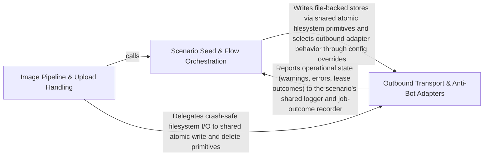

---
tags:
  - 2brain
  - 2brain/arch
  - project/boilerplate-node-backend
type: architecture
component: Scenario_Dataset_Flow_Content
---

## Details

The seedable content layer: the per-module fixture files that write the starting rows (products, accounts, users, addresses, wishlist, webhooks, locales, mail outbox/log) and the shop scenario's order book that is written by driving the app rather than by inserting rows. It also carries the one-shot script wrapper that gives every db:/ops: script a non-zero exit code, cleanup-on-failure, and a recorded job outcome.

### Scenario Seed & Flow Orchestration
The core content layer of the scenario subsystem. Contains the per-module fixture files (products with per-locale copy, accounts, users, addresses, wishlist, webhooks, locales) that write starting rows via insertIfAbsent; the shop scenario's order book (shop-history.ts) that drives POST /cart/checkout, POST /payments/…, shipping, returns, and cancellations through the real application to produce authentic downstream state; and the one-shot script wrapper (runScript / refuseToRun) that validates config, runs the job body, records a lease-based outcome, and guarantees cleanup on both success and failure paths. Also includes the kernel primitives the flows depend on (domain event map, outbox relay, public-event registry) and the infrastructure adapters they touch (cluster supervision, cache, document store).

**Related Classes/Methods**:

- `scripts.run-script.runScript`:106-118
- `scripts.run-script.refuseToRun`:32-48
- `src.kernel.outbox.relayOutbox`:328-344

**Source Files:**

- `scenarios/flows/shop-history.ts`
  - `scenarios.flows.shop-history.FillerOrder` (L58-L61) - Interface
- `scenarios/products.ts`
  - `scenarios.products.ProductCopy` (L51-L54) - Interface
- `scenarios/support/doubles/payments/fake.ts`
  - `scenarios.support.doubles.payments.fake.KeyedAnswer` (L219-L224) - Interface
  - `scenarios.support.doubles.payments.fake.parseWebhook.then() callback` (L551-L556) - Function
- `scripts/run-script.ts`
  - `scripts.run-script.refuseToRun` (L32-L48) - Class
  - `scripts.run-script.then() callback` (L39-L39) - Function
  - `scripts.run-script.refuseToRun.then() callback` (L40-L46) - Function
  - `scripts.run-script.runScript` (L106-L118) - Class
  - `scripts.run-script.runScript.then() callback` (L117-L117) - Function
- `src/cluster.ts`
  - `src.cluster.supervise` (L41-L174) - Class
  - `src.cluster.supervise.startPrimaryShutdown.forceShutdownTimer` (L105-L113) - Class
  - `src.cluster.supervise.startPrimaryShutdown.forceShutdownTimer.setTimeout() callback` (L105-L113) - Function
  - `src.cluster.supervise.cluster.on('exit') callback` (L121-L170) - Function
  - `src.cluster.supervise.process.on('SIGTERM') callback` (L172-L172) - Function
  - `src.cluster.supervise.process.on('SIGINT') callback` (L173-L173) - Function
- `src/infrastructure/adapters/cache.ts`
  - `src.infrastructure.adapters.cache.getCacheValue` (L105-L124) - Class
  - `src.infrastructure.adapters.cache.getCacheValue.then() callback` (L108-L114) - Function
  - `src.infrastructure.adapters.cache.getCacheValue.then() callback.then() callback` (L113-L113) - Function
  - `src.infrastructure.adapters.cache.getCacheValue.catch() callback` (L115-L124) - Function
  - `src.infrastructure.adapters.cache.setCacheValue` (L136-L191) - Class
  - `src.infrastructure.adapters.cache.setCacheValue.then() callback` (L152-L181) - Function
  - `src.infrastructure.adapters.cache.setCacheValue.then() callback.then() callback.cacheTags.map() callback` (L168-L174) - Function
  - `src.infrastructure.adapters.cache.setCacheValue.then() callback.then() callback` (L179-L179) - Function
  - `src.infrastructure.adapters.cache.setCacheValue.catch() callback` (L182-L190) - Function
  - `src.infrastructure.adapters.cache.indexUnderTag` (L209-L226) - Class
  - `src.infrastructure.adapters.cache.indexUnderTag.then() callback` (L224-L224) - Function
  - `src.infrastructure.adapters.cache.claimCacheRefresh` (L242-L261) - Class
  - `src.infrastructure.adapters.cache.claimCacheRefresh.then() callback` (L245-L251) - Function
  - `src.infrastructure.adapters.cache.claimCacheRefresh.then() callback.then() callback` (L250-L250) - Function
  - `src.infrastructure.adapters.cache.claimCacheRefresh.catch() callback` (L252-L261) - Function
  - `src.infrastructure.adapters.cache.invalidateCacheTags` (L273-L318) - Class
  - `src.infrastructure.adapters.cache.invalidateCacheTags.then() callback` (L279-L307) - Function
  - `src.infrastructure.adapters.cache.invalidateCacheTags.then() callback.cacheTags.map() callback` (L286-L302) - Function
  - `src.infrastructure.adapters.cache.then() callback.cacheTags.map() callback.then() callback` (L296-L296) - Function
  - `src.infrastructure.adapters.cache.invalidateCacheTags.then() callback.cacheTags.map() callback.then() callback.then() callback` (L300-L300) - Function
  - `src.infrastructure.adapters.cache.invalidateCacheTags.then() callback.then() callback` (L303-L306) - Function
  - `src.infrastructure.adapters.cache.invalidateCacheTags.then() callback.then() callback.deleted.perTag.reduce() callback` (L304-L304) - Function
  - `src.infrastructure.adapters.cache.invalidateCacheTags.catch() callback` (L308-L317) - Function
  - `src.infrastructure.adapters.cache.invalidateCacheTagsLogged` (L330-L345) - Class
  - `src.infrastructure.adapters.cache.invalidateCacheTagsLogged.then() callback` (L331-L345) - Function
  - `src.infrastructure.adapters.cache.ClearCacheResult` (L354-L365) - Interface
- `src/infrastructure/adapters/document-store.ts`
  - `src.infrastructure.adapters.document-store.readDocument` (L48-L60) - Class
  - `src.infrastructure.adapters.document-store.then() callback` (L53-L53) - Function
  - `src.infrastructure.adapters.document-store.readDocument.then() callback` (L54-L58) - Function
  - `src.infrastructure.adapters.document-store.writeDocument` (L71-L78) - Class
  - `src.infrastructure.adapters.document-store.writeDocument.then() callback` (L75-L76) - Function
  - `src.infrastructure.adapters.document-store.writeDocument.then() callback.writeFileAtomically() callback` (L76-L76) - Function
- `src/infrastructure/adapters/logger.ts`
  - `src.infrastructure.adapters.logger.Logger.warn` (L47-L47) - Method
- `src/infrastructure/adapters/pinned-https.ts`
  - `src.infrastructure.adapters.pinned-https.PinnedHttpsRequestOptions` (L17-L26) - Interface
  - `src.infrastructure.adapters.pinned-https.pinnedHttpsRequest` (L41-L72) - Class
  - `src.infrastructure.adapters.pinned-https.pinnedHttpsRequest.then() callback` (L46-L71) - Function
  - `src.infrastructure.adapters.pinned-https.pinnedHttpsRequest.then() callback.<function>` (L47-L71) - Function
- `src/infrastructure/adapters/remote-image.ts`
  - `src.infrastructure.adapters.remote-image.download` (L40-L50) - Class
  - `src.infrastructure.adapters.remote-image.download.then() callback` (L44-L50) - Function
  - `src.infrastructure.adapters.remote-image.rehostRemoteImage` (L83-L96) - Class
  - `src.infrastructure.adapters.remote-image.rehostRemoteImage.catch() callback` (L89-L95) - Function
- `src/infrastructure/adapters/ssrf-guard.ts`
  - `src.infrastructure.adapters.ssrf-guard.SsrfRefusedError` (L30-L43) - Class
  - `src.infrastructure.adapters.ssrf-guard.SsrfRefusedError.constructor` (L38-L42) - Constructor
  - `src.infrastructure.adapters.ssrf-guard.resolveAllAddresses.lookup` (L166-L176) - Class
  - `src.infrastructure.adapters.ssrf-guard.resolveAllAddresses.lookup.then() callback` (L166-L176) - Function
  - `src.infrastructure.adapters.ssrf-guard.buildPinnedLookup` (L231-L242) - Class
  - `src.infrastructure.adapters.ssrf-guard.buildPinnedLookup.<function>` (L233-L241) - Function
  - `src.infrastructure.adapters.ssrf-guard.resolveSafeOutboundTarget` (L263-L300) - Class
  - `src.infrastructure.adapters.ssrf-guard.resolveSafeOutboundTarget.then() callback` (L280-L299) - Function
  - `src.infrastructure.adapters.ssrf-guard.resolveSafeOutboundTarget.then() callback.then() callback` (L281-L299) - Function
- `src/infrastructure/http/middlewares/cache.ts`
  - `src.infrastructure.http.middlewares.cache.armCacheWrite` (L349-L380) - Class
  - `src.infrastructure.http.middlewares.cache.armCacheWrite.<function>` (L357-L379) - Function
  - `src.infrastructure.http.middlewares.cache.serveOrArm` (L457-L539) - Class
  - `src.infrastructure.http.middlewares.cache.serveOrArm.then() callback` (L487-L532) - Function
  - `src.infrastructure.http.middlewares.cache.serveOrArm.then() callback.then() callback` (L516-L531) - Function
  - `src.infrastructure.http.middlewares.cache.invalidateCache` (L620-L631) - Class
  - `src.infrastructure.http.middlewares.cache.invalidateCache.<function>` (L621-L631) - Function
  - `src.infrastructure.http.middlewares.cache.invalidateCache.<function>.response.on('finish') callback` (L622-L628) - Function
- `src/infrastructure/http/middlewares/idempotency-model.ts`
  - `src.infrastructure.http.middlewares.idempotency-model.IdempotencyRecordDocument` (L28-L43) - Interface
- `src/infrastructure/http/middlewares/rate-limit.ts`
  - `src.infrastructure.http.middlewares.rate-limit.limiterLogger` (L190-L195) - Class
  - `src.infrastructure.http.middlewares.rate-limit.limiterLogger.warn` (L191-L192) - Method
  - `src.infrastructure.http.middlewares.rate-limit.limiterLogger.error` (L193-L194) - Method
- `src/infrastructure/http/read-capped-body.ts`
  - `src.infrastructure.http.read-capped-body.readCappedText` (L51-L57) - Class
  - `src.infrastructure.http.read-capped-body.readCappedText.then() callback` (L54-L55) - Function
- `src/infrastructure/i18n/catalog.ts`
  - `src.infrastructure.i18n.catalog.listSupportedLocales` (L62-L77) - Class
  - `src.infrastructure.i18n.catalog.listSupportedLocales.filter() callback` (L72-L72) - Function
  - `src.infrastructure.i18n.catalog.listSupportedLocales.map() callback` (L73-L73) - Function
  - `src.infrastructure.i18n.catalog.loadLocaleResources` (L177-L183) - Class
  - `src.infrastructure.i18n.catalog.loadLocaleResources.map() callback` (L179-L182) - Function
- `src/infrastructure/i18n/served.ts`
  - `src.infrastructure.i18n.served.ServedLanguages` (L17-L22) - Interface
  - `src.infrastructure.i18n.served.listServedLocales.fromFiles` (L55-L55) - Class
  - `src.infrastructure.i18n.served.listServedLocales.fromFiles.filter() callback` (L55-L55) - Function
- `src/infrastructure/observability/metric-config.ts`
  - `src.infrastructure.observability.metric-config.MetricData` (L15-L19) - Interface
- `src/infrastructure/observability/metrics-http.ts`
  - `src.infrastructure.observability.metrics-http.RequestMetricInput` (L93-L99) - Interface
- `src/infrastructure/persistence/command-metrics.ts`
  - `src.infrastructure.persistence.command-metrics.PendingCommand` (L29-L32) - Interface
  - `src.infrastructure.persistence.command-metrics.observeDatabaseCommands` (L56-L84) - Class
  - `src.infrastructure.persistence.command-metrics.observeDatabaseCommands.client.on('commandStarted') callback` (L76-L81) - Function
  - `src.infrastructure.persistence.command-metrics.observeDatabaseCommands.client.on('commandSucceeded') callback` (L82-L82) - Function
  - `src.infrastructure.persistence.command-metrics.observeDatabaseCommands.client.on('commandFailed') callback` (L83-L83) - Function
- `src/infrastructure/persistence/factories.ts`
  - `src.infrastructure.persistence.factories.FactoryIdentity` (L16-L23) - Interface
- `src/infrastructure/persistence/lease.ts`
  - `src.infrastructure.persistence.lease.recordJobOutcome` (L205-L234) - Class
  - `src.infrastructure.persistence.lease.recordJobOutcome.catch() callback` (L225-L234) - Function
- `src/infrastructure/runtime/cluster-policy.ts`
  - `src.infrastructure.runtime.cluster-policy.CrashPolicy` (L27-L36) - Interface
  - `src.infrastructure.runtime.cluster-policy.recentCrashes` (L51-L54) - Class
  - `src.infrastructure.runtime.cluster-policy.crashVerdict.recentCrashes.history.filter() callback` (L52-L52) - Function
- `src/infrastructure/runtime/database.ts`
  - `src.infrastructure.runtime.database.start.attemptConnect` (L134-L161) - Class
  - `src.infrastructure.runtime.database.start.attemptConnect.then() callback` (L140-L160) - Function
  - `src.infrastructure.runtime.database.start.attemptConnect.then() callback.then() callback` (L159-L159) - Function
  - `src.infrastructure.runtime.database.watchConnection` (L184-L193) - Class
  - `src.infrastructure.runtime.database.watchConnection.mongoose.connection.on('disconnected') callback` (L188-L190) - Function
  - `src.infrastructure.runtime.database.watchConnection.mongoose.connection.on('reconnected') callback` (L191-L191) - Function
- `src/infrastructure/security/breached-passwords/index.ts`
  - `src.infrastructure.security.breached-passwords.index.bundledList` (L32-L36) - Class
  - `src.infrastructure.security.breached-passwords.index.bundledList.filter() callback` (L35-L35) - Function
  - `src.infrastructure.security.breached-passwords.index.checkHibpRange` (L58-L95) - Class
  - `src.infrastructure.security.breached-passwords.index.checkHibpRange.then() callback` (L79-L85) - Function
  - `src.infrastructure.security.breached-passwords.index.checkHibpRange.then() callback.match` (L80-L83) - Class
  - `src.infrastructure.security.breached-passwords.index.checkHibpRange.then() callback.match.map() callback` (L82-L82) - Function
  - `src.infrastructure.security.breached-passwords.index.checkHibpRange.then() callback.match.find() callback` (L83-L83) - Function
  - `src.infrastructure.security.breached-passwords.index.checkHibpRange.catch() callback` (L86-L94) - Function
- `src/kernel/events.ts`
  - `src.kernel.events.DomainEventMap` (L21-L21) - Interface
  - `src.kernel.events.DomainEventMeta` (L35-L41) - Interface
- `src/kernel/outbox.ts`
  - `src.kernel.outbox.relayOutbox` (L328-L344) - Class
  - `src.kernel.outbox.nudgeOutbox.pass` (L356-L362) - Class
  - `src.kernel.outbox.nudgeOutbox.pass.catch() callback` (L356-L362) - Function
- `src/kernel/registry.ts`
  - `src.kernel.registry.resolvePublicEvents` (L639-L647) - Class
  - `src.kernel.registry.resolvePublicEvents.appModules.flatMap() callback` (L645-L645) - Function
- `src/modules/account/emails.ts`
  - `src.modules.account.emails.twoFactorChangedEmail` (L252-L268) - Class
  - `src.modules.account.emails.twoFactorChangedEmail.body` (L262-L265) - Method
  - `src.modules.account.emails.signInMethodChangedEmail` (L283-L299) - Class
  - `src.modules.account.emails.signInMethodChangedEmail.body` (L293-L296) - Method
  - `src.modules.account.emails.twoFactorLockedEmail` (L308-L323) - Class
  - `src.modules.account.emails.twoFactorLockedEmail.body` (L317-L320) - Method
  - `src.modules.account.emails.passwordChangedEmail` (L367-L378) - Class
  - `src.modules.account.emails.passwordChangedEmail.body` (L372-L375) - Method
- `src/modules/account/oauth/providers/client.ts`
  - `src.modules.account.oauth.providers.client.providerFetch` (L25-L44) - Class
  - `src.modules.account.oauth.providers.client.providerFetch.signal.filter() callback` (L31-L31) - Function
  - `src.modules.account.oauth.providers.client.providerFetch.then() callback` (L35-L43) - Function
  - `src.modules.account.oauth.providers.client.providerFetch.then() callback.then() callback` (L37-L42) - Function
- `src/modules/account/services/oauth.ts`
  - `src.modules.account.services.oauth.notifySignInMethod` (L129-L147) - Class
  - `src.modules.account.services.oauth.notifySignInMethod.catch() callback` (L144-L146) - Function
  - `src.modules.account.services.oauth.unlinkOAuthProvider` (L419-L438) - Class
  - `src.modules.account.services.oauth.unlinkOAuthProvider.then() callback` (L424-L438) - Function
  - `src.modules.account.services.oauth.unlinkOAuthProvider.then() callback.then() callback` (L434-L437) - Function
- `src/modules/account/services/password.ts`
  - `src.modules.account.services.password.notifyPasswordChanged` (L170-L181) - Class
  - `src.modules.account.services.password.notifyPasswordChanged.catch() callback` (L178-L180) - Function
- `src/modules/account/services/two-factor-outcomes.ts`
  - `src.modules.account.services.two-factor-outcomes.notifyChange` (L55-L73) - Class
  - `src.modules.account.services.two-factor-outcomes.notifyChange.catch() callback` (L70-L72) - Function
  - `src.modules.account.services.two-factor-outcomes.notifyLocked` (L130-L142) - Class
  - `src.modules.account.services.two-factor-outcomes.notifyLocked.catch() callback` (L139-L141) - Function
- `src/modules/account/two-factor/totp.ts`
  - `src.modules.account.two-factor.totp.TotpVerification` (L76-L81) - Interface
- `src/modules/addresses/factories.ts`
  - `src.modules.addresses.factories.AddressBookOverrides` (L14-L19) - Interface
- `src/modules/api-keys/services/api-keys.ts`
  - `src.modules.api-keys.services.api-keys.notifyMinted` (L87-L120) - Class
  - `src.modules.api-keys.services.api-keys.notifyMinted.then() callback` (L90-L116) - Function
  - `src.modules.api-keys.services.api-keys.notifyMinted.catch() callback` (L117-L119) - Function
  - `src.modules.api-keys.services.api-keys.notifyRevoked` (L314-L340) - Class
  - `src.modules.api-keys.services.api-keys.notifyRevoked.then() callback` (L321-L333) - Function
  - `src.modules.api-keys.services.api-keys.notifyRevoked.catch() callback` (L334-L340) - Function
- `src/modules/audit-logs/service.ts`
  - `src.modules.audit-logs.service.record` (L35-L47) - Class
  - `src.modules.audit-logs.service.record.catch() callback` (L36-L46) - Function
- `src/modules/delivery/services/preorder-sweep.ts`
  - `src.modules.delivery.services.preorder-sweep.PreorderSweepResult` (L25-L28) - Interface
- `src/modules/invoicing/presenter.ts`
  - `src.modules.invoicing.presenter.ExportedDocument` (L13-L19) - Interface
- `src/modules/invoicing/providers/index.ts`
  - `src.modules.invoicing.providers.index.EInvoicingProvider` (L36-L47) - Interface
  - `src.modules.invoicing.providers.index.EInvoicingProvider.issue` (L46-L46) - Method
- `src/modules/invoicing/providers/pdf.ts`
  - `src.modules.invoicing.providers.pdf.pdfEInvoicingProvider` (L37-L50) - Class
  - `src.modules.invoicing.providers.pdf.pdfEInvoicingProvider.issue` (L40-L49) - Method
  - `src.modules.invoicing.providers.pdf.issue.then() callback` (L48-L48) - Function
  - `src.modules.invoicing.providers.pdf.pdfEInvoicingProvider.issue.then() callback` (L49-L49) - Function
- `src/modules/invoicing/services/render.ts`
  - `src.modules.invoicing.services.render.readStored` (L56-L65) - Class
  - `src.modules.invoicing.services.render.readStored.catch() callback` (L57-L65) - Function
  - `src.modules.invoicing.services.render.storeBestEffort` (L73-L81) - Class
  - `src.modules.invoicing.services.render.then() callback` (L75-L75) - Function
  - `src.modules.invoicing.services.render.storeBestEffort.then() callback` (L76-L80) - Function
  - `src.modules.invoicing.services.render.storedOrRendered` (L91-L97) - Class
  - `src.modules.invoicing.services.render.storedOrRendered.then() callback.then() callback` (L95-L95) - Function
  - `src.modules.invoicing.services.render.renderInvoicePdf` (L115-L118) - Class
  - `src.modules.invoicing.services.render.renderInvoicePdf.storedOrRendered() callback` (L116-L117) - Function
  - `src.modules.invoicing.services.render.renderCreditNotePdf` (L125-L132) - Class
  - `src.modules.invoicing.services.render.renderCreditNotePdf.storedOrRendered() callback` (L126-L131) - Function
- `src/modules/locales/services/actions.ts`
  - `src.modules.locales.services.actions.LanguageStanding` (L19-L24) - Interface
- `src/modules/locales/services/capabilities.ts`
  - `src.modules.locales.services.capabilities.mergeCapabilities` (L129-L155) - Class
  - `src.modules.locales.services.capabilities.mergeCapabilities.toSorted() callback` (L154-L154) - Function
  - `src.modules.locales.services.capabilities.readDynamicTier` (L162-L188) - Class
  - `src.modules.locales.services.capabilities.readDynamicTier.then() callback` (L176-L180) - Function
  - `src.modules.locales.services.capabilities.readDynamicTier.catch() callback` (L181-L188) - Function
  - `src.modules.locales.services.capabilities.listCapabilities` (L218-L237) - Class
  - `src.modules.locales.services.capabilities.listCapabilities.then() callback` (L222-L237) - Function
  - `src.modules.locales.services.capabilities.readLanguage.then() callback.language` (L256-L256) - Class
  - `src.modules.locales.services.capabilities.readLanguage.then() callback.language.locales.find() callback` (L256-L256) - Function
  - `src.modules.locales.services.capabilities.describeStoredLanguage` (L267-L281) - Class
  - `src.modules.locales.services.capabilities.describeStoredLanguage.then() callback` (L271-L281) - Function
- `src/modules/locales/services/entries.ts`
  - `src.modules.locales.services.entries.rejectBadBatch.keys` (L254-L254) - Class
  - `src.modules.locales.services.entries.rejectBadBatch.keys.inputs.map() callback` (L254-L254) - Function
  - `src.modules.locales.services.entries.rejectBadBatch.badKey` (L256-L256) - Class
  - `src.modules.locales.services.entries.rejectBadBatch.badKey.keys.find() callback` (L256-L256) - Function
  - `src.modules.locales.services.entries.importEntries.inputs` (L298-L301) - Class
  - `src.modules.locales.services.entries.importEntries.inputs.map() callback` (L298-L301) - Function
  - `src.modules.locales.services.entries.importEntries.written` (L307-L307) - Class
  - `src.modules.locales.services.entries.importEntries.written.inputs.filter() callback` (L307-L307) - Function
  - `src.modules.locales.services.entries.importEntries.written.map() callback` (L307-L307) - Function
  - `src.modules.locales.services.entries.importEntries.deleted` (L308-L308) - Class
  - `src.modules.locales.services.entries.importEntries.deleted.inputs.filter() callback` (L308-L308) - Function
  - `src.modules.locales.services.entries.importEntries.deleted.map() callback` (L308-L308) - Function
  - `src.modules.locales.services.entries.importEntries.survivors` (L330-L331) - Class
  - `src.modules.locales.services.entries.importEntries.survivors.stored.filter() callback` (L331-L331) - Function
- `src/modules/locales/services/keys.ts`
  - `src.modules.locales.services.keys.findUnsafeKeySegment` (L102-L103) - Class
  - `src.modules.locales.services.keys.findUnsafeKeySegment.find() callback` (L103-L103) - Function
- `src/modules/locales/services/messages.ts`
  - `src.modules.locales.services.messages.readMessages` (L34-L52) - Class
  - `src.modules.locales.services.messages.readMessages.then() callback` (L41-L51) - Function
  - `src.modules.locales.services.messages.readMessages.then() callback.then() callback` (L44-L49) - Function
  - `src.modules.locales.services.messages.readApiOverrides` (L64-L92) - Class
  - `src.modules.locales.services.messages.readApiOverrides.then() callback` (L65-L92) - Function
  - `src.modules.locales.services.messages.readLocaleOverlay` (L99-L104) - Class
  - `src.modules.locales.services.messages.readLocaleOverlay.then() callback` (L104-L104) - Function
- `src/modules/locales/services/translatables.ts`
  - `src.modules.locales.services.translatables.translatableCacheTags` (L34-L36) - Class
  - `src.modules.locales.services.translatables.translatableCacheTags.flatMap() callback` (L35-L35) - Function
- `src/modules/locales/services/translations.ts`
  - `src.modules.locales.services.translations.planSlot.planFields.unknownField` (L118-L120) - Class
  - `src.modules.locales.services.translations.planSlot.planFields.unknownField.find() callback` (L119-L119) - Function
  - `src.modules.locales.services.translations.writePlannedTranslations.fallbackWrite` (L246-L249) - Class
  - `src.modules.locales.services.translations.writePlannedTranslations.fallbackWrite.planned.find() callback` (L247-L248) - Function
  - `src.modules.locales.services.translations.planForPort` (L261-L277) - Class
  - `src.modules.locales.services.translations.planForPort.then() callback` (L265-L276) - Function
  - `src.modules.locales.services.translations.planForPort.then() callback.planned.plan.planned.map() callback` (L271-L274) - Function
  - `src.modules.locales.services.translations.writeForPort` (L283-L302) - Class
  - `src.modules.locales.services.translations.writeForPort.writePlan.planned.map() callback` (L295-L298) - Function
  - `src.modules.locales.services.translations.applyTranslationBatch` (L317-L361) - Class
  - `src.modules.locales.services.translations.applyTranslationBatch.withTransaction() callback` (L335-L345) - Function
  - `src.modules.locales.services.translations.applyTranslationBatch.metadata.upserted.map() callback` (L355-L355) - Function
  - `src.modules.locales.services.translations.applyTranslationBatch.metadata.upserted.planned.filter() callback` (L355-L355) - Function
  - `src.modules.locales.services.translations.applyTranslationBatch.metadata.deleted.map() callback` (L356-L356) - Function
  - `src.modules.locales.services.translations.applyTranslationBatch.metadata.deleted.planned.filter() callback` (L356-L356) - Function
  - `src.modules.locales.services.translations.replaceEntityTranslations.checkedLocales` (L421-L421) - Class
  - `src.modules.locales.services.translations.replaceEntityTranslations.checkedLocales.existing.map() callback` (L421-L421) - Function
  - `src.modules.locales.services.translations.replaceEntityTranslations.deletions` (L424-L426) - Class
  - `src.modules.locales.services.translations.replaceEntityTranslations.deletions.filter() callback` (L425-L425) - Function
  - `src.modules.locales.services.translations.replaceEntityTranslations.deletions.map() callback` (L425-L425) - Function
  - `src.modules.locales.services.translations.getEntityTranslations` (L437-L452) - Class
  - `src.modules.locales.services.translations.getEntityTranslations.then() callback` (L444-L450) - Function
- `src/modules/payments/repository.ts`
  - `src.modules.payments.repository.MixSums` (L109-L113) - Interface
  - `src.modules.payments.repository.RecordedDispute` (L116-L123) - Interface
  - `src.modules.payments.repository.RefundRow` (L126-L131) - Interface
  - `src.modules.payments.repository.RefundFilters` (L134-L142) - Interface
  - `src.modules.payments.repository.UpsertedPayment` (L239-L242) - Interface
  - `src.modules.payments.repository.paymentRepository.findByProviderRef` (L486-L487) - Method
- `src/modules/payments/services/disputes.ts`
  - `src.modules.payments.services.disputes.applyDisputeDelivery` (L167-L194) - Class
  - `src.modules.payments.services.disputes.applyDisputeDelivery.then() callback` (L182-L193) - Function
- `src/modules/payments/services/refund-settlement.ts`
  - `src.modules.payments.services.refund-settlement.announceInTransaction() callback` (L279-L311) - Function
- `src/modules/payments/services/settlement.ts`
  - `src.modules.payments.services.settlement.applyDisputeEvent` (L770-L788) - Class
  - `src.modules.payments.services.settlement.applyDisputeEvent.then() callback` (L775-L788) - Function
  - `src.modules.payments.services.settlement.applyRefundDelivery` (L799-L817) - Class
  - `src.modules.payments.services.settlement.applyRefundDelivery.then() callback` (L804-L817) - Function
  - `src.modules.payments.services.settlement.applyWebhookSettlement` (L857-L881) - Class
  - `src.modules.payments.services.settlement.applyWebhookSettlement.then() callback` (L858-L881) - Function
  - `src.modules.payments.services.settlement.applyWebhookSettlement.then() callback.then() callback` (L870-L880) - Function
- `src/modules/payments/services/transfer.ts`
  - `src.modules.payments.services.transfer.openTransferPayment` (L29-L52) - Class
  - `src.modules.payments.services.transfer.openTransferPayment.then() callback` (L30-L52) - Function
  - `src.modules.payments.services.transfer.openTransferPayment.then() callback.then() callback` (L41-L51) - Function
- `src/modules/sitemap/service.ts`
  - `src.modules.sitemap.service.Languages` (L20-L25) - Interface
- `src/modules/stats/domain/calendar.ts`
  - `src.modules.stats.domain.calendar.CalendarDay` (L12-L16) - Interface
- `src/modules/stats/domain/range.ts`
  - `src.modules.stats.domain.range.CalendarRange` (L27-L33) - Interface
- `src/modules/stats/services/range.ts`
  - `src.modules.stats.services.range.resolvePeriod.period.bucketStarts.range.bucketStarts.map() callback` (L81-L81) - Function
- `src/modules/stock-alerts/emails.ts`
  - `src.modules.stock-alerts.emails.BackInStockEmailInput` (L12-L17) - Interface
- `src/modules/users/emails.ts`
  - `src.modules.users.emails.PurchaseHoldNotice` (L15-L28) - Interface
- `src/modules/webhooks/module.ts`
  - `src.modules.webhooks.module.onRegistered` (L35-L44) - Class
  - `src.modules.webhooks.module.onRegistered.modules.map() callback` (L37-L37) - Function
- `src/modules/webhooks/transport/webhook-delivery.ts`
  - `src.modules.webhooks.transport.webhook-delivery.WebhookDeliveryAttempt` (L31-L42) - Interface
  - `src.modules.webhooks.transport.webhook-delivery.WebhookDeliveryResult` (L45-L54) - Interface
  - `src.modules.webhooks.transport.webhook-delivery.deliverWebhook` (L106-L158) - Class
  - `src.modules.webhooks.transport.webhook-delivery.then() callback` (L114-L131) - Function
  - `src.modules.webhooks.transport.webhook-delivery.deliverWebhook.then() callback` (L132-L150) - Function
  - `src.modules.webhooks.transport.webhook-delivery.deliverWebhook.catch() callback` (L152-L156) - Function
- `src/modules/webhooks/transport/webhook-signing.ts`
  - `src.modules.webhooks.transport.webhook-signing.WebhookSignatureHeaders` (L33-L40) - Interface
  - `src.modules.webhooks.transport.webhook-signing.SignWebhookPayloadInput` (L43-L55) - Interface
  - `src.modules.webhooks.transport.webhook-signing.signWebhookPayload.signatures` (L119-L123) - Class
  - `src.modules.webhooks.transport.webhook-signing.signWebhookPayload.signatures.input.secrets.map() callback` (L120-L121) - Function

### Outbound Transport & Anti-Bot Adapters
The support-doubles and outbound-adapter layer that the scenario profile swaps in for production infrastructure. Provides in-memory mail transports (logMailTransport, outboxMailTransport with DemoOutboxEmail) so seeded flows produce inspectable mail without a real SMTP server; the anti-bot adapter (Altcha / Turnstile / none strategies, checkEmailPolicy, hasMxRecord) and its config surface; the outbound config adapters (antibotConfig, mailConfig, outboundConfig); the export-store writer (writeExport); and the filesystem primitives (pruneUnreferenced, unlinkIfPresent, writeFileAtomically) that the scenario's file-backed stores rely on. This group is the seam between the scenario's in-process doubles and the real outbound side-effects (mail, bot-challenge, file export).

**Related Classes/Methods**:

- `scenarios.support.doubles.mail-outbox.outboxMailTransport`:84-90
- `scenarios.support.doubles.mail-log.logMailTransport`:20-35
- `src.infrastructure.adapters.antibot.checkEmailPolicy`:107-138
- `src.infrastructure.adapters.filesystem.writeFileAtomically`:100-116
- `src.infrastructure.adapters.export-store.writeExport`:59-78

**Source Files:**

- `scenarios/support/doubles/mail-log.ts`
  - `scenarios.support.doubles.mail-log.logMailTransport` (L20-L35) - Class
  - `scenarios.support.doubles.mail-log.logMailTransport.delivers` (L21-L21) - Method
  - `scenarios.support.doubles.mail-log.logMailTransport.send` (L22-L34) - Method
  - `scenarios.support.doubles.mail-log.logMailTransport.send.then() callback` (L23-L33) - Function
- `scenarios/support/doubles/mail-outbox.ts`
  - `scenarios.support.doubles.mail-outbox.DemoOutboxEmail` (L17-L42) - Interface
  - `scenarios.support.doubles.mail-outbox.recordDemoEmail.lines.filter() callback` (L67-L67) - Function
  - `scenarios.support.doubles.mail-outbox.recordDemoEmail.lines.map() callback` (L68-L68) - Function
  - `scenarios.support.doubles.mail-outbox.recordDemoEmail.attachments.request.attachments.map() callback` (L70-L70) - Function
  - `scenarios.support.doubles.mail-outbox.outboxMailTransport` (L84-L90) - Class
  - `scenarios.support.doubles.mail-outbox.outboxMailTransport.delivers` (L85-L85) - Method
  - `scenarios.support.doubles.mail-outbox.outboxMailTransport.send` (L86-L89) - Method
- `src/app/config-routes.ts`
  - `src.app.config-routes.router.get('/config') callback` (L35-L52) - Function
- `src/infrastructure/adapters/antibot-providers/altcha-store.ts`
  - `src.infrastructure.adapters.antibot-providers.altcha-store.claim` (L94-L100) - Class
  - `src.infrastructure.adapters.antibot-providers.altcha-store.claim.then() callback` (L99-L99) - Function
- `src/infrastructure/adapters/antibot-providers/altcha.ts`
  - `src.infrastructure.adapters.antibot-providers.altcha.issue` (L47-L59) - Class
  - `src.infrastructure.adapters.antibot-providers.altcha.issue.then() callback` (L56-L59) - Function
  - `src.infrastructure.adapters.antibot-providers.altcha.check` (L106-L125) - Class
  - `src.infrastructure.adapters.antibot-providers.altcha.then() callback` (L115-L120) - Function
  - `src.infrastructure.adapters.antibot-providers.altcha.check.then() callback.then() callback` (L119-L119) - Function
  - `src.infrastructure.adapters.antibot-providers.altcha.check.then() callback` (L123-L123) - Function
  - `src.infrastructure.adapters.antibot-providers.altcha.altchaProvider` (L128-L135) - Class
  - `src.infrastructure.adapters.antibot-providers.altcha.altchaProvider.publicParameters` (L132-L132) - Method
  - `src.infrastructure.adapters.antibot-providers.altcha.altchaProvider.verify` (L134-L134) - Method
  - `src.infrastructure.adapters.antibot-providers.altcha.altchaProvider.verify.catch() callback` (L134-L134) - Function
- `src/infrastructure/adapters/antibot-providers/index.ts`
  - `src.infrastructure.adapters.antibot-providers.index.HumanChallengeProvider` (L58-L90) - Interface
  - `src.infrastructure.adapters.antibot-providers.index.HumanChallengeProvider.publicParameters` (L71-L71) - Method
  - `src.infrastructure.adapters.antibot-providers.index.HumanChallengeProvider.verify` (L89-L89) - Method
- `src/infrastructure/adapters/antibot-providers/none.ts`
  - `src.infrastructure.adapters.antibot-providers.none.noneProvider` (L11-L15) - Class
  - `src.infrastructure.adapters.antibot-providers.none.noneProvider.publicParameters` (L13-L13) - Method
  - `src.infrastructure.adapters.antibot-providers.none.noneProvider.verify` (L14-L14) - Method
- `src/infrastructure/adapters/antibot-providers/turnstile.ts`
  - `src.infrastructure.adapters.antibot-providers.turnstile.siteverify` (L38-L57) - Class
  - `src.infrastructure.adapters.antibot-providers.turnstile.then() callback` (L52-L53) - Function
  - `src.infrastructure.adapters.antibot-providers.turnstile.siteverify.then() callback` (L55-L56) - Function
  - `src.infrastructure.adapters.antibot-providers.turnstile.turnstileProvider` (L60-L67) - Class
  - `src.infrastructure.adapters.antibot-providers.turnstile.turnstileProvider.publicParameters` (L62-L65) - Method
  - `src.infrastructure.adapters.antibot-providers.turnstile.turnstileProvider.verify` (L66-L66) - Method
  - `src.infrastructure.adapters.antibot-providers.turnstile.turnstileProvider.verify.catch() callback` (L66-L66) - Function
- `src/infrastructure/adapters/antibot.ts`
  - `src.infrastructure.adapters.antibot.addressesOf` (L48-L52) - Class
  - `src.infrastructure.adapters.antibot.addressesOf.lookup.catch() callback` (L49-L52) - Function
  - `src.infrastructure.adapters.antibot.hasAddressRecord` (L60-L70) - Class
  - `src.infrastructure.adapters.antibot.hasAddressRecord.then() callback` (L66-L69) - Function
  - `src.infrastructure.adapters.antibot.hasMxRecord` (L80-L95) - Class
  - `src.infrastructure.adapters.antibot.hasMxRecord.then() callback` (L83-L87) - Function
  - `src.infrastructure.adapters.antibot.hasMxRecord.then() callback.records.some() callback` (L86-L86) - Function
  - `src.infrastructure.adapters.antibot.hasMxRecord.catch() callback` (L88-L95) - Function
  - `src.infrastructure.adapters.antibot.checkEmailPolicy` (L107-L138) - Class
  - `src.infrastructure.adapters.antibot.checkEmailPolicy.then() callback` (L108-L138) - Function
  - `src.infrastructure.adapters.antibot.checkEmailPolicy.then() callback.then() callback` (L137-L137) - Function
- `src/infrastructure/adapters/config.ts`
  - `src.infrastructure.adapters.config.mailConfig` (L28-L56) - Class
  - `src.infrastructure.adapters.config.mailConfig.check` (L44-L55) - Method
  - `src.infrastructure.adapters.config.mailConfig.check.SMTP_COMPANIONS.filter() callback` (L47-L47) - Function
  - `src.infrastructure.adapters.config.outboundConfig` (L132-L141) - Class
  - `src.infrastructure.adapters.config.outboundConfig.check` (L137-L140) - Method
  - `src.infrastructure.adapters.config.outboundConfig.check.config.NODE_OUTBOUND_ALLOWED_PORTS.filter() callback` (L139-L139) - Function
  - `src.infrastructure.adapters.config.outboundConfig.check.map() callback` (L140-L140) - Function
  - `src.infrastructure.adapters.config.antibotConfig` (L164-L192) - Class
  - `src.infrastructure.adapters.config.antibotConfig.check` (L176-L191) - Method
- `src/infrastructure/adapters/email.worker.ts`
  - `src.infrastructure.adapters.email.worker.discardJobAttachments` (L26-L29) - Class
  - `src.infrastructure.adapters.email.worker.discardJobAttachments.attachments.map() callback` (L29-L29) - Function
  - `src.infrastructure.adapters.email.worker.discardJobAttachments.then() callback` (L29-L29) - Function
  - `src.infrastructure.adapters.email.worker.handleEmailJob` (L40-L74) - Class
  - `src.infrastructure.adapters.email.worker.handleEmailJob.then() callback.then() callback` (L64-L64) - Function
  - `src.infrastructure.adapters.email.worker.handleEmailJob.catch() callback` (L65-L72) - Function
- `src/infrastructure/adapters/export-store.ts`
  - `src.infrastructure.adapters.export-store.writeExport` (L59-L78) - Class
  - `src.infrastructure.adapters.export-store.writeExport.then() callback` (L66-L76) - Function
  - `src.infrastructure.adapters.export-store.writeExport.then() callback.writeFileAtomically() callback` (L67-L75) - Function
  - `src.infrastructure.adapters.export-store.writeExport.then() callback.writeFileAtomically() callback.then() callback` (L68-L74) - Function
  - `src.infrastructure.adapters.export-store.writeExport.then() callback.writeFileAtomically() callback.then() callback.produce() callback` (L72-L72) - Function
  - `src.infrastructure.adapters.export-store.writeExport.then() callback.writeFileAtomically() callback.then() callback.produce() callback.then() callback` (L72-L72) - Function
  - `src.infrastructure.adapters.export-store.writeExport.then() callback.writeFileAtomically() callback.then() callback.finally() callback` (L72-L73) - Function
- `src/infrastructure/adapters/filesystem.ts`
  - `src.infrastructure.adapters.filesystem.unlinkIfPresent` (L76-L89) - Class
  - `src.infrastructure.adapters.filesystem.unlinkIfPresent.then() callback` (L83-L88) - Function
  - `src.infrastructure.adapters.filesystem.writeFileAtomically` (L100-L116) - Class
  - `src.infrastructure.adapters.filesystem.writeFileAtomically.then() callback` (L108-L108) - Function
  - `src.infrastructure.adapters.filesystem.writeFileAtomically.catch() callback` (L109-L114) - Function
  - `src.infrastructure.adapters.filesystem.writeFileAtomically.catch() callback.then() callback` (L112-L114) - Function
  - `src.infrastructure.adapters.filesystem.pruneUnreferenced` (L197-L230) - Class
  - `src.infrastructure.adapters.filesystem.pruneUnreferenced.catch() callback` (L203-L206) - Function
  - `src.infrastructure.adapters.filesystem.pruneUnreferenced.then() callback` (L207-L230) - Function
  - `src.infrastructure.adapters.filesystem.pruneUnreferenced.then() callback.then() callback` (L226-L229) - Function
- `src/infrastructure/adapters/limits-redis.ts`
  - `src.infrastructure.adapters.limits-redis.connection.connect.then() callback` (L87-L87) - Function
  - `src.infrastructure.adapters.limits-redis.claimLimitsKey` (L160-L174) - Class
  - `src.infrastructure.adapters.limits-redis.claimLimitsKey.then() callback` (L168-L168) - Function
  - `src.infrastructure.adapters.limits-redis.claimLimitsKey.catch() callback` (L169-L173) - Function
- `src/infrastructure/adapters/mail-spool.ts`
  - `src.infrastructure.adapters.mail-spool.discardSpooled` (L72-L79) - Class
  - `src.infrastructure.adapters.mail-spool.discardSpooled.then() callback` (L77-L77) - Function
- `src/infrastructure/adapters/mail-transports.ts`
  - `src.infrastructure.adapters.mail-transports.OutgoingMail` (L28-L40) - Interface
  - `src.infrastructure.adapters.mail-transports.MailTransportAdapter` (L43-L62) - Interface
  - `src.infrastructure.adapters.mail-transports.smtpTransport` (L67-L70) - Class
  - `src.infrastructure.adapters.mail-transports.smtpTransport.delivers` (L68-L68) - Method
  - `src.infrastructure.adapters.mail-transports.smtpTransport.send` (L69-L69) - Method
  - `src.infrastructure.adapters.mail-transports.smtpTransport.send.then() callback` (L69-L69) - Function
- `src/infrastructure/adapters/mailer.ts`
  - `src.infrastructure.adapters.mailer.resolveAttachments` (L58-L73) - Class
  - `src.infrastructure.adapters.mailer.resolveAttachments.attachments.map() callback` (L62-L72) - Function
  - `src.infrastructure.adapters.mailer.resolveAttachments.attachments.map() callback.then() callback` (L64-L64) - Function
  - `src.infrastructure.adapters.mailer.resolveAttachments.then() callback` (L73-L73) - Function
  - `src.infrastructure.adapters.mailer.renderMessage` (L87-L129) - Class
  - `src.infrastructure.adapters.mailer.renderMessage.then() callback` (L110-L129) - Function
  - `src.infrastructure.adapters.mailer.sendTemplatedEmail` (L150-L194) - Class
  - `src.infrastructure.adapters.mailer.sendTemplatedEmail.withSpan('email.send') callback` (L158-L193) - Function
  - `src.infrastructure.adapters.mailer.sendTemplatedEmail.withSpan('email.send') callback.then() callback.render` (L180-L180) - Method
  - `src.infrastructure.adapters.mailer.sendTemplatedEmail.withSpan('email.send') callback.then() callback` (L183-L189) - Function
  - `src.infrastructure.adapters.mailer.sendInline` (L222-L233) - Class
  - `src.infrastructure.adapters.mailer.sendInline.then() callback` (L228-L228) - Function
  - `src.infrastructure.adapters.mailer.sendInline.finally() callback` (L229-L232) - Function
  - `src.infrastructure.adapters.mailer.sendInline.finally() callback.map() callback` (L230-L230) - Function
  - `src.infrastructure.adapters.mailer.sendInline.finally() callback.then() callback` (L231-L231) - Function
- `src/infrastructure/adapters/smtp-transport.ts`
  - `src.infrastructure.adapters.smtp-transport.sendBySmtp` (L85-L86) - Class
  - `src.infrastructure.adapters.smtp-transport.sendBySmtp.then() callback` (L86-L86) - Function
- `src/infrastructure/config/define.ts`
  - `src.infrastructure.config.define.ConfigSlice` (L46-L58) - Interface
  - `src.infrastructure.config.define.ConfigSlice.inspect` (L57-L57) - Method
  - `src.infrastructure.config.define.ConfigDefinition` (L194-L204) - Interface
  - `src.infrastructure.config.define.ConfigDefinition.check` (L203-L203) - Method
  - `src.infrastructure.config.define.defineConfig.slice.inspect` (L245-L254) - Method
  - `src.infrastructure.config.define.configProblems.all` (L293-L293) - Class
  - `src.infrastructure.config.define.configProblems.all.slices.map() callback` (L293-L293) - Function
  - `src.infrastructure.config.define.defineProbe` (L364-L365) - Class
  - `src.infrastructure.config.define.defineProbe.check` (L365-L365) - Method
- `src/infrastructure/config/fields.ts`
  - `src.infrastructure.config.fields.Presence` (L57-L78) - Interface
  - `src.infrastructure.config.fields.Field` (L83-L90) - Interface
  - `src.infrastructure.config.fields.build` (L136-L147) - Function
  - `src.infrastructure.config.fields.int` (L196-L207) - Function
  - `src.infrastructure.config.fields.int.transform() callback` (L203-L203) - Function
  - `src.infrastructure.config.fields.decimal` (L216-L230) - Function
  - `src.infrastructure.config.fields.decimal.transform() callback` (L226-L226) - Function
  - `src.infrastructure.config.fields.flag` (L239-L253) - Function
  - `src.infrastructure.config.fields.choice` (L270-L292) - Function
  - `src.infrastructure.config.fields.choice.transform() callback` (L278-L278) - Function
  - `src.infrastructure.config.fields.choice.z.custom() callback` (L284-L286) - Function
  - `src.infrastructure.config.fields.choice.error` (L287-L287) - Method
  - `src.infrastructure.config.fields.text` (L323-L329) - Function
  - `src.infrastructure.config.fields.text.transform() callback` (L326-L326) - Function
  - `src.infrastructure.config.fields.email` (L338-L343) - Function
  - `src.infrastructure.config.fields.timeZone` (L376-L388) - Function
  - `src.infrastructure.config.fields.timeZone.transform() callback` (L380-L385) - Function
  - `src.infrastructure.config.fields.currency` (L398-L412) - Function
  - `src.infrastructure.config.fields.currency.transform() callback` (L402-L409) - Function
  - `src.infrastructure.config.fields.country` (L426-L435) - Class
  - `src.infrastructure.config.fields.country.transform() callback` (L428-L433) - Function
  - `src.infrastructure.config.fields.listRule` (L473-L479) - Class
  - `src.infrastructure.config.fields.listRule.transform() callback` (L474-L478) - Function
  - `src.infrastructure.config.fields.listRule.transform() callback.map() callback` (L477-L477) - Function
  - `src.infrastructure.config.fields.listRule.transform() callback.filter() callback` (L478-L478) - Function
  - `src.infrastructure.config.fields.csv` (L486-L490) - Class
  - `src.infrastructure.config.fields.csv.listRule() callback` (L488-L488) - Function
  - `src.infrastructure.config.fields.countries` (L498-L505) - Class
  - `src.infrastructure.config.fields.countries.listRule() callback` (L500-L500) - Function
  - `src.infrastructure.config.fields.countries.superRefine() callback` (L500-L503) - Function
  - `src.infrastructure.config.fields.countries.superRefine() callback.members.every() callback` (L501-L501) - Function
  - `src.infrastructure.config.fields.keyRing` (L513-L517) - Class
  - `src.infrastructure.config.fields.keyRing.listRule() callback` (L515-L515) - Function
- `src/infrastructure/config/store.ts`
  - `src.infrastructure.config.store.StoreState` (L24-L37) - Interface
  - `src.infrastructure.config.store.overrideEnvironment` (L113-L129) - Class
  - `src.infrastructure.config.store.overrideEnvironment.<function>` (L122-L128) - Function
- `src/infrastructure/http/config.ts`
  - `src.infrastructure.http.config.rateLimitBudgetConfig.shape.budgets.map() callback` (L100-L103) - Function
- `src/infrastructure/http/middlewares/human-challenge.ts`
  - `src.infrastructure.http.middlewares.human-challenge.humanChallengeGate` (L36-L64) - Class
  - `src.infrastructure.http.middlewares.human-challenge.humanChallengeGate.then() callback` (L55-L61) - Function
  - `src.infrastructure.http.middlewares.human-challenge.humanChallengeGate.catch() callback` (L63-L63) - Function
- `src/infrastructure/observability/tracer.ts`
  - `src.infrastructure.observability.tracer.withSpan` (L37-L77) - Class
  - `src.infrastructure.observability.tracer.withSpan.tracer.startActiveSpan() callback` (L42-L76) - Function
  - `src.infrastructure.observability.tracer.withSpan.tracer.startActiveSpan() callback.then() callback` (L60-L74) - Function
- `src/modules/account/oauth/config.ts`
  - `src.modules.account.oauth.config.oauthConfig` (L29-L37) - Class
- `src/modules/antibot/service.ts`
  - `src.modules.antibot.service.antibotService` (L26-L38) - Class
  - `src.modules.antibot.service.antibotService.config` (L27-L37) - Method
  - `src.modules.antibot.service.antibotService.config.then() callback` (L30-L37) - Function
- `src/modules/payments/config.ts`
  - `src.modules.payments.config.PaymentMethodInfo` (L70-L74) - Interface
  - `src.modules.payments.config.webhookSecretRing` (L127-L128) - Class
  - `src.modules.payments.config.webhookSecretRing.map() callback` (L128-L128) - Function
  - `src.modules.payments.config.paymentsConfig` (L139-L168) - Class
  - `src.modules.payments.config.paymentsConfig.check` (L159-L167) - Method
  - `src.modules.payments.config.paymentsConfig.check.some() callback` (L162-L162) - Function

### Image Pipeline & Upload Handling
The image and upload infrastructure that the scenario's product fixtures and the replaceProductImage flow action depend on. Provides the ImageStore port and its filesystem implementation (filesystemImageStore), the image-signature identification layer (identifyImage, hasMarker) that validates uploaded bytes, the remote-image digest helper (digestBytes), the HTTP upload pipeline (getFormFiles, readUploadedImage, deleteUpload, RequestImage), and the low-level filesystem operations (deleteFile, ReapResult) for reaping orphaned uploads. The scenario's products-images.generated.json and generate-seed-images tool feed this pipeline so every seeded product has a real, identifiable image on disk.

**Related Classes/Methods**:

- `src.infrastructure.adapters.image-store.filesystemImageStore`:196-255
- `src.infrastructure.adapters.image-signatures.identifyImage`:96-101
- `src.infrastructure.http.uploads.readUploadedImage`:68-113
- `src.infrastructure.adapters.remote-image.digestBytes`:57-74
- `src.infrastructure.adapters.filesystem.deleteFile`:50-60

**Source Files:**

- `src/infrastructure/adapters/filesystem.ts`
  - `src.infrastructure.adapters.filesystem.deleteFile` (L50-L60) - Class
  - `src.infrastructure.adapters.filesystem.deleteFile.toolkitDeleteFile() callback` (L52-L59) - Function
  - `src.infrastructure.adapters.filesystem.ReapResult` (L130-L133) - Interface
  - `src.infrastructure.adapters.filesystem.then() callback.orphaned.map() callback.then() callback` (L214-L221) - Function
- `src/infrastructure/adapters/image-signatures.ts`
  - `src.infrastructure.adapters.image-signatures.hasMarker` (L86-L88) - Class
  - `src.infrastructure.adapters.image-signatures.hasMarker.marker.bytes.every() callback` (L88-L88) - Function
  - `src.infrastructure.adapters.image-signatures.identifyImage` (L96-L101) - Class
  - `src.infrastructure.adapters.image-signatures.identifyImage.SUPPORTED_IMAGE_FORMATS.find() callback` (L98-L100) - Function
  - `src.infrastructure.adapters.image-signatures.identifyImage.SUPPORTED_IMAGE_FORMATS.find() callback.every() callback` (L100-L100) - Function
- `src/infrastructure/adapters/image-store.ts`
  - `src.infrastructure.adapters.image-store.ImageStore` (L31-L109) - Interface
  - `src.infrastructure.adapters.image-store.ImageStore.quarantine` (L41-L41) - Method
  - `src.infrastructure.adapters.image-store.ImageStore.readQuarantined` (L50-L50) - Method
  - `src.infrastructure.adapters.image-store.ImageStore.removeQuarantined` (L61-L61) - Method
  - `src.infrastructure.adapters.image-store.ImageStore.promote` (L82-L82) - Method
  - `src.infrastructure.adapters.image-store.ImageStore.putDerivative` (L96-L96) - Method
  - `src.infrastructure.adapters.image-store.ImageStore.remove` (L108-L108) - Method
  - `src.infrastructure.adapters.image-store.writeAtomically` (L189-L190) - Class
  - `src.infrastructure.adapters.image-store.writeAtomically.writeFileAtomically() callback` (L190-L190) - Function
  - `src.infrastructure.adapters.image-store.filesystemImageStore` (L196-L255) - Class
  - `src.infrastructure.adapters.image-store.filesystemImageStore.quarantine` (L197-L205) - Method
  - `src.infrastructure.adapters.image-store.filesystemImageStore.readQuarantined` (L207-L207) - Method
  - `src.infrastructure.adapters.image-store.filesystemImageStore.removeQuarantined` (L209-L209) - Method
  - `src.infrastructure.adapters.image-store.filesystemImageStore.promote` (L211-L221) - Method
  - `src.infrastructure.adapters.image-store.filesystemImageStore.putDerivative` (L223-L230) - Method
  - `src.infrastructure.adapters.image-store.filesystemImageStore.remove` (L232-L254) - Method
  - `src.infrastructure.adapters.image-store.filesystemImageStore.remove.then() callback` (L252-L252) - Function
- `src/infrastructure/adapters/image.worker.ts`
  - `src.infrastructure.adapters.image.worker.UnsupportedImageFormatError` (L46-L48) - Class
  - `src.infrastructure.adapters.image.worker.digestQuarantinedImage` (L135-L166) - Class
  - `src.infrastructure.adapters.image.worker.digestQuarantinedImage.then() callback` (L136-L166) - Function
  - `src.infrastructure.adapters.image.worker.digestQuarantinedImage.then() callback.then() callback.then() callback` (L147-L147) - Function
  - `src.infrastructure.adapters.image.worker.digestQuarantinedImage.then() callback.catch() callback` (L149-L157) - Function
  - `src.infrastructure.adapters.image.worker.digestQuarantinedImage.then() callback.then() callback` (L165-L165) - Function
  - `src.infrastructure.adapters.image.worker.settleWriteback` (L188-L216) - Class
  - `src.infrastructure.adapters.image.worker.settleWriteback.then() callback` (L195-L216) - Function
  - `src.infrastructure.adapters.image.worker.settleWriteback.then() callback.then() callback` (L212-L212) - Function
  - `src.infrastructure.adapters.image.worker.settleWriteback.then() callback.clearQuarantine.then() callback` (L215-L215) - Function
  - `src.infrastructure.adapters.image.worker.handleImageDigestJob` (L228-L268) - Class
  - `src.infrastructure.adapters.image.worker.handleImageDigestJob.then() callback` (L249-L250) - Function
  - `src.infrastructure.adapters.image.worker.handleImageDigestJob.then() callback.then() callback` (L250-L250) - Function
  - `src.infrastructure.adapters.image.worker.handleImageDigestJob.catch() callback` (L252-L267) - Function
  - `src.infrastructure.adapters.image.worker.handleImageDigestJob.catch() callback.then() callback` (L258-L258) - Function
  - `src.infrastructure.adapters.image.worker.enqueueImageDigest.runInline` (L290-L299) - Class
  - `src.infrastructure.adapters.image.worker.enqueueImageDigest.runInline.then() callback` (L291-L298) - Function
  - `src.infrastructure.adapters.image.worker.enqueueImageDigest.runInline.then() callback.then() callback` (L298-L298) - Function
- `src/infrastructure/adapters/remote-image.ts`
  - `src.infrastructure.adapters.remote-image.digestBytes` (L57-L74) - Class
  - `src.infrastructure.adapters.remote-image.digestBytes.then() callback` (L63-L67) - Function
  - `src.infrastructure.adapters.remote-image.digestBytes.then() callback.finally() callback` (L65-L66) - Function
  - `src.infrastructure.adapters.remote-image.digestBytes.catch() callback` (L69-L72) - Function
  - `src.infrastructure.adapters.remote-image.digestBytes.catch() callback.then() callback` (L70-L72) - Function
- `src/infrastructure/http/middlewares/upload.ts`
  - `src.infrastructure.http.middlewares.upload.validateUploadedImages` (L255-L298) - Class
  - `src.infrastructure.http.middlewares.upload.validateUploadedImages.paths.map() callback` (L269-L269) - Function
  - `src.infrastructure.http.middlewares.upload.validateUploadedImages.then() callback` (L270-L296) - Function
  - `src.infrastructure.http.middlewares.upload.validateUploadedImages.then() callback.then() callback` (L293-L295) - Function
  - `src.infrastructure.http.middlewares.upload.validateUploadedImages.catch() callback` (L297-L297) - Function
  - `src.infrastructure.http.middlewares.upload.cleanupAfterPartialQuarantine` (L310-L319) - Class
  - `src.infrastructure.http.middlewares.upload.cleanupAfterPartialQuarantine.staged.map() callback` (L315-L315) - Function
  - `src.infrastructure.http.middlewares.upload.cleanupAfterPartialQuarantine.results.filter() callback` (L317-L317) - Function
  - `src.infrastructure.http.middlewares.upload.cleanupAfterPartialQuarantine.map() callback` (L318-L318) - Function
  - `src.infrastructure.http.middlewares.upload.releaseUnclaimedUpload` (L331-L339) - Class
  - `src.infrastructure.http.middlewares.upload.releaseUnclaimedUpload.response.once('close') callback` (L332-L338) - Function
  - `src.infrastructure.http.middlewares.upload.digestQuarantinedKeysInline` (L352-L380) - Class
  - `src.infrastructure.http.middlewares.upload.digestQuarantinedKeysInline.keys.map() callback` (L364-L364) - Function
  - `src.infrastructure.http.middlewares.upload.digestQuarantinedKeysInline.then() callback` (L366-L375) - Function
  - `src.infrastructure.http.middlewares.upload.digestQuarantinedKeysInline.then() callback.digested.map() callback` (L368-L368) - Function
  - `src.infrastructure.http.middlewares.upload.digestQuarantinedKeysInline.then() callback.keys.map() callback` (L372-L372) - Function
  - `src.infrastructure.http.middlewares.upload.digestQuarantinedKeysInline.then() callback.then() callback` (L372-L373) - Function
  - `src.infrastructure.http.middlewares.upload.digestQuarantinedKeysInline.catch() callback` (L376-L379) - Function
  - `src.infrastructure.http.middlewares.upload.digestQuarantinedKeysInline.catch() callback.keys.map() callback` (L377-L377) - Function
  - `src.infrastructure.http.middlewares.upload.digestQuarantinedKeysInline.catch() callback.then() callback` (L377-L378) - Function
  - `src.infrastructure.http.middlewares.upload.quarantineUploadedImages` (L394-L458) - Class
  - `src.infrastructure.http.middlewares.upload.quarantineUploadedImages.staged.map() callback` (L404-L404) - Function
  - `src.infrastructure.http.middlewares.upload.quarantineUploadedImages.then() callback` (L406-L452) - Function
  - `src.infrastructure.http.middlewares.upload.quarantineUploadedImages.then() callback.then() callback` (L409-L410) - Function
  - `src.infrastructure.http.middlewares.upload.quarantineUploadedImages.catch() callback` (L457-L457) - Function
- `src/infrastructure/http/uploads.ts`
  - `src.infrastructure.http.uploads.getFormFiles` (L24-L26) - Function
  - `src.infrastructure.http.uploads.RequestImage` (L29-L58) - Interface
  - `src.infrastructure.http.uploads.readUploadedImage` (L68-L113) - Class
  - `src.infrastructure.http.uploads.deleteUpload` (L88-L88) - Method
  - `src.infrastructure.http.uploads.readUploadedImage.deleteUpload` (L111-L111) - Method
- `src/modules/account/services/oauth.ts`
  - `src.modules.account.services.oauth.discardAvatar` (L235-L238) - Class
  - `src.modules.account.services.oauth.discardAvatar.then() callback` (L236-L238) - Function
- `src/modules/example/services/personal-data.ts`
  - `src.modules.example.services.personal-data.eraseForUser` (L53-L61) - Class
  - `src.modules.example.services.personal-data.eraseForUser.then() callback` (L57-L60) - Function
  - `src.modules.example.services.personal-data.eraseForUser.then() callback.<function>` (L57-L60) - Function
  - `src.modules.example.services.personal-data.eraseForUser.then() callback.<function>.imageUrls.map() callback` (L58-L58) - Function
  - `src.modules.example.services.personal-data.eraseForUser.then() callback.<function>.then() callback` (L59-L59) - Function
- `src/modules/products/services/lookups.ts`
  - `src.modules.products.services.lookups.isLive` (L39-L42) - Class
  - `src.modules.products.services.lookups.isLive.then() callback` (L42-L42) - Function
- `src/modules/products/services/remove.ts`
  - `src.modules.products.services.remove.announceDeleted` (L35-L48) - Class
  - `src.modules.products.services.remove.announceDeleted.then() callback` (L41-L46) - Function
  - `src.modules.products.services.remove.announceDeleted.then() callback.announceInTransaction() callback` (L42-L46) - Function
  - `src.modules.products.services.remove.remove` (L63-L105) - Class
  - `src.modules.products.services.remove.announceDeleted() callback` (L85-L89) - Function
  - `src.modules.products.services.remove.announceDeleted() callback.then() callback` (L88-L88) - Function
  - `src.modules.products.services.remove.remove.announceDeleted() callback.then() callback` (L89-L89) - Function
  - `src.modules.products.services.remove.remove.announceDeleted() callback` (L99-L100) - Function
  - `src.modules.products.services.remove.remove.then() callback` (L101-L104) - Function
- `src/modules/users/services/update.ts`
  - `src.modules.users.services.update.finishUpdate.imageCleanup` (L310-L312) - Class
  - `src.modules.users.services.update.finishUpdate.imageCleanup.then() callback` (L332-L332) - Function
