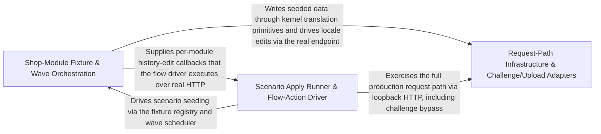

---
tags:
  - 2brain
  - 2brain/arch
  - project/boilerplate-node-backend
type: architecture
component: Scenario_Execution_Flow_Action_Driver
---

## Details

The runtime engine that applies a scenario to the live shop. It resolves scenario arguments, drives locale-entry edits through the locale fixture pipeline, manages shop-module entries and their history edits, orchestrates wave entries (staged rollout of scenario steps), and dispatches the concrete flow actions that mutate shop state — submitCard, shipOrder, recordOfflinePayment, hardDeleteProduct. It also carries the rate-limit budget generation and Altcha challenge wiring that the scenario runner needs to exercise the full request path. This is the verb layer: it turns a declarative scenario definition into a sequence of API-level mutations.

### Request-Path Infrastructure & Challenge/Upload Adapters
The production infrastructure the scenario runner deliberately drives so the seed exercises the full request path rather than a shortcut. This group bundles the HTTP/adapter surface the flow actions traverse: the Altcha human-challenge wiring, the image-store and image-signature adapters with ACCEPTED_UPLOAD_MIMETYPES and ImageWritebackFields, the PDF renderer with RenderTimeoutError, the SSRF guard with SafeOutboundTarget, the HTTP controller and id/schema plumbing with collectIdPaths/CarriedId/SchemaNode, plus the object-guard and kernel translation primitives that the seeded data and its translations flow through.

**Related Classes/Methods**:

- `src.infrastructure.adapters.image-signatures.ACCEPTED_UPLOAD_MIMETYPES`:71-73
- `src.infrastructure.http.ids.collectIdPaths`:176-193
- `src.kernel.translation.applyTranslations`:322-341

**Source Files:**

- `src/infrastructure/adapters/antibot-providers/altcha.ts`
  - `src.infrastructure.adapters.antibot-providers.altcha.then() callback` (L115-L120) - Function
- `src/infrastructure/adapters/image-signatures.ts`
  - `src.infrastructure.adapters.image-signatures.ACCEPTED_UPLOAD_MIMETYPES` (L71-L73) - Class
  - `src.infrastructure.adapters.image-signatures.ACCEPTED_UPLOAD_MIMETYPES.SUPPORTED_IMAGE_FORMATS.flatMap() callback` (L72-L72) - Function
- `src/infrastructure/adapters/image-store.ts`
  - `src.infrastructure.adapters.image-store.ImageWritebackFields` (L275-L279) - Interface
- `src/infrastructure/adapters/pdf.ts`
  - `src.infrastructure.adapters.pdf.RenderTimeoutError` (L68-L73) - Class
  - `src.infrastructure.adapters.pdf.RenderTimeoutError.constructor` (L69-L72) - Constructor
  - `src.infrastructure.adapters.pdf.withDeadline.deadline` (L183-L190) - Class
  - `src.infrastructure.adapters.pdf.withDeadline.deadline.<function>` (L183-L190) - Function
  - `src.infrastructure.adapters.pdf.withDeadline.deadline.<function>.setTimeout() callback` (L184-L189) - Function
  - `src.infrastructure.adapters.pdf.withDeadline.deadline.<function>.setTimeout() callback.catch() callback` (L187-L187) - Function
- `src/infrastructure/adapters/ssrf-guard.ts`
  - `src.infrastructure.adapters.ssrf-guard.SafeOutboundTarget` (L49-L62) - Interface
  - `src.infrastructure.adapters.ssrf-guard.resolveAllAddresses.lookup.then() callback.addresses.results.flatMap() callback` (L166-L167) - Function
  - `src.infrastructure.adapters.ssrf-guard.resolveAllAddresses.lookup.then() callback.addresses` (L166-L168) - Class
- `src/infrastructure/http/controller.ts`
  - `src.infrastructure.http.controller.parseBody.flagged` (L135-L135) - Class
  - `src.infrastructure.http.controller.parseBody.flagged.refusals.map() callback` (L135-L135) - Function
- `src/infrastructure/http/ids.ts`
  - `src.infrastructure.http.ids.SchemaNode` (L119-L134) - Interface
  - `src.infrastructure.http.ids.isIdString` (L163-L168) - Class
  - `src.infrastructure.http.ids.isIdString.some() callback` (L165-L167) - Function
  - `src.infrastructure.http.ids.collectIdPaths` (L176-L193) - Class
  - `src.infrastructure.http.ids.flatMap() callback` (L181-L182) - Function
  - `src.infrastructure.http.ids.collectIdPaths.flatMap() callback` (L191-L191) - Function
  - `src.infrastructure.http.ids.CarriedId` (L213-L216) - Interface
- `src/infrastructure/http/schemas.ts`
  - `src.infrastructure.http.schemas.optionalBooleanSchema` (L108-L111) - Class
  - `src.infrastructure.http.schemas.optionalBooleanSchema.z.preprocess() callback` (L109-L109) - Function
- `src/infrastructure/i18n/catalog.ts`
  - `src.infrastructure.i18n.catalog.localeCandidatesFor` (L40-L43) - Class
  - `src.infrastructure.i18n.catalog.localeCandidatesFor.filter() callback` (L42-L42) - Function
- `src/infrastructure/object-guards.ts`
  - `src.infrastructure.object-guards.stripUndefined` (L29-L32) - Class
  - `src.infrastructure.object-guards.stripUndefined.filter() callback` (L32-L32) - Function
- `src/infrastructure/persistence/factories.ts`
  - `src.infrastructure.persistence.factories.FactoryIdentity` (L16-L23) - Interface
- `src/infrastructure/persistence/versioning.ts`
  - `src.infrastructure.persistence.versioning.Precondition` (L27-L32) - Interface
  - `src.infrastructure.persistence.versioning.DeleteOutcome` (L197-L200) - Interface
  - `src.infrastructure.persistence.versioning.then() callback` (L216-L216) - Function
- `src/kernel/translation.ts`
  - `src.kernel.translation.Translatable` (L303-L305) - Interface
  - `src.kernel.translation.applyTranslations` (L322-L341) - Class
  - `src.kernel.translation.applyTranslations.items.map() callback` (L337-L340) - Function
- `src/modules/addresses/factories.ts`
  - `src.modules.addresses.factories.AddressBookOverrides` (L14-L19) - Interface
- `src/modules/addresses/model.ts`
  - `src.modules.addresses.model.AddressItem` (L14-L29) - Interface
  - `src.modules.addresses.model.AddressBookDocument` (L32-L37) - Interface
- `src/modules/addresses/presenter.ts`
  - `src.modules.addresses.presenter.AddressesView` (L12-L14) - Interface
  - `src.modules.addresses.presenter.presentAddressOf.item` (L40-L40) - Class
  - `src.modules.addresses.presenter.presentAddressOf.item.book.items.find() callback` (L40-L40) - Function
- `src/modules/addresses/repository.ts`
  - `src.modules.addresses.repository.addressBookRepository.updateEntry.entry` (L207-L207) - Class
  - `src.modules.addresses.repository.addressBookRepository.updateEntry.entry.book.items.find() callback` (L207-L207) - Function
  - `src.modules.addresses.repository.addressBookRepository.setDefault.entry` (L240-L240) - Class
  - `src.modules.addresses.repository.addressBookRepository.setDefault.entry.book.items.find() callback` (L240-L240) - Function
  - `src.modules.addresses.repository.addressBookRepository.removeEntry.entry` (L256-L256) - Class
  - `src.modules.addresses.repository.addressBookRepository.removeEntry.entry.book.items.find() callback` (L256-L256) - Function
- `src/modules/api-keys/model.ts`
  - `src.modules.api-keys.model.ApiKeyDocument` (L15-L27) - Interface
  - `src.modules.api-keys.model.apiKeySchema.permissions.validate.validator` (L64-L64) - Method
- `src/modules/api-keys/repository.ts`
  - `src.modules.api-keys.repository.revokeMany` (L93-L97) - Class
  - `src.modules.api-keys.repository.revokeMany.then() callback` (L97-L97) - Function
- `src/modules/cart/model.ts`
  - `src.modules.cart.model.CartDocument` (L35-L58) - Interface
- `src/modules/delivery/model.ts`
  - `src.modules.delivery.model.ShipmentDocument` (L15-L23) - Interface
- `src/modules/feedback/model.ts`
  - `src.modules.feedback.model.FeedbackRequestDocument` (L29-L34) - Interface
- `src/modules/inventory/model.ts`
  - `src.modules.inventory.model.StockMovementDocument` (L30-L35) - Interface
  - `src.modules.inventory.model.StockLevelDocument` (L109-L125) - Interface
  - `src.modules.inventory.model.ReservationItem` (L182-L185) - Interface
  - `src.modules.inventory.model.ReservationDocument` (L201-L208) - Interface
- `src/modules/locales/model.ts`
  - `src.modules.locales.model.LocaleDocument` (L45-L48) - Interface
  - `src.modules.locales.model.LocaleEntryDocument` (L51-L55) - Interface
  - `src.modules.locales.model.TranslationDocument` (L58-L62) - Interface
  - `src.modules.locales.model.translationSchema.fields.default` (L258-L258) - Method
- `src/modules/notifications/model.ts`
  - `src.modules.notifications.model.NotificationParametersByCode` (L35-L39) - Interface
  - `src.modules.notifications.model.NotificationCommon` (L50-L55) - Interface
- `src/modules/notifications/repository.ts`
  - `src.modules.notifications.repository.notificationRepository.trimToNewest.ids` (L119-L119) - Class
  - `src.modules.notifications.repository.notificationRepository.trimToNewest.ids.excess.map() callback` (L119-L119) - Function
- `src/modules/orders/domain/rules.ts`
  - `src.modules.orders.domain.rules.OrderLineCandidate` (L8-L11) - Interface
  - `src.modules.orders.domain.rules.checkOrderLines` (L25-L30) - Class
  - `src.modules.orders.domain.rules.checkOrderLines.lines.some() callback` (L27-L27) - Function
  - `src.modules.orders.domain.rules.ShippableLineCandidate` (L33-L35) - Interface
- `src/modules/orders/domain/tax.ts`
  - `src.modules.orders.domain.tax.orderTaxBreakdown.rates` (L237-L237) - Class
  - `src.modules.orders.domain.tax.orderTaxBreakdown.rates.items.map() callback` (L237-L237) - Function
- `src/modules/orders/emails.ts`
  - `src.modules.orders.emails.withdrawalCase` (L94-L98) - Class
- `src/modules/orders/repository.ts`
  - `src.modules.orders.repository.setProjection.changes` (L282-L286) - Class
  - `src.modules.orders.repository.setProjection.changes.filter() callback` (L284-L284) - Function
  - `src.modules.orders.repository.setProjection.changes.map() callback` (L285-L285) - Function
  - `src.modules.orders.repository.incrementOrderNumberCounter` (L520-L530) - Class
  - `src.modules.orders.repository.incrementOrderNumberCounter.then() callback` (L530-L530) - Function
- `src/modules/orders/services/cancel.ts`
  - `src.modules.orders.services.cancel.clearRefundOwed` (L295-L296) - Class
  - `src.modules.orders.services.cancel.clearRefundOwed.then() callback` (L296-L296) - Function
- `src/modules/orders/services/current.ts`
  - `src.modules.orders.services.current.OrderLineShape` (L17-L20) - Interface
  - `src.modules.orders.services.current.resolveCurrentImages.then() callback.byId` (L54-L54) - Class
  - `src.modules.orders.services.current.resolveCurrentImages.then() callback.byId.products.map() callback` (L54-L54) - Function
- `src/modules/orders/services/place.ts`
  - `src.modules.orders.services.place.placeOrder.verdict` (L121-L123) - Class
  - `src.modules.orders.services.place.placeOrder.verdict.input.lines.map() callback` (L122-L122) - Function
  - `src.modules.orders.services.place.placeOrder.orderItems` (L126-L131) - Class
  - `src.modules.orders.services.place.placeOrder.orderItems.input.lines.map() callback` (L130-L130) - Function
  - `src.modules.orders.services.place.placeOrder.outcome` (L147-L151) - Class
  - `src.modules.orders.services.place.placeOrder.outcome.input.lines.map() callback` (L149-L149) - Function
  - `src.modules.orders.services.place.order` (L197-L209) - Class
  - `src.modules.orders.services.place.order.announceInTransaction() callback` (L198-L207) - Function
- `src/modules/orders/services/snapshot.ts`
  - `src.modules.orders.services.snapshot.resolveSnapshotProducts` (L37-L52) - Class
  - `src.modules.orders.services.snapshot.resolveSnapshotProducts.runWithLocale() callback` (L41-L51) - Function
  - `src.modules.orders.services.snapshot.resolveSnapshotProducts.runWithLocale() callback.products.map() callback` (L44-L44) - Function
  - `src.modules.orders.services.snapshot.resolveSnapshotProducts.runWithLocale() callback.then() callback` (L46-L50) - Function
  - `src.modules.orders.services.snapshot.resolveSnapshotProducts.runWithLocale() callback.then() callback.products.map() callback` (L47-L50) - Function
  - `src.modules.orders.services.snapshot.freezeOrderLines` (L65-L93) - Class
  - `src.modules.orders.services.snapshot.freezeOrderLines.then() callback` (L70-L92) - Function
  - `src.modules.orders.services.snapshot.freezeOrderLines.then() callback.resolvedProducts.map() callback` (L71-L92) - Function
- `src/modules/products/model.ts`
  - `src.modules.products.model.ProductRecord` (L34-L50) - Interface
  - `src.modules.products.model.ProductDocument` (L64-L74) - Interface
  - `src.modules.products.model.checkProductTranslationFields` (L122-L132) - Class
  - `src.modules.products.model.checkProductTranslationFields.parsed.error.issues.map() callback` (L128-L131) - Function
- `src/modules/products/services/lookups.ts`
  - `src.modules.products.services.lookups.titlesOf` (L81-L89) - Class
  - `src.modules.products.services.lookups.titlesOf.then() callback` (L82-L89) - Function
  - `src.modules.products.services.lookups.titlesById` (L97-L98) - Class
  - `src.modules.products.services.lookups.titlesById.then() callback` (L98-L98) - Function
- `src/modules/products/services/read.ts`
  - `src.modules.products.services.read.getById` (L47-L61) - Class
  - `src.modules.products.services.read.getById.then() callback` (L54-L60) - Function
  - `src.modules.products.services.read.getById.then() callback.then() callback` (L58-L58) - Function
  - `src.modules.products.services.read.getByIdViewed` (L70-L84) - Class
  - `src.modules.products.services.read.getByIdViewed.then() callback` (L75-L84) - Function
  - `src.modules.products.services.read.getAdmin` (L96-L124) - Class
  - `src.modules.products.services.read.getAdmin.then() callback` (L97-L124) - Function
  - `src.modules.products.services.read.getAdmin.then() callback.then() callback` (L100-L123) - Function
- `src/modules/products/services/search.ts`
  - `src.modules.products.services.search.search` (L37-L59) - Class
  - `src.modules.products.services.search.search.resultPromise.then() callback` (L56-L57) - Function
  - `src.modules.products.services.search.search.resultPromise.then() callback.then() callback` (L57-L57) - Function
  - `src.modules.products.services.search.searchViewed` (L102-L124) - Class
  - `src.modules.products.services.search.searchViewed.then() callback` (L107-L124) - Function
  - `src.modules.products.services.search.searchViewed.then() callback.items.result.items.map() callback` (L122-L122) - Function
- `src/modules/products/services/translated-write.ts`
  - `src.modules.products.services.translated-write.clearOmittedLocales` (L219-L234) - Class
  - `src.modules.products.services.translated-write.clearOmittedLocales.then() callback` (L223-L234) - Function
  - `src.modules.products.services.translated-write.clearOmittedLocales.then() callback.translations.map() callback` (L226-L229) - Function
- `src/modules/returns/emails.ts`
  - `src.modules.returns.emails.ReturnNoticeInput` (L25-L41) - Interface
- `src/modules/returns/model.ts`
  - `src.modules.returns.model.ReturnLine` (L21-L30) - Interface
  - `src.modules.returns.model.ReturnDocument` (L33-L63) - Interface
  - `src.modules.returns.model.ReturnOrderLockDocument` (L131-L134) - Interface
- `src/modules/users/model.ts`
  - `src.modules.users.model.UserRecord` (L129-L219) - Interface
  - `src.modules.users.model.UserDocument` (L294-L304) - Interface
- `src/modules/wishlist/factories.ts`
  - `src.modules.wishlist.factories.WishlistOverrides` (L14-L22) - Interface
- `src/modules/wishlist/model.ts`
  - `src.modules.wishlist.model.WishlistItem` (L22-L24) - Interface
  - `src.modules.wishlist.model.WishlistDocument` (L32-L37) - Interface

### Shop-Module Fixture & Wave Orchestration
The declarative fixture layer that defines what the scenario seeds and in what order. shop-modules.ts is the per-module fixture table (ShopModuleEntry with seed, after, baseline, driveHistoryEdit) and reshapes it into wave entries via asWaveEntries, historyEdits, and baselineShopModules. waves.ts provides the generic dependency-wave scheduler (waveOrder, runInWaves) that runs independent fixtures concurrently within a wave and sequentially across waves, tolerating dangling after names. locales.ts builds the locale-entry fixtures and the driveLocaleEntryEdit history step; products-filler.ts supplies filler image role keys; permissions.ts/translation.ts carry the kernel permission and translation primitives the fixtures depend on.

**Related Classes/Methods**:

- `scenarios.shop-modules.ShopModuleEntry`:22-44
- `scenarios.shop-modules.historyEdits`:90-97
- `scenarios.locales.localeEntryFixtures`:209-217
- `scenarios.products-filler.FILLER_IMAGE_ROLE_KEYS`:21-24

**Source Files:**

- `scenarios/locales.ts`
  - `scenarios.locales.localeEntryFixtures.LOCALE_ENTRIES.map() callback` (L209-L216) - Function
  - `scenarios.locales.localeEntryFixtures` (L209-L217) - Class
- `scenarios/products-filler.ts`
  - `scenarios.products-filler.FILLER_IMAGE_ROLE_KEYS` (L21-L24) - Class
  - `scenarios.products-filler.FILLER_IMAGE_ROLE_KEYS.Array.from() callback` (L23-L23) - Function
- `scenarios/shop-modules.ts`
  - `scenarios.shop-modules.ShopModuleEntry` (L22-L44) - Interface
  - `scenarios.shop-modules.historyEdits` (L90-L97) - Class
  - `scenarios.shop-modules.historyEdits.flatMap() callback` (L94-L95) - Function
- `scenarios/waves.ts`
  - `scenarios.waves.WaveEntry` (L11-L15) - Interface
  - `scenarios.waves.waveOrder.ready.filter() callback` (L33-L34) - Function
  - `scenarios.waves.waveOrder.ready` (L33-L35) - Class
  - `scenarios.waves.waveOrder.ready.filter() callback.every() callback` (L34-L34) - Function
- `src/kernel/permissions.ts`
  - `src.kernel.permissions.PermissionKey` (L74-L117) - Interface
  - `src.kernel.permissions.PresetRole` (L134-L156) - Interface
  - `src.kernel.permissions.PERMISSION_SUBJECTS` (L259-L261) - Class
  - `src.kernel.permissions.PERMISSION_SUBJECTS.PERMISSION_KEYS.map() callback` (L260-L260) - Function
  - `src.kernel.permissions.signupDefaultRole` (L274-L285) - Class
  - `src.kernel.permissions.signupDefaultRole.<function>` (L274-L285) - Function
  - `src.kernel.permissions.signupDefaultRole.<function>.matches` (L275-L275) - Class
  - `src.kernel.permissions.signupDefaultRole.<function>.matches.PRESET_ROLES.filter() callback` (L275-L275) - Function
  - `src.kernel.permissions.byKey` (L307-L307) - Class
  - `src.kernel.permissions.byKey.PERMISSION_KEYS.map() callback` (L307-L307) - Function
  - `src.kernel.permissions.byRoleName` (L317-L319) - Class
  - `src.kernel.permissions.byRoleName.map() callback` (L318-L318) - Function
  - `src.kernel.permissions.declaredKeysOfScope` (L573-L580) - Class
  - `src.kernel.permissions.declaredKeysOfScope.AUTHORIZATION_SCOPES.map() callback` (L574-L579) - Function
  - `src.kernel.permissions.declaredKeysOfScope.AUTHORIZATION_SCOPES.map() callback.PERMISSION_KEYS.filter() callback` (L576-L576) - Function
  - `src.kernel.permissions.declaredKeysOfScope.AUTHORIZATION_SCOPES.map() callback.map() callback` (L577-L577) - Function
- `src/kernel/translation.ts`
  - `src.kernel.translation.applyTranslations.resolved` (L329-L333) - Class
  - `src.kernel.translation.applyTranslations.resolved.items.map() callback` (L331-L331) - Function

### Scenario Apply Runner & Flow-Action Driver
The heart of the subsystem — the verb layer that resolves the scenario argument, boots the app in-process, and drives the concrete flow actions that mutate shop state. apply.ts is the runner (gates, connection, one call into buildScenario, --reset/--describe-to handling, and the scripted rate-limit budget install). flows/actions.ts holds the API-level mutation verbs — submitCard, recordOfflinePayment, shipOrder, hardDeleteProduct, plus checkout, openPayment, syncPayment, startProcessing, deliverOrder, cancelOrder, requestReturn — each a thin, contract-faithful call through the real middleware stack. generate-rate-limit-budgets.ts produces the rate-limit budget the runner needs to exercise the full request path without 429s.

**Related Classes/Methods**:

- `scenarios.apply.scenarioArgument`
- `scenarios.flows.actions.submitCard`:142-157
- `scenarios.flows.actions.recordOfflinePayment`:189-194
- `scenarios.flows.actions.shipOrder`:213-216
- `scenarios.flows.actions.hardDeleteProduct`:290-291

**Source Files:**

- `scenarios/apply.ts`
  - `scenarios.apply.scenarioArgument` (L100-L100) - Class
  - `scenarios.apply.scenarioArgument.find() callback` (L100-L100) - Function
- `scenarios/flows/actions.ts`
  - `scenarios.flows.actions.submitCard` (L142-L157) - Class
  - `scenarios.flows.actions.submitCard.then() callback` (L149-L157) - Function
  - `scenarios.flows.actions.recordOfflinePayment` (L189-L194) - Class
  - `scenarios.flows.actions.recordOfflinePayment.then() callback` (L194-L194) - Function
  - `scenarios.flows.actions.shipOrder` (L213-L216) - Class
  - `scenarios.flows.actions.shipOrder.then() callback` (L216-L216) - Function
  - `scenarios.flows.actions.hardDeleteProduct` (L290-L291) - Class
  - `scenarios.flows.actions.hardDeleteProduct.then() callback` (L291-L291) - Function
- `scripts/docs/generate-rate-limit-budgets.ts`
  - `scripts.docs.generate-rate-limit-budgets.rows` (L35-L40) - Class
  - `scripts.docs.generate-rate-limit-budgets.rows.enabledModules.flatMap() callback` (L36-L37) - Function
  - `scripts.docs.generate-rate-limit-budgets.rows.enabledModules.flatMap() callback.map() callback` (L37-L37) - Function
  - `scripts.docs.generate-rate-limit-budgets.rows.INFRASTRUCTURE_RATE_LIMITS.map() callback` (L39-L39) - Function
- `src/kernel/access/query.ts`
  - `src.kernel.access.query.coerce` (L43-L50) - Class
  - `src.kernel.access.query.coerce.userId` (L49-L49) - Method
- `src/kernel/registry.ts`
  - `src.kernel.registry.ImageTarget` (L29-L47) - Interface
  - `src.kernel.registry.TranslatableTarget` (L91-L156) - Interface
  - `src.kernel.registry.TranslationFieldIssue` (L159-L164) - Interface
  - `src.kernel.registry.PublicEventProjection` (L172-L178) - Interface
  - `src.kernel.registry.PersonalDataSubject` (L209-L219) - Interface
  - `src.kernel.registry.resolvePersonalDataErasers` (L548-L555) - Class
  - `src.kernel.registry.resolvePersonalDataErasers.appModules.flatMap() callback` (L551-L554) - Function
  - `src.kernel.registry.resolvePersonalDataErasers.appModules.flatMap() callback.appModule.personalData.flatMap() callback` (L554-L554) - Function
  - `src.kernel.registry.resolveRateLimits` (L567-L568) - Class
  - `src.kernel.registry.resolveRateLimits.appModules.flatMap() callback` (L568-L568) - Function
- `src/kernel/translation.ts`
  - `src.kernel.translation.planTranslations.otherLocale` (L240-L240) - Class
  - `src.kernel.translation.planTranslations.otherLocale.find() callback` (L240-L240) - Function
