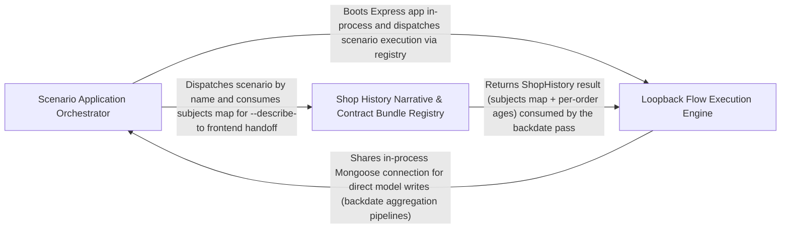

---
tags:
  - 2brain
  - 2brain/arch
  - project/boilerplate-node-backend
type: architecture
component: Scenario_Flow_Driver
---

## Details

The HTTP flow runner that lives the shop's history by driving the real checkout, payment, shipping and refund endpoints over a loopback listener, then backdating each order into the past.

### Scenario Application Orchestrator [[Expand]](./Scenario_Application_Orchestrator.md)
The entry-point and environment-bootstrap layer of the flow driver. scenarios/apply.ts is the single command that the demo profile invokes (npm run db:bootstrap → scenario:apply); it wires together the security middleware (installRequestParsing, isRawBodyPath), the kernel authentication resolvers (AuthResolver, CredentialResolver, ResolvedCredential), the filesystem and image-store adapters, and the scaffold/mutation-CI planning utilities, then hands control to the execution engine. It is the conductor that ensures the app is in a fully configured, authenticated, and filesystem-ready state before any HTTP flow is driven.

**Related Classes/Methods**:

- `src.app.security.installRequestParsing`:200-239

**Source Files:**

- `scenarios/apply.ts`
  - `scenarios.apply.filter() callback` (L91-L91) - Function
- `scripts/contracts/check-asyncapi-breaking.ts`
  - `scripts.contracts.check-asyncapi-breaking.then() callback` (L90-L131) - Function
- `scripts/mutation/ci/slice-ignorer.ts`
  - `scripts.mutation.ci.slice-ignorer.LineSlice` (L17-L20) - Interface
  - `scripts.mutation.ci.slice-ignorer.NodeLocation` (L23-L26) - Interface
  - `scripts.mutation.ci.slice-ignorer.IgnorerPath` (L29-L31) - Interface
  - `scripts.mutation.ci.slice-ignorer.strykerPlugins.value.shouldIgnore` (L84-L87) - Method
- `scripts/scaffold/plan.ts`
  - `scripts.scaffold.plan.PlannedFile` (L15-L20) - Interface
  - `scripts.scaffold.plan.ScaffoldPlan` (L23-L28) - Interface
- `src/app/security.ts`
  - `src.app.security.isRawBodyPath` (L48-L51) - Class
  - `src.app.security.isRawBodyPath.RAW_BODY_PATHS.some() callback` (L50-L50) - Function
  - `src.app.security.installRequestParsing` (L200-L239) - Class
  - `src.app.security.installRequestParsing.verify` (L219-L225) - Method
- `src/infrastructure/adapters/filesystem.ts`
  - `src.infrastructure.adapters.filesystem.deleteFile` (L49-L59) - Class
  - `src.infrastructure.adapters.filesystem.deleteFile.toolkitDeleteFile() callback` (L51-L58) - Function
- `src/infrastructure/adapters/image-signatures.ts`
  - `src.infrastructure.adapters.image-signatures.ImageFormat` (L19-L32) - Interface
  - `src.infrastructure.adapters.image-signatures.hasMarker` (L97-L99) - Class
  - `src.infrastructure.adapters.image-signatures.hasMarker.marker.bytes.every() callback` (L99-L99) - Function
  - `src.infrastructure.adapters.image-signatures.identifyImage` (L107-L112) - Class
  - `src.infrastructure.adapters.image-signatures.identifyImage.SUPPORTED_IMAGE_FORMATS.find() callback` (L109-L111) - Function
  - `src.infrastructure.adapters.image-signatures.identifyImage.SUPPORTED_IMAGE_FORMATS.find() callback.every() callback` (L111-L111) - Function
  - `src.infrastructure.adapters.image-signatures.extensionForImage` (L153-L154) - Class
  - `src.infrastructure.adapters.image-signatures.extensionForImage.SUPPORTED_IMAGE_FORMATS.find() callback` (L154-L154) - Function
- `src/infrastructure/adapters/image-store.ts`
  - `src.infrastructure.adapters.image-store.ImageStore` (L25-L103) - Interface
  - `src.infrastructure.adapters.image-store.ImageStore.quarantine` (L35-L35) - Method
  - `src.infrastructure.adapters.image-store.ImageStore.readQuarantined` (L44-L44) - Method
  - `src.infrastructure.adapters.image-store.ImageStore.removeQuarantined` (L55-L55) - Method
  - `src.infrastructure.adapters.image-store.ImageStore.promote` (L76-L76) - Method
  - `src.infrastructure.adapters.image-store.ImageStore.putDerivative` (L90-L90) - Method
  - `src.infrastructure.adapters.image-store.ImageStore.remove` (L102-L102) - Method
  - `src.infrastructure.adapters.image-store.filesystemImageStore` (L195-L254) - Class
  - `src.infrastructure.adapters.image-store.filesystemImageStore.quarantine` (L196-L204) - Method
  - `src.infrastructure.adapters.image-store.filesystemImageStore.readQuarantined` (L206-L206) - Method
  - `src.infrastructure.adapters.image-store.filesystemImageStore.removeQuarantined` (L208-L208) - Method
  - `src.infrastructure.adapters.image-store.filesystemImageStore.promote` (L210-L220) - Method
  - `src.infrastructure.adapters.image-store.filesystemImageStore.putDerivative` (L222-L229) - Method
  - `src.infrastructure.adapters.image-store.filesystemImageStore.remove` (L231-L253) - Method
  - `src.infrastructure.adapters.image-store.filesystemImageStore.remove.then() callback` (L251-L251) - Function
- `src/infrastructure/adapters/image.worker.ts`
  - `src.infrastructure.adapters.image.worker.UnsupportedImageFormatError` (L44-L46) - Class
  - `src.infrastructure.adapters.image.worker.DigestedImageUrls` (L74-L79) - Interface
  - `src.infrastructure.adapters.image.worker.digestQuarantinedImage` (L133-L164) - Class
  - `src.infrastructure.adapters.image.worker.digestQuarantinedImage.then() callback` (L134-L164) - Function
  - `src.infrastructure.adapters.image.worker.then() callback.then() callback` (L144-L145) - Function
  - `src.infrastructure.adapters.image.worker.digestQuarantinedImage.then() callback.then() callback.then() callback` (L145-L145) - Function
  - `src.infrastructure.adapters.image.worker.digestQuarantinedImage.then() callback.catch() callback` (L147-L155) - Function
  - `src.infrastructure.adapters.image.worker.digestQuarantinedImage.then() callback.then() callback` (L163-L163) - Function
  - `src.infrastructure.adapters.image.worker.settleWriteback` (L186-L214) - Class
  - `src.infrastructure.adapters.image.worker.settleWriteback.then() callback` (L193-L214) - Function
  - `src.infrastructure.adapters.image.worker.then() callback.clearQuarantine.then() callback` (L209-L209) - Function
  - `src.infrastructure.adapters.image.worker.settleWriteback.then() callback.then() callback` (L210-L210) - Function
  - `src.infrastructure.adapters.image.worker.settleWriteback.then() callback.clearQuarantine.then() callback` (L213-L213) - Function
  - `src.infrastructure.adapters.image.worker.handleImageDigestJob` (L226-L266) - Class
  - `src.infrastructure.adapters.image.worker.handleImageDigestJob.then() callback` (L247-L248) - Function
  - `src.infrastructure.adapters.image.worker.handleImageDigestJob.then() callback.then() callback` (L248-L248) - Function
  - `src.infrastructure.adapters.image.worker.handleImageDigestJob.catch() callback` (L250-L265) - Function
  - `src.infrastructure.adapters.image.worker.handleImageDigestJob.catch() callback.then() callback` (L256-L256) - Function
  - `src.infrastructure.adapters.image.worker.enqueueImageDigest` (L284-L313) - Class
  - `src.infrastructure.adapters.image.worker.enqueueImageDigest.runInline` (L288-L297) - Class
  - `src.infrastructure.adapters.image.worker.enqueueImageDigest.runInline.then() callback` (L289-L296) - Function
  - `src.infrastructure.adapters.image.worker.enqueueImageDigest.runInline.then() callback.then() callback` (L296-L296) - Function
  - `src.infrastructure.adapters.image.worker.enqueueImageDigest.then() callback` (L305-L312) - Function
  - `src.infrastructure.adapters.image.worker.enqueueIfImagePending` (L333-L357) - Class
  - `src.infrastructure.adapters.image.worker.enqueueIfImagePending.then() callback` (L349-L356) - Function
- `src/infrastructure/adapters/remote-image.ts`
  - `src.infrastructure.adapters.remote-image.digestBytes` (L78-L95) - Class
  - `src.infrastructure.adapters.remote-image.digestBytes.then() callback` (L84-L88) - Function
  - `src.infrastructure.adapters.remote-image.digestBytes.then() callback.finally() callback` (L86-L87) - Function
  - `src.infrastructure.adapters.remote-image.digestBytes.catch() callback` (L90-L93) - Function
  - `src.infrastructure.adapters.remote-image.digestBytes.catch() callback.then() callback` (L91-L93) - Function
- `src/infrastructure/config/define.ts`
  - `src.infrastructure.config.define.ConfigError` (L77-L83) - Class
  - `src.infrastructure.config.define.ConfigError.constructor` (L79-L82) - Constructor
  - `src.infrastructure.config.define.configProblems.merged` (L296-L298) - Class
  - `src.infrastructure.config.define.configProblems.merged.all.flatMap() callback` (L297-L297) - Function
  - `src.infrastructure.config.define.assertConfigIn.clauses` (L316-L322) - Class
  - `src.infrastructure.config.define.assertConfigIn.clauses.filter() callback` (L322-L322) - Function
- `src/infrastructure/config/fields.ts`
  - `src.infrastructure.config.fields.CommonOptions` (L62-L67) - Interface
  - `src.infrastructure.config.fields.BuildOptions` (L88-L93) - Interface
  - `src.infrastructure.config.fields.RangeOptions` (L119-L126) - Interface
  - `src.infrastructure.config.fields.TextOptions` (L278-L283) - Interface
  - `src.infrastructure.config.fields.CsvOptions` (L381-L386) - Interface
- `src/infrastructure/config/store.ts`
  - `src.infrastructure.config.store.StoreState` (L24-L37) - Interface
  - `src.infrastructure.config.store.overrideEnvironment` (L113-L129) - Class
  - `src.infrastructure.config.store.overrideEnvironment.before` (L116-L118) - Class
  - `src.infrastructure.config.store.overrideEnvironment.before.map() callback` (L117-L117) - Function
  - `src.infrastructure.config.store.overrideEnvironment.<function>` (L122-L128) - Function
- `src/infrastructure/http/middlewares/content-type.ts`
  - `src.infrastructure.http.middlewares.content-type.requireDeclaredContentType` (L41-L62) - Class
  - `src.infrastructure.http.middlewares.content-type.requireDeclaredContentType.<function>` (L44-L61) - Function
- `src/infrastructure/http/middlewares/request-logger.ts`
  - `src.infrastructure.http.middlewares.request-logger.requestLogger` (L17-L43) - Class
  - `src.infrastructure.http.middlewares.request-logger.requestLogger.response.once('finish') callback` (L21-L40) - Function
- `src/infrastructure/http/middlewares/upload.ts`
  - `src.infrastructure.http.middlewares.upload.resolveUploadDestination` (L66-L84) - Class
  - `src.infrastructure.http.middlewares.upload.resolveUploadDestination.then() callback` (L82-L82) - Function
  - `src.infrastructure.http.middlewares.upload.resolveUploadDestination.catch() callback` (L83-L83) - Function
  - `src.infrastructure.http.middlewares.upload.validateUploadedImages` (L221-L264) - Class
  - `src.infrastructure.http.middlewares.upload.validateUploadedImages.paths.map() callback` (L235-L235) - Function
  - `src.infrastructure.http.middlewares.upload.validateUploadedImages.then() callback` (L236-L262) - Function
  - `src.infrastructure.http.middlewares.upload.validateUploadedImages.then() callback.then() callback` (L259-L261) - Function
  - `src.infrastructure.http.middlewares.upload.validateUploadedImages.catch() callback` (L263-L263) - Function
  - `src.infrastructure.http.middlewares.upload.cleanupAfterPartialQuarantine` (L276-L285) - Class
  - `src.infrastructure.http.middlewares.upload.cleanupAfterPartialQuarantine.staged.map() callback` (L281-L281) - Function
  - `src.infrastructure.http.middlewares.upload.cleanupAfterPartialQuarantine.results.filter() callback` (L283-L283) - Function
  - `src.infrastructure.http.middlewares.upload.cleanupAfterPartialQuarantine.map() callback` (L284-L284) - Function
  - `src.infrastructure.http.middlewares.upload.releaseUnclaimedUpload` (L297-L304) - Class
  - `src.infrastructure.http.middlewares.upload.releaseUnclaimedUpload.response.once('close') callback` (L298-L303) - Function
  - `src.infrastructure.http.middlewares.upload.digestQuarantinedKeysInline` (L317-L345) - Class
  - `src.infrastructure.http.middlewares.upload.digestQuarantinedKeysInline.keys.map() callback` (L329-L329) - Function
  - `src.infrastructure.http.middlewares.upload.digestQuarantinedKeysInline.then() callback` (L331-L340) - Function
  - `src.infrastructure.http.middlewares.upload.digestQuarantinedKeysInline.then() callback.digested.map() callback` (L333-L333) - Function
  - `src.infrastructure.http.middlewares.upload.digestQuarantinedKeysInline.then() callback.keys.map() callback` (L337-L337) - Function
  - `src.infrastructure.http.middlewares.upload.digestQuarantinedKeysInline.then() callback.then() callback` (L337-L338) - Function
  - `src.infrastructure.http.middlewares.upload.digestQuarantinedKeysInline.catch() callback` (L341-L344) - Function
  - `src.infrastructure.http.middlewares.upload.digestQuarantinedKeysInline.catch() callback.keys.map() callback` (L342-L342) - Function
  - `src.infrastructure.http.middlewares.upload.digestQuarantinedKeysInline.catch() callback.then() callback` (L342-L343) - Function
  - `src.infrastructure.http.middlewares.upload.quarantineUploadedImages` (L359-L423) - Class
  - `src.infrastructure.http.middlewares.upload.quarantineUploadedImages.staged.map() callback` (L369-L369) - Function
  - `src.infrastructure.http.middlewares.upload.quarantineUploadedImages.then() callback` (L371-L417) - Function
  - `src.infrastructure.http.middlewares.upload.quarantineUploadedImages.then() callback.then() callback` (L374-L375) - Function
  - `src.infrastructure.http.middlewares.upload.quarantineUploadedImages.catch() callback` (L422-L422) - Function
- `src/infrastructure/http/uploads.ts`
  - `src.infrastructure.http.uploads.getFormFiles` (L24-L26) - Function
  - `src.infrastructure.http.uploads.RequestImage` (L29-L58) - Interface
  - `src.infrastructure.http.uploads.deleteUpload` (L88-L88) - Method
  - `src.infrastructure.http.uploads.readUploadedImage.deleteUpload` (L111-L111) - Method
- `src/infrastructure/observability/metrics-http.ts`
  - `src.infrastructure.observability.metrics-http.RequestMetricInput` (L95-L101) - Interface
- `src/infrastructure/observability/metrics-outbox.ts`
  - `src.infrastructure.observability.metrics-outbox._outboxPendingGauge` (L58-L74) - Class
  - `src.infrastructure.observability.metrics-outbox._outboxPendingGauge.collect` (L62-L73) - Method
  - `src.infrastructure.observability.metrics-outbox._outboxPendingGauge.collect.then() callback` (L69-L71) - Function
  - `src.infrastructure.observability.metrics-outbox._outboxPendingGauge.collect.catch() callback` (L72-L72) - Function
- `src/infrastructure/observability/metrics-registry.ts`
  - `src.infrastructure.observability.metrics-registry._processUptimeGauge` (L38-L45) - Class
  - `src.infrastructure.observability.metrics-registry._processUptimeGauge.collect` (L42-L44) - Method
- `src/infrastructure/observability/tracer.ts`
  - `src.infrastructure.observability.tracer.tracer.startActiveSpan() callback.then() callback` (L51-L51) - Function
- `src/infrastructure/runtime/otel-sdk.ts`
  - `src.infrastructure.runtime.otel-sdk.redactUrlSecrets.secrets` (L66-L66) - Class
  - `src.infrastructure.runtime.otel-sdk.redactUrlSecrets.secrets.QUERY_SECRETS.filter() callback` (L66-L66) - Function
- `src/infrastructure/runtime/server-lifecycle.ts`
  - `src.infrastructure.runtime.server-lifecycle.listenOn` (L43-L53) - Class
  - `src.infrastructure.runtime.server-lifecycle.listenOn.<function>` (L44-L53) - Function
  - `src.infrastructure.runtime.server-lifecycle.closeServer.<function>.cutTimer` (L106-L109) - Class
  - `src.infrastructure.runtime.server-lifecycle.closeServer.<function>.cutTimer.setTimeout() callback` (L107-L107) - Function
  - `src.infrastructure.runtime.server-lifecycle.registerSignalHandlers.onProcessSignal.forcedExitTimer` (L185-L189) - Class
  - `src.infrastructure.runtime.server-lifecycle.registerSignalHandlers.onProcessSignal.forcedExitTimer.setTimeout() callback` (L185-L189) - Function
- `src/kernel/authentication.ts`
  - `src.kernel.authentication.AuthResolver` (L37-L60) - Interface
  - `src.kernel.authentication.ResolvedCredential` (L82-L85) - Interface
  - `src.kernel.authentication.CredentialResolver` (L88-L90) - Interface
- `src/modules/account/services/oauth.ts`
  - `src.modules.account.services.oauth.discardAvatar` (L133-L136) - Class
  - `src.modules.account.services.oauth.discardAvatar.then() callback` (L134-L136) - Function
- `src/modules/account/services/signup.ts`
  - `src.modules.account.services.signup.createAccountIfEmailFree.then() callback.then() callback` (L137-L140) - Function
- `src/modules/example/services/personal-data.ts`
  - `src.modules.example.services.personal-data.eraseForUser` (L51-L59) - Class
  - `src.modules.example.services.personal-data.eraseForUser.then() callback` (L55-L58) - Function
  - `src.modules.example.services.personal-data.eraseForUser.then() callback.<function>` (L55-L58) - Function
  - `src.modules.example.services.personal-data.eraseForUser.then() callback.<function>.imageUrls.map() callback` (L56-L56) - Function
  - `src.modules.example.services.personal-data.eraseForUser.then() callback.<function>.then() callback` (L57-L57) - Function
- `src/modules/returns/domain/accounting.ts`
  - `src.modules.returns.domain.accounting.AccountedReturn` (L15-L21) - Interface
  - `src.modules.returns.domain.accounting.OrderAccounts` (L24-L29) - Interface
  - `src.modules.returns.domain.accounting.accountsOf.settled` (L50-L50) - Class
  - `src.modules.returns.domain.accounting.accountsOf.settled.returns.filter() callback` (L50-L50) - Function
  - `src.modules.returns.domain.accounting.accountsOf.accountedFor.settled.flatMap() callback` (L56-L56) - Function
- `src/modules/returns/domain/quantities.ts`
  - `src.modules.returns.domain.quantities.ProductQuantity` (L8-L11) - Interface
  - `src.modules.returns.domain.quantities.wireLines` (L24-L27) - Class
  - `src.modules.returns.domain.quantities.wireLines.lines.map() callback` (L27-L27) - Function
  - `src.modules.returns.domain.quantities.returnableLinesOf` (L36-L44) - Class
  - `src.modules.returns.domain.quantities.returnableLinesOf.items.filter() callback` (L43-L43) - Function
  - `src.modules.returns.domain.quantities.returnableLinesOf.map() callback` (L44-L44) - Function
  - `src.modules.returns.domain.quantities.checkRequestedLines.lines.filter() callback` (L84-L84) - Function
  - `src.modules.returns.domain.quantities.checkRequestedLines.lines.map() callback` (L100-L100) - Function
  - `src.modules.returns.domain.quantities.takesLastUnit` (L113-L128) - Class
  - `src.modules.returns.domain.quantities.takesLastUnit.every() callback` (L126-L126) - Function
- `src/modules/returns/domain/refund-amount.ts`
  - `src.modules.returns.domain.refund-amount.RefundBreakdown` (L40-L45) - Interface
- `src/modules/returns/domain/status-projection.ts`
  - `src.modules.returns.domain.status-projection.ProjectedReturn` (L12-L17) - Interface
  - `src.modules.returns.domain.status-projection.projectReturnStatus` (L36-L61) - Class
  - `src.modules.returns.domain.status-projection.holding.some() callback` (L49-L49) - Function
- `src/modules/returns/repository.ts`
  - `src.modules.returns.repository.returnRepository.sumReceived` (L120-L137) - Method
  - `src.modules.returns.repository.returnRepository.scrubFreeTextBefore` (L160-L171) - Method
  - `src.modules.returns.repository.returnRepository.scrubFreeTextBefore.then() callback` (L171-L171) - Function
- `src/modules/returns/services/cancel-remainder.ts`
  - `src.modules.returns.services.cancel-remainder.Cancelled` (L57-L60) - Interface
  - `src.modules.returns.services.cancel-remainder.rowFor.byProduct` (L85-L85) - Class
  - `src.modules.returns.services.cancel-remainder.rowFor.byProduct.order.items.map() callback` (L85-L85) - Function
  - `src.modules.returns.services.cancel-remainder.rowFor.lines.lines.map() callback` (L95-L104) - Function
  - `src.modules.returns.services.cancel-remainder.then() callback` (L219-L219) - Function
  - `src.modules.returns.services.cancel-remainder.createCancellation.then() callback.then() callback.option` (L294-L294) - Class
  - `src.modules.returns.services.cancel-remainder.createCancellation.then() callback.then() callback.option.options.find() callback` (L294-L294) - Function
- `src/modules/returns/services/cancellation-refund.ts`
  - `src.modules.returns.services.cancellation-refund.cancellationRefundOn.ordered` (L32-L35) - Class
  - `src.modules.returns.services.cancellation-refund.cancellationRefundOn.ordered.order.items.map() callback` (L32-L35) - Function
  - `src.modules.returns.services.cancellation-refund.cancellationRefundOn.price` (L36-L38) - Class
  - `src.modules.returns.services.cancellation-refund.cancellationRefundOn.price.order.items.map() callback` (L37-L37) - Function
  - `src.modules.returns.services.cancellation-refund.cancellationRefundOn.lines.lines.map() callback` (L41-L44) - Function
- `src/modules/returns/services/close.ts`
  - `src.modules.returns.services.close.closeReturn.announceInTransaction() callback.then() callback` (L39-L55) - Function
  - `src.modules.returns.services.close.closeReturn.announceInTransaction() callback.then() callback.then() callback` (L54-L54) - Function
  - `src.modules.returns.services.close.closeReturn.announceInTransaction() callback` (L57-L66) - Function
- `src/modules/returns/services/create.ts`
  - `src.modules.returns.services.create.writeWithdrawalRecord.withTransaction() callback` (L91-L124) - Function
  - `src.modules.returns.services.create.writeWithdrawalRecord.withTransaction() callback.then() callback` (L108-L123) - Function
  - `src.modules.returns.services.create.writeWithdrawalRecord.withTransaction() callback.then() callback.then() callback` (L123-L123) - Function
  - `src.modules.returns.services.create.alreadyReturned` (L177-L182) - Class
  - `src.modules.returns.services.create.alreadyReturned.then() callback` (L180-L181) - Function
  - `src.modules.returns.services.create.alreadyReturned.then() callback.flatMap() callback` (L181-L181) - Function
  - `src.modules.returns.services.create.writeReturn` (L209-L244) - Class
  - `src.modules.returns.services.create.writeReturn.then() callback.then() callback` (L243-L243) - Function
  - `src.modules.returns.services.create.openUnderLock` (L256-L276) - Class
  - `src.modules.returns.services.create.openUnderLock.withTransaction() callback` (L261-L275) - Function
  - `src.modules.returns.services.create.openUnderLock.withTransaction() callback.then() callback` (L265-L275) - Function
  - `src.modules.returns.services.create.openUnderLock.withTransaction() callback.then() callback.then() callback` (L273-L273) - Function
  - `src.modules.returns.services.create.openReturn.then() callback.then() callback.returnable` (L349-L349) - Class
  - `src.modules.returns.services.create.openReturn.then() callback.then() callback.returnable.shipped.filter() callback` (L349-L349) - Function
- `src/modules/returns/services/decide.ts`
  - `src.modules.returns.services.decide.decide.then() callback.withTransaction() callback` (L90-L116) - Function
  - `src.modules.returns.services.decide.decide.then() callback.withTransaction() callback.then() callback` (L99-L115) - Function
  - `src.modules.returns.services.decide.decide.then() callback.withTransaction() callback.then() callback.then() callback` (L114-L114) - Function
- `src/modules/returns/services/options.ts`
  - `src.modules.returns.services.options.optionLines` (L49-L60) - Class
  - `src.modules.returns.services.options.optionLines.filter() callback` (L54-L54) - Function
  - `src.modules.returns.services.options.optionLines.map() callback` (L55-L59) - Function
  - `src.modules.returns.services.options.getReturnOptions` (L69-L108) - Class
  - `src.modules.returns.services.options.getReturnOptions.then() callback` (L73-L108) - Function
  - `src.modules.returns.services.options.getReturnOptions.then() callback.then() callback` (L80-L107) - Function
  - `src.modules.returns.services.options.getReturnOptions.then() callback.then() callback.returnable.shipped.filter() callback` (L87-L87) - Function
  - `src.modules.returns.services.options.getReturnOptions.then() callback.then() callback.back` (L88-L90) - Class
  - `src.modules.returns.services.options.getReturnOptions.then() callback.then() callback.back.flatMap() callback` (L90-L90) - Function
  - `src.modules.returns.services.options.getReturnOptions.then() callback.then() callback.cancellable.remainders.map() callback` (L96-L105) - Function
- `src/modules/returns/services/outcome.ts`
  - `src.modules.returns.services.outcome.CreateReturnInput` (L22-L32) - Interface
- `src/modules/returns/services/projection.ts`
  - `src.modules.returns.services.projection.syncReturnStatus.then() callback.cancelled` (L27-L29) - Class
  - `src.modules.returns.services.projection.syncReturnStatus.then() callback.cancelled.returns.filter() callback` (L28-L28) - Function
  - `src.modules.returns.services.projection.syncReturnStatus.then() callback.cancelled.flatMap() callback` (L29-L29) - Function
  - `src.modules.returns.services.projection.syncReturnStatus.then() callback.status` (L30-L40) - Class
  - `src.modules.returns.services.projection.syncReturnStatus.then() callback.status.returns.map() callback` (L31-L35) - Function
- `src/modules/returns/services/receive.ts`
  - `src.modules.returns.services.receive.ReceiveReturnInput` (L55-L58) - Interface
  - `src.modules.returns.services.receive.quote.ordered` (L89-L92) - Class
  - `src.modules.returns.services.receive.quote.ordered.order.items.map() callback` (L89-L92) - Function
  - `src.modules.returns.services.receive.claimAndRestock` (L124-L177) - Class
  - `src.modules.returns.services.receive.claimAndRestock.withTransaction() callback` (L130-L174) - Function
  - `src.modules.returns.services.receive.claimAndRestock.withTransaction() callback.others` (L134-L134) - Class
  - `src.modules.returns.services.receive.claimAndRestock.withTransaction() callback.others.everyReturn.filter() callback` (L134-L134) - Function
  - `src.modules.returns.services.receive.refundAndClose.lines.received.lines.map() callback` (L207-L210) - Function
  - `src.modules.returns.services.receive.then() callback.then() callback` (L264-L264) - Function
- `src/modules/returns/services/stats.ts`
  - `src.modules.returns.services.stats.ReturnedBucket` (L12-L16) - Interface
  - `src.modules.returns.services.stats.returnedByProduct` (L40-L48) - Class
  - `src.modules.returns.services.stats.returnedByProduct.then() callback` (L48-L48) - Function
  - `src.modules.returns.services.stats.returnedByProduct.then() callback.rows.map() callback` (L48-L48) - Function
- `src/modules/users/services/lookups.ts`
  - `src.modules.users.services.lookups.emailTaken` (L55-L56) - Class
  - `src.modules.users.services.lookups.emailTaken.then() callback` (L56-L56) - Function
- `src/modules/users/services/read.ts`
  - `src.modules.users.services.read.getById` (L24-L27) - Class
  - `src.modules.users.services.read.getById.then() callback` (L26-L26) - Function
- `src/modules/users/services/update.ts`
  - `src.modules.users.services.update.changedRole` (L116-L122) - Class
  - `src.modules.users.services.update.changedRole.then() callback` (L119-L121) - Function
  - `src.modules.users.services.update.saveAndGrant` (L133-L164) - Class
  - `src.modules.users.services.update.saveAndGrant.then() callback` (L151-L162) - Function
  - `src.modules.users.services.update.saveAndGrant.then() callback.then() callback` (L162-L162) - Function
  - `src.modules.users.services.update.finishUpdate.imageCleanup` (L182-L184) - Class
  - `src.modules.users.services.update.imageCleanup.then() callback` (L183-L183) - Function
  - `src.modules.users.services.update.finishUpdate.imageCleanup.then() callback` (L196-L196) - Function
  - `src.modules.users.services.update.saveWithRole` (L205-L227) - Class
  - `src.modules.users.services.update.saveWithRole.then() callback.withTransaction() callback` (L226-L226) - Function
  - `src.modules.users.services.update.saveWithRole.then() callback` (L227-L227) - Function
  - `src.modules.users.services.update.refusalFor.missing` (L308-L308) - Class
  - `src.modules.users.services.update.refusalFor.missing.find() callback` (L308-L308) - Function

### Loopback Flow Execution Engine [[Expand]](./Loopback_Flow_Execution_Engine.md)
The core engine room that makes the flow runner work. It provides three tightly-coupled capabilities: (1) the ephemeral loopback listener (withLoopbackServer) that binds the Express app to 127.0.0.1:0 for the duration of one seed, (2) the HTTP client (readAttempt, send) that issues fetch calls against that listener and unwraps the API's { data, errors } envelope, and (3) the backdate mechanism (mover, shiftStage, TRAILS) that rewrites the date columns on six unrelated collections (orders, payments, shipments, reservations, stock movements, audit logs) per-order using MongoDB aggregation-pipeline $dateSubtract. Supporting infrastructure includes the ephemeral MongoDB, product seeding with translations, seed-image generation, and the AppExtension hook in src/app.ts that exposes the Express app to the scenario layer.

**Related Classes/Methods**:

- `scenarios.flows.backdate.mover`:36-53
- `scenarios.flows.backdate.shiftStage`:99-110
- `scenarios.flows.client.readAttempt`:75-92
- `scenarios.products.writeSeedTranslations`:473-488

**Source Files:**

- `scenarios/flows/backdate.ts`
  - `scenarios.flows.backdate.mover` (L36-L53) - Class
  - `scenarios.flows.backdate.mover.<function>` (L38-L53) - Function
  - `scenarios.flows.backdate.TRAILS` (L65-L89) - Class
  - `scenarios.flows.backdate.TRAILS.mover() callback` (L88-L88) - Function
  - `scenarios.flows.backdate.shiftStage` (L99-L110) - Class
  - `scenarios.flows.backdate.shiftStage.dates.map() callback` (L101-L109) - Function
- `scenarios/flows/client.ts`
  - `scenarios.flows.client.readAttempt` (L75-L92) - Class
  - `scenarios.flows.client.readAttempt.then() callback.errorMessages.map() callback` (L83-L83) - Function
  - `scenarios.flows.client.readAttempt.then() callback` (L86-L91) - Function
- `scenarios/flows/loopback.ts`
  - `scenarios.flows.loopback.withLoopbackServer.<function>.server` (L30-L37) - Class
  - `scenarios.flows.loopback.withLoopbackServer.<function>.server.app.listen('127.0.0.1') callback` (L30-L37) - Function
  - `scenarios.flows.loopback.withLoopbackServer.<function>.server.app.listen('127.0.0.1') callback.close` (L35-L35) - Method
  - `scenarios.flows.loopback.withLoopbackServer.<function>.server.app.listen('127.0.0.1') callback.close.<function>` (L35-L35) - Function
  - `scenarios.flows.loopback.withLoopbackServer.<function>.server.app.listen('127.0.0.1') callback.close.<function>.server.close() callback` (L35-L35) - Function
- `scenarios/products.ts`
  - `scenarios.products.ProductCopy` (L51-L54) - Interface
  - `scenarios.products.writeSeedTranslations` (L473-L488) - Class
  - `scenarios.products.writeSeedTranslations.then() callback` (L479-L487) - Function
  - `scenarios.products.writeSeedTranslations.then() callback.then() callback` (L486-L486) - Function
- `scenarios/run-server.ts`
  - `scenarios.run-server.then() callback` (L163-L237) - Function
  - `scenarios.run-server.then() callback.then() callback.extension.afterBoot` (L230-L230) - Method
- `scenarios/support/doubles/webhook-sink.ts`
  - `scenarios.support.doubles.webhook-sink.trustSinkCertificateAuthority` (L28-L37) - Class
  - `scenarios.support.doubles.webhook-sink.trustSinkCertificateAuthority.defaults.some() callback` (L33-L33) - Function
- `scenarios/support/ephemeral-mongod.ts`
  - `scenarios.support.ephemeral-mongod.startInProcessMongod.timeout` (L51-L63) - Class
  - `scenarios.support.ephemeral-mongod.startInProcessMongod.timeout.<function>` (L51-L63) - Function
  - `scenarios.support.ephemeral-mongod.startInProcessMongod.timeout.<function>.setTimeout() callback` (L53-L60) - Function
- `scenarios/tools/generate-seed-images.ts`
  - `scenarios.tools.generate-seed-images.ImageEntry` (L36-L39) - Interface
  - `scenarios.tools.generate-seed-images.main` (L149-L174) - Class
  - `scenarios.tools.generate-seed-images.written.map() callback` (L160-L160) - Function
  - `scenarios.tools.generate-seed-images.main.written.map() callback` (L164-L164) - Function
  - `scenarios.tools.generate-seed-images.catch() callback` (L177-L180) - Function
- `src/app.ts`
  - `src.app.AppExtension` (L92-L105) - Interface
- `src/app/config.ts`
  - `src.app.config.APP_CONFIG_SLICES` (L101-L136) - Class
  - `src.app.config.APP_CONFIG_SLICES.map() callback` (L136-L136) - Function
- `src/app/routes.ts`
  - `src.app.routes.installRoutes` (L24-L64) - Class
  - `src.app.routes.app.use() callback` (L36-L39) - Function
  - `src.app.routes.installRoutes.app.use() callback` (L61-L63) - Function
- `src/app/security-txt.ts`
  - `src.app.security-txt.SecurityTxtSettings` (L13-L22) - Interface
  - `src.app.security-txt.buildSecurityTxt` (L47-L73) - Class
  - `src.app.security-txt.buildSecurityTxt.filter() callback` (L70-L70) - Function
- `src/app/security.ts`
  - `src.app.security.RAW_BODY_PATHS.enabledModules.flatMap() callback` (L40-L41) - Function
  - `src.app.security.RAW_BODY_PATHS` (L40-L42) - Class
  - `src.app.security.RAW_BODY_PATHS.enabledModules.flatMap() callback.map() callback` (L41-L41) - Function
  - `src.app.security.installSecurity` (L97-L192) - Class
  - `src.app.security.installSecurity.app.use() callback` (L129-L132) - Function
- `src/app/static-assets.ts`
  - `src.app.static-assets.installStatic` (L19-L52) - Class
  - `src.app.static-assets.installStatic.setHeaders` (L44-L49) - Method
- `src/app/system-routes.ts`
  - `src.app.system-routes.router.get('/livez') callback` (L31-L33) - Function
  - `src.app.system-routes.router.get('/.well-known/security.txt') callback` (L50-L58) - Function
- `src/app/telemetry.ts`
  - `src.app.telemetry.installTelemetry` (L22-L44) - Class
  - `src.app.telemetry.installTelemetry.app.use() callback` (L26-L43) - Function
  - `src.app.telemetry.installTelemetry.app.use() callback.response.once('finish') callback` (L32-L41) - Function
- `src/kernel/module-config.ts`
  - `src.kernel.module-config.moduleConfigSlices` (L39-L40) - Class
  - `src.kernel.module-config.moduleConfigSlices.appModules.flatMap() callback` (L40-L40) - Function
- `src/kernel/outbox.ts`
  - `src.kernel.outbox.enqueueOutboxEvent` (L143-L153) - Class
  - `src.kernel.outbox.enqueueOutboxEvent.then() callback` (L153-L153) - Function
  - `src.kernel.outbox.nudgeOutbox` (L337-L347) - Class
  - `src.kernel.outbox.announceWithin` (L393-L401) - Class
  - `src.kernel.outbox.announceWithin.then() callback` (L398-L401) - Function
  - `src.kernel.outbox.announceWithin.then() callback.then() callback` (L400-L400) - Function
  - `src.kernel.outbox.announceInTransaction` (L414-L421) - Class
  - `src.kernel.outbox.announceInTransaction.withTransaction() callback` (L418-L418) - Function
  - `src.kernel.outbox.announceInTransaction.then() callback` (L418-L421) - Function
- `src/kernel/registry.ts`
  - `src.kernel.registry.resolvePersonalDataSections` (L656-L661) - Class
  - `src.kernel.registry.resolvePersonalDataSections.appModules.flatMap() callback` (L659-L660) - Function
- `src/modules/account/services/password.ts`
  - `src.modules.account.services.password.passwordAndEpochWrite` (L119-L126) - Class
  - `src.modules.account.services.password.passwordAndEpochWrite.<function>` (L121-L126) - Function
  - `src.modules.account.services.password.passwordAndEpochWrite.<function>.then() callback` (L124-L125) - Function
  - `src.modules.account.services.password.passwordAndEpochWrite.<function>.then() callback.then() callback` (L125-L125) - Function
  - `src.modules.account.services.password.writePassword` (L142-L160) - Class
  - `src.modules.account.services.password.writePassword.then() callback.announceInTransaction() callback` (L152-L153) - Function
  - `src.modules.account.services.password.writePassword.then() callback` (L157-L158) - Function
  - `src.modules.account.services.password.writePassword.then() callback.then() callback` (L158-L158) - Function
  - `src.modules.account.services.password.writePassword.catch() callback` (L160-L160) - Function
- `src/modules/account/services/revocation.ts`
  - `src.modules.account.services.revocation.moveEpoch` (L70-L79) - Class
  - `src.modules.account.services.revocation.moveEpoch.announceInTransaction() callback.then() callback` (L76-L76) - Function
  - `src.modules.account.services.revocation.moveEpoch.announceInTransaction() callback` (L77-L77) - Function
  - `src.modules.account.services.revocation.moveEpoch.then() callback` (L78-L78) - Function
- `src/modules/inventory/services/allocate.ts`
  - `src.modules.inventory.services.allocate.Allocation` (L24-L29) - Interface
  - `src.modules.inventory.services.allocate.waiting` (L80-L82) - Class
  - `src.modules.inventory.services.allocate.allocateProduct.waiting.hold.items.filter() callback` (L81-L81) - Function
  - `src.modules.inventory.services.allocate.allocateProduct.waiting.reduce() callback` (L82-L82) - Function
- `src/modules/inventory/services/holds.ts`
  - `src.modules.inventory.services.holds.commitWithin.preorderProducts` (L103-L105) - Class
  - `src.modules.inventory.services.holds.commitWithin.preorderProducts.hold.items.filter() callback` (L104-L104) - Function
  - `src.modules.inventory.services.holds.commitWithin.preorderProducts.map() callback` (L105-L105) - Function
  - `src.modules.inventory.services.holds.commitForOrder` (L141-L151) - Class
  - `src.modules.inventory.services.holds.commitForOrder.withTransaction() callback` (L144-L144) - Function
  - `src.modules.inventory.services.holds.commitForOrder.then() callback` (L145-L149) - Function
  - `src.modules.inventory.services.holds.commitForOrder.then() callback.then() callback` (L148-L148) - Function
- `src/modules/inventory/services/levels.ts`
  - `src.modules.inventory.services.levels.listPreorders.products` (L115-L115) - Class
  - `src.modules.inventory.services.levels.listPreorders.products.items.map() callback` (L115-L115) - Function
  - `src.modules.inventory.services.levels.listPreorders.byId` (L116-L116) - Class
  - `src.modules.inventory.services.levels.listPreorders.byId.products.map() callback` (L116-L116) - Function
  - `src.modules.inventory.services.levels.listPreorders.items.items.map() callback` (L119-L127) - Function
- `src/modules/locales/repository.ts`
  - `src.modules.locales.repository.bumpRevision` (L150-L154) - Class
  - `src.modules.locales.repository.bumpRevision.then() callback` (L154-L154) - Function
  - `src.modules.locales.repository.valuesByKey` (L160-L166) - Class
  - `src.modules.locales.repository.valuesByKey.then() callback` (L166-L166) - Function
  - `src.modules.locales.repository.valuesByKey.then() callback.rows.map() callback` (L166-L166) - Function
  - `src.modules.locales.repository.currentRevision` (L172-L178) - Class
  - `src.modules.locales.repository.currentRevision.then() callback` (L178-L178) - Function
  - `src.modules.locales.repository.createEntry` (L181-L192) - Class
  - `src.modules.locales.repository.createEntry.then() callback.then() callback` (L192-L192) - Function
  - `src.modules.locales.repository.saveEntryValue` (L195-L207) - Class
  - `src.modules.locales.repository.saveEntryValue.then() callback` (L204-L205) - Function
  - `src.modules.locales.repository.saveEntryValue.then() callback.then() callback` (L205-L205) - Function
  - `src.modules.locales.repository.removeEntry` (L210-L211) - Class
  - `src.modules.locales.repository.removeEntry.then() callback` (L211-L211) - Function
  - `src.modules.locales.repository.importEntries` (L227-L275) - Class
  - `src.modules.locales.repository.importEntries.withTransaction() callback` (L241-L260) - Function
  - `src.modules.locales.repository.importEntries.withTransaction() callback.changedEntries.map() callback` (L246-L252) - Function
- `src/modules/orders/domain/lifecycle.ts`
  - `src.modules.orders.domain.lifecycle.statusesLeadingTo` (L203-L204) - Class
  - `src.modules.orders.domain.lifecycle.statusesLeadingTo.filter() callback` (L204-L204) - Function
- `src/modules/orders/services/cancel.ts`
  - `src.modules.orders.services.cancel.moveToCancelled` (L78-L107) - Class
  - `src.modules.orders.services.cancel.moveToCancelled.announceInTransaction() callback.order` (L89-L100) - Class
  - `src.modules.orders.services.cancel.moveToCancelled.announceInTransaction() callback.order.withTimeline() callback` (L99-L99) - Function
  - `src.modules.orders.services.cancel.moveToCancelled.announceInTransaction() callback` (L104-L104) - Function
  - `src.modules.orders.services.cancel.moveToCancelled.then() callback` (L105-L106) - Function
  - `src.modules.orders.services.cancel.moveToCancelled.then() callback.then() callback` (L106-L106) - Function
  - `src.modules.orders.services.cancel.cancelUnanswered` (L370-L381) - Class
  - `src.modules.orders.services.cancel.cancelUnanswered.then() callback` (L379-L380) - Function
  - `src.modules.orders.services.cancel.cancelUnanswered.then() callback.then() callback` (L380-L380) - Function
- `src/modules/orders/services/override.ts`
  - `src.modules.orders.services.override.applyOverride` (L56-L127) - Class
  - `src.modules.orders.services.override.applyOverride.write` (L88-L100) - Class
  - `src.modules.orders.services.override.applyOverride.write.withTimeline() callback` (L91-L99) - Function
  - `src.modules.orders.services.override.applyOverride.move.then() callback` (L114-L126) - Function
- `src/modules/orders/services/ship-stock.ts`
  - `src.modules.orders.services.ship-stock.announceMoveShippingStock` (L30-L43) - Class
  - `src.modules.orders.services.ship-stock.announceMoveShippingStock.announceInTransaction() callback` (L36-L39) - Function
  - `src.modules.orders.services.ship-stock.announceMoveShippingStock.announceInTransaction() callback.then() callback` (L37-L38) - Function
  - `src.modules.orders.services.ship-stock.announceMoveShippingStock.announceInTransaction() callback.then() callback.then() callback` (L38-L38) - Function
  - `src.modules.orders.services.ship-stock.announceMoveShippingStock.then() callback` (L41-L42) - Function
  - `src.modules.orders.services.ship-stock.announceMoveShippingStock.then() callback.then() callback` (L42-L42) - Function
- `src/modules/orders/services/status.ts`
  - `src.modules.orders.services.status.markSystemMove` (L65-L88) - Class
  - `src.modules.orders.services.status.markSystemMove.withTimeline() callback` (L84-L84) - Function
  - `src.modules.orders.services.status.markSystemMove.announceMove() callback` (L86-L86) - Function
  - `src.modules.orders.services.status.markPaid` (L113-L143) - Class
  - `src.modules.orders.services.status.markPaid.movePaid` (L120-L129) - Class
  - `src.modules.orders.services.status.movePaid.withTimeline() callback` (L121-L121) - Function
  - `src.modules.orders.services.status.markPaid.movePaid.withTimeline() callback` (L122-L128) - Function
  - `src.modules.orders.services.status.markPaid.announceMove() callback.then() callback` (L133-L134) - Function
  - `src.modules.orders.services.status.markPaid.announceMove() callback.then() callback.then() callback` (L134-L134) - Function
  - `src.modules.orders.services.status.markPaid.announceMove() callback` (L136-L136) - Function
  - `src.modules.orders.services.status.markPaid.then() callback` (L137-L141) - Function
  - `src.modules.orders.services.status.markPaid.then() callback.then() callback` (L140-L140) - Function
  - `src.modules.orders.services.status.markDelivered` (L207-L223) - Class
  - `src.modules.orders.services.status.withTimeline() callback` (L218-L218) - Function
  - `src.modules.orders.services.status.markDelivered.withTimeline() callback` (L219-L219) - Function
  - `src.modules.orders.services.status.markDelivered.announceMove() callback` (L221-L221) - Function
  - `src.modules.orders.services.status.markFulfilmentComplete` (L240-L273) - Class
  - `src.modules.orders.services.status.then() callback.withTimeline() callback` (L261-L262) - Function
  - `src.modules.orders.services.status.markFulfilmentComplete.then() callback.withTimeline() callback` (L263-L266) - Function
  - `src.modules.orders.services.status.markFulfilmentComplete.then() callback.announceWithin() callback` (L268-L271) - Function
  - `src.modules.orders.services.status.markFulfilmentComplete.then() callback.announceWithin() callback.events.map() callback` (L269-L270) - Function
- `src/modules/orders/services/timeline.ts`
  - `src.modules.orders.services.timeline.withTimeline` (L79-L89) - Class
  - `src.modules.orders.services.timeline.withTimeline.<function>` (L84-L89) - Function
  - `src.modules.orders.services.timeline.withTimeline.<function>.then() callback` (L85-L88) - Function
  - `src.modules.orders.services.timeline.withTimeline.<function>.then() callback.then() callback` (L87-L87) - Function
- `src/modules/payments/services/settlement.ts`
  - `src.modules.payments.services.settlement.reportAttempt.declined` (L465-L466) - Class
  - `src.modules.payments.services.settlement.reportAttempt.declined.result.errors.some() callback` (L466-L466) - Function
- `src/modules/products/services/crud.ts`
  - `src.modules.products.services.crud.afterCommitStep` (L85-L91) - Class
  - `src.modules.products.services.crud.afterCommitStep.then() callback` (L88-L88) - Function
  - `src.modules.products.services.crud.afterCommitStep.catch() callback` (L89-L91) - Function
  - `src.modules.products.services.crud.insertProduct` (L115-L142) - Class
  - `src.modules.products.services.crud.insertProduct.then() callback` (L135-L141) - Function
  - `src.modules.products.services.crud.insertProduct.then() callback.then() callback` (L141-L141) - Function
  - `src.modules.products.services.crud.finishCreate` (L151-L179) - Class
  - `src.modules.products.services.crud.finishCreate.then() callback` (L161-L177) - Function
  - `src.modules.products.services.crud.finishCreate.then() callback.afterCommitStep('audit') callback` (L162-L168) - Function
  - `src.modules.products.services.crud.finishCreate.then() callback.then() callback` (L170-L170) - Function
  - `src.modules.products.services.crud.finishCreate.then() callback.catch() callback` (L171-L177) - Function
  - `src.modules.products.services.crud.create` (L185-L188) - Class
  - `src.modules.products.services.crud.create.withTransaction() callback` (L186-L186) - Function
  - `src.modules.products.services.crud.create.then() callback` (L186-L187) - Function
  - `src.modules.products.services.crud.ProductUpdateOutcome` (L191-L196) - Interface
  - `src.modules.products.services.crud.applyUpdate` (L230-L287) - Class
  - `src.modules.products.services.crud.applyUpdate.then() callback.then() callback` (L283-L283) - Function
  - `src.modules.products.services.crud.applyUpdate.then() callback` (L286-L286) - Function
  - `src.modules.products.services.crud.finishUpdate` (L295-L310) - Class
  - `src.modules.products.services.crud.finishUpdate.afterCommitStep('old image removal') callback` (L299-L300) - Function
  - `src.modules.products.services.crud.finishUpdate.then() callback` (L302-L302) - Function
  - `src.modules.products.services.crud.finishUpdate.catch() callback` (L303-L309) - Function
  - `src.modules.products.services.crud.update` (L316-L320) - Class
  - `src.modules.products.services.crud.update.withTransaction() callback` (L320-L320) - Function
  - `src.modules.products.services.crud.updateByIdInTransaction` (L330-L346) - Class
  - `src.modules.products.services.crud.updateByIdInTransaction.then() callback` (L339-L345) - Function
  - `src.modules.products.services.crud.finishUpdateById` (L356-L370) - Class
  - `src.modules.products.services.crud.finishUpdateById.afterCommitStep('audit') callback` (L361-L367) - Function
  - `src.modules.products.services.crud.finishUpdateById.then() callback` (L370-L370) - Function
  - `src.modules.products.services.crud.updateById` (L376-L384) - Class
  - `src.modules.products.services.crud.updateById.withTransaction() callback` (L381-L381) - Function
  - `src.modules.products.services.crud.updateById.then() callback` (L382-L383) - Function
- `src/modules/products/services/translated-write.ts`
  - `src.modules.products.services.translated-write.toUpsertTranslationsRequest` (L38-L55) - Class
  - `src.modules.products.services.translated-write.toUpsertTranslationsRequest.map() callback` (L42-L54) - Function
  - `src.modules.products.services.translated-write.writeCreate.product.withTransaction() callback` (L112-L131) - Function
  - `src.modules.products.services.translated-write.writeCreate.product` (L112-L132) - Class
  - `src.modules.products.services.translated-write.writeCreate.product.withTransaction() callback.then() callback` (L123-L130) - Function
  - `src.modules.products.services.translated-write.writeCreate.product.withTransaction() callback.then() callback.then() callback` (L130-L130) - Function
  - `src.modules.products.services.translated-write.writeUpdate.result.withTransaction() callback` (L175-L190) - Function
  - `src.modules.products.services.translated-write.writeUpdate.result` (L175-L191) - Class
  - `src.modules.products.services.translated-write.writeUpdate.result.withTransaction() callback.then() callback` (L180-L189) - Function
  - `src.modules.products.services.translated-write.writeUpdate.result.withTransaction() callback.then() callback.then() callback` (L188-L188) - Function
- `src/modules/products/services/validation.ts`
  - `src.modules.products.services.validation.sanitizeStringArray` (L7-L10) - Class
  - `src.modules.products.services.validation.sanitizeStringArray.values.map() callback` (L9-L9) - Function
- `src/modules/returns/domain/quantities.ts`
  - `src.modules.returns.domain.quantities.ProductIdLike` (L14-L16) - Interface
  - `src.modules.returns.domain.quantities.ProductIdLike.toString` (L15-L15) - Method
  - `src.modules.returns.domain.quantities.lines` (L83-L85) - Class
  - `src.modules.returns.domain.quantities.lines.map() callback` (L85-L85) - Function
- `src/modules/returns/domain/refund-amount.ts`
  - `src.modules.returns.domain.refund-amount.RefundInputs` (L24-L37) - Interface
  - `src.modules.returns.domain.refund-amount.CancellationInputs` (L96-L104) - Interface
- `src/modules/returns/domain/status-projection.ts`
  - `src.modules.returns.domain.status-projection.projectReturnStatus.holding` (L42-L47) - Class
  - `src.modules.returns.domain.status-projection.projectReturnStatus.holding.returns.filter() callback` (L43-L46) - Function
  - `src.modules.returns.domain.status-projection.projectReturnStatus.holding.some() callback` (L50-L50) - Function
  - `src.modules.returns.domain.status-projection.projectReturnStatus.everything` (L57-L59) - Class
  - `src.modules.returns.domain.status-projection.projectReturnStatus.everything.every() callback` (L58-L58) - Function
- `src/modules/returns/services/cancel-remainder.ts`
  - `src.modules.returns.services.cancel-remainder.cancelUnderLock` (L121-L162) - Class
  - `src.modules.returns.services.cancel-remainder.cancelUnderLock.withTransaction() callback` (L127-L162) - Function
  - `src.modules.returns.services.cancel-remainder.cancelUnderLock.withTransaction() callback.cancelled.lines.map() callback` (L141-L141) - Function
  - `src.modules.returns.services.cancel-remainder.refund` (L172-L197) - Class
  - `src.modules.returns.services.cancel-remainder.refund.then() callback` (L188-L188) - Function
  - `src.modules.returns.services.cancel-remainder.refund.catch() callback` (L189-L196) - Function
  - `src.modules.returns.services.cancel-remainder.announceCancelled` (L208-L229) - Class
  - `src.modules.returns.services.cancel-remainder.announceCancelled.done.lines.map() callback` (L218-L218) - Function
  - `src.modules.returns.services.cancel-remainder.announceCancelled.then() callback` (L228-L228) - Function
  - `src.modules.returns.services.cancel-remainder.cancelRemainderUnanswered` (L336-L356) - Class
  - `src.modules.returns.services.cancel-remainder.cancelRemainderUnanswered.then() callback` (L351-L354) - Function
  - `src.modules.returns.services.cancel-remainder.cancelRemainderUnanswered.then() callback.then() callback` (L354-L354) - Function
- `src/modules/returns/services/create.ts`
  - `src.modules.returns.services.create.writeReturn.byProduct` (L215-L215) - Class
  - `src.modules.returns.services.create.writeReturn.byProduct.order.items.map() callback` (L215-L215) - Function
- `src/modules/returns/services/options.ts`
  - `src.modules.returns.services.options.optionLines.titles` (L50-L52) - Class
  - `src.modules.returns.services.options.optionLines.titles.order.items.map() callback` (L51-L51) - Function
  - `src.modules.returns.services.options.then() callback.then() callback.returnable` (L87-L87) - Class
- `src/modules/returns/services/receive.ts`
  - `src.modules.returns.services.receive.claimAndRestock.then() callback` (L174-L177) - Function

### Shop History Narrative & Contract Bundle Registry [[Expand]](./Shop_History_Narrative_Contract_Bundle_Registry.md)
The story and the contract halves of the flow driver. On the narrative side, shop-history.ts defines the complete order book: ten filler shoppers with combinatorial product lines, the named-story orders (paid, shipped, delivered, declined, refunded, cancelled, deleted), the ShopHistory result type (subject-id map + per-order age in days), and the signInCustomerBase helper that authenticates each filler through the real login endpoint. The Caller / Attempt / Envelope / ScenarioFlowError types in client.ts form the typed contract between the narrative and the execution engine. On the contract-artifact side, the scripts/contracts/ bundle files define and register the AsyncAPI/OpenAPI bundle fragments that the scenario's HTTP calls must conform to, ensuring the flow driver exercises the contracted surface rather than an ad-hoc one.

**Related Classes/Methods**:

- `scenarios.flows.client.ScenarioFlowError`:39-53

**Source Files:**

- `scenarios/flows/client.ts`
  - `scenarios.flows.client.Envelope` (L14-L17) - Interface
  - `scenarios.flows.client.Attempt` (L23-L31) - Interface
  - `scenarios.flows.client.ScenarioFlowError` (L39-L53) - Class
  - `scenarios.flows.client.ScenarioFlowError.constructor` (L46-L52) - Constructor
  - `scenarios.flows.client.Caller` (L56-L72) - Interface
  - `scenarios.flows.client.then() callback` (L77-L85) - Function
  - `scenarios.flows.client.send.headers.filter() callback` (L109-L109) - Function
  - `scenarios.flows.client.signIn` (L128-L157) - Class
  - `scenarios.flows.client.signIn.then() callback` (L133-L157) - Function
  - `scenarios.flows.client.signIn.then() callback.call` (L150-L155) - Method
  - `scenarios.flows.client.signIn.then() callback.call.then() callback` (L151-L155) - Function
- `scenarios/flows/shop-history.ts`
  - `scenarios.flows.shop-history.ShopHistory` (L53-L62) - Interface
  - `scenarios.flows.shop-history.FillerOrder` (L74-L77) - Interface
  - `scenarios.flows.shop-history.signInCustomerBase` (L263-L268) - Class
  - `scenarios.flows.shop-history.signInCustomerBase.map() callback` (L265-L266) - Function
  - `scenarios.flows.shop-history.signInCustomerBase.map() callback.then() callback` (L266-L266) - Function
  - `scenarios.flows.shop-history.signInCustomerBase.then() callback` (L268-L268) - Function
  - `scenarios.flows.shop-history.driveShopHistory.orderId.lines.map() callback` (L396-L396) - Function
  - `scenarios.flows.shop-history.ages` (L631-L636) - Class
  - `scenarios.flows.shop-history.driveShopHistory.ages.placed.map() callback` (L632-L635) - Function
- `scripts/contracts/analytics-browser-events.ts`
  - `scripts.contracts.analytics-browser-events.browserEventFragments` (L48-L53) - Class
  - `scripts.contracts.analytics-browser-events.browserEventFragments.map() callback` (L50-L51) - Function
  - `scripts.contracts.analytics-browser-events.localiseReferences` (L61-L72) - Class
  - `scripts.contracts.analytics-browser-events.localiseReferences.node.map() callback` (L62-L62) - Function
  - `scripts.contracts.analytics-browser-events.localiseReferences.map() callback` (L65-L70) - Function
  - `scripts.contracts.analytics-browser-events.withBrowserEvents` (L99-L145) - Class
  - `scripts.contracts.analytics-browser-events.withBrowserEvents.flatMap() callback` (L126-L138) - Function
  - `scripts.contracts.analytics-browser-events.withBrowserEvents.flatMap() callback.oneOf.map() callback` (L132-L132) - Function
- `scripts/contracts/asyncapi-breaking.ts`
  - `scripts.contracts.asyncapi-breaking.AcknowledgedBreak` (L20-L25) - Interface
  - `scripts.contracts.asyncapi-breaking.breakingChanges` (L51-L64) - Class
  - `scripts.contracts.asyncapi-breaking.breakingChanges.found.filter() callback` (L63-L63) - Function
  - `scripts.contracts.asyncapi-breaking.breakingChanges.found.filter() callback.acknowledged.every() callback` (L63-L63) - Function
- `scripts/contracts/asyncapi-bundles.ts`
  - `scripts.contracts.asyncapi-bundles.modulesWithAsyncapi` (L54-L54) - Class
  - `scripts.contracts.asyncapi-bundles.internalSections` (L65-L68) - Class
  - `scripts.contracts.asyncapi-bundles.internalSections.map() callback` (L67-L67) - Function
  - `scripts.contracts.asyncapi-bundles.sectionsInScope` (L90-L93) - Class
  - `scripts.contracts.asyncapi-bundles.sectionsInScope.ASYNC_SECTION_ORDER.filter() callback` (L93-L93) - Function
  - `scripts.contracts.asyncapi-bundles.marker` (L138-L143) - Class
  - `scripts.contracts.asyncapi-bundles.marker.sections.map() callback` (L141-L141) - Function
  - `scripts.contracts.asyncapi-bundles.marker.map() callback` (L142-L142) - Function
  - `scripts.contracts.asyncapi-bundles.asyncapiBundle` (L243-L255) - Class
  - `scripts.contracts.asyncapi-bundles.asyncapiBundle.content` (L248-L248) - Method
  - `scripts.contracts.asyncapi-bundles.asyncapiBundle.sources` (L249-L253) - Method
  - `scripts.contracts.asyncapi-bundles.asyncapiBundle.sources.map() callback` (L251-L251) - Function
  - `scripts.contracts.asyncapi-bundles.asyncapiPublicBundle` (L264-L275) - Class
  - `scripts.contracts.asyncapi-bundles.asyncapiPublicBundle.content` (L268-L268) - Method
  - `scripts.contracts.asyncapi-bundles.asyncapiPublicBundle.sources` (L269-L273) - Method
  - `scripts.contracts.asyncapi-bundles.asyncapiPublicBundle.sources.map() callback` (L271-L271) - Function
- `scripts/contracts/asyncapi-webhook-events.ts`
  - `scripts.contracts.asyncapi-webhook-events.webhookEventFragments` (L37-L42) - Class
  - `scripts.contracts.asyncapi-webhook-events.webhookEventFragments.map() callback` (L39-L40) - Function
- `scripts/contracts/authorization-bundle.ts`
  - `scripts.contracts.authorization-bundle.fragmentKeysBlock` (L81-L97) - Class
  - `scripts.contracts.authorization-bundle.sectionsOnDisk` (L100-L100) - Class
  - `scripts.contracts.authorization-bundle.assembleAuthorizationKeys.keys` (L112-L114) - Class
  - `scripts.contracts.authorization-bundle.assembleAuthorizationKeys.keys.map() callback` (L113-L113) - Function
- `scripts/contracts/build-bundles.ts`
  - `scripts.contracts.build-bundles.unknown` (L42-L42) - Class
  - `scripts.contracts.build-bundles.unknown.named.filter() callback` (L42-L42) - Function
  - `scripts.contracts.build-bundles.CONTRACT_BUNDLES.map() callback` (L48-L48) - Function
  - `scripts.contracts.build-bundles.bundle` (L57-L66) - Class
  - `scripts.contracts.build-bundles.bundle.bundles.map() callback` (L59-L59) - Function
  - `scripts.contracts.build-bundles.bundle.bundles.map() callback.then() callback` (L59-L59) - Function
  - `scripts.contracts.build-bundles.bundle.then() callback` (L60-L66) - Function
  - `scripts.contracts.build-bundles.bundle.then() callback.stale` (L61-L63) - Class
  - `scripts.contracts.build-bundles.bundle.then() callback.stale.assembled.filter() callback` (L62-L62) - Function
  - `scripts.contracts.build-bundles.bundle.then() callback.stale.map() callback` (L65-L65) - Function
  - `scripts.contracts.build-bundles.report` (L83-L102) - Class
  - `scripts.contracts.build-bundles.report.stale.map() callback` (L100-L100) - Function
  - `scripts.contracts.build-bundles.run` (L105-L153) - Class
  - `scripts.contracts.build-bundles.run.selected` (L109-L109) - Class
  - `scripts.contracts.build-bundles.run.selected.named.map() callback` (L109-L109) - Function
  - `scripts.contracts.build-bundles.run.generated` (L117-L117) - Class
  - `scripts.contracts.build-bundles.run.generated.selected.filter() callback` (L117-L117) - Function
  - `scripts.contracts.build-bundles.generated.map() callback` (L121-L121) - Function
  - `scripts.contracts.build-bundles.run.generated.map() callback` (L125-L125) - Function
  - `scripts.contracts.build-bundles.run.authored` (L143-L143) - Class
  - `scripts.contracts.build-bundles.run.authored.CONTRACT_BUNDLES.filter() callback` (L143-L143) - Function
  - `scripts.contracts.build-bundles.catch() callback` (L156-L159) - Function
- `scripts/contracts/bundle-kinds.ts`
  - `scripts.contracts.bundle-kinds.BundleIdentity` (L24-L45) - Interface
  - `scripts.contracts.bundle-kinds.CompiledBundle` (L55-L60) - Interface
  - `scripts.contracts.bundle-kinds.GeneratedBundle` (L70-L74) - Interface
- `scripts/contracts/bundle-registry.ts`
  - `scripts.contracts.bundle-registry.collectionBundle` (L41-L48) - Class
  - `scripts.contracts.bundle-registry.collectionBundle.content` (L47-L47) - Method
  - `scripts.contracts.bundle-registry.collectionBundle.content.then() callback` (L47-L47) - Function
  - `scripts.contracts.bundle-registry.findBundle` (L77-L78) - Class
  - `scripts.contracts.bundle-registry.findBundle.CONTRACT_BUNDLES.find() callback` (L78-L78) - Function
- `scripts/contracts/client-collections-bundle.ts`
  - `scripts.contracts.client-collections-bundle.sections` (L71-L74) - Class
  - `scripts.contracts.client-collections-bundle.sections.SECTION_ORDER.map() callback` (L72-L72) - Function
  - `scripts.contracts.client-collections-bundle.sections.filter() callback` (L73-L73) - Function
  - `scripts.contracts.client-collections-bundle.modulesDeclaringProbes` (L172-L173) - Class
  - `scripts.contracts.client-collections-bundle.loadProbes` (L191-L212) - Class
  - `scripts.contracts.client-collections-bundle.loadProbes.<function>` (L191-L212) - Function
  - `scripts.contracts.client-collections-bundle.loadProbes.<function>.<function>` (L194-L211) - Function
  - `scripts.contracts.client-collections-bundle.loadProbes.<function>.<function>.map() callback` (L196-L207) - Function
  - `scripts.contracts.client-collections-bundle.loadProbes.<function>.<function>.map() callback.then() callback` (L200-L206) - Function
  - `scripts.contracts.client-collections-bundle.loadProbes.<function>.<function>.then() callback` (L209-L209) - Function
  - `scripts.contracts.client-collections-bundle.generate` (L225-L235) - Class
  - `scripts.contracts.client-collections-bundle.generate.then() callback` (L226-L234) - Function
  - `scripts.contracts.client-collections-bundle.allProbes` (L238-L239) - Class
  - `scripts.contracts.client-collections-bundle.allProbes.then() callback` (L239-L239) - Function
  - `scripts.contracts.client-collections-bundle.allProbes.then() callback.result.requests.filter() callback` (L239-L239) - Function
  - `scripts.contracts.client-collections-bundle.collectionContent` (L250-L256) - Class
  - `scripts.contracts.client-collections-bundle.collectionContent.then() callback` (L251-L256) - Function
- `scripts/contracts/cookie-auth.ts`
  - `scripts.contracts.cookie-auth.takesBearer` (L37-L40) - Class
  - `scripts.contracts.cookie-auth.takesBearer.security.some() callback` (L40-L40) - Function
  - `scripts.contracts.cookie-auth.withCookieAuth` (L55-L77) - Class
  - `scripts.contracts.cookie-auth.withCookieAuth.flatMap() callback` (L60-L61) - Function
  - `scripts.contracts.cookie-auth.withCookieAuth.flatMap() callback.OPERATION_METHODS.map() callback` (L61-L61) - Function
  - `scripts.contracts.cookie-auth.withCookieAuth.operation.security.every() callback` (L65-L65) - Function
- `scripts/contracts/generate-asyncapi-types.ts`
  - `scripts.contracts.generate-asyncapi-types.AsyncApiChannel` (L34-L46) - Interface
  - `scripts.contracts.generate-asyncapi-types.AsyncApiMessage` (L49-L51) - Interface
  - `scripts.contracts.generate-asyncapi-types.AsyncApiServer` (L54-L56) - Interface
  - `scripts.contracts.generate-asyncapi-types.JsonSchema` (L59-L72) - Interface
  - `scripts.contracts.generate-asyncapi-types.AsyncApiDocument` (L75-L83) - Interface
  - `scripts.contracts.generate-asyncapi-types.toPascalCase` (L100-L107) - Class
  - `scripts.contracts.generate-asyncapi-types.toPascalCase.map() callback` (L106-L106) - Function
  - `scripts.contracts.generate-asyncapi-types.collectChannelMessageEntries` (L168-L185) - Class
  - `scripts.contracts.generate-asyncapi-types.collectChannelMessageEntries.filter() callback` (L174-L174) - Function
  - `scripts.contracts.generate-asyncapi-types.collectChannelMessageEntries.map() callback` (L175-L184) - Function
  - `scripts.contracts.generate-asyncapi-types.collectChannelMessageEntries.toSorted() callback` (L185-L185) - Function
  - `scripts.contracts.generate-asyncapi-types.channelProtocols` (L197-L211) - Class
  - `scripts.contracts.generate-asyncapi-types.channelProtocols.map() callback` (L202-L210) - Function
  - `scripts.contracts.generate-asyncapi-types.channelProtocols.filter() callback` (L211-L211) - Function
  - `scripts.contracts.generate-asyncapi-types.channelPayloadSchemaNames` (L220-L228) - Class
  - `scripts.contracts.generate-asyncapi-types.filter() callback` (L226-L226) - Function
  - `scripts.contracts.generate-asyncapi-types.channelPayloadSchemaNames.map() callback` (L227-L227) - Function
  - `scripts.contracts.generate-asyncapi-types.channelPayloadSchemaNames.filter() callback` (L228-L228) - Function
  - `scripts.contracts.generate-asyncapi-types.renderPayloadMap.rows` (L253-L257) - Class
  - `scripts.contracts.generate-asyncapi-types.renderPayloadMap.rows.entries.map() callback` (L255-L255) - Function
  - `scripts.contracts.generate-asyncapi-types.renderChannelNamespace.entries` (L288-L290) - Class
  - `scripts.contracts.generate-asyncapi-types.renderChannelNamespace.entries.channelNames.map() callback` (L289-L289) - Function
  - `scripts.contracts.generate-asyncapi-types.modelNameConstraints` (L325-L327) - Class
  - `scripts.contracts.generate-asyncapi-types.modelNameConstraints.NAMING_FORMATTER` (L326-L326) - Method
  - `scripts.contracts.generate-asyncapi-types.sseEntries` (L365-L369) - Class
  - `scripts.contracts.generate-asyncapi-types.sseEntries.collectChannelMessageEntries() callback` (L368-L368) - Function
  - `scripts.contracts.generate-asyncapi-types.queuePayloadSchemaNames` (L377-L381) - Class
  - `scripts.contracts.generate-asyncapi-types.queuePayloadSchemaNames.filter() callback` (L379-L379) - Function
  - `scripts.contracts.generate-asyncapi-types.queuePayloadSchemaNames.flatMap() callback` (L380-L380) - Function
  - `scripts.contracts.generate-asyncapi-types.channelNamespaceBlocks` (L384-L386) - Class
  - `scripts.contracts.generate-asyncapi-types.channelNamespaceBlocks.map() callback` (L385-L385) - Function
  - `scripts.contracts.generate-asyncapi-types.messageTypeBlocks` (L389-L397) - Class
  - `scripts.contracts.generate-asyncapi-types.messageTypeBlocks.map() callback` (L390-L396) - Function
  - `scripts.contracts.generate-asyncapi-types.zodExpression` (L414-L492) - Class
  - `scripts.contracts.generate-asyncapi-types.zodExpression.schema.enum.map() callback` (L418-L418) - Function
  - `scripts.contracts.generate-asyncapi-types.zodExpression.members` (L427-L427) - Class
  - `scripts.contracts.generate-asyncapi-types.zodExpression.members.schema.oneOf.map() callback` (L427-L427) - Function
  - `scripts.contracts.generate-asyncapi-types.zodExpression.fields` (L466-L473) - Class
  - `scripts.contracts.generate-asyncapi-types.zodExpression.fields.map() callback` (L468-L471) - Function
  - `scripts.contracts.generate-asyncapi-types.renderZodSchemas` (L504-L511) - Class
  - `scripts.contracts.generate-asyncapi-types.renderZodSchemas.map() callback` (L509-L510) - Function
  - `scripts.contracts.generate-asyncapi-types.then() callback` (L571-L579) - Function
  - `scripts.contracts.generate-asyncapi-types.catch() callback` (L580-L583) - Function
- `scripts/contracts/generate-request-content-types.ts`
  - `scripts.contracts.generate-request-content-types.OperationObject` (L24-L26) - Interface
  - `scripts.contracts.generate-request-content-types.OpenApiDocument` (L29-L31) - Interface
  - `scripts.contracts.generate-request-content-types.compileTemplate.parameterCount.segments.filter() callback` (L70-L70) - Function
  - `scripts.contracts.generate-request-content-types.renderRows` (L81-L101) - Class
  - `scripts.contracts.generate-request-content-types.renderRows.flatMap() callback` (L83-L95) - Function
  - `scripts.contracts.generate-request-content-types.renderRows.flatMap() callback.BODY_METHODS.flatMap() callback` (L84-L95) - Function
  - `scripts.contracts.generate-request-content-types.renderRows.toSorted() callback` (L98-L99) - Function
  - `scripts.contracts.generate-request-content-types.renderRows.map() callback` (L101-L101) - Function
- `scripts/contracts/openapi-bundle.ts`
  - `scripts.contracts.openapi-bundle.modulesWithOpenapi` (L74-L74) - Class
  - `scripts.contracts.openapi-bundle.rootPaths` (L120-L127) - Class
  - `scripts.contracts.openapi-bundle.rootPaths.filter() callback` (L125-L125) - Function
  - `scripts.contracts.openapi-bundle.rootPaths.map() callback` (L126-L126) - Function
  - `scripts.contracts.openapi-bundle.sectionPaths` (L130-L135) - Class
  - `scripts.contracts.openapi-bundle.sectionPaths.map() callback` (L134-L134) - Function
  - `scripts.contracts.openapi-bundle.operationsOf` (L187-L190) - Class
  - `scripts.contracts.openapi-bundle.operationsOf.flatMap() callback` (L188-L189) - Function
  - `scripts.contracts.openapi-bundle.operationsOf.flatMap() callback.OPERATION_METHODS.map() callback` (L189-L189) - Function
  - `scripts.contracts.openapi-bundle.operationsOf.flatMap() callback.filter() callback` (L189-L189) - Function
  - `scripts.contracts.openapi-bundle.withErrorCodes` (L387-L408) - Class
  - `scripts.contracts.openapi-bundle.withErrorCodes.codes.map() callback` (L403-L403) - Function
  - `scripts.contracts.openapi-bundle.openapiBundle` (L574-L581) - Class
  - `scripts.contracts.openapi-bundle.openapiBundle.sources` (L580-L580) - Method
  - `scripts.contracts.openapi-bundle.openapiBundle.sources.MODULE_SECTIONS.map() callback` (L580-L580) - Function
- `scripts/contracts/permission-actions-render.ts`
  - `scripts.contracts.permission-actions-render.readPermissionActions` (L17-L27) - Class
  - `scripts.contracts.permission-actions-render.readPermissionActions.actions.every() callback` (L22-L22) - Function
  - `scripts.contracts.permission-actions-render.renderPermissionActions.rows` (L36-L36) - Class
  - `scripts.contracts.permission-actions-render.renderPermissionActions.rows.actions.map() callback` (L36-L36) - Function
- `scripts/contracts/personal-data-assembly.ts`
  - `scripts.contracts.personal-data-assembly.retarget` (L49-L61) - Class
  - `scripts.contracts.personal-data-assembly.retarget.node.map() callback` (L50-L50) - Function
  - `scripts.contracts.personal-data-assembly.retarget.map() callback` (L54-L59) - Function
  - `scripts.contracts.personal-data-assembly.readPersonalDataSections` (L72-L86) - Class
  - `scripts.contracts.personal-data-assembly.readPersonalDataSections.modules.flatMap() callback` (L76-L86) - Function
  - `scripts.contracts.personal-data-assembly.readPersonalDataSections.modules.flatMap() callback.map() callback` (L80-L85) - Function
- `scripts/contracts/prune-unused.ts`
  - `scripts.contracts.prune-unused.reachable` (L80-L91) - Class
  - `scripts.contracts.prune-unused.reachable.filter() callback` (L89-L89) - Function
  - `scripts.contracts.prune-unused.pruneUnused` (L100-L124) - Class
  - `scripts.contracts.prune-unused.pruneUnused.document.tags.filter() callback` (L119-L119) - Function
- `scripts/contracts/root-assembly.ts`
  - `scripts.contracts.root-assembly.pruneStaleReferences.declared` (L59-L61) - Class
  - `scripts.contracts.root-assembly.pruneStaleReferences.declared.fragments.flatMap() callback` (L60-L60) - Function
  - `scripts.contracts.root-assembly.pruneStaleReferences.declared.fragments.flatMap() callback.urls.map() callback` (L60-L60) - Function
  - `scripts.contracts.root-assembly.appendMissingTags` (L94-L114) - Class
  - `scripts.contracts.root-assembly.appendMissingTags.fragments.flatMap() callback` (L105-L105) - Function
  - `scripts.contracts.root-assembly.readModuleFragments` (L151-L168) - Class
  - `scripts.contracts.root-assembly.readModuleFragments.map() callback` (L157-L167) - Function
  - `scripts.contracts.root-assembly.readModuleFragments.map() callback.tags.operations.flatMap() callback` (L164-L164) - Function
- `scripts/contracts/section-order.ts`
  - `scripts.contracts.section-order.orderSections.known` (L22-L22) - Class
  - `scripts.contracts.section-order.orderSections.known.preferred.filter() callback` (L22-L22) - Function
- `scripts/contracts/validate-asyncapi.ts`
  - `scripts.contracts.validate-asyncapi.isInvalid` (L38-L43) - Class
  - `scripts.contracts.validate-asyncapi.isInvalid.diagnostics.some() callback` (L40-L42) - Function
  - `scripts.contracts.validate-asyncapi.files.map() callback` (L50-L62) - Function
  - `scripts.contracts.validate-asyncapi.files.map() callback.then() callback` (L51-L62) - Function
  - `scripts.contracts.validate-asyncapi.then() callback` (L65-L69) - Function
  - `scripts.contracts.validate-asyncapi.catch() callback` (L70-L73) - Function
- `scripts/eslint/barrel-allowed-sources.ts`
  - `scripts.eslint.barrel-allowed-sources.barrelAllowedSources` (L80-L279) - Class
  - `scripts.eslint.barrel-allowed-sources.barrelAllowedSources.create` (L122-L278) - Method
  - `scripts.eslint.barrel-allowed-sources.barrelAllowedSources.create.Program` (L173-L181) - Method
  - `scripts.eslint.barrel-allowed-sources.barrelAllowedSources.create.ExportAllDeclaration` (L183-L214) - Method
  - `scripts.eslint.barrel-allowed-sources.barrelAllowedSources.create.ExportNamedDeclaration` (L216-L276) - Method
- `scripts/eslint/controller-chain-must-catch.ts`
  - `scripts.eslint.controller-chain-must-catch.controllerChainMustCatch` (L125-L164) - Class
  - `scripts.eslint.controller-chain-must-catch.controllerChainMustCatch.create` (L137-L163) - Method
  - `scripts.eslint.controller-chain-must-catch.controllerChainMustCatch.create.CallExpression` (L139-L161) - Method
- `scripts/eslint/no-hardcoded-user-text.ts`
  - `scripts.eslint.no-hardcoded-user-text.noHardcodedUserText` (L32-L84) - Class
  - `scripts.eslint.no-hardcoded-user-text.noHardcodedUserText.create` (L44-L83) - Method
  - `scripts.eslint.no-hardcoded-user-text.noHardcodedUserText.create.CallExpression` (L46-L81) - Method
- `scripts/eslint/no-persistence-imports.ts`
  - `scripts.eslint.no-persistence-imports.RuleOptions` (L40-L43) - Interface
  - `scripts.eslint.no-persistence-imports.noPersistenceImports` (L77-L138) - Class
  - `scripts.eslint.no-persistence-imports.noPersistenceImports.create` (L109-L137) - Method
  - `scripts.eslint.no-persistence-imports.noPersistenceImports.create.ImportDeclaration` (L115-L135) - Method
- `scripts/modules-on-disk.ts`
  - `scripts.modules-on-disk.modulesWith` (L26-L31) - Class
  - `scripts.modules-on-disk.modulesWith.map() callback` (L29-L29) - Function
  - `scripts.modules-on-disk.modulesWith.filter() callback` (L30-L30) - Function
- `scripts/mutation/baseline.ts`
  - `scripts.mutation.baseline.formatRegressions.regressed` (L262-L262) - Class
  - `scripts.mutation.baseline.formatRegressions.regressed.comparisons.filter() callback` (L262-L262) - Function
- `scripts/mutation/ci/cli.ts`
  - `scripts.mutation.ci.cli.option.value` (L42-L42) - Class
  - `scripts.mutation.ci.cli.scope` (L86-L91) - Class
  - `scripts.mutation.ci.cli.scope.map() callback` (L87-L91) - Function
  - `scripts.mutation.ci.cli.readOutcomes` (L94-L107) - Class
  - `scripts.mutation.ci.cli.readOutcomes.filter() callback` (L98-L98) - Function
  - `scripts.mutation.ci.cli.readOutcomes.map() callback` (L99-L105) - Function
  - `scripts.mutation.ci.cli.planWave` (L110-L124) - Class
  - `scripts.mutation.ci.cli.planWave.plan.shards.map() callback` (L122-L122) - Function
  - `scripts.mutation.ci.cli.showShard.shard` (L129-L129) - Class
  - `scripts.mutation.ci.cli.showShard.shard.shards.find() callback` (L129-L129) - Function
  - `scripts.mutation.ci.cli.readFinished` (L148-L162) - Class
  - `scripts.mutation.ci.cli.readFinished.flatMap() callback` (L155-L161) - Function
  - `scripts.mutation.ci.cli.merge.plans` (L167-L170) - Class
  - `scripts.mutation.ci.cli.merge.plans.filter() callback` (L168-L168) - Function
  - `scripts.mutation.ci.cli.merge.plans.map() callback` (L169-L169) - Function
  - `scripts.mutation.ci.cli.merge.plans.toSorted() callback` (L170-L170) - Function
  - `scripts.mutation.ci.cli.weakest` (L188-L190) - Class
  - `scripts.mutation.ci.cli.merge.weakest.toSorted() callback` (L189-L189) - Function
- `scripts/mutation/ci/merge.ts`
  - `scripts.mutation.ci.merge.incompleteFiles` (L73-L93) - Class
  - `scripts.mutation.ci.merge.incompleteFiles.finished.flatMap() callback` (L78-L78) - Function
  - `scripts.mutation.ci.merge.incompleteFiles.scope.filter() callback` (L82-L91) - Function
  - `scripts.mutation.ci.merge.incompleteFiles.scope.filter() callback.toSorted() callback` (L85-L85) - Function
  - `scripts.mutation.ci.merge.incompleteFiles.map() callback` (L92-L92) - Function
  - `scripts.mutation.ci.merge.mergeReports.remap` (L177-L177) - Class
  - `scripts.mutation.ci.merge.mergeReports.remap.ids.map() callback` (L177-L177) - Function
  - `scripts.mutation.ci.merge.mergeReports.files` (L179-L194) - Class
  - `scripts.mutation.ci.merge.mergeReports.files.filter() callback` (L181-L181) - Function
  - `scripts.mutation.ci.merge.mergeReports.files.map() callback` (L182-L193) - Function
  - `scripts.mutation.ci.merge.mergeReports.files.map() callback.mutants.map() callback` (L186-L191) - Function
  - `scripts.mutation.ci.merge.mergeReports.top` (L198-L200) - Class
  - `scripts.mutation.ci.merge.mergeReports.top.filter() callback` (L199-L199) - Function
  - `scripts.mutation.ci.merge.renderHtml.at` (L216-L216) - Class
  - `scripts.mutation.ci.merge.renderHtml.at.lines.findIndex() callback` (L216-L216) - Function
  - `scripts.mutation.ci.merge.formatSummary` (L233-L285) - Class
  - `scripts.mutation.ci.merge.formatSummary.toSorted() callback` (L258-L258) - Function
  - `scripts.mutation.ci.merge.formatSummary.map() callback` (L259-L259) - Function
  - `scripts.mutation.ci.merge.formatSummary.weakest.map() callback` (L269-L269) - Function
  - `scripts.mutation.ci.merge.formatSummary.incomplete.map() callback` (L281-L281) - Function
- `scripts/mutation/ci/waves.ts`
  - `scripts.mutation.ci.waves.ScopeFile` (L43-L49) - Interface
  - `scripts.mutation.ci.waves.Unit` (L52-L54) - Interface
  - `scripts.mutation.ci.waves.CiShard` (L57-L63) - Interface
  - `scripts.mutation.ci.waves.WavePlan` (L69-L79) - Interface
  - `scripts.mutation.ci.waves.cut` (L89-L103) - Class
  - `scripts.mutation.ci.waves.cut.bounds` (L92-L95) - Class
  - `scripts.mutation.ci.waves.cut.bounds.Array.from() callback` (L94-L94) - Function
  - `scripts.mutation.ci.waves.cut.Array.from() callback` (L97-L102) - Function
  - `scripts.mutation.ci.waves.packUnits` (L123-L136) - Class
  - `scripts.mutation.ci.waves.packUnits.toSorted() callback` (L127-L127) - Function
  - `scripts.mutation.ci.waves.packUnits.units.filter() callback` (L127-L127) - Function
  - `scripts.mutation.ci.waves.packUnits.bin` (L128-L128) - Class
  - `scripts.mutation.ci.waves.packUnits.bin.bins.find() callback` (L128-L128) - Function
  - `scripts.mutation.ci.waves.packUnits.bins.map() callback` (L135-L135) - Function
  - `scripts.mutation.ci.waves.firstWave` (L158-L163) - Class
  - `scripts.mutation.ci.waves.firstWave.map() callback` (L161-L161) - Function
  - `scripts.mutation.ci.waves.firstWave.scope.flatMap() callback` (L161-L161) - Function
  - `scripts.mutation.ci.waves.retryOf.retry.shard.units.map() callback` (L178-L178) - Function
  - `scripts.mutation.ci.waves.retryOf.retry.pieces.map() callback` (L181-L181) - Function
  - `scripts.mutation.ci.waves.nextWave` (L194-L206) - Class
  - `scripts.mutation.ci.waves.nextWave.abandoned.results.flatMap() callback` (L199-L199) - Function
  - `scripts.mutation.ci.waves.strykerArguments.mutate.shard.units.map() callback` (L226-L226) - Function
- `scripts/mutation/mutate-scope.ts`
  - `scripts.mutation.mutate-scope.StrykerConfig` (L21-L23) - Interface
  - `scripts.mutation.mutate-scope.isMutable` (L41-L52) - Class
  - `scripts.mutation.mutate-scope.isMutable.include` (L42-L42) - Class
  - `scripts.mutation.mutate-scope.isMutable.include.patterns.filter() callback` (L42-L42) - Function
  - `scripts.mutation.mutate-scope.isMutable.include.some() callback` (L49-L49) - Function
  - `scripts.mutation.mutate-scope.mutableFiles` (L55-L70) - Class
  - `scripts.mutation.mutate-scope.mutableFiles.files.map() callback` (L68-L68) - Function
  - `scripts.mutation.mutate-scope.mutableFiles.filter() callback` (L69-L69) - Function
  - `scripts.mutation.mutate-scope.lineCount` (L73-L76) - Class
  - `scripts.mutation.mutate-scope.lineCount.filter() callback` (L76-L76) - Function
  - `scripts.mutation.mutate-scope.scopeWithLines` (L79-L80) - Class
  - `scripts.mutation.mutate-scope.scopeWithLines.map() callback` (L80-L80) - Function
  - `scripts.mutation.mutate-scope.changedMutable` (L93-L96) - Class
  - `scripts.mutation.mutate-scope.changedMutable.changed.filter() callback` (L95-L95) - Function
- `scripts/mutation/run-diff.ts`
  - `scripts.mutation.run-diff.changedFiles` (L52-L59) - Class
  - `scripts.mutation.run-diff.changedFiles.map() callback` (L58-L58) - Function
  - `scripts.mutation.run-diff.changedFiles.filter() callback` (L59-L59) - Function
- `scripts/mutation/run-shards.ts`
  - `scripts.mutation.run-shards.listArgument` (L47-L51) - Class
  - `scripts.mutation.run-shards.listArgument.map() callback` (L50-L50) - Function
- `scripts/mutation/sharding.ts`
  - `scripts.mutation.sharding.Shard` (L16-L20) - Interface
  - `scripts.mutation.sharding.packIntoShards` (L42-L66) - Class
  - `scripts.mutation.sharding.packIntoShards.files.toSorted() callback` (L53-L53) - Function
- `scripts/scaffold/apply.ts`
  - `scripts.scaffold.apply.takenSchemaNames.names.flatMap() callback` (L29-L30) - Function
  - `scripts.scaffold.apply.takenSchemaNames.names` (L29-L31) - Class
- `scripts/scaffold/central-edits.ts`
  - `scripts.scaffold.central-edits.appendToList.blank` (L41-L41) - Class
  - `scripts.scaffold.central-edits.appendToList.blank.lines.findIndex() callback` (L41-L41) - Function
  - `scripts.scaffold.central-edits.addParityEntry.closes` (L74-L74) - Class
  - `scripts.scaffold.central-edits.addParityEntry.closes.lines.findIndex() callback` (L74-L74) - Function
- `scripts/scaffold/demo-remove-authorization.ts`
  - `scripts.scaffold.demo-remove-authorization.readRemovedAuthorization.survivors` (L40-L42) - Class
  - `scripts.scaffold.demo-remove-authorization.readRemovedAuthorization.survivors.filter() callback` (L41-L41) - Function
  - `scripts.scaffold.demo-remove-authorization.readRemovedAuthorization.survivors.flatMap() callback` (L42-L42) - Function
  - `scripts.scaffold.demo-remove-authorization.readRemovedAuthorization.removed` (L46-L46) - Class
  - `scripts.scaffold.demo-remove-authorization.readRemovedAuthorization.removed.names.flatMap() callback` (L46-L46) - Function
- `scripts/scaffold/demo-remove-registry.ts`
  - `scripts.scaffold.demo-remove-registry.stripModuleLines` (L38-L48) - Class
  - `scripts.scaffold.demo-remove-registry.stripModuleLines.filter() callback` (L42-L46) - Function
- `scripts/scaffold/demo-remove-tests.ts`
  - `scripts.scaffold.demo-remove-tests.testRoots.moduleTests` (L20-L24) - Class
  - `scripts.scaffold.demo-remove-tests.testRoots.moduleTests.map() callback` (L21-L22) - Function
- `scripts/scaffold/registry.ts`
  - `scripts.scaffold.registry.isRegistered` (L54-L55) - Class
  - `scripts.scaffold.registry.isRegistered.some() callback` (L55-L55) - Function
  - `scripts.scaffold.registry.retermRun` (L66-L81) - Class
  - `scripts.scaffold.registry.retermRun.first` (L72-L72) - Class
  - `scripts.scaffold.registry.retermRun.first.lines.findIndex() callback` (L72-L72) - Function
  - `scripts.scaffold.registry.retermRun.lines.map() callback` (L76-L79) - Function
  - `scripts.scaffold.registry.registerModule.withImport` (L114-L120) - Class
  - `scripts.scaffold.registry.registerModule.withImport.insertInRun() callback` (L116-L116) - Function
- `scripts/scaffold/scaffold-module.ts`
  - `scripts.scaffold.scaffold-module.main.plan` (L38-L43) - Class
  - `scripts.scaffold.scaffold-module.main.plan.catch() callback` (L39-L42) - Function
- `scripts/setup/environment-file.ts`
  - `scripts.setup.environment-file.FillResult` (L16-L21) - Interface
  - `scripts.setup.environment-file.fillPlaceholders` (L31-L48) - Class
  - `scripts.setup.environment-file.fillPlaceholders.lines.map() callback` (L43-L43) - Function
  - `scripts.setup.environment-file.readEnvironmentValue` (L51-L55) - Class
  - `scripts.setup.environment-file.readEnvironmentValue.find() callback` (L54-L54) - Function
- `scripts/setup/required-keys.ts`
  - `scripts.setup.required-keys.FillableKey` (L12-L15) - Interface
  - `scripts.setup.required-keys.fillableKeys` (L22-L29) - Class
  - `scripts.setup.required-keys.fillableKeys.map() callback` (L28-L28) - Function
