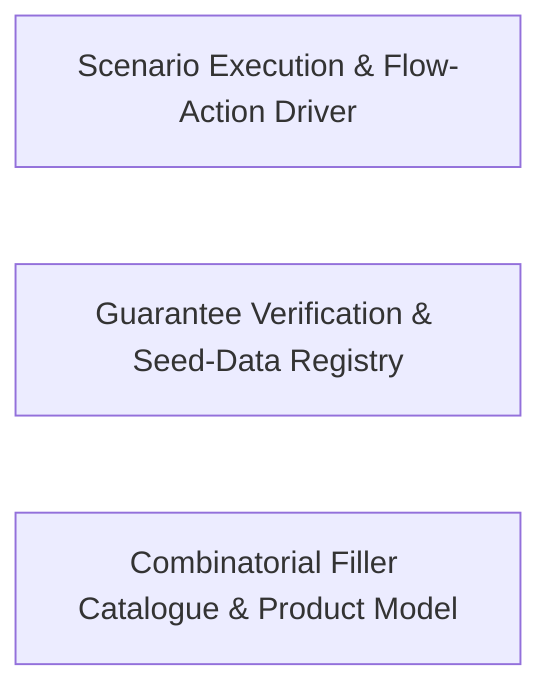

---
tags:
  - 2brain
  - 2brain/arch
  - project/boilerplate-node-backend
type: architecture
component: Scenario_Guarantee_Check_Filler_Catalogue
---

## Details

The combinatorial filler catalogue that gives the demo shop its volume, plus the guarantee checker that holds each module's declared scenario guarantees equal to the subjects the scenario actually offers.

### Scenario Execution & Flow-Action Driver [[Expand]](./Scenario_Execution_Flow_Action_Driver.md)
The runtime engine that applies a scenario to the live shop. It resolves scenario arguments, drives locale-entry edits through the locale fixture pipeline, manages shop-module entries and their history edits, orchestrates wave entries (staged rollout of scenario steps), and dispatches the concrete flow actions that mutate shop state — submitCard, shipOrder, recordOfflinePayment, hardDeleteProduct. It also carries the rate-limit budget generation and Altcha challenge wiring that the scenario runner needs to exercise the full request path. This is the verb layer: it turns a declarative scenario definition into a sequence of API-level mutations.

**Related Classes/Methods**:

- `scenarios.apply.scenarioArgument`
- `scenarios.flows.actions.submitCard`:142-157
- `scenarios.locales.localeEntryFixtures`:209-217

**Source Files:**

- `scenarios/apply.ts`
  - `scenarios.apply.scenarioArgument` (L100-L100) - Class
  - `scenarios.apply.scenarioArgument.find() callback` (L100-L100) - Function
- `scenarios/flows/actions.ts`
  - `scenarios.flows.actions.submitCard` (L142-L157) - Class
  - `scenarios.flows.actions.submitCard.then() callback` (L149-L157) - Function
  - `scenarios.flows.actions.recordOfflinePayment` (L189-L194) - Class
  - `scenarios.flows.actions.recordOfflinePayment.then() callback` (L194-L194) - Function
  - `scenarios.flows.actions.shipOrder` (L213-L216) - Class
  - `scenarios.flows.actions.shipOrder.then() callback` (L216-L216) - Function
  - `scenarios.flows.actions.hardDeleteProduct` (L290-L291) - Class
  - `scenarios.flows.actions.hardDeleteProduct.then() callback` (L291-L291) - Function
- `scenarios/locales.ts`
  - `scenarios.locales.localeEntryFixtures.LOCALE_ENTRIES.map() callback` (L209-L216) - Function
  - `scenarios.locales.localeEntryFixtures` (L209-L217) - Class
- `scenarios/products-filler.ts`
  - `scenarios.products-filler.FILLER_IMAGE_ROLE_KEYS` (L21-L24) - Class
  - `scenarios.products-filler.FILLER_IMAGE_ROLE_KEYS.Array.from() callback` (L23-L23) - Function
- `scenarios/shop-modules.ts`
  - `scenarios.shop-modules.ShopModuleEntry` (L22-L44) - Interface
  - `scenarios.shop-modules.historyEdits` (L90-L97) - Class
  - `scenarios.shop-modules.historyEdits.flatMap() callback` (L94-L95) - Function
- `scenarios/waves.ts`
  - `scenarios.waves.WaveEntry` (L11-L15) - Interface
  - `scenarios.waves.waveOrder.ready.filter() callback` (L33-L34) - Function
  - `scenarios.waves.waveOrder.ready` (L33-L35) - Class
  - `scenarios.waves.waveOrder.ready.filter() callback.every() callback` (L34-L34) - Function
- `scripts/docs/generate-rate-limit-budgets.ts`
  - `scripts.docs.generate-rate-limit-budgets.rows` (L35-L40) - Class
  - `scripts.docs.generate-rate-limit-budgets.rows.enabledModules.flatMap() callback` (L36-L37) - Function
  - `scripts.docs.generate-rate-limit-budgets.rows.enabledModules.flatMap() callback.map() callback` (L37-L37) - Function
  - `scripts.docs.generate-rate-limit-budgets.rows.INFRASTRUCTURE_RATE_LIMITS.map() callback` (L39-L39) - Function
- `src/infrastructure/adapters/antibot-providers/altcha.ts`
  - `src.infrastructure.adapters.antibot-providers.altcha.then() callback` (L115-L120) - Function
- `src/infrastructure/adapters/image-signatures.ts`
  - `src.infrastructure.adapters.image-signatures.ACCEPTED_UPLOAD_MIMETYPES` (L71-L73) - Class
  - `src.infrastructure.adapters.image-signatures.ACCEPTED_UPLOAD_MIMETYPES.SUPPORTED_IMAGE_FORMATS.flatMap() callback` (L72-L72) - Function
- `src/infrastructure/adapters/image-store.ts`
  - `src.infrastructure.adapters.image-store.ImageWritebackFields` (L275-L279) - Interface
- `src/infrastructure/adapters/pdf.ts`
  - `src.infrastructure.adapters.pdf.RenderTimeoutError` (L68-L73) - Class
  - `src.infrastructure.adapters.pdf.RenderTimeoutError.constructor` (L69-L72) - Constructor
  - `src.infrastructure.adapters.pdf.withDeadline.deadline` (L183-L190) - Class
  - `src.infrastructure.adapters.pdf.withDeadline.deadline.<function>` (L183-L190) - Function
  - `src.infrastructure.adapters.pdf.withDeadline.deadline.<function>.setTimeout() callback` (L184-L189) - Function
  - `src.infrastructure.adapters.pdf.withDeadline.deadline.<function>.setTimeout() callback.catch() callback` (L187-L187) - Function
- `src/infrastructure/adapters/ssrf-guard.ts`
  - `src.infrastructure.adapters.ssrf-guard.SafeOutboundTarget` (L49-L62) - Interface
  - `src.infrastructure.adapters.ssrf-guard.resolveAllAddresses.lookup.then() callback.addresses.results.flatMap() callback` (L166-L167) - Function
  - `src.infrastructure.adapters.ssrf-guard.resolveAllAddresses.lookup.then() callback.addresses` (L166-L168) - Class
- `src/infrastructure/http/controller.ts`
  - `src.infrastructure.http.controller.parseBody.flagged` (L135-L135) - Class
  - `src.infrastructure.http.controller.parseBody.flagged.refusals.map() callback` (L135-L135) - Function
- `src/infrastructure/http/ids.ts`
  - `src.infrastructure.http.ids.SchemaNode` (L119-L134) - Interface
  - `src.infrastructure.http.ids.isIdString` (L163-L168) - Class
  - `src.infrastructure.http.ids.isIdString.some() callback` (L165-L167) - Function
  - `src.infrastructure.http.ids.collectIdPaths` (L176-L193) - Class
  - `src.infrastructure.http.ids.flatMap() callback` (L181-L182) - Function
  - `src.infrastructure.http.ids.collectIdPaths.flatMap() callback` (L191-L191) - Function
  - `src.infrastructure.http.ids.CarriedId` (L213-L216) - Interface
- `src/infrastructure/http/schemas.ts`
  - `src.infrastructure.http.schemas.optionalBooleanSchema` (L108-L111) - Class
  - `src.infrastructure.http.schemas.optionalBooleanSchema.z.preprocess() callback` (L109-L109) - Function
- `src/infrastructure/i18n/catalog.ts`
  - `src.infrastructure.i18n.catalog.localeCandidatesFor` (L40-L43) - Class
  - `src.infrastructure.i18n.catalog.localeCandidatesFor.filter() callback` (L42-L42) - Function
- `src/infrastructure/object-guards.ts`
  - `src.infrastructure.object-guards.stripUndefined` (L29-L32) - Class
  - `src.infrastructure.object-guards.stripUndefined.filter() callback` (L32-L32) - Function
- `src/infrastructure/persistence/factories.ts`
  - `src.infrastructure.persistence.factories.FactoryIdentity` (L16-L23) - Interface
- `src/infrastructure/persistence/versioning.ts`
  - `src.infrastructure.persistence.versioning.Precondition` (L27-L32) - Interface
  - `src.infrastructure.persistence.versioning.DeleteOutcome` (L197-L200) - Interface
  - `src.infrastructure.persistence.versioning.then() callback` (L216-L216) - Function
- `src/kernel/access/query.ts`
  - `src.kernel.access.query.coerce` (L43-L50) - Class
  - `src.kernel.access.query.coerce.userId` (L49-L49) - Method
- `src/kernel/permissions.ts`
  - `src.kernel.permissions.PermissionKey` (L74-L117) - Interface
  - `src.kernel.permissions.PresetRole` (L134-L156) - Interface
  - `src.kernel.permissions.PERMISSION_SUBJECTS` (L259-L261) - Class
  - `src.kernel.permissions.PERMISSION_SUBJECTS.PERMISSION_KEYS.map() callback` (L260-L260) - Function
  - `src.kernel.permissions.signupDefaultRole` (L274-L285) - Class
  - `src.kernel.permissions.signupDefaultRole.<function>` (L274-L285) - Function
  - `src.kernel.permissions.signupDefaultRole.<function>.matches` (L275-L275) - Class
  - `src.kernel.permissions.signupDefaultRole.<function>.matches.PRESET_ROLES.filter() callback` (L275-L275) - Function
  - `src.kernel.permissions.byKey` (L307-L307) - Class
  - `src.kernel.permissions.byKey.PERMISSION_KEYS.map() callback` (L307-L307) - Function
  - `src.kernel.permissions.byRoleName` (L317-L319) - Class
  - `src.kernel.permissions.byRoleName.map() callback` (L318-L318) - Function
  - `src.kernel.permissions.declaredKeysOfScope` (L573-L580) - Class
  - `src.kernel.permissions.declaredKeysOfScope.AUTHORIZATION_SCOPES.map() callback` (L574-L579) - Function
  - `src.kernel.permissions.declaredKeysOfScope.AUTHORIZATION_SCOPES.map() callback.PERMISSION_KEYS.filter() callback` (L576-L576) - Function
  - `src.kernel.permissions.declaredKeysOfScope.AUTHORIZATION_SCOPES.map() callback.map() callback` (L577-L577) - Function
- `src/kernel/registry.ts`
  - `src.kernel.registry.ImageTarget` (L29-L47) - Interface
  - `src.kernel.registry.TranslatableTarget` (L91-L156) - Interface
  - `src.kernel.registry.TranslationFieldIssue` (L159-L164) - Interface
  - `src.kernel.registry.PublicEventProjection` (L172-L178) - Interface
  - `src.kernel.registry.PersonalDataSubject` (L209-L219) - Interface
  - `src.kernel.registry.resolvePersonalDataErasers` (L548-L555) - Class
  - `src.kernel.registry.resolvePersonalDataErasers.appModules.flatMap() callback` (L551-L554) - Function
  - `src.kernel.registry.resolvePersonalDataErasers.appModules.flatMap() callback.appModule.personalData.flatMap() callback` (L554-L554) - Function
  - `src.kernel.registry.resolveRateLimits` (L567-L568) - Class
  - `src.kernel.registry.resolveRateLimits.appModules.flatMap() callback` (L568-L568) - Function
- `src/kernel/translation.ts`
  - `src.kernel.translation.planTranslations.otherLocale` (L240-L240) - Class
  - `src.kernel.translation.planTranslations.otherLocale.find() callback` (L240-L240) - Function
  - `src.kernel.translation.Translatable` (L303-L305) - Interface
  - `src.kernel.translation.applyTranslations` (L322-L341) - Class
  - `src.kernel.translation.applyTranslations.resolved` (L329-L333) - Class
  - `src.kernel.translation.applyTranslations.resolved.items.map() callback` (L331-L331) - Function
  - `src.kernel.translation.applyTranslations.items.map() callback` (L337-L340) - Function
- `src/modules/addresses/factories.ts`
  - `src.modules.addresses.factories.AddressBookOverrides` (L14-L19) - Interface
- `src/modules/addresses/model.ts`
  - `src.modules.addresses.model.AddressItem` (L14-L29) - Interface
  - `src.modules.addresses.model.AddressBookDocument` (L32-L37) - Interface
- `src/modules/addresses/presenter.ts`
  - `src.modules.addresses.presenter.AddressesView` (L12-L14) - Interface
  - `src.modules.addresses.presenter.presentAddressOf.item` (L40-L40) - Class
  - `src.modules.addresses.presenter.presentAddressOf.item.book.items.find() callback` (L40-L40) - Function
- `src/modules/addresses/repository.ts`
  - `src.modules.addresses.repository.addressBookRepository.updateEntry.entry` (L207-L207) - Class
  - `src.modules.addresses.repository.addressBookRepository.updateEntry.entry.book.items.find() callback` (L207-L207) - Function
  - `src.modules.addresses.repository.addressBookRepository.setDefault.entry` (L240-L240) - Class
  - `src.modules.addresses.repository.addressBookRepository.setDefault.entry.book.items.find() callback` (L240-L240) - Function
  - `src.modules.addresses.repository.addressBookRepository.removeEntry.entry` (L256-L256) - Class
  - `src.modules.addresses.repository.addressBookRepository.removeEntry.entry.book.items.find() callback` (L256-L256) - Function
- `src/modules/api-keys/model.ts`
  - `src.modules.api-keys.model.ApiKeyDocument` (L15-L27) - Interface
  - `src.modules.api-keys.model.apiKeySchema.permissions.validate.validator` (L64-L64) - Method
- `src/modules/api-keys/repository.ts`
  - `src.modules.api-keys.repository.revokeMany` (L93-L97) - Class
  - `src.modules.api-keys.repository.revokeMany.then() callback` (L97-L97) - Function
- `src/modules/cart/model.ts`
  - `src.modules.cart.model.CartDocument` (L35-L58) - Interface
- `src/modules/delivery/model.ts`
  - `src.modules.delivery.model.ShipmentDocument` (L15-L23) - Interface
- `src/modules/feedback/model.ts`
  - `src.modules.feedback.model.FeedbackRequestDocument` (L29-L34) - Interface
- `src/modules/inventory/model.ts`
  - `src.modules.inventory.model.StockMovementDocument` (L30-L35) - Interface
  - `src.modules.inventory.model.StockLevelDocument` (L109-L125) - Interface
  - `src.modules.inventory.model.ReservationItem` (L182-L185) - Interface
  - `src.modules.inventory.model.ReservationDocument` (L201-L208) - Interface
- `src/modules/locales/model.ts`
  - `src.modules.locales.model.LocaleDocument` (L45-L48) - Interface
  - `src.modules.locales.model.LocaleEntryDocument` (L51-L55) - Interface
  - `src.modules.locales.model.TranslationDocument` (L58-L62) - Interface
  - `src.modules.locales.model.translationSchema.fields.default` (L258-L258) - Method
- `src/modules/notifications/model.ts`
  - `src.modules.notifications.model.NotificationParametersByCode` (L35-L39) - Interface
  - `src.modules.notifications.model.NotificationCommon` (L50-L55) - Interface
- `src/modules/notifications/repository.ts`
  - `src.modules.notifications.repository.notificationRepository.trimToNewest.ids` (L119-L119) - Class
  - `src.modules.notifications.repository.notificationRepository.trimToNewest.ids.excess.map() callback` (L119-L119) - Function
- `src/modules/orders/domain/rules.ts`
  - `src.modules.orders.domain.rules.OrderLineCandidate` (L8-L11) - Interface
  - `src.modules.orders.domain.rules.checkOrderLines` (L25-L30) - Class
  - `src.modules.orders.domain.rules.checkOrderLines.lines.some() callback` (L27-L27) - Function
  - `src.modules.orders.domain.rules.ShippableLineCandidate` (L33-L35) - Interface
- `src/modules/orders/domain/tax.ts`
  - `src.modules.orders.domain.tax.orderTaxBreakdown.rates` (L237-L237) - Class
  - `src.modules.orders.domain.tax.orderTaxBreakdown.rates.items.map() callback` (L237-L237) - Function
- `src/modules/orders/emails.ts`
  - `src.modules.orders.emails.withdrawalCase` (L94-L98) - Class
- `src/modules/orders/repository.ts`
  - `src.modules.orders.repository.setProjection.changes` (L282-L286) - Class
  - `src.modules.orders.repository.setProjection.changes.filter() callback` (L284-L284) - Function
  - `src.modules.orders.repository.setProjection.changes.map() callback` (L285-L285) - Function
  - `src.modules.orders.repository.incrementOrderNumberCounter` (L520-L530) - Class
  - `src.modules.orders.repository.incrementOrderNumberCounter.then() callback` (L530-L530) - Function
- `src/modules/orders/services/cancel.ts`
  - `src.modules.orders.services.cancel.clearRefundOwed` (L295-L296) - Class
  - `src.modules.orders.services.cancel.clearRefundOwed.then() callback` (L296-L296) - Function
- `src/modules/orders/services/current.ts`
  - `src.modules.orders.services.current.OrderLineShape` (L17-L20) - Interface
  - `src.modules.orders.services.current.resolveCurrentImages.then() callback.byId` (L54-L54) - Class
  - `src.modules.orders.services.current.resolveCurrentImages.then() callback.byId.products.map() callback` (L54-L54) - Function
- `src/modules/orders/services/place.ts`
  - `src.modules.orders.services.place.placeOrder.verdict` (L121-L123) - Class
  - `src.modules.orders.services.place.placeOrder.verdict.input.lines.map() callback` (L122-L122) - Function
  - `src.modules.orders.services.place.placeOrder.orderItems` (L126-L131) - Class
  - `src.modules.orders.services.place.placeOrder.orderItems.input.lines.map() callback` (L130-L130) - Function
  - `src.modules.orders.services.place.placeOrder.outcome` (L147-L151) - Class
  - `src.modules.orders.services.place.placeOrder.outcome.input.lines.map() callback` (L149-L149) - Function
  - `src.modules.orders.services.place.order` (L197-L209) - Class
  - `src.modules.orders.services.place.order.announceInTransaction() callback` (L198-L207) - Function
- `src/modules/orders/services/snapshot.ts`
  - `src.modules.orders.services.snapshot.resolveSnapshotProducts` (L37-L52) - Class
  - `src.modules.orders.services.snapshot.resolveSnapshotProducts.runWithLocale() callback` (L41-L51) - Function
  - `src.modules.orders.services.snapshot.resolveSnapshotProducts.runWithLocale() callback.products.map() callback` (L44-L44) - Function
  - `src.modules.orders.services.snapshot.resolveSnapshotProducts.runWithLocale() callback.then() callback` (L46-L50) - Function
  - `src.modules.orders.services.snapshot.resolveSnapshotProducts.runWithLocale() callback.then() callback.products.map() callback` (L47-L50) - Function
  - `src.modules.orders.services.snapshot.freezeOrderLines` (L65-L93) - Class
  - `src.modules.orders.services.snapshot.freezeOrderLines.then() callback` (L70-L92) - Function
  - `src.modules.orders.services.snapshot.freezeOrderLines.then() callback.resolvedProducts.map() callback` (L71-L92) - Function
- `src/modules/products/model.ts`
  - `src.modules.products.model.ProductRecord` (L34-L50) - Interface
  - `src.modules.products.model.ProductDocument` (L64-L74) - Interface
  - `src.modules.products.model.checkProductTranslationFields` (L122-L132) - Class
  - `src.modules.products.model.checkProductTranslationFields.parsed.error.issues.map() callback` (L128-L131) - Function
- `src/modules/products/services/lookups.ts`
  - `src.modules.products.services.lookups.titlesOf` (L81-L89) - Class
  - `src.modules.products.services.lookups.titlesOf.then() callback` (L82-L89) - Function
  - `src.modules.products.services.lookups.titlesById` (L97-L98) - Class
  - `src.modules.products.services.lookups.titlesById.then() callback` (L98-L98) - Function
- `src/modules/products/services/read.ts`
  - `src.modules.products.services.read.getById` (L47-L61) - Class
  - `src.modules.products.services.read.getById.then() callback` (L54-L60) - Function
  - `src.modules.products.services.read.getById.then() callback.then() callback` (L58-L58) - Function
  - `src.modules.products.services.read.getByIdViewed` (L70-L84) - Class
  - `src.modules.products.services.read.getByIdViewed.then() callback` (L75-L84) - Function
  - `src.modules.products.services.read.getAdmin` (L96-L124) - Class
  - `src.modules.products.services.read.getAdmin.then() callback` (L97-L124) - Function
  - `src.modules.products.services.read.getAdmin.then() callback.then() callback` (L100-L123) - Function
- `src/modules/products/services/search.ts`
  - `src.modules.products.services.search.search` (L37-L59) - Class
  - `src.modules.products.services.search.search.resultPromise.then() callback` (L56-L57) - Function
  - `src.modules.products.services.search.search.resultPromise.then() callback.then() callback` (L57-L57) - Function
  - `src.modules.products.services.search.searchViewed` (L102-L124) - Class
  - `src.modules.products.services.search.searchViewed.then() callback` (L107-L124) - Function
  - `src.modules.products.services.search.searchViewed.then() callback.items.result.items.map() callback` (L122-L122) - Function
- `src/modules/products/services/translated-write.ts`
  - `src.modules.products.services.translated-write.clearOmittedLocales` (L219-L234) - Class
  - `src.modules.products.services.translated-write.clearOmittedLocales.then() callback` (L223-L234) - Function
  - `src.modules.products.services.translated-write.clearOmittedLocales.then() callback.translations.map() callback` (L226-L229) - Function
- `src/modules/returns/emails.ts`
  - `src.modules.returns.emails.ReturnNoticeInput` (L25-L41) - Interface
- `src/modules/returns/model.ts`
  - `src.modules.returns.model.ReturnLine` (L21-L30) - Interface
  - `src.modules.returns.model.ReturnDocument` (L33-L63) - Interface
  - `src.modules.returns.model.ReturnOrderLockDocument` (L131-L134) - Interface
- `src/modules/users/model.ts`
  - `src.modules.users.model.UserRecord` (L129-L219) - Interface
  - `src.modules.users.model.UserDocument` (L294-L304) - Interface
- `src/modules/wishlist/factories.ts`
  - `src.modules.wishlist.factories.WishlistOverrides` (L14-L22) - Interface
- `src/modules/wishlist/model.ts`
  - `src.modules.wishlist.model.WishlistItem` (L22-L24) - Interface
  - `src.modules.wishlist.model.WishlistDocument` (L32-L37) - Interface

### Guarantee Verification & Seed-Data Registry [[Expand]](./Guarantee_Verification_Seed_Data_Registry.md)
The verification pillar of the subsystem. assertScenarioGuarantees and findUnmetGuarantees implement the contract check: for every shop module that declares a scenario guarantee, the checker walks the subjects the scenario actually offers and reports any guarantee that is not met. The same group carries the seed-data registry that the guarantees reference — OPENING_STOCK, PRODUCT_COPY_BY_ID, DIGITAL_GUIDES, SEED_CUSTOMER_EMAILS — so the checker has a single source of truth for what the scenario promises. describeTo provides the human-readable description of a scenario's guarantee surface, used in test output and documentation. This is the noun + assertion layer: it defines what the scenario must guarantee and checks that it does.

**Related Classes/Methods**:

- `scenarios.check.assertScenarioGuarantees`:73-83
- `scenarios.check.findUnmetGuarantees`:44-63
- `scenarios.products.OPENING_STOCK`:372-385
- `scenarios.users.SEED_CUSTOMER_EMAILS`:242-246
- `scenarios.apply.describeTo`:110-112

**Source Files:**

- `scenarios/apply.ts`
  - `scenarios.apply.describeTo` (L110-L112) - Class
  - `scenarios.apply.describeTo.process.argv.find() callback` (L111-L111) - Function
- `scenarios/check.ts`
  - `scenarios.check.findUnmetGuarantees` (L44-L63) - Class
  - `scenarios.check.findUnmetGuarantees.problems` (L53-L55) - Class
  - `scenarios.check.findUnmetGuarantees.problems.filter() callback` (L54-L54) - Function
  - `scenarios.check.findUnmetGuarantees.problems.map() callback` (L55-L55) - Function
  - `scenarios.check.findUnmetGuarantees.filter() callback` (L60-L60) - Function
  - `scenarios.check.findUnmetGuarantees.map() callback` (L61-L61) - Function
  - `scenarios.check.assertScenarioGuarantees` (L73-L83) - Class
  - `scenarios.check.assertScenarioGuarantees.problems.map() callback` (L81-L81) - Function
- `scenarios/flows/actions.ts`
  - `scenarios.flows.actions.receiveStock` (L52-L55) - Class
  - `scenarios.flows.actions.receiveStock.then() callback` (L55-L55) - Function
  - `scenarios.flows.actions.startProcessing` (L203-L204) - Class
  - `scenarios.flows.actions.startProcessing.then() callback` (L204-L204) - Function
  - `scenarios.flows.actions.requestReturn` (L243-L251) - Class
  - `scenarios.flows.actions.requestReturn.then() callback` (L251-L251) - Function
- `scenarios/flows/shop-history.ts`
  - `scenarios.flows.shop-history.banOneCustomer` (L293-L296) - Class
  - `scenarios.flows.shop-history.banOneCustomer.then() callback` (L296-L296) - Function
  - `scenarios.flows.shop-history.signOutEveryone` (L307-L310) - Class
  - `scenarios.flows.shop-history.signOutEveryone.callers.map() callback` (L308-L308) - Function
  - `scenarios.flows.shop-history.signOutEveryone.then() callback` (L309-L309) - Function
  - `scenarios.flows.shop-history.requireBankTransfer` (L342-L348) - Class
  - `scenarios.flows.shop-history.requireBankTransfer.then() callback` (L343-L348) - Function
  - `scenarios.flows.shop-history.requireBankTransfer.then() callback.methods.some() callback` (L344-L344) - Function
- `scenarios/products-filler.ts`
  - `scenarios.products-filler.DIGITAL_GUIDES` (L268-L292) - Class
  - `scenarios.products-filler.DIGITAL_GUIDES.map() callback` (L271-L292) - Function
- `scenarios/products.ts`
  - `scenarios.products.OPENING_STOCK` (L372-L385) - Class
  - `scenarios.products.OPENING_STOCK.FILLER_PRODUCTS.map() callback` (L383-L383) - Function
  - `scenarios.products.PRODUCT_COPY_BY_ID` (L402-L409) - Class
  - `scenarios.products.PRODUCT_COPY_BY_ID.map() callback` (L404-L404) - Function
  - `scenarios.products.PRODUCT_COPY_BY_ID.FILLER_PRODUCTS.map() callback` (L407-L407) - Function
- `scenarios/users.ts`
  - `scenarios.users.SEED_CUSTOMER_EMAILS` (L242-L246) - Class
  - `scenarios.users.SEED_CUSTOMER_EMAILS.CUSTOMER_NAMES.map() callback` (L243-L243) - Function
- `src/cluster.ts`
  - `src.cluster.supervise.scheduleRespawn.timer` (L72-L75) - Class
  - `src.cluster.supervise.scheduleRespawn.timer.setTimeout() callback` (L72-L75) - Function
- `src/infrastructure/adapters/filesystem.ts`
  - `src.infrastructure.adapters.filesystem.pruneUnreferenced.then() callback.orphaned` (L180-L180) - Class
  - `src.infrastructure.adapters.filesystem.pruneUnreferenced.then() callback.orphaned.entries.filter() callback` (L180-L180) - Function
  - `src.infrastructure.adapters.filesystem.pruneUnreferenced.then() callback.orphaned.map() callback` (L183-L195) - Function
  - `src.infrastructure.adapters.filesystem.pruneUnreferenced.then() callback.orphaned.map() callback.then() callback` (L193-L193) - Function
- `src/infrastructure/adapters/logger.ts`
  - `src.infrastructure.adapters.logger.SENSITIVE_KEYS` (L123-L123) - Class
  - `src.infrastructure.adapters.logger.SENSITIVE_KEYS.map() callback` (L123-L123) - Function
- `src/infrastructure/adapters/pdf.ts`
  - `src.infrastructure.adapters.pdf.renderHtmlToPdf.render` (L134-L134) - Class
  - `src.infrastructure.adapters.pdf.renderHtmlToPdf.render.withRenderSlot() callback` (L134-L134) - Function
  - `src.infrastructure.adapters.pdf.renderOnce` (L164-L168) - Class
  - `src.infrastructure.adapters.pdf.renderOnce.then() callback` (L168-L168) - Function
  - `src.infrastructure.adapters.pdf.withDeadline` (L180-L202) - Class
  - `src.infrastructure.adapters.pdf.withDeadline.finally() callback` (L197-L200) - Function
  - `src.infrastructure.adapters.pdf.printIn` (L227-L264) - Class
  - `src.infrastructure.adapters.pdf.printIn.then() callback` (L232-L262) - Function
  - `src.infrastructure.adapters.pdf.printIn.then() callback.then() callback` (L262-L262) - Function
- `src/infrastructure/adapters/queue.ts`
  - `src.infrastructure.adapters.queue.publishToQueue.then() callback.<function>.timer` (L656-L660) - Class
  - `src.infrastructure.adapters.queue.publishToQueue.then() callback.<function>.timer.setTimeout() callback` (L656-L660) - Function
- `src/infrastructure/http/ids.ts`
  - `src.infrastructure.http.ids.carriedAt` (L225-L238) - Class
  - `src.infrastructure.http.ids.carriedAt.value.flatMap() callback` (L231-L232) - Function
  - `src.infrastructure.http.ids.malformedIdIssues` (L251-L262) - Class
  - `src.infrastructure.http.ids.malformedIdIssues.flatMap() callback` (L257-L257) - Function
  - `src.infrastructure.http.ids.malformedIdIssues.filter() callback` (L259-L260) - Function
  - `src.infrastructure.http.ids.malformedIdIssues.map() callback` (L262-L262) - Function
- `src/infrastructure/http/middlewares/content-type.ts`
  - `src.infrastructure.http.middlewares.content-type.requireDeclaredContentType.<function>.operation` (L46-L48) - Class
  - `src.infrastructure.http.middlewares.content-type.requireDeclaredContentType.<function>.operation.operations.find() callback` (L47-L47) - Function
- `src/infrastructure/http/middlewares/locale.ts`
  - `src.infrastructure.http.middlewares.locale.negotiateLocale.offered` (L36-L36) - Class
  - `src.infrastructure.http.middlewares.locale.negotiateLocale.offered.supported.filter() callback` (L36-L36) - Function
- `src/infrastructure/http/middlewares/upload.ts`
  - `src.infrastructure.http.middlewares.upload.withLocaleRestored` (L196-L205) - Class
  - `src.infrastructure.http.middlewares.upload.withLocaleRestored.<function>` (L198-L205) - Function
  - `src.infrastructure.http.middlewares.upload.withLocaleRestored.<function>.middleware() callback` (L199-L205) - Function
  - `src.infrastructure.http.middlewares.upload.withLocaleRestored.<function>.middleware() callback.runWithLocaleContext() callback` (L204-L204) - Function
  - `src.infrastructure.http.middlewares.upload.validateUploadedImages.then() callback.rejected` (L237-L241) - Class
  - `src.infrastructure.http.middlewares.upload.validateUploadedImages.then() callback.rejected.paths.filter() callback` (L238-L240) - Function
  - `src.infrastructure.http.middlewares.upload.validateUploadedImages.then() callback.rejected.map() callback` (L259-L259) - Function
  - `src.infrastructure.http.middlewares.upload.then() callback.digested.map() callback` (L332-L332) - Function
  - `src.infrastructure.http.middlewares.upload.quarantineUploadedImages.then() callback.failed` (L372-L372) - Class
  - `src.infrastructure.http.middlewares.upload.quarantineUploadedImages.then() callback.failed.results.find() callback` (L372-L372) - Function
  - `src.infrastructure.http.middlewares.upload.quarantineUploadedImages.then() callback.keys` (L378-L380) - Class
  - `src.infrastructure.http.middlewares.upload.quarantineUploadedImages.then() callback.keys.results.map() callback` (L379-L379) - Function
  - `src.infrastructure.http.middlewares.upload.upload` (L446-L448) - Class
  - `src.infrastructure.http.middlewares.upload.upload.image` (L447-L447) - Method
- `src/infrastructure/http/preconditions.ts`
  - `src.infrastructure.http.preconditions.tagsOf` (L28-L28) - Class
  - `src.infrastructure.http.preconditions.tagsOf.map() callback` (L28-L28) - Function
- `src/infrastructure/persistence/changes.ts`
  - `src.infrastructure.persistence.changes.setAndUnset.$set` (L34-L34) - Class
  - `src.infrastructure.persistence.changes.setAndUnset.$set.entries.filter() callback` (L34-L34) - Function
  - `src.infrastructure.persistence.changes.setAndUnset.$unset` (L35-L37) - Class
  - `src.infrastructure.persistence.changes.setAndUnset.$unset.entries.filter() callback` (L36-L36) - Function
  - `src.infrastructure.persistence.changes.setAndUnset.$unset.map() callback` (L36-L36) - Function
- `src/infrastructure/persistence/create-repository.ts`
  - `src.infrastructure.persistence.create-repository.FindAllOptions` (L55-L64) - Interface
  - `src.infrastructure.persistence.create-repository.SearchSpec` (L74-L105) - Interface
  - `src.infrastructure.persistence.create-repository.PaginatedResult` (L191-L194) - Interface
  - `src.infrastructure.persistence.create-repository.RepositoryOptions` (L197-L206) - Interface
  - `src.infrastructure.persistence.create-repository.createRepository.normalize.transformed.items.map() callback` (L331-L332) - Function
  - `src.infrastructure.persistence.create-repository.createRepository.normalize.transformed` (L331-L333) - Class
  - `src.infrastructure.persistence.create-repository.save` (L387-L390) - Class
  - `src.infrastructure.persistence.create-repository.createRepository.save.fencedSave() callback` (L390-L390) - Function
  - `src.infrastructure.persistence.create-repository.deleteOne` (L403-L408) - Class
  - `src.infrastructure.persistence.create-repository.createRepository.deleteOne.checkedDelete() callback` (L407-L407) - Function
  - `src.infrastructure.persistence.create-repository.search` (L419-L445) - Class
  - `src.infrastructure.persistence.create-repository.createRepository.search.then() callback` (L434-L443) - Function
  - `src.infrastructure.persistence.create-repository.createRepository.search.then() callback.then() callback` (L440-L443) - Function
- `src/infrastructure/persistence/revision-plugin.ts`
  - `src.infrastructure.persistence.revision-plugin.stampsUpdatedAt` (L65-L70) - Class
  - `src.infrastructure.persistence.revision-plugin.stampsUpdatedAt.setters.map() callback` (L66-L67) - Function
  - `src.infrastructure.persistence.revision-plugin.stampsUpdatedAt.setters` (L66-L68) - Class
  - `src.infrastructure.persistence.revision-plugin.stampsUpdatedAt.setters.some() callback` (L69-L69) - Function
  - `src.infrastructure.persistence.revision-plugin.incrementOnUpdate` (L81-L97) - Function
  - `src.infrastructure.persistence.revision-plugin.revisionPlugin` (L107-L120) - Class
  - `src.infrastructure.persistence.revision-plugin.revisionPlugin.flagEdit` (L112-L116) - Function
- `src/infrastructure/persistence/search.ts`
  - `src.infrastructure.persistence.search.PaginationResult` (L20-L24) - Interface
  - `src.infrastructure.persistence.search.PaginatedMeta` (L27-L32) - Interface
  - `src.infrastructure.persistence.search.addTextFilter` (L150-L160) - Class
  - `src.infrastructure.persistence.search.addTextFilter.fields.map() callback` (L157-L159) - Function
  - `src.infrastructure.persistence.search.splitSortParameter.parts.flatMap() callback` (L209-L210) - Function
  - `src.infrastructure.persistence.search.splitSortParameter.parts` (L209-L211) - Class
  - `src.infrastructure.persistence.search.splitSortParameter.tokens` (L212-L212) - Class
  - `src.infrastructure.persistence.search.splitSortParameter.tokens.parts.map() callback` (L212-L212) - Function
  - `src.infrastructure.persistence.search.splitSortParameter.present` (L213-L213) - Class
  - `src.infrastructure.persistence.search.splitSortParameter.present.tokens.filter() callback` (L213-L213) - Function
- `src/infrastructure/persistence/serialize.ts`
  - `src.infrastructure.persistence.serialize.SerializeOptions` (L18-L32) - Interface
  - `src.infrastructure.persistence.serialize.SerializableSchema` (L41-L43) - Interface
  - `src.infrastructure.persistence.serialize.applySerialization` (L52-L95) - Class
  - `src.infrastructure.persistence.serialize.transform` (L57-L76) - Class
  - `src.infrastructure.persistence.serialize.applySerialization.transform.toString` (L61-L61) - Method
  - `src.infrastructure.persistence.serialize.applySerialization.transform` (L85-L91) - Method
- `src/modules/api-keys/repository.ts`
  - `src.modules.api-keys.repository.deleteByUserId` (L63-L69) - Class
  - `src.modules.api-keys.repository.deleteByUserId.then() callback` (L67-L69) - Function
- `src/modules/audit-logs/model.ts`
  - `src.modules.audit-logs.model.AuditLogDocument` (L40-L42) - Interface
  - `src.modules.audit-logs.model.applyAuditLogTransform` (L175-L182) - Class
  - `src.modules.audit-logs.model.applyAuditLogTransform.after` (L178-L181) - Method
- `src/modules/audit-logs/repository.ts`
  - `src.modules.audit-logs.repository.AuditLogSearchFilters` (L23-L32) - Interface
  - `src.modules.audit-logs.repository.OwnEntriesCursor` (L75-L78) - Interface
  - `src.modules.audit-logs.repository.OwnEntriesPage` (L81-L85) - Interface
  - `src.modules.audit-logs.repository.cursorAfter.atEdge` (L99-L99) - Class
  - `src.modules.audit-logs.repository.cursorAfter.atEdge.rows.filter() callback` (L99-L99) - Function
  - `src.modules.audit-logs.repository.cursorAfter.seen.atEdge.map() callback` (L101-L101) - Function
  - `src.modules.audit-logs.repository.ownEntriesPage` (L115-L134) - Class
  - `src.modules.audit-logs.repository.ownEntriesPage.then() callback` (L129-L134) - Function
- `src/modules/cart/repository.ts`
  - `src.modules.cart.repository.LineWrite` (L27-L30) - Interface
  - `src.modules.cart.repository.upsertLine.then() callback.then() callback.currentQuantity.existing.items.find() callback` (L151-L152) - Function
  - `src.modules.cart.repository.upsertLine.then() callback.then() callback.currentQuantity` (L151-L153) - Class
- `src/modules/example/model.ts`
  - `src.modules.example.model.ExampleDocument` (L25-L38) - Interface
  - `src.modules.example.model.applyExampleTransform` (L77-L82) - Class
  - `src.modules.example.model.applyExampleTransform.after` (L79-L81) - Method
- `src/modules/orders/domain/tax.ts`
  - `src.modules.orders.domain.tax.TaxableLineItem` (L24-L28) - Interface
  - `src.modules.orders.domain.tax.LineTaxBreakdown` (L38-L42) - Interface
  - `src.modules.orders.domain.tax.TaxRateSummary` (L49-L55) - Interface
  - `src.modules.orders.domain.tax.OrderTaxBreakdown` (L58-L90) - Interface
  - `src.modules.orders.domain.tax.OrderTaxInput` (L93-L104) - Interface
  - `src.modules.orders.domain.tax.RateGroup` (L128-L134) - Interface
  - `src.modules.orders.domain.tax.allocateLineTax.taxes` (L185-L185) - Class
  - `src.modules.orders.domain.tax.allocateLineTax.taxes.grossByLine.map() callback` (L185-L185) - Function
  - `src.modules.orders.domain.tax.allocateLineTax.indexes` (L187-L187) - Class
  - `src.modules.orders.domain.tax.allocateLineTax.indexes.rates.flatMap() callback` (L187-L187) - Function
  - `src.modules.orders.domain.tax.lineTaxFromRateTotals.rates` (L210-L210) - Class
  - `src.modules.orders.domain.tax.lineTaxFromRateTotals.rates.items.map() callback` (L210-L210) - Function
  - `src.modules.orders.domain.tax.lines` (L256-L260) - Class
  - `src.modules.orders.domain.tax.orderTaxBreakdown.lines.items.map() callback` (L256-L260) - Function
  - `src.modules.orders.domain.tax.orderTaxBreakdown.sortedGroups` (L262-L262) - Class
  - `src.modules.orders.domain.tax.orderTaxBreakdown.sortedGroups.toSorted() callback` (L262-L262) - Function
  - `src.modules.orders.domain.tax.orderTaxBreakdown.taxSummary.sortedGroups.map() callback` (L274-L275) - Function
  - `src.modules.orders.domain.tax.taxSummary` (L274-L276) - Class
  - `src.modules.orders.domain.tax.shippingByRate` (L278-L282) - Class
  - `src.modules.orders.domain.tax.orderTaxBreakdown.shippingByRate.sortedGroups.map() callback` (L279-L280) - Function
  - `src.modules.orders.domain.tax.orderTaxBreakdown.shippingByRate.filter() callback` (L282-L282) - Function
  - `src.modules.orders.domain.tax.shippingNetTotal.sumOf() callback` (L285-L285) - Function
  - `src.modules.orders.domain.tax.orderTaxBreakdown.netTotal.sumOf() callback` (L290-L290) - Function
  - `src.modules.orders.domain.tax.orderTaxBreakdown.taxTotal.sumOf() callback` (L297-L297) - Function
  - `src.modules.orders.domain.tax.orderTaxBreakdown.shippingTaxAmount.sumOf() callback` (L302-L302) - Function
- `src/modules/orders/model.ts`
  - `src.modules.orders.model.OrderDocumentItem` (L69-L87) - Interface
  - `src.modules.orders.model.OrderDocument` (L112-L228) - Interface
  - `src.modules.orders.model.OrderStatusOverride` (L234-L250) - Interface
  - `src.modules.orders.model.applyOrderTransform` (L682-L704) - Class
  - `src.modules.orders.model.applyOrderTransform.after` (L692-L703) - Method
  - `src.modules.orders.model.OrderNumberCounterDocument` (L717-L719) - Interface
- `src/modules/orders/repository.ts`
  - `src.modules.orders.repository.scrubDueForAnonymization` (L498-L508) - Class
  - `src.modules.orders.repository.scrubDueForAnonymization.then() callback` (L508-L508) - Function
- `src/modules/payments/model.ts`
  - `src.modules.payments.model.RefundRecord` (L21-L47) - Interface
  - `src.modules.payments.model.PaymentDocument` (L52-L111) - Interface
  - `src.modules.payments.model.applyPaymentTransform` (L257-L268) - Class
  - `src.modules.payments.model.applyPaymentTransform.after` (L259-L267) - Method
  - `src.modules.payments.model.applyPaymentTransform.after.serialized.refunds.map() callback` (L264-L265) - Function
  - `src.modules.payments.model.PaymentWebhookEventDocument` (L286-L291) - Interface
  - `src.modules.payments.model.paymentWebhookEventSchema.receivedAt.default` (L308-L308) - Method
- `src/modules/webhooks/metrics.ts`
  - `src.modules.webhooks.metrics._webhookDeliveriesOverdue` (L49-L61) - Class
  - `src.modules.webhooks.metrics._webhookDeliveriesOverdue.collect` (L53-L60) - Method
- `src/modules/webhooks/model.ts`
  - `src.modules.webhooks.model.WebhookSecretRingEntry` (L24-L28) - Interface
  - `src.modules.webhooks.model.WebhookSubscriptionDocument` (L31-L57) - Interface
  - `src.modules.webhooks.model.webhookSubscriptionSchema.eventTypes.validate.validator` (L91-L91) - Method
  - `src.modules.webhooks.model.applyWebhookSubscriptionTransform` (L148-L155) - Class
  - `src.modules.webhooks.model.applyWebhookSubscriptionTransform.after` (L150-L154) - Method
  - `src.modules.webhooks.model.applyWebhookSubscriptionTransform.after.map() callback` (L152-L152) - Function
  - `src.modules.webhooks.model.WebhookDeliveryDocument` (L178-L203) - Interface
- `src/modules/webhooks/repository.ts`
  - `src.modules.webhooks.repository.outcomeUpdate.present` (L253-L253) - Class
  - `src.modules.webhooks.repository.outcomeUpdate.present.entries.filter() callback` (L253-L253) - Function
  - `src.modules.webhooks.repository.outcomeUpdate.absent` (L254-L254) - Class
  - `src.modules.webhooks.repository.outcomeUpdate.absent.entries.filter() callback` (L254-L254) - Function

### Combinatorial Filler Catalogue & Product Model [[Expand]](./Combinatorial_Filler_Catalogue_Product_Model.md)
The catalogue-generation pillar. It defines the combinatorial product model — AnimalLine (species/line), FillerCopy (marketing copy variants), Tier (price/quality tier), ProductType (physical/digital/service) — and the GRID_PRODUCTS matrix that cross-multiplies them into a full filler catalogue. fillerProductRows materialises the grid into concrete product rows ready for seeding. The group also carries the locale-entry edit driver (driveLocaleEntryEdit) that localises each filler product, and the flow data structures (CartSummaryData, CheckoutData, Line) that the filler products flow through during cart/checkout scenario steps. This is the volume layer: it is what gives the demo shop its realistic product count without hand-authoring every SKU.

**Related Classes/Methods**:

- `scenarios.products-filler.GRID_PRODUCTS`:236-261
- `scenarios.products.fillerProductRows`:348-359
- `scenarios.locales.driveLocaleEntryEdit`:247-252

**Source Files:**

- `scenarios/flows/actions.ts`
  - `scenarios.flows.actions.Line` (L15-L18) - Interface
  - `scenarios.flows.actions.CartSummaryData` (L21-L23) - Interface
  - `scenarios.flows.actions.CheckoutData` (L26-L28) - Interface
  - `scenarios.flows.actions.PaymentData` (L31-L34) - Interface
  - `scenarios.flows.actions.ensureAddress` (L63-L78) - Class
  - `scenarios.flows.actions.ensureAddress.then() callback` (L78-L78) - Function
  - `scenarios.flows.actions.openPayment` (L128-L129) - Class
  - `scenarios.flows.actions.openPayment.then() callback` (L129-L129) - Function
  - `scenarios.flows.actions.syncPayment` (L163-L166) - Class
  - `scenarios.flows.actions.syncPayment.then() callback` (L166-L166) - Function
  - `scenarios.flows.actions.deliverOrder` (L223-L224) - Class
  - `scenarios.flows.actions.deliverOrder.then() callback` (L224-L224) - Function
  - `scenarios.flows.actions.cancelOrder` (L230-L233) - Class
  - `scenarios.flows.actions.cancelOrder.then() callback` (L233-L233) - Function
  - `scenarios.flows.actions.softDeleteOrder` (L258-L259) - Class
  - `scenarios.flows.actions.softDeleteOrder.then() callback` (L259-L259) - Function
  - `scenarios.flows.actions.replaceProductImage` (L278-L282) - Class
  - `scenarios.flows.actions.replaceProductImage.then() callback` (L281-L281) - Function
- `scenarios/locales.ts`
  - `scenarios.locales.driveLocaleEntryEdit` (L247-L252) - Class
  - `scenarios.locales.driveLocaleEntryEdit.then() callback` (L252-L252) - Function
- `scenarios/products-filler.ts`
  - `scenarios.products-filler.AnimalLine` (L27-L33) - Interface
  - `scenarios.products-filler.ProductType` (L46-L60) - Interface
  - `scenarios.products-filler.Tier` (L147-L156) - Interface
  - `scenarios.products-filler.FillerCopy` (L196-L199) - Interface
  - `scenarios.products-filler.FillerProduct` (L202-L226) - Interface
  - `scenarios.products-filler.GRID_PRODUCTS.ANIMALS.flatMap() callback` (L236-L260) - Function
  - `scenarios.products-filler.GRID_PRODUCTS` (L236-L261) - Class
  - `scenarios.products-filler.GRID_PRODUCTS.ANIMALS.flatMap() callback.PRODUCT_TYPES.flatMap() callback` (L237-L259) - Function
  - `scenarios.products-filler.GRID_PRODUCTS.ANIMALS.flatMap() callback.PRODUCT_TYPES.flatMap() callback.TIERS.map() callback` (L238-L259) - Function
- `scenarios/products.ts`
  - `scenarios.products.fillerProductRows` (L348-L359) - Class
  - `scenarios.products.fillerProductRows.FILLER_PRODUCTS.map() callback` (L349-L358) - Function
- `scenarios/run-server.ts`
  - `scenarios.run-server.waitUntilListening.poll` (L155-L163) - Class
  - `scenarios.run-server.poll.then() callback` (L157-L157) - Function
  - `scenarios.run-server.waitUntilListening.poll.then() callback` (L158-L162) - Function
  - `scenarios.run-server.then() callback.process.once() callback.catch() callback` (L178-L182) - Function
  - `scenarios.run-server.then() callback.process.once() callback.then() callback` (L183-L183) - Function
  - `scenarios.run-server.then() callback.then() callback` (L240-L242) - Function
  - `scenarios.run-server.catch() callback` (L244-L247) - Function
- `src/infrastructure/adapters/image-signatures.ts`
  - `src.infrastructure.adapters.image-signatures.CANONICAL_MIME_BY_ALIAS` (L76-L80) - Class
  - `src.infrastructure.adapters.image-signatures.CANONICAL_MIME_BY_ALIAS.SUPPORTED_IMAGE_FORMATS.flatMap() callback` (L77-L78) - Function
  - `src.infrastructure.adapters.image-signatures.CANONICAL_MIME_BY_ALIAS.SUPPORTED_IMAGE_FORMATS.flatMap() callback.map() callback` (L78-L78) - Function
  - `src.infrastructure.adapters.image-signatures.HEADER_LENGTH` (L83-L89) - Class
  - `src.infrastructure.adapters.image-signatures.HEADER_LENGTH.SUPPORTED_IMAGE_FORMATS.flatMap() callback` (L84-L87) - Function
  - `src.infrastructure.adapters.image-signatures.HEADER_LENGTH.SUPPORTED_IMAGE_FORMATS.flatMap() callback.map() callback` (L86-L86) - Function
- `src/infrastructure/adapters/pdf.ts`
  - `src.infrastructure.adapters.pdf.refuseNonDataRequest` (L212-L218) - Class
  - `src.infrastructure.adapters.pdf.refuseNonDataRequest.answer.catch() callback` (L217-L217) - Function
- `src/infrastructure/adapters/ssrf-guard.ts`
  - `src.infrastructure.adapters.ssrf-guard.resolveSafeOutboundTarget.then() callback.then() callback.unsafe` (L283-L285) - Class
  - `src.infrastructure.adapters.ssrf-guard.resolveSafeOutboundTarget.then() callback.then() callback.unsafe.addresses.find() callback` (L285-L285) - Function
- `src/infrastructure/http/middlewares/cache.ts`
  - `src.infrastructure.http.middlewares.cache.CacheOptions` (L150-L213) - Interface
  - `src.infrastructure.http.middlewares.cache.setCache` (L523-L548) - Class
  - `src.infrastructure.http.middlewares.cache.setCache.<function>` (L528-L547) - Function
- `src/infrastructure/http/request.ts`
  - `src.infrastructure.http.request.readInput.sources.map() callback` (L222-L223) - Function
  - `src.infrastructure.http.request.readInput.sources` (L222-L224) - Class
  - `src.infrastructure.http.request.readInput.stated` (L254-L256) - Class
  - `src.infrastructure.http.request.readInput.stated.sources.map() callback` (L255-L255) - Function
  - `src.infrastructure.http.request.readInput.stated.filter() callback` (L256-L256) - Function
  - `src.infrastructure.http.request.readInput.undecoded` (L260-L260) - Class
  - `src.infrastructure.http.request.readInput.undecoded.stated.find() callback` (L260-L260) - Function
- `src/infrastructure/http/response.ts`
  - `src.infrastructure.http.response.ResponseNeutral` (L20-L27) - Interface
  - `src.infrastructure.http.response.ResponseSuccess` (L32-L39) - Interface
  - `src.infrastructure.http.response.ResponseErrorItem` (L42-L54) - Interface
  - `src.infrastructure.http.response.ResponseReject` (L60-L69) - Interface
  - `src.infrastructure.http.response.normalizeErrors` (L210-L238) - Class
  - `src.infrastructure.http.response.normalizeErrors.inputErrors.map() callback` (L219-L237) - Function
- `src/infrastructure/i18n/catalog.ts`
  - `src.infrastructure.i18n.catalog.listSupportedLocales` (L55-L70) - Class
  - `src.infrastructure.i18n.catalog.listSupportedLocales.filter() callback` (L65-L65) - Function
  - `src.infrastructure.i18n.catalog.listSupportedLocales.map() callback` (L66-L66) - Function
  - `src.infrastructure.i18n.catalog.loadLocaleResources` (L159-L165) - Class
  - `src.infrastructure.i18n.catalog.loadLocaleResources.map() callback` (L161-L164) - Function
- `src/infrastructure/runtime/busy.ts`
  - `src.infrastructure.runtime.busy.ServiceBusyError` (L13-L19) - Class
  - `src.infrastructure.runtime.busy.ServiceBusyError.constructor` (L15-L18) - Constructor
- `src/kernel/translation.ts`
  - `src.kernel.translation.TranslationPort` (L70-L152) - Interface
- `src/modules/api-keys/repository.ts`
  - `src.modules.api-keys.repository.touchLastUsed` (L52-L56) - Class
  - `src.modules.api-keys.repository.touchLastUsed.then() callback` (L56-L56) - Function
- `src/modules/locales/module.ts`
  - `src.modules.locales.module.onRegistered` (L34-L60) - Class
  - `src.modules.locales.module.onRegistered.registerLocaleOverrideProvider() callback` (L38-L38) - Function
  - `src.modules.locales.module.onRegistered.readAll` (L53-L56) - Method
  - `src.modules.locales.module.onRegistered.readAll.then() callback` (L56-L56) - Function
  - `src.modules.locales.module.onRegistered.readAll.then() callback.rows.map() callback` (L56-L56) - Function
- `src/modules/locales/repository.ts`
  - `src.modules.locales.repository.EntryInput` (L36-L39) - Interface
  - `src.modules.locales.repository.ImportCounts` (L42-L46) - Interface
  - `src.modules.locales.repository.countEntriesByLocale` (L97-L107) - Class
  - `src.modules.locales.repository.countEntriesByLocale.then() callback` (L107-L107) - Function
  - `src.modules.locales.repository.countEntriesByLocale.then() callback.rows.map() callback` (L107-L107) - Function
  - `src.modules.locales.repository.listKeys` (L139-L145) - Class
  - `src.modules.locales.repository.listKeys.then() callback` (L145-L145) - Function
  - `src.modules.locales.repository.listKeys.then() callback.rows.map() callback` (L145-L145) - Function
  - `src.modules.locales.repository.importEntries.incoming` (L238-L238) - Class
  - `src.modules.locales.repository.importEntries.incoming.inputs.map() callback` (L238-L238) - Function
  - `src.modules.locales.repository.importEntries.removedKeys` (L240-L240) - Class
  - `src.modules.locales.repository.importEntries.removedKeys.filter() callback` (L240-L240) - Function
  - `src.modules.locales.repository.importEntries.changedEntries` (L243-L243) - Class
  - `src.modules.locales.repository.importEntries.changedEntries.filter() callback` (L243-L243) - Function
  - `src.modules.locales.repository.importEntries.created` (L266-L266) - Class
  - `src.modules.locales.repository.importEntries.created.changedEntries.filter() callback` (L266-L266) - Function
  - `src.modules.locales.repository.LocaleCascadeCounts` (L282-L287) - Interface
  - `src.modules.locales.repository.deleteLocaleCascade` (L301-L307) - Class
  - `src.modules.locales.repository.deleteLocaleCascade.then() callback` (L305-L306) - Function
  - `src.modules.locales.repository.deleteLocaleCascade.then() callback.then() callback` (L306-L306) - Function
  - `src.modules.locales.repository.resolveEntityFields` (L350-L381) - Class
  - `src.modules.locales.repository.resolveEntityFields.then() callback` (L360-L381) - Function
  - `src.modules.locales.repository.findEntityIdsByFieldMatch` (L394-L411) - Class
  - `src.modules.locales.repository.findEntityIdsByFieldMatch.$or.fields.map() callback` (L404-L406) - Function
  - `src.modules.locales.repository.findEntityIdsByFieldMatch.then() callback` (L411-L411) - Function
  - `src.modules.locales.repository.findEntityIdsByFieldMatch.then() callback.rows.map() callback` (L411-L411) - Function
  - `src.modules.locales.repository.removeEntityLocale` (L466-L476) - Class
  - `src.modules.locales.repository.removeEntityLocale.then() callback` (L476-L476) - Function
  - `src.modules.locales.repository.removeEntityTranslations` (L484-L488) - Class
  - `src.modules.locales.repository.removeEntityTranslations.then() callback` (L488-L488) - Function
- `src/modules/locales/routes.ts`
  - `src.modules.locales.routes.messagesCache` (L47-L53) - Class
  - `src.modules.locales.routes.messagesCache.scopeKey` (L51-L52) - Method
  - `src.modules.locales.routes.publicLocaleCache` (L67-L73) - Class
  - `src.modules.locales.routes.publicLocaleCache.scopeKey` (L71-L72) - Method
- `src/modules/locales/services/capabilities.ts`
  - `src.modules.locales.services.capabilities.mergeCapabilities` (L101-L125) - Class
  - `src.modules.locales.services.capabilities.mergeCapabilities.toSorted() callback` (L124-L124) - Function
  - `src.modules.locales.services.capabilities.readDynamicTier` (L132-L152) - Class
  - `src.modules.locales.services.capabilities.readDynamicTier.then() callback` (L144-L144) - Function
  - `src.modules.locales.services.capabilities.readDynamicTier.catch() callback` (L145-L152) - Function
  - `src.modules.locales.services.capabilities.listCapabilities` (L168-L173) - Class
  - `src.modules.locales.services.capabilities.listCapabilities.then() callback` (L169-L173) - Function
- `src/modules/locales/services/entries.ts`
  - `src.modules.locales.services.entries.importEntries.inputs` (L208-L208) - Class
  - `src.modules.locales.services.entries.importEntries.inputs.entries.map() callback` (L208-L208) - Function
  - `src.modules.locales.services.entries.importEntries.keys` (L209-L209) - Class
  - `src.modules.locales.services.entries.importEntries.keys.inputs.map() callback` (L209-L209) - Function
  - `src.modules.locales.services.entries.importEntries.survivors` (L232-L232) - Class
  - `src.modules.locales.services.entries.importEntries.survivors.stored.filter() callback` (L232-L232) - Function
- `src/modules/locales/services/keys.ts`
  - `src.modules.locales.services.keys.findUnsafeKeySegment` (L94-L95) - Class
  - `src.modules.locales.services.keys.findUnsafeKeySegment.find() callback` (L95-L95) - Function
- `src/modules/locales/services/messages.ts`
  - `src.modules.locales.services.messages.readMessages` (L31-L48) - Class
  - `src.modules.locales.services.messages.readMessages.then() callback` (L37-L47) - Function
  - `src.modules.locales.services.messages.readMessages.then() callback.then() callback` (L40-L45) - Function
  - `src.modules.locales.services.messages.readApiOverrides` (L60-L88) - Class
  - `src.modules.locales.services.messages.readApiOverrides.then() callback` (L61-L88) - Function
- `src/modules/locales/services/translations.ts`
  - `src.modules.locales.services.translations.planSlot.planFields.unknownField` (L110-L112) - Class
  - `src.modules.locales.services.translations.planSlot.planFields.unknownField.find() callback` (L111-L111) - Function
  - `src.modules.locales.services.translations.writePlannedTranslations.fallbackWrite` (L244-L247) - Class
  - `src.modules.locales.services.translations.writePlannedTranslations.fallbackWrite.planned.find() callback` (L245-L246) - Function
  - `src.modules.locales.services.translations.clearOmittedInPayload` (L373-L384) - Class
  - `src.modules.locales.services.translations.clearOmittedInPayload.map() callback` (L378-L383) - Function
  - `src.modules.locales.services.translations.replaceEntityTranslations.checkedLocales` (L409-L409) - Class
  - `src.modules.locales.services.translations.replaceEntityTranslations.checkedLocales.existing.map() callback` (L409-L409) - Function
  - `src.modules.locales.services.translations.replaceEntityTranslations.deletions` (L412-L414) - Class
  - `src.modules.locales.services.translations.replaceEntityTranslations.deletions.filter() callback` (L413-L413) - Function
  - `src.modules.locales.services.translations.replaceEntityTranslations.deletions.map() callback` (L413-L413) - Function
- `src/modules/locales/tenants.ts`
  - `src.modules.locales.tenants.extraFrontendTenants` (L28-L32) - Class
  - `src.modules.locales.tenants.extraFrontendTenants.NODE_LOCALE_TENANTS_EXTRA.map() callback` (L29-L32) - Function
  - `src.modules.locales.tenants.listTenants` (L35-L46) - Class
  - `src.modules.locales.tenants.listTenants.rows.filter() callback` (L45-L45) - Function
  - `src.modules.locales.tenants.frontendTenantIds` (L49-L52) - Class
  - `src.modules.locales.tenants.frontendTenantIds.filter() callback` (L51-L51) - Function
  - `src.modules.locales.tenants.frontendTenantIds.map() callback` (L52-L52) - Function
  - `src.modules.locales.tenants.isKnownTenant` (L55-L55) - Class
  - `src.modules.locales.tenants.isKnownTenant.some() callback` (L55-L55) - Function
- `src/modules/users/model.ts`
  - `src.modules.users.model.TokenType` (L31-L36) - Enum
  - `src.modules.users.model.Token` (L66-L108) - Interface
  - `src.modules.users.model.DeliveredCodeState` (L226-L238) - Interface
  - `src.modules.users.model.TwoFactorMethodRecord` (L248-L263) - Interface
  - `src.modules.users.model.MfaReservation` (L269-L275) - Interface
  - `src.modules.users.model.OAuthAccount` (L282-L289) - Interface
  - `src.modules.users.model.UserMethods` (L309-L321) - Interface
  - `src.modules.users.model.userSchema.pre('save') callback.then() callback` (L761-L763) - Function
  - `src.modules.users.model.tokenAdd.then() callback` (L798-L804) - Function
  - `src.modules.users.model.tokenRemoveAll.then() callback` (L813-L819) - Function
  - `src.modules.users.model.tokenRemoveAll.then() callback.tokens.filter() callback` (L818-L818) - Function
