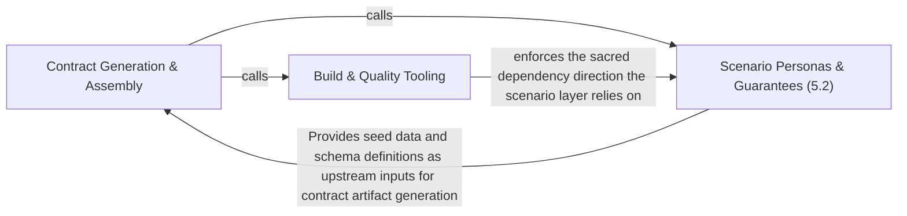

---
tags:
  - 2brain
  - 2brain/arch
  - project/boilerplate-node-backend
type: architecture
component: Scenario_Personas_Guarantees
---

## Details

The declarative layer that defines who the demo accounts are (the 13 personas in shared/scenarios/personas.yaml, parsed by personasSchema), what the catalogue looks like (the combinatorial products-filler grid), and what the scenario must guarantee (check.ts's findUnmetGuarantees / assertScenarioGuarantees cross-checking module-declared guarantees against the subjects buildScenario returns), plus the per-module CollectionValues that feed the generated API client's example values.

### Contract Generation & Assembly [[Expand]](./Contract_Generation_Assembly.md)
The contract-first generation layer that turns shared rule fragments and module declarations into the OpenAPI/AsyncAPI bundles the API and event contracts are built from. It owns the fragment model (AuthorizationFragment, DeclaredSection), the browser-event and webhook-event fragment emitters, the shared-rule JSON-Schema export, and the root assembly that stitches per-module fragments into a single document. This is the upstream of implementation: the contracts it emits are the source of truth that the scenario layer (Group 2) and the generated client both consume.

**Related Classes/Methods**:

- `scripts.contracts.analytics-browser-events.withBrowserEvents`:96-139
- `scripts.contracts.asyncapi-webhook-events.webhookEventFragments`

**Source Files:**

- `scenarios/personas-schema.ts`
  - `scenarios.personas-schema.personasSchema.accounts.PERSONA_NAMES.map() callback` (L63-L63) - Function
- `scripts/contracts/analytics-browser-events.ts`
  - `scripts.contracts.analytics-browser-events.browserEventFragments` (L44-L49) - Class
  - `scripts.contracts.analytics-browser-events.browserEventFragments.map() callback` (L46-L47) - Function
  - `scripts.contracts.analytics-browser-events.localiseReferences` (L57-L68) - Class
  - `scripts.contracts.analytics-browser-events.localiseReferences.node.map() callback` (L58-L58) - Function
  - `scripts.contracts.analytics-browser-events.localiseReferences.map() callback` (L61-L66) - Function
  - `scripts.contracts.analytics-browser-events.withBrowserEvents` (L96-L139) - Class
  - `scripts.contracts.analytics-browser-events.withBrowserEvents.flatMap() callback` (L124-L136) - Function
  - `scripts.contracts.analytics-browser-events.withBrowserEvents.flatMap() callback.oneOf.map() callback` (L130-L130) - Function
- `scripts/contracts/asyncapi-bundles.ts`
  - `scripts.contracts.asyncapi-bundles.internalSections` (L65-L68) - Class
  - `scripts.contracts.asyncapi-bundles.internalSections.map() callback` (L67-L67) - Function
- `scripts/contracts/asyncapi-webhook-events.ts`
  - `scripts.contracts.asyncapi-webhook-events.webhookEventFragments` (L26-L26) - Class
- `scripts/contracts/fragments.ts`
  - `scripts.contracts.fragments.DeclaredTag` (L16-L21) - Interface
  - `scripts.contracts.fragments.DeclaredSection` (L34-L37) - Interface
  - `scripts.contracts.fragments.OpenApiFragment` (L43-L49) - Interface
  - `scripts.contracts.fragments.AuthorizationRule` (L71-L75) - Interface
  - `scripts.contracts.fragments.AuthorizationSet` (L78-L82) - Interface
  - `scripts.contracts.fragments.AuthorizationFragment` (L85-L88) - Interface
- `scripts/contracts/generate-shared-rule-schemas.ts`
  - `scripts.contracts.generate-shared-rule-schemas.loadModuleSource` (L77-L84) - Class
  - `scripts.contracts.generate-shared-rule-schemas.loadModuleSource.then() callback` (L79-L83) - Function
  - `scripts.contracts.generate-shared-rule-schemas.camelCaseOf` (L87-L88) - Class
  - `scripts.contracts.generate-shared-rule-schemas.camelCaseOf.name.replaceAll() callback` (L88-L88) - Function
  - `scripts.contracts.generate-shared-rule-schemas.ModuleBlock` (L91-L102) - Interface
  - `scripts.contracts.generate-shared-rule-schemas.MODULE_BLOCKS` (L108-L125) - Class
  - `scripts.contracts.generate-shared-rule-schemas.MODULE_BLOCKS.exportName` (L121-L121) - Method
  - `scripts.contracts.generate-shared-rule-schemas.MODULE_BLOCKS.description` (L122-L123) - Method
  - `scripts.contracts.generate-shared-rule-schemas.collectBlockSources` (L133-L158) - Class
  - `scripts.contracts.generate-shared-rule-schemas.collectBlockSources.flatMap() callback` (L134-L158) - Function
  - `scripts.contracts.generate-shared-rule-schemas.collectSources` (L182-L200) - Class
  - `scripts.contracts.generate-shared-rule-schemas.collectSources.map() callback` (L184-L184) - Function
  - `scripts.contracts.generate-shared-rule-schemas.collectSources.then() callback` (L185-L200) - Function
  - `scripts.contracts.generate-shared-rule-schemas.collectSources.then() callback.flatMap() callback` (L186-L195) - Function
  - `scripts.contracts.generate-shared-rule-schemas.collectSources.then() callback.MODULE_BLOCKS.flatMap() callback` (L199-L199) - Function
- `scripts/contracts/root-assembly.ts`
  - `scripts.contracts.root-assembly.readModuleFragments` (L237-L255) - Class
  - `scripts.contracts.root-assembly.readModuleFragments.map() callback` (L243-L254) - Function
  - `scripts.contracts.root-assembly.readModuleFragments.map() callback.tags.operations.flatMap() callback` (L250-L250) - Function
- `scripts/docs/check-references.ts`
  - `scripts.docs.check-references.Finding` (L46-L49) - Interface
  - `scripts.docs.check-references.Scan` (L78-L81) - Interface
  - `scripts.docs.check-references.Claim` (L115-L118) - Interface
  - `scripts.docs.check-references.run.roots` (L244-L244) - Class
  - `scripts.docs.check-references.run.roots.ALLOWED.map() callback` (L244-L244) - Function
  - `scripts.docs.check-references.run.pages` (L251-L257) - Class
  - `scripts.docs.check-references.run.pages.filter() callback` (L257-L257) - Function
- `scripts/docs/dependency-groups.ts`
  - `scripts.docs.dependency-groups.DependencyGroup` (L18-L23) - Interface
  - `scripts.docs.dependency-groups.matchesGroup` (L225-L230) - Class
  - `scripts.docs.dependency-groups.matchesGroup.patterns.some() callback` (L226-L229) - Function
- `scripts/docs/generate-audit-actions.ts`
  - `scripts.docs.generate-audit-actions.DeclaredAction` (L45-L54) - Interface
  - `scripts.docs.generate-audit-actions.AuditActionRow` (L57-L59) - Interface
  - `scripts.docs.generate-audit-actions.walk` (L62-L67) - Class
  - `scripts.docs.generate-audit-actions.walk.flatMap() callback` (L63-L67) - Function
  - `scripts.docs.generate-audit-actions.readModuleActions.entry` (L80-L85) - Class
  - `scripts.docs.generate-audit-actions.readModuleActions.entry.find() callback` (L81-L84) - Function
  - `scripts.docs.generate-audit-actions.readModuleActions.entry.find() callback.every() callback` (L84-L84) - Function
  - `scripts.docs.generate-audit-actions.collectDeclaredActions.infrastructureActions` (L93-L98) - Class
  - `scripts.docs.generate-audit-actions.collectDeclaredActions.infrastructureActions.map() callback` (L93-L98) - Function
  - `scripts.docs.generate-audit-actions.collectDeclaredActions.moduleActions` (L100-L111) - Class
  - `scripts.docs.generate-audit-actions.collectDeclaredActions.moduleActions.map() callback` (L101-L110) - Function
  - `scripts.docs.generate-audit-actions.collectDeclaredActions.moduleActions.map() callback.map() callback` (L104-L109) - Function
  - `scripts.docs.generate-audit-actions.targetTypeCell` (L154-L161) - Class
  - `scripts.docs.generate-audit-actions.targetTypeCell.map() callback` (L159-L159) - Function
  - `scripts.docs.generate-audit-actions.actionTable` (L164-L174) - Class
  - `scripts.docs.generate-audit-actions.actionTable.rows.toSorted() callback` (L169-L169) - Function
  - `scripts.docs.generate-audit-actions.actionTable.map() callback` (L171-L172) - Function
  - `scripts.docs.generate-audit-actions.main.sources` (L179-L179) - Class
  - `scripts.docs.generate-audit-actions.main.sources.map() callback` (L179-L179) - Function
  - `scripts.docs.generate-audit-actions.main.rows` (L180-L183) - Class
  - `scripts.docs.generate-audit-actions.main.rows.declared.map() callback` (L180-L183) - Function
- `scripts/docs/generate-dependency-map.ts`
  - `scripts.docs.generate-dependency-map.PackageManifest` (L72-L75) - Interface
  - `scripts.docs.generate-dependency-map.walk` (L82-L89) - Class
  - `scripts.docs.generate-dependency-map.walk.flatMap() callback` (L83-L89) - Function
  - `scripts.docs.generate-dependency-map.importSpecifiers` (L111-L120) - Class
  - `scripts.docs.generate-dependency-map.importSpecifiers.map() callback` (L113-L113) - Function
  - `scripts.docs.generate-dependency-map.importSpecifiers.filter() callback` (L115-L119) - Function
  - `scripts.docs.generate-dependency-map.importSpecifiers.filter() callback.ALIAS_PREFIXES.every() callback` (L118-L118) - Function
  - `scripts.docs.generate-dependency-map.packageFor` (L123-L124) - Class
  - `scripts.docs.generate-dependency-map.packageFor.packages.find() callback` (L124-L124) - Function
  - `scripts.docs.generate-dependency-map.readOwnership.files` (L152-L155) - Class
  - `scripts.docs.generate-dependency-map.readOwnership.files.SCAN_DIRECTORIES.flatMap() callback` (L153-L153) - Function
  - `scripts.docs.generate-dependency-map.readOwnership.files.SCAN_FILES.map() callback` (L154-L154) - Function
  - `scripts.docs.generate-dependency-map.Row` (L187-L192) - Interface
  - `scripts.docs.generate-dependency-map.groupRows` (L195-L206) - Class
  - `scripts.docs.generate-dependency-map.groupRows.groups.map() callback` (L197-L205) - Function
  - `scripts.docs.generate-dependency-map.groupRows.groups.map() callback.packages.packages.filter() callback` (L200-L200) - Function
  - `scripts.docs.generate-dependency-map.groupRows.groups.map() callback.packages.map() callback` (L201-L201) - Function
  - `scripts.docs.generate-dependency-map.groupRows.filter() callback` (L206-L206) - Function
  - `scripts.docs.generate-dependency-map.moduleOwnedRow.owned` (L214-L225) - Class
  - `scripts.docs.generate-dependency-map.moduleOwnedRow.owned.packages.filter() callback` (L215-L215) - Function
  - `scripts.docs.generate-dependency-map.moduleOwnedRow.owned.packages.filter() callback.groups.every() callback` (L215-L215) - Function
  - `scripts.docs.generate-dependency-map.moduleOwnedRow.owned.map() callback` (L216-L219) - Function
  - `scripts.docs.generate-dependency-map.moduleOwnedRow.owned.filter() callback` (L221-L221) - Function
  - `scripts.docs.generate-dependency-map.moduleOwnedRow.owned.toSorted() callback` (L224-L224) - Function
  - `scripts.docs.generate-dependency-map.moduleOwnedRow.packages.owned.map() callback` (L232-L232) - Function
  - `scripts.docs.generate-dependency-map.moduleOwnedRow.readMore.owned.map() callback` (L236-L236) - Function
  - `scripts.docs.generate-dependency-map.moduleOwnedRow.readMore.map() callback` (L237-L237) - Function
  - `scripts.docs.generate-dependency-map.ungroupedTable` (L243-L271) - Class
  - `scripts.docs.generate-dependency-map.ungroupedTable.leftover` (L248-L252) - Class
  - `scripts.docs.generate-dependency-map.ungroupedTable.leftover.packages.filter() callback` (L249-L251) - Function
  - `scripts.docs.generate-dependency-map.ungroupedTable.leftover.packages.filter() callback.groups.every() callback` (L250-L250) - Function
  - `scripts.docs.generate-dependency-map.ungroupedTable.map() callback` (L267-L268) - Function
  - `scripts.docs.generate-dependency-map.renderTable` (L274-L292) - Class
  - `scripts.docs.generate-dependency-map.renderTable.map() callback` (L286-L286) - Function
  - `scripts.docs.generate-dependency-map.renderTable.filter() callback` (L290-L290) - Function
  - `scripts.docs.generate-dependency-map.then() callback` (L323-L325) - Function
- `scripts/docs/generate-jobs.ts`
  - `scripts.docs.generate-jobs.then() callback` (L74-L76) - Function
- `scripts/docs/generate-module-graph.ts`
  - `scripts.docs.generate-module-graph.EventEdge` (L56-L60) - Interface
  - `scripts.docs.generate-module-graph.Target` (L63-L68) - Interface
  - `scripts.docs.generate-module-graph.SUBDOMAIN` (L78-L80) - Class
  - `scripts.docs.generate-module-graph.SUBDOMAIN.map() callback` (L79-L79) - Function
  - `scripts.docs.generate-module-graph.readEdges` (L83-L116) - Class
  - `scripts.docs.generate-module-graph.readEdges.labels` (L103-L105) - Class
  - `scripts.docs.generate-module-graph.readEdges.labels.map() callback` (L104-L104) - Function
  - `scripts.docs.generate-module-graph.readEdges.edges.toSorted() callback` (L115-L115) - Function
  - `scripts.docs.generate-module-graph.moduleSourceFiles.rest` (L139-L146) - Class
  - `scripts.docs.generate-module-graph.rest.filter() callback` (L144-L144) - Function
  - `scripts.docs.generate-module-graph.moduleSourceFiles.rest.map() callback` (L145-L145) - Function
  - `scripts.docs.generate-module-graph.moduleSourceFiles.rest.filter() callback` (L146-L146) - Function
  - `scripts.docs.generate-module-graph.readEventEdges` (L181-L194) - Class
  - `scripts.docs.generate-module-graph.readEventEdges.edges.toSorted() callback` (L189-L192) - Function
  - `scripts.docs.generate-module-graph.renderNeighbourhood` (L197-L250) - Class
  - `scripts.docs.generate-module-graph.renderNeighbourhood.reaches` (L202-L202) - Class
  - `scripts.docs.generate-module-graph.renderNeighbourhood.reaches.edges.filter() callback` (L202-L202) - Function
  - `scripts.docs.generate-module-graph.renderNeighbourhood.reached` (L203-L203) - Class
  - `scripts.docs.generate-module-graph.renderNeighbourhood.reached.edges.filter() callback` (L203-L203) - Function
  - `scripts.docs.generate-module-graph.renderNeighbourhood.announces` (L204-L204) - Class
  - `scripts.docs.generate-module-graph.renderNeighbourhood.announces.events.filter() callback` (L204-L204) - Function
  - `scripts.docs.generate-module-graph.renderNeighbourhood.listens` (L205-L205) - Class
  - `scripts.docs.generate-module-graph.renderNeighbourhood.listens.events.filter() callback` (L205-L205) - Function
  - `scripts.docs.generate-module-graph.renderNeighbourhood.neighbours` (L207-L214) - Class
  - `scripts.docs.generate-module-graph.renderNeighbourhood.neighbours.announces.map() callback` (L211-L211) - Function
  - `scripts.docs.generate-module-graph.renderNeighbourhood.neighbours.listens.map() callback` (L212-L212) - Function
  - `scripts.docs.generate-module-graph.renderNeighbourhood.byKind` (L220-L221) - Class
  - `scripts.docs.generate-module-graph.renderNeighbourhood.byKind.map() callback` (L221-L221) - Function
  - `scripts.docs.generate-module-graph.renderNeighbourhood.byKind.neighbours.filter() callback` (L221-L221) - Function
  - `scripts.docs.generate-module-graph.renderNeighbourhood.neighbours.map() callback` (L233-L233) - Function
  - `scripts.docs.generate-module-graph.renderNeighbourhood.reached.map() callback` (L235-L235) - Function
  - `scripts.docs.generate-module-graph.renderNeighbourhood.reaches.map() callback` (L236-L236) - Function
  - `scripts.docs.generate-module-graph.renderNeighbourhood.listens.map() callback` (L237-L237) - Function
  - `scripts.docs.generate-module-graph.renderNeighbourhood.announces.map() callback` (L238-L238) - Function
  - `scripts.docs.generate-module-graph.render` (L252-L296) - Class
  - `scripts.docs.generate-module-graph.render.declare` (L255-L255) - Class
  - `scripts.docs.generate-module-graph.render.declare.names.map() callback` (L255-L255) - Function
  - `scripts.docs.generate-module-graph.render.byKind` (L256-L257) - Class
  - `scripts.docs.generate-module-graph.render.byKind.map() callback` (L257-L257) - Function
  - `scripts.docs.generate-module-graph.render.byKind.names.filter() callback` (L257-L257) - Function
  - `scripts.docs.generate-module-graph.render.isolated` (L258-L258) - Class
  - `scripts.docs.generate-module-graph.render.isolated.map() callback` (L258-L258) - Function
  - `scripts.docs.generate-module-graph.render.isolated.names.filter() callback` (L258-L258) - Function
  - `scripts.docs.generate-module-graph.render.edges.map() callback` (L266-L266) - Function
  - `scripts.docs.generate-module-graph.render.names.map() callback` (L285-L289) - Function
  - `scripts.docs.generate-module-graph.names.map() callback.reaches` (L286-L286) - Class
  - `scripts.docs.generate-module-graph.render.names.map() callback.reaches.edges.filter() callback` (L286-L286) - Function
  - `scripts.docs.generate-module-graph.render.names.map() callback.reaches.map() callback` (L286-L286) - Function
  - `scripts.docs.generate-module-graph.names.map() callback.reached` (L287-L287) - Class
  - `scripts.docs.generate-module-graph.render.names.map() callback.reached.edges.filter() callback` (L287-L287) - Function
  - `scripts.docs.generate-module-graph.render.names.map() callback.reached.map() callback` (L287-L287) - Function
  - `scripts.docs.generate-module-graph.render.toSorted() callback` (L290-L290) - Function
  - `scripts.docs.generate-module-graph.render.map() callback` (L292-L293) - Function
  - `scripts.docs.generate-module-graph.targets` (L317-L339) - Class
  - `scripts.docs.generate-module-graph.targets.filter() callback` (L331-L331) - Function
  - `scripts.docs.generate-module-graph.targets.map() callback` (L332-L337) - Function
  - `scripts.docs.generate-module-graph.then() callback` (L351-L353) - Function
- `scripts/docs/generate-rate-limit-budgets.ts`
  - `scripts.docs.generate-rate-limit-budgets.budgetTable` (L47-L57) - Class
  - `scripts.docs.generate-rate-limit-budgets.budgetTable.rows.map() callback` (L52-L55) - Function
- `scripts/docs/generate-role-matrix.ts`
  - `scripts.docs.generate-role-matrix.Persona` (L49-L54) - Interface
  - `scripts.docs.generate-role-matrix.personas` (L66-L78) - Class
  - `scripts.docs.generate-role-matrix.personas.AUDIENCE_NAMES.map() callback` (L68-L68) - Function
  - `scripts.docs.generate-role-matrix.personas.PRESET_ROLES.filter() callback` (L70-L70) - Function
  - `scripts.docs.generate-role-matrix.personas.map() callback` (L71-L76) - Function
  - `scripts.docs.generate-role-matrix.modules` (L81-L81) - Class
  - `scripts.docs.generate-role-matrix.modules.PERMISSION_RULES.map() callback` (L81-L81) - Function
  - `scripts.docs.generate-role-matrix.cell.held` (L124-L126) - Class
  - `scripts.docs.generate-role-matrix.cell.held.PERMISSION_RULES.filter() callback` (L125-L125) - Function
  - `scripts.docs.generate-role-matrix.cell.wide` (L134-L136) - Class
  - `scripts.docs.generate-role-matrix.cell.wide.flatMap() callback` (L135-L135) - Function
  - `scripts.docs.generate-role-matrix.cell.wide.held.filter() callback` (L135-L135) - Function
  - `scripts.docs.generate-role-matrix.cell.held.flatMap() callback` (L138-L138) - Function
  - `scripts.docs.generate-role-matrix.moduleBody.rows.map() callback.sets.PERMISSION_SETS.filter() callback` (L237-L237) - Function
  - `scripts.docs.generate-role-matrix.moduleBody.rows.map() callback.sets` (L237-L239) - Class
  - `scripts.docs.generate-role-matrix.moduleBody.rows.map() callback.sets.map() callback` (L238-L238) - Function
  - `scripts.docs.generate-role-matrix.then() callback` (L295-L297) - Function
- `scripts/docs/generate-scenario-registries.ts`
  - `scripts.docs.generate-scenario-registries.then() callback` (L29-L31) - Function
  - `scripts.docs.generate-scenario-registries.catch() callback` (L32-L35) - Function
- `scripts/docs/jobs-render.ts`
  - `scripts.docs.jobs-render.describeSchedule` (L38-L46) - Class
  - `scripts.docs.jobs-render.rest.every() callback` (L42-L42) - Function
  - `scripts.docs.jobs-render.describeSchedule.rest.every() callback` (L43-L43) - Function
  - `scripts.docs.jobs-render.renderCrontab` (L71-L74) - Class
  - `scripts.docs.jobs-render.renderCrontab.jobs.map() callback` (L73-L73) - Function
  - `scripts.docs.jobs-render.renderJobsTable` (L81-L89) - Class
  - `scripts.docs.jobs-render.renderJobsTable.jobs.map() callback` (L86-L87) - Function
- `scripts/docs/marker-block.ts`
  - `scripts.docs.marker-block.MarkerBlock` (L19-L23) - Interface
  - `scripts.docs.marker-block.MarkerPageOptions` (L26-L39) - Interface
- `scripts/docs/module-catalog.ts`
  - `scripts.docs.module-catalog.CatalogPage` (L21-L26) - Interface
  - `scripts.docs.module-catalog.CatalogEntry` (L29-L36) - Interface
  - `scripts.docs.module-catalog.readCatalog` (L89-L108) - Class
  - `scripts.docs.module-catalog.readCatalog.stems` (L92-L97) - Class
  - `scripts.docs.module-catalog.readCatalog.stems.filter() callback` (L94-L94) - Function
  - `scripts.docs.module-catalog.readCatalog.stems.map() callback` (L95-L95) - Function
  - `scripts.docs.module-catalog.readCatalog.map() callback` (L99-L107) - Function
  - `scripts.docs.module-catalog.readCatalog.map() callback.pages.stems.filter() callback` (L105-L105) - Function
  - `scripts.docs.module-catalog.readCatalog.map() callback.pages.map() callback` (L106-L106) - Function
  - `scripts.docs.module-catalog.inGroup` (L111-L117) - Class
  - `scripts.docs.module-catalog.inGroup.entries.filter() callback` (L116-L116) - Function
  - `scripts.docs.module-catalog.inGroup.toSorted() callback` (L117-L117) - Function
  - `scripts.docs.module-catalog.bullet.deeper` (L121-L124) - Class
  - `scripts.docs.module-catalog.bullet.deeper.entry.pages.map() callback` (L123-L123) - Function
  - `scripts.docs.module-catalog.renderModuleList` (L134-L141) - Class
  - `scripts.docs.module-catalog.renderModuleList.GROUPS.flatMap() callback` (L135-L139) - Function
  - `scripts.docs.module-catalog.renderModuleList.GROUPS.flatMap() callback.members.map() callback` (L138-L138) - Function
  - `scripts.docs.module-catalog.SidebarItem` (L144-L148) - Interface
  - `scripts.docs.module-catalog.SidebarSection` (L151-L155) - Interface
  - `scripts.docs.module-catalog.moduleSidebar` (L162-L189) - Class
  - `scripts.docs.module-catalog.moduleSidebar.GROUPS.flatMap() callback` (L164-L188) - Function
  - `scripts.docs.module-catalog.moduleSidebar.GROUPS.flatMap() callback.items.members.map() callback` (L171-L185) - Function
- `scripts/docs/module-descriptor.ts`
  - `scripts.docs.module-descriptor.readAllModuleDescriptors` (L64-L70) - Class
  - `scripts.docs.module-descriptor.readAllModuleDescriptors.map() callback` (L66-L69) - Function
- `scripts/docs/repo-references.ts`
  - `scripts.docs.repo-references.allowed` (L78-L85) - Class
  - `scripts.docs.repo-references.allowed.GENERATED_SUFFIXES.some() callback` (L79-L79) - Function
  - `scripts.docs.repo-references.allowed.ALLOWED.some() callback` (L81-L84) - Function
  - `scripts.docs.repo-references.trackedTargets.files` (L109-L117) - Class
  - `scripts.docs.repo-references.trackedTargets.files.filter() callback` (L117-L117) - Function
  - `scripts.docs.repo-references.trackedTargets.roots.files.map() callback` (L121-L121) - Function
  - `scripts.docs.repo-references.resolves` (L161-L162) - Class
  - `scripts.docs.repo-references.resolves.SPELLINGS.some() callback` (L162-L162) - Function
  - `scripts.docs.repo-references.readAliases` (L185-L199) - Class
  - `scripts.docs.repo-references.readAliases.map() callback` (L195-L198) - Function
  - `scripts.docs.repo-references.throughAliases.alias.aliases.find() callback` (L213-L214) - Function
  - `scripts.docs.repo-references.throughAliases.alias` (L213-L215) - Class
- `scripts/modules-on-disk.ts`
  - `scripts.modules-on-disk.modulesWith` (L26-L31) - Class
  - `scripts.modules-on-disk.filter() callback` (L28-L28) - Function
  - `scripts.modules-on-disk.modulesWith.map() callback` (L29-L29) - Function
  - `scripts.modules-on-disk.modulesWith.filter() callback` (L30-L30) - Function
- `scripts/mutation/ci/slice-ignorer.ts`
  - `scripts.mutation.ci.slice-ignorer.LineSlice` (L17-L20) - Interface
  - `scripts.mutation.ci.slice-ignorer.NodeLocation` (L23-L26) - Interface
  - `scripts.mutation.ci.slice-ignorer.IgnorerPath` (L29-L31) - Interface
  - `scripts.mutation.ci.slice-ignorer.strykerPlugins.value.shouldIgnore` (L84-L87) - Method
- `scripts/scaffold/apply.ts`
  - `scripts.scaffold.apply.takenSchemaNames.names.flatMap() callback` (L29-L30) - Function
  - `scripts.scaffold.apply.takenSchemaNames.names` (L29-L31) - Class
  - `scripts.scaffold.apply.applyScaffold.edits` (L99-L107) - Class
  - `scripts.scaffold.apply.applyScaffold.edits.map() callback` (L100-L106) - Function
- `scripts/scaffold/central-edits.ts`
  - `scripts.scaffold.central-edits.CentralEdit` (L21-L26) - Interface
  - `scripts.scaffold.central-edits.appendToList` (L36-L51) - Class
  - `scripts.scaffold.central-edits.appendToList.opens` (L38-L38) - Class
  - `scripts.scaffold.central-edits.appendToList.opens.lines.findIndex() callback` (L38-L38) - Function
  - `scripts.scaffold.central-edits.appendToList.blank` (L41-L41) - Class
  - `scripts.scaffold.central-edits.appendToList.blank.lines.findIndex() callback` (L41-L41) - Function
  - `scripts.scaffold.central-edits.appendToList.items.map() callback` (L48-L48) - Function
  - `scripts.scaffold.central-edits.addParityEntry` (L67-L85) - Class
  - `scripts.scaffold.central-edits.addParityEntry.opens.lines.findIndex() callback` (L69-L70) - Function
  - `scripts.scaffold.central-edits.addParityEntry.opens` (L69-L71) - Class
  - `scripts.scaffold.central-edits.addParityEntry.closes` (L74-L74) - Class
  - `scripts.scaffold.central-edits.addParityEntry.closes.lines.findIndex() callback` (L74-L74) - Function
  - `scripts.scaffold.central-edits.addParityEntry.rows` (L75-L75) - Class
  - `scripts.scaffold.central-edits.addParityEntry.rows.map() callback` (L75-L75) - Function
  - `scripts.scaffold.central-edits.addParityEntry.at` (L77-L77) - Class
  - `scripts.scaffold.central-edits.addParityEntry.at.rows.findIndex() callback` (L77-L77) - Function
  - `scripts.scaffold.central-edits.addParityEntry.sorted.map() callback` (L82-L82) - Function
  - `scripts.scaffold.central-edits.centralEdits` (L92-L102) - Class
  - `scripts.scaffold.central-edits.centralEdits.apply` (L100-L100) - Method
- `scripts/scaffold/demo-remove-alert-rules.ts`
  - `scripts.scaffold.demo-remove-alert-rules.sourceFiles` (L34-L39) - Class
  - `scripts.scaffold.demo-remove-alert-rules.sourceFiles.flatMap() callback` (L35-L39) - Function
  - `scripts.scaffold.demo-remove-alert-rules.metricsIn` (L45-L50) - Class
  - `scripts.scaffold.demo-remove-alert-rules.metricsIn.files.flatMap() callback` (L47-L48) - Function
  - `scripts.scaffold.demo-remove-alert-rules.metricsIn.files.flatMap() callback.map() callback` (L48-L48) - Function
  - `scripts.scaffold.demo-remove-alert-rules.readRemovedMetrics` (L57-L72) - Class
  - `scripts.scaffold.demo-remove-alert-rules.readRemovedMetrics.removedRoots` (L61-L61) - Class
  - `scripts.scaffold.demo-remove-alert-rules.readRemovedMetrics.removedRoots.names.map() callback` (L61-L61) - Function
  - `scripts.scaffold.demo-remove-alert-rules.readRemovedMetrics.isRemoved` (L62-L63) - Class
  - `scripts.scaffold.demo-remove-alert-rules.readRemovedMetrics.isRemoved.removedRoots.some() callback` (L63-L63) - Function
  - `scripts.scaffold.demo-remove-alert-rules.readRemovedMetrics.surviving` (L66-L66) - Class
  - `scripts.scaffold.demo-remove-alert-rules.readRemovedMetrics.surviving.files.filter() callback` (L66-L66) - Function
  - `scripts.scaffold.demo-remove-alert-rules.readRemovedMetrics.files.filter() callback` (L68-L68) - Function
  - `scripts.scaffold.demo-remove-alert-rules.readRemovedMetrics.filter() callback` (L69-L69) - Function
  - `scripts.scaffold.demo-remove-alert-rules.stripRules` (L100-L115) - Class
  - `scripts.scaffold.demo-remove-alert-rules.stripRules.reads` (L102-L103) - Class
  - `scripts.scaffold.demo-remove-alert-rules.stripRules.reads.some() callback` (L103-L103) - Function
  - `scripts.scaffold.demo-remove-alert-rules.stripRules.dropped` (L106-L106) - Class
  - `scripts.scaffold.demo-remove-alert-rules.stripRules.dropped.chunks.filter() callback` (L106-L106) - Function
  - `scripts.scaffold.demo-remove-alert-rules.stripRules.kept` (L107-L107) - Class
  - `scripts.scaffold.demo-remove-alert-rules.stripRules.kept.chunks.filter() callback` (L107-L107) - Function
  - `scripts.scaffold.demo-remove-alert-rules.stripRules.nonEmpty` (L109-L111) - Class
  - `scripts.scaffold.demo-remove-alert-rules.stripRules.nonEmpty.kept.filter() callback` (L110-L110) - Function
  - `scripts.scaffold.demo-remove-alert-rules.stripRules.dropped.map() callback` (L114-L114) - Function
  - `scripts.scaffold.demo-remove-alert-rules.stripRuleTests` (L122-L133) - Class
  - `scripts.scaffold.demo-remove-alert-rules.stripRuleTests.asksAboutDropped` (L124-L125) - Class
  - `scripts.scaffold.demo-remove-alert-rules.stripRuleTests.asksAboutDropped.some() callback` (L125-L125) - Function
  - `scripts.scaffold.demo-remove-alert-rules.stripRuleTests.filter() callback` (L130-L130) - Function
- `scripts/scaffold/demo-remove-authorization.ts`
  - `scripts.scaffold.demo-remove-authorization.RemovedAuthorization` (L22-L29) - Interface
  - `scripts.scaffold.demo-remove-authorization.readRemovedAuthorization.survivors` (L42-L44) - Class
  - `scripts.scaffold.demo-remove-authorization.readRemovedAuthorization.survivors.filter() callback` (L43-L43) - Function
  - `scripts.scaffold.demo-remove-authorization.readRemovedAuthorization.survivors.flatMap() callback` (L44-L44) - Function
  - `scripts.scaffold.demo-remove-authorization.readRemovedAuthorization.removedFragments` (L48-L48) - Class
  - `scripts.scaffold.demo-remove-authorization.readRemovedAuthorization.removedFragments.names.map() callback` (L48-L48) - Function
  - `scripts.scaffold.demo-remove-authorization.readRemovedAuthorization.removed` (L49-L49) - Class
  - `scripts.scaffold.demo-remove-authorization.readRemovedAuthorization.removed.removedFragments.flatMap() callback` (L49-L49) - Function
  - `scripts.scaffold.demo-remove-authorization.readRemovedAuthorization.stillUsed` (L51-L51) - Class
  - `scripts.scaffold.demo-remove-authorization.readRemovedAuthorization.stillUsed.map() callback` (L51-L51) - Function
  - `scripts.scaffold.demo-remove-authorization.readRemovedAuthorization.rules.removed.map() callback` (L53-L53) - Function
  - `scripts.scaffold.demo-remove-authorization.readRemovedAuthorization.sets.removedFragments.flatMap() callback` (L54-L54) - Function
  - `scripts.scaffold.demo-remove-authorization.readRemovedAuthorization.sets.removedFragments.flatMap() callback.fragment.sets.map() callback` (L54-L54) - Function
  - `scripts.scaffold.demo-remove-authorization.readRemovedAuthorization.subjects.filter() callback` (L56-L56) - Function
  - `scripts.scaffold.demo-remove-authorization.readRemovedAuthorization.subjects.removed.map() callback` (L56-L56) - Function
  - `scripts.scaffold.demo-remove-authorization.stripRoleGrants.lines` (L70-L72) - Class
  - `scripts.scaffold.demo-remove-authorization.stripRoleGrants.lines.filter() callback` (L72-L72) - Function
  - `scripts.scaffold.demo-remove-authorization.stripRoleGrants.out` (L74-L79) - Class
  - `scripts.scaffold.demo-remove-authorization.stripRoleGrants.out.lines.map() callback` (L74-L79) - Function
  - `scripts.scaffold.demo-remove-authorization.stripRoleGrants.out.lines.map() callback.next` (L77-L77) - Class
  - `scripts.scaffold.demo-remove-authorization.stripRoleGrants.out.lines.map() callback.next.find() callback` (L77-L77) - Function
  - `scripts.scaffold.demo-remove-authorization.pruneCase` (L98-L120) - Class
  - `scripts.scaffold.demo-remove-authorization.pruneCase.lists.map() callback` (L102-L106) - Function
  - `scripts.scaffold.demo-remove-authorization.pruneCase.lists` (L102-L107) - Class
  - `scripts.scaffold.demo-remove-authorization.pruneCase.lists.map() callback.map() callback` (L105-L105) - Function
  - `scripts.scaffold.demo-remove-authorization.pruneCase.emptied` (L108-L110) - Class
  - `scripts.scaffold.demo-remove-authorization.pruneCase.emptied.lists.some() callback` (L109-L109) - Function
  - `scripts.scaffold.demo-remove-authorization.pruneCase.emptied.lists.some() callback.all.every() callback` (L109-L109) - Function
  - `scripts.scaffold.demo-remove-authorization.pruneCase.chunk.replaceAll() callback` (L113-L119) - Function
  - `scripts.scaffold.demo-remove-authorization.pruneCase.chunk.replaceAll() callback.kept` (L114-L117) - Class
  - `scripts.scaffold.demo-remove-authorization.pruneCase.chunk.replaceAll() callback.kept.map() callback` (L116-L116) - Function
  - `scripts.scaffold.demo-remove-authorization.pruneCase.chunk.replaceAll() callback.kept.filter() callback` (L117-L117) - Function
  - `scripts.scaffold.demo-remove-authorization.stripConformanceCases.casesKept` (L133-L136) - Class
  - `scripts.scaffold.demo-remove-authorization.stripConformanceCases.casesKept.map() callback` (L134-L134) - Function
  - `scripts.scaffold.demo-remove-authorization.stripConformanceCases.casesKept.filter() callback` (L135-L135) - Function
- `scripts/scaffold/demo-remove-registry.ts`
  - `scripts.scaffold.demo-remove-registry.RemovalNote` (L19-L22) - Interface
  - `scripts.scaffold.demo-remove-registry.removeModuleFolders` (L25-L29) - Class
  - `scripts.scaffold.demo-remove-registry.removeModuleFolders.names.map() callback` (L26-L29) - Function
  - `scripts.scaffold.demo-remove-registry.stripModuleLines` (L44-L60) - Class
  - `scripts.scaffold.demo-remove-registry.stripModuleLines.identifiers` (L46-L50) - Class
  - `scripts.scaffold.demo-remove-registry.stripModuleLines.identifiers.lines.filter() callback` (L48-L48) - Function
  - `scripts.scaffold.demo-remove-registry.stripModuleLines.identifiers.map() callback` (L49-L49) - Function
  - `scripts.scaffold.demo-remove-registry.stripModuleLines.lines.filter() callback` (L53-L57) - Function
- `scripts/scaffold/demo-remove-scenarios.ts`
  - `scripts.scaffold.demo-remove-scenarios.removeShopOnlyScenarioFiles` (L41-L45) - Class
  - `scripts.scaffold.demo-remove-scenarios.removeShopOnlyScenarioFiles.SHOP_ONLY_FILES.map() callback` (L42-L45) - Function
  - `scripts.scaffold.demo-remove-scenarios.removeScenarioModuleFiles` (L112-L125) - Class
  - `scripts.scaffold.demo-remove-scenarios.removeScenarioModuleFiles.names.flatMap() callback` (L116-L125) - Function
  - `scripts.scaffold.demo-remove-scenarios.removeScenarioModuleFiles.names.flatMap() callback.owned` (L117-L121) - Class
  - `scripts.scaffold.demo-remove-scenarios.removeScenarioModuleFiles.names.flatMap() callback.owned.filter() callback` (L121-L121) - Function
  - `scripts.scaffold.demo-remove-scenarios.removeScenarioModuleFiles.names.flatMap() callback.owned.map() callback` (L124-L124) - Function
- `scripts/scaffold/demo-remove-tests.ts`
  - `scripts.scaffold.demo-remove-tests.testRoots` (L18-L26) - Class
  - `scripts.scaffold.demo-remove-tests.testRoots.moduleTests` (L20-L24) - Class
  - `scripts.scaffold.demo-remove-tests.testRoots.moduleTests.map() callback` (L21-L22) - Function
  - `scripts.scaffold.demo-remove-tests.testRoots.filter() callback` (L25-L25) - Function
  - `scripts.scaffold.demo-remove-tests.walkTypeScript` (L29-L34) - Class
  - `scripts.scaffold.demo-remove-tests.walkTypeScript.flatMap() callback` (L30-L34) - Function
  - `scripts.scaffold.demo-remove-tests.requiredModules` (L59-L62) - Class
  - `scripts.scaffold.demo-remove-tests.requiredModules.flatMap() callback` (L60-L61) - Function
  - `scripts.scaffold.demo-remove-tests.requiredModules.flatMap() callback.map() callback` (L61-L61) - Function
  - `scripts.scaffold.demo-remove-tests.specifiersOf` (L68-L69) - Class
  - `scripts.scaffold.demo-remove-tests.specifiersOf.SPECIFIER_PATTERNS.flatMap() callback` (L69-L69) - Function
  - `scripts.scaffold.demo-remove-tests.specifiersOf.SPECIFIER_PATTERNS.flatMap() callback.map() callback` (L69-L69) - Function
  - `scripts.scaffold.demo-remove-tests.isGone` (L94-L100) - Class
  - `scripts.scaffold.demo-remove-tests.isGone.gone.some() callback` (L96-L99) - Function
  - `scripts.scaffold.demo-remove-tests.removeResidueTests` (L109-L142) - Class
  - `scripts.scaffold.demo-remove-tests.removeResidueTests.files` (L110-L110) - Class
  - `scripts.scaffold.demo-remove-tests.removeResidueTests.files.flatMap() callback` (L110-L110) - Function
  - `scripts.scaffold.demo-remove-tests.removeResidueTests.gone` (L114-L118) - Class
  - `scripts.scaffold.demo-remove-tests.removeResidueTests.gone.names.flatMap() callback` (L114-L118) - Function
  - `scripts.scaffold.demo-remove-tests.removeResidueTests.files.filter() callback` (L123-L123) - Function
  - `scripts.scaffold.demo-remove-tests.removeResidueTests.importsGone` (L125-L128) - Class
  - `scripts.scaffold.demo-remove-tests.removeResidueTests.importsGone.some() callback` (L125-L128) - Function
  - `scripts.scaffold.demo-remove-tests.removeResidueTests.requiresGone` (L129-L129) - Class
  - `scripts.scaffold.demo-remove-tests.removeResidueTests.requiresGone.some() callback` (L129-L129) - Function
  - `scripts.scaffold.demo-remove-tests.removeResidueTests.deleted.map() callback` (L138-L141) - Function
- `scripts/scaffold/demo-remove-validation-labels.ts`
  - `scripts.scaffold.demo-remove-validation-labels.readRemovedFields` (L120-L136) - Class
  - `scripts.scaffold.demo-remove-validation-labels.readRemovedFields.survivors` (L125-L127) - Class
  - `scripts.scaffold.demo-remove-validation-labels.readRemovedFields.survivors.filter() callback` (L126-L126) - Function
  - `scripts.scaffold.demo-remove-validation-labels.readRemovedFields.survivors.map() callback` (L127-L127) - Function
  - `scripts.scaffold.demo-remove-validation-labels.readRemovedFields.filter() callback` (L135-L135) - Function
  - `scripts.scaffold.demo-remove-validation-labels.stripValidationLabels` (L144-L172) - Class
  - `scripts.scaffold.demo-remove-validation-labels.stripValidationLabels.filter() callback` (L151-L151) - Function
  - `scripts.scaffold.demo-remove-validation-labels.stripValidationLabels.flatMap() callback` (L152-L171) - Function
  - `scripts.scaffold.demo-remove-validation-labels.stripValidationLabels.flatMap() callback.dropped` (L160-L160) - Class
  - `scripts.scaffold.demo-remove-validation-labels.stripValidationLabels.flatMap() callback.dropped.filter() callback` (L160-L160) - Function
- `scripts/scaffold/demo-remove.ts`
  - `scripts.scaffold.demo-remove.then() callback` (L52-L66) - Function
  - `scripts.scaffold.demo-remove.then() callback.written.map() callback` (L54-L54) - Function
- `scripts/scaffold/names.ts`
  - `scripts.scaffold.names.ModuleNames` (L8-L31) - Interface
  - `scripts.scaffold.names.pascal` (L58-L62) - Class
  - `scripts.scaffold.names.pascal.map() callback` (L61-L61) - Function
  - `scripts.scaffold.names.snake` (L76-L77) - Class
  - `scripts.scaffold.names.snake.replaceAll() callback` (L77-L77) - Function
- `scripts/scaffold/options.ts`
  - `scripts.scaffold.options.ScaffoldOptions` (L11-L24) - Interface
  - `scripts.scaffold.options.ParseRefusal` (L39-L41) - Interface
  - `scripts.scaffold.options.parseArguments.positional` (L60-L66) - Class
  - `scripts.scaffold.options.parseArguments.positional.argv.filter() callback` (L60-L66) - Function
- `scripts/scaffold/plan.ts`
  - `scripts.scaffold.plan.PlannedFile` (L16-L21) - Interface
  - `scripts.scaffold.plan.ScaffoldPlan` (L24-L29) - Interface
  - `scripts.scaffold.plan.collidingSchemas` (L171-L180) - Class
  - `scripts.scaffold.plan.collidingSchemas.filter() callback` (L180-L180) - Function
- `scripts/scaffold/registry.ts`
  - `scripts.scaffold.registry.insertInRun.first` (L27-L27) - Class
  - `scripts.scaffold.registry.insertInRun.first.lines.findIndex() callback` (L27-L27) - Function
  - `scripts.scaffold.registry.insertInRun.offset` (L33-L33) - Class
  - `scripts.scaffold.registry.insertInRun.offset.findIndex() callback` (L33-L33) - Function
  - `scripts.scaffold.registry.isRegistered` (L54-L55) - Class
  - `scripts.scaffold.registry.isRegistered.some() callback` (L55-L55) - Function
  - `scripts.scaffold.registry.retermRun` (L66-L81) - Class
  - `scripts.scaffold.registry.retermRun.first` (L72-L72) - Class
  - `scripts.scaffold.registry.retermRun.first.lines.findIndex() callback` (L72-L72) - Function
  - `scripts.scaffold.registry.retermRun.lines.map() callback` (L76-L79) - Function
  - `scripts.scaffold.registry.splitAfter.at` (L100-L100) - Class
  - `scripts.scaffold.registry.splitAfter.at.lines.findIndex() callback` (L100-L100) - Function
  - `scripts.scaffold.registry.registerModule.withImport` (L114-L120) - Class
  - `scripts.scaffold.registry.registerModule.withImport.insertInRun() callback` (L116-L116) - Function
- `scripts/scaffold/scaffold-module.ts`
  - `scripts.scaffold.scaffold-module.main.plan` (L37-L42) - Class
  - `scripts.scaffold.scaffold-module.main.plan.catch() callback` (L38-L41) - Function
  - `scripts.scaffold.scaffold-module.then() callback` (L66-L69) - Function
- `scripts/scaffold/scenario-registry.ts`
  - `scripts.scaffold.scenario-registry.GeneratedFile` (L28-L31) - Interface
  - `scripts.scaffold.scenario-registry.foldersDeclaring` (L69-L83) - Class
  - `scripts.scaffold.scenario-registry.filter() callback` (L76-L76) - Function
  - `scripts.scaffold.scenario-registry.foldersDeclaring.map() callback` (L77-L77) - Function
  - `scripts.scaffold.scenario-registry.foldersDeclaring.filter() callback` (L78-L81) - Function
  - `scripts.scaffold.scenario-registry.identifier` (L89-L90) - Class
  - `scripts.scaffold.scenario-registry.identifier.name.replaceAll() callback` (L90-L90) - Function
  - `scripts.scaffold.scenario-registry.namesIn` (L97-L102) - Class
  - `scripts.scaffold.scenario-registry.namesIn.flatMap() callback` (L100-L100) - Function
  - `scripts.scaffold.scenario-registry.renderCollection.imports.entries.map() callback` (L116-L117) - Function
  - `scripts.scaffold.scenario-registry.renderCollection.declaration.entries.map() callback` (L120-L120) - Function
  - `scripts.scaffold.scenario-registry.renderFixtureRegistry.modules` (L130-L132) - Class
  - `scripts.scaffold.scenario-registry.renderFixtureRegistry.modules.filter() callback` (L131-L131) - Function
  - `scripts.scaffold.scenario-registry.renderFixtureRegistry.modules.map() callback` (L132-L132) - Function
  - `scripts.scaffold.scenario-registry.renderScenarioRegistry.named` (L148-L152) - Class
  - `scripts.scaffold.scenario-registry.renderScenarioRegistry.named.map() callback` (L148-L152) - Function
  - `scripts.scaffold.scenario-registry.renderDoublesRegistry` (L170-L196) - Class
  - `scripts.scaffold.scenario-registry.folders.map() callback` (L180-L181) - Function
  - `scripts.scaffold.scenario-registry.renderDoublesRegistry.folders.map() callback` (L185-L185) - Function
  - `scripts.scaffold.scenario-registry.renderLeversRegistry` (L202-L229) - Class
  - `scripts.scaffold.scenario-registry.renderLeversRegistry.folders.map() callback` (L217-L217) - Function
  - `scripts.scaffold.scenario-registry.renderScenarioRegistries` (L238-L257) - Class
  - `scripts.scaffold.scenario-registry.renderScenarioRegistries.then() callback` (L243-L256) - Function
  - `scripts.scaffold.scenario-registry.renderScenarioRegistries.then() callback.map() callback` (L250-L254) - Function
  - `scripts.scaffold.scenario-registry.renderScenarioRegistries.then() callback.map() callback.then() callback` (L251-L254) - Function
  - `scripts.scaffold.scenario-registry.writeScenarioRegistries` (L265-L274) - Class
  - `scripts.scaffold.scenario-registry.writeScenarioRegistries.then() callback` (L266-L273) - Function
  - `scripts.scaffold.scenario-registry.writeScenarioRegistries.then() callback.files.flatMap() callback` (L267-L273) - Function
  - `scripts.scaffold.scenario-registry.staleScenarioRegistries` (L282-L290) - Class
  - `scripts.scaffold.scenario-registry.staleScenarioRegistries.then() callback` (L283-L289) - Function
  - `scripts.scaffold.scenario-registry.staleScenarioRegistries.then() callback.files.filter() callback` (L285-L288) - Function
  - `scripts.scaffold.scenario-registry.staleScenarioRegistries.then() callback.map() callback` (L289-L289) - Function
- `scripts/scaffold/templates-code.ts`
  - `scripts.scaffold.templates-code.auditEntries` (L69-L78) - Class
  - `scripts.scaffold.templates-code.auditEntries.map() callback` (L75-L78) - Function
  - `scripts.scaffold.templates-code.rulesYaml` (L81-L94) - Class
  - `scripts.scaffold.templates-code.rulesYaml.flatMap() callback` (L89-L92) - Function
  - `scripts.scaffold.templates-code.authorizationYaml` (L157-L175) - Class
  - `scripts.scaffold.templates-code.authorizationYaml.RULE_ACTIONS.flatMap() callback` (L160-L166) - Function
  - `scripts.scaffold.templates-code.authorizationYaml.RULE_ACTIONS.map() callback` (L173-L173) - Function

### Scenario Personas & Guarantees (5.2) [[Expand]](./Scenario_Personas_Guarantees_5_2_.md)
The declarative seed layer and the heart of this subsystem. It parses the 13 demo personas (personasSchema), resolves their fixed ids and login credentials (accounts.ts), builds the deterministic combinatorial catalogue (products-filler.ts), and enforces the guarantee invariant: findUnmetGuarantees / assertScenarioGuarantees cross-check the guarantees each enabled module declares in AppModule.scenario against the subject-id map buildScenario returns, failing in both directions. It also defines CollectionValues, the per-module shape that feeds the generated API client's example values. This is the unit of value: it makes the demo reproducible, self-describing, and provably consistent with the mounted modules.

**Related Classes/Methods**:

- `scenarios.check.findUnmetGuarantees`:44-63
- `scenarios.accounts.SeedLogin`:104-111
- `scenarios.products-filler.FILLER_IMAGE_ROLE_KEYS`:21-24
- `scenarios.collection-values.CollectionValues`:10-23

**Source Files:**

- `scenarios/accounts.ts`
  - `scenarios.accounts.SeedLogin` (L104-L111) - Interface
  - `scenarios.accounts.seedCredentials` (L131-L137) - Class
  - `scenarios.accounts.seedCredentials.<function>` (L131-L137) - Function
  - `scenarios.accounts.seedCredentials.<function>.PERSONA_NAMES.map() callback` (L134-L134) - Function
  - `scenarios.accounts.then() callback` (L157-L169) - Function
- `scenarios/apply.ts`
  - `scenarios.apply.scenarioArgument` (L100-L100) - Class
  - `scenarios.apply.scenarioArgument.find() callback` (L100-L100) - Function
  - `scenarios.apply.describeTo` (L110-L112) - Class
  - `scenarios.apply.describeTo.process.argv.find() callback` (L111-L111) - Function
- `scenarios/check.ts`
  - `scenarios.check.findUnmetGuarantees` (L44-L63) - Class
  - `scenarios.check.findUnmetGuarantees.problems` (L53-L55) - Class
  - `scenarios.check.findUnmetGuarantees.problems.filter() callback` (L54-L54) - Function
  - `scenarios.check.findUnmetGuarantees.problems.map() callback` (L55-L55) - Function
  - `scenarios.check.findUnmetGuarantees.filter() callback` (L60-L60) - Function
  - `scenarios.check.findUnmetGuarantees.map() callback` (L61-L61) - Function
  - `scenarios.check.assertScenarioGuarantees` (L73-L83) - Class
  - `scenarios.check.assertScenarioGuarantees.problems.map() callback` (L81-L81) - Function
- `scenarios/collection-values.ts`
  - `scenarios.collection-values.CollectionValues` (L10-L23) - Interface
- `scenarios/products-filler.ts`
  - `scenarios.products-filler.FILLER_IMAGE_ROLE_KEYS` (L21-L24) - Class
  - `scenarios.products-filler.FILLER_IMAGE_ROLE_KEYS.Array.from() callback` (L23-L23) - Function
  - `scenarios.products-filler.AnimalLine` (L27-L33) - Interface
  - `scenarios.products-filler.ProductType` (L46-L60) - Interface
  - `scenarios.products-filler.Tier` (L147-L156) - Interface
  - `scenarios.products-filler.FillerCopy` (L196-L199) - Interface
  - `scenarios.products-filler.FillerProduct` (L202-L226) - Interface
  - `scenarios.products-filler.GRID_PRODUCTS.ANIMALS.flatMap() callback` (L236-L263) - Function
  - `scenarios.products-filler.GRID_PRODUCTS` (L236-L264) - Class
  - `scenarios.products-filler.GRID_PRODUCTS.ANIMALS.flatMap() callback.PRODUCT_TYPES.flatMap() callback` (L237-L262) - Function
  - `scenarios.products-filler.GRID_PRODUCTS.ANIMALS.flatMap() callback.PRODUCT_TYPES.flatMap() callback.TIERS.map() callback` (L238-L262) - Function
  - `scenarios.products-filler.DIGITAL_GUIDES` (L271-L295) - Class
  - `scenarios.products-filler.DIGITAL_GUIDES.map() callback` (L274-L295) - Function
- `scenarios/users.ts`
  - `scenarios.users.SEED_CUSTOMER_EMAILS` (L178-L182) - Class
  - `scenarios.users.SEED_CUSTOMER_EMAILS.CUSTOMER_NAMES.map() callback` (L179-L179) - Function
- `scenarios/values/orders.ts`
  - `scenarios.values.orders.collectionValues` (L17-L22) - Class
  - `scenarios.values.orders.collectionValues.pathParam` (L19-L20) - Method
- `scenarios/values/products.ts`
  - `scenarios.values.products.collectionValues` (L11-L26) - Class
  - `scenarios.values.products.collectionValues.pathParam` (L16-L19) - Method
- `scenarios/waves.ts`
  - `scenarios.waves.waveOrder.ready.filter() callback` (L33-L34) - Function
  - `scenarios.waves.waveOrder.ready` (L33-L35) - Class
  - `scenarios.waves.waveOrder.ready.filter() callback.every() callback` (L34-L34) - Function
- `scripts/contracts/asyncapi-breaking.ts`
  - `scripts.contracts.asyncapi-breaking.AcknowledgedBreak` (L20-L25) - Interface
  - `scripts.contracts.asyncapi-breaking.breakingChanges` (L51-L64) - Class
  - `scripts.contracts.asyncapi-breaking.breakingChanges.found.filter() callback` (L63-L63) - Function
  - `scripts.contracts.asyncapi-breaking.breakingChanges.found.filter() callback.acknowledged.every() callback` (L63-L63) - Function
- `scripts/contracts/asyncapi-bundles.ts`
  - `scripts.contracts.asyncapi-bundles.sectionsInScope` (L90-L93) - Class
  - `scripts.contracts.asyncapi-bundles.sectionsInScope.ASYNC_SECTION_ORDER.filter() callback` (L93-L93) - Function
  - `scripts.contracts.asyncapi-bundles.fragmentsFor` (L134-L135) - Class
  - `scripts.contracts.asyncapi-bundles.fragmentsFor.sections.flatMap() callback` (L135-L135) - Function
  - `scripts.contracts.asyncapi-bundles.marker` (L138-L143) - Class
  - `scripts.contracts.asyncapi-bundles.marker.sections.map() callback` (L141-L141) - Function
  - `scripts.contracts.asyncapi-bundles.marker.map() callback` (L142-L142) - Function
  - `scripts.contracts.asyncapi-bundles.asyncapiBundle` (L246-L253) - Class
  - `scripts.contracts.asyncapi-bundles.asyncapiBundle.content` (L251-L251) - Method
  - `scripts.contracts.asyncapi-bundles.asyncapiPublicBundle` (L261-L267) - Class
  - `scripts.contracts.asyncapi-bundles.asyncapiPublicBundle.content` (L265-L265) - Method
- `scripts/contracts/asyncapi-section-fragments.ts`
  - `scripts.contracts.asyncapi-section-fragments.sectionFragments` (L52-L57) - Class
  - `scripts.contracts.asyncapi-section-fragments.sectionFragments.map() callback` (L56-L56) - Function
  - `scripts.contracts.asyncapi-section-fragments.RestReference` (L72-L75) - Interface
  - `scripts.contracts.asyncapi-section-fragments.localiseReferencesIn` (L84-L99) - Class
  - `scripts.contracts.asyncapi-section-fragments.localiseReferencesIn.Pair` (L88-L96) - Method
  - `scripts.contracts.asyncapi-section-fragments.localiseOpenApiReferences` (L131-L165) - Class
  - `scripts.contracts.asyncapi-section-fragments.localiseOpenApiReferences.users` (L137-L141) - Class
  - `scripts.contracts.asyncapi-section-fragments.localiseOpenApiReferences.users.schemas.items.flatMap() callback` (L138-L139) - Function
  - `scripts.contracts.asyncapi-section-fragments.localiseOpenApiReferences.users.filter() callback` (L141-L141) - Function
  - `scripts.contracts.asyncapi-section-fragments.localiseOpenApiReferences.references.filter() callback` (L146-L146) - Function
  - `scripts.contracts.asyncapi-section-fragments.localReferencesIn` (L175-L188) - Class
  - `scripts.contracts.asyncapi-section-fragments.localReferencesIn.Pair` (L180-L185) - Method
  - `scripts.contracts.asyncapi-section-fragments.orderByReference.byName` (L238-L240) - Class
  - `scripts.contracts.asyncapi-section-fragments.orderByReference.byName.schemas.items.map() callback` (L239-L239) - Function
- `scripts/contracts/asyncapi-webhook-events.ts`
  - `scripts.contracts.asyncapi-webhook-events.webhookEventNames` (L36-L41) - Class
  - `scripts.contracts.asyncapi-webhook-events.webhookEventNames.flatMap() callback` (L37-L40) - Function
- `scripts/contracts/authorization-bundle.ts`
  - `scripts.contracts.authorization-bundle.fragmentBlocks` (L89-L106) - Class
  - `scripts.contracts.authorization-bundle.fragmentBlocks.misattributed` (L95-L97) - Class
  - `scripts.contracts.authorization-bundle.fragmentBlocks.misattributed.filter() callback` (L96-L96) - Function
  - `scripts.contracts.authorization-bundle.fragmentBlocks.misattributed.map() callback` (L101-L101) - Function
  - `scripts.contracts.authorization-bundle.assembleAuthorizationKeys.blocks.map() callback` (L123-L124) - Function
  - `scripts.contracts.authorization-bundle.assembleAuthorizationKeys.blocks` (L123-L125) - Class
  - `scripts.contracts.authorization-bundle.assembleAuthorizationKeys.rules` (L126-L126) - Class
  - `scripts.contracts.authorization-bundle.assembleAuthorizationKeys.rules.blocks.map() callback` (L126-L126) - Function
  - `scripts.contracts.authorization-bundle.assembleAuthorizationKeys.sets` (L127-L130) - Class
  - `scripts.contracts.authorization-bundle.assembleAuthorizationKeys.sets.blocks.map() callback` (L128-L128) - Function
  - `scripts.contracts.authorization-bundle.assembleAuthorizationKeys.sets.filter() callback` (L129-L129) - Function
- `scripts/contracts/build-bundles.ts`
  - `scripts.contracts.build-bundles.named` (L38-L38) - Class
  - `scripts.contracts.build-bundles.named.arguments_.filter() callback` (L38-L38) - Function
  - `scripts.contracts.build-bundles.unknown` (L41-L41) - Class
  - `scripts.contracts.build-bundles.unknown.named.filter() callback` (L41-L41) - Function
  - `scripts.contracts.build-bundles.CONTRACT_BUNDLES.map() callback` (L47-L47) - Function
  - `scripts.contracts.build-bundles.bundle` (L56-L65) - Class
  - `scripts.contracts.build-bundles.bundle.bundles.map() callback` (L58-L58) - Function
  - `scripts.contracts.build-bundles.bundle.bundles.map() callback.then() callback` (L58-L58) - Function
  - `scripts.contracts.build-bundles.bundle.then() callback` (L59-L65) - Function
  - `scripts.contracts.build-bundles.bundle.then() callback.stale` (L60-L62) - Class
  - `scripts.contracts.build-bundles.bundle.then() callback.stale.assembled.filter() callback` (L61-L61) - Function
  - `scripts.contracts.build-bundles.bundle.then() callback.stale.map() callback` (L64-L64) - Function
  - `scripts.contracts.build-bundles.report` (L82-L101) - Class
  - `scripts.contracts.build-bundles.report.stale.map() callback` (L99-L99) - Function
  - `scripts.contracts.build-bundles.run` (L104-L152) - Class
  - `scripts.contracts.build-bundles.run.selected` (L108-L108) - Class
  - `scripts.contracts.build-bundles.run.selected.named.map() callback` (L108-L108) - Function
  - `scripts.contracts.build-bundles.run.generated` (L116-L116) - Class
  - `scripts.contracts.build-bundles.run.generated.selected.filter() callback` (L116-L116) - Function
  - `scripts.contracts.build-bundles.generated.map() callback` (L120-L120) - Function
  - `scripts.contracts.build-bundles.run.generated.map() callback` (L124-L124) - Function
  - `scripts.contracts.build-bundles.run.authored` (L142-L142) - Class
  - `scripts.contracts.build-bundles.run.authored.CONTRACT_BUNDLES.filter() callback` (L142-L142) - Function
  - `scripts.contracts.build-bundles.catch() callback` (L155-L158) - Function
- `scripts/contracts/bundle-kinds.ts`
  - `scripts.contracts.bundle-kinds.BundleIdentity` (L24-L45) - Interface
  - `scripts.contracts.bundle-kinds.CompiledBundle` (L55-L59) - Interface
  - `scripts.contracts.bundle-kinds.GeneratedBundle` (L69-L73) - Interface
- `scripts/contracts/bundle-registry.ts`
  - `scripts.contracts.bundle-registry.collectionBundle` (L41-L48) - Class
  - `scripts.contracts.bundle-registry.collectionBundle.content` (L47-L47) - Method
  - `scripts.contracts.bundle-registry.collectionBundle.content.then() callback` (L47-L47) - Function
  - `scripts.contracts.bundle-registry.findBundle` (L62-L63) - Class
  - `scripts.contracts.bundle-registry.findBundle.CONTRACT_BUNDLES.find() callback` (L63-L63) - Function
- `scripts/contracts/check-asyncapi-breaking.ts`
  - `scripts.contracts.check-asyncapi-breaking.then() callback` (L116-L157) - Function
  - `scripts.contracts.check-asyncapi-breaking.catch() callback` (L158-L161) - Function
- `scripts/contracts/client-collections-bundle.ts`
  - `scripts.contracts.client-collections-bundle.sections` (L67-L70) - Class
  - `scripts.contracts.client-collections-bundle.sections.SECTION_ORDER.map() callback` (L68-L68) - Function
  - `scripts.contracts.client-collections-bundle.sections.filter() callback` (L69-L69) - Function
  - `scripts.contracts.client-collections-bundle.baseValues` (L82-L146) - Class
  - `scripts.contracts.client-collections-bundle.baseValues.pathParam` (L125-L131) - Method
  - `scripts.contracts.client-collections-bundle.loadModuleValues` (L166-L180) - Class
  - `scripts.contracts.client-collections-bundle.loadModuleValues.<function>` (L166-L180) - Function
  - `scripts.contracts.client-collections-bundle.loadModuleValues.<function>.<function>` (L169-L179) - Function
  - `scripts.contracts.client-collections-bundle.loadModuleValues.<function>.<function>.filter() callback` (L173-L173) - Function
  - `scripts.contracts.client-collections-bundle.loadModuleValues.<function>.<function>.map() callback` (L176-L176) - Function
  - `scripts.contracts.client-collections-bundle.loadValues` (L186-L206) - Class
  - `scripts.contracts.client-collections-bundle.loadValues.then() callback` (L187-L206) - Function
  - `scripts.contracts.client-collections-bundle.loadValues.then() callback.pathParam` (L199-L205) - Method
  - `scripts.contracts.client-collections-bundle.loadProbes` (L235-L256) - Class
  - `scripts.contracts.client-collections-bundle.loadProbes.<function>` (L235-L256) - Function
  - `scripts.contracts.client-collections-bundle.loadProbes.<function>.<function>` (L238-L255) - Function
  - `scripts.contracts.client-collections-bundle.loadProbes.<function>.<function>.map() callback` (L240-L251) - Function
  - `scripts.contracts.client-collections-bundle.loadProbes.<function>.<function>.map() callback.then() callback` (L244-L250) - Function
  - `scripts.contracts.client-collections-bundle.loadProbes.<function>.<function>.then() callback` (L253-L253) - Function
  - `scripts.contracts.client-collections-bundle.generate` (L269-L279) - Class
  - `scripts.contracts.client-collections-bundle.generate.then() callback` (L270-L278) - Function
  - `scripts.contracts.client-collections-bundle.allProbes` (L282-L283) - Class
  - `scripts.contracts.client-collections-bundle.allProbes.then() callback` (L283-L283) - Function
  - `scripts.contracts.client-collections-bundle.allProbes.then() callback.result.requests.filter() callback` (L283-L283) - Function
  - `scripts.contracts.client-collections-bundle.collectionContent` (L294-L300) - Class
  - `scripts.contracts.client-collections-bundle.collectionContent.then() callback` (L295-L300) - Function
- `scripts/contracts/cookie-auth.ts`
  - `scripts.contracts.cookie-auth.takesBearer` (L23-L26) - Class
  - `scripts.contracts.cookie-auth.takesBearer.security.some() callback` (L26-L26) - Function
  - `scripts.contracts.cookie-auth.withCookieAuth` (L34-L45) - Class
  - `scripts.contracts.cookie-auth.withCookieAuth.operation.security.every() callback` (L37-L37) - Function
- `scripts/contracts/extends-map.ts`
  - `scripts.contracts.extends-map.isStringList` (L15-L16) - Class
  - `scripts.contracts.extends-map.isStringList.value.every() callback` (L16-L16) - Function
- `scripts/contracts/fill-enum.ts`
  - `scripts.contracts.fill-enum.Placeholder` (L36-L40) - Interface
  - `scripts.contracts.fill-enum.isStringList` (L43-L44) - Class
  - `scripts.contracts.fill-enum.isStringList.value.every() callback` (L44-L44) - Function
- `scripts/contracts/generate-asyncapi-types.ts`
  - `scripts.contracts.generate-asyncapi-types.AsyncApiChannel` (L41-L53) - Interface
  - `scripts.contracts.generate-asyncapi-types.AsyncApiMessage` (L56-L58) - Interface
  - `scripts.contracts.generate-asyncapi-types.AsyncApiServer` (L61-L63) - Interface
  - `scripts.contracts.generate-asyncapi-types.JsonSchema` (L66-L79) - Interface
  - `scripts.contracts.generate-asyncapi-types.AsyncApiDocument` (L82-L90) - Interface
  - `scripts.contracts.generate-asyncapi-types.toPascalCase` (L104-L111) - Class
  - `scripts.contracts.generate-asyncapi-types.toPascalCase.map() callback` (L110-L110) - Function
  - `scripts.contracts.generate-asyncapi-types.collectChannelMessageEntries` (L172-L189) - Class
  - `scripts.contracts.generate-asyncapi-types.collectChannelMessageEntries.filter() callback` (L178-L178) - Function
  - `scripts.contracts.generate-asyncapi-types.collectChannelMessageEntries.map() callback` (L179-L188) - Function
  - `scripts.contracts.generate-asyncapi-types.collectChannelMessageEntries.toSorted() callback` (L189-L189) - Function
  - `scripts.contracts.generate-asyncapi-types.channelProtocols` (L201-L215) - Class
  - `scripts.contracts.generate-asyncapi-types.channelProtocols.map() callback` (L206-L214) - Function
  - `scripts.contracts.generate-asyncapi-types.channelProtocols.filter() callback` (L215-L215) - Function
  - `scripts.contracts.generate-asyncapi-types.channelPayloadSchemaNames` (L224-L232) - Class
  - `scripts.contracts.generate-asyncapi-types.filter() callback` (L230-L230) - Function
  - `scripts.contracts.generate-asyncapi-types.channelPayloadSchemaNames.map() callback` (L231-L231) - Function
  - `scripts.contracts.generate-asyncapi-types.channelPayloadSchemaNames.filter() callback` (L232-L232) - Function
  - `scripts.contracts.generate-asyncapi-types.renderLiteralArray.lines` (L242-L242) - Class
  - `scripts.contracts.generate-asyncapi-types.renderLiteralArray.lines.values.map() callback` (L242-L242) - Function
  - `scripts.contracts.generate-asyncapi-types.renderPayloadMap.rows` (L257-L261) - Class
  - `scripts.contracts.generate-asyncapi-types.renderPayloadMap.rows.entries.map() callback` (L259-L259) - Function
  - `scripts.contracts.generate-asyncapi-types.renderChannelNamespace.entries` (L292-L294) - Class
  - `scripts.contracts.generate-asyncapi-types.renderChannelNamespace.entries.channelNames.map() callback` (L293-L293) - Function
  - `scripts.contracts.generate-asyncapi-types.modelNameConstraints` (L329-L331) - Class
  - `scripts.contracts.generate-asyncapi-types.modelNameConstraints.NAMING_FORMATTER` (L330-L330) - Method
  - `scripts.contracts.generate-asyncapi-types.sseEntries` (L399-L403) - Class
  - `scripts.contracts.generate-asyncapi-types.sseEntries.collectChannelMessageEntries() callback` (L402-L402) - Function
  - `scripts.contracts.generate-asyncapi-types.queuePayloadSchemaNames` (L411-L415) - Class
  - `scripts.contracts.generate-asyncapi-types.queuePayloadSchemaNames.filter() callback` (L413-L413) - Function
  - `scripts.contracts.generate-asyncapi-types.queuePayloadSchemaNames.flatMap() callback` (L414-L414) - Function
  - `scripts.contracts.generate-asyncapi-types.channelNamespaceBlocks` (L418-L420) - Class
  - `scripts.contracts.generate-asyncapi-types.channelNamespaceBlocks.map() callback` (L419-L419) - Function
  - `scripts.contracts.generate-asyncapi-types.messageTypeBlocks` (L423-L431) - Class
  - `scripts.contracts.generate-asyncapi-types.messageTypeBlocks.map() callback` (L424-L430) - Function
  - `scripts.contracts.generate-asyncapi-types.zodExpression` (L448-L526) - Class
  - `scripts.contracts.generate-asyncapi-types.zodExpression.schema.enum.map() callback` (L452-L452) - Function
  - `scripts.contracts.generate-asyncapi-types.zodExpression.members` (L461-L461) - Class
  - `scripts.contracts.generate-asyncapi-types.zodExpression.members.schema.oneOf.map() callback` (L461-L461) - Function
  - `scripts.contracts.generate-asyncapi-types.zodExpression.fields` (L500-L507) - Class
  - `scripts.contracts.generate-asyncapi-types.zodExpression.fields.map() callback` (L502-L505) - Function
  - `scripts.contracts.generate-asyncapi-types.renderZodSchemas` (L538-L545) - Class
  - `scripts.contracts.generate-asyncapi-types.renderZodSchemas.map() callback` (L543-L544) - Function
  - `scripts.contracts.generate-asyncapi-types.buildOutput.sections` (L567-L599) - Class
  - `scripts.contracts.generate-asyncapi-types.buildOutput.sections.sseEntries.map() callback` (L593-L593) - Function
  - `scripts.contracts.generate-asyncapi-types.then() callback` (L609-L620) - Function
  - `scripts.contracts.generate-asyncapi-types.then() callback.restModels` (L610-L610) - Class
  - `scripts.contracts.generate-asyncapi-types.then() callback.restModels.models.flatMap() callback` (L610-L610) - Function
  - `scripts.contracts.generate-asyncapi-types.then() callback.modelBlocks` (L611-L616) - Class
  - `scripts.contracts.generate-asyncapi-types.then() callback.modelBlocks.models.filter() callback` (L612-L612) - Function
  - `scripts.contracts.generate-asyncapi-types.then() callback.modelBlocks.map() callback` (L614-L615) - Function
  - `scripts.contracts.generate-asyncapi-types.catch() callback` (L621-L624) - Function
- `scripts/contracts/generate-error-codes.ts`
  - `scripts.contracts.generate-error-codes.ErrorCodeEntry` (L30-L33) - Interface
  - `scripts.contracts.generate-error-codes.OpenApiDocument` (L36-L38) - Interface
  - `scripts.contracts.generate-error-codes.rows` (L78-L78) - Class
  - `scripts.contracts.generate-error-codes.rows.codes.map() callback` (L78-L78) - Function
- `scripts/contracts/generate-request-content-types.ts`
  - `scripts.contracts.generate-request-content-types.compileTemplate.source` (L50-L52) - Class
  - `scripts.contracts.generate-request-content-types.compileTemplate.source.parts.map() callback` (L51-L51) - Function
  - `scripts.contracts.generate-request-content-types.renderRows` (L66-L91) - Class
  - `scripts.contracts.generate-request-content-types.renderRows.flatMap() callback` (L68-L85) - Function
  - `scripts.contracts.generate-request-content-types.renderRows.flatMap() callback.WRITE_METHODS.flatMap() callback` (L69-L85) - Function
  - `scripts.contracts.generate-request-content-types.renderRows.toSorted() callback` (L88-L89) - Function
  - `scripts.contracts.generate-request-content-types.renderRows.map() callback` (L91-L91) - Function
  - `scripts.contracts.generate-request-content-types.renderRouteRows` (L99-L119) - Class
  - `scripts.contracts.generate-request-content-types.map() callback` (L101-L114) - Function
  - `scripts.contracts.generate-request-content-types.renderRouteRows.map() callback.methods.HTTP_METHODS.filter() callback` (L102-L102) - Function
  - `scripts.contracts.generate-request-content-types.renderRouteRows.map() callback.methods.map() callback` (L102-L103) - Function
  - `scripts.contracts.generate-request-content-types.renderRouteRows.map() callback.methods` (L102-L104) - Class
  - `scripts.contracts.generate-request-content-types.renderRouteRows.map() callback.owner.HTTP_METHODS.map() callback` (L105-L105) - Function
  - `scripts.contracts.generate-request-content-types.renderRouteRows.map() callback.owner` (L105-L107) - Class
  - `scripts.contracts.generate-request-content-types.renderRouteRows.map() callback.owner.find() callback` (L106-L106) - Function
  - `scripts.contracts.generate-request-content-types.renderRouteRows.toSorted() callback` (L116-L117) - Function
  - `scripts.contracts.generate-request-content-types.renderRouteRows.map() callback` (L119-L119) - Function
- `scripts/contracts/generate-shared-rule-schemas.ts`
  - `scripts.contracts.generate-shared-rule-schemas.GeneratedSource` (L38-L43) - Interface
  - `scripts.contracts.generate-shared-rule-schemas.SCHEMA_EXPORTS` (L50-L54) - Class
  - `scripts.contracts.generate-shared-rule-schemas.SCHEMA_EXPORTS.map() callback` (L51-L51) - Function
  - `scripts.contracts.generate-shared-rule-schemas.writeGenerated` (L208-L221) - Class
  - `scripts.contracts.generate-shared-rule-schemas.writeGenerated.then() callback` (L218-L220) - Function
  - `scripts.contracts.generate-shared-rule-schemas.then() callback` (L225-L225) - Function
  - `scripts.contracts.generate-shared-rule-schemas.then() callback.sources.map() callback` (L225-L225) - Function
- `scripts/contracts/generate-upload-types.ts`
  - `scripts.contracts.generate-upload-types.MediaType` (L25-L27) - Interface
  - `scripts.contracts.generate-upload-types.OpenApiDocument` (L30-L35) - Interface
  - `scripts.contracts.generate-upload-types.map() callback` (L69-L69) - Function
  - `scripts.contracts.generate-upload-types.types` (L77-L77) - Class
  - `scripts.contracts.generate-upload-types.types.map() callback` (L77-L77) - Function
- `scripts/contracts/image-upload-encoding.ts`
  - `scripts.contracts.image-upload-encoding.isTypeList` (L22-L25) - Class
  - `scripts.contracts.image-upload-encoding.isTypeList.value.every() callback` (L25-L25) - Function
- `scripts/contracts/openapi-bundle.ts`
  - `scripts.contracts.openapi-bundle.rootPaths` (L140-L143) - Class
  - `scripts.contracts.openapi-bundle.rootPaths.filter() callback` (L142-L142) - Function
  - `scripts.contracts.openapi-bundle.rootPaths.map() callback` (L143-L143) - Function
  - `scripts.contracts.openapi-bundle.sectionPaths` (L146-L151) - Class
  - `scripts.contracts.openapi-bundle.sectionPaths.map() callback` (L150-L150) - Function
  - `scripts.contracts.openapi-bundle.VersionedPathItem` (L227-L229) - Interface
  - `scripts.contracts.openapi-bundle.withAnswerHeaders.answered.filter() callback` (L251-L252) - Function
  - `scripts.contracts.openapi-bundle.withAnswerHeaders.answered` (L251-L253) - Class
  - `scripts.contracts.openapi-bundle.withErrorCodes` (L426-L437) - Class
  - `scripts.contracts.openapi-bundle.withErrorCodes.codes.map() callback` (L436-L436) - Function
  - `scripts.contracts.openapi-bundle.bundleSteps` (L581-L629) - Class
  - `scripts.contracts.openapi-bundle.bundleSteps.<function>` (L589-L594) - Function
- `scripts/contracts/openapi-document.ts`
  - `scripts.contracts.openapi-document.OperationExtensions` (L22-L26) - Interface
  - `scripts.contracts.openapi-document.AppLevelResponse` (L29-L32) - Interface
  - `scripts.contracts.openapi-document.ErrorCodeEntry` (L35-L43) - Interface
  - `scripts.contracts.openapi-document.RootExtensions` (L49-L55) - Interface
  - `scripts.contracts.openapi-document.OperationEntry` (L70-L74) - Interface
  - `scripts.contracts.openapi-document.operationsOf` (L113-L119) - Class
  - `scripts.contracts.openapi-document.operationsOf.flatMap() callback` (L114-L118) - Function
  - `scripts.contracts.openapi-document.operationsOf.flatMap() callback.HTTP_METHODS.flatMap() callback` (L115-L118) - Function
  - `scripts.contracts.openapi-document.securityOpenMethods` (L129-L135) - Class
  - `scripts.contracts.openapi-document.securityOpenMethods.HTTP_METHODS.filter() callback` (L132-L135) - Function
  - `scripts.contracts.openapi-document.securityOpenMethods.map() callback` (L135-L135) - Function
- `scripts/contracts/openapi-extensions.ts`
  - `scripts.contracts.openapi-extensions.ExtensionFragment` (L52-L63) - Interface
  - `scripts.contracts.openapi-extensions.extensionFragments.found` (L118-L134) - Class
  - `scripts.contracts.openapi-extensions.extensionFragments.found.filter() callback` (L119-L119) - Function
  - `scripts.contracts.openapi-extensions.extensionFragments.found.toSorted() callback` (L120-L120) - Function
  - `scripts.contracts.openapi-extensions.extensionFragments.found.flatMap() callback` (L121-L133) - Function
  - `scripts.contracts.openapi-extensions.extensionFragments.found.flatMap() callback.flatMap() callback` (L124-L133) - Function
  - `scripts.contracts.openapi-extensions.checkExtensions` (L171-L186) - Class
  - `scripts.contracts.openapi-extensions.checkExtensions.<function>` (L173-L186) - Function
  - `scripts.contracts.openapi-extensions.withUnionExtensions` (L290-L301) - Class
  - `scripts.contracts.openapi-extensions.withUnionExtensions.<function>` (L292-L301) - Function
- `scripts/contracts/permission-security.ts`
  - `scripts.contracts.permission-security.permissionNamesOf` (L57-L63) - Class
  - `scripts.contracts.permission-security.permissionNamesOf.flatMap() callback` (L59-L60) - Function
  - `scripts.contracts.permission-security.permissionNamesOf.flatMap() callback.PERMISSION_SCHEMES.flatMap() callback` (L60-L60) - Function
- `scripts/contracts/permission-vocabulary-render.ts`
  - `scripts.contracts.permission-vocabulary-render.PermissionVocabulary` (L14-L29) - Interface
  - `scripts.contracts.permission-vocabulary-render.stringList` (L42-L49) - Class
  - `scripts.contracts.permission-vocabulary-render.stringList.value.every() callback` (L46-L46) - Function
  - `scripts.contracts.permission-vocabulary-render.fieldOfEach` (L74-L88) - Class
  - `scripts.contracts.permission-vocabulary-render.fieldOfEach.entries.map() callback` (L78-L87) - Function
  - `scripts.contracts.permission-vocabulary-render.assertUnique.repeat` (L98-L98) - Class
  - `scripts.contracts.permission-vocabulary-render.assertUnique.repeat.list.find() callback` (L98-L98) - Function
  - `scripts.contracts.permission-vocabulary-render.readPermissionVocabulary.ruleIds.ruleActions.map() callback` (L142-L142) - Function
  - `scripts.contracts.permission-vocabulary-render.readPermissionVocabulary.pairs.subjects.map() callback` (L148-L148) - Function
  - `scripts.contracts.permission-vocabulary-render.renderList.rows` (L168-L168) - Class
  - `scripts.contracts.permission-vocabulary-render.renderList.rows.items.map() callback` (L168-L168) - Function
  - `scripts.contracts.permission-vocabulary-render.renderPermissionVocabulary.pairRows` (L184-L189) - Class
  - `scripts.contracts.permission-vocabulary-render.renderPermissionVocabulary.pairRows.map() callback` (L185-L188) - Function
  - `scripts.contracts.permission-vocabulary-render.renderPermissionVocabulary.pairRows.map() callback.list` (L186-L186) - Class
  - `scripts.contracts.permission-vocabulary-render.renderPermissionVocabulary.pairRows.map() callback.list.actions.map() callback` (L186-L186) - Function
- `scripts/contracts/personal-data-assembly.ts`
  - `scripts.contracts.personal-data-assembly.PersonalDataSection` (L33-L42) - Interface
  - `scripts.contracts.personal-data-assembly.retarget` (L49-L61) - Class
  - `scripts.contracts.personal-data-assembly.retarget.node.map() callback` (L50-L50) - Function
  - `scripts.contracts.personal-data-assembly.retarget.map() callback` (L54-L59) - Function
  - `scripts.contracts.personal-data-assembly.readPersonalDataSections` (L72-L86) - Class
  - `scripts.contracts.personal-data-assembly.readPersonalDataSections.modules.flatMap() callback` (L76-L86) - Function
  - `scripts.contracts.personal-data-assembly.readPersonalDataSections.modules.flatMap() callback.map() callback` (L80-L85) - Function
- `scripts/contracts/prune-unused.ts`
  - `scripts.contracts.prune-unused.Findings` (L30-L37) - Interface
  - `scripts.contracts.prune-unused.reachable` (L73-L86) - Class
  - `scripts.contracts.prune-unused.reachable.filter() callback` (L84-L84) - Function
  - `scripts.contracts.prune-unused.pruneUnused` (L91-L112) - Class
  - `scripts.contracts.prune-unused.pruneUnused.document.tags.filter() callback` (L105-L105) - Function
  - `scripts.contracts.prune-unused.pruneUnused.map() callback` (L110-L110) - Function
  - `scripts.contracts.prune-unused.pruneUnused.map() callback.tags.group.tags.filter() callback` (L110-L110) - Function
  - `scripts.contracts.prune-unused.pruneUnused.filter() callback` (L111-L111) - Function
- `scripts/contracts/response-headers.ts`
  - `scripts.contracts.response-headers.isHeaderMap` (L32-L36) - Class
  - `scripts.contracts.response-headers.isHeaderMap.every() callback` (L36-L36) - Function
  - `scripts.contracts.response-headers.declares` (L39-L40) - Class
  - `scripts.contracts.response-headers.declares.some() callback` (L40-L40) - Function
  - `scripts.contracts.response-headers.inlineResponsesOf` (L46-L52) - Class
  - `scripts.contracts.response-headers.inlineResponsesOf.flatMap() callback` (L48-L49) - Function
  - `scripts.contracts.response-headers.inlineResponsesOf.filter() callback` (L52-L52) - Function
  - `scripts.contracts.response-headers.writeResponsesOf` (L60-L68) - Class
  - `scripts.contracts.response-headers.writeResponsesOf.filter() callback` (L64-L65) - Function
  - `scripts.contracts.response-headers.writeResponsesOf.flatMap() callback` (L67-L67) - Function
  - `scripts.contracts.response-headers.takesIdempotencyKey` (L97-L100) - Class
  - `scripts.contracts.response-headers.takesIdempotencyKey.some() callback` (L99-L99) - Function
- `scripts/contracts/root-assembly.ts`
  - `scripts.contracts.root-assembly.ModuleFragment` (L33-L44) - Interface
  - `scripts.contracts.root-assembly.pruneStaleReferences.declared` (L72-L74) - Class
  - `scripts.contracts.root-assembly.pruneStaleReferences.declared.fragments.flatMap() callback` (L73-L73) - Function
  - `scripts.contracts.root-assembly.pruneStaleReferences.declared.fragments.flatMap() callback.urls.map() callback` (L73-L73) - Function
  - `scripts.contracts.root-assembly.pruneStaleReferences.stale` (L77-L82) - Class
  - `scripts.contracts.root-assembly.pruneStaleReferences.stale.paths.items.filter() callback` (L77-L82) - Function
  - `scripts.contracts.root-assembly.appendMissingTags` (L107-L127) - Class
  - `scripts.contracts.root-assembly.appendMissingTags.fragments.flatMap() callback` (L118-L118) - Function
  - `scripts.contracts.root-assembly.appendMissingTags.used` (L121-L121) - Class
  - `scripts.contracts.root-assembly.appendMissingTags.used.fragments.flatMap() callback` (L121-L121) - Function
  - `scripts.contracts.root-assembly.appendMissingTags.wanted` (L122-L124) - Class
  - `scripts.contracts.root-assembly.appendMissingTags.wanted.filter() callback` (L123-L123) - Function
  - `scripts.contracts.root-assembly.readModuleFragments.map() callback.operations` (L245-L245) - Class
  - `scripts.contracts.root-assembly.readModuleFragments.map() callback.operations.flatMap() callback` (L245-L245) - Function
- `scripts/contracts/run-with-timeout.ts`
  - `scripts.contracts.run-with-timeout.CommandTimeoutError` (L10-L10) - Class
- `scripts/contracts/section-order.ts`
  - `scripts.contracts.section-order.orderSections.known` (L22-L22) - Class
  - `scripts.contracts.section-order.orderSections.known.preferred.filter() callback` (L22-L22) - Function
  - `scripts.contracts.section-order.orderSections.extra` (L23-L23) - Class
  - `scripts.contracts.section-order.orderSections.extra.present.filter() callback` (L23-L23) - Function
- `scripts/contracts/shared-rules-render.ts`
  - `scripts.contracts.shared-rules-render.docblock` (L30-L38) - Class
  - `scripts.contracts.shared-rules-render.docblock.lines.map() callback` (L35-L35) - Function
  - `scripts.contracts.shared-rules-render.renderKeyed.keys` (L64-L64) - Class
  - `scripts.contracts.shared-rules-render.renderKeyed.keys.entries.map() callback` (L64-L64) - Function
  - `scripts.contracts.shared-rules-render.renderKeyed.rows` (L66-L69) - Class
  - `scripts.contracts.shared-rules-render.renderKeyed.rows.entries.map() callback` (L67-L68) - Function
  - `scripts.contracts.shared-rules-render.withNumericSeparators` (L80-L83) - Class
  - `scripts.contracts.shared-rules-render.withNumericSeparators.json.replaceAll() callback` (L81-L82) - Function
  - `scripts.contracts.shared-rules-render.renderGenerated` (L111-L115) - Class
  - `scripts.contracts.shared-rules-render.renderGenerated.spec.exports.map() callback` (L114-L114) - Function
- `scripts/contracts/validate-asyncapi.ts`
  - `scripts.contracts.validate-asyncapi.isInvalid` (L38-L43) - Class
  - `scripts.contracts.validate-asyncapi.isInvalid.diagnostics.some() callback` (L40-L42) - Function
  - `scripts.contracts.validate-asyncapi.files.map() callback` (L50-L62) - Function
  - `scripts.contracts.validate-asyncapi.files.map() callback.then() callback` (L51-L62) - Function
  - `scripts.contracts.validate-asyncapi.then() callback` (L65-L69) - Function
  - `scripts.contracts.validate-asyncapi.catch() callback` (L70-L73) - Function
- `scripts/mutation/ci/merge.ts`
  - `scripts.mutation.ci.merge.mergeTests` (L100-L131) - Class
  - `scripts.mutation.ci.merge.mergeTests.remap` (L129-L129) - Method
  - `scripts.mutation.ci.merge.mergeTests.remap.ids.map() callback` (L129-L129) - Function

### Build & Quality Tooling [[Expand]](./Build_Quality_Tooling.md)
The build-time guardrails that keep the scenario/contract layer honest. It owns the custom ESLint boundary rules (no-persistence-imports, barrel-allowed-sources, controller-chain-must-catch, no-hardcoded-user-text) that enforce the sacred dependency direction the scenario layer relies on, the mutation-testing baseline, and the artifact-regeneration steps. This is the enforcement axis: it does not define personas or guarantees, but it makes the declarative invariants of Group 2 structurally impossible to violate silently.

**Related Classes/Methods**:

- `scripts.eslint.no-persistence-imports.noPersistenceImports`:55-116
- `scripts.eslint.barrel-allowed-sources.barrelAllowedSources`:80-279
- `scripts.regenerate-artifacts.steps`

**Source Files:**

- `scripts/audit/check-clean.ts`
  - `scripts.audit.check-clean.git` (L37-L45) - Class
  - `scripts.audit.check-clean.git.filter() callback` (L45-L45) - Function
  - `scripts.audit.check-clean.main.roots` (L142-L142) - Class
  - `scripts.audit.check-clean.main.roots.repos.map() callback` (L142-L142) - Function
- `scripts/audit/code-shape/scripts/generate-shallow-candidates.ts`
  - `scripts.audit.code-shape.scripts.generate-shallow-candidates.rawConfig.ts.readConfigFile() callback` (L43-L44) - Function
  - `scripts.audit.code-shape.scripts.generate-shallow-candidates.rawConfig` (L43-L45) - Class
- `scripts/audit/code-shape/scripts/shallow-candidates.ts`
  - `scripts.audit.code-shape.scripts.shallow-candidates.FunctionFacts` (L45-L63) - Interface
  - `scripts.audit.code-shape.scripts.shallow-candidates.FileFacts` (L68-L77) - Interface
  - `scripts.audit.code-shape.scripts.shallow-candidates.ShallowReport` (L82-L91) - Interface
  - `scripts.audit.code-shape.scripts.shallow-candidates.Usage` (L96-L101) - Interface
  - `scripts.audit.code-shape.scripts.shallow-candidates.NamedFunction` (L106-L111) - Interface
  - `scripts.audit.code-shape.scripts.shallow-candidates.projectFiles` (L225-L232) - Class
  - `scripts.audit.code-shape.scripts.shallow-candidates.projectFiles.filter() callback` (L229-L231) - Function
  - `scripts.audit.code-shape.scripts.shallow-candidates.isSelfCall` (L307-L316) - Class
  - `scripts.audit.code-shape.scripts.shallow-candidates.isSelfCall.some() callback` (L308-L316) - Function
  - `scripts.audit.code-shape.scripts.shallow-candidates.forwardTarget.own.declared.parameters.map() callback` (L404-L407) - Function
  - `scripts.audit.code-shape.scripts.shallow-candidates.forwardTarget.own` (L404-L408) - Class
  - `scripts.audit.code-shape.scripts.shallow-candidates.forwardTarget.passed` (L409-L414) - Class
  - `scripts.audit.code-shape.scripts.shallow-candidates.forwardTarget.passed.call.arguments.map() callback` (L409-L414) - Function
  - `scripts.audit.code-shape.scripts.shallow-candidates.optionalNeverPassed` (L426-L437) - Class
  - `scripts.audit.code-shape.scripts.shallow-candidates.optionalNeverPassed.declared.parameters.filter() callback` (L431-L434) - Function
  - `scripts.audit.code-shape.scripts.shallow-candidates.optionalNeverPassed.map() callback` (L436-L436) - Function
  - `scripts.audit.code-shape.scripts.shallow-candidates.reExportedBy` (L473-L484) - Class
  - `scripts.audit.code-shape.scripts.shallow-candidates.reExportedBy.clause.elements.filter() callback` (L480-L480) - Function
  - `scripts.audit.code-shape.scripts.shallow-candidates.reExportedBy.map() callback` (L482-L482) - Function
  - `scripts.audit.code-shape.scripts.shallow-candidates.Published` (L541-L546) - Interface
  - `scripts.audit.code-shape.scripts.shallow-candidates.publishedFiles.queue` (L560-L560) - Class
  - `scripts.audit.code-shape.scripts.shallow-candidates.publishedFiles.queue.filter() callback` (L560-L560) - Function
  - `scripts.audit.code-shape.scripts.shallow-candidates.carriedFunctions.objects` (L665-L673) - Class
  - `scripts.audit.code-shape.scripts.shallow-candidates.carriedFunctions.objects.sourceFile.statements.filter() callback` (L666-L666) - Function
  - `scripts.audit.code-shape.scripts.shallow-candidates.carriedFunctions.objects.flatMap() callback` (L667-L667) - Function
  - `scripts.audit.code-shape.scripts.shallow-candidates.carriedFunctions.objects.filter() callback` (L669-L672) - Function
  - `scripts.audit.code-shape.scripts.shallow-candidates.findShallowCandidates.inScope` (L739-L741) - Class
  - `scripts.audit.code-shape.scripts.shallow-candidates.findShallowCandidates.inScope.scope.some() callback` (L741-L741) - Function
  - `scripts.audit.code-shape.scripts.shallow-candidates.findShallowCandidates.smallAndRare.functions.filter() callback` (L783-L783) - Function
  - `scripts.audit.code-shape.scripts.shallow-candidates.findShallowCandidates.passThroughs.functions.filter() callback` (L785-L785) - Function
  - `scripts.audit.code-shape.scripts.shallow-candidates.findShallowCandidates.optionalNeverPassed.functions.filter() callback` (L787-L787) - Function
  - `scripts.audit.code-shape.scripts.shallow-candidates.findShallowCandidates.lazyFiles.files.filter() callback` (L791-L794) - Function
  - `scripts.audit.code-shape.scripts.shallow-candidates.findShallowCandidates.lazyFiles.toSorted() callback` (L797-L797) - Function
- `scripts/docker/generate-dockerfile-dockerignore.ts`
  - `scripts.docker.generate-dockerfile-dockerignore.derive.kept` (L58-L58) - Class
  - `scripts.docker.generate-dockerfile-dockerignore.derive.kept.filter() callback` (L58-L58) - Function
- `scripts/docs/check-references.ts`
  - `scripts.docs.check-references.deadScriptFindings` (L228-L238) - Class
  - `scripts.docs.check-references.deadScriptFindings.map() callback` (L237-L237) - Function
- `scripts/docs/code-citations.ts`
  - `scripts.docs.code-citations.deadCodeCitations` (L73-L96) - Class
  - `scripts.docs.code-citations.deadCodeCitations.files.filter() callback` (L84-L84) - Function
- `scripts/docs/document-facts.ts`
  - `scripts.docs.document-facts.npmScriptsCited` (L34-L40) - Class
  - `scripts.docs.document-facts.npmScriptsCited.map() callback` (L37-L37) - Function
  - `scripts.docs.document-facts.missingScripts` (L49-L54) - Class
  - `scripts.docs.document-facts.missingScripts.pages.flatMap() callback` (L50-L53) - Function
  - `scripts.docs.document-facts.missingScripts.pages.flatMap() callback.filter() callback` (L52-L52) - Function
  - `scripts.docs.document-facts.missingScripts.pages.flatMap() callback.map() callback` (L53-L53) - Function
- `scripts/eslint/barrel-allowed-sources.ts`
  - `scripts.eslint.barrel-allowed-sources.barrelAllowedSources` (L80-L279) - Class
  - `scripts.eslint.barrel-allowed-sources.barrelAllowedSources.create` (L122-L278) - Method
  - `scripts.eslint.barrel-allowed-sources.barrelAllowedSources.create.Program` (L173-L181) - Method
  - `scripts.eslint.barrel-allowed-sources.barrelAllowedSources.create.ExportAllDeclaration` (L183-L214) - Method
  - `scripts.eslint.barrel-allowed-sources.barrelAllowedSources.create.ExportNamedDeclaration` (L216-L276) - Method
- `scripts/eslint/comment-links.ts`
  - `scripts.eslint.comment-links.commentLinks` (L86-L119) - Class
  - `scripts.eslint.comment-links.commentLinks.create` (L101-L118) - Method
  - `scripts.eslint.comment-links.commentLinks.create.Program` (L103-L116) - Method
- `scripts/eslint/controller-chain-must-catch.ts`
  - `scripts.eslint.controller-chain-must-catch.controllerChainMustCatch.create.CallExpression.parents` (L144-L146) - Class
  - `scripts.eslint.controller-chain-must-catch.controllerChainMustCatch.create.CallExpression.parents.map() callback` (L145-L145) - Function
- `scripts/eslint/no-hardcoded-user-text.ts`
  - `scripts.eslint.no-hardcoded-user-text.noHardcodedUserText` (L32-L84) - Class
  - `scripts.eslint.no-hardcoded-user-text.noHardcodedUserText.create` (L44-L83) - Method
  - `scripts.eslint.no-hardcoded-user-text.noHardcodedUserText.create.CallExpression` (L46-L81) - Method
  - `scripts.eslint.no-hardcoded-user-text.noHardcodedUserText.create.CallExpression.errors` (L51-L54) - Class
  - `scripts.eslint.no-hardcoded-user-text.noHardcodedUserText.create.CallExpression.errors.node.arguments.find() callback` (L52-L53) - Function
- `scripts/eslint/no-persistence-imports.ts`
  - `scripts.eslint.no-persistence-imports.RuleOptions` (L18-L21) - Interface
  - `scripts.eslint.no-persistence-imports.noPersistenceImports` (L55-L116) - Class
  - `scripts.eslint.no-persistence-imports.noPersistenceImports.create` (L87-L115) - Method
  - `scripts.eslint.no-persistence-imports.noPersistenceImports.create.ImportDeclaration` (L93-L113) - Method
  - `scripts.eslint.no-persistence-imports.noPersistenceImports.create.ImportDeclaration.name.find() callback` (L107-L108) - Function
  - `scripts.eslint.no-persistence-imports.noPersistenceImports.create.ImportDeclaration.name` (L107-L109) - Class
  - `scripts.eslint.no-persistence-imports.noPersistenceImports.create.ImportDeclaration.name.find() callback.bindings.some() callback` (L108-L108) - Function
- `scripts/git-base.ts`
  - `scripts.git-base.gitEnvironment` (L19-L20) - Class
  - `scripts.git-base.gitEnvironment.filter() callback` (L20-L20) - Function
- `scripts/hooks/check-generated-fresh.ts`
  - `scripts.hooks.check-generated-fresh.stale.map() callback` (L44-L44) - Function
- `scripts/hooks/stale-generated-files.ts`
  - `scripts.hooks.stale-generated-files.StaleGeneratedOptions` (L23-L37) - Interface
  - `scripts.hooks.stale-generated-files.paths` (L58-L58) - Class
  - `scripts.hooks.stale-generated-files.paths.filter() callback` (L58-L58) - Function
- `scripts/mutation/baseline.ts`
  - `scripts.mutation.baseline.MutationReport` (L41-L43) - Interface
  - `scripts.mutation.baseline.MutationBaseline` (L46-L51) - Interface
  - `scripts.mutation.baseline.FileComparison` (L57-L62) - Interface
  - `scripts.mutation.baseline.scoresFromReport.scored` (L82-L82) - Class
  - `scripts.mutation.baseline.scoresFromReport.scored.mutants.filter() callback` (L82-L82) - Function
  - `scripts.mutation.baseline.scoresFromReport.killed` (L90-L90) - Class
  - `scripts.mutation.baseline.scoresFromReport.killed.scored.filter() callback` (L90-L90) - Function
  - `scripts.mutation.baseline.compareToBaseline` (L168-L190) - Class
  - `scripts.mutation.baseline.compareToBaseline.files.map() callback` (L175-L189) - Function
  - `scripts.mutation.baseline.compareMerged` (L198-L202) - Class
  - `scripts.mutation.baseline.compareMerged.filter() callback` (L202-L202) - Function
  - `scripts.mutation.baseline.missingFromReport` (L237-L243) - Class
  - `scripts.mutation.baseline.missingFromReport.filter() callback` (L242-L242) - Function
  - `scripts.mutation.baseline.formatRegressions.regressed` (L271-L271) - Class
  - `scripts.mutation.baseline.formatRegressions.regressed.comparisons.filter() callback` (L271-L271) - Function
  - `scripts.mutation.baseline.formatRegressions.lines` (L274-L277) - Class
  - `scripts.mutation.baseline.formatRegressions.lines.regressed.map() callback` (L275-L276) - Function
- `scripts/mutation/check-baseline.ts`
  - `scripts.mutation.check-baseline.printProgress` (L105-L118) - Class
  - `scripts.mutation.check-baseline.printProgress.comparisons.filter() callback` (L113-L113) - Function
  - `scripts.mutation.check-baseline.map() callback` (L162-L162) - Function
  - `scripts.mutation.check-baseline.counts.held.comparisons.filter() callback` (L177-L177) - Function
  - `scripts.mutation.check-baseline.counts.improved.comparisons.filter() callback` (L178-L178) - Function
  - `scripts.mutation.check-baseline.counts.added.comparisons.filter() callback` (L179-L179) - Function
  - `scripts.mutation.check-baseline.counts.removed.comparisons.filter() callback` (L180-L180) - Function
  - `scripts.mutation.check-baseline.comparisons.filter() callback` (L186-L186) - Function
- `scripts/mutation/ci/cli.ts`
  - `scripts.mutation.ci.cli.scope` (L86-L91) - Class
  - `scripts.mutation.ci.cli.scope.map() callback` (L87-L91) - Function
  - `scripts.mutation.ci.cli.readOutcomes` (L94-L109) - Class
  - `scripts.mutation.ci.cli.readOutcomes.filter() callback` (L98-L98) - Function
  - `scripts.mutation.ci.cli.readOutcomes.map() callback` (L99-L107) - Function
  - `scripts.mutation.ci.cli.planWave` (L112-L128) - Class
  - `scripts.mutation.ci.cli.planWave.plan.shards.map() callback` (L126-L126) - Function
  - `scripts.mutation.ci.cli.showShard.shard` (L133-L133) - Class
  - `scripts.mutation.ci.cli.showShard.shard.shards.find() callback` (L133-L133) - Function
  - `scripts.mutation.ci.cli.readFinished` (L152-L167) - Class
  - `scripts.mutation.ci.cli.readFinished.shards` (L153-L155) - Class
  - `scripts.mutation.ci.cli.readFinished.shards.plans.flatMap() callback` (L154-L154) - Function
  - `scripts.mutation.ci.cli.readFinished.shards.plans.flatMap() callback.each.map() callback` (L154-L154) - Function
  - `scripts.mutation.ci.cli.readFinished.flatMap() callback` (L159-L166) - Function
  - `scripts.mutation.ci.cli.merge.plans` (L172-L176) - Class
  - `scripts.mutation.ci.cli.merge.plans.filter() callback` (L173-L173) - Function
  - `scripts.mutation.ci.cli.merge.plans.map() callback` (L175-L175) - Function
  - `scripts.mutation.ci.cli.merge.plans.toSorted() callback` (L176-L176) - Function
  - `scripts.mutation.ci.cli.weakest` (L194-L196) - Class
  - `scripts.mutation.ci.cli.merge.weakest.toSorted() callback` (L195-L195) - Function
- `scripts/mutation/ci/merge.ts`
  - `scripts.mutation.ci.merge.ReportMutant` (L21-L31) - Interface
  - `scripts.mutation.ci.merge.ReportTest` (L34-L39) - Interface
  - `scripts.mutation.ci.merge.StrykerReport` (L42-L46) - Interface
  - `scripts.mutation.ci.merge.ShardReport` (L49-L52) - Interface
  - `scripts.mutation.ci.merge.MergeResult` (L55-L58) - Interface
  - `scripts.mutation.ci.merge.incompleteFiles` (L74-L94) - Class
  - `scripts.mutation.ci.merge.incompleteFiles.finished.flatMap() callback` (L79-L79) - Function
  - `scripts.mutation.ci.merge.incompleteFiles.scope.filter() callback` (L83-L92) - Function
  - `scripts.mutation.ci.merge.incompleteFiles.scope.filter() callback.toSorted() callback` (L86-L86) - Function
  - `scripts.mutation.ci.merge.incompleteFiles.map() callback` (L93-L93) - Function
  - `scripts.mutation.ci.merge.mergeTests.idMaps.reports.map() callback` (L109-L125) - Function
  - `scripts.mutation.ci.merge.FileMutants` (L134-L141) - Interface
  - `scripts.mutation.ci.merge.mergeReports.incomplete.finished.map() callback` (L177-L177) - Function
  - `scripts.mutation.ci.merge.mergeReports.top` (L207-L209) - Class
  - `scripts.mutation.ci.merge.mergeReports.top.filter() callback` (L208-L208) - Function
  - `scripts.mutation.ci.merge.overlayReport.kept` (L229-L229) - Class
  - `scripts.mutation.ci.merge.overlayReport.kept.filter() callback` (L229-L229) - Function
  - `scripts.mutation.ci.merge.overlayReport.files.kept.map() callback` (L234-L234) - Function
  - `scripts.mutation.ci.merge.overlayReport.files.map() callback` (L236-L247) - Function
  - `scripts.mutation.ci.merge.overlayReport.files.map() callback.mutants.entry.mutants.map() callback` (L240-L245) - Function
  - `scripts.mutation.ci.merge.renderHtml.at` (L262-L262) - Class
  - `scripts.mutation.ci.merge.renderHtml.at.lines.findIndex() callback` (L262-L262) - Function
  - `scripts.mutation.ci.merge.formatSummary` (L279-L331) - Class
  - `scripts.mutation.ci.merge.formatSummary.toSorted() callback` (L304-L304) - Function
  - `scripts.mutation.ci.merge.formatSummary.map() callback` (L305-L305) - Function
  - `scripts.mutation.ci.merge.formatSummary.weakest.map() callback` (L315-L315) - Function
  - `scripts.mutation.ci.merge.formatSummary.incomplete.map() callback` (L327-L327) - Function
- `scripts/mutation/ci/waves.ts`
  - `scripts.mutation.ci.waves.ScopeFile` (L43-L49) - Interface
  - `scripts.mutation.ci.waves.Unit` (L52-L54) - Interface
  - `scripts.mutation.ci.waves.CiShard` (L57-L63) - Interface
  - `scripts.mutation.ci.waves.WavePlan` (L69-L79) - Interface
  - `scripts.mutation.ci.waves.cut` (L89-L103) - Class
  - `scripts.mutation.ci.waves.cut.bounds` (L92-L95) - Class
  - `scripts.mutation.ci.waves.cut.bounds.Array.from() callback` (L94-L94) - Function
  - `scripts.mutation.ci.waves.cut.Array.from() callback` (L97-L102) - Function
  - `scripts.mutation.ci.waves.packUnits` (L123-L136) - Class
  - `scripts.mutation.ci.waves.packUnits.slices` (L124-L124) - Class
  - `scripts.mutation.ci.waves.packUnits.slices.map() callback` (L124-L124) - Function
  - `scripts.mutation.ci.waves.packUnits.slices.units.filter() callback` (L124-L124) - Function
  - `scripts.mutation.ci.waves.packUnits.toSorted() callback` (L127-L127) - Function
  - `scripts.mutation.ci.waves.packUnits.units.filter() callback` (L127-L127) - Function
  - `scripts.mutation.ci.waves.packUnits.bin` (L128-L128) - Class
  - `scripts.mutation.ci.waves.packUnits.bin.bins.find() callback` (L128-L128) - Function
  - `scripts.mutation.ci.waves.packUnits.bins.map() callback` (L135-L135) - Function
  - `scripts.mutation.ci.waves.scheduleWave.named` (L144-L147) - Class
  - `scripts.mutation.ci.waves.scheduleWave.named.queue.map() callback` (L144-L147) - Function
  - `scripts.mutation.ci.waves.firstWave` (L158-L163) - Class
  - `scripts.mutation.ci.waves.firstWave.map() callback` (L161-L161) - Function
  - `scripts.mutation.ci.waves.firstWave.scope.flatMap() callback` (L161-L161) - Function
  - `scripts.mutation.ci.waves.retryOf.retry.shard.units.map() callback` (L178-L178) - Function
  - `scripts.mutation.ci.waves.retryOf.retry.pieces.map() callback` (L181-L181) - Function
  - `scripts.mutation.ci.waves.nextWave` (L194-L206) - Class
  - `scripts.mutation.ci.waves.nextWave.abandoned.results.flatMap() callback` (L199-L199) - Function
  - `scripts.mutation.ci.waves.strykerArguments.mutate.shard.units.map() callback` (L226-L226) - Function
- `scripts/mutation/github-artifacts.ts`
  - `scripts.mutation.github-artifacts.GitHubArtifact` (L20-L34) - Interface
  - `scripts.mutation.github-artifacts.newestReport` (L51-L63) - Class
  - `scripts.mutation.github-artifacts.newestReport.named` (L52-L52) - Class
  - `scripts.mutation.github-artifacts.newestReport.named.artifacts.filter() callback` (L52-L52) - Function
  - `scripts.mutation.github-artifacts.newestReport.fromMain` (L54-L56) - Class
  - `scripts.mutation.github-artifacts.newestReport.fromMain.named.filter() callback` (L55-L55) - Function
  - `scripts.mutation.github-artifacts.artifact` (L58-L61) - Class
  - `scripts.mutation.github-artifacts.newestReport.artifact.fromMain.filter() callback` (L59-L59) - Function
  - `scripts.mutation.github-artifacts.newestReport.artifact.toSorted() callback` (L60-L60) - Function
- `scripts/mutation/local-policy.ts`
  - `scripts.mutation.local-policy.ShardSelection` (L14-L19) - Interface
  - `scripts.mutation.local-policy.selectShards.asked` (L47-L47) - Class
  - `scripts.mutation.local-policy.selectShards.asked.shards.filter() callback` (L47-L47) - Function
  - `scripts.mutation.local-policy.done` (L48-L48) - Class
  - `scripts.mutation.local-policy.selectShards.done.asked.filter() callback` (L48-L48) - Function
  - `scripts.mutation.local-policy.selectShards.outstanding` (L49-L49) - Class
  - `scripts.mutation.local-policy.selectShards.outstanding.asked.filter() callback` (L49-L49) - Function
  - `scripts.mutation.local-policy.selectShards.outstanding.asked.filter() callback.done.every() callback` (L49-L49) - Function
- `scripts/mutation/mutate-scope.ts`
  - `scripts.mutation.mutate-scope.isMutable` (L41-L52) - Class
  - `scripts.mutation.mutate-scope.isMutable.include` (L42-L42) - Class
  - `scripts.mutation.mutate-scope.isMutable.include.patterns.filter() callback` (L42-L42) - Function
  - `scripts.mutation.mutate-scope.isMutable.include.some() callback` (L49-L49) - Function
  - `scripts.mutation.mutate-scope.mutableFiles` (L55-L70) - Class
  - `scripts.mutation.mutate-scope.mutableFiles.files.map() callback` (L68-L68) - Function
  - `scripts.mutation.mutate-scope.mutableFiles.filter() callback` (L69-L69) - Function
  - `scripts.mutation.mutate-scope.lineCount` (L73-L76) - Class
  - `scripts.mutation.mutate-scope.lineCount.filter() callback` (L76-L76) - Function
  - `scripts.mutation.mutate-scope.scopeWithLines` (L79-L80) - Class
  - `scripts.mutation.mutate-scope.scopeWithLines.map() callback` (L80-L80) - Function
  - `scripts.mutation.mutate-scope.changedMutable` (L93-L96) - Class
  - `scripts.mutation.mutate-scope.changedMutable.changed.filter() callback` (L95-L95) - Function
- `scripts/mutation/pull-report.ts`
  - `scripts.mutation.pull-report.listArtifacts` (L35-L40) - Class
  - `scripts.mutation.pull-report.listArtifacts.then() callback` (L40-L40) - Function
  - `scripts.mutation.pull-report.install` (L55-L73) - Class
  - `scripts.mutation.pull-report.install.then() callback` (L56-L72) - Function
  - `scripts.mutation.pull-report.then() callback.then() callback` (L58-L58) - Function
  - `scripts.mutation.pull-report.install.then() callback.then() callback.PULLED_FILES.map() callback` (L61-L62) - Function
  - `scripts.mutation.pull-report.install.then() callback.finally() callback` (L66-L66) - Function
  - `scripts.mutation.pull-report.install.then() callback.then() callback` (L67-L72) - Function
  - `scripts.mutation.pull-report.missingMessage` (L95-L114) - Class
  - `scripts.mutation.pull-report.missingMessage.named` (L96-L96) - Class
  - `scripts.mutation.pull-report.missingMessage.named.artifacts.filter() callback` (L96-L96) - Function
  - `scripts.mutation.pull-report.missingMessage.named.map() callback` (L106-L106) - Function
  - `scripts.mutation.pull-report.missingMessage.newest` (L108-L112) - Class
  - `scripts.mutation.pull-report.missingMessage.newest.named.map() callback` (L110-L110) - Function
  - `scripts.mutation.pull-report.then() callback` (L123-L128) - Function
  - `scripts.mutation.pull-report.catch() callback` (L129-L132) - Function
- `scripts/mutation/run-diff.ts`
  - `scripts.mutation.run-diff.changedFiles` (L36-L43) - Class
  - `scripts.mutation.run-diff.changedFiles.map() callback` (L42-L42) - Function
  - `scripts.mutation.run-diff.changedFiles.filter() callback` (L43-L43) - Function
  - `scripts.mutation.run-diff.then() callback` (L123-L129) - Function
- `scripts/mutation/run-shards.ts`
  - `scripts.mutation.run-shards.listArgument` (L48-L52) - Class
  - `scripts.mutation.run-shards.listArgument.map() callback` (L51-L51) - Function
  - `scripts.mutation.run-shards.runShard.written` (L141-L141) - Class
  - `scripts.mutation.run-shards.runShard.written.catch() callback` (L141-L141) - Function
- `scripts/mutation/sharding.ts`
  - `scripts.mutation.sharding.Shard` (L16-L20) - Interface
  - `scripts.mutation.sharding.packIntoShards` (L42-L66) - Class
  - `scripts.mutation.sharding.packIntoShards.totalLines` (L46-L46) - Class
  - `scripts.mutation.sharding.packIntoShards.totalLines.files.reduce() callback` (L46-L46) - Function
  - `scripts.mutation.sharding.packIntoShards.bins` (L48-L51) - Class
  - `scripts.mutation.sharding.packIntoShards.bins.Array.from() callback` (L48-L51) - Function
  - `scripts.mutation.sharding.packIntoShards.files.toSorted() callback` (L53-L53) - Function
  - `scripts.mutation.sharding.packIntoShards.bins.map() callback` (L61-L65) - Function
- `scripts/mutation/stryker-run.ts`
  - `scripts.mutation.stryker-run.StrykerOutcome` (L79-L82) - Interface
  - `scripts.mutation.stryker-run.runStryker.passedConcurrency` (L100-L100) - Class
  - `scripts.mutation.stryker-run.runStryker.passedConcurrency.args.some() callback` (L100-L100) - Function
- `scripts/ops/reapply-erasures.ts`
  - `scripts.ops.reapply-erasures.drainAuditSink` (L58-L61) - Class
  - `scripts.ops.reapply-erasures.drainAuditSink.<function>` (L59-L61) - Function
  - `scripts.ops.reapply-erasures.drainAuditSink.<function>.setTimeout() callback` (L60-L60) - Function
  - `scripts.ops.reapply-erasures.replay.then() callback` (L76-L76) - Function
  - `scripts.ops.reapply-erasures.main` (L81-L93) - Class
  - `scripts.ops.reapply-erasures.main.then() callback` (L83-L92) - Function
- `scripts/ops/run-job.ts`
  - `scripts.ops.run-job.requestedJob` (L46-L60) - Class
  - `scripts.ops.run-job.requestedJob.found` (L50-L50) - Class
  - `scripts.ops.run-job.requestedJob.found.find() callback` (L50-L50) - Function
  - `scripts.ops.run-job.requestedJob.map() callback` (L54-L54) - Function
- `scripts/pairing/spec-identity.ts`
  - `scripts.pairing.spec-identity.SharedFile` (L33-L36) - Interface
  - `scripts.pairing.spec-identity.SpecComparison` (L122-L132) - Interface
  - `scripts.pairing.spec-identity.compareSharedFiles` (L154-L183) - Class
  - `scripts.pairing.spec-identity.compareSharedFiles.SHARED_FILES.map() callback` (L159-L183) - Function
  - `scripts.pairing.spec-identity.sharedFileProblems` (L186-L187) - Class
  - `scripts.pairing.spec-identity.sharedFileProblems.comparisons.filter() callback` (L187-L187) - Function
  - `scripts.pairing.spec-identity.formatSharedFileProblems.lines` (L204-L220) - Class
  - `scripts.pairing.spec-identity.formatSharedFileProblems.lines.problems.map() callback` (L204-L220) - Function
- `scripts/pairing/sync-to-frontend.ts`
  - `scripts.pairing.sync-to-frontend.Outcome` (L113-L120) - Interface
  - `scripts.pairing.sync-to-frontend.outcomes` (L123-L139) - Class
  - `scripts.pairing.sync-to-frontend.outcomes.SHARED_FILES.map() callback` (L123-L139) - Function
  - `scripts.pairing.sync-to-frontend.of` (L149-L149) - Class
  - `scripts.pairing.sync-to-frontend.of.outcomes.filter() callback` (L149-L149) - Function
  - `scripts.pairing.sync-to-frontend.list` (L157-L158) - Class
  - `scripts.pairing.sync-to-frontend.list.items.map() callback` (L158-L158) - Function
- `scripts/regenerate-artifacts.ts`
  - `scripts.regenerate-artifacts.Step` (L39-L48) - Interface
  - `scripts.regenerate-artifacts.steps` (L161-L161) - Class
  - `scripts.regenerate-artifacts.steps.STEPS.filter() callback` (L161-L161) - Function
- `src/kernel/permissions.ts`
  - `src.kernel.permissions.rolesDocumentSchema.audience.AUDIENCE_NAMES.map() callback` (L244-L244) - Function
- `src/kernel/registry.ts`
  - `src.kernel.registry.resolveJobs` (L698-L699) - Class
  - `src.kernel.registry.resolveJobs.appModules.flatMap() callback` (L699-L699) - Function
- `src/modules.ts`
  - `src.modules.servedModuleNames` (L80-L82) - Class
  - `src.modules.servedModuleNames.enabledModules.map() callback` (L81-L81) - Function
- `src/modules/account/model.ts`
  - `src.modules.account.model.ErasureLedgerDocument` (L213-L230) - Interface
- `src/modules/account/services/erasure-ledger.ts`
  - `src.modules.account.services.erasure-ledger.ReapplyOptions` (L101-L108) - Interface
  - `src.modules.account.services.erasure-ledger.reapplyOne` (L158-L178) - Class
  - `src.modules.account.services.erasure-ledger.then() callback` (L166-L166) - Function
  - `src.modules.account.services.erasure-ledger.reapplyOne.then() callback` (L173-L177) - Function
  - `src.modules.account.services.erasure-ledger.outcome` (L203-L210) - Class
  - `src.modules.account.services.erasure-ledger.reapplyErasures.outcome.catch() callback` (L203-L210) - Function
