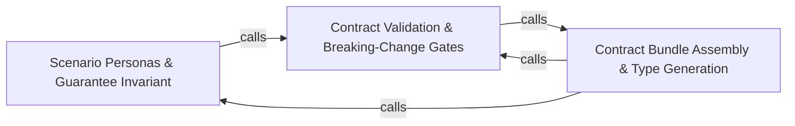

---
tags:
  - 2brain
  - 2brain/arch
  - project/boilerplate-node-backend
type: architecture
component: Scenario_Personas_Guarantees_5_2_
---

## Details

The declarative seed layer and the heart of this subsystem. It parses the 13 demo personas (personasSchema), resolves their fixed ids and login credentials (accounts.ts), builds the deterministic combinatorial catalogue (products-filler.ts), and enforces the guarantee invariant: findUnmetGuarantees / assertScenarioGuarantees cross-check the guarantees each enabled module declares in AppModule.scenario against the subject-id map buildScenario returns, failing in both directions. It also defines CollectionValues, the per-module shape that feeds the generated API client's example values. This is the unit of value: it makes the demo reproducible, self-describing, and provably consistent with the mounted modules.

### Scenario Personas & Guarantee Invariant
The declarative seed layer and heart of the subsystem. It parses the 13 demo personas (personasSchema), resolves their fixed ids and login credentials (accounts.ts), builds the deterministic combinatorial catalogue (products-filler.ts), and enforces the guarantee invariant: findUnmetGuarantees / assertScenarioGuarantees cross-check the guarantees each enabled module declares in AppModule.scenario against the subject-id map buildScenario returns, failing in both directions. It also defines CollectionValues, the per-module shape that feeds the generated API client's example values. This is the unit of value: it makes the demo reproducible, self-describing, and provably consistent with the mounted modules.

**Related Classes/Methods**:

- `scenarios.check.findUnmetGuarantees`:44-63
- `scenarios.check.assertScenarioGuarantees`:73-83
- `scenarios.accounts.SeedLogin`:104-111
- `scenarios.accounts.seedCredentials`:131-137
- `scenarios.products-filler.FILLER_IMAGE_ROLE_KEYS`:21-24
- `scenarios.collection-values.CollectionValues`:10-23

**Source Files:**

- `scenarios/accounts.ts`
  - `scenarios.accounts.SeedLogin` (L104-L111) - Interface
  - `scenarios.accounts.seedCredentials` (L131-L137) - Class
  - `scenarios.accounts.seedCredentials.<function>` (L131-L137) - Function
  - `scenarios.accounts.seedCredentials.<function>.PERSONA_NAMES.map() callback` (L134-L134) - Function
  - `scenarios.accounts.then() callback` (L157-L169) - Function
- `scenarios/apply.ts`
  - `scenarios.apply.scenarioArgument` (L100-L100) - Class
  - `scenarios.apply.scenarioArgument.find() callback` (L100-L100) - Function
  - `scenarios.apply.describeTo` (L110-L112) - Class
  - `scenarios.apply.describeTo.process.argv.find() callback` (L111-L111) - Function
- `scenarios/check.ts`
  - `scenarios.check.findUnmetGuarantees` (L44-L63) - Class
  - `scenarios.check.findUnmetGuarantees.problems` (L53-L55) - Class
  - `scenarios.check.findUnmetGuarantees.problems.filter() callback` (L54-L54) - Function
  - `scenarios.check.findUnmetGuarantees.problems.map() callback` (L55-L55) - Function
  - `scenarios.check.findUnmetGuarantees.filter() callback` (L60-L60) - Function
  - `scenarios.check.findUnmetGuarantees.map() callback` (L61-L61) - Function
  - `scenarios.check.assertScenarioGuarantees` (L73-L83) - Class
  - `scenarios.check.assertScenarioGuarantees.problems.map() callback` (L81-L81) - Function
- `scenarios/collection-values.ts`
  - `scenarios.collection-values.CollectionValues` (L10-L23) - Interface
- `scenarios/products-filler.ts`
  - `scenarios.products-filler.FILLER_IMAGE_ROLE_KEYS` (L21-L24) - Class
  - `scenarios.products-filler.FILLER_IMAGE_ROLE_KEYS.Array.from() callback` (L23-L23) - Function
  - `scenarios.products-filler.AnimalLine` (L27-L33) - Interface
  - `scenarios.products-filler.ProductType` (L46-L60) - Interface
  - `scenarios.products-filler.Tier` (L147-L156) - Interface
  - `scenarios.products-filler.FillerCopy` (L196-L199) - Interface
  - `scenarios.products-filler.FillerProduct` (L202-L226) - Interface
  - `scenarios.products-filler.GRID_PRODUCTS.ANIMALS.flatMap() callback` (L236-L263) - Function
  - `scenarios.products-filler.GRID_PRODUCTS` (L236-L264) - Class
  - `scenarios.products-filler.GRID_PRODUCTS.ANIMALS.flatMap() callback.PRODUCT_TYPES.flatMap() callback` (L237-L262) - Function
  - `scenarios.products-filler.GRID_PRODUCTS.ANIMALS.flatMap() callback.PRODUCT_TYPES.flatMap() callback.TIERS.map() callback` (L238-L262) - Function
  - `scenarios.products-filler.DIGITAL_GUIDES` (L271-L295) - Class
  - `scenarios.products-filler.DIGITAL_GUIDES.map() callback` (L274-L295) - Function
- `scenarios/users.ts`
  - `scenarios.users.SEED_CUSTOMER_EMAILS` (L174-L178) - Class
  - `scenarios.users.SEED_CUSTOMER_EMAILS.CUSTOMER_NAMES.map() callback` (L175-L175) - Function
- `scenarios/values/orders.ts`
  - `scenarios.values.orders.collectionValues` (L17-L22) - Class
  - `scenarios.values.orders.collectionValues.pathParam` (L19-L20) - Method
- `scenarios/values/products.ts`
  - `scenarios.values.products.collectionValues` (L11-L26) - Class
  - `scenarios.values.products.collectionValues.pathParam` (L16-L19) - Method
- `scenarios/waves.ts`
  - `scenarios.waves.waveOrder.ready.filter() callback` (L33-L34) - Function
  - `scenarios.waves.waveOrder.ready` (L33-L35) - Class
  - `scenarios.waves.waveOrder.ready.filter() callback.every() callback` (L34-L34) - Function
- `scripts/contracts/asyncapi-bundles.ts`
  - `scripts.contracts.asyncapi-bundles.sectionsInScope` (L90-L93) - Class
  - `scripts.contracts.asyncapi-bundles.sectionsInScope.ASYNC_SECTION_ORDER.filter() callback` (L93-L93) - Function
  - `scripts.contracts.asyncapi-bundles.asyncapiBundle` (L246-L258) - Class
  - `scripts.contracts.asyncapi-bundles.asyncapiBundle.content` (L251-L251) - Method
  - `scripts.contracts.asyncapi-bundles.asyncapiBundle.sources` (L252-L256) - Method
  - `scripts.contracts.asyncapi-bundles.asyncapiBundle.sources.map() callback` (L254-L254) - Function
  - `scripts.contracts.asyncapi-bundles.asyncapiPublicBundle` (L266-L277) - Class
  - `scripts.contracts.asyncapi-bundles.asyncapiPublicBundle.content` (L270-L270) - Method
  - `scripts.contracts.asyncapi-bundles.asyncapiPublicBundle.sources` (L271-L275) - Method
  - `scripts.contracts.asyncapi-bundles.asyncapiPublicBundle.sources.map() callback` (L273-L273) - Function
- `scripts/contracts/asyncapi-section-fragments.ts`
  - `scripts.contracts.asyncapi-section-fragments.orderByReference.byName` (L238-L240) - Class
  - `scripts.contracts.asyncapi-section-fragments.orderByReference.byName.schemas.items.map() callback` (L239-L239) - Function
- `scripts/contracts/bundle-kinds.ts`
  - `scripts.contracts.bundle-kinds.BundleIdentity` (L24-L45) - Interface
  - `scripts.contracts.bundle-kinds.CompiledBundle` (L55-L60) - Interface
  - `scripts.contracts.bundle-kinds.GeneratedBundle` (L70-L74) - Interface
- `scripts/contracts/bundle-registry.ts`
  - `scripts.contracts.bundle-registry.collectionBundle` (L41-L48) - Class
  - `scripts.contracts.bundle-registry.collectionBundle.content` (L47-L47) - Method
  - `scripts.contracts.bundle-registry.collectionBundle.content.then() callback` (L47-L47) - Function
- `scripts/contracts/client-collections-bundle.ts`
  - `scripts.contracts.client-collections-bundle.sections` (L63-L66) - Class
  - `scripts.contracts.client-collections-bundle.sections.SECTION_ORDER.map() callback` (L64-L64) - Function
  - `scripts.contracts.client-collections-bundle.sections.filter() callback` (L65-L65) - Function
  - `scripts.contracts.client-collections-bundle.baseValues` (L78-L142) - Class
  - `scripts.contracts.client-collections-bundle.baseValues.pathParam` (L121-L127) - Method
  - `scripts.contracts.client-collections-bundle.loadModuleValues` (L162-L176) - Class
  - `scripts.contracts.client-collections-bundle.loadModuleValues.<function>` (L162-L176) - Function
  - `scripts.contracts.client-collections-bundle.loadModuleValues.<function>.<function>` (L165-L175) - Function
  - `scripts.contracts.client-collections-bundle.loadModuleValues.<function>.<function>.filter() callback` (L169-L169) - Function
  - `scripts.contracts.client-collections-bundle.loadModuleValues.<function>.<function>.map() callback` (L172-L172) - Function
  - `scripts.contracts.client-collections-bundle.loadValues` (L182-L202) - Class
  - `scripts.contracts.client-collections-bundle.loadValues.then() callback` (L183-L202) - Function
  - `scripts.contracts.client-collections-bundle.loadValues.then() callback.pathParam` (L195-L201) - Method
  - `scripts.contracts.client-collections-bundle.loadProbes` (L231-L252) - Class
  - `scripts.contracts.client-collections-bundle.loadProbes.<function>` (L231-L252) - Function
  - `scripts.contracts.client-collections-bundle.loadProbes.<function>.<function>` (L234-L251) - Function
  - `scripts.contracts.client-collections-bundle.loadProbes.<function>.<function>.map() callback` (L236-L247) - Function
  - `scripts.contracts.client-collections-bundle.loadProbes.<function>.<function>.map() callback.then() callback` (L240-L246) - Function
  - `scripts.contracts.client-collections-bundle.loadProbes.<function>.<function>.then() callback` (L249-L249) - Function
  - `scripts.contracts.client-collections-bundle.generate` (L265-L275) - Class
  - `scripts.contracts.client-collections-bundle.generate.then() callback` (L266-L274) - Function
  - `scripts.contracts.client-collections-bundle.allProbes` (L278-L279) - Class
  - `scripts.contracts.client-collections-bundle.allProbes.then() callback` (L279-L279) - Function
  - `scripts.contracts.client-collections-bundle.allProbes.then() callback.result.requests.filter() callback` (L279-L279) - Function
  - `scripts.contracts.client-collections-bundle.collectionContent` (L290-L296) - Class
  - `scripts.contracts.client-collections-bundle.collectionContent.then() callback` (L291-L296) - Function
- `scripts/contracts/fill-enum.ts`
  - `scripts.contracts.fill-enum.Placeholder` (L36-L40) - Interface
  - `scripts.contracts.fill-enum.isStringList` (L43-L44) - Class
  - `scripts.contracts.fill-enum.isStringList.value.every() callback` (L44-L44) - Function
- `scripts/contracts/generate-asyncapi-types.ts`
  - `scripts.contracts.generate-asyncapi-types.then() callback.restModels` (L613-L613) - Class
  - `scripts.contracts.generate-asyncapi-types.then() callback.restModels.models.flatMap() callback` (L613-L613) - Function
- `scripts/contracts/generate-request-content-types.ts`
  - `scripts.contracts.generate-request-content-types.renderRouteRows.map() callback.methods.HTTP_METHODS.filter() callback` (L107-L107) - Function
- `scripts/contracts/generate-upload-types.ts`
  - `scripts.contracts.generate-upload-types.MediaType` (L25-L27) - Interface
- `scripts/contracts/openapi-bundle.ts`
  - `scripts.contracts.openapi-bundle.rootPaths` (L139-L142) - Class
  - `scripts.contracts.openapi-bundle.rootPaths.filter() callback` (L141-L141) - Function
  - `scripts.contracts.openapi-bundle.rootPaths.map() callback` (L142-L142) - Function
  - `scripts.contracts.openapi-bundle.sectionPaths` (L145-L150) - Class
  - `scripts.contracts.openapi-bundle.sectionPaths.map() callback` (L149-L149) - Function
  - `scripts.contracts.openapi-bundle.openapiBundle` (L647-L658) - Class
  - `scripts.contracts.openapi-bundle.openapiBundle.sources` (L653-L657) - Method
  - `scripts.contracts.openapi-bundle.openapiBundle.sources.MODULE_SECTIONS.map() callback` (L655-L655) - Function
- `scripts/contracts/openapi-document.ts`
  - `scripts.contracts.openapi-document.ErrorCodeEntry` (L35-L38) - Interface
  - `scripts.contracts.openapi-document.RootExtensions` (L44-L50) - Interface
  - `scripts.contracts.openapi-document.securityOpenMethods` (L124-L130) - Class
  - `scripts.contracts.openapi-document.securityOpenMethods.HTTP_METHODS.filter() callback` (L127-L130) - Function
  - `scripts.contracts.openapi-document.securityOpenMethods.map() callback` (L130-L130) - Function
- `scripts/contracts/permission-vocabulary-render.ts`
  - `scripts.contracts.permission-vocabulary-render.assertUnique.repeat` (L95-L95) - Class
  - `scripts.contracts.permission-vocabulary-render.assertUnique.repeat.list.find() callback` (L95-L95) - Function
  - `scripts.contracts.permission-vocabulary-render.readPermissionVocabulary.pairs.subjects.map() callback` (L140-L140) - Function
  - `scripts.contracts.permission-vocabulary-render.renderPermissionVocabulary.pairRows` (L176-L181) - Class
  - `scripts.contracts.permission-vocabulary-render.renderPermissionVocabulary.pairRows.map() callback` (L177-L180) - Function
- `scripts/contracts/prune-unused.ts`
  - `scripts.contracts.prune-unused.pruneUnused.map() callback` (L115-L115) - Function
  - `scripts.contracts.prune-unused.pruneUnused.map() callback.tags.group.tags.filter() callback` (L115-L115) - Function
  - `scripts.contracts.prune-unused.pruneUnused.filter() callback` (L116-L116) - Function
- `scripts/contracts/response-headers.ts`
  - `scripts.contracts.response-headers.isHeaderMap` (L31-L35) - Class
  - `scripts.contracts.response-headers.isHeaderMap.every() callback` (L35-L35) - Function

### Contract Bundle Assembly & Type Generation
The build side of the contract pipeline. It assembles the seven published contract documents (OpenAPI, AsyncAPI, AsyncAPI-public, and the Bruno/Insomnia/Mockoon/Postman client collections) from their fragments via the bundle registry, and generates the TypeScript realtime contract types from asyncapi.yaml. It supports --check staleness detection and per-bundle selection, and renders cross-cutting fragments (authorization, permission actions, request content-types) into the bundled documents. This is the 'fragments are the source of truth; bundles are what spectral/orval/Prism read' half of the contract-first model.

**Related Classes/Methods**:

- `scripts.contracts.bundle-registry.findBundle`:77-78
- `scripts.contracts.generate-asyncapi-types.collectChannelMessageEntries`:175-192

**Source Files:**

- `scripts/contracts/asyncapi-bundles.ts`
  - `scripts.contracts.asyncapi-bundles.marker` (L138-L143) - Class
  - `scripts.contracts.asyncapi-bundles.marker.sections.map() callback` (L141-L141) - Function
  - `scripts.contracts.asyncapi-bundles.marker.map() callback` (L142-L142) - Function
- `scripts/contracts/asyncapi-section-fragments.ts`
  - `scripts.contracts.asyncapi-section-fragments.localiseReferencesIn` (L84-L99) - Class
  - `scripts.contracts.asyncapi-section-fragments.localiseReferencesIn.Pair` (L88-L96) - Method
  - `scripts.contracts.asyncapi-section-fragments.localiseOpenApiReferences.users` (L137-L141) - Class
  - `scripts.contracts.asyncapi-section-fragments.localiseOpenApiReferences.users.schemas.items.flatMap() callback` (L138-L139) - Function
  - `scripts.contracts.asyncapi-section-fragments.localiseOpenApiReferences.users.filter() callback` (L141-L141) - Function
  - `scripts.contracts.asyncapi-section-fragments.localReferencesIn` (L175-L188) - Class
  - `scripts.contracts.asyncapi-section-fragments.localReferencesIn.Pair` (L180-L185) - Method
- `scripts/contracts/asyncapi-webhook-events.ts`
  - `scripts.contracts.asyncapi-webhook-events.webhookEventNames` (L36-L41) - Class
  - `scripts.contracts.asyncapi-webhook-events.webhookEventNames.flatMap() callback` (L37-L40) - Function
- `scripts/contracts/authorization-bundle.ts`
  - `scripts.contracts.authorization-bundle.assembleAuthorizationKeys.rules` (L126-L126) - Class
  - `scripts.contracts.authorization-bundle.assembleAuthorizationKeys.rules.blocks.map() callback` (L126-L126) - Function
  - `scripts.contracts.authorization-bundle.assembleAuthorizationKeys.sets` (L127-L130) - Class
  - `scripts.contracts.authorization-bundle.assembleAuthorizationKeys.sets.blocks.map() callback` (L128-L128) - Function
  - `scripts.contracts.authorization-bundle.assembleAuthorizationKeys.sets.filter() callback` (L129-L129) - Function
- `scripts/contracts/build-bundles.ts`
  - `scripts.contracts.build-bundles.unknown` (L41-L41) - Class
  - `scripts.contracts.build-bundles.unknown.named.filter() callback` (L41-L41) - Function
  - `scripts.contracts.build-bundles.bundle.then() callback.stale` (L60-L62) - Class
  - `scripts.contracts.build-bundles.bundle.then() callback.stale.assembled.filter() callback` (L61-L61) - Function
  - `scripts.contracts.build-bundles.bundle.then() callback.stale.map() callback` (L64-L64) - Function
  - `scripts.contracts.build-bundles.run.selected` (L108-L108) - Class
  - `scripts.contracts.build-bundles.run.selected.named.map() callback` (L108-L108) - Function
  - `scripts.contracts.build-bundles.run.authored` (L142-L142) - Class
  - `scripts.contracts.build-bundles.run.authored.CONTRACT_BUNDLES.filter() callback` (L142-L142) - Function
- `scripts/contracts/bundle-registry.ts`
  - `scripts.contracts.bundle-registry.findBundle` (L77-L78) - Class
  - `scripts.contracts.bundle-registry.findBundle.CONTRACT_BUNDLES.find() callback` (L78-L78) - Function
- `scripts/contracts/extends-map.ts`
  - `scripts.contracts.extends-map.isStringList` (L20-L21) - Class
  - `scripts.contracts.extends-map.isStringList.value.every() callback` (L21-L21) - Function
- `scripts/contracts/generate-asyncapi-types.ts`
  - `scripts.contracts.generate-asyncapi-types.AsyncApiChannel` (L41-L53) - Interface
  - `scripts.contracts.generate-asyncapi-types.AsyncApiMessage` (L56-L58) - Interface
  - `scripts.contracts.generate-asyncapi-types.AsyncApiServer` (L61-L63) - Interface
  - `scripts.contracts.generate-asyncapi-types.JsonSchema` (L66-L79) - Interface
  - `scripts.contracts.generate-asyncapi-types.AsyncApiDocument` (L82-L90) - Interface
  - `scripts.contracts.generate-asyncapi-types.toPascalCase` (L107-L114) - Class
  - `scripts.contracts.generate-asyncapi-types.toPascalCase.map() callback` (L113-L113) - Function
  - `scripts.contracts.generate-asyncapi-types.collectChannelMessageEntries` (L175-L192) - Class
  - `scripts.contracts.generate-asyncapi-types.collectChannelMessageEntries.filter() callback` (L181-L181) - Function
  - `scripts.contracts.generate-asyncapi-types.collectChannelMessageEntries.map() callback` (L182-L191) - Function
  - `scripts.contracts.generate-asyncapi-types.collectChannelMessageEntries.toSorted() callback` (L192-L192) - Function
  - `scripts.contracts.generate-asyncapi-types.filter() callback` (L233-L233) - Function
  - `scripts.contracts.generate-asyncapi-types.renderLiteralArray.lines` (L245-L245) - Class
  - `scripts.contracts.generate-asyncapi-types.renderLiteralArray.lines.values.map() callback` (L245-L245) - Function
  - `scripts.contracts.generate-asyncapi-types.modelNameConstraints` (L332-L334) - Class
  - `scripts.contracts.generate-asyncapi-types.modelNameConstraints.NAMING_FORMATTER` (L333-L333) - Method
  - `scripts.contracts.generate-asyncapi-types.sseEntries` (L402-L406) - Class
  - `scripts.contracts.generate-asyncapi-types.sseEntries.collectChannelMessageEntries() callback` (L405-L405) - Function
  - `scripts.contracts.generate-asyncapi-types.channelNamespaceBlocks` (L421-L423) - Class
  - `scripts.contracts.generate-asyncapi-types.channelNamespaceBlocks.map() callback` (L422-L422) - Function
  - `scripts.contracts.generate-asyncapi-types.messageTypeBlocks` (L426-L434) - Class
  - `scripts.contracts.generate-asyncapi-types.messageTypeBlocks.map() callback` (L427-L433) - Function
  - `scripts.contracts.generate-asyncapi-types.zodExpression` (L451-L529) - Class
  - `scripts.contracts.generate-asyncapi-types.zodExpression.schema.enum.map() callback` (L455-L455) - Function
  - `scripts.contracts.generate-asyncapi-types.zodExpression.members` (L464-L464) - Class
  - `scripts.contracts.generate-asyncapi-types.zodExpression.members.schema.oneOf.map() callback` (L464-L464) - Function
  - `scripts.contracts.generate-asyncapi-types.zodExpression.fields` (L503-L510) - Class
  - `scripts.contracts.generate-asyncapi-types.zodExpression.fields.map() callback` (L505-L508) - Function
  - `scripts.contracts.generate-asyncapi-types.renderZodSchemas` (L541-L548) - Class
  - `scripts.contracts.generate-asyncapi-types.renderZodSchemas.map() callback` (L546-L547) - Function
  - `scripts.contracts.generate-asyncapi-types.then() callback` (L612-L623) - Function
  - `scripts.contracts.generate-asyncapi-types.then() callback.modelBlocks` (L614-L619) - Class
  - `scripts.contracts.generate-asyncapi-types.catch() callback` (L624-L627) - Function
- `scripts/contracts/generate-request-content-types.ts`
  - `scripts.contracts.generate-request-content-types.compileTemplate.source` (L51-L57) - Class
  - `scripts.contracts.generate-request-content-types.compileTemplate.source.segments.map() callback` (L52-L55) - Function
  - `scripts.contracts.generate-request-content-types.compileTemplate.parameterCount.segments.filter() callback` (L60-L60) - Function
  - `scripts.contracts.generate-request-content-types.renderRows` (L71-L96) - Class
  - `scripts.contracts.generate-request-content-types.renderRows.flatMap() callback` (L73-L90) - Function
  - `scripts.contracts.generate-request-content-types.renderRows.flatMap() callback.WRITE_METHODS.flatMap() callback` (L74-L90) - Function
  - `scripts.contracts.generate-request-content-types.renderRows.toSorted() callback` (L93-L94) - Function
  - `scripts.contracts.generate-request-content-types.renderRows.map() callback` (L96-L96) - Function
  - `scripts.contracts.generate-request-content-types.renderRouteRows` (L104-L124) - Class
  - `scripts.contracts.generate-request-content-types.map() callback` (L106-L119) - Function
  - `scripts.contracts.generate-request-content-types.renderRouteRows.map() callback.owner` (L110-L112) - Class
  - `scripts.contracts.generate-request-content-types.renderRouteRows.map() callback.owner.find() callback` (L111-L111) - Function
  - `scripts.contracts.generate-request-content-types.renderRouteRows.toSorted() callback` (L121-L122) - Function
  - `scripts.contracts.generate-request-content-types.renderRouteRows.map() callback` (L124-L124) - Function
- `scripts/contracts/generate-upload-types.ts`
  - `scripts.contracts.generate-upload-types.map() callback` (L72-L72) - Function
- `scripts/contracts/openapi-bundle.ts`
  - `scripts.contracts.openapi-bundle.VersionedPathItem` (L220-L222) - Interface
  - `scripts.contracts.openapi-bundle.bundleSteps` (L534-L579) - Class
  - `scripts.contracts.openapi-bundle.bundleSteps.<function>` (L542-L547) - Function
- `scripts/contracts/openapi-document.ts`
  - `scripts.contracts.openapi-document.OperationExtensions` (L22-L26) - Interface
  - `scripts.contracts.openapi-document.AppLevelResponse` (L29-L32) - Interface
  - `scripts.contracts.openapi-document.operationsOf` (L108-L114) - Class
  - `scripts.contracts.openapi-document.operationsOf.flatMap() callback` (L109-L113) - Function
  - `scripts.contracts.openapi-document.operationsOf.flatMap() callback.HTTP_METHODS.flatMap() callback` (L110-L113) - Function
- `scripts/contracts/openapi-extensions.ts`
  - `scripts.contracts.openapi-extensions.checkExtensions` (L170-L184) - Class
  - `scripts.contracts.openapi-extensions.checkExtensions.<function>` (L172-L184) - Function
  - `scripts.contracts.openapi-extensions.withUnionExtensions` (L287-L298) - Class
  - `scripts.contracts.openapi-extensions.withUnionExtensions.<function>` (L289-L298) - Function
- `scripts/contracts/permission-vocabulary-render.ts`
  - `scripts.contracts.permission-vocabulary-render.PermissionVocabulary` (L13-L28) - Interface
  - `scripts.contracts.permission-vocabulary-render.stringList` (L41-L48) - Class
  - `scripts.contracts.permission-vocabulary-render.stringList.value.every() callback` (L45-L45) - Function
  - `scripts.contracts.permission-vocabulary-render.renderList.rows` (L160-L160) - Class
  - `scripts.contracts.permission-vocabulary-render.renderList.rows.items.map() callback` (L160-L160) - Function
- `scripts/contracts/prune-unused.ts`
  - `scripts.contracts.prune-unused.Findings` (L36-L43) - Interface
  - `scripts.contracts.prune-unused.reachable` (L79-L92) - Class
  - `scripts.contracts.prune-unused.reachable.filter() callback` (L90-L90) - Function
  - `scripts.contracts.prune-unused.pruneUnused` (L97-L117) - Class
  - `scripts.contracts.prune-unused.pruneUnused.document.tags.filter() callback` (L110-L110) - Function
- `scripts/contracts/response-headers.ts`
  - `scripts.contracts.response-headers.declares` (L38-L39) - Class
  - `scripts.contracts.response-headers.declares.some() callback` (L39-L39) - Function
  - `scripts.contracts.response-headers.inlineResponsesOf` (L45-L51) - Class
  - `scripts.contracts.response-headers.inlineResponsesOf.flatMap() callback` (L47-L48) - Function
  - `scripts.contracts.response-headers.inlineResponsesOf.filter() callback` (L51-L51) - Function
- `scripts/contracts/root-assembly.ts`
  - `scripts.contracts.root-assembly.ModuleFragment` (L33-L44) - Interface
  - `scripts.contracts.root-assembly.pruneStaleReferences.declared` (L72-L74) - Class
  - `scripts.contracts.root-assembly.pruneStaleReferences.declared.fragments.flatMap() callback` (L73-L73) - Function
  - `scripts.contracts.root-assembly.pruneStaleReferences.declared.fragments.flatMap() callback.urls.map() callback` (L73-L73) - Function
  - `scripts.contracts.root-assembly.appendMissingTags` (L107-L127) - Class
  - `scripts.contracts.root-assembly.appendMissingTags.fragments.flatMap() callback` (L118-L118) - Function
  - `scripts.contracts.root-assembly.appendMissingTags.wanted` (L122-L124) - Class
  - `scripts.contracts.root-assembly.appendMissingTags.wanted.filter() callback` (L123-L123) - Function
  - `scripts.contracts.root-assembly.readModuleFragments.map() callback.operations` (L244-L244) - Class
  - `scripts.contracts.root-assembly.readModuleFragments.map() callback.operations.flatMap() callback` (L244-L244) - Function
- `scripts/contracts/section-order.ts`
  - `scripts.contracts.section-order.orderSections.known` (L22-L22) - Class
  - `scripts.contracts.section-order.orderSections.known.preferred.filter() callback` (L22-L22) - Function
- `scripts/contracts/shared-rules-render.ts`
  - `scripts.contracts.shared-rules-render.withNumericSeparators` (L79-L82) - Class
  - `scripts.contracts.shared-rules-render.withNumericSeparators.json.replaceAll() callback` (L80-L81) - Function

### Contract Validation & Breaking-Change Gates
The guard side of the contract pipeline. It validates the bundled documents and enforces the breaking-change invariant on the partner-facing webhook catalogue: check-asyncapi-breaking.ts diffs the working-tree asyncapi.public.yaml against origin/main's merge-base and fails on any change a subscriber would feel, with asyncapi-breaking.ts providing the testable classification half (overrides + acknowledged breaks). It also derives the cookieAuth alternative and 403 origin-refusal from bearerAuth on the bundled document, and generates error-code / permission-action artifacts. This is the 'published claim with a guard behind it' half of the contract-first model.

**Related Classes/Methods**:

- `scripts.contracts.asyncapi-breaking.breakingChanges`:51-64
- `scripts.contracts.cookie-auth.withCookieAuth`:34-45

**Source Files:**

- `scripts/contracts/asyncapi-breaking.ts`
  - `scripts.contracts.asyncapi-breaking.AcknowledgedBreak` (L20-L25) - Interface
  - `scripts.contracts.asyncapi-breaking.breakingChanges` (L51-L64) - Class
  - `scripts.contracts.asyncapi-breaking.breakingChanges.found.filter() callback` (L63-L63) - Function
  - `scripts.contracts.asyncapi-breaking.breakingChanges.found.filter() callback.acknowledged.every() callback` (L63-L63) - Function
- `scripts/contracts/asyncapi-bundles.ts`
  - `scripts.contracts.asyncapi-bundles.fragmentsFor` (L134-L135) - Class
  - `scripts.contracts.asyncapi-bundles.fragmentsFor.sections.flatMap() callback` (L135-L135) - Function
- `scripts/contracts/asyncapi-section-fragments.ts`
  - `scripts.contracts.asyncapi-section-fragments.sectionFragments` (L52-L57) - Class
  - `scripts.contracts.asyncapi-section-fragments.sectionFragments.map() callback` (L56-L56) - Function
  - `scripts.contracts.asyncapi-section-fragments.RestReference` (L72-L75) - Interface
  - `scripts.contracts.asyncapi-section-fragments.localiseOpenApiReferences` (L131-L165) - Class
  - `scripts.contracts.asyncapi-section-fragments.localiseOpenApiReferences.references.filter() callback` (L146-L146) - Function
- `scripts/contracts/authorization-bundle.ts`
  - `scripts.contracts.authorization-bundle.fragmentBlocks` (L89-L106) - Class
  - `scripts.contracts.authorization-bundle.fragmentBlocks.misattributed` (L95-L97) - Class
  - `scripts.contracts.authorization-bundle.fragmentBlocks.misattributed.filter() callback` (L96-L96) - Function
  - `scripts.contracts.authorization-bundle.fragmentBlocks.misattributed.map() callback` (L101-L101) - Function
  - `scripts.contracts.authorization-bundle.assembleAuthorizationKeys.blocks.map() callback` (L123-L124) - Function
  - `scripts.contracts.authorization-bundle.assembleAuthorizationKeys.blocks` (L123-L125) - Class
- `scripts/contracts/build-bundles.ts`
  - `scripts.contracts.build-bundles.named` (L38-L38) - Class
  - `scripts.contracts.build-bundles.named.arguments_.filter() callback` (L38-L38) - Function
  - `scripts.contracts.build-bundles.CONTRACT_BUNDLES.map() callback` (L47-L47) - Function
  - `scripts.contracts.build-bundles.bundle` (L56-L65) - Class
  - `scripts.contracts.build-bundles.bundle.bundles.map() callback` (L58-L58) - Function
  - `scripts.contracts.build-bundles.bundle.bundles.map() callback.then() callback` (L58-L58) - Function
  - `scripts.contracts.build-bundles.bundle.then() callback` (L59-L65) - Function
  - `scripts.contracts.build-bundles.report` (L82-L101) - Class
  - `scripts.contracts.build-bundles.report.stale.map() callback` (L99-L99) - Function
  - `scripts.contracts.build-bundles.run` (L104-L152) - Class
  - `scripts.contracts.build-bundles.run.generated` (L116-L116) - Class
  - `scripts.contracts.build-bundles.run.generated.selected.filter() callback` (L116-L116) - Function
  - `scripts.contracts.build-bundles.generated.map() callback` (L120-L120) - Function
  - `scripts.contracts.build-bundles.run.generated.map() callback` (L124-L124) - Function
  - `scripts.contracts.build-bundles.catch() callback` (L155-L158) - Function
- `scripts/contracts/check-asyncapi-breaking.ts`
  - `scripts.contracts.check-asyncapi-breaking.then() callback` (L114-L155) - Function
  - `scripts.contracts.check-asyncapi-breaking.catch() callback` (L156-L159) - Function
- `scripts/contracts/cookie-auth.ts`
  - `scripts.contracts.cookie-auth.takesBearer` (L23-L26) - Class
  - `scripts.contracts.cookie-auth.takesBearer.security.some() callback` (L26-L26) - Function
  - `scripts.contracts.cookie-auth.withCookieAuth` (L34-L45) - Class
  - `scripts.contracts.cookie-auth.withCookieAuth.operation.security.every() callback` (L37-L37) - Function
- `scripts/contracts/generate-asyncapi-types.ts`
  - `scripts.contracts.generate-asyncapi-types.channelProtocols` (L204-L218) - Class
  - `scripts.contracts.generate-asyncapi-types.channelProtocols.map() callback` (L209-L217) - Function
  - `scripts.contracts.generate-asyncapi-types.channelProtocols.filter() callback` (L218-L218) - Function
  - `scripts.contracts.generate-asyncapi-types.channelPayloadSchemaNames` (L227-L235) - Class
  - `scripts.contracts.generate-asyncapi-types.channelPayloadSchemaNames.map() callback` (L234-L234) - Function
  - `scripts.contracts.generate-asyncapi-types.channelPayloadSchemaNames.filter() callback` (L235-L235) - Function
  - `scripts.contracts.generate-asyncapi-types.renderPayloadMap.rows` (L260-L264) - Class
  - `scripts.contracts.generate-asyncapi-types.renderPayloadMap.rows.entries.map() callback` (L262-L262) - Function
  - `scripts.contracts.generate-asyncapi-types.renderChannelNamespace.entries` (L295-L297) - Class
  - `scripts.contracts.generate-asyncapi-types.renderChannelNamespace.entries.channelNames.map() callback` (L296-L296) - Function
  - `scripts.contracts.generate-asyncapi-types.queuePayloadSchemaNames` (L414-L418) - Class
  - `scripts.contracts.generate-asyncapi-types.queuePayloadSchemaNames.filter() callback` (L416-L416) - Function
  - `scripts.contracts.generate-asyncapi-types.queuePayloadSchemaNames.flatMap() callback` (L417-L417) - Function
  - `scripts.contracts.generate-asyncapi-types.buildOutput.sections` (L570-L602) - Class
  - `scripts.contracts.generate-asyncapi-types.buildOutput.sections.sseEntries.map() callback` (L596-L596) - Function
  - `scripts.contracts.generate-asyncapi-types.then() callback.modelBlocks.models.filter() callback` (L615-L615) - Function
  - `scripts.contracts.generate-asyncapi-types.then() callback.modelBlocks.map() callback` (L617-L618) - Function
- `scripts/contracts/generate-error-codes.ts`
  - `scripts.contracts.generate-error-codes.ErrorCodeEntry` (L30-L33) - Interface
  - `scripts.contracts.generate-error-codes.OpenApiDocument` (L36-L38) - Interface
  - `scripts.contracts.generate-error-codes.rows` (L81-L81) - Class
  - `scripts.contracts.generate-error-codes.rows.codes.map() callback` (L81-L81) - Function
- `scripts/contracts/generate-request-content-types.ts`
  - `scripts.contracts.generate-request-content-types.renderRouteRows.map() callback.methods.map() callback` (L107-L108) - Function
  - `scripts.contracts.generate-request-content-types.renderRouteRows.map() callback.methods` (L107-L109) - Class
  - `scripts.contracts.generate-request-content-types.renderRouteRows.map() callback.owner.HTTP_METHODS.map() callback` (L110-L110) - Function
- `scripts/contracts/generate-shared-rule-schemas.ts`
  - `scripts.contracts.generate-shared-rule-schemas.GeneratedSource` (L37-L42) - Interface
  - `scripts.contracts.generate-shared-rule-schemas.SCHEMA_EXPORTS` (L48-L51) - Class
  - `scripts.contracts.generate-shared-rule-schemas.SCHEMA_EXPORTS.map() callback` (L49-L49) - Function
  - `scripts.contracts.generate-shared-rule-schemas.writeGenerated` (L205-L218) - Class
  - `scripts.contracts.generate-shared-rule-schemas.writeGenerated.then() callback` (L215-L217) - Function
  - `scripts.contracts.generate-shared-rule-schemas.then() callback` (L222-L222) - Function
  - `scripts.contracts.generate-shared-rule-schemas.then() callback.sources.map() callback` (L222-L222) - Function
- `scripts/contracts/generate-upload-types.ts`
  - `scripts.contracts.generate-upload-types.OpenApiDocument` (L30-L35) - Interface
  - `scripts.contracts.generate-upload-types.types` (L80-L80) - Class
  - `scripts.contracts.generate-upload-types.types.map() callback` (L80-L80) - Function
- `scripts/contracts/image-upload-encoding.ts`
  - `scripts.contracts.image-upload-encoding.isTypeList` (L22-L25) - Class
  - `scripts.contracts.image-upload-encoding.isTypeList.value.every() callback` (L25-L25) - Function
- `scripts/contracts/openapi-bundle.ts`
  - `scripts.contracts.openapi-bundle.withErrorCodes` (L379-L390) - Class
  - `scripts.contracts.openapi-bundle.withErrorCodes.codes.map() callback` (L389-L389) - Function
  - `scripts.contracts.openapi-bundle.openapiBundle.sources.map() callback` (L656-L656) - Function
- `scripts/contracts/openapi-document.ts`
  - `scripts.contracts.openapi-document.OperationEntry` (L65-L69) - Interface
- `scripts/contracts/openapi-extensions.ts`
  - `scripts.contracts.openapi-extensions.ExtensionFragment` (L51-L62) - Interface
  - `scripts.contracts.openapi-extensions.extensionFragments.found` (L117-L133) - Class
  - `scripts.contracts.openapi-extensions.extensionFragments.found.filter() callback` (L118-L118) - Function
  - `scripts.contracts.openapi-extensions.extensionFragments.found.toSorted() callback` (L119-L119) - Function
  - `scripts.contracts.openapi-extensions.extensionFragments.found.flatMap() callback` (L120-L132) - Function
  - `scripts.contracts.openapi-extensions.extensionFragments.found.flatMap() callback.flatMap() callback` (L123-L132) - Function
- `scripts/contracts/permission-vocabulary-render.ts`
  - `scripts.contracts.permission-vocabulary-render.fieldOfEach` (L75-L85) - Class
  - `scripts.contracts.permission-vocabulary-render.fieldOfEach.entries.map() callback` (L79-L84) - Function
  - `scripts.contracts.permission-vocabulary-render.readPermissionVocabulary.ruleIds.ruleActions.map() callback` (L135-L135) - Function
  - `scripts.contracts.permission-vocabulary-render.renderPermissionVocabulary.pairRows.map() callback.list` (L178-L178) - Class
  - `scripts.contracts.permission-vocabulary-render.renderPermissionVocabulary.pairRows.map() callback.list.actions.map() callback` (L178-L178) - Function
- `scripts/contracts/personal-data-assembly.ts`
  - `scripts.contracts.personal-data-assembly.PersonalDataSection` (L33-L42) - Interface
  - `scripts.contracts.personal-data-assembly.retarget` (L49-L61) - Class
  - `scripts.contracts.personal-data-assembly.retarget.node.map() callback` (L50-L50) - Function
  - `scripts.contracts.personal-data-assembly.retarget.map() callback` (L54-L59) - Function
  - `scripts.contracts.personal-data-assembly.readPersonalDataSections` (L72-L86) - Class
  - `scripts.contracts.personal-data-assembly.readPersonalDataSections.modules.flatMap() callback` (L76-L86) - Function
  - `scripts.contracts.personal-data-assembly.readPersonalDataSections.modules.flatMap() callback.map() callback` (L80-L85) - Function
- `scripts/contracts/response-headers.ts`
  - `scripts.contracts.response-headers.takesIdempotencyKey` (L79-L82) - Class
  - `scripts.contracts.response-headers.takesIdempotencyKey.some() callback` (L81-L81) - Function
- `scripts/contracts/root-assembly.ts`
  - `scripts.contracts.root-assembly.pruneStaleReferences.stale` (L77-L82) - Class
  - `scripts.contracts.root-assembly.pruneStaleReferences.stale.paths.items.filter() callback` (L77-L82) - Function
  - `scripts.contracts.root-assembly.appendMissingTags.used` (L121-L121) - Class
  - `scripts.contracts.root-assembly.appendMissingTags.used.fragments.flatMap() callback` (L121-L121) - Function
- `scripts/contracts/section-order.ts`
  - `scripts.contracts.section-order.orderSections.extra` (L23-L23) - Class
  - `scripts.contracts.section-order.orderSections.extra.present.filter() callback` (L23-L23) - Function
- `scripts/contracts/shared-rules-render.ts`
  - `scripts.contracts.shared-rules-render.docblock` (L30-L38) - Class
  - `scripts.contracts.shared-rules-render.docblock.lines.map() callback` (L35-L35) - Function
  - `scripts.contracts.shared-rules-render.renderKeyed.keys` (L63-L63) - Class
  - `scripts.contracts.shared-rules-render.renderKeyed.keys.entries.map() callback` (L63-L63) - Function
  - `scripts.contracts.shared-rules-render.renderKeyed.rows` (L65-L68) - Class
  - `scripts.contracts.shared-rules-render.renderKeyed.rows.entries.map() callback` (L66-L67) - Function
  - `scripts.contracts.shared-rules-render.renderGenerated` (L108-L112) - Class
  - `scripts.contracts.shared-rules-render.renderGenerated.spec.exports.map() callback` (L111-L111) - Function
- `scripts/contracts/validate-asyncapi.ts`
  - `scripts.contracts.validate-asyncapi.isInvalid` (L38-L43) - Class
  - `scripts.contracts.validate-asyncapi.isInvalid.diagnostics.some() callback` (L40-L42) - Function
  - `scripts.contracts.validate-asyncapi.files.map() callback` (L50-L62) - Function
  - `scripts.contracts.validate-asyncapi.files.map() callback.then() callback` (L51-L62) - Function
  - `scripts.contracts.validate-asyncapi.then() callback` (L65-L69) - Function
  - `scripts.contracts.validate-asyncapi.catch() callback` (L70-L73) - Function
