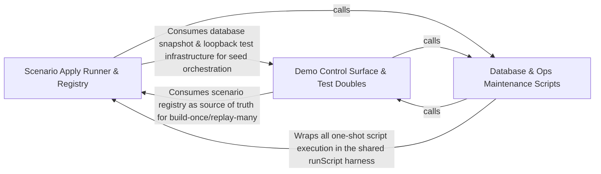

---
tags:
  - 2brain
  - 2brain/arch
  - project/boilerplate-node-backend
type: architecture
component: Scenario_Runner_Apply_
---

## Details

The npm run scenario:apply runner that owns the gates, the in-process app boot, and the single call into buildScenario, plus the demo control surface and database-snapshot helpers it depends on.

### Scenario Apply Runner & Registry [[Expand]](./Scenario_Apply_Runner_Registry.md)
The npm run scenario:apply entry point and the scenario registry it delegates to. This is the spine of the subsystem: it owns the CLI gates (scenario-name validation, --reset emptying, non-empty-database refusal, --describe-to output), the in-process app boot, the single call into buildScenario, and the post-seed cache invalidation. buildScenario is the one function that knows the legitimate ordering of seed → drive → backdate, and the SCENARIOS registry is the single place a new scenario is added. runScript is the shared one-shot harness that gives every db:/ops: script a non-zero exit code, guaranteed cleanup, and a recorded job outcome.

**Related Classes/Methods**:

- `scenarios.apply.bootAppInProcess`:118-123
- `scenarios.apply.seed`:126-198
- `scenarios.index.buildScenario`:107-133
- `scripts.run-script.runScript`:106-118

**Source Files:**

- `scenarios/apply.ts`
  - `scenarios.apply.bootAppInProcess` (L118-L123) - Class
  - `scenarios.apply.bootAppInProcess.then() callback` (L119-L123) - Function
  - `scenarios.apply.bootAppInProcess.then() callback.then() callback` (L122-L122) - Function
  - `scenarios.apply.seed` (L126-L198) - Function
  - `scenarios.apply.runScript() callback` (L227-L227) - Function
  - `scenarios.apply.then() callback` (L227-L228) - Function
- `scenarios/flows/backdate.ts`
  - `scenarios.flows.backdate.mover() callback` (L66-L66) - Function
  - `scenarios.flows.backdate.backdateOrder` (L118-L121) - Class
  - `scenarios.flows.backdate.backdateOrder.TRAILS.map() callback` (L121-L121) - Function
  - `scenarios.flows.backdate.backdateOrder.then() callback` (L121-L121) - Function
  - `scenarios.flows.backdate.backdateHistory` (L152-L157) - Class
  - `scenarios.flows.backdate.then() callback` (L154-L155) - Function
  - `scenarios.flows.backdate.backdateHistory.then() callback.map() callback` (L155-L155) - Function
  - `scenarios.flows.backdate.backdateHistory.then() callback` (L157-L157) - Function
- `scenarios/flows/loopback.ts`
  - `scenarios.flows.loopback.withLoopbackServer` (L25-L47) - Class
  - `scenarios.flows.loopback.withLoopbackServer.<function>` (L29-L39) - Function
  - `scenarios.flows.loopback.withLoopbackServer.then() callback` (L39-L46) - Function
  - `scenarios.flows.loopback.then() callback.then() callback.then() callback` (L41-L41) - Function
  - `scenarios.flows.loopback.withLoopbackServer.then() callback.then() callback` (L42-L45) - Function
  - `scenarios.flows.loopback.withLoopbackServer.then() callback.then() callback.then() callback` (L43-L45) - Function
- `scenarios/index.ts`
  - `scenarios.index.Scenario` (L46-L58) - Interface
  - `scenarios.index.buildScenario` (L107-L133) - Class
  - `scenarios.index.then() callback` (L119-L122) - Function
  - `scenarios.index.buildScenario.then() callback.withoutHumanChallenge() callback` (L121-L121) - Function
  - `scenarios.index.buildScenario.then() callback` (L124-L130) - Function
  - `scenarios.index.buildScenario.then() callback.then() callback` (L126-L129) - Function
- `scenarios/support/database-snapshot.ts`
  - `scenarios.support.database-snapshot.emptyDatabase` (L28-L31) - Class
  - `scenarios.support.database-snapshot.emptyDatabase.map() callback` (L30-L30) - Function
  - `scenarios.support.database-snapshot.emptyDatabase.then() callback` (L31-L31) - Function
  - `scenarios.support.database-snapshot.captureDatabase` (L64-L72) - Class
  - `scenarios.support.database-snapshot.captureDatabase.map() callback` (L66-L70) - Function
  - `scenarios.support.database-snapshot.captureDatabase.map() callback.then() callback` (L70-L70) - Function
  - `scenarios.support.database-snapshot.captureDatabase.then() callback` (L72-L72) - Function
  - `scenarios.support.database-snapshot.restoreDatabaseCopy` (L85-L96) - Class
  - `scenarios.support.database-snapshot.restoreDatabaseCopy.then() callback.filter() callback` (L90-L90) - Function
  - `scenarios.support.database-snapshot.restoreDatabaseCopy.then() callback.map() callback` (L91-L92) - Function
  - `scenarios.support.database-snapshot.restoreDatabaseCopy.then() callback` (L96-L96) - Function
- `scenarios/support/demo-clock.ts`
  - `scenarios.support.demo-clock.DemoClock` (L21-L35) - Interface
  - `scenarios.support.demo-clock.installDemoClock` (L64-L87) - Class
  - `scenarios.support.demo-clock.installDemoClock.uninstall` (L74-L74) - Method
  - `scenarios.support.demo-clock.installDemoClock.now` (L75-L75) - Method
  - `scenarios.support.demo-clock.installDemoClock.offsetMs` (L76-L76) - Method
  - `scenarios.support.demo-clock.installDemoClock.advance` (L77-L82) - Method
  - `scenarios.support.demo-clock.installDemoClock.reset` (L83-L85) - Method
- `scenarios/support/demo.ts`
  - `scenarios.support.demo.UnknownScenarioError` (L44-L49) - Class
  - `scenarios.support.demo.UnknownScenarioError.constructor` (L46-L48) - Constructor
  - `scenarios.support.demo.ScenarioCopy` (L52-L57) - Interface
  - `scenarios.support.demo.buildOnce` (L85-L102) - Class
  - `scenarios.support.demo.buildOnce.then() callback` (L86-L102) - Function
  - `scenarios.support.demo.then() callback.then() callback` (L94-L94) - Function
  - `scenarios.support.demo.buildOnce.then() callback.then() callback` (L95-L100) - Function
  - `scenarios.support.demo.buildOnce.then() callback.then() callback.then() callback` (L96-L100) - Function
  - `scenarios.support.demo.runRestore` (L121-L135) - Class
  - `scenarios.support.demo.runRestore.then() callback.then() callback` (L124-L126) - Function
  - `scenarios.support.demo.runRestore.then() callback` (L135-L135) - Function
  - `scenarios.support.demo.restoreScenario` (L149-L156) - Class
  - `scenarios.support.demo.restoreScenario.outcome` (L150-L150) - Class
  - `scenarios.support.demo.restoreScenario.outcome.restoreQueue.then() callback` (L150-L150) - Function
  - `scenarios.support.demo.outcome.then() callback` (L152-L152) - Function
  - `scenarios.support.demo.restoreScenario.outcome.then() callback` (L153-L153) - Function
  - `scenarios.support.demo.installDemo` (L193-L267) - Class
  - `scenarios.support.demo.installDemo.app.post('/__test/restore') callback` (L198-L216) - Function
  - `scenarios.support.demo.installDemo.app.post('/__test/restore') callback.then() callback` (L206-L206) - Function
  - `scenarios.support.demo.installDemo.app.post('/__test/restore') callback.catch() callback` (L207-L215) - Function
  - `scenarios.support.demo.installDemo.app.get('/__test/scenario') callback` (L218-L220) - Function
  - `scenarios.support.demo.installDemo.app.get('/__test/clock') callback` (L222-L226) - Function
  - `scenarios.support.demo.installDemo.app.post('/__test/clock') callback` (L228-L240) - Function
  - `scenarios.support.demo.installDemo.app.post('/__test/jobs/:name') callback` (L242-L262) - Function
  - `scenarios.support.demo.installDemo.app.post('/__test/jobs/:name') callback.then() callback` (L247-L256) - Function
  - `scenarios.support.demo.installDemo.app.post('/__test/jobs/:name') callback.then() callback.then() callback` (L253-L255) - Function
  - `scenarios.support.demo.installDemo.app.post('/__test/jobs/:name') callback.catch() callback` (L257-L261) - Function
  - `scenarios.support.demo.installDemo.app.get('/__test/emails') callback` (L264-L266) - Function
- `scenarios/support/doubles/mail-outbox.ts`
  - `scenarios.support.doubles.mail-outbox.DemoOutboxEmail` (L17-L37) - Interface
  - `scenarios.support.doubles.mail-outbox.recordDemoEmail.lines.filter() callback` (L61-L61) - Function
  - `scenarios.support.doubles.mail-outbox.recordDemoEmail.lines.map() callback` (L62-L62) - Function
  - `scenarios.support.doubles.mail-outbox.recordDemoEmail.attachments.request.attachments.map() callback` (L64-L64) - Function
- `scripts/db/cache-clear.ts`
  - `scripts.db.cache-clear.runScript() callback` (L45-L45) - Function
- `scripts/docs/generate-role-matrix.ts`
  - `scripts.docs.generate-role-matrix.then() callback` (L170-L172) - Function
- `scripts/ops/run-job.ts`
  - `scripts.ops.run-job.execute` (L65-L72) - Class
  - `scripts.ops.run-job.execute.then() callback` (L72-L72) - Function
  - `scripts.ops.run-job.runScript() callback` (L99-L99) - Function
- `scripts/run-script.ts`
  - `scripts.run-script.refuseToRun` (L32-L48) - Class
  - `scripts.run-script.then() callback` (L39-L39) - Function
  - `scripts.run-script.refuseToRun.then() callback` (L40-L46) - Function
  - `scripts.run-script.runScript` (L106-L118) - Class
  - `scripts.run-script.runScript.then() callback` (L117-L117) - Function
- `scripts/security/refresh-breached-passwords.ts`
  - `scripts.security.refresh-breached-passwords.downloadCorpus` (L73-L80) - Class
  - `scripts.security.refresh-breached-passwords.downloadCorpus.map() callback` (L79-L79) - Function
  - `scripts.security.refresh-breached-passwords.survivors` (L88-L88) - Class
  - `scripts.security.refresh-breached-passwords.runScript() callback` (L102-L102) - Function
- `src/app.ts`
  - `src.app.AppInstance` (L63-L85) - Interface
  - `src.app.AppOptions` (L108-L120) - Interface
  - `src.app.boot.then() callback` (L149-L149) - Function
  - `src.app.createApp.boot.then() callback` (L184-L184) - Function
  - `src.app.start.then() callback` (L198-L198) - Function
  - `src.app.createApp.start.then() callback` (L199-L220) - Function
  - `src.app.createApp.start.then() callback.then() callback` (L207-L219) - Function
  - `src.app.createApp.stop.shutdownInfra() callback` (L229-L230) - Function
  - `src.app.createApp.stop.finally() callback` (L231-L234) - Function
- `src/app/workers.ts`
  - `src.app.workers.registerWorkers` (L29-L67) - Class
  - `src.app.workers.registerWorkers.registerImageWritebackResolver() callback` (L37-L37) - Function
  - `src.app.workers.registerWorkers.map() callback` (L62-L62) - Function
  - `src.app.workers.registerWorkers.then() callback` (L63-L66) - Function
- `src/cluster.ts`
  - `src.cluster.supervise` (L41-L174) - Class
  - `src.cluster.supervise.startPrimaryShutdown.forceShutdownTimer` (L105-L113) - Class
  - `src.cluster.supervise.startPrimaryShutdown.forceShutdownTimer.setTimeout() callback` (L105-L113) - Function
  - `src.cluster.supervise.cluster.on('exit') callback` (L121-L170) - Function
  - `src.cluster.supervise.process.on('SIGTERM') callback` (L172-L172) - Function
  - `src.cluster.supervise.process.on('SIGINT') callback` (L173-L173) - Function
- `src/infrastructure/adapters/cache.ts`
  - `src.infrastructure.adapters.cache.cacheConnection` (L44-L69) - Class
  - `src.infrastructure.adapters.cache.cacheConnection.isReady` (L50-L50) - Method
  - `src.infrastructure.adapters.cache.cacheConnection.connect` (L51-L67) - Method
  - `src.infrastructure.adapters.cache.cacheConnection.connect.then() callback` (L66-L66) - Function
  - `src.infrastructure.adapters.cache.startCache` (L92-L92) - Class
  - `src.infrastructure.adapters.cache.startCache.then() callback` (L92-L92) - Function
  - `src.infrastructure.adapters.cache.getCacheValue` (L105-L124) - Class
  - `src.infrastructure.adapters.cache.getCacheValue.then() callback` (L108-L114) - Function
  - `src.infrastructure.adapters.cache.getCacheValue.then() callback.then() callback` (L113-L113) - Function
  - `src.infrastructure.adapters.cache.getCacheValue.catch() callback` (L115-L124) - Function
  - `src.infrastructure.adapters.cache.setCacheValue` (L135-L190) - Class
  - `src.infrastructure.adapters.cache.setCacheValue.then() callback` (L151-L180) - Function
  - `src.infrastructure.adapters.cache.setCacheValue.then() callback.then() callback.cacheTags.map() callback` (L167-L173) - Function
  - `src.infrastructure.adapters.cache.setCacheValue.then() callback.then() callback` (L178-L178) - Function
  - `src.infrastructure.adapters.cache.setCacheValue.catch() callback` (L181-L189) - Function
  - `src.infrastructure.adapters.cache.indexUnderTag` (L208-L225) - Class
  - `src.infrastructure.adapters.cache.indexUnderTag.then() callback` (L223-L223) - Function
  - `src.infrastructure.adapters.cache.claimCacheRefresh` (L241-L260) - Class
  - `src.infrastructure.adapters.cache.claimCacheRefresh.then() callback` (L244-L250) - Function
  - `src.infrastructure.adapters.cache.claimCacheRefresh.then() callback.then() callback` (L249-L249) - Function
  - `src.infrastructure.adapters.cache.claimCacheRefresh.catch() callback` (L251-L260) - Function
  - `src.infrastructure.adapters.cache.invalidateCacheTags` (L272-L317) - Class
  - `src.infrastructure.adapters.cache.invalidateCacheTags.then() callback` (L278-L306) - Function
  - `src.infrastructure.adapters.cache.invalidateCacheTags.then() callback.cacheTags.map() callback` (L285-L301) - Function
  - `src.infrastructure.adapters.cache.then() callback.cacheTags.map() callback.then() callback` (L295-L295) - Function
  - `src.infrastructure.adapters.cache.invalidateCacheTags.then() callback.cacheTags.map() callback.then() callback.then() callback` (L299-L299) - Function
  - `src.infrastructure.adapters.cache.invalidateCacheTags.then() callback.then() callback` (L302-L305) - Function
  - `src.infrastructure.adapters.cache.invalidateCacheTags.then() callback.then() callback.deleted.perTag.reduce() callback` (L303-L303) - Function
  - `src.infrastructure.adapters.cache.invalidateCacheTags.catch() callback` (L307-L316) - Function
  - `src.infrastructure.adapters.cache.ClearCacheResult` (L353-L364) - Interface
  - `src.infrastructure.adapters.cache.clearCache` (L404-L436) - Class
  - `src.infrastructure.adapters.cache.clearCache.then() callback` (L407-L421) - Function
  - `src.infrastructure.adapters.cache.clearCache.then() callback.then() callback` (L417-L420) - Function
  - `src.infrastructure.adapters.cache.clearCache.catch() callback` (L422-L436) - Function
- `src/infrastructure/adapters/export-store.ts`
  - `src.infrastructure.adapters.export-store.then() callback` (L103-L103) - Function
- `src/infrastructure/adapters/limits-redis.ts`
  - `src.infrastructure.adapters.limits-redis.buildLimitsClient` (L48-L56) - Class
  - `src.infrastructure.adapters.limits-redis.buildLimitsClient.redisClient.on('error') callback` (L53-L53) - Function
  - `src.infrastructure.adapters.limits-redis.connectionFor` (L66-L114) - Class
  - `src.infrastructure.adapters.limits-redis.connectionFor.connection` (L75-L103) - Class
  - `src.infrastructure.adapters.limits-redis.connectionFor.connection.isEnabled` (L81-L81) - Method
  - `src.infrastructure.adapters.limits-redis.connectionFor.connection.connect` (L82-L94) - Method
  - `src.infrastructure.adapters.limits-redis.connection.connect.then() callback` (L87-L87) - Function
  - `src.infrastructure.adapters.limits-redis.connectionFor.connection.connect.then() callback` (L88-L92) - Function
  - `src.infrastructure.adapters.limits-redis.connectionFor.connection.isReady` (L95-L95) - Method
  - `src.infrastructure.adapters.limits-redis.connectionFor.connection.close` (L96-L99) - Method
  - `src.infrastructure.adapters.limits-redis.connectionFor.connection.onRecovered` (L100-L102) - Method
  - `src.infrastructure.adapters.limits-redis.connectionFor.forget` (L107-L110) - Method
  - `src.infrastructure.adapters.limits-redis.sendToLimits` (L127-L138) - Class
  - `src.infrastructure.adapters.limits-redis.sendToLimits.then() callback` (L130-L136) - Function
  - `src.infrastructure.adapters.limits-redis.sendToLimits.then() callback.catch() callback` (L131-L136) - Function
  - `src.infrastructure.adapters.limits-redis.claimLimitsKey` (L160-L174) - Class
  - `src.infrastructure.adapters.limits-redis.claimLimitsKey.then() callback` (L168-L168) - Function
  - `src.infrastructure.adapters.limits-redis.claimLimitsKey.catch() callback` (L169-L173) - Function
  - `src.infrastructure.adapters.limits-redis.isLimitsKeyClaimed` (L184-L195) - Class
  - `src.infrastructure.adapters.limits-redis.isLimitsKeyClaimed.then() callback` (L189-L189) - Function
  - `src.infrastructure.adapters.limits-redis.isLimitsKeyClaimed.catch() callback` (L190-L194) - Function
- `src/infrastructure/adapters/logger.ts`
  - `src.infrastructure.adapters.logger.Logger` (L30-L45) - Interface
  - `src.infrastructure.adapters.logger.Logger.warn` (L38-L38) - Method
  - `src.infrastructure.adapters.logger.Logger.log` (L44-L44) - Method
- `src/infrastructure/adapters/managed-connection.ts`
  - `src.infrastructure.adapters.managed-connection.UnavailabilityLatch` (L21-L27) - Interface
  - `src.infrastructure.adapters.managed-connection.unavailabilityLatch` (L37-L52) - Class
  - `src.infrastructure.adapters.managed-connection.unavailabilityLatch.report` (L41-L45) - Method
  - `src.infrastructure.adapters.managed-connection.unavailabilityLatch.clear` (L46-L50) - Method
  - `src.infrastructure.adapters.managed-connection.ManagedConnectionOptions` (L63-L112) - Interface
  - `src.infrastructure.adapters.managed-connection.ManagedConnection` (L115-L158) - Interface
  - `src.infrastructure.adapters.managed-connection.manageConnection` (L167-L282) - Class
  - `src.infrastructure.adapters.managed-connection.manageConnection.latch` (L183-L191) - Class
  - `src.infrastructure.adapters.managed-connection.manageConnection.latch.unavailabilityLatch() callback` (L183-L191) - Function
  - `src.infrastructure.adapters.managed-connection.manageConnection.NotConfigured` (L194-L194) - Class
  - `src.infrastructure.adapters.managed-connection.manageConnection.attempt.running` (L200-L218) - Class
  - `src.infrastructure.adapters.managed-connection.manageConnection.attempt.running.then() callback` (L201-L209) - Function
  - `src.infrastructure.adapters.managed-connection.manageConnection.attempt.running.catch() callback` (L210-L214) - Function
  - `src.infrastructure.adapters.managed-connection.manageConnection.attempt.running.finally() callback` (L215-L218) - Function
  - `src.infrastructure.adapters.managed-connection.get` (L233-L240) - Class
  - `src.infrastructure.adapters.managed-connection.manageConnection.get.catch() callback` (L239-L239) - Function
  - `src.infrastructure.adapters.managed-connection.manageConnection.state` (L246-L253) - Method
  - `src.infrastructure.adapters.managed-connection.manageConnection.forget` (L255-L257) - Method
  - `src.infrastructure.adapters.managed-connection.manageConnection.stop` (L261-L280) - Method
  - `src.infrastructure.adapters.managed-connection.manageConnection.stop.catch() callback` (L273-L273) - Function
  - `src.infrastructure.adapters.managed-connection.manageConnection.stop.finally() callback` (L274-L278) - Function
- `src/infrastructure/adapters/pinned-https.ts`
  - `src.infrastructure.adapters.pinned-https.PinnedHttpsRequestOptions` (L17-L26) - Interface
  - `src.infrastructure.adapters.pinned-https.pinnedHttpsRequest` (L41-L72) - Class
  - `src.infrastructure.adapters.pinned-https.pinnedHttpsRequest.then() callback` (L46-L71) - Function
  - `src.infrastructure.adapters.pinned-https.pinnedHttpsRequest.then() callback.<function>` (L47-L71) - Function
- `src/infrastructure/adapters/queue.ts`
  - `src.infrastructure.adapters.queue.unavailabilityLog.unavailabilityLatch() callback` (L110-L112) - Function
  - `src.infrastructure.adapters.queue.unavailabilityLog` (L110-L113) - Class
  - `src.infrastructure.adapters.queue.setupChannel` (L145-L186) - Class
  - `src.infrastructure.adapters.queue.setupChannel.ch.on('error') callback` (L158-L161) - Function
  - `src.infrastructure.adapters.queue.setupChannel.ch.on('close') callback` (L162-L183) - Function
  - `src.infrastructure.adapters.queue.setupChannel.ch.on('close') callback.retry` (L179-L181) - Class
  - `src.infrastructure.adapters.queue.setupChannel.ch.on('close') callback.retry.setTimeout() callback` (L179-L181) - Function
  - `src.infrastructure.adapters.queue.ensureConnecting` (L210-L239) - Class
  - `src.infrastructure.adapters.queue.ensureConnecting.then() callback` (L221-L235) - Function
  - `src.infrastructure.adapters.queue.ensureConnecting.then() callback.model.on('connect') callback` (L226-L230) - Function
  - `src.infrastructure.adapters.queue.ensureConnecting.then() callback.model.on('disconnect') callback` (L231-L234) - Function
  - `src.infrastructure.adapters.queue.stopQueue` (L311-L334) - Class
  - `src.infrastructure.adapters.queue.stopQueue.then() callback` (L328-L331) - Function
  - `src.infrastructure.adapters.queue.stopQueue.catch() callback` (L332-L332) - Function
  - `src.infrastructure.adapters.queue.cancelConsumers` (L344-L349) - Class
  - `src.infrastructure.adapters.queue.cancelConsumers.tags.map() callback` (L348-L348) - Function
  - `src.infrastructure.adapters.queue.cancelConsumers.then() callback` (L348-L348) - Function
  - `src.infrastructure.adapters.queue.assertJobQueue` (L559-L597) - Class
  - `src.infrastructure.adapters.queue.assertJobQueue.then() callback` (L596-L596) - Function
  - `src.infrastructure.adapters.queue.publishToQueue` (L643-L691) - Class
  - `src.infrastructure.adapters.queue.publishToQueue.then() callback` (L653-L685) - Function
  - `src.infrastructure.adapters.queue.publishToQueue.then() callback.<function>` (L654-L685) - Function
  - `src.infrastructure.adapters.queue.publishToQueue.then() callback.<function>.ch.sendToQueue() callback` (L678-L683) - Function
  - `src.infrastructure.adapters.queue.publishToQueue.catch() callback` (L687-L690) - Function
  - `src.infrastructure.adapters.queue.handleDelivery` (L863-L934) - Class
  - `src.infrastructure.adapters.queue.handleDelivery.issues.verdict.error.issues.map() callback` (L891-L891) - Function
  - `src.infrastructure.adapters.queue.bindConsumer` (L954-L984) - Class
  - `src.infrastructure.adapters.queue.bindConsumer.then() callback.ch.consume() callback` (L971-L977) - Function
  - `src.infrastructure.adapters.queue.bindConsumer.then() callback` (L980-L982) - Function
  - `src.infrastructure.adapters.queue.consumeFromQueue` (L1018-L1024) - Class
  - `src.infrastructure.adapters.queue.consumeFromQueue.consumerBindings.set() callback` (L1021-L1021) - Function
- `src/infrastructure/adapters/redis.ts`
  - `src.infrastructure.adapters.redis.closeRedisClient` (L120-L126) - Class
  - `src.infrastructure.adapters.redis.then() callback` (L123-L123) - Function
  - `src.infrastructure.adapters.redis.closeRedisClient.then() callback` (L124-L124) - Function
- `src/infrastructure/adapters/remote-image.ts`
  - `src.infrastructure.adapters.remote-image.readCapped` (L38-L52) - Class
  - `src.infrastructure.adapters.remote-image.readCapped.<function>` (L39-L52) - Function
  - `src.infrastructure.adapters.remote-image.readCapped.<function>.response.on('data') callback` (L42-L49) - Function
  - `src.infrastructure.adapters.remote-image.readCapped.<function>.response.on('end') callback` (L50-L50) - Function
  - `src.infrastructure.adapters.remote-image.download` (L61-L71) - Class
  - `src.infrastructure.adapters.remote-image.download.then() callback` (L65-L71) - Function
  - `src.infrastructure.adapters.remote-image.rehostRemoteImage` (L104-L117) - Class
  - `src.infrastructure.adapters.remote-image.rehostRemoteImage.catch() callback` (L110-L116) - Function
- `src/infrastructure/adapters/ssrf-guard.ts`
  - `src.infrastructure.adapters.ssrf-guard.SsrfRefusedError` (L30-L43) - Class
  - `src.infrastructure.adapters.ssrf-guard.SsrfRefusedError.constructor` (L38-L42) - Constructor
  - `src.infrastructure.adapters.ssrf-guard.resolveAllAddresses.lookup` (L166-L176) - Class
  - `src.infrastructure.adapters.ssrf-guard.resolveAllAddresses.lookup.then() callback` (L166-L176) - Function
  - `src.infrastructure.adapters.ssrf-guard.buildPinnedLookup` (L231-L242) - Class
  - `src.infrastructure.adapters.ssrf-guard.buildPinnedLookup.<function>` (L233-L241) - Function
  - `src.infrastructure.adapters.ssrf-guard.resolveSafeOutboundTarget` (L263-L300) - Class
  - `src.infrastructure.adapters.ssrf-guard.resolveSafeOutboundTarget.then() callback` (L280-L299) - Function
  - `src.infrastructure.adapters.ssrf-guard.resolveSafeOutboundTarget.then() callback.then() callback` (L281-L299) - Function
- `src/infrastructure/http/middlewares/cache.ts`
  - `src.infrastructure.http.middlewares.cache.armCacheWrite` (L333-L361) - Class
  - `src.infrastructure.http.middlewares.cache.armCacheWrite.<function>` (L341-L360) - Function
  - `src.infrastructure.http.middlewares.cache.serveOrArm` (L436-L511) - Class
  - `src.infrastructure.http.middlewares.cache.serveOrArm.then() callback` (L466-L504) - Function
  - `src.infrastructure.http.middlewares.cache.serveOrArm.then() callback.then() callback` (L491-L503) - Function
- `src/infrastructure/http/middlewares/rate-limit-store.ts`
  - `src.infrastructure.http.middlewares.rate-limit-store.lazyRedisStore.store.sendCommand` (L62-L62) - Method
  - `src.infrastructure.http.middlewares.rate-limit-store.clearRateLimitCounters` (L342-L360) - Class
  - `src.infrastructure.http.middlewares.rate-limit-store.clearRateLimitCounters.then() callback` (L352-L352) - Function
  - `src.infrastructure.http.middlewares.rate-limit-store.clearRateLimitCounters.catch() callback` (L353-L358) - Function
  - `src.infrastructure.http.middlewares.rate-limit-store.clearRateLimitCounters.finally() callback` (L359-L359) - Function
- `src/infrastructure/http/middlewares/rate-limit.ts`
  - `src.infrastructure.http.middlewares.rate-limit.limiterLogger` (L96-L101) - Class
  - `src.infrastructure.http.middlewares.rate-limit.limiterLogger.warn` (L97-L98) - Method
  - `src.infrastructure.http.middlewares.rate-limit.limiterLogger.error` (L99-L100) - Method
- `src/infrastructure/i18n/overrides.ts`
  - `src.infrastructure.i18n.overrides.refreshLocaleOverrides` (L106-L121) - Class
  - `src.infrastructure.i18n.overrides.refreshLocaleOverrides.then() callback` (L110-L110) - Function
  - `src.infrastructure.i18n.overrides.refreshLocaleOverrides.catch() callback` (L111-L120) - Function
  - `src.infrastructure.i18n.overrides.startLocaleOverrideRefresh` (L146-L150) - Class
  - `src.infrastructure.i18n.overrides.startLocaleOverrideRefresh.setInterval() callback` (L148-L148) - Function
- `src/infrastructure/persistence/command-metrics.ts`
  - `src.infrastructure.persistence.command-metrics.observeDatabaseCommands` (L57-L85) - Class
  - `src.infrastructure.persistence.command-metrics.observeDatabaseCommands.client.on('commandStarted') callback` (L77-L82) - Function
  - `src.infrastructure.persistence.command-metrics.observeDatabaseCommands.client.on('commandSucceeded') callback` (L83-L83) - Function
  - `src.infrastructure.persistence.command-metrics.observeDatabaseCommands.client.on('commandFailed') callback` (L84-L84) - Function
- `src/infrastructure/persistence/lease.ts`
  - `src.infrastructure.persistence.lease.recordJobOutcome` (L205-L234) - Class
  - `src.infrastructure.persistence.lease.recordJobOutcome.catch() callback` (L225-L234) - Function
- `src/infrastructure/runtime/cluster-policy.ts`
  - `src.infrastructure.runtime.cluster-policy.CrashPolicy` (L27-L36) - Interface
  - `src.infrastructure.runtime.cluster-policy.recentCrashes` (L51-L54) - Class
  - `src.infrastructure.runtime.cluster-policy.crashVerdict.recentCrashes.history.filter() callback` (L52-L52) - Function
- `src/infrastructure/runtime/database.ts`
  - `src.infrastructure.runtime.database.start.attemptConnect` (L133-L160) - Class
  - `src.infrastructure.runtime.database.attemptConnect.then() callback` (L138-L138) - Function
  - `src.infrastructure.runtime.database.start.attemptConnect.then() callback` (L139-L159) - Function
  - `src.infrastructure.runtime.database.start.attemptConnect.then() callback.then() callback` (L158-L158) - Function
  - `src.infrastructure.runtime.database.watchConnection` (L183-L192) - Class
  - `src.infrastructure.runtime.database.watchConnection.mongoose.connection.on('disconnected') callback` (L187-L189) - Function
  - `src.infrastructure.runtime.database.watchConnection.mongoose.connection.on('reconnected') callback` (L190-L190) - Function
  - `src.infrastructure.runtime.database.stopDatabase` (L201-L219) - Class
  - `src.infrastructure.runtime.database.stopDatabase.then() callback` (L207-L214) - Function
  - `src.infrastructure.runtime.database.stopDatabase.finally() callback` (L216-L218) - Function
- `src/infrastructure/runtime/server-lifecycle.ts`
  - `src.infrastructure.runtime.server-lifecycle.closeServer` (L104-L121) - Class
  - `src.infrastructure.runtime.server-lifecycle.closeServer.<function>` (L105-L121) - Function
  - `src.infrastructure.runtime.server-lifecycle.closeServer.<function>.server.close() callback` (L112-L119) - Function
  - `src.infrastructure.runtime.server-lifecycle.shutdownInfra` (L134-L161) - Class
  - `src.infrastructure.runtime.server-lifecycle.shutdownInfra.then() callback` (L161-L161) - Function
- `src/infrastructure/runtime/settle.ts`
  - `src.infrastructure.runtime.settle.settleWithin` (L14-L30) - Class
  - `src.infrastructure.runtime.settle.settleWithin.then() callback` (L27-L27) - Function
  - `src.infrastructure.runtime.settle.settleWithin.finally() callback` (L27-L28) - Function
- `src/kernel/outbox.ts`
  - `src.kernel.outbox.relayOutbox` (L310-L326) - Class
  - `src.kernel.outbox.nudgeOutbox.pass` (L338-L344) - Class
  - `src.kernel.outbox.nudgeOutbox.pass.catch() callback` (L338-L344) - Function
  - `src.kernel.outbox.nudgeOutbox.pass.finally() callback` (L346-L346) - Function
- `src/kernel/registry.ts`
  - `src.kernel.registry.resolveImageTargets` (L561-L569) - Class
  - `src.kernel.registry.resolveImageTargets.appModules.flatMap() callback` (L567-L567) - Function
  - `src.kernel.registry.resolveConsumers` (L580-L581) - Class
  - `src.kernel.registry.resolveConsumers.appModules.flatMap() callback` (L581-L581) - Function
  - `src.kernel.registry.resolveBrowserEvents` (L636-L643) - Class
  - `src.kernel.registry.resolveBrowserEvents.appModules.flatMap() callback` (L641-L641) - Function
- `src/modules/account/emails.ts`
  - `src.modules.account.emails.setupRequestEmail` (L161-L173) - Class
  - `src.modules.account.emails.setupRequestEmail.body` (L166-L171) - Method
  - `src.modules.account.emails.twoFactorChangedEmail` (L244-L259) - Class
  - `src.modules.account.emails.twoFactorChangedEmail.body` (L254-L257) - Method
  - `src.modules.account.emails.twoFactorLockedEmail` (L268-L282) - Class
  - `src.modules.account.emails.twoFactorLockedEmail.body` (L277-L280) - Method
- `src/modules/account/rate-limits.ts`
  - `src.modules.account.rate-limits.CREDENTIAL_IDENTITY_BUDGET` (L71-L91) - Class
  - `src.modules.account.rate-limits.CREDENTIAL_IDENTITY_BUDGET.skip` (L90-L90) - Method
- `src/modules/account/services/email-change.ts`
  - `src.modules.account.services.email-change.applyEmailChangeRequest` (L63-L80) - Class
  - `src.modules.account.services.email-change.applyEmailChangeRequest.then() callback` (L75-L79) - Function
- `src/modules/account/services/export.ts`
  - `src.modules.account.services.export.dispatch` (L118-L137) - Class
  - `src.modules.account.services.export.dispatch.then() callback` (L122-L137) - Function
- `src/modules/account/services/password-reset-request.ts`
  - `src.modules.account.services.password-reset-request.requestAccountSetup` (L139-L148) - Class
  - `src.modules.account.services.password-reset-request.requestAccountSetup.then() callback` (L140-L148) - Function
- `src/modules/account/services/two-factor-outcomes.ts`
  - `src.modules.account.services.two-factor-outcomes.notifyChange` (L54-L72) - Class
  - `src.modules.account.services.two-factor-outcomes.notifyChange.catch() callback` (L69-L71) - Function
  - `src.modules.account.services.two-factor-outcomes.notifyLocked` (L126-L138) - Class
  - `src.modules.account.services.two-factor-outcomes.notifyLocked.catch() callback` (L135-L137) - Function
- `src/modules/account/session/device-cookie.ts`
  - `src.modules.account.session.device-cookie.holdsDeviceCookie` (L77-L84) - Class
  - `src.modules.account.session.device-cookie.holdsDeviceCookie.some() callback` (L82-L82) - Function
  - `src.modules.account.session.device-cookie.rememberDevice.tokens.filter() callback` (L112-L112) - Function
  - `src.modules.account.session.device-cookie.rememberDevice.tokens` (L112-L115) - Class
- `src/modules/api-keys/services/api-keys.ts`
  - `src.modules.api-keys.services.api-keys.notifyMinted` (L79-L105) - Class
  - `src.modules.api-keys.services.api-keys.notifyMinted.catch() callback` (L102-L104) - Function
  - `src.modules.api-keys.services.api-keys.notifyRevoked` (L250-L276) - Class
  - `src.modules.api-keys.services.api-keys.notifyRevoked.then() callback` (L257-L269) - Function
  - `src.modules.api-keys.services.api-keys.notifyRevoked.then() callback.mail` (L259-L263) - Class
  - `src.modules.api-keys.services.api-keys.notifyRevoked.catch() callback` (L270-L276) - Function
  - `src.modules.api-keys.services.api-keys.revokeAllMintedBy` (L287-L306) - Class
  - `src.modules.api-keys.services.api-keys.revokeAllMintedBy.then() callback` (L288-L306) - Function
  - `src.modules.api-keys.services.api-keys.revokeAllMintedBy.then() callback.live.map() callback` (L293-L293) - Function
  - `src.modules.api-keys.services.api-keys.revokeAllMintedBy.then() callback.then() callback` (L296-L305) - Function
- `src/modules/audit-logs/service.ts`
  - `src.modules.audit-logs.service.record` (L34-L46) - Class
  - `src.modules.audit-logs.service.record.catch() callback` (L35-L45) - Function
- `src/modules/feedback/emails.ts`
  - `src.modules.feedback.emails.ContactRequest` (L15-L21) - Interface
- `src/modules/observability/services/dependency-health.ts`
  - `src.modules.observability.services.dependency-health.DependencyHealth` (L18-L22) - Interface
- `src/modules/orders/domain/totals.ts`
  - `src.modules.orders.domain.totals.LineItem` (L21-L25) - Interface
  - `src.modules.orders.domain.totals.LineItemTotals` (L28-L35) - Interface
  - `src.modules.orders.domain.totals.OrderTotalInput` (L63-L75) - Interface
- `src/modules/orders/emails.ts`
  - `src.modules.orders.emails.OrderLines` (L26-L42) - Interface
  - `src.modules.orders.emails.WithdrawalNotice` (L61-L71) - Interface
  - `src.modules.orders.emails.withdrawalNotice.excludedNote.titles.excluded.map() callback` (L153-L153) - Function
  - `src.modules.orders.emails.orderConfirmEmail.data.lines.order.items.map() callback` (L226-L231) - Function
- `src/modules/orders/factories.ts`
  - `src.modules.orders.factories.makeOrder.items.map() callback` (L149-L153) - Function
- `src/modules/payments/config.ts`
  - `src.modules.payments.config.PaymentMethodInfo` (L29-L33) - Interface
- `src/modules/stats/domain/range.ts`
  - `src.modules.stats.domain.range.CalendarRange` (L27-L33) - Interface
- `src/modules/stats/services/breakdowns.ts`
  - `src.modules.stats.services.breakdowns.getProductStats.then() callback.reversed` (L35-L35) - Class
  - `src.modules.stats.services.breakdowns.getProductStats.then() callback.reversed.returned.map() callback` (L35-L35) - Function
  - `src.modules.stats.services.breakdowns.getCategoryStats` (L57-L66) - Class
  - `src.modules.stats.services.breakdowns.getCategoryStats.then() callback` (L58-L66) - Function
  - `src.modules.stats.services.breakdowns.getCategoryStats.then() callback.categories.rows.map() callback` (L60-L65) - Function
  - `src.modules.stats.services.breakdowns.getOperationsStats` (L112-L138) - Class
  - `src.modules.stats.services.breakdowns.getOperationsStats.then() callback` (L118-L138) - Function
  - `src.modules.stats.services.breakdowns.getOperationsStats.then() callback.unitsOrdered` (L119-L119) - Class
  - `src.modules.stats.services.breakdowns.getOperationsStats.then() callback.unitsOrdered.paid.reduce() callback` (L119-L119) - Function
  - `src.modules.stats.services.breakdowns.getOperationsStats.then() callback.currencies` (L121-L121) - Class
  - `src.modules.stats.services.breakdowns.getOperationsStats.then() callback.currencies.money.map() callback` (L121-L121) - Function
  - `src.modules.stats.services.breakdowns.getOperationsStats.then() callback.refunds.currencies.map() callback` (L126-L136) - Function
  - `src.modules.stats.services.breakdowns.getOperationsStats.then() callback.refunds.currencies.map() callback.invoiced.rows.map() callback` (L128-L128) - Function
  - `src.modules.stats.services.breakdowns.then() callback.refunds.currencies.map() callback.invoiced` (L128-L128) - Class
  - `src.modules.stats.services.breakdowns.getOperationsStats.then() callback.refunds.currencies.map() callback.credited.rows.map() callback` (L129-L129) - Function
  - `src.modules.stats.services.breakdowns.then() callback.refunds.currencies.map() callback.credited` (L129-L129) - Class
  - `src.modules.stats.services.breakdowns.getCustomerStats` (L144-L151) - Class
  - `src.modules.stats.services.breakdowns.getCustomerStats.then() callback` (L145-L151) - Function
  - `src.modules.stats.services.breakdowns.getPipelineStats` (L154-L163) - Class
  - `src.modules.stats.services.breakdowns.getPipelineStats.then() callback` (L155-L163) - Function
  - `src.modules.stats.services.breakdowns.getPipelineStats.then() callback.awaitingTransfers.snapshot.awaitingTransfers.map() callback` (L157-L162) - Function
- `src/modules/stats/services/figures.ts`
  - `src.modules.stats.services.figures.RawFigures` (L20-L32) - Interface
- `src/modules/webhooks/module.ts`
  - `src.modules.webhooks.module.onRegistered` (L40-L49) - Class
  - `src.modules.webhooks.module.onRegistered.modules.map() callback` (L42-L42) - Function
- `src/modules/webhooks/services/attempt.ts`
  - `src.modules.webhooks.services.attempt.recordSuccess` (L117-L139) - Class
  - `src.modules.webhooks.services.attempt.recordSuccess.then() callback` (L132-L137) - Function
  - `src.modules.webhooks.services.attempt.recordSuccess.then() callback.then() callback` (L136-L136) - Function
  - `src.modules.webhooks.services.attempt.attemptDelivery` (L228-L256) - Class
  - `src.modules.webhooks.services.attempt.attemptDelivery.then() callback` (L251-L254) - Function
- `src/modules/webhooks/services/catalogue.ts`
  - `src.modules.webhooks.services.catalogue.eventsOf` (L34-L43) - Class
  - `src.modules.webhooks.services.catalogue.eventsOf.map() callback` (L39-L42) - Function
  - `src.modules.webhooks.services.catalogue.registerWebhookCatalogue` (L51-L53) - Class
  - `src.modules.webhooks.services.catalogue.registerWebhookCatalogue.moduleNames.flatMap() callback` (L52-L52) - Function
  - `src.modules.webhooks.services.catalogue.unknownEventTypes` (L65-L68) - Class
  - `src.modules.webhooks.services.catalogue.unknownEventTypes.known` (L66-L66) - Class
  - `src.modules.webhooks.services.catalogue.unknownEventTypes.known.catalogue.map() callback` (L66-L66) - Function
  - `src.modules.webhooks.services.catalogue.unknownEventTypes.filter() callback` (L67-L67) - Function
- `src/modules/webhooks/transport/webhook-delivery.ts`
  - `src.modules.webhooks.transport.webhook-delivery.WebhookDeliveryAttempt` (L31-L42) - Interface
  - `src.modules.webhooks.transport.webhook-delivery.WebhookDeliveryResult` (L45-L54) - Interface
  - `src.modules.webhooks.transport.webhook-delivery.deliverWebhook` (L98-L150) - Class
  - `src.modules.webhooks.transport.webhook-delivery.then() callback` (L106-L123) - Function
  - `src.modules.webhooks.transport.webhook-delivery.deliverWebhook.then() callback` (L124-L142) - Function
  - `src.modules.webhooks.transport.webhook-delivery.deliverWebhook.catch() callback` (L144-L148) - Function
- `src/modules/webhooks/transport/webhook-signing.ts`
  - `src.modules.webhooks.transport.webhook-signing.WebhookSignatureHeaders` (L33-L40) - Interface
  - `src.modules.webhooks.transport.webhook-signing.SignWebhookPayloadInput` (L43-L55) - Interface
  - `src.modules.webhooks.transport.webhook-signing.signWebhookPayload.signatures` (L119-L123) - Class
  - `src.modules.webhooks.transport.webhook-signing.signWebhookPayload.signatures.input.secrets.map() callback` (L120-L121) - Function

### Demo Control Surface & Test Doubles [[Expand]](./Demo_Control_Surface_Test_Doubles.md)
The demo profile's runtime control plane and the dev-only doubles that make the flows runnable without external services. installDemo/restoreScenario mount the unauthenticated /__test/* routes (restore, describe, emails, clock, jobs) and implement build-once/replay-many via the database-snapshot helpers (emptyDatabase, captureDatabase, restoreDatabaseCopy). The doubles — the fake PSP (3-D Secure + signed webhooks), the mail outbox, and the in-process mongod replica set — let the seed and e2e suite walk the full payment/webhook/mail paths with no real provider, broker, or database. This group is the 'make it runnable and observable' half of the subsystem, kept strictly outside src/.

**Related Classes/Methods**:

- `scenarios.support.ephemeral-mongod.startInProcessMongod`:48-81

**Source Files:**

- `scenarios/support/ephemeral-mongod.ts`
  - `scenarios.support.ephemeral-mongod.startInProcessMongod` (L48-L81) - Class
  - `scenarios.support.ephemeral-mongod.startInProcessMongod.catch() callback` (L76-L79) - Function
  - `scenarios.support.ephemeral-mongod.startInProcessMongod.finally() callback` (L80-L80) - Function
- `src/app/error-handling.ts`
  - `src.app.error-handling.installErrorHandling` (L231-L256) - Class
  - `src.app.error-handling.installErrorHandling.process.on('uncaughtException') callback` (L244-L255) - Function
- `src/cluster.ts`
  - `src.cluster.then() callback` (L183-L183) - Function
  - `src.cluster.catch() callback` (L185-L191) - Function
- `src/infrastructure/adapters/logger.ts`
  - `src.infrastructure.adapters.logger.Logger.error` (L41-L41) - Method
- `src/infrastructure/adapters/mailer.ts`
  - `src.infrastructure.adapters.mailer.enqueueEmail` (L245-L295) - Class
- `src/infrastructure/adapters/queue.ts`
  - `src.infrastructure.adapters.queue.then() callback` (L567-L567) - Function
  - `src.infrastructure.adapters.queue.PublishOptions` (L602-L609) - Interface
  - `src.infrastructure.adapters.queue.ConsumeOptions` (L696-L713) - Interface
  - `src.infrastructure.adapters.queue.retryLater` (L811-L846) - Class
  - `src.infrastructure.adapters.queue.retryLater.ch.sendToQueue() callback` (L828-L841) - Function
  - `src.infrastructure.adapters.queue.handleDelivery.settled` (L905-L931) - Class
  - `src.infrastructure.adapters.queue.settled.then() callback` (L906-L906) - Function
  - `src.infrastructure.adapters.queue.handleDelivery.settled.then() callback` (L907-L912) - Function
  - `src.infrastructure.adapters.queue.handleDelivery.settled.catch() callback` (L913-L931) - Function
  - `src.infrastructure.adapters.queue.handleDelivery.settled.finally() callback` (L933-L933) - Function
- `src/infrastructure/http/frontend-link.ts`
  - `src.infrastructure.http.frontend-link.frontendLink` (L41-L52) - Class
  - `src.infrastructure.http.frontend-link.frontendLink.path.replaceAll(`{${name}}`) callback` (L49-L49) - Function
- `src/infrastructure/http/middlewares/rate-limit-store.ts`
  - `src.infrastructure.http.middlewares.rate-limit-store.lazyRedisStore` (L52-L102) - Class
  - `src.infrastructure.http.middlewares.rate-limit-store.lazyRedisStore.store` (L56-L91) - Class
  - `src.infrastructure.http.middlewares.rate-limit-store.lazyRedisStore.store.catch() callback` (L77-L86) - Function
  - `src.infrastructure.http.middlewares.rate-limit-store.lazyRedisStore.init` (L94-L96) - Method
  - `src.infrastructure.http.middlewares.rate-limit-store.lazyRedisStore.increment` (L97-L97) - Method
  - `src.infrastructure.http.middlewares.rate-limit-store.lazyRedisStore.decrement` (L98-L98) - Method
  - `src.infrastructure.http.middlewares.rate-limit-store.lazyRedisStore.resetKey` (L99-L99) - Method
  - `src.infrastructure.http.middlewares.rate-limit-store.lazyRedisStore.get` (L100-L100) - Method
  - `src.infrastructure.http.middlewares.rate-limit-store.failoverStore` (L119-L162) - Class
  - `src.infrastructure.http.middlewares.rate-limit-store.failoverStore.route` (L137-L150) - Class
  - `src.infrastructure.http.middlewares.rate-limit-store.route.then() callback` (L141-L141) - Function
  - `src.infrastructure.http.middlewares.rate-limit-store.failoverStore.route.then() callback` (L142-L145) - Function
  - `src.infrastructure.http.middlewares.rate-limit-store.failoverStore.route.catch() callback` (L146-L149) - Function
  - `src.infrastructure.http.middlewares.rate-limit-store.failoverStore.init` (L153-L156) - Method
  - `src.infrastructure.http.middlewares.rate-limit-store.failoverStore.increment` (L157-L157) - Method
  - `src.infrastructure.http.middlewares.rate-limit-store.failoverStore.increment.route() callback` (L157-L157) - Function
  - `src.infrastructure.http.middlewares.rate-limit-store.failoverStore.decrement` (L158-L158) - Method
  - `src.infrastructure.http.middlewares.rate-limit-store.failoverStore.decrement.route() callback` (L158-L158) - Function
  - `src.infrastructure.http.middlewares.rate-limit-store.failoverStore.decrement.then() callback` (L158-L158) - Function
  - `src.infrastructure.http.middlewares.rate-limit-store.failoverStore.resetKey` (L159-L159) - Method
  - `src.infrastructure.http.middlewares.rate-limit-store.failoverStore.resetKey.route() callback` (L159-L159) - Function
  - `src.infrastructure.http.middlewares.rate-limit-store.failoverStore.resetKey.then() callback` (L159-L159) - Function
  - `src.infrastructure.http.middlewares.rate-limit-store.failoverStore.get` (L160-L160) - Method
  - `src.infrastructure.http.middlewares.rate-limit-store.failoverStore.get.route() callback` (L160-L160) - Function
  - `src.infrastructure.http.middlewares.rate-limit-store.Escalation` (L212-L217) - Interface
  - `src.infrastructure.http.middlewares.rate-limit-store.escalatingStore` (L240-L292) - Class
  - `src.infrastructure.http.middlewares.rate-limit-store.escalatingStore.levels.Array.from() callback` (L245-L246) - Function
  - `src.infrastructure.http.middlewares.rate-limit-store.escalatingStore.levels` (L245-L247) - Class
  - `src.infrastructure.http.middlewares.rate-limit-store.escalatingStore.init` (L266-L274) - Method
  - `src.infrastructure.http.middlewares.rate-limit-store.escalatingStore.increment` (L275-L284) - Method
  - `src.infrastructure.http.middlewares.rate-limit-store.escalatingStore.decrement` (L285-L285) - Method
  - `src.infrastructure.http.middlewares.rate-limit-store.escalatingStore.resetKey` (L286-L289) - Method
  - `src.infrastructure.http.middlewares.rate-limit-store.escalatingStore.resetKey.map() callback` (L288-L288) - Function
  - `src.infrastructure.http.middlewares.rate-limit-store.escalatingStore.resetKey.then() callback` (L289-L289) - Function
  - `src.infrastructure.http.middlewares.rate-limit-store.escalatingStore.get` (L290-L290) - Method
  - `src.infrastructure.http.middlewares.rate-limit-store.then() callback` (L351-L351) - Function
- `src/infrastructure/http/middlewares/rate-limit.ts`
  - `src.infrastructure.http.middlewares.rate-limit.GLOBAL_RATE_LIMIT_BUDGET` (L335-L353) - Class
  - `src.infrastructure.http.middlewares.rate-limit.GLOBAL_RATE_LIMIT_BUDGET.skip` (L351-L352) - Method
  - `src.infrastructure.http.middlewares.rate-limit.API_KEY_RATE_LIMIT_BUDGET` (L364-L379) - Class
  - `src.infrastructure.http.middlewares.rate-limit.API_KEY_RATE_LIMIT_BUDGET.keyGenerator` (L378-L378) - Method
- `src/infrastructure/http/middlewares/store-breaker.ts`
  - `src.infrastructure.http.middlewares.store-breaker.Breaker` (L16-L29) - Interface
  - `src.infrastructure.http.middlewares.store-breaker.createBreaker` (L37-L57) - Class
  - `src.infrastructure.http.middlewares.store-breaker.createBreaker.admit` (L42-L47) - Method
  - `src.infrastructure.http.middlewares.store-breaker.createBreaker.succeeded` (L48-L51) - Method
  - `src.infrastructure.http.middlewares.store-breaker.createBreaker.failed` (L52-L55) - Method
- `src/infrastructure/http/validation-messages.ts`
  - `src.infrastructure.http.validation-messages.registerValidationMessages` (L154-L157) - Class
  - `src.infrastructure.http.validation-messages.registerValidationMessages.customError` (L156-L156) - Method
- `src/infrastructure/runtime/server-lifecycle.ts`
  - `src.infrastructure.runtime.server-lifecycle.failBoot` (L64-L70) - Class
  - `src.infrastructure.runtime.server-lifecycle.failBoot.catch() callback` (L68-L68) - Function
  - `src.infrastructure.runtime.server-lifecycle.failBoot.finally() callback` (L69-L69) - Function
  - `src.infrastructure.runtime.server-lifecycle.registerSignalHandlers` (L168-L221) - Class
  - `src.infrastructure.runtime.server-lifecycle.registerSignalHandlers.onProcessSignal` (L173-L215) - Class
  - `src.infrastructure.runtime.server-lifecycle.onProcessSignal.then() callback` (L197-L197) - Function
  - `src.infrastructure.runtime.server-lifecycle.registerSignalHandlers.onProcessSignal.then() callback` (L198-L204) - Function
  - `src.infrastructure.runtime.server-lifecycle.registerSignalHandlers.onProcessSignal.catch() callback` (L205-L214) - Function
  - `src.infrastructure.runtime.server-lifecycle.registerSignalHandlers.process.on('SIGTERM') callback` (L218-L218) - Function
  - `src.infrastructure.runtime.server-lifecycle.registerSignalHandlers.process.on('SIGINT') callback` (L220-L220) - Function
- `src/kernel/outbox.ts`
  - `src.kernel.outbox.OutboxEventDocument` (L45-L63) - Interface
  - `src.kernel.outbox.OutboxRow` (L156-L161) - Interface
  - `src.kernel.outbox.RelayResult` (L164-L168) - Interface
  - `src.kernel.outbox.claim` (L201-L214) - Class
  - `src.kernel.outbox.claim.then() callback` (L213-L213) - Function
  - `src.kernel.outbox.dispatch` (L221-L229) - Class
  - `src.kernel.outbox.dispatch.then() callback` (L228-L228) - Function
  - `src.kernel.outbox.markFailed` (L246-L274) - Class
  - `src.kernel.outbox.markFailed.then() callback` (L264-L273) - Function
  - `src.kernel.outbox.relayOne` (L277-L285) - Class
  - `src.kernel.outbox.relayOne.then() callback` (L278-L285) - Function
  - `src.kernel.outbox.relayOne.then() callback.then() callback` (L280-L283) - Function
  - `src.kernel.outbox.relayOne.then() callback.then() callback.then() callback` (L282-L282) - Function
  - `src.kernel.outbox.relayOutbox.outcomes` (L319-L319) - Class
  - `src.kernel.outbox.relayOutbox.outcomes.heads.map() callback` (L319-L319) - Function
  - `src.kernel.outbox.relayOutbox.outcomes.every() callback` (L322-L322) - Function
  - `src.kernel.outbox.OutboxAnnouncement` (L350-L357) - Interface
  - `src.kernel.outbox.setOutboxPendingReader() callback` (L437-L437) - Function
- `src/kernel/registry.ts`
  - `src.kernel.registry.PublicEventTarget` (L200-L206) - Interface
- `src/modules/account/emails.ts`
  - `src.modules.account.emails.verifyRequestEmail` (L94-L111) - Class
  - `src.modules.account.emails.verifyRequestEmail.body` (L104-L109) - Method
  - `src.modules.account.emails.emailChangeNoticeEmail` (L122-L138) - Class
  - `src.modules.account.emails.emailChangeNoticeEmail.body` (L132-L136) - Method
  - `src.modules.account.emails.resetRequestEmail` (L141-L153) - Class
  - `src.modules.account.emails.resetRequestEmail.body` (L146-L151) - Method
  - `src.modules.account.emails.reauthCodeEmail` (L214-L231) - Class
  - `src.modules.account.emails.reauthCodeEmail.body` (L224-L229) - Method
  - `src.modules.account.emails.resetConfirmEmail` (L291-L315) - Class
  - `src.modules.account.emails.resetConfirmEmail.body` (L300-L313) - Method
  - `src.modules.account.emails.resetConfirmEmail.body.providers.providers.providers.map() callback` (L308-L308) - Function
  - `src.modules.account.emails.deleteRequestEmail` (L318-L330) - Class
  - `src.modules.account.emails.deleteRequestEmail.body` (L323-L328) - Method
  - `src.modules.account.emails.deleteConfirmEmail` (L333-L343) - Class
  - `src.modules.account.emails.deleteConfirmEmail.body` (L338-L341) - Method
  - `src.modules.account.emails.inactivityWarningEmail` (L349-L362) - Class
  - `src.modules.account.emails.inactivityWarningEmail.body` (L358-L360) - Method
  - `src.modules.account.emails.exportFailedEmail` (L371-L381) - Class
  - `src.modules.account.emails.exportFailedEmail.body` (L376-L379) - Method
  - `src.modules.account.emails.exportReadyEmail` (L392-L410) - Class
  - `src.modules.account.emails.exportReadyEmail.body` (L402-L408) - Method
- `src/modules/account/mail-budget.ts`
  - `src.modules.account.mail-budget.mailRecipientLimiter` (L93-L108) - Class
  - `src.modules.account.mail-budget.mailRecipientLimiter.then() callback` (L100-L107) - Function
- `src/modules/account/rate-limits.ts`
  - `src.modules.account.rate-limits.CREDENTIAL_DEVICE_BUDGET` (L121-L134) - Class
  - `src.modules.account.rate-limits.CREDENTIAL_DEVICE_BUDGET.skip` (L133-L133) - Method
- `src/modules/account/services/deletion-request.ts`
  - `src.modules.account.services.deletion-request.requestAccountDeletion` (L21-L40) - Class
  - `src.modules.account.services.deletion-request.requestAccountDeletion.then() callback` (L22-L40) - Function
- `src/modules/account/services/email-change.ts`
  - `src.modules.account.services.email-change.sendEmailChangeMail` (L136-L149) - Class
  - `src.modules.account.services.email-change.sendEmailChangeMail.then() callback` (L149-L149) - Function
- `src/modules/account/services/export-job.ts`
  - `src.modules.account.services.export-job.mailRequester` (L80-L90) - Class
  - `src.modules.account.services.export-job.mailRequester.then() callback` (L84-L90) - Function
  - `src.modules.account.services.export-job.mailLink` (L98-L101) - Class
  - `src.modules.account.services.export-job.mailLink.mailRequester() callback` (L100-L100) - Function
  - `src.modules.account.services.export-job.buildAndSettle` (L110-L129) - Class
  - `src.modules.account.services.export-job.buildAndSettle.writeExport() callback` (L120-L121) - Function
  - `src.modules.account.services.export-job.buildAndSettle.then() callback` (L122-L127) - Function
  - `src.modules.account.services.export-job.removeFileIfRowGone` (L138-L141) - Class
  - `src.modules.account.services.export-job.removeFileIfRowGone.then() callback.then() callback` (L141-L141) - Function
  - `src.modules.account.services.export-job.afterBuild` (L154-L168) - Class
  - `src.modules.account.services.export-job.afterBuild.catch() callback` (L161-L167) - Function
  - `src.modules.account.services.export-job.mailFailure` (L176-L179) - Class
  - `src.modules.account.services.export-job.mailFailure.mailRequester() callback` (L177-L177) - Function
  - `src.modules.account.services.export-job.mailFailure.catch() callback` (L177-L179) - Function
  - `src.modules.account.services.export-job.fail` (L189-L207) - Class
  - `src.modules.account.services.export-job.fail.then() callback` (L198-L206) - Function
  - `src.modules.account.services.export-job.fail.then() callback.then() callback` (L205-L205) - Function
  - `src.modules.account.services.export-job.runExportJob` (L218-L231) - Class
  - `src.modules.account.services.export-job.runExportJob.then() callback` (L219-L231) - Function
  - `src.modules.account.services.export-job.runExportJob.then() callback.then() callback` (L230-L230) - Function
- `src/modules/account/services/export-rows.ts`
  - `src.modules.account.services.export-rows.removeRow` (L20-L21) - Class
  - `src.modules.account.services.export-rows.removeRow.then() callback` (L21-L21) - Function
  - `src.modules.account.services.export-rows.reapExpiredExports` (L32-L44) - Class
  - `src.modules.account.services.export-rows.reapExpiredExports.drain` (L33-L39) - Class
  - `src.modules.account.services.export-rows.reapExpiredExports.drain.then() callback` (L34-L39) - Function
  - `src.modules.account.services.export-rows.reapExpiredExports.drain.then() callback.due.map() callback` (L36-L36) - Function
  - `src.modules.account.services.export-rows.reapExpiredExports.drain.then() callback.then() callback` (L36-L37) - Function
  - `src.modules.account.services.export-rows.reapExpiredExports.then() callback` (L41-L42) - Function
  - `src.modules.account.services.export-rows.reapExpiredExports.then() callback.then() callback` (L42-L42) - Function
- `src/modules/account/services/export.ts`
  - `src.modules.account.services.export.AccountExportRequestResult` (L56-L59) - Interface
  - `src.modules.account.services.export.insertRow` (L88-L111) - Class
  - `src.modules.account.services.export.insertRow.then() callback` (L102-L109) - Function
  - `src.modules.account.services.export.insertRow.then() callback.then() callback` (L104-L108) - Function
  - `src.modules.account.services.export.dispatch.then() callback.running` (L127-L135) - Class
  - `src.modules.account.services.export.dispatch.then() callback.running.catch() callback` (L128-L134) - Function
  - `src.modules.account.services.export.dispatch.then() callback.running.finally() callback` (L135-L135) - Function
  - `src.modules.account.services.export.ExportRowChoice` (L140-L143) - Interface
  - `src.modules.account.services.export.rowOrRefusal` (L155-L166) - Class
  - `src.modules.account.services.export.rowOrRefusal.then() callback` (L156-L166) - Function
  - `src.modules.account.services.export.rowOrRefusal.then() callback.then() callback` (L162-L164) - Function
  - `src.modules.account.services.export.rowOrRefusal.then() callback.then() callback.then() callback` (L164-L164) - Function
  - `src.modules.account.services.export.eraseExports` (L265-L271) - Class
  - `src.modules.account.services.export.eraseExports.then() callback` (L269-L270) - Function
  - `src.modules.account.services.export.eraseExports.then() callback.<function>` (L269-L270) - Function
  - `src.modules.account.services.export.eraseExports.then() callback.<function>.files.map() callback` (L270-L270) - Function
  - `src.modules.account.services.export.eraseExports.then() callback.<function>.then() callback` (L270-L270) - Function
- `src/modules/account/services/password-reset-request.ts`
  - `src.modules.account.services.password-reset-request.mailResetLink` (L67-L86) - Class
  - `src.modules.account.services.password-reset-request.mailResetLink.then() callback` (L68-L86) - Function
  - `src.modules.account.services.password-reset-request.mailResetLink.then() callback.then() callback` (L71-L85) - Function
  - `src.modules.account.services.password-reset-request.requestPasswordReset` (L101-L131) - Class
  - `src.modules.account.services.password-reset-request.requestPasswordReset.then() callback` (L121-L130) - Function
- `src/modules/account/services/password-reset.ts`
  - `src.modules.account.services.password-reset.afterReset.mail` (L79-L86) - Class
  - `src.modules.account.services.password-reset.afterReset.mail.map() callback` (L85-L85) - Function
- `src/modules/account/services/reap-inactive.ts`
  - `src.modules.account.services.reap-inactive.warn` (L30-L41) - Class
  - `src.modules.account.services.reap-inactive.warn.then() callback.then() callback` (L39-L39) - Function
- `src/modules/account/services/reauth.ts`
  - `src.modules.account.services.reauth.deliverCode` (L98-L110) - Class
  - `src.modules.account.services.reauth.deliverCode.then() callback.then() callback` (L108-L108) - Function
  - `src.modules.account.services.reauth.deliverCode.then() callback` (L109-L109) - Function
- `src/modules/account/services/self-delete.ts`
  - `src.modules.account.services.self-delete.removeOwnAccount` (L33-L72) - Class
  - `src.modules.account.services.self-delete.removeOwnAccount.then() callback` (L48-L70) - Function
  - `src.modules.account.services.self-delete.removeOwnAccount.then() callback.then() callback` (L49-L70) - Function
- `src/modules/account/services/tokens.ts`
  - `src.modules.account.services.tokens.issueToken` (L34-L53) - Class
  - `src.modules.account.services.tokens.issueToken.then() callback` (L52-L52) - Function
- `src/modules/account/services/verification.ts`
  - `src.modules.account.services.verification.VERIFICATION_TARGETS.[EMAIL_VERIFY_TOKEN_TYPE].addressOf` (L65-L65) - Method
  - `src.modules.account.services.verification.VERIFICATION_TARGETS.[EMAIL_CHANGE_TOKEN_TYPE].addressOf` (L66-L66) - Method
  - `src.modules.account.services.verification.sendVerificationEmail` (L77-L104) - Class
  - `src.modules.account.services.verification.sendVerificationEmail.then() callback` (L89-L103) - Function
- `src/modules/account/two-factor/methods/email.ts`
  - `src.modules.account.two-factor.methods.email.deliverEmailCode` (L47-L74) - Class
  - `src.modules.account.two-factor.methods.email.deliverEmailCode.then() callback` (L66-L73) - Function
- `src/modules/delivery/domain/fulfillment.ts`
  - `src.modules.delivery.domain.fulfillment.withShipped.add` (L241-L241) - Class
  - `src.modules.delivery.domain.fulfillment.withShipped.add.shipped.map() callback` (L241-L241) - Function
  - `src.modules.delivery.domain.fulfillment.summarize.last` (L308-L308) - Class
  - `src.modules.delivery.domain.fulfillment.summarize.last.arrivals.toSorted() callback` (L308-L308) - Function
  - `src.modules.delivery.domain.fulfillment.summarize.undelivered.shipments.filter() callback` (L317-L317) - Function
- `src/modules/delivery/emails.ts`
  - `src.modules.delivery.emails.EmailLine` (L14-L17) - Interface
  - `src.modules.delivery.emails.ShippedEmailInput` (L20-L27) - Interface
  - `src.modules.delivery.emails.DeliveredEmailInput` (L30-L35) - Interface
  - `src.modules.delivery.emails.PreorderDelayedEmailInput` (L38-L51) - Interface
  - `src.modules.delivery.emails.lineTexts` (L67-L68) - Class
  - `src.modules.delivery.emails.lineTexts.lines.map() callback` (L68-L68) - Function
- `src/modules/delivery/module.ts`
  - `src.modules.delivery.module.publicEvents.[SHIPMENT_SHIPPED].toPublicEvent` (L66-L69) - Method
  - `src.modules.delivery.module.publicEvents.[SHIPMENT_DELIVERED].toPublicEvent` (L72-L75) - Method
- `src/modules/delivery/services/cut.ts`
  - `src.modules.delivery.services.cut.CutInput` (L18-L33) - Interface
- `src/modules/delivery/services/holds.ts`
  - `src.modules.delivery.services.holds.Changed` (L44-L47) - Interface
- `src/modules/delivery/services/notify.ts`
  - `src.modules.delivery.services.notify.emailLines` (L22-L23) - Class
  - `src.modules.delivery.services.notify.emailLines.shipment.lines.map() callback` (L23-L23) - Function
  - `src.modules.delivery.services.notify.notifyShipped` (L35-L51) - Class
  - `src.modules.delivery.services.notify.notifyShipped.orderService.mailBuyer() callback` (L40-L51) - Function
  - `src.modules.delivery.services.notify.notifyDelivered` (L61-L73) - Class
  - `src.modules.delivery.services.notify.notifyDelivered.then() callback` (L62-L73) - Function
  - `src.modules.delivery.services.notify.notifyDelivered.then() callback.orderService.mailBuyer() callback` (L66-L72) - Function
  - `src.modules.delivery.services.notify.notifyDelayed` (L83-L97) - Class
  - `src.modules.delivery.services.notify.notifyDelayed.orderService.mailBuyer() callback` (L87-L97) - Function
- `src/modules/delivery/services/preorder-sweep.ts`
  - `src.modules.delivery.services.preorder-sweep.PreorderSweepResult` (L30-L35) - Interface
- `src/modules/delivery/services/read.ts`
  - `src.modules.delivery.services.read.RemainderOption` (L87-L92) - Interface
- `src/modules/delivery/services/ship.ts`
  - `src.modules.delivery.services.ship.ShipInput` (L43-L52) - Interface
  - `src.modules.delivery.services.ship.then() callback` (L197-L197) - Function
- `src/modules/delivery/services/slip.ts`
  - `src.modules.delivery.services.slip.expectedFrom.then() callback.dates` (L47-L49) - Class
  - `src.modules.delivery.services.slip.expectedFrom.then() callback.dates.products.map() callback` (L48-L48) - Function
  - `src.modules.delivery.services.slip.expectedFrom.then() callback.dates.filter() callback` (L49-L49) - Function
  - `src.modules.delivery.services.slip.expectedFrom.then() callback.dates.map() callback` (L52-L52) - Function
- `src/modules/example/module.ts`
  - `src.modules.example.module.publicEvents.[EXAMPLE_PUBLISHED].toPublicEvent` (L42-L45) - Method
- `src/modules/example/services/notify.ts`
  - `src.modules.example.services.notify.mailOwnerOfPublished` (L24-L33) - Class
  - `src.modules.example.services.notify.mailOwnerOfPublished.then() callback` (L25-L33) - Function
- `src/modules/feedback/service.ts`
  - `src.modules.feedback.service.create` (L73-L129) - Class
  - `src.modules.feedback.service.create.then() callback` (L77-L128) - Function
  - `src.modules.feedback.service.create.then() callback.then() callback` (L88-L127) - Function
  - `src.modules.feedback.service.create.then() callback.then() callback.catch() callback` (L117-L122) - Function
- `src/modules/inventory/services/sweep.ts`
  - `src.modules.inventory.services.sweep.tryExpireOne` (L63-L72) - Class
  - `src.modules.inventory.services.sweep.tryExpireOne.catch() callback` (L64-L72) - Function
- `src/modules/orders/module.ts`
  - `src.modules.orders.module.publicEvents.[ORDER_CREATED].toPublicEvent` (L52-L55) - Method
  - `src.modules.orders.module.publicEvents.[ORDER_STATUS_CHANGED].toPublicEvent` (L58-L61) - Method
  - `src.modules.orders.module.publicEvents.[ORDER_CANCELLED].toPublicEvent` (L64-L67) - Method
- `src/modules/orders/services/crud.ts`
  - `src.modules.orders.services.crud.create.buyerLocale` (L132-L144) - Class
  - `src.modules.orders.services.crud.create.buyerLocale.then() callback` (L134-L134) - Function
  - `src.modules.orders.services.crud.create.buyerLocale.catch() callback` (L135-L144) - Function
- `src/modules/orders/services/notify.ts`
  - `src.modules.orders.services.notify.mailBuyer` (L83-L112) - Class
  - `src.modules.orders.services.notify.mailBuyer.then() callback` (L100-L102) - Function
  - `src.modules.orders.services.notify.mailBuyer.catch() callback` (L103-L111) - Function
- `src/modules/orders/services/retention.ts`
  - `src.modules.orders.services.retention.detachUserId` (L29-L37) - Class
  - `src.modules.orders.services.retention.detachUserId.then() callback` (L32-L36) - Function
  - `src.modules.orders.services.retention.cancelUnpaidOrders` (L82-L105) - Class
  - `src.modules.orders.services.retention.cancelUnpaidOrders.orderIds.map() callback` (L84-L103) - Function
  - `src.modules.orders.services.retention.cancelUnpaidOrders.orderIds.map() callback.then() callback` (L86-L94) - Function
  - `src.modules.orders.services.retention.cancelUnpaidOrders.orderIds.map() callback.catch() callback` (L95-L103) - Function
  - `src.modules.orders.services.retention.cancelUnpaidOrders.then() callback` (L105-L105) - Function
  - `src.modules.orders.services.retention.eraseUserOrders` (L121-L131) - Class
  - `src.modules.orders.services.retention.eraseUserOrders.then() callback` (L125-L130) - Function
  - `src.modules.orders.services.retention.eraseUserOrders.then() callback.then() callback` (L130-L130) - Function
- `src/modules/orders/services/stats.ts`
  - `src.modules.orders.services.stats.productTotals` (L89-L118) - Class
  - `src.modules.orders.services.stats.productTotals.then() callback` (L110-L117) - Function
  - `src.modules.orders.services.stats.productTotals.then() callback.rows.map() callback` (L111-L117) - Function
  - `src.modules.orders.services.stats.categoryTotals` (L133-L159) - Class
  - `src.modules.orders.services.stats.categoryTotals.then() callback` (L152-L158) - Function
  - `src.modules.orders.services.stats.categoryTotals.then() callback.rows.map() callback` (L153-L158) - Function
  - `src.modules.orders.services.stats.pipeline` (L288-L333) - Class
  - `src.modules.orders.services.stats.pipeline.then() callback` (L325-L333) - Function
  - `src.modules.orders.services.stats.pipeline.then() callback.awaitingTransfers.facet.transfers.map() callback` (L326-L331) - Function
- `src/modules/orders/services/timeline.ts`
  - `src.modules.orders.services.timeline.clearTimelineActor` (L144-L145) - Class
  - `src.modules.orders.services.timeline.clearTimelineActor.then() callback` (L145-L145) - Function
- `src/modules/payments/domain/display-status.ts`
  - `src.modules.payments.domain.display-status.displayStatusOf` (L30-L49) - Class
  - `src.modules.payments.domain.display-status.displayStatusOf.refunds.some() callback` (L37-L37) - Function
  - `src.modules.payments.domain.display-status.displayStatusOf.refunds.every() callback` (L40-L40) - Function
- `src/modules/payments/module.ts`
  - `src.modules.payments.module.publicEvents.[PAYMENT_SUCCEEDED].toPublicEvent` (L46-L49) - Method
  - `src.modules.payments.module.publicEvents.[PAYMENT_FAILED].toPublicEvent` (L52-L55) - Method
  - `src.modules.payments.module.publicEvents.[PAYMENT_REFUNDED].toPublicEvent` (L58-L67) - Method
- `src/modules/payments/rate-limits.ts`
  - `src.modules.payments.rate-limits.CONFIRM_DECLINE_BUDGET` (L98-L113) - Class
  - `src.modules.payments.rate-limits.CONFIRM_DECLINE_BUDGET.requestWasSuccessful` (L111-L111) - Method
  - `src.modules.payments.rate-limits.CONFIRM_DECLINE_BLOCK_BUDGET` (L158-L173) - Class
  - `src.modules.payments.rate-limits.CONFIRM_DECLINE_BLOCK_BUDGET.requestWasSuccessful` (L171-L171) - Method
- `src/modules/payments/services/effects.ts`
  - `src.modules.payments.services.effects.retryOneRefund` (L64-L75) - Class
  - `src.modules.payments.services.effects.retryOneRefund.then() callback` (L66-L66) - Function
  - `src.modules.payments.services.effects.retryOneRefund.catch() callback` (L67-L75) - Function
- `src/modules/payments/services/notify.ts`
  - `src.modules.payments.services.notify.mailPaymentReceived` (L54-L78) - Class
  - `src.modules.payments.services.notify.mailPaymentReceived.then() callback` (L59-L69) - Function
  - `src.modules.payments.services.notify.mailPaymentReceived.then() callback.orderService.mailBuyer() callback` (L61-L68) - Function
  - `src.modules.payments.services.notify.mailPaymentReceived.catch() callback` (L71-L78) - Function
  - `src.modules.payments.services.notify.mailRefundIssued` (L87-L119) - Class
  - `src.modules.payments.services.notify.mailRefundIssued.then() callback` (L92-L111) - Function
  - `src.modules.payments.services.notify.mailRefundIssued.then() callback.orderService.mailBuyer() callback` (L97-L110) - Function
  - `src.modules.payments.services.notify.mailRefundIssued.catch() callback` (L112-L119) - Function
- `src/modules/returns/module.ts`
  - `src.modules.returns.module.publicEvents.[RETURN_REQUESTED].toPublicEvent` (L38-L41) - Method
  - `src.modules.returns.module.publicEvents.[RETURN_RECEIVED].toPublicEvent` (L44-L47) - Method
  - `src.modules.returns.module.publicEvents.[RETURN_CLOSED].toPublicEvent` (L50-L58) - Method
- `src/modules/returns/services/close.ts`
  - `src.modules.returns.services.close.closeReturn` (L27-L85) - Class
  - `src.modules.returns.services.close.announceInTransaction() callback` (L29-L56) - Function
  - `src.modules.returns.services.close.closeReturn.then() callback` (L67-L85) - Function
  - `src.modules.returns.services.close.closeReturn.then() callback.then() callback` (L84-L84) - Function
- `src/modules/returns/services/create.ts`
  - `src.modules.returns.services.create.announceOpened` (L286-L308) - Class
  - `src.modules.returns.services.create.announceOpened.then() callback` (L307-L307) - Function
- `src/modules/returns/services/decide.ts`
  - `src.modules.returns.services.decide.notifyDecision` (L54-L67) - Class
  - `src.modules.returns.services.decide.notifyDecision.then() callback` (L58-L67) - Function
- `src/modules/returns/services/notify.ts`
  - `src.modules.returns.services.notify.mailReturnNotice` (L22-L33) - Class
  - `src.modules.returns.services.notify.mailReturnNotice.mailBuyer() callback` (L27-L33) - Function
- `src/modules/returns/services/projection.ts`
  - `src.modules.returns.services.projection.syncReturnStatus` (L20-L50) - Class
  - `src.modules.returns.services.projection.syncReturnStatus.then() callback` (L22-L42) - Function
  - `src.modules.returns.services.projection.syncReturnStatus.then() callback.then() callback` (L41-L41) - Function
  - `src.modules.returns.services.projection.syncReturnStatus.catch() callback` (L43-L50) - Function
- `src/modules/returns/services/receive.ts`
  - `src.modules.returns.services.receive.refundAndClose` (L188-L228) - Class
  - `src.modules.returns.services.receive.refundAndClose.finish` (L194-L195) - Class
  - `src.modules.returns.services.receive.refundAndClose.finish.then() callback` (L195-L195) - Function
  - `src.modules.returns.services.receive.refundAndClose.then() callback` (L217-L217) - Function
  - `src.modules.returns.services.receive.refundAndClose.catch() callback` (L218-L226) - Function
- `src/modules/returns/services/stats.ts`
  - `src.modules.returns.services.stats.returnedSeries` (L55-L68) - Class
  - `src.modules.returns.services.stats.returnedSeries.then() callback` (L68-L68) - Function
  - `src.modules.returns.services.stats.returnedSeries.then() callback.rows.map() callback` (L68-L68) - Function
- `src/modules/stats/services/breakdowns.ts`
  - `src.modules.stats.services.breakdowns.getProductSeries` (L73-L90) - Class
  - `src.modules.stats.services.breakdowns.getProductSeries.then() callback` (L77-L90) - Function
  - `src.modules.stats.services.breakdowns.getProductSeries.then() callback.buckets.period.bucketStarts.map() callback` (L84-L88) - Function
- `src/modules/users/services/remove.ts`
  - `src.modules.users.services.remove.runAfterErase` (L61-L70) - Class
  - `src.modules.users.services.remove.runAfterErase.deferred.map() callback` (L63-L68) - Function
  - `src.modules.users.services.remove.runAfterErase.deferred.map() callback.catch() callback` (L64-L68) - Function
  - `src.modules.users.services.remove.runAfterErase.then() callback` (L70-L70) - Function
- `src/modules/webhooks/services/attempt.ts`
  - `src.modules.webhooks.services.attempt.notifyOwnerOfAutoDisable` (L46-L81) - Class
  - `src.modules.webhooks.services.attempt.notifyOwnerOfAutoDisable.then() callback` (L65-L69) - Function
  - `src.modules.webhooks.services.attempt.notifyOwnerOfAutoDisable.catch() callback` (L70-L80) - Function
  - `src.modules.webhooks.services.attempt.recordExhaustion` (L147-L183) - Class
  - `src.modules.webhooks.services.attempt.recordExhaustion.then() callback` (L164-L182) - Function
  - `src.modules.webhooks.services.attempt.recordExhaustion.then() callback.then() callback` (L168-L181) - Function
  - `src.modules.webhooks.services.attempt.recordExhaustion.then() callback.then() callback.then() callback` (L175-L179) - Function
  - `src.modules.webhooks.services.attempt.processDeliveryJob` (L277-L285) - Class
  - `src.modules.webhooks.services.attempt.processDeliveryJob.then() callback` (L278-L285) - Function
  - `src.modules.webhooks.services.attempt.then() callback.then() callback` (L283-L283) - Function
  - `src.modules.webhooks.services.attempt.processDeliveryJob.then() callback.then() callback` (L284-L284) - Function
- `src/modules/webhooks/services/catalogue.ts`
  - `src.modules.webhooks.services.catalogue.catalogue` (L27-L27) - Class
- `src/modules/webhooks/services/publish.ts`
  - `src.modules.webhooks.services.publish.createDeliveryRow` (L36-L55) - Class
  - `src.modules.webhooks.services.publish.createDeliveryRow.catch() callback` (L52-L55) - Function
  - `src.modules.webhooks.services.publish.deliverToOne` (L64-L71) - Class
  - `src.modules.webhooks.services.publish.deliverToOne.then() callback` (L69-L70) - Function
  - `src.modules.webhooks.services.publish.deliverToOne.then() callback.then() callback` (L70-L70) - Function
  - `src.modules.webhooks.services.publish.fanOut` (L86-L104) - Class
  - `src.modules.webhooks.services.publish.fanOut.then() callback` (L87-L104) - Function
  - `src.modules.webhooks.services.publish.fanOut.then() callback.matches.subscriptions.filter() callback` (L88-L89) - Function
  - `src.modules.webhooks.services.publish.fanOut.then() callback.matches` (L88-L90) - Class
  - `src.modules.webhooks.services.publish.fanOut.then() callback.matches.map() callback` (L92-L92) - Function
  - `src.modules.webhooks.services.publish.fanOut.then() callback.then() callback` (L93-L103) - Function
  - `src.modules.webhooks.services.publish.fanOut.then() callback.then() callback.failures` (L94-L94) - Class
  - `src.modules.webhooks.services.publish.fanOut.then() callback.then() callback.failures.outcomes.filter() callback` (L94-L94) - Function
  - `src.modules.webhooks.services.publish.subscribeToTarget` (L120-L129) - Class
  - `src.modules.webhooks.services.publish.subscribeToTarget.onDomainEvent() callback` (L125-L128) - Function
- `src/modules/webhooks/services/sweep.ts`
  - `src.modules.webhooks.services.sweep.publishOrSend` (L41-L46) - Class
  - `src.modules.webhooks.services.sweep.publishOrSend.then() callback` (L42-L45) - Function
  - `src.modules.webhooks.services.sweep.publishOrSend.then() callback.then() callback` (L45-L45) - Function
  - `src.modules.webhooks.services.sweep.handleInGroups` (L55-L69) - Class
  - `src.modules.webhooks.services.sweep.handleInGroups.group.map() callback` (L59-L59) - Function
  - `src.modules.webhooks.services.sweep.handleInGroups.then() callback` (L59-L68) - Function
  - `src.modules.webhooks.services.sweep.handleInGroups.then() callback.failed.outcomes.filter() callback` (L60-L60) - Function
  - `src.modules.webhooks.services.sweep.then() callback.failed` (L60-L60) - Class
  - `src.modules.webhooks.services.sweep.sweepDueWebhookDeliveries` (L76-L81) - Class
  - `src.modules.webhooks.services.sweep.sweepDueWebhookDeliveries.then() callback` (L77-L81) - Function
- `src/serve.ts`
  - `src.serve.catch() callback` (L29-L29) - Function
- `src/types/rate-limit-budget.ts`
  - `src.types.rate-limit-budget.RateLimitBudget` (L22-L100) - Interface

### Database & Ops Maintenance Scripts [[Expand]](./Database_Ops_Maintenance_Scripts.md)
The db: and ops: one-shot scripts that prepare and maintain the database the scenario runner seeds into. This group owns access-model bootstrapping, Mongoose index synchronization (diffing registered models against the live database and applying unique/TTL indexes), and the scheduled reaping jobs (expired tokens, inactive accounts, account exports). Each is a self-contained main that opens its own connections and is wrapped by the shared runScript harness (Group 1) for exit codes, cleanup, and job-outcome recording. It is the 'database lifecycle' half of the subsystem, distinct from the seed/restore flow.

**Related Classes/Methods**:

- `scripts.db.bootstrap-access.main`:26-31
- `scripts.db.index-sync.applyIndexSync`:214-233

**Source Files:**

- `scenarios/support/doubles/payments/fake.ts`
  - `scenarios.support.doubles.payments.fake.fakePaymentProvider` (L166-L281) - Class
  - `scenarios.support.doubles.payments.fake.fakePaymentProvider.prepare` (L171-L188) - Method
  - `scenarios.support.doubles.payments.fake.fakePaymentProvider.confirm` (L190-L199) - Method
  - `scenarios.support.doubles.payments.fake.fakePaymentProvider.retrieve` (L201-L206) - Method
  - `scenarios.support.doubles.payments.fake.fakePaymentProvider.refund` (L210-L224) - Method
  - `scenarios.support.doubles.payments.fake.fakePaymentProvider.cancel` (L226-L246) - Method
  - `scenarios.support.doubles.payments.fake.fakePaymentProvider.parseWebhook` (L258-L280) - Method
  - `scenarios.support.doubles.payments.fake.fakePaymentProvider.parseWebhook.catch() callback` (L268-L271) - Function
  - `scenarios.support.doubles.payments.fake.fakePaymentProvider.parseWebhook.then() callback` (L272-L280) - Function
- `scenarios/support/doubles/payments/register.ts`
  - `scenarios.support.doubles.payments.register.loadFakePaymentProvider` (L17-L18) - Class
  - `scenarios.support.doubles.payments.register.loadFakePaymentProvider.then() callback` (L18-L18) - Function
  - `scenarios.support.doubles.payments.register.lazyFakePaymentProvider` (L26-L46) - Class
  - `scenarios.support.doubles.payments.register.lazyFakePaymentProvider.prepare` (L28-L31) - Method
  - `scenarios.support.doubles.payments.register.lazyFakePaymentProvider.prepare.then() callback` (L29-L30) - Function
  - `scenarios.support.doubles.payments.register.lazyFakePaymentProvider.confirm` (L32-L35) - Method
  - `scenarios.support.doubles.payments.register.lazyFakePaymentProvider.confirm.then() callback` (L33-L34) - Function
  - `scenarios.support.doubles.payments.register.lazyFakePaymentProvider.retrieve` (L36-L37) - Method
  - `scenarios.support.doubles.payments.register.lazyFakePaymentProvider.retrieve.then() callback` (L37-L37) - Function
  - `scenarios.support.doubles.payments.register.lazyFakePaymentProvider.refund` (L38-L41) - Method
  - `scenarios.support.doubles.payments.register.lazyFakePaymentProvider.refund.then() callback` (L39-L40) - Function
  - `scenarios.support.doubles.payments.register.lazyFakePaymentProvider.cancel` (L42-L43) - Method
  - `scenarios.support.doubles.payments.register.lazyFakePaymentProvider.cancel.then() callback` (L43-L43) - Function
  - `scenarios.support.doubles.payments.register.lazyFakePaymentProvider.parseWebhook` (L44-L45) - Method
  - `scenarios.support.doubles.payments.register.lazyFakePaymentProvider.parseWebhook.then() callback` (L45-L45) - Function
- `scripts/db/bootstrap-access.ts`
  - `scripts.db.bootstrap-access.main` (L26-L31) - Class
  - `scripts.db.bootstrap-access.then() callback` (L28-L28) - Function
  - `scripts.db.bootstrap-access.main.then() callback` (L29-L31) - Function
- `scripts/db/index-sync.ts`
  - `scripts.db.index-sync.IndexDiff` (L30-L37) - Interface
  - `scripts.db.index-sync.RegisteredModel` (L47-L51) - Interface
  - `scripts.db.index-sync.UniqueIndex` (L56-L63) - Interface
  - `scripts.db.index-sync.uniqueIndexes` (L88-L98) - Class
  - `scripts.db.index-sync.uniqueIndexes.flatMap() callback` (L89-L97) - Function
  - `scripts.db.index-sync.uniqueIndexes.flatMap() callback.filter() callback` (L92-L92) - Function
  - `scripts.db.index-sync.uniqueIndexes.flatMap() callback.map() callback` (L93-L97) - Function
  - `scripts.db.index-sync.findDuplicates.$match.keys.map() callback` (L117-L117) - Function
  - `scripts.db.index-sync.findDuplicates.$group._id.keys.map() callback` (L123-L123) - Function
  - `scripts.db.index-sync.findBlockingDuplicates.pending` (L155-L161) - Class
  - `scripts.db.index-sync.findBlockingDuplicates.pending.plan.flatMap() callback` (L158-L159) - Function
  - `scripts.db.index-sync.findBlockingDuplicates.pending.plan.flatMap() callback.toCreate.map() callback` (L159-L159) - Function
  - `scripts.db.index-sync.applyIndexSync` (L214-L233) - Class
  - `scripts.db.index-sync.applyIndexSync.blocking.map() callback` (L221-L221) - Function
- `scripts/db/sync-indexes.ts`
  - `scripts.db.sync-indexes.describe` (L31-L36) - Class
  - `scripts.db.sync-indexes.describe.toCreate.map() callback` (L34-L34) - Function
  - `scripts.db.sync-indexes.describe.toDrop.map() callback` (L35-L35) - Function
  - `scripts.db.sync-indexes.report` (L39-L46) - Class
  - `scripts.db.sync-indexes.report.plan.map() callback` (L45-L45) - Function
  - `scripts.db.sync-indexes.runScript() callback` (L79-L79) - Function
- `scripts/ops/reencrypt.ts`
  - `scripts.ops.reencrypt.main` (L53-L58) - Class
  - `scripts.ops.reencrypt.main.then() callback` (L56-L58) - Function
- `scripts/ops/run-job.ts`
  - `scripts.ops.run-job.work` (L50-L58) - Class
  - `scripts.ops.run-job.work.withLease() callback` (L54-L54) - Function
  - `scripts.ops.run-job.work.withLease() callback.then() callback` (L54-L54) - Function
  - `scripts.ops.run-job.work.then() callback` (L54-L57) - Function
- `scripts/security/refresh-breached-passwords.ts`
  - `scripts.security.refresh-breached-passwords.main.survivors.lines.filter() callback` (L88-L88) - Function
- `src/app/jobs.ts`
  - `src.app.jobs.appJobs` (L38-L88) - Class
  - `src.app.jobs.run` (L43-L50) - Method
  - `src.app.jobs.appJobs.run` (L80-L83) - Method
  - `src.app.jobs.appJobs.run.then() callback` (L81-L83) - Function
- `src/infrastructure/adapters/filesystem.ts`
  - `src.infrastructure.adapters.filesystem.ReapResult` (L102-L105) - Interface
  - `src.infrastructure.adapters.filesystem.reapDirectory` (L119-L154) - Class
  - `src.infrastructure.adapters.filesystem.reapDirectory.catch() callback` (L121-L132) - Function
  - `src.infrastructure.adapters.filesystem.reapDirectory.then() callback` (L133-L153) - Function
  - `src.infrastructure.adapters.filesystem.reapDirectory.then() callback.entries.map() callback` (L135-L149) - Function
  - `src.infrastructure.adapters.filesystem.reapDirectory.then() callback.entries.map() callback.then() callback` (L138-L141) - Function
  - `src.infrastructure.adapters.filesystem.reapDirectory.then() callback.entries.map() callback.then() callback.then() callback` (L140-L140) - Function
  - `src.infrastructure.adapters.filesystem.reapDirectory.then() callback.entries.map() callback.catch() callback` (L143-L148) - Function
  - `src.infrastructure.adapters.filesystem.reapDirectory.then() callback.then() callback` (L150-L153) - Function
  - `src.infrastructure.adapters.filesystem.then() callback.orphaned.map() callback.then() callback` (L186-L191) - Function
- `src/infrastructure/adapters/logger.ts`
  - `src.infrastructure.adapters.logger.Logger.info` (L35-L35) - Method
- `src/infrastructure/adapters/mail-spool.ts`
  - `src.infrastructure.adapters.mail-spool.spoolAttachment` (L46-L51) - Class
  - `src.infrastructure.adapters.mail-spool.spoolAttachment.then() callback` (L50-L50) - Function
  - `src.infrastructure.adapters.mail-spool.reapSpooled` (L92-L93) - Class
  - `src.infrastructure.adapters.mail-spool.reapSpooled.then() callback` (L93-L93) - Function
- `src/infrastructure/adapters/queue.ts`
  - `src.infrastructure.adapters.queue.parkedCounts` (L441-L465) - Class
  - `src.infrastructure.adapters.queue.parkedCounts.then() callback` (L447-L462) - Function
  - `src.infrastructure.adapters.queue.parkedCounts.then() callback.map() callback` (L449-L452) - Function
  - `src.infrastructure.adapters.queue.parkedCounts.then() callback.map() callback.then() callback` (L452-L452) - Function
  - `src.infrastructure.adapters.queue.parkedCounts.then() callback.then() callback` (L455-L458) - Function
  - `src.infrastructure.adapters.queue.parkedCounts.then() callback.then() callback.results.flatMap() callback` (L456-L457) - Function
  - `src.infrastructure.adapters.queue.parkedCounts.then() callback.finally() callback` (L460-L462) - Function
  - `src.infrastructure.adapters.queue.parkedCounts.then() callback.finally() callback.catch() callback` (L461-L461) - Function
  - `src.infrastructure.adapters.queue.parkedCounts.catch() callback` (L464-L464) - Function
- `src/infrastructure/adapters/ssrf-guard.ts`
  - `src.infrastructure.adapters.ssrf-guard.rejectOnAbort` (L210-L218) - Class
  - `src.infrastructure.adapters.ssrf-guard.rejectOnAbort.<function>` (L211-L218) - Function
  - `src.infrastructure.adapters.ssrf-guard.rejectOnAbort.<function>.signal.addEventListener('abort') callback` (L217-L217) - Function
- `src/infrastructure/persistence/lease.ts`
  - `src.infrastructure.persistence.lease.LeaseDocument` (L36-L43) - Interface
  - `src.infrastructure.persistence.lease.LeaseSummary` (L84-L89) - Interface
  - `src.infrastructure.persistence.lease.releaseLease` (L159-L191) - Class
  - `src.infrastructure.persistence.lease.releaseLease.catch() callback` (L180-L191) - Function
  - `src.infrastructure.persistence.lease.withLease` (L248-L266) - Class
  - `src.infrastructure.persistence.lease.withLease.then() callback` (L255-L265) - Function
  - `src.infrastructure.persistence.lease.then() callback.then() callback.then() callback` (L259-L259) - Function
  - `src.infrastructure.persistence.lease.withLease.then() callback.then() callback` (L260-L263) - Function
  - `src.infrastructure.persistence.lease.withLease.then() callback.then() callback.then() callback` (L261-L263) - Function
- `src/kernel/outbox.ts`
  - `src.kernel.outbox.settleOutboxNudges` (L430-L431) - Class
  - `src.kernel.outbox.settleOutboxNudges.then() callback` (L431-L431) - Function
- `src/kernel/registry.ts`
  - `src.kernel.registry.JobDeclaration` (L256-L291) - Interface
  - `src.kernel.registry.resolveTranslatables` (L596-L604) - Class
  - `src.kernel.registry.resolveTranslatables.appModules.flatMap() callback` (L602-L602) - Function
  - `src.kernel.registry.resolvePublicEvents` (L619-L627) - Class
  - `src.kernel.registry.resolvePublicEvents.appModules.flatMap() callback` (L625-L625) - Function
- `src/modules.ts`
  - `src.modules.enabledModuleDirectories` (L76-L79) - Class
  - `src.modules.enabledModuleDirectories.enabledModules.map() callback` (L78-L78) - Function
  - `src.modules.enabledModuleDirectories.filter() callback` (L79-L79) - Function
- `src/modules/access/repository.ts`
  - `src.modules.access.repository.tenantRepository` (L15-L36) - Class
  - `src.modules.access.repository.tenantRepository.upsertBySlug` (L20-L35) - Method
- `src/modules/access/service.ts`
  - `src.modules.access.service.checkGrant.escalated` (L133-L133) - Class
  - `src.modules.access.service.checkGrant.escalated.permissions.filter() callback` (L133-L133) - Function
- `src/modules/account/emails.ts`
  - `src.modules.account.emails.twoFactorCodeEmail` (L187-L204) - Class
  - `src.modules.account.emails.twoFactorCodeEmail.body` (L197-L202) - Method
- `src/modules/account/jobs.ts`
  - `src.modules.account.jobs.accountJobs` (L34-L67) - Class
  - `src.modules.account.jobs.accountJobs.run` (L62-L65) - Method
  - `src.modules.account.jobs.accountJobs.run.then() callback` (L63-L65) - Function
- `src/modules/account/services/previous-email-cleanup.ts`
  - `src.modules.account.services.previous-email-cleanup.reapLapsedPreviousEmails` (L22-L25) - Class
  - `src.modules.account.services.previous-email-cleanup.reapLapsedPreviousEmails.then() callback` (L25-L25) - Function
- `src/modules/account/services/reap-inactive.ts`
  - `src.modules.account.services.reap-inactive.minimiseStage` (L47-L50) - Class
  - `src.modules.account.services.reap-inactive.minimiseStage.then() callback` (L48-L50) - Function
- `src/modules/cart/domain/availability.ts`
  - `src.modules.cart.domain.availability.AvailabilityFacts` (L33-L40) - Interface
- `src/modules/cart/domain/rules.ts`
  - `src.modules.cart.domain.rules.needsShipping` (L97-L98) - Class
  - `src.modules.cart.domain.rules.needsShipping.lines.some() callback` (L98-L98) - Function
- `src/modules/cart/services/view.ts`
  - `src.modules.cart.services.view.effectiveShippingChoice` (L145-L149) - Class
  - `src.modules.cart.services.view.effectiveShippingChoice.options.some() callback` (L149-L149) - Function
- `src/modules/delivery/jobs.ts`
  - `src.modules.delivery.jobs.deliveryJobs` (L15-L41) - Class
  - `src.modules.delivery.jobs.run` (L21-L21) - Method
  - `src.modules.delivery.jobs.deliveryJobs.run` (L30-L37) - Method
  - `src.modules.delivery.jobs.deliveryJobs.run.then() callback` (L37-L37) - Function
- `src/modules/delivery/services/cut.ts`
  - `src.modules.delivery.services.cut.Cut` (L36-L39) - Interface
- `src/modules/delivery/services/fulfill.ts`
  - `src.modules.delivery.services.fulfill.Fulfilled` (L37-L40) - Interface
- `src/modules/delivery/services/holds.ts`
  - `src.modules.delivery.services.holds.HoldInput` (L36-L41) - Interface
- `src/modules/delivery/services/read.ts`
  - `src.modules.delivery.services.read.then() callback.then() callback` (L43-L49) - Function
- `src/modules/delivery/services/retention.ts`
  - `src.modules.delivery.services.retention.scrubHoldNotes` (L25-L33) - Class
  - `src.modules.delivery.services.retention.scrubHoldNotes.then() callback` (L28-L33) - Function
- `src/modules/inventory/jobs.ts`
  - `src.modules.inventory.jobs.inventoryJobs` (L13-L28) - Class
  - `src.modules.inventory.jobs.inventoryJobs.run` (L22-L22) - Method
  - `src.modules.inventory.jobs.inventoryJobs.run.then() callback` (L22-L22) - Function
- `src/modules/invoicing/domain/credit-shares.ts`
  - `src.modules.invoicing.domain.credit-shares.CreditableInvoice` (L35-L43) - Interface
  - `src.modules.invoicing.domain.credit-shares.RefundedGoods` (L46-L50) - Interface
  - `src.modules.invoicing.domain.credit-shares.CreditLine` (L53-L60) - Interface
  - `src.modules.invoicing.domain.credit-shares.goodsWeights` (L70-L90) - Class
  - `src.modules.invoicing.domain.credit-shares.goodsWeights.weights` (L72-L72) - Class
  - `src.modules.invoicing.domain.credit-shares.goodsWeights.weights.taxSummary.map() callback` (L72-L72) - Function
  - `src.modules.invoicing.domain.credit-shares.goodsWeights.line` (L78-L78) - Class
  - `src.modules.invoicing.domain.credit-shares.goodsWeights.line.lines.find() callback` (L78-L78) - Function
  - `src.modules.invoicing.domain.credit-shares.goodsWeights.shippingShares` (L83-L86) - Class
  - `src.modules.invoicing.domain.credit-shares.goodsWeights.shippingShares.shippingByRate.map() callback` (L85-L85) - Function
  - `src.modules.invoicing.domain.credit-shares.goodsWeights.taxSummary.map() callback` (L89-L89) - Function
  - `src.modules.invoicing.domain.credit-shares.creditShares` (L101-L126) - Class
  - `src.modules.invoicing.domain.credit-shares.creditShares.everyRate` (L108-L108) - Class
  - `src.modules.invoicing.domain.credit-shares.creditShares.everyRate.taxSummary.map() callback` (L108-L108) - Function
  - `src.modules.invoicing.domain.credit-shares.creditShares.taxSummary.flatMap() callback` (L114-L124) - Function
- `src/modules/invoicing/emails.ts`
  - `src.modules.invoicing.emails.buildVatBlock.perLine` (L155-L162) - Class
  - `src.modules.invoicing.emails.buildVatBlock.perLine.document.lines.map() callback` (L156-L159) - Function
- `src/modules/invoicing/jobs.ts`
  - `src.modules.invoicing.jobs.invoicingJobs` (L18-L31) - Class
  - `src.modules.invoicing.jobs.invoicingJobs.run` (L24-L27) - Method
  - `src.modules.invoicing.jobs.invoicingJobs.run.then() callback` (L25-L27) - Function
- `src/modules/orders/domain/tax.ts`
  - `src.modules.orders.domain.tax.allocateLineTax.shares` (L188-L191) - Class
  - `src.modules.orders.domain.tax.allocateLineTax.shares.indexes.map() callback` (L190-L190) - Function
  - `src.modules.orders.domain.tax.lineTaxFromRateTotals` (L205-L224) - Class
  - `src.modules.orders.domain.tax.lineTaxFromRateTotals.grossByLine.items.map() callback` (L211-L212) - Function
  - `src.modules.orders.domain.tax.lineTaxFromRateTotals.grossByLine` (L211-L213) - Class
  - `src.modules.orders.domain.tax.lineTaxFromRateTotals.taxes` (L214-L218) - Class
  - `src.modules.orders.domain.tax.lineTaxFromRateTotals.taxes.map() callback` (L217-L217) - Function
  - `src.modules.orders.domain.tax.lineTaxFromRateTotals.grossByLine.map() callback` (L219-L223) - Function
  - `src.modules.orders.domain.tax.orderTaxBreakdown.grossAmounts.items.map() callback` (L239-L240) - Function
  - `src.modules.orders.domain.tax.orderTaxBreakdown.grossAmounts` (L239-L241) - Class
  - `src.modules.orders.domain.tax.orderTaxBreakdown.lineTaxes` (L250-L254) - Class
  - `src.modules.orders.domain.tax.orderTaxBreakdown.lineTaxes.map() callback` (L253-L253) - Function
  - `src.modules.orders.domain.tax.orderTaxBreakdown.sumOf` (L263-L264) - Class
  - `src.modules.orders.domain.tax.orderTaxBreakdown.sumOf.sortedGroups.map() callback` (L264-L264) - Function
  - `src.modules.orders.domain.tax.orderTaxBreakdown.shippingNetTotal` (L284-L287) - Class
  - `src.modules.orders.domain.tax.orderTaxBreakdown.shippingNetTotal.sumOf() callback` (L286-L286) - Function
  - `src.modules.orders.domain.tax.netTotal` (L288-L291) - Class
  - `src.modules.orders.domain.tax.netTotal.sumOf() callback` (L289-L289) - Function
- `src/modules/orders/jobs.ts`
  - `src.modules.orders.jobs.ordersJobs` (L14-L34) - Class
  - `src.modules.orders.jobs.ordersJobs.run.then() callback` (L20-L20) - Function
  - `src.modules.orders.jobs.run` (L20-L20) - Method
- `src/modules/orders/services/retention.ts`
  - `src.modules.orders.services.retention.startOrderPiiClock` (L46-L55) - Class
  - `src.modules.orders.services.retention.startOrderPiiClock.then() callback` (L47-L55) - Function
  - `src.modules.orders.services.retention.anonymizeDueOrders` (L63-L70) - Class
  - `src.modules.orders.services.retention.anonymizeDueOrders.then() callback` (L64-L70) - Function
  - `src.modules.orders.services.retention.then() callback.then() callback` (L129-L129) - Function
- `src/modules/orders/services/stats.ts`
  - `src.modules.orders.services.stats.paidBuckets` (L50-L73) - Class
  - `src.modules.orders.services.stats.paidBuckets.then() callback` (L66-L72) - Function
  - `src.modules.orders.services.stats.paidBuckets.then() callback.rows.map() callback` (L67-L72) - Function
  - `src.modules.orders.services.stats.productSeries` (L172-L192) - Class
  - `src.modules.orders.services.stats.productSeries.then() callback` (L189-L192) - Function
  - `src.modules.orders.services.stats.productSeries.then() callback.buckets.rows.map() callback` (L191-L191) - Function
- `src/modules/orders/services/timeline.ts`
  - `src.modules.orders.services.timeline.scrubTimelineText` (L153-L161) - Class
  - `src.modules.orders.services.timeline.scrubTimelineText.then() callback` (L156-L161) - Function
- `src/modules/payments/controllers/post-payment-confirm.ts`
  - `src.modules.payments.controllers.post-payment-confirm.postPaymentConfirm.then() callback.declined` (L38-L39) - Class
  - `src.modules.payments.controllers.post-payment-confirm.postPaymentConfirm.then() callback.declined.result.errors.some() callback` (L39-L39) - Function
- `src/modules/payments/controllers/post-payment-webhook.ts`
  - `src.modules.payments.controllers.post-payment-webhook.postPaymentWebhook` (L33-L85) - Class
  - `src.modules.payments.controllers.post-payment-webhook.postPaymentWebhook.then() callback` (L50-L61) - Function
  - `src.modules.payments.controllers.post-payment-webhook.then() callback.then() callback` (L57-L57) - Function
  - `src.modules.payments.controllers.post-payment-webhook.postPaymentWebhook.then() callback.then() callback` (L58-L60) - Function
  - `src.modules.payments.controllers.post-payment-webhook.postPaymentWebhook.catch() callback` (L62-L84) - Function
- `src/modules/payments/jobs.ts`
  - `src.modules.payments.jobs.paymentsJobs` (L13-L29) - Class
  - `src.modules.payments.jobs.run` (L18-L18) - Method
  - `src.modules.payments.jobs.paymentsJobs.run` (L27-L27) - Method
  - `src.modules.payments.jobs.paymentsJobs.run.then() callback` (L27-L27) - Function
- `src/modules/payments/providers/errors.ts`
  - `src.modules.payments.providers.errors.PaymentInFlightError` (L15-L21) - Class
  - `src.modules.payments.providers.errors.PaymentInFlightError.constructor` (L17-L20) - Constructor
  - `src.modules.payments.providers.errors.PaymentProviderError` (L28-L40) - Class
  - `src.modules.payments.providers.errors.PaymentProviderError.constructor` (L33-L39) - Constructor
- `src/modules/payments/providers/index.ts`
  - `src.modules.payments.providers.index.ProviderPaymentState` (L35-L56) - Interface
  - `src.modules.payments.providers.index.PreparedPayment` (L59-L67) - Interface
  - `src.modules.payments.providers.index.RefundedByProvider` (L70-L73) - Interface
  - `src.modules.payments.providers.index.ProviderWebhookEvent` (L84-L89) - Interface
  - `src.modules.payments.providers.index.PaymentProvider` (L101-L198) - Interface
  - `src.modules.payments.providers.index.PaymentProvider.prepare` (L119-L123) - Method
  - `src.modules.payments.providers.index.PaymentProvider.confirm` (L133-L133) - Method
  - `src.modules.payments.providers.index.PaymentProvider.retrieve` (L141-L141) - Method
  - `src.modules.payments.providers.index.PaymentProvider.refund` (L155-L159) - Method
  - `src.modules.payments.providers.index.PaymentProvider.cancel` (L175-L175) - Method
  - `src.modules.payments.providers.index.PaymentProvider.parseWebhook` (L197-L197) - Method
- `src/modules/payments/providers/webhook-signature.ts`
  - `src.modules.payments.providers.webhook-signature.WebhookRejected` (L33-L46) - Class
  - `src.modules.payments.providers.webhook-signature.WebhookRejected.constructor` (L39-L45) - Constructor
- `src/modules/payments/repository.ts`
  - `src.modules.payments.repository.aggregateRefundRows` (L125-L129) - Class
  - `src.modules.payments.repository.aggregateRefundRows.then() callback` (L126-L129) - Function
  - `src.modules.payments.repository.UpsertedPayment` (L132-L135) - Interface
  - `src.modules.payments.repository.upsertConfirmable` (L149-L180) - Class
  - `src.modules.payments.repository.upsertConfirmable.then() callback` (L169-L175) - Function
  - `src.modules.payments.repository.upsertConfirmable.catch() callback` (L177-L180) - Function
  - `src.modules.payments.repository.paymentRepository` (L189-L653) - Class
  - `src.modules.payments.repository.paymentRepository.ownerScope` (L271-L271) - Method
  - `src.modules.payments.repository.paymentRepository.findByIdScoped` (L283-L284) - Method
  - `src.modules.payments.repository.paymentRepository.findByOrderId` (L293-L294) - Method
  - `src.modules.payments.repository.paymentRepository.findByProviderRef` (L303-L303) - Method
  - `src.modules.payments.repository.paymentRepository.attachProviderRef` (L314-L322) - Method
  - `src.modules.payments.repository.paymentRepository.attachProviderRef.then() callback` (L322-L322) - Function
  - `src.modules.payments.repository.paymentRepository.upsertIntent` (L333-L338) - Method
  - `src.modules.payments.repository.paymentRepository.upsertOffline` (L347-L355) - Method
  - `src.modules.payments.repository.paymentRepository.updateStatusIfIn` (L362-L369) - Method
  - `src.modules.payments.repository.paymentRepository.detachUserId` (L380-L388) - Method
  - `src.modules.payments.repository.paymentRepository.detachUserId.then() callback` (L388-L388) - Function
  - `src.modules.payments.repository.paymentRepository.deleteAbandonedBefore` (L400-L407) - Method
  - `src.modules.payments.repository.paymentRepository.deleteAbandonedBefore.then() callback` (L407-L407) - Function
  - `src.modules.payments.repository.paymentRepository.addRefund` (L426-L437) - Method
  - `src.modules.payments.repository.paymentRepository.settleRefund` (L451-L476) - Method
  - `src.modules.payments.repository.paymentRepository.failRefund` (L488-L505) - Method
  - `src.modules.payments.repository.paymentRepository.sumMix` (L539-L554) - Method
  - `src.modules.payments.repository.paymentRepository.searchRefunds` (L562-L585) - Method
  - `src.modules.payments.repository.paymentRepository.findOpenRefundRows` (L594-L612) - Method
  - `src.modules.payments.repository.paymentRepository.findWithOpenRefunds` (L622-L630) - Method
  - `src.modules.payments.repository.paymentRepository.findStaleInFlight` (L642-L652) - Method
- `src/modules/payments/services/announce.ts`
  - `src.modules.payments.services.announce.recordDecline` (L35-L73) - Class
  - `src.modules.payments.services.announce.announceInTransaction() callback` (L41-L67) - Function
  - `src.modules.payments.services.announce.recordDecline.announceInTransaction() callback.SETTLEABLE_PAYMENT_STATUSES.filter() callback` (L47-L47) - Function
  - `src.modules.payments.services.announce.recordDecline.announceInTransaction() callback.then() callback` (L54-L66) - Function
  - `src.modules.payments.services.announce.recordDecline.announceInTransaction() callback.then() callback.then() callback` (L65-L65) - Function
  - `src.modules.payments.services.announce.recordDecline.announceInTransaction() callback` (L68-L72) - Function
- `src/modules/payments/services/effects.ts`
  - `src.modules.payments.services.effects.reconcileOne` (L102-L116) - Class
  - `src.modules.payments.services.effects.reconcileOne.then() callback` (L105-L106) - Function
  - `src.modules.payments.services.effects.reconcileOne.catch() callback` (L108-L116) - Function
- `src/modules/payments/services/intent.ts`
  - `src.modules.payments.services.intent.rejectStrayIntent` (L43-L70) - Class
  - `src.modules.payments.services.intent.rejectStrayIntent.catch() callback` (L50-L57) - Function
  - `src.modules.payments.services.intent.rejectStrayIntent.then() callback` (L58-L70) - Function
  - `src.modules.payments.services.intent.cancelOpenIntentForOrder` (L178-L207) - Class
  - `src.modules.payments.services.intent.cancelOpenIntentForOrder.then() callback` (L179-L207) - Function
  - `src.modules.payments.services.intent.cancelOpenIntentForOrder.then() callback.then() callback` (L190-L190) - Function
  - `src.modules.payments.services.intent.cancelOpenIntentForOrder.then() callback.catch() callback.then() callback` (L197-L197) - Function
  - `src.modules.payments.services.intent.cancelOpenIntentForOrder.then() callback.catch() callback` (L199-L206) - Function
- `src/modules/payments/services/list.ts`
  - `src.modules.payments.services.list.listRefunds` (L93-L98) - Class
  - `src.modules.payments.services.list.listRefunds.then() callback` (L98-L98) - Function
  - `src.modules.payments.services.list.listRefunds.then() callback.items.items.map() callback` (L98-L98) - Function
  - `src.modules.payments.services.list.listAttention` (L121-L144) - Class
  - `src.modules.payments.services.list.listAttention.then() callback` (L131-L143) - Function
  - `src.modules.payments.services.list.listAttention.then() callback.items.stale.map() callback` (L133-L133) - Function
  - `src.modules.payments.services.list.listAttention.then() callback.items.manual.map() callback` (L134-L134) - Function
  - `src.modules.payments.services.list.listAttention.then() callback.items.owed.map() callback` (L136-L140) - Function
  - `src.modules.payments.services.list.listAttention.then() callback.items.toSorted() callback` (L142-L142) - Function
- `src/modules/payments/services/notify.ts`
  - `src.modules.payments.services.notify.completesPayment.refundedMinor` (L38-L45) - Class
  - `src.modules.payments.services.notify.completesPayment.refundedMinor.payment.refunds.filter() callback` (L40-L43) - Function
  - `src.modules.payments.services.notify.completesPayment.refundedMinor.reduce() callback` (L45-L45) - Function
- `src/modules/payments/services/refunds.ts`
  - `src.modules.payments.services.refunds.openRefund` (L170-L237) - Class
  - `src.modules.payments.services.refunds.openRefund.write` (L197-L220) - Class
  - `src.modules.payments.services.refunds.openRefund.write.then() callback` (L206-L219) - Function
  - `src.modules.payments.services.refunds.openRefund.write.then() callback.then() callback` (L218-L218) - Function
  - `src.modules.payments.services.refunds.openRefund.then() callback` (L222-L236) - Function
  - `src.modules.payments.services.refunds.openRefund.then() callback.then() callback` (L231-L234) - Function
  - `src.modules.payments.services.refunds.isFullyRefunded` (L244-L245) - Class
  - `src.modules.payments.services.refunds.isFullyRefunded.payment.refunds.every() callback` (L245-L245) - Function
  - `src.modules.payments.services.refunds.writeSettlement` (L337-L358) - Class
  - `src.modules.payments.services.refunds.writeSettlement.then() callback` (L346-L357) - Function
  - `src.modules.payments.services.refunds.writeSettlement.then() callback.then() callback` (L356-L356) - Function
  - `src.modules.payments.services.refunds.settleRefund` (L373-L390) - Class
  - `src.modules.payments.services.refunds.settleRefund.announceInTransaction() callback` (L382-L386) - Function
  - `src.modules.payments.services.refunds.settleRefund.then() callback` (L387-L390) - Function
  - `src.modules.payments.services.refunds.recordRefundFailure` (L401-L421) - Class
  - `src.modules.payments.services.refunds.recordRefundFailure.withTransaction() callback` (L406-L420) - Function
  - `src.modules.payments.services.refunds.recordRefundFailure.withTransaction() callback.then() callback` (L409-L419) - Function
  - `src.modules.payments.services.refunds.sendToProvider` (L433-L452) - Class
  - `src.modules.payments.services.refunds.sendToProvider.then() callback` (L448-L451) - Function
  - `src.modules.payments.services.refunds.sendToProvider.then() callback.then() callback` (L449-L451) - Function
  - `src.modules.payments.services.refunds.settledElsewhere` (L526-L536) - Class
  - `src.modules.payments.services.refunds.settledElsewhere.then() callback` (L529-L535) - Function
  - `src.modules.payments.services.refunds.settledElsewhere.then() callback.fresh.refunds.some() callback` (L531-L532) - Function
  - `src.modules.payments.services.refunds.performRefund` (L555-L582) - Class
  - `src.modules.payments.services.refunds.performRefund.then() callback` (L560-L582) - Function
  - `src.modules.payments.services.refunds.performRefund.then() callback.then() callback` (L570-L581) - Function
  - `src.modules.payments.services.refunds.performRefund.then() callback.then() callback.then() callback` (L574-L579) - Function
  - `src.modules.payments.services.refunds.performRefund.then() callback.then() callback.then() callback.then() callback` (L577-L577) - Function
  - `src.modules.payments.services.refunds.refundForOrder` (L675-L676) - Class
  - `src.modules.payments.services.refunds.refundForOrder.then() callback` (L676-L676) - Function
  - `src.modules.payments.services.refunds.refundForReturn` (L696-L722) - Class
  - `src.modules.payments.services.refunds.refundForReturn.then() callback` (L707-L722) - Function
- `src/modules/payments/services/retention.ts`
  - `src.modules.payments.services.retention.detachUserId` (L23-L33) - Class
  - `src.modules.payments.services.retention.detachUserId.then() callback` (L24-L33) - Function
  - `src.modules.payments.services.retention.reapAbandonedPayments` (L99-L110) - Class
  - `src.modules.payments.services.retention.reapAbandonedPayments.then() callback` (L103-L109) - Function
- `src/modules/payments/services/settlement.ts`
  - `src.modules.payments.services.settlement.refundLostPayment.refunded` (L103-L113) - Class
  - `src.modules.payments.services.settlement.refundLostPayment.refunded.then() callback.then() callback` (L104-L104) - Function
  - `src.modules.payments.services.settlement.refundLostPayment.refunded.catch() callback` (L105-L113) - Function
  - `src.modules.payments.services.settlement.cancelMismatchedOrder` (L126-L140) - Class
  - `src.modules.payments.services.settlement.cancelMismatchedOrder.then() callback` (L129-L132) - Function
  - `src.modules.payments.services.settlement.cancelMismatchedOrder.then() callback.then() callback` (L131-L131) - Function
  - `src.modules.payments.services.settlement.cancelMismatchedOrder.catch() callback` (L133-L140) - Function
  - `src.modules.payments.services.settlement.settleMismatch` (L154-L206) - Class
  - `src.modules.payments.services.settlement.settleMismatch.then() callback` (L168-L205) - Function
  - `src.modules.payments.services.settlement.afterSettlement` (L287-L332) - Class
  - `src.modules.payments.services.settlement.afterSettlement.catch() callback` (L323-L330) - Function
  - `src.modules.payments.services.settlement.afterSettlement.then() callback` (L331-L331) - Function
  - `src.modules.payments.services.settlement.settlePayment` (L355-L414) - Class
  - `src.modules.payments.services.settlement.settlePayment.then() callback.catch() callback` (L381-L388) - Function
  - `src.modules.payments.services.settlement.settlePayment.withTransaction() callback` (L411-L412) - Function
  - `src.modules.payments.services.settlement.settlePayment.then() callback` (L413-L413) - Function
  - `src.modules.payments.services.settlement.settleFound` (L550-L580) - Class
  - `src.modules.payments.services.settlement.settleFound.then() callback` (L567-L579) - Function
  - `src.modules.payments.services.settlement.settleFound.then() callback.then() callback` (L571-L577) - Function
  - `src.modules.payments.services.settlement.settleVia` (L593-L613) - Class
  - `src.modules.payments.services.settlement.settleVia.then() callback` (L605-L613) - Function
  - `src.modules.payments.services.settlement.confirmPayment` (L630-L643) - Class
  - `src.modules.payments.services.settlement.confirmPayment.settleVia() callback` (L642-L642) - Function
  - `src.modules.payments.services.settlement.syncPayment` (L655-L673) - Class
  - `src.modules.payments.services.settlement.syncPayment.then() callback` (L660-L673) - Function
  - `src.modules.payments.services.settlement.syncPayment.then() callback.settleFound() callback` (L670-L670) - Function
  - `src.modules.payments.services.settlement.applyWebhookDelivery` (L694-L713) - Class
  - `src.modules.payments.services.settlement.settleFromProvider` (L726-L733) - Class
  - `src.modules.payments.services.settlement.settleFromProvider.then() callback` (L732-L732) - Function
  - `src.modules.payments.services.settlement.applyWebhookSettlement` (L748-L771) - Class
  - `src.modules.payments.services.settlement.applyWebhookSettlement.then() callback` (L749-L771) - Function
  - `src.modules.payments.services.settlement.applyWebhookSettlement.then() callback.then() callback` (L760-L770) - Function
- `src/modules/payments/services/stats.ts`
  - `src.modules.payments.services.stats.methodMix` (L25-L34) - Class
  - `src.modules.payments.services.stats.methodMix.then() callback` (L26-L33) - Function
  - `src.modules.payments.services.stats.methodMix.then() callback.rows.map() callback` (L27-L33) - Function
- `src/modules/returns/jobs.ts`
  - `src.modules.returns.jobs.returnsJobs` (L12-L20) - Class
  - `src.modules.returns.jobs.returnsJobs.run` (L18-L18) - Method
- `src/modules/returns/services/retention.ts`
  - `src.modules.returns.services.retention.scrubReturnText` (L23-L31) - Class
  - `src.modules.returns.services.retention.scrubReturnText.then() callback` (L26-L31) - Function
- `src/modules/returns/services/stats.ts`
  - `src.modules.returns.services.stats.returnedBuckets` (L22-L34) - Class
  - `src.modules.returns.services.stats.returnedBuckets.then() callback` (L28-L33) - Function
  - `src.modules.returns.services.stats.returnedBuckets.then() callback.rows.map() callback` (L29-L33) - Function
- `src/modules/stats/services/breakdowns.ts`
  - `src.modules.stats.services.breakdowns.getProductStats` (L30-L51) - Class
  - `src.modules.stats.services.breakdowns.getProductStats.then() callback` (L34-L51) - Function
  - `src.modules.stats.services.breakdowns.getProductStats.then() callback.products.sold.map() callback` (L38-L49) - Function
  - `src.modules.stats.services.breakdowns.getPaymentMix` (L96-L106) - Class
  - `src.modules.stats.services.breakdowns.getPaymentMix.then() callback` (L97-L106) - Function
  - `src.modules.stats.services.breakdowns.getPaymentMix.then() callback.rows.rows.map() callback` (L99-L105) - Function
- `src/modules/stats/services/figures.ts`
  - `src.modules.stats.services.figures.Figures` (L35-L49) - Interface
- `src/modules/webhooks/jobs.ts`
  - `src.modules.webhooks.jobs.webhooksJobs` (L12-L21) - Class
  - `src.modules.webhooks.jobs.webhooksJobs.run` (L19-L19) - Method
- `src/shared-kernel/money.ts`
  - `src.shared-kernel.money.ISO_4217_EXPONENTS` (L39-L57) - Class
  - `src.shared-kernel.money.ISO_4217_EXPONENTS.flatMap() callback` (L56-L56) - Function
  - `src.shared-kernel.money.ISO_4217_EXPONENTS.flatMap() callback.map() callback` (L56-L56) - Function
  - `src.shared-kernel.money.apportion` (L202-L217) - Class
  - `src.shared-kernel.money.apportion.weights.map() callback` (L204-L204) - Function
  - `src.shared-kernel.money.apportion.shares` (L206-L206) - Class
  - `src.shared-kernel.money.apportion.shares.weights.map() callback` (L206-L206) - Function
- `src/types/auth-context.ts`
  - `src.types.auth-context.AuthContext` (L29-L85) - Interface
  - `src.types.auth-context.TenantCaller` (L115-L143) - Interface
  - `src.types.auth-context.PlatformCaller` (L146-L160) - Interface
  - `src.types.auth-context.CallerContext` (L171-L224) - Interface
  - `src.types.auth-context.TenantCallerContext` (L235-L237) - Interface
  - `src.types.auth-context.ResolveOptions` (L247-L253) - Interface
