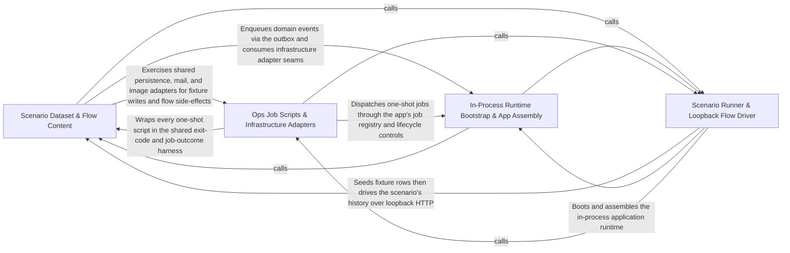

---
tags:
  - 2brain
  - 2brain/arch
  - project/boilerplate-node-backend
type: architecture
component: Scenario_Runner_Flow_Driver
---

## Details

The scenario registry and its two entry points — scenarios/apply.ts (the npm run scenario:apply CLI that boots the app in-process, seeds, and drives flows) and scenarios/run-server.ts (the npm run demo profile that serves the seeded app on NODE_PORT) — plus the loopback flow driver that runs the real checkout/payment/shipping endpoints against a throwaway 127.0.0.1 listener.

### Scenario Dataset & Flow Content [[Expand]](./Scenario_Dataset_Flow_Content.md)
The seedable content layer: the per-module fixture files that write the starting rows (products, accounts, users, addresses, wishlist, webhooks, locales, mail outbox/log) and the shop scenario's order book that is written by driving the app rather than by inserting rows. It also carries the one-shot script wrapper that gives every db:/ops: script a non-zero exit code, cleanup-on-failure, and a recorded job outcome.

**Related Classes/Methods**:

- `scripts.run-script.runScript`:106-118
- `scripts.run-script.refuseToRun`:32-48
- `src.kernel.outbox.relayOutbox`:328-344

**Source Files:**

- `scenarios/flows/shop-history.ts`
  - `scenarios.flows.shop-history.FillerOrder` (L58-L61) - Interface
- `scenarios/products.ts`
  - `scenarios.products.ProductCopy` (L51-L54) - Interface
- `scenarios/support/doubles/mail-log.ts`
  - `scenarios.support.doubles.mail-log.logMailTransport` (L20-L35) - Class
  - `scenarios.support.doubles.mail-log.logMailTransport.delivers` (L21-L21) - Method
  - `scenarios.support.doubles.mail-log.logMailTransport.send` (L22-L34) - Method
  - `scenarios.support.doubles.mail-log.logMailTransport.send.then() callback` (L23-L33) - Function
- `scenarios/support/doubles/mail-outbox.ts`
  - `scenarios.support.doubles.mail-outbox.DemoOutboxEmail` (L17-L42) - Interface
  - `scenarios.support.doubles.mail-outbox.recordDemoEmail.lines.filter() callback` (L67-L67) - Function
  - `scenarios.support.doubles.mail-outbox.recordDemoEmail.lines.map() callback` (L68-L68) - Function
  - `scenarios.support.doubles.mail-outbox.recordDemoEmail.attachments.request.attachments.map() callback` (L70-L70) - Function
  - `scenarios.support.doubles.mail-outbox.outboxMailTransport` (L84-L90) - Class
  - `scenarios.support.doubles.mail-outbox.outboxMailTransport.delivers` (L85-L85) - Method
  - `scenarios.support.doubles.mail-outbox.outboxMailTransport.send` (L86-L89) - Method
- `scenarios/support/doubles/payments/fake.ts`
  - `scenarios.support.doubles.payments.fake.KeyedAnswer` (L219-L224) - Interface
  - `scenarios.support.doubles.payments.fake.parseWebhook.then() callback` (L551-L556) - Function
- `scripts/run-script.ts`
  - `scripts.run-script.refuseToRun` (L32-L48) - Class
  - `scripts.run-script.then() callback` (L39-L39) - Function
  - `scripts.run-script.refuseToRun.then() callback` (L40-L46) - Function
  - `scripts.run-script.runScript` (L106-L118) - Class
  - `scripts.run-script.runScript.then() callback` (L117-L117) - Function
- `src/app/config-routes.ts`
  - `src.app.config-routes.router.get('/config') callback` (L35-L52) - Function
- `src/cluster.ts`
  - `src.cluster.supervise` (L41-L174) - Class
  - `src.cluster.supervise.startPrimaryShutdown.forceShutdownTimer` (L105-L113) - Class
  - `src.cluster.supervise.startPrimaryShutdown.forceShutdownTimer.setTimeout() callback` (L105-L113) - Function
  - `src.cluster.supervise.cluster.on('exit') callback` (L121-L170) - Function
  - `src.cluster.supervise.process.on('SIGTERM') callback` (L172-L172) - Function
  - `src.cluster.supervise.process.on('SIGINT') callback` (L173-L173) - Function
- `src/infrastructure/adapters/antibot-providers/altcha-store.ts`
  - `src.infrastructure.adapters.antibot-providers.altcha-store.claim` (L94-L100) - Class
  - `src.infrastructure.adapters.antibot-providers.altcha-store.claim.then() callback` (L99-L99) - Function
- `src/infrastructure/adapters/antibot-providers/altcha.ts`
  - `src.infrastructure.adapters.antibot-providers.altcha.issue` (L47-L59) - Class
  - `src.infrastructure.adapters.antibot-providers.altcha.issue.then() callback` (L56-L59) - Function
  - `src.infrastructure.adapters.antibot-providers.altcha.check` (L106-L125) - Class
  - `src.infrastructure.adapters.antibot-providers.altcha.then() callback` (L115-L120) - Function
  - `src.infrastructure.adapters.antibot-providers.altcha.check.then() callback.then() callback` (L119-L119) - Function
  - `src.infrastructure.adapters.antibot-providers.altcha.check.then() callback` (L123-L123) - Function
  - `src.infrastructure.adapters.antibot-providers.altcha.altchaProvider` (L128-L135) - Class
  - `src.infrastructure.adapters.antibot-providers.altcha.altchaProvider.publicParameters` (L132-L132) - Method
  - `src.infrastructure.adapters.antibot-providers.altcha.altchaProvider.verify` (L134-L134) - Method
  - `src.infrastructure.adapters.antibot-providers.altcha.altchaProvider.verify.catch() callback` (L134-L134) - Function
- `src/infrastructure/adapters/antibot-providers/index.ts`
  - `src.infrastructure.adapters.antibot-providers.index.HumanChallengeProvider` (L58-L90) - Interface
  - `src.infrastructure.adapters.antibot-providers.index.HumanChallengeProvider.publicParameters` (L71-L71) - Method
  - `src.infrastructure.adapters.antibot-providers.index.HumanChallengeProvider.verify` (L89-L89) - Method
- `src/infrastructure/adapters/antibot-providers/none.ts`
  - `src.infrastructure.adapters.antibot-providers.none.noneProvider` (L11-L15) - Class
  - `src.infrastructure.adapters.antibot-providers.none.noneProvider.publicParameters` (L13-L13) - Method
  - `src.infrastructure.adapters.antibot-providers.none.noneProvider.verify` (L14-L14) - Method
- `src/infrastructure/adapters/antibot-providers/turnstile.ts`
  - `src.infrastructure.adapters.antibot-providers.turnstile.siteverify` (L38-L57) - Class
  - `src.infrastructure.adapters.antibot-providers.turnstile.then() callback` (L52-L53) - Function
  - `src.infrastructure.adapters.antibot-providers.turnstile.siteverify.then() callback` (L55-L56) - Function
  - `src.infrastructure.adapters.antibot-providers.turnstile.turnstileProvider` (L60-L67) - Class
  - `src.infrastructure.adapters.antibot-providers.turnstile.turnstileProvider.publicParameters` (L62-L65) - Method
  - `src.infrastructure.adapters.antibot-providers.turnstile.turnstileProvider.verify` (L66-L66) - Method
  - `src.infrastructure.adapters.antibot-providers.turnstile.turnstileProvider.verify.catch() callback` (L66-L66) - Function
- `src/infrastructure/adapters/antibot.ts`
  - `src.infrastructure.adapters.antibot.addressesOf` (L48-L52) - Class
  - `src.infrastructure.adapters.antibot.addressesOf.lookup.catch() callback` (L49-L52) - Function
  - `src.infrastructure.adapters.antibot.hasAddressRecord` (L60-L70) - Class
  - `src.infrastructure.adapters.antibot.hasAddressRecord.then() callback` (L66-L69) - Function
  - `src.infrastructure.adapters.antibot.hasMxRecord` (L80-L95) - Class
  - `src.infrastructure.adapters.antibot.hasMxRecord.then() callback` (L83-L87) - Function
  - `src.infrastructure.adapters.antibot.hasMxRecord.then() callback.records.some() callback` (L86-L86) - Function
  - `src.infrastructure.adapters.antibot.hasMxRecord.catch() callback` (L88-L95) - Function
  - `src.infrastructure.adapters.antibot.checkEmailPolicy` (L107-L138) - Class
  - `src.infrastructure.adapters.antibot.checkEmailPolicy.then() callback` (L108-L138) - Function
  - `src.infrastructure.adapters.antibot.checkEmailPolicy.then() callback.then() callback` (L137-L137) - Function
- `src/infrastructure/adapters/cache.ts`
  - `src.infrastructure.adapters.cache.getCacheValue` (L105-L124) - Class
  - `src.infrastructure.adapters.cache.getCacheValue.then() callback` (L108-L114) - Function
  - `src.infrastructure.adapters.cache.getCacheValue.then() callback.then() callback` (L113-L113) - Function
  - `src.infrastructure.adapters.cache.getCacheValue.catch() callback` (L115-L124) - Function
  - `src.infrastructure.adapters.cache.setCacheValue` (L136-L191) - Class
  - `src.infrastructure.adapters.cache.setCacheValue.then() callback` (L152-L181) - Function
  - `src.infrastructure.adapters.cache.setCacheValue.then() callback.then() callback.cacheTags.map() callback` (L168-L174) - Function
  - `src.infrastructure.adapters.cache.setCacheValue.then() callback.then() callback` (L179-L179) - Function
  - `src.infrastructure.adapters.cache.setCacheValue.catch() callback` (L182-L190) - Function
  - `src.infrastructure.adapters.cache.indexUnderTag` (L209-L226) - Class
  - `src.infrastructure.adapters.cache.indexUnderTag.then() callback` (L224-L224) - Function
  - `src.infrastructure.adapters.cache.claimCacheRefresh` (L242-L261) - Class
  - `src.infrastructure.adapters.cache.claimCacheRefresh.then() callback` (L245-L251) - Function
  - `src.infrastructure.adapters.cache.claimCacheRefresh.then() callback.then() callback` (L250-L250) - Function
  - `src.infrastructure.adapters.cache.claimCacheRefresh.catch() callback` (L252-L261) - Function
  - `src.infrastructure.adapters.cache.invalidateCacheTags` (L273-L318) - Class
  - `src.infrastructure.adapters.cache.invalidateCacheTags.then() callback` (L279-L307) - Function
  - `src.infrastructure.adapters.cache.invalidateCacheTags.then() callback.cacheTags.map() callback` (L286-L302) - Function
  - `src.infrastructure.adapters.cache.then() callback.cacheTags.map() callback.then() callback` (L296-L296) - Function
  - `src.infrastructure.adapters.cache.invalidateCacheTags.then() callback.cacheTags.map() callback.then() callback.then() callback` (L300-L300) - Function
  - `src.infrastructure.adapters.cache.invalidateCacheTags.then() callback.then() callback` (L303-L306) - Function
  - `src.infrastructure.adapters.cache.invalidateCacheTags.then() callback.then() callback.deleted.perTag.reduce() callback` (L304-L304) - Function
  - `src.infrastructure.adapters.cache.invalidateCacheTags.catch() callback` (L308-L317) - Function
  - `src.infrastructure.adapters.cache.invalidateCacheTagsLogged` (L330-L345) - Class
  - `src.infrastructure.adapters.cache.invalidateCacheTagsLogged.then() callback` (L331-L345) - Function
  - `src.infrastructure.adapters.cache.ClearCacheResult` (L354-L365) - Interface
- `src/infrastructure/adapters/config.ts`
  - `src.infrastructure.adapters.config.mailConfig` (L28-L56) - Class
  - `src.infrastructure.adapters.config.mailConfig.check` (L44-L55) - Method
  - `src.infrastructure.adapters.config.mailConfig.check.SMTP_COMPANIONS.filter() callback` (L47-L47) - Function
  - `src.infrastructure.adapters.config.outboundConfig` (L132-L141) - Class
  - `src.infrastructure.adapters.config.outboundConfig.check` (L137-L140) - Method
  - `src.infrastructure.adapters.config.outboundConfig.check.config.NODE_OUTBOUND_ALLOWED_PORTS.filter() callback` (L139-L139) - Function
  - `src.infrastructure.adapters.config.outboundConfig.check.map() callback` (L140-L140) - Function
  - `src.infrastructure.adapters.config.antibotConfig` (L164-L192) - Class
  - `src.infrastructure.adapters.config.antibotConfig.check` (L176-L191) - Method
- `src/infrastructure/adapters/document-store.ts`
  - `src.infrastructure.adapters.document-store.readDocument` (L48-L60) - Class
  - `src.infrastructure.adapters.document-store.then() callback` (L53-L53) - Function
  - `src.infrastructure.adapters.document-store.readDocument.then() callback` (L54-L58) - Function
  - `src.infrastructure.adapters.document-store.writeDocument` (L71-L78) - Class
  - `src.infrastructure.adapters.document-store.writeDocument.then() callback` (L75-L76) - Function
  - `src.infrastructure.adapters.document-store.writeDocument.then() callback.writeFileAtomically() callback` (L76-L76) - Function
- `src/infrastructure/adapters/email.worker.ts`
  - `src.infrastructure.adapters.email.worker.discardJobAttachments` (L26-L29) - Class
  - `src.infrastructure.adapters.email.worker.discardJobAttachments.attachments.map() callback` (L29-L29) - Function
  - `src.infrastructure.adapters.email.worker.discardJobAttachments.then() callback` (L29-L29) - Function
  - `src.infrastructure.adapters.email.worker.handleEmailJob` (L40-L74) - Class
  - `src.infrastructure.adapters.email.worker.handleEmailJob.then() callback.then() callback` (L64-L64) - Function
  - `src.infrastructure.adapters.email.worker.handleEmailJob.catch() callback` (L65-L72) - Function
- `src/infrastructure/adapters/export-store.ts`
  - `src.infrastructure.adapters.export-store.writeExport` (L59-L78) - Class
  - `src.infrastructure.adapters.export-store.writeExport.then() callback` (L66-L76) - Function
  - `src.infrastructure.adapters.export-store.writeExport.then() callback.writeFileAtomically() callback` (L67-L75) - Function
  - `src.infrastructure.adapters.export-store.writeExport.then() callback.writeFileAtomically() callback.then() callback` (L68-L74) - Function
  - `src.infrastructure.adapters.export-store.writeExport.then() callback.writeFileAtomically() callback.then() callback.produce() callback` (L72-L72) - Function
  - `src.infrastructure.adapters.export-store.writeExport.then() callback.writeFileAtomically() callback.then() callback.produce() callback.then() callback` (L72-L72) - Function
  - `src.infrastructure.adapters.export-store.writeExport.then() callback.writeFileAtomically() callback.then() callback.finally() callback` (L72-L73) - Function
- `src/infrastructure/adapters/filesystem.ts`
  - `src.infrastructure.adapters.filesystem.deleteFile` (L50-L60) - Class
  - `src.infrastructure.adapters.filesystem.deleteFile.toolkitDeleteFile() callback` (L52-L59) - Function
  - `src.infrastructure.adapters.filesystem.unlinkIfPresent` (L76-L89) - Class
  - `src.infrastructure.adapters.filesystem.unlinkIfPresent.then() callback` (L83-L88) - Function
  - `src.infrastructure.adapters.filesystem.writeFileAtomically` (L100-L116) - Class
  - `src.infrastructure.adapters.filesystem.writeFileAtomically.then() callback` (L108-L108) - Function
  - `src.infrastructure.adapters.filesystem.writeFileAtomically.catch() callback` (L109-L114) - Function
  - `src.infrastructure.adapters.filesystem.writeFileAtomically.catch() callback.then() callback` (L112-L114) - Function
  - `src.infrastructure.adapters.filesystem.ReapResult` (L130-L133) - Interface
  - `src.infrastructure.adapters.filesystem.pruneUnreferenced` (L197-L230) - Class
  - `src.infrastructure.adapters.filesystem.pruneUnreferenced.catch() callback` (L203-L206) - Function
  - `src.infrastructure.adapters.filesystem.pruneUnreferenced.then() callback` (L207-L230) - Function
  - `src.infrastructure.adapters.filesystem.then() callback.orphaned.map() callback.then() callback` (L214-L221) - Function
  - `src.infrastructure.adapters.filesystem.pruneUnreferenced.then() callback.then() callback` (L226-L229) - Function
- `src/infrastructure/adapters/image-signatures.ts`
  - `src.infrastructure.adapters.image-signatures.hasMarker` (L86-L88) - Class
  - `src.infrastructure.adapters.image-signatures.hasMarker.marker.bytes.every() callback` (L88-L88) - Function
  - `src.infrastructure.adapters.image-signatures.identifyImage` (L96-L101) - Class
  - `src.infrastructure.adapters.image-signatures.identifyImage.SUPPORTED_IMAGE_FORMATS.find() callback` (L98-L100) - Function
  - `src.infrastructure.adapters.image-signatures.identifyImage.SUPPORTED_IMAGE_FORMATS.find() callback.every() callback` (L100-L100) - Function
- `src/infrastructure/adapters/image-store.ts`
  - `src.infrastructure.adapters.image-store.ImageStore` (L31-L109) - Interface
  - `src.infrastructure.adapters.image-store.ImageStore.quarantine` (L41-L41) - Method
  - `src.infrastructure.adapters.image-store.ImageStore.readQuarantined` (L50-L50) - Method
  - `src.infrastructure.adapters.image-store.ImageStore.removeQuarantined` (L61-L61) - Method
  - `src.infrastructure.adapters.image-store.ImageStore.promote` (L82-L82) - Method
  - `src.infrastructure.adapters.image-store.ImageStore.putDerivative` (L96-L96) - Method
  - `src.infrastructure.adapters.image-store.ImageStore.remove` (L108-L108) - Method
  - `src.infrastructure.adapters.image-store.writeAtomically` (L189-L190) - Class
  - `src.infrastructure.adapters.image-store.writeAtomically.writeFileAtomically() callback` (L190-L190) - Function
  - `src.infrastructure.adapters.image-store.filesystemImageStore` (L196-L255) - Class
  - `src.infrastructure.adapters.image-store.filesystemImageStore.quarantine` (L197-L205) - Method
  - `src.infrastructure.adapters.image-store.filesystemImageStore.readQuarantined` (L207-L207) - Method
  - `src.infrastructure.adapters.image-store.filesystemImageStore.removeQuarantined` (L209-L209) - Method
  - `src.infrastructure.adapters.image-store.filesystemImageStore.promote` (L211-L221) - Method
  - `src.infrastructure.adapters.image-store.filesystemImageStore.putDerivative` (L223-L230) - Method
  - `src.infrastructure.adapters.image-store.filesystemImageStore.remove` (L232-L254) - Method
  - `src.infrastructure.adapters.image-store.filesystemImageStore.remove.then() callback` (L252-L252) - Function
- `src/infrastructure/adapters/image.worker.ts`
  - `src.infrastructure.adapters.image.worker.UnsupportedImageFormatError` (L46-L48) - Class
  - `src.infrastructure.adapters.image.worker.digestQuarantinedImage` (L135-L166) - Class
  - `src.infrastructure.adapters.image.worker.digestQuarantinedImage.then() callback` (L136-L166) - Function
  - `src.infrastructure.adapters.image.worker.digestQuarantinedImage.then() callback.then() callback.then() callback` (L147-L147) - Function
  - `src.infrastructure.adapters.image.worker.digestQuarantinedImage.then() callback.catch() callback` (L149-L157) - Function
  - `src.infrastructure.adapters.image.worker.digestQuarantinedImage.then() callback.then() callback` (L165-L165) - Function
  - `src.infrastructure.adapters.image.worker.settleWriteback` (L188-L216) - Class
  - `src.infrastructure.adapters.image.worker.settleWriteback.then() callback` (L195-L216) - Function
  - `src.infrastructure.adapters.image.worker.settleWriteback.then() callback.then() callback` (L212-L212) - Function
  - `src.infrastructure.adapters.image.worker.settleWriteback.then() callback.clearQuarantine.then() callback` (L215-L215) - Function
  - `src.infrastructure.adapters.image.worker.handleImageDigestJob` (L228-L268) - Class
  - `src.infrastructure.adapters.image.worker.handleImageDigestJob.then() callback` (L249-L250) - Function
  - `src.infrastructure.adapters.image.worker.handleImageDigestJob.then() callback.then() callback` (L250-L250) - Function
  - `src.infrastructure.adapters.image.worker.handleImageDigestJob.catch() callback` (L252-L267) - Function
  - `src.infrastructure.adapters.image.worker.handleImageDigestJob.catch() callback.then() callback` (L258-L258) - Function
  - `src.infrastructure.adapters.image.worker.enqueueImageDigest.runInline` (L290-L299) - Class
  - `src.infrastructure.adapters.image.worker.enqueueImageDigest.runInline.then() callback` (L291-L298) - Function
  - `src.infrastructure.adapters.image.worker.enqueueImageDigest.runInline.then() callback.then() callback` (L298-L298) - Function
- `src/infrastructure/adapters/limits-redis.ts`
  - `src.infrastructure.adapters.limits-redis.connection.connect.then() callback` (L87-L87) - Function
  - `src.infrastructure.adapters.limits-redis.claimLimitsKey` (L160-L174) - Class
  - `src.infrastructure.adapters.limits-redis.claimLimitsKey.then() callback` (L168-L168) - Function
  - `src.infrastructure.adapters.limits-redis.claimLimitsKey.catch() callback` (L169-L173) - Function
- `src/infrastructure/adapters/logger.ts`
  - `src.infrastructure.adapters.logger.Logger.warn` (L47-L47) - Method
- `src/infrastructure/adapters/mail-spool.ts`
  - `src.infrastructure.adapters.mail-spool.discardSpooled` (L72-L79) - Class
  - `src.infrastructure.adapters.mail-spool.discardSpooled.then() callback` (L77-L77) - Function
- `src/infrastructure/adapters/mail-transports.ts`
  - `src.infrastructure.adapters.mail-transports.OutgoingMail` (L28-L40) - Interface
  - `src.infrastructure.adapters.mail-transports.MailTransportAdapter` (L43-L62) - Interface
  - `src.infrastructure.adapters.mail-transports.smtpTransport` (L67-L70) - Class
  - `src.infrastructure.adapters.mail-transports.smtpTransport.delivers` (L68-L68) - Method
  - `src.infrastructure.adapters.mail-transports.smtpTransport.send` (L69-L69) - Method
  - `src.infrastructure.adapters.mail-transports.smtpTransport.send.then() callback` (L69-L69) - Function
- `src/infrastructure/adapters/mailer.ts`
  - `src.infrastructure.adapters.mailer.resolveAttachments` (L58-L73) - Class
  - `src.infrastructure.adapters.mailer.resolveAttachments.attachments.map() callback` (L62-L72) - Function
  - `src.infrastructure.adapters.mailer.resolveAttachments.attachments.map() callback.then() callback` (L64-L64) - Function
  - `src.infrastructure.adapters.mailer.resolveAttachments.then() callback` (L73-L73) - Function
  - `src.infrastructure.adapters.mailer.renderMessage` (L87-L129) - Class
  - `src.infrastructure.adapters.mailer.renderMessage.then() callback` (L110-L129) - Function
  - `src.infrastructure.adapters.mailer.sendTemplatedEmail` (L150-L194) - Class
  - `src.infrastructure.adapters.mailer.sendTemplatedEmail.withSpan('email.send') callback` (L158-L193) - Function
  - `src.infrastructure.adapters.mailer.sendTemplatedEmail.withSpan('email.send') callback.then() callback.render` (L180-L180) - Method
  - `src.infrastructure.adapters.mailer.sendTemplatedEmail.withSpan('email.send') callback.then() callback` (L183-L189) - Function
  - `src.infrastructure.adapters.mailer.sendInline` (L222-L233) - Class
  - `src.infrastructure.adapters.mailer.sendInline.then() callback` (L228-L228) - Function
  - `src.infrastructure.adapters.mailer.sendInline.finally() callback` (L229-L232) - Function
  - `src.infrastructure.adapters.mailer.sendInline.finally() callback.map() callback` (L230-L230) - Function
  - `src.infrastructure.adapters.mailer.sendInline.finally() callback.then() callback` (L231-L231) - Function
- `src/infrastructure/adapters/pinned-https.ts`
  - `src.infrastructure.adapters.pinned-https.PinnedHttpsRequestOptions` (L17-L26) - Interface
  - `src.infrastructure.adapters.pinned-https.pinnedHttpsRequest` (L41-L72) - Class
  - `src.infrastructure.adapters.pinned-https.pinnedHttpsRequest.then() callback` (L46-L71) - Function
  - `src.infrastructure.adapters.pinned-https.pinnedHttpsRequest.then() callback.<function>` (L47-L71) - Function
- `src/infrastructure/adapters/remote-image.ts`
  - `src.infrastructure.adapters.remote-image.download` (L40-L50) - Class
  - `src.infrastructure.adapters.remote-image.download.then() callback` (L44-L50) - Function
  - `src.infrastructure.adapters.remote-image.digestBytes` (L57-L74) - Class
  - `src.infrastructure.adapters.remote-image.digestBytes.then() callback` (L63-L67) - Function
  - `src.infrastructure.adapters.remote-image.digestBytes.then() callback.finally() callback` (L65-L66) - Function
  - `src.infrastructure.adapters.remote-image.digestBytes.catch() callback` (L69-L72) - Function
  - `src.infrastructure.adapters.remote-image.digestBytes.catch() callback.then() callback` (L70-L72) - Function
  - `src.infrastructure.adapters.remote-image.rehostRemoteImage` (L83-L96) - Class
  - `src.infrastructure.adapters.remote-image.rehostRemoteImage.catch() callback` (L89-L95) - Function
- `src/infrastructure/adapters/smtp-transport.ts`
  - `src.infrastructure.adapters.smtp-transport.sendBySmtp` (L85-L86) - Class
  - `src.infrastructure.adapters.smtp-transport.sendBySmtp.then() callback` (L86-L86) - Function
- `src/infrastructure/adapters/ssrf-guard.ts`
  - `src.infrastructure.adapters.ssrf-guard.SsrfRefusedError` (L30-L43) - Class
  - `src.infrastructure.adapters.ssrf-guard.SsrfRefusedError.constructor` (L38-L42) - Constructor
  - `src.infrastructure.adapters.ssrf-guard.resolveAllAddresses.lookup` (L166-L176) - Class
  - `src.infrastructure.adapters.ssrf-guard.resolveAllAddresses.lookup.then() callback` (L166-L176) - Function
  - `src.infrastructure.adapters.ssrf-guard.buildPinnedLookup` (L231-L242) - Class
  - `src.infrastructure.adapters.ssrf-guard.buildPinnedLookup.<function>` (L233-L241) - Function
  - `src.infrastructure.adapters.ssrf-guard.resolveSafeOutboundTarget` (L263-L300) - Class
  - `src.infrastructure.adapters.ssrf-guard.resolveSafeOutboundTarget.then() callback` (L280-L299) - Function
  - `src.infrastructure.adapters.ssrf-guard.resolveSafeOutboundTarget.then() callback.then() callback` (L281-L299) - Function
- `src/infrastructure/config/define.ts`
  - `src.infrastructure.config.define.ConfigSlice` (L46-L58) - Interface
  - `src.infrastructure.config.define.ConfigSlice.inspect` (L57-L57) - Method
  - `src.infrastructure.config.define.ConfigDefinition` (L194-L204) - Interface
  - `src.infrastructure.config.define.ConfigDefinition.check` (L203-L203) - Method
  - `src.infrastructure.config.define.defineConfig.slice.inspect` (L245-L254) - Method
  - `src.infrastructure.config.define.configProblems.all` (L293-L293) - Class
  - `src.infrastructure.config.define.configProblems.all.slices.map() callback` (L293-L293) - Function
  - `src.infrastructure.config.define.defineProbe` (L364-L365) - Class
  - `src.infrastructure.config.define.defineProbe.check` (L365-L365) - Method
- `src/infrastructure/config/fields.ts`
  - `src.infrastructure.config.fields.Presence` (L57-L78) - Interface
  - `src.infrastructure.config.fields.Field` (L83-L90) - Interface
  - `src.infrastructure.config.fields.build` (L136-L147) - Function
  - `src.infrastructure.config.fields.int` (L196-L207) - Function
  - `src.infrastructure.config.fields.int.transform() callback` (L203-L203) - Function
  - `src.infrastructure.config.fields.decimal` (L216-L230) - Function
  - `src.infrastructure.config.fields.decimal.transform() callback` (L226-L226) - Function
  - `src.infrastructure.config.fields.flag` (L239-L253) - Function
  - `src.infrastructure.config.fields.choice` (L270-L292) - Function
  - `src.infrastructure.config.fields.choice.transform() callback` (L278-L278) - Function
  - `src.infrastructure.config.fields.choice.z.custom() callback` (L284-L286) - Function
  - `src.infrastructure.config.fields.choice.error` (L287-L287) - Method
  - `src.infrastructure.config.fields.text` (L323-L329) - Function
  - `src.infrastructure.config.fields.text.transform() callback` (L326-L326) - Function
  - `src.infrastructure.config.fields.email` (L338-L343) - Function
  - `src.infrastructure.config.fields.timeZone` (L376-L388) - Function
  - `src.infrastructure.config.fields.timeZone.transform() callback` (L380-L385) - Function
  - `src.infrastructure.config.fields.currency` (L398-L412) - Function
  - `src.infrastructure.config.fields.currency.transform() callback` (L402-L409) - Function
  - `src.infrastructure.config.fields.country` (L426-L435) - Class
  - `src.infrastructure.config.fields.country.transform() callback` (L428-L433) - Function
  - `src.infrastructure.config.fields.listRule` (L473-L479) - Class
  - `src.infrastructure.config.fields.listRule.transform() callback` (L474-L478) - Function
  - `src.infrastructure.config.fields.listRule.transform() callback.map() callback` (L477-L477) - Function
  - `src.infrastructure.config.fields.listRule.transform() callback.filter() callback` (L478-L478) - Function
  - `src.infrastructure.config.fields.csv` (L486-L490) - Class
  - `src.infrastructure.config.fields.csv.listRule() callback` (L488-L488) - Function
  - `src.infrastructure.config.fields.countries` (L498-L505) - Class
  - `src.infrastructure.config.fields.countries.listRule() callback` (L500-L500) - Function
  - `src.infrastructure.config.fields.countries.superRefine() callback` (L500-L503) - Function
  - `src.infrastructure.config.fields.countries.superRefine() callback.members.every() callback` (L501-L501) - Function
  - `src.infrastructure.config.fields.keyRing` (L513-L517) - Class
  - `src.infrastructure.config.fields.keyRing.listRule() callback` (L515-L515) - Function
- `src/infrastructure/config/store.ts`
  - `src.infrastructure.config.store.StoreState` (L24-L37) - Interface
  - `src.infrastructure.config.store.overrideEnvironment` (L113-L129) - Class
  - `src.infrastructure.config.store.overrideEnvironment.<function>` (L122-L128) - Function
- `src/infrastructure/http/config.ts`
  - `src.infrastructure.http.config.rateLimitBudgetConfig.shape.budgets.map() callback` (L100-L103) - Function
- `src/infrastructure/http/middlewares/cache.ts`
  - `src.infrastructure.http.middlewares.cache.armCacheWrite` (L349-L380) - Class
  - `src.infrastructure.http.middlewares.cache.armCacheWrite.<function>` (L357-L379) - Function
  - `src.infrastructure.http.middlewares.cache.serveOrArm` (L457-L539) - Class
  - `src.infrastructure.http.middlewares.cache.serveOrArm.then() callback` (L487-L532) - Function
  - `src.infrastructure.http.middlewares.cache.serveOrArm.then() callback.then() callback` (L516-L531) - Function
  - `src.infrastructure.http.middlewares.cache.invalidateCache` (L620-L631) - Class
  - `src.infrastructure.http.middlewares.cache.invalidateCache.<function>` (L621-L631) - Function
  - `src.infrastructure.http.middlewares.cache.invalidateCache.<function>.response.on('finish') callback` (L622-L628) - Function
- `src/infrastructure/http/middlewares/human-challenge.ts`
  - `src.infrastructure.http.middlewares.human-challenge.humanChallengeGate` (L36-L64) - Class
  - `src.infrastructure.http.middlewares.human-challenge.humanChallengeGate.then() callback` (L55-L61) - Function
  - `src.infrastructure.http.middlewares.human-challenge.humanChallengeGate.catch() callback` (L63-L63) - Function
- `src/infrastructure/http/middlewares/idempotency-model.ts`
  - `src.infrastructure.http.middlewares.idempotency-model.IdempotencyRecordDocument` (L28-L43) - Interface
- `src/infrastructure/http/middlewares/rate-limit.ts`
  - `src.infrastructure.http.middlewares.rate-limit.limiterLogger` (L190-L195) - Class
  - `src.infrastructure.http.middlewares.rate-limit.limiterLogger.warn` (L191-L192) - Method
  - `src.infrastructure.http.middlewares.rate-limit.limiterLogger.error` (L193-L194) - Method
- `src/infrastructure/http/middlewares/upload.ts`
  - `src.infrastructure.http.middlewares.upload.validateUploadedImages` (L255-L298) - Class
  - `src.infrastructure.http.middlewares.upload.validateUploadedImages.paths.map() callback` (L269-L269) - Function
  - `src.infrastructure.http.middlewares.upload.validateUploadedImages.then() callback` (L270-L296) - Function
  - `src.infrastructure.http.middlewares.upload.validateUploadedImages.then() callback.then() callback` (L293-L295) - Function
  - `src.infrastructure.http.middlewares.upload.validateUploadedImages.catch() callback` (L297-L297) - Function
  - `src.infrastructure.http.middlewares.upload.cleanupAfterPartialQuarantine` (L310-L319) - Class
  - `src.infrastructure.http.middlewares.upload.cleanupAfterPartialQuarantine.staged.map() callback` (L315-L315) - Function
  - `src.infrastructure.http.middlewares.upload.cleanupAfterPartialQuarantine.results.filter() callback` (L317-L317) - Function
  - `src.infrastructure.http.middlewares.upload.cleanupAfterPartialQuarantine.map() callback` (L318-L318) - Function
  - `src.infrastructure.http.middlewares.upload.releaseUnclaimedUpload` (L331-L339) - Class
  - `src.infrastructure.http.middlewares.upload.releaseUnclaimedUpload.response.once('close') callback` (L332-L338) - Function
  - `src.infrastructure.http.middlewares.upload.digestQuarantinedKeysInline` (L352-L380) - Class
  - `src.infrastructure.http.middlewares.upload.digestQuarantinedKeysInline.keys.map() callback` (L364-L364) - Function
  - `src.infrastructure.http.middlewares.upload.digestQuarantinedKeysInline.then() callback` (L366-L375) - Function
  - `src.infrastructure.http.middlewares.upload.digestQuarantinedKeysInline.then() callback.digested.map() callback` (L368-L368) - Function
  - `src.infrastructure.http.middlewares.upload.digestQuarantinedKeysInline.then() callback.keys.map() callback` (L372-L372) - Function
  - `src.infrastructure.http.middlewares.upload.digestQuarantinedKeysInline.then() callback.then() callback` (L372-L373) - Function
  - `src.infrastructure.http.middlewares.upload.digestQuarantinedKeysInline.catch() callback` (L376-L379) - Function
  - `src.infrastructure.http.middlewares.upload.digestQuarantinedKeysInline.catch() callback.keys.map() callback` (L377-L377) - Function
  - `src.infrastructure.http.middlewares.upload.digestQuarantinedKeysInline.catch() callback.then() callback` (L377-L378) - Function
  - `src.infrastructure.http.middlewares.upload.quarantineUploadedImages` (L394-L458) - Class
  - `src.infrastructure.http.middlewares.upload.quarantineUploadedImages.staged.map() callback` (L404-L404) - Function
  - `src.infrastructure.http.middlewares.upload.quarantineUploadedImages.then() callback` (L406-L452) - Function
  - `src.infrastructure.http.middlewares.upload.quarantineUploadedImages.then() callback.then() callback` (L409-L410) - Function
  - `src.infrastructure.http.middlewares.upload.quarantineUploadedImages.catch() callback` (L457-L457) - Function
- `src/infrastructure/http/read-capped-body.ts`
  - `src.infrastructure.http.read-capped-body.readCappedText` (L51-L57) - Class
  - `src.infrastructure.http.read-capped-body.readCappedText.then() callback` (L54-L55) - Function
- `src/infrastructure/http/uploads.ts`
  - `src.infrastructure.http.uploads.getFormFiles` (L24-L26) - Function
  - `src.infrastructure.http.uploads.RequestImage` (L29-L58) - Interface
  - `src.infrastructure.http.uploads.readUploadedImage` (L68-L113) - Class
  - `src.infrastructure.http.uploads.deleteUpload` (L88-L88) - Method
  - `src.infrastructure.http.uploads.readUploadedImage.deleteUpload` (L111-L111) - Method
- `src/infrastructure/i18n/catalog.ts`
  - `src.infrastructure.i18n.catalog.listSupportedLocales` (L62-L77) - Class
  - `src.infrastructure.i18n.catalog.listSupportedLocales.filter() callback` (L72-L72) - Function
  - `src.infrastructure.i18n.catalog.listSupportedLocales.map() callback` (L73-L73) - Function
  - `src.infrastructure.i18n.catalog.loadLocaleResources` (L177-L183) - Class
  - `src.infrastructure.i18n.catalog.loadLocaleResources.map() callback` (L179-L182) - Function
- `src/infrastructure/i18n/served.ts`
  - `src.infrastructure.i18n.served.ServedLanguages` (L17-L22) - Interface
  - `src.infrastructure.i18n.served.listServedLocales.fromFiles` (L55-L55) - Class
  - `src.infrastructure.i18n.served.listServedLocales.fromFiles.filter() callback` (L55-L55) - Function
- `src/infrastructure/observability/metric-config.ts`
  - `src.infrastructure.observability.metric-config.MetricData` (L15-L19) - Interface
- `src/infrastructure/observability/metrics-http.ts`
  - `src.infrastructure.observability.metrics-http.RequestMetricInput` (L93-L99) - Interface
- `src/infrastructure/observability/tracer.ts`
  - `src.infrastructure.observability.tracer.withSpan` (L37-L77) - Class
  - `src.infrastructure.observability.tracer.withSpan.tracer.startActiveSpan() callback` (L42-L76) - Function
  - `src.infrastructure.observability.tracer.withSpan.tracer.startActiveSpan() callback.then() callback` (L60-L74) - Function
- `src/infrastructure/persistence/command-metrics.ts`
  - `src.infrastructure.persistence.command-metrics.PendingCommand` (L29-L32) - Interface
  - `src.infrastructure.persistence.command-metrics.observeDatabaseCommands` (L56-L84) - Class
  - `src.infrastructure.persistence.command-metrics.observeDatabaseCommands.client.on('commandStarted') callback` (L76-L81) - Function
  - `src.infrastructure.persistence.command-metrics.observeDatabaseCommands.client.on('commandSucceeded') callback` (L82-L82) - Function
  - `src.infrastructure.persistence.command-metrics.observeDatabaseCommands.client.on('commandFailed') callback` (L83-L83) - Function
- `src/infrastructure/persistence/factories.ts`
  - `src.infrastructure.persistence.factories.FactoryIdentity` (L16-L23) - Interface
- `src/infrastructure/persistence/lease.ts`
  - `src.infrastructure.persistence.lease.recordJobOutcome` (L205-L234) - Class
  - `src.infrastructure.persistence.lease.recordJobOutcome.catch() callback` (L225-L234) - Function
- `src/infrastructure/runtime/cluster-policy.ts`
  - `src.infrastructure.runtime.cluster-policy.CrashPolicy` (L27-L36) - Interface
  - `src.infrastructure.runtime.cluster-policy.recentCrashes` (L51-L54) - Class
  - `src.infrastructure.runtime.cluster-policy.crashVerdict.recentCrashes.history.filter() callback` (L52-L52) - Function
- `src/infrastructure/runtime/database.ts`
  - `src.infrastructure.runtime.database.start.attemptConnect` (L134-L161) - Class
  - `src.infrastructure.runtime.database.start.attemptConnect.then() callback` (L140-L160) - Function
  - `src.infrastructure.runtime.database.start.attemptConnect.then() callback.then() callback` (L159-L159) - Function
  - `src.infrastructure.runtime.database.watchConnection` (L184-L193) - Class
  - `src.infrastructure.runtime.database.watchConnection.mongoose.connection.on('disconnected') callback` (L188-L190) - Function
  - `src.infrastructure.runtime.database.watchConnection.mongoose.connection.on('reconnected') callback` (L191-L191) - Function
- `src/infrastructure/security/breached-passwords/index.ts`
  - `src.infrastructure.security.breached-passwords.index.bundledList` (L32-L36) - Class
  - `src.infrastructure.security.breached-passwords.index.bundledList.filter() callback` (L35-L35) - Function
  - `src.infrastructure.security.breached-passwords.index.checkHibpRange` (L58-L95) - Class
  - `src.infrastructure.security.breached-passwords.index.checkHibpRange.then() callback` (L79-L85) - Function
  - `src.infrastructure.security.breached-passwords.index.checkHibpRange.then() callback.match` (L80-L83) - Class
  - `src.infrastructure.security.breached-passwords.index.checkHibpRange.then() callback.match.map() callback` (L82-L82) - Function
  - `src.infrastructure.security.breached-passwords.index.checkHibpRange.then() callback.match.find() callback` (L83-L83) - Function
  - `src.infrastructure.security.breached-passwords.index.checkHibpRange.catch() callback` (L86-L94) - Function
- `src/kernel/events.ts`
  - `src.kernel.events.DomainEventMap` (L21-L21) - Interface
  - `src.kernel.events.DomainEventMeta` (L35-L41) - Interface
- `src/kernel/outbox.ts`
  - `src.kernel.outbox.relayOutbox` (L328-L344) - Class
  - `src.kernel.outbox.nudgeOutbox.pass` (L356-L362) - Class
  - `src.kernel.outbox.nudgeOutbox.pass.catch() callback` (L356-L362) - Function
- `src/kernel/registry.ts`
  - `src.kernel.registry.resolvePublicEvents` (L639-L647) - Class
  - `src.kernel.registry.resolvePublicEvents.appModules.flatMap() callback` (L645-L645) - Function
- `src/modules/account/emails.ts`
  - `src.modules.account.emails.twoFactorChangedEmail` (L252-L268) - Class
  - `src.modules.account.emails.twoFactorChangedEmail.body` (L262-L265) - Method
  - `src.modules.account.emails.signInMethodChangedEmail` (L283-L299) - Class
  - `src.modules.account.emails.signInMethodChangedEmail.body` (L293-L296) - Method
  - `src.modules.account.emails.twoFactorLockedEmail` (L308-L323) - Class
  - `src.modules.account.emails.twoFactorLockedEmail.body` (L317-L320) - Method
  - `src.modules.account.emails.passwordChangedEmail` (L367-L378) - Class
  - `src.modules.account.emails.passwordChangedEmail.body` (L372-L375) - Method
- `src/modules/account/oauth/config.ts`
  - `src.modules.account.oauth.config.oauthConfig` (L29-L37) - Class
- `src/modules/account/oauth/providers/client.ts`
  - `src.modules.account.oauth.providers.client.providerFetch` (L25-L44) - Class
  - `src.modules.account.oauth.providers.client.providerFetch.signal.filter() callback` (L31-L31) - Function
  - `src.modules.account.oauth.providers.client.providerFetch.then() callback` (L35-L43) - Function
  - `src.modules.account.oauth.providers.client.providerFetch.then() callback.then() callback` (L37-L42) - Function
- `src/modules/account/services/oauth.ts`
  - `src.modules.account.services.oauth.notifySignInMethod` (L129-L147) - Class
  - `src.modules.account.services.oauth.notifySignInMethod.catch() callback` (L144-L146) - Function
  - `src.modules.account.services.oauth.discardAvatar` (L235-L238) - Class
  - `src.modules.account.services.oauth.discardAvatar.then() callback` (L236-L238) - Function
  - `src.modules.account.services.oauth.unlinkOAuthProvider` (L419-L438) - Class
  - `src.modules.account.services.oauth.unlinkOAuthProvider.then() callback` (L424-L438) - Function
  - `src.modules.account.services.oauth.unlinkOAuthProvider.then() callback.then() callback` (L434-L437) - Function
- `src/modules/account/services/password.ts`
  - `src.modules.account.services.password.notifyPasswordChanged` (L170-L181) - Class
  - `src.modules.account.services.password.notifyPasswordChanged.catch() callback` (L178-L180) - Function
- `src/modules/account/services/two-factor-outcomes.ts`
  - `src.modules.account.services.two-factor-outcomes.notifyChange` (L55-L73) - Class
  - `src.modules.account.services.two-factor-outcomes.notifyChange.catch() callback` (L70-L72) - Function
  - `src.modules.account.services.two-factor-outcomes.notifyLocked` (L130-L142) - Class
  - `src.modules.account.services.two-factor-outcomes.notifyLocked.catch() callback` (L139-L141) - Function
- `src/modules/account/two-factor/totp.ts`
  - `src.modules.account.two-factor.totp.TotpVerification` (L76-L81) - Interface
- `src/modules/addresses/factories.ts`
  - `src.modules.addresses.factories.AddressBookOverrides` (L14-L19) - Interface
- `src/modules/antibot/service.ts`
  - `src.modules.antibot.service.antibotService` (L26-L38) - Class
  - `src.modules.antibot.service.antibotService.config` (L27-L37) - Method
  - `src.modules.antibot.service.antibotService.config.then() callback` (L30-L37) - Function
- `src/modules/api-keys/services/api-keys.ts`
  - `src.modules.api-keys.services.api-keys.notifyMinted` (L87-L120) - Class
  - `src.modules.api-keys.services.api-keys.notifyMinted.then() callback` (L90-L116) - Function
  - `src.modules.api-keys.services.api-keys.notifyMinted.catch() callback` (L117-L119) - Function
  - `src.modules.api-keys.services.api-keys.notifyRevoked` (L314-L340) - Class
  - `src.modules.api-keys.services.api-keys.notifyRevoked.then() callback` (L321-L333) - Function
  - `src.modules.api-keys.services.api-keys.notifyRevoked.catch() callback` (L334-L340) - Function
- `src/modules/audit-logs/service.ts`
  - `src.modules.audit-logs.service.record` (L35-L47) - Class
  - `src.modules.audit-logs.service.record.catch() callback` (L36-L46) - Function
- `src/modules/delivery/services/preorder-sweep.ts`
  - `src.modules.delivery.services.preorder-sweep.PreorderSweepResult` (L25-L28) - Interface
- `src/modules/example/services/personal-data.ts`
  - `src.modules.example.services.personal-data.eraseForUser` (L53-L61) - Class
  - `src.modules.example.services.personal-data.eraseForUser.then() callback` (L57-L60) - Function
  - `src.modules.example.services.personal-data.eraseForUser.then() callback.<function>` (L57-L60) - Function
  - `src.modules.example.services.personal-data.eraseForUser.then() callback.<function>.imageUrls.map() callback` (L58-L58) - Function
  - `src.modules.example.services.personal-data.eraseForUser.then() callback.<function>.then() callback` (L59-L59) - Function
- `src/modules/invoicing/presenter.ts`
  - `src.modules.invoicing.presenter.ExportedDocument` (L13-L19) - Interface
- `src/modules/invoicing/providers/index.ts`
  - `src.modules.invoicing.providers.index.EInvoicingProvider` (L36-L47) - Interface
  - `src.modules.invoicing.providers.index.EInvoicingProvider.issue` (L46-L46) - Method
- `src/modules/invoicing/providers/pdf.ts`
  - `src.modules.invoicing.providers.pdf.pdfEInvoicingProvider` (L37-L50) - Class
  - `src.modules.invoicing.providers.pdf.pdfEInvoicingProvider.issue` (L40-L49) - Method
  - `src.modules.invoicing.providers.pdf.issue.then() callback` (L48-L48) - Function
  - `src.modules.invoicing.providers.pdf.pdfEInvoicingProvider.issue.then() callback` (L49-L49) - Function
- `src/modules/invoicing/services/render.ts`
  - `src.modules.invoicing.services.render.readStored` (L56-L65) - Class
  - `src.modules.invoicing.services.render.readStored.catch() callback` (L57-L65) - Function
  - `src.modules.invoicing.services.render.storeBestEffort` (L73-L81) - Class
  - `src.modules.invoicing.services.render.then() callback` (L75-L75) - Function
  - `src.modules.invoicing.services.render.storeBestEffort.then() callback` (L76-L80) - Function
  - `src.modules.invoicing.services.render.storedOrRendered` (L91-L97) - Class
  - `src.modules.invoicing.services.render.storedOrRendered.then() callback.then() callback` (L95-L95) - Function
  - `src.modules.invoicing.services.render.renderInvoicePdf` (L115-L118) - Class
  - `src.modules.invoicing.services.render.renderInvoicePdf.storedOrRendered() callback` (L116-L117) - Function
  - `src.modules.invoicing.services.render.renderCreditNotePdf` (L125-L132) - Class
  - `src.modules.invoicing.services.render.renderCreditNotePdf.storedOrRendered() callback` (L126-L131) - Function
- `src/modules/locales/services/actions.ts`
  - `src.modules.locales.services.actions.LanguageStanding` (L19-L24) - Interface
- `src/modules/locales/services/capabilities.ts`
  - `src.modules.locales.services.capabilities.mergeCapabilities` (L129-L155) - Class
  - `src.modules.locales.services.capabilities.mergeCapabilities.toSorted() callback` (L154-L154) - Function
  - `src.modules.locales.services.capabilities.readDynamicTier` (L162-L188) - Class
  - `src.modules.locales.services.capabilities.readDynamicTier.then() callback` (L176-L180) - Function
  - `src.modules.locales.services.capabilities.readDynamicTier.catch() callback` (L181-L188) - Function
  - `src.modules.locales.services.capabilities.listCapabilities` (L218-L237) - Class
  - `src.modules.locales.services.capabilities.listCapabilities.then() callback` (L222-L237) - Function
  - `src.modules.locales.services.capabilities.readLanguage.then() callback.language` (L256-L256) - Class
  - `src.modules.locales.services.capabilities.readLanguage.then() callback.language.locales.find() callback` (L256-L256) - Function
  - `src.modules.locales.services.capabilities.describeStoredLanguage` (L267-L281) - Class
  - `src.modules.locales.services.capabilities.describeStoredLanguage.then() callback` (L271-L281) - Function
- `src/modules/locales/services/entries.ts`
  - `src.modules.locales.services.entries.rejectBadBatch.keys` (L254-L254) - Class
  - `src.modules.locales.services.entries.rejectBadBatch.keys.inputs.map() callback` (L254-L254) - Function
  - `src.modules.locales.services.entries.rejectBadBatch.badKey` (L256-L256) - Class
  - `src.modules.locales.services.entries.rejectBadBatch.badKey.keys.find() callback` (L256-L256) - Function
  - `src.modules.locales.services.entries.importEntries.inputs` (L298-L301) - Class
  - `src.modules.locales.services.entries.importEntries.inputs.map() callback` (L298-L301) - Function
  - `src.modules.locales.services.entries.importEntries.written` (L307-L307) - Class
  - `src.modules.locales.services.entries.importEntries.written.inputs.filter() callback` (L307-L307) - Function
  - `src.modules.locales.services.entries.importEntries.written.map() callback` (L307-L307) - Function
  - `src.modules.locales.services.entries.importEntries.deleted` (L308-L308) - Class
  - `src.modules.locales.services.entries.importEntries.deleted.inputs.filter() callback` (L308-L308) - Function
  - `src.modules.locales.services.entries.importEntries.deleted.map() callback` (L308-L308) - Function
  - `src.modules.locales.services.entries.importEntries.survivors` (L330-L331) - Class
  - `src.modules.locales.services.entries.importEntries.survivors.stored.filter() callback` (L331-L331) - Function
- `src/modules/locales/services/keys.ts`
  - `src.modules.locales.services.keys.findUnsafeKeySegment` (L102-L103) - Class
  - `src.modules.locales.services.keys.findUnsafeKeySegment.find() callback` (L103-L103) - Function
- `src/modules/locales/services/messages.ts`
  - `src.modules.locales.services.messages.readMessages` (L34-L52) - Class
  - `src.modules.locales.services.messages.readMessages.then() callback` (L41-L51) - Function
  - `src.modules.locales.services.messages.readMessages.then() callback.then() callback` (L44-L49) - Function
  - `src.modules.locales.services.messages.readApiOverrides` (L64-L92) - Class
  - `src.modules.locales.services.messages.readApiOverrides.then() callback` (L65-L92) - Function
  - `src.modules.locales.services.messages.readLocaleOverlay` (L99-L104) - Class
  - `src.modules.locales.services.messages.readLocaleOverlay.then() callback` (L104-L104) - Function
- `src/modules/locales/services/translatables.ts`
  - `src.modules.locales.services.translatables.translatableCacheTags` (L34-L36) - Class
  - `src.modules.locales.services.translatables.translatableCacheTags.flatMap() callback` (L35-L35) - Function
- `src/modules/locales/services/translations.ts`
  - `src.modules.locales.services.translations.planSlot.planFields.unknownField` (L118-L120) - Class
  - `src.modules.locales.services.translations.planSlot.planFields.unknownField.find() callback` (L119-L119) - Function
  - `src.modules.locales.services.translations.writePlannedTranslations.fallbackWrite` (L246-L249) - Class
  - `src.modules.locales.services.translations.writePlannedTranslations.fallbackWrite.planned.find() callback` (L247-L248) - Function
  - `src.modules.locales.services.translations.planForPort` (L261-L277) - Class
  - `src.modules.locales.services.translations.planForPort.then() callback` (L265-L276) - Function
  - `src.modules.locales.services.translations.planForPort.then() callback.planned.plan.planned.map() callback` (L271-L274) - Function
  - `src.modules.locales.services.translations.writeForPort` (L283-L302) - Class
  - `src.modules.locales.services.translations.writeForPort.writePlan.planned.map() callback` (L295-L298) - Function
  - `src.modules.locales.services.translations.applyTranslationBatch` (L317-L361) - Class
  - `src.modules.locales.services.translations.applyTranslationBatch.withTransaction() callback` (L335-L345) - Function
  - `src.modules.locales.services.translations.applyTranslationBatch.metadata.upserted.map() callback` (L355-L355) - Function
  - `src.modules.locales.services.translations.applyTranslationBatch.metadata.upserted.planned.filter() callback` (L355-L355) - Function
  - `src.modules.locales.services.translations.applyTranslationBatch.metadata.deleted.map() callback` (L356-L356) - Function
  - `src.modules.locales.services.translations.applyTranslationBatch.metadata.deleted.planned.filter() callback` (L356-L356) - Function
  - `src.modules.locales.services.translations.replaceEntityTranslations.checkedLocales` (L421-L421) - Class
  - `src.modules.locales.services.translations.replaceEntityTranslations.checkedLocales.existing.map() callback` (L421-L421) - Function
  - `src.modules.locales.services.translations.replaceEntityTranslations.deletions` (L424-L426) - Class
  - `src.modules.locales.services.translations.replaceEntityTranslations.deletions.filter() callback` (L425-L425) - Function
  - `src.modules.locales.services.translations.replaceEntityTranslations.deletions.map() callback` (L425-L425) - Function
  - `src.modules.locales.services.translations.getEntityTranslations` (L437-L452) - Class
  - `src.modules.locales.services.translations.getEntityTranslations.then() callback` (L444-L450) - Function
- `src/modules/payments/config.ts`
  - `src.modules.payments.config.PaymentMethodInfo` (L70-L74) - Interface
  - `src.modules.payments.config.webhookSecretRing` (L127-L128) - Class
  - `src.modules.payments.config.webhookSecretRing.map() callback` (L128-L128) - Function
  - `src.modules.payments.config.paymentsConfig` (L139-L168) - Class
  - `src.modules.payments.config.paymentsConfig.check` (L159-L167) - Method
  - `src.modules.payments.config.paymentsConfig.check.some() callback` (L162-L162) - Function
- `src/modules/payments/repository.ts`
  - `src.modules.payments.repository.MixSums` (L109-L113) - Interface
  - `src.modules.payments.repository.RecordedDispute` (L116-L123) - Interface
  - `src.modules.payments.repository.RefundRow` (L126-L131) - Interface
  - `src.modules.payments.repository.RefundFilters` (L134-L142) - Interface
  - `src.modules.payments.repository.UpsertedPayment` (L239-L242) - Interface
  - `src.modules.payments.repository.paymentRepository.findByProviderRef` (L486-L487) - Method
- `src/modules/payments/services/disputes.ts`
  - `src.modules.payments.services.disputes.applyDisputeDelivery` (L167-L194) - Class
  - `src.modules.payments.services.disputes.applyDisputeDelivery.then() callback` (L182-L193) - Function
- `src/modules/payments/services/refund-settlement.ts`
  - `src.modules.payments.services.refund-settlement.announceInTransaction() callback` (L279-L311) - Function
- `src/modules/payments/services/settlement.ts`
  - `src.modules.payments.services.settlement.applyDisputeEvent` (L770-L788) - Class
  - `src.modules.payments.services.settlement.applyDisputeEvent.then() callback` (L775-L788) - Function
  - `src.modules.payments.services.settlement.applyRefundDelivery` (L799-L817) - Class
  - `src.modules.payments.services.settlement.applyRefundDelivery.then() callback` (L804-L817) - Function
  - `src.modules.payments.services.settlement.applyWebhookSettlement` (L857-L881) - Class
  - `src.modules.payments.services.settlement.applyWebhookSettlement.then() callback` (L858-L881) - Function
  - `src.modules.payments.services.settlement.applyWebhookSettlement.then() callback.then() callback` (L870-L880) - Function
- `src/modules/payments/services/transfer.ts`
  - `src.modules.payments.services.transfer.openTransferPayment` (L29-L52) - Class
  - `src.modules.payments.services.transfer.openTransferPayment.then() callback` (L30-L52) - Function
  - `src.modules.payments.services.transfer.openTransferPayment.then() callback.then() callback` (L41-L51) - Function
- `src/modules/products/services/lookups.ts`
  - `src.modules.products.services.lookups.isLive` (L39-L42) - Class
  - `src.modules.products.services.lookups.isLive.then() callback` (L42-L42) - Function
- `src/modules/products/services/remove.ts`
  - `src.modules.products.services.remove.announceDeleted` (L35-L48) - Class
  - `src.modules.products.services.remove.announceDeleted.then() callback` (L41-L46) - Function
  - `src.modules.products.services.remove.announceDeleted.then() callback.announceInTransaction() callback` (L42-L46) - Function
  - `src.modules.products.services.remove.remove` (L63-L105) - Class
  - `src.modules.products.services.remove.announceDeleted() callback` (L85-L89) - Function
  - `src.modules.products.services.remove.announceDeleted() callback.then() callback` (L88-L88) - Function
  - `src.modules.products.services.remove.remove.announceDeleted() callback.then() callback` (L89-L89) - Function
  - `src.modules.products.services.remove.remove.announceDeleted() callback` (L99-L100) - Function
  - `src.modules.products.services.remove.remove.then() callback` (L101-L104) - Function
- `src/modules/sitemap/service.ts`
  - `src.modules.sitemap.service.Languages` (L20-L25) - Interface
- `src/modules/stats/domain/calendar.ts`
  - `src.modules.stats.domain.calendar.CalendarDay` (L12-L16) - Interface
- `src/modules/stats/domain/range.ts`
  - `src.modules.stats.domain.range.CalendarRange` (L27-L33) - Interface
- `src/modules/stats/services/range.ts`
  - `src.modules.stats.services.range.resolvePeriod.period.bucketStarts.range.bucketStarts.map() callback` (L81-L81) - Function
- `src/modules/stock-alerts/emails.ts`
  - `src.modules.stock-alerts.emails.BackInStockEmailInput` (L12-L17) - Interface
- `src/modules/users/emails.ts`
  - `src.modules.users.emails.PurchaseHoldNotice` (L15-L28) - Interface
- `src/modules/users/services/update.ts`
  - `src.modules.users.services.update.finishUpdate.imageCleanup` (L310-L312) - Class
  - `src.modules.users.services.update.finishUpdate.imageCleanup.then() callback` (L332-L332) - Function
- `src/modules/webhooks/module.ts`
  - `src.modules.webhooks.module.onRegistered` (L35-L44) - Class
  - `src.modules.webhooks.module.onRegistered.modules.map() callback` (L37-L37) - Function
- `src/modules/webhooks/transport/webhook-delivery.ts`
  - `src.modules.webhooks.transport.webhook-delivery.WebhookDeliveryAttempt` (L31-L42) - Interface
  - `src.modules.webhooks.transport.webhook-delivery.WebhookDeliveryResult` (L45-L54) - Interface
  - `src.modules.webhooks.transport.webhook-delivery.deliverWebhook` (L106-L158) - Class
  - `src.modules.webhooks.transport.webhook-delivery.then() callback` (L114-L131) - Function
  - `src.modules.webhooks.transport.webhook-delivery.deliverWebhook.then() callback` (L132-L150) - Function
  - `src.modules.webhooks.transport.webhook-delivery.deliverWebhook.catch() callback` (L152-L156) - Function
- `src/modules/webhooks/transport/webhook-signing.ts`
  - `src.modules.webhooks.transport.webhook-signing.WebhookSignatureHeaders` (L33-L40) - Interface
  - `src.modules.webhooks.transport.webhook-signing.SignWebhookPayloadInput` (L43-L55) - Interface
  - `src.modules.webhooks.transport.webhook-signing.signWebhookPayload.signatures` (L119-L123) - Class
  - `src.modules.webhooks.transport.webhook-signing.signWebhookPayload.signatures.input.secrets.map() callback` (L120-L121) - Function

### In-Process Runtime Bootstrap & App Assembly [[Expand]](./In_Process_Runtime_Bootstrap_App_Assembly.md)
The harness that lets both entry points run the real application without Docker/Redis/broker: it starts an in-process single-member mongod replica set (needed for multi-document transactions), installs the app's cross-cutting extensions (error handling, static assets, telemetry), and provides the outbox relay/claim/dispatch machinery the seeded flows depend on.

**Related Classes/Methods**:

- `scenarios.support.ephemeral-mongod.startInProcessMongod`:48-90
- `src.app.error-handling.installErrorHandling`:215-240
- `src.app.telemetry.installTelemetry`:22-44
- `src.app.static-assets.installStatic`:19-52
- `src.kernel.outbox.claim`:213-226

**Source Files:**

- `scenarios/support/doubles/payments/levers.ts`
  - `scenarios.support.doubles.payments.levers.REFUND_FAILURE_BODY.orderId.refine('not an order id') callback` (L28-L28) - Function
  - `scenarios.support.doubles.payments.levers.DISPUTE_BODY.orderId.refine('not an order id') callback` (L39-L39) - Function
  - `scenarios.support.doubles.payments.levers.providerRefOf` (L60-L61) - Class
  - `scenarios.support.doubles.payments.levers.providerRefOf.then() callback` (L61-L61) - Function
  - `scenarios.support.doubles.payments.levers.installDisputeLever` (L68-L106) - Class
  - `scenarios.support.doubles.payments.levers.installDisputeLever.app.post('/__test/payments/dispute') callback` (L69-L105) - Function
  - `scenarios.support.doubles.payments.levers.installDisputeLever.app.post('/__test/payments/dispute') callback.then() callback` (L78-L99) - Function
  - `scenarios.support.doubles.payments.levers.installDisputeLever.app.post('/__test/payments/dispute') callback.then() callback.then() callback` (L98-L98) - Function
  - `scenarios.support.doubles.payments.levers.installDisputeLever.app.post('/__test/payments/dispute') callback.catch() callback` (L100-L104) - Function
  - `scenarios.support.doubles.payments.levers.installLever` (L112-L137) - Class
  - `scenarios.support.doubles.payments.levers.installLever.app.post('/__test/payments/refund-failure') callback` (L114-L136) - Function
  - `scenarios.support.doubles.payments.levers.installLever.app.post('/__test/payments/refund-failure') callback.then() callback` (L122-L130) - Function
  - `scenarios.support.doubles.payments.levers.installLever.app.post('/__test/payments/refund-failure') callback.catch() callback` (L131-L135) - Function
- `scenarios/support/ephemeral-mongod.ts`
  - `scenarios.support.ephemeral-mongod.startInProcessMongod` (L48-L90) - Class
  - `scenarios.support.ephemeral-mongod.startInProcessMongod.catch() callback` (L85-L88) - Function
  - `scenarios.support.ephemeral-mongod.startInProcessMongod.finally() callback` (L89-L89) - Function
- `src/app/config-routes.ts`
  - `src.app.config-routes.router.get('/config') callback.then() callback` (L38-L50) - Function
- `src/app/error-handling.ts`
  - `src.app.error-handling.installErrorHandling` (L215-L240) - Class
  - `src.app.error-handling.installErrorHandling.process.on('uncaughtException') callback` (L228-L239) - Function
- `src/app/static-assets.ts`
  - `src.app.static-assets.installStatic` (L19-L52) - Class
  - `src.app.static-assets.installStatic.setHeaders` (L44-L49) - Method
- `src/app/telemetry.ts`
  - `src.app.telemetry.installTelemetry` (L22-L44) - Class
  - `src.app.telemetry.installTelemetry.app.use() callback` (L26-L43) - Function
  - `src.app.telemetry.installTelemetry.app.use() callback.response.once('finish') callback` (L32-L41) - Function
- `src/cluster.ts`
  - `src.cluster.then() callback` (L183-L183) - Function
  - `src.cluster.catch() callback` (L197-L203) - Function
- `src/infrastructure/adapters/cache.ts`
  - `src.infrastructure.adapters.cache.cacheConnection` (L44-L69) - Class
  - `src.infrastructure.adapters.cache.cacheConnection.isReady` (L50-L50) - Method
  - `src.infrastructure.adapters.cache.cacheConnection.connect` (L51-L67) - Method
  - `src.infrastructure.adapters.cache.cacheConnection.connect.then() callback` (L66-L66) - Function
- `src/infrastructure/adapters/limits-redis.ts`
  - `src.infrastructure.adapters.limits-redis.buildLimitsClient` (L48-L56) - Class
  - `src.infrastructure.adapters.limits-redis.buildLimitsClient.redisClient.on('error') callback` (L53-L53) - Function
  - `src.infrastructure.adapters.limits-redis.connectionFor` (L66-L114) - Class
  - `src.infrastructure.adapters.limits-redis.connectionFor.connection` (L75-L103) - Class
  - `src.infrastructure.adapters.limits-redis.connectionFor.connection.isEnabled` (L81-L81) - Method
  - `src.infrastructure.adapters.limits-redis.connectionFor.connection.connect` (L82-L94) - Method
  - `src.infrastructure.adapters.limits-redis.connectionFor.connection.connect.then() callback` (L88-L92) - Function
  - `src.infrastructure.adapters.limits-redis.connectionFor.connection.isReady` (L95-L95) - Method
  - `src.infrastructure.adapters.limits-redis.connectionFor.connection.close` (L96-L99) - Method
  - `src.infrastructure.adapters.limits-redis.connectionFor.connection.onRecovered` (L100-L102) - Method
  - `src.infrastructure.adapters.limits-redis.connectionFor.forget` (L107-L110) - Method
  - `src.infrastructure.adapters.limits-redis.sendToLimits` (L127-L138) - Class
  - `src.infrastructure.adapters.limits-redis.sendToLimits.then() callback` (L130-L136) - Function
  - `src.infrastructure.adapters.limits-redis.sendToLimits.then() callback.catch() callback` (L131-L136) - Function
  - `src.infrastructure.adapters.limits-redis.isLimitsKeyClaimed` (L184-L195) - Class
  - `src.infrastructure.adapters.limits-redis.isLimitsKeyClaimed.then() callback` (L189-L189) - Function
  - `src.infrastructure.adapters.limits-redis.isLimitsKeyClaimed.catch() callback` (L190-L194) - Function
- `src/infrastructure/adapters/logger.ts`
  - `src.infrastructure.adapters.logger.Logger.error` (L50-L50) - Method
- `src/infrastructure/adapters/mailer.ts`
  - `src.infrastructure.adapters.mailer.enqueueEmail` (L256-L305) - Class
- `src/infrastructure/adapters/managed-connection.ts`
  - `src.infrastructure.adapters.managed-connection.UnavailabilityLatch` (L21-L27) - Interface
  - `src.infrastructure.adapters.managed-connection.unavailabilityLatch` (L37-L52) - Class
  - `src.infrastructure.adapters.managed-connection.unavailabilityLatch.report` (L41-L45) - Method
  - `src.infrastructure.adapters.managed-connection.unavailabilityLatch.clear` (L46-L50) - Method
  - `src.infrastructure.adapters.managed-connection.ManagedConnectionOptions` (L63-L112) - Interface
  - `src.infrastructure.adapters.managed-connection.ManagedConnection` (L115-L158) - Interface
  - `src.infrastructure.adapters.managed-connection.manageConnection` (L167-L282) - Class
  - `src.infrastructure.adapters.managed-connection.manageConnection.latch` (L183-L191) - Class
  - `src.infrastructure.adapters.managed-connection.manageConnection.latch.unavailabilityLatch() callback` (L183-L191) - Function
  - `src.infrastructure.adapters.managed-connection.manageConnection.NotConfigured` (L194-L194) - Class
  - `src.infrastructure.adapters.managed-connection.manageConnection.attempt.running` (L200-L218) - Class
  - `src.infrastructure.adapters.managed-connection.manageConnection.attempt.running.then() callback` (L201-L209) - Function
  - `src.infrastructure.adapters.managed-connection.manageConnection.attempt.running.catch() callback` (L210-L214) - Function
  - `src.infrastructure.adapters.managed-connection.manageConnection.attempt.running.finally() callback` (L215-L218) - Function
  - `src.infrastructure.adapters.managed-connection.get` (L233-L240) - Class
  - `src.infrastructure.adapters.managed-connection.manageConnection.get.catch() callback` (L239-L239) - Function
  - `src.infrastructure.adapters.managed-connection.manageConnection.state` (L246-L253) - Method
  - `src.infrastructure.adapters.managed-connection.manageConnection.forget` (L255-L257) - Method
  - `src.infrastructure.adapters.managed-connection.manageConnection.stop` (L261-L280) - Method
  - `src.infrastructure.adapters.managed-connection.manageConnection.stop.catch() callback` (L273-L273) - Function
  - `src.infrastructure.adapters.managed-connection.manageConnection.stop.finally() callback` (L274-L278) - Function
- `src/infrastructure/adapters/queue.ts`
  - `src.infrastructure.adapters.queue.unavailabilityLog.unavailabilityLatch() callback` (L111-L113) - Function
  - `src.infrastructure.adapters.queue.unavailabilityLog` (L111-L114) - Class
  - `src.infrastructure.adapters.queue.setupChannel` (L146-L187) - Class
  - `src.infrastructure.adapters.queue.setupChannel.ch.on('error') callback` (L159-L162) - Function
  - `src.infrastructure.adapters.queue.setupChannel.ch.on('close') callback` (L163-L184) - Function
  - `src.infrastructure.adapters.queue.setupChannel.ch.on('close') callback.retry` (L180-L182) - Class
  - `src.infrastructure.adapters.queue.setupChannel.ch.on('close') callback.retry.setTimeout() callback` (L180-L182) - Function
  - `src.infrastructure.adapters.queue.ensureConnecting` (L211-L240) - Class
  - `src.infrastructure.adapters.queue.ensureConnecting.then() callback` (L222-L236) - Function
  - `src.infrastructure.adapters.queue.ensureConnecting.then() callback.model.on('connect') callback` (L227-L231) - Function
  - `src.infrastructure.adapters.queue.ensureConnecting.then() callback.model.on('disconnect') callback` (L232-L235) - Function
  - `src.infrastructure.adapters.queue.retryLater` (L812-L847) - Class
  - `src.infrastructure.adapters.queue.retryLater.ch.sendToQueue() callback` (L829-L842) - Function
  - `src.infrastructure.adapters.queue.handleDelivery.settled` (L906-L932) - Class
  - `src.infrastructure.adapters.queue.handleDelivery.settled.then() callback` (L908-L913) - Function
  - `src.infrastructure.adapters.queue.handleDelivery.settled.catch() callback` (L914-L932) - Function
- `src/infrastructure/adapters/redis.ts`
  - `src.infrastructure.adapters.redis.closeRedisClient` (L120-L126) - Class
  - `src.infrastructure.adapters.redis.closeRedisClient.then() callback` (L124-L124) - Function
- `src/infrastructure/http/frontend-link.ts`
  - `src.infrastructure.http.frontend-link.frontendLink` (L66-L70) - Class
- `src/infrastructure/http/ids.ts`
  - `src.infrastructure.http.ids.SchemaNode` (L122-L137) - Interface
  - `src.infrastructure.http.ids.isIdString` (L166-L171) - Class
  - `src.infrastructure.http.ids.isIdString.some() callback` (L168-L170) - Function
  - `src.infrastructure.http.ids.collectIdPaths` (L179-L196) - Class
  - `src.infrastructure.http.ids.flatMap() callback` (L184-L185) - Function
  - `src.infrastructure.http.ids.collectIdPaths.flatMap() callback` (L194-L194) - Function
  - `src.infrastructure.http.ids.CarriedId` (L216-L219) - Interface
- `src/infrastructure/http/middlewares/rate-limit-store.ts`
  - `src.infrastructure.http.middlewares.rate-limit-store.lazyRedisStore` (L59-L109) - Class
  - `src.infrastructure.http.middlewares.rate-limit-store.lazyRedisStore.store` (L63-L98) - Class
  - `src.infrastructure.http.middlewares.rate-limit-store.lazyRedisStore.store.sendCommand` (L69-L69) - Method
  - `src.infrastructure.http.middlewares.rate-limit-store.lazyRedisStore.store.catch() callback` (L84-L93) - Function
  - `src.infrastructure.http.middlewares.rate-limit-store.lazyRedisStore.init` (L101-L103) - Method
  - `src.infrastructure.http.middlewares.rate-limit-store.lazyRedisStore.increment` (L104-L104) - Method
  - `src.infrastructure.http.middlewares.rate-limit-store.lazyRedisStore.decrement` (L105-L105) - Method
  - `src.infrastructure.http.middlewares.rate-limit-store.lazyRedisStore.resetKey` (L106-L106) - Method
  - `src.infrastructure.http.middlewares.rate-limit-store.lazyRedisStore.get` (L107-L107) - Method
  - `src.infrastructure.http.middlewares.rate-limit-store.failoverStore` (L126-L169) - Class
  - `src.infrastructure.http.middlewares.rate-limit-store.failoverStore.route` (L144-L157) - Class
  - `src.infrastructure.http.middlewares.rate-limit-store.route.then() callback` (L148-L148) - Function
  - `src.infrastructure.http.middlewares.rate-limit-store.failoverStore.route.then() callback` (L149-L152) - Function
  - `src.infrastructure.http.middlewares.rate-limit-store.failoverStore.route.catch() callback` (L153-L156) - Function
  - `src.infrastructure.http.middlewares.rate-limit-store.failoverStore.init` (L160-L163) - Method
  - `src.infrastructure.http.middlewares.rate-limit-store.failoverStore.increment` (L164-L164) - Method
  - `src.infrastructure.http.middlewares.rate-limit-store.failoverStore.increment.route() callback` (L164-L164) - Function
  - `src.infrastructure.http.middlewares.rate-limit-store.failoverStore.decrement` (L165-L165) - Method
  - `src.infrastructure.http.middlewares.rate-limit-store.failoverStore.decrement.route() callback` (L165-L165) - Function
  - `src.infrastructure.http.middlewares.rate-limit-store.failoverStore.decrement.then() callback` (L165-L165) - Function
  - `src.infrastructure.http.middlewares.rate-limit-store.failoverStore.resetKey` (L166-L166) - Method
  - `src.infrastructure.http.middlewares.rate-limit-store.failoverStore.resetKey.route() callback` (L166-L166) - Function
  - `src.infrastructure.http.middlewares.rate-limit-store.failoverStore.resetKey.then() callback` (L166-L166) - Function
  - `src.infrastructure.http.middlewares.rate-limit-store.failoverStore.get` (L167-L167) - Method
  - `src.infrastructure.http.middlewares.rate-limit-store.failoverStore.get.route() callback` (L167-L167) - Function
  - `src.infrastructure.http.middlewares.rate-limit-store.Escalation` (L241-L246) - Interface
  - `src.infrastructure.http.middlewares.rate-limit-store.escalatingStore` (L269-L320) - Class
  - `src.infrastructure.http.middlewares.rate-limit-store.escalatingStore.levels.Array.from() callback` (L274-L275) - Function
  - `src.infrastructure.http.middlewares.rate-limit-store.escalatingStore.levels` (L274-L276) - Class
  - `src.infrastructure.http.middlewares.rate-limit-store.escalatingStore.init` (L295-L303) - Method
  - `src.infrastructure.http.middlewares.rate-limit-store.escalatingStore.increment` (L304-L312) - Method
  - `src.infrastructure.http.middlewares.rate-limit-store.escalatingStore.decrement` (L314-L314) - Method
  - `src.infrastructure.http.middlewares.rate-limit-store.escalatingStore.decrement.then() callback` (L314-L314) - Function
  - `src.infrastructure.http.middlewares.rate-limit-store.escalatingStore.resetKey` (L315-L318) - Method
  - `src.infrastructure.http.middlewares.rate-limit-store.escalatingStore.resetKey.map() callback` (L317-L317) - Function
  - `src.infrastructure.http.middlewares.rate-limit-store.escalatingStore.resetKey.then() callback` (L318-L318) - Function
  - `src.infrastructure.http.middlewares.rate-limit-store.clearRateLimitCounters` (L380-L398) - Class
  - `src.infrastructure.http.middlewares.rate-limit-store.then() callback` (L389-L389) - Function
  - `src.infrastructure.http.middlewares.rate-limit-store.clearRateLimitCounters.then() callback` (L390-L390) - Function
  - `src.infrastructure.http.middlewares.rate-limit-store.clearRateLimitCounters.catch() callback` (L391-L396) - Function
  - `src.infrastructure.http.middlewares.rate-limit-store.clearRateLimitCounters.finally() callback` (L397-L397) - Function
- `src/infrastructure/http/middlewares/store-breaker.ts`
  - `src.infrastructure.http.middlewares.store-breaker.Breaker` (L16-L29) - Interface
  - `src.infrastructure.http.middlewares.store-breaker.createBreaker` (L37-L57) - Class
  - `src.infrastructure.http.middlewares.store-breaker.createBreaker.admit` (L42-L47) - Method
  - `src.infrastructure.http.middlewares.store-breaker.createBreaker.succeeded` (L48-L51) - Method
  - `src.infrastructure.http.middlewares.store-breaker.createBreaker.failed` (L52-L55) - Method
- `src/infrastructure/http/middlewares/upload.ts`
  - `src.infrastructure.http.middlewares.upload.resolveUploadDestination` (L68-L86) - Class
  - `src.infrastructure.http.middlewares.upload.resolveUploadDestination.then() callback` (L84-L84) - Function
  - `src.infrastructure.http.middlewares.upload.resolveUploadDestination.catch() callback` (L85-L85) - Function
- `src/infrastructure/runtime/server-lifecycle.ts`
  - `src.infrastructure.runtime.server-lifecycle.failBoot` (L64-L70) - Class
  - `src.infrastructure.runtime.server-lifecycle.failBoot.catch() callback` (L68-L68) - Function
  - `src.infrastructure.runtime.server-lifecycle.failBoot.finally() callback` (L69-L69) - Function
  - `src.infrastructure.runtime.server-lifecycle.registerSignalHandlers` (L168-L221) - Class
  - `src.infrastructure.runtime.server-lifecycle.registerSignalHandlers.onProcessSignal` (L173-L215) - Class
  - `src.infrastructure.runtime.server-lifecycle.registerSignalHandlers.onProcessSignal.forcedExitTimer` (L185-L189) - Class
  - `src.infrastructure.runtime.server-lifecycle.registerSignalHandlers.onProcessSignal.forcedExitTimer.setTimeout() callback` (L185-L189) - Function
  - `src.infrastructure.runtime.server-lifecycle.registerSignalHandlers.onProcessSignal.then() callback` (L198-L204) - Function
  - `src.infrastructure.runtime.server-lifecycle.registerSignalHandlers.onProcessSignal.catch() callback` (L205-L214) - Function
  - `src.infrastructure.runtime.server-lifecycle.registerSignalHandlers.process.on('SIGTERM') callback` (L218-L218) - Function
  - `src.infrastructure.runtime.server-lifecycle.registerSignalHandlers.process.on('SIGINT') callback` (L220-L220) - Function
- `src/kernel/outbox.ts`
  - `src.kernel.outbox.claim` (L213-L226) - Class
  - `src.kernel.outbox.claim.then() callback` (L225-L225) - Function
  - `src.kernel.outbox.dispatch` (L233-L241) - Class
  - `src.kernel.outbox.dispatch.then() callback` (L240-L240) - Function
  - `src.kernel.outbox.markFailed` (L258-L292) - Class
  - `src.kernel.outbox.markFailed.then() callback` (L276-L291) - Function
  - `src.kernel.outbox.markFailed.then() callback.then() callback` (L290-L290) - Function
  - `src.kernel.outbox.relayOne` (L295-L303) - Class
  - `src.kernel.outbox.relayOne.then() callback` (L296-L303) - Function
  - `src.kernel.outbox.relayOne.then() callback.then() callback` (L298-L301) - Function
  - `src.kernel.outbox.relayOne.then() callback.then() callback.then() callback` (L300-L300) - Function
  - `src.kernel.outbox.relayOutbox.outcomes` (L337-L337) - Class
  - `src.kernel.outbox.relayOutbox.outcomes.heads.map() callback` (L337-L337) - Function
  - `src.kernel.outbox.relayOutbox.outcomes.every() callback` (L340-L340) - Function
- `src/kernel/registry.ts`
  - `src.kernel.registry.PublicEventTarget` (L200-L206) - Interface
- `src/modules/account/emails.ts`
  - `src.modules.account.emails.twoFactorCodeEmail` (L195-L212) - Class
  - `src.modules.account.emails.twoFactorCodeEmail.body` (L205-L210) - Method
  - `src.modules.account.emails.accountDeletedEmail` (L454-L464) - Class
  - `src.modules.account.emails.accountDeletedEmail.body` (L459-L462) - Method
  - `src.modules.account.emails.inactivityWarningEmail` (L470-L483) - Class
  - `src.modules.account.emails.inactivityWarningEmail.body` (L479-L481) - Method
  - `src.modules.account.emails.exportFailedEmail` (L492-L502) - Class
  - `src.modules.account.emails.exportFailedEmail.body` (L497-L500) - Method
  - `src.modules.account.emails.exportReadyEmail` (L512-L525) - Class
  - `src.modules.account.emails.exportReadyEmail.body` (L517-L523) - Method
- `src/modules/account/services/export-job.ts`
  - `src.modules.account.services.export-job.mailRequester` (L84-L93) - Class
  - `src.modules.account.services.export-job.mailRequester.then() callback` (L88-L93) - Function
  - `src.modules.account.services.export-job.mailLink` (L100-L103) - Class
  - `src.modules.account.services.export-job.mailLink.mailRequester() callback` (L102-L102) - Function
  - `src.modules.account.services.export-job.settleAnnouncing` (L114-L131) - Class
  - `src.modules.account.services.export-job.announceInTransaction() callback` (L119-L125) - Function
  - `src.modules.account.services.export-job.settleAnnouncing.announceInTransaction() callback` (L126-L130) - Function
  - `src.modules.account.services.export-job.buildAndSettle` (L141-L147) - Class
  - `src.modules.account.services.export-job.buildAndSettle.writeExport() callback` (L145-L145) - Function
  - `src.modules.account.services.export-job.buildAndSettle.then() callback` (L146-L146) - Function
  - `src.modules.account.services.export-job.removeFileIfRowGone` (L156-L159) - Class
  - `src.modules.account.services.export-job.removeFileIfRowGone.then() callback.then() callback` (L159-L159) - Function
  - `src.modules.account.services.export-job.afterBuild` (L172-L186) - Class
  - `src.modules.account.services.export-job.afterBuild.catch() callback` (L179-L185) - Function
  - `src.modules.account.services.export-job.mailFailure` (L194-L197) - Class
  - `src.modules.account.services.export-job.mailFailure.mailRequester() callback` (L195-L195) - Function
  - `src.modules.account.services.export-job.mailFailure.catch() callback` (L195-L197) - Function
  - `src.modules.account.services.export-job.fail` (L207-L223) - Class
  - `src.modules.account.services.export-job.fail.then() callback` (L214-L222) - Function
  - `src.modules.account.services.export-job.fail.then() callback.then() callback` (L221-L221) - Function
  - `src.modules.account.services.export-job.runExportJob` (L234-L253) - Class
  - `src.modules.account.services.export-job.runExportJob.then() callback` (L235-L253) - Function
  - `src.modules.account.services.export-job.runExportJob.then() callback.then() callback` (L239-L252) - Function
  - `src.modules.account.services.export-job.then() callback.then() callback.then() callback` (L242-L242) - Function
  - `src.modules.account.services.export-job.runExportJob.then() callback.then() callback.then() callback` (L251-L251) - Function
- `src/modules/account/services/export.ts`
  - `src.modules.account.services.export.dispatch.then() callback.running` (L124-L132) - Class
  - `src.modules.account.services.export.dispatch.then() callback.running.catch() callback` (L125-L131) - Function
  - `src.modules.account.services.export.dispatch.then() callback.running.finally() callback` (L132-L132) - Function
- `src/modules/account/services/password-reset-request.ts`
  - `src.modules.account.services.password-reset-request.requestPasswordReset` (L107-L137) - Class
  - `src.modules.account.services.password-reset-request.requestPasswordReset.then() callback` (L127-L136) - Function
- `src/modules/account/services/purge-deletions.ts`
  - `src.modules.account.services.purge-deletions.PurgeCounts` (L20-L27) - Interface
  - `src.modules.account.services.purge-deletions.purgeOne` (L36-L66) - Class
  - `src.modules.account.services.purge-deletions.purgeOne.then() callback` (L43-L60) - Function
  - `src.modules.account.services.purge-deletions.purgeOne.catch() callback` (L61-L65) - Function
- `src/modules/account/services/reap-inactive.ts`
  - `src.modules.account.services.reap-inactive.warn` (L31-L42) - Class
  - `src.modules.account.services.reap-inactive.warn.then() callback.then() callback` (L40-L40) - Function
  - `src.modules.account.services.reap-inactive.InactiveReapCounts` (L55-L64) - Interface
- `src/modules/delivery/module.ts`
  - `src.modules.delivery.module.shipmentData.lines.payload.lines.map() callback` (L56-L56) - Function
  - `src.modules.delivery.module.publicEvents.[SHIPMENT_SHIPPED].toPublicEvent` (L67-L70) - Method
  - `src.modules.delivery.module.publicEvents.[SHIPMENT_DELIVERED].toPublicEvent` (L73-L76) - Method
  - `src.modules.delivery.module.publicEvents.[SHIPMENT_LOST].toPublicEvent` (L80-L83) - Method
  - `src.modules.delivery.module.personalData.collect.then() callback` (L110-L110) - Function
  - `src.modules.delivery.module.subscribe.onDomainEvent() callback` (L130-L131) - Function
- `src/modules/delivery/services/notify.ts`
  - `src.modules.delivery.services.notify.emailLines` (L32-L33) - Class
  - `src.modules.delivery.services.notify.emailLines.shipment.lines.map() callback` (L33-L33) - Function
  - `src.modules.delivery.services.notify.mailShipped` (L42-L80) - Class
  - `src.modules.delivery.services.notify.mailShipped.then() callback` (L51-L70) - Function
  - `src.modules.delivery.services.notify.mailShipped.then() callback.orderService.mailBuyerOfOrder() callback` (L53-L69) - Function
  - `src.modules.delivery.services.notify.mailShipped.catch() callback` (L72-L79) - Function
  - `src.modules.delivery.services.notify.mailTrackingChanged` (L91-L111) - Class
  - `src.modules.delivery.services.notify.mailTrackingChanged.orderService.mailBuyerOfOrder() callback` (L96-L105) - Function
  - `src.modules.delivery.services.notify.mailTrackingChanged.catch() callback` (L106-L111) - Function
  - `src.modules.delivery.services.notify.mailDelivered` (L120-L152) - Class
  - `src.modules.delivery.services.notify.mailDelivered.then() callback` (L126-L143) - Function
  - `src.modules.delivery.services.notify.mailDelivered.then() callback.orderService.mailBuyerOfOrder() callback` (L128-L142) - Function
  - `src.modules.delivery.services.notify.mailDelivered.catch() callback` (L145-L152) - Function
  - `src.modules.delivery.services.notify.mailLost` (L162-L192) - Class
  - `src.modules.delivery.services.notify.mailLost.then() callback` (L165-L183) - Function
  - `src.modules.delivery.services.notify.mailLost.then() callback.orderService.mailBuyerOfOrder() callback` (L167-L182) - Function
  - `src.modules.delivery.services.notify.mailLost.catch() callback` (L185-L192) - Function
  - `src.modules.delivery.services.notify.mailDelayed` (L201-L212) - Class
  - `src.modules.delivery.services.notify.mailDelayed.orderService.mailBuyerOfOrder() callback` (L202-L212) - Function
  - `src.modules.delivery.services.notify.mailHoldNoticed` (L220-L229) - Class
  - `src.modules.delivery.services.notify.mailHoldNoticed.orderService.mailBuyerOfOrder() callback` (L221-L229) - Function
- `src/modules/example/module.ts`
  - `src.modules.example.module.publicEvents.[EXAMPLE_PUBLISHED].toPublicEvent` (L47-L50) - Method
- `src/modules/example/services/notify.ts`
  - `src.modules.example.services.notify.mailOwnerOfPublished` (L27-L37) - Class
  - `src.modules.example.services.notify.mailOwnerOfPublished.then() callback` (L28-L37) - Function
- `src/modules/inventory/services/holds.ts`
  - `src.modules.inventory.services.holds.serveQueueAfter.freed` (L43-L45) - Class
  - `src.modules.inventory.services.holds.serveQueueAfter.freed.lines.filter() callback` (L44-L44) - Function
  - `src.modules.inventory.services.holds.serveQueueAfter.freed.map() callback` (L45-L45) - Function
  - `src.modules.inventory.services.holds.claimAndMove.then() callback.then() callback` (L78-L78) - Function
  - `src.modules.inventory.services.holds.retakeReleasedForOrder.lines` (L156-L162) - Class
  - `src.modules.inventory.services.holds.retakeReleasedForOrder.lines.hold.items.map() callback` (L157-L161) - Function
  - `src.modules.inventory.services.holds.retakeReleasedForOrder.lines.toSorted() callback` (L162-L162) - Function
  - `src.modules.inventory.services.holds.retakeReleasedForOrder.productIds.lines.map() callback` (L198-L198) - Function
  - `src.modules.inventory.services.holds.commitWithin.preorderProducts` (L221-L223) - Class
  - `src.modules.inventory.services.holds.commitWithin.preorderProducts.hold.items.filter() callback` (L222-L222) - Function
  - `src.modules.inventory.services.holds.commitWithin.preorderProducts.map() callback` (L223-L223) - Function
  - `src.modules.inventory.services.holds.then() callback.then() callback.then() callback` (L347-L347) - Function
- `src/modules/inventory/services/levels.ts`
  - `src.modules.inventory.services.levels.listPreorders.products` (L104-L104) - Class
  - `src.modules.inventory.services.levels.listPreorders.products.items.map() callback` (L104-L104) - Function
  - `src.modules.inventory.services.levels.listPreorders.byId` (L105-L105) - Class
  - `src.modules.inventory.services.levels.listPreorders.byId.products.map() callback` (L105-L105) - Function
  - `src.modules.inventory.services.levels.listLevels.products` (L147-L147) - Class
  - `src.modules.inventory.services.levels.listLevels.products.items.map() callback` (L147-L147) - Function
  - `src.modules.inventory.services.levels.listLevels.titleOf` (L148-L148) - Class
  - `src.modules.inventory.services.levels.listLevels.titleOf.products.map() callback` (L148-L148) - Function
- `src/modules/inventory/services/reserve.ts`
  - `src.modules.inventory.services.reserve.takeSpillLine.parts.withTransaction() callback.others` (L156-L162) - Class
  - `src.modules.inventory.services.reserve.takeSpillLine.parts.withTransaction() callback.others.filter() callback` (L157-L157) - Function
  - `src.modules.inventory.services.reserve.takeSpillLine.parts.withTransaction() callback.others.map() callback` (L158-L162) - Function
- `src/modules/inventory/services/sweep.ts`
  - `src.modules.inventory.services.sweep.tryExpireOne` (L63-L72) - Class
  - `src.modules.inventory.services.sweep.tryExpireOne.catch() callback` (L64-L72) - Function
- `src/modules/observability/controllers/get-observability-metrics.ts`
  - `src.modules.observability.controllers.get-observability-metrics.getObservabilityMetrics` (L18-L29) - Class
  - `src.modules.observability.controllers.get-observability-metrics.getObservabilityMetrics.then() callback` (L20-L23) - Function
  - `src.modules.observability.controllers.get-observability-metrics.getObservabilityMetrics.catch() callback` (L24-L28) - Function
- `src/modules/orders/module.ts`
  - `src.modules.orders.module.publicEvents.[ORDER_CREATED].toPublicEvent` (L44-L47) - Method
  - `src.modules.orders.module.publicEvents.[ORDER_STATUS_CHANGED].toPublicEvent` (L50-L53) - Method
  - `src.modules.orders.module.publicEvents.[ORDER_CANCELED].toPublicEvent` (L56-L60) - Method
  - `src.modules.orders.module.publicEvents.[ORDER_REDACTED].toPublicEvent` (L63-L66) - Method
  - `src.modules.orders.module.subscribe.onDomainEvent() callback` (L109-L110) - Function
- `src/modules/orders/services/cancel-mail.ts`
  - `src.modules.orders.services.cancel-mail.mailOrderCanceled` (L20-L41) - Class
  - `src.modules.orders.services.cancel-mail.mailOrderCanceled.mailBuyerOfOrder() callback` (L28-L40) - Function
- `src/modules/orders/services/notify.ts`
  - `src.modules.orders.services.notify.mailBuyer` (L37-L67) - Class
  - `src.modules.orders.services.notify.catch() callback` (L45-L54) - Function
  - `src.modules.orders.services.notify.mailBuyer.then() callback` (L55-L57) - Function
  - `src.modules.orders.services.notify.mailBuyer.catch() callback` (L58-L66) - Function
  - `src.modules.orders.services.notify.mailBuyerOfOrder` (L77-L92) - Class
  - `src.modules.orders.services.notify.mailBuyerOfOrder.then() callback` (L82-L83) - Function
  - `src.modules.orders.services.notify.mailBuyerOfOrder.then() callback.mailBuyer() callback` (L83-L83) - Function
  - `src.modules.orders.services.notify.mailBuyerOfOrder.catch() callback` (L85-L92) - Function
  - `src.modules.orders.services.notify.mailOrderPlaced` (L101-L106) - Class
  - `src.modules.orders.services.notify.mailOrderPlaced.mailBuyerOfOrder() callback` (L102-L106) - Function
- `src/modules/orders/services/purchase-hold.ts`
  - `src.modules.orders.services.purchase-hold.Findings` (L37-L42) - Interface
  - `src.modules.orders.services.purchase-hold.findingsFor` (L50-L75) - Class
  - `src.modules.orders.services.purchase-hold.findingsFor.then() callback` (L61-L75) - Function
  - `src.modules.orders.services.purchase-hold.actOn` (L86-L109) - Class
  - `src.modules.orders.services.purchase-hold.then() callback` (L94-L101) - Function
  - `src.modules.orders.services.purchase-hold.actOn.then() callback.then() callback` (L100-L100) - Function
  - `src.modules.orders.services.purchase-hold.actOn.then() callback` (L106-L108) - Function
  - `src.modules.orders.services.purchase-hold.considerPurchaseHold` (L120-L138) - Class
  - `src.modules.orders.services.purchase-hold.considerPurchaseHold.then() callback` (L128-L134) - Function
  - `src.modules.orders.services.purchase-hold.considerPurchaseHold.then() callback.then() callback` (L133-L133) - Function
  - `src.modules.orders.services.purchase-hold.considerPurchaseHold.catch() callback` (L135-L137) - Function
- `src/modules/payments/module.ts`
  - `src.modules.payments.module.publicEvents.[PAYMENT_SUCCEEDED].toPublicEvent` (L47-L50) - Method
  - `src.modules.payments.module.publicEvents.[PAYMENT_FAILED].toPublicEvent` (L53-L56) - Method
  - `src.modules.payments.module.publicEvents.[PAYMENT_REFUNDED].toPublicEvent` (L59-L68) - Method
  - `src.modules.payments.module.publicEvents.[PAYMENT_REFUND_FAILED].toPublicEvent` (L71-L82) - Method
  - `src.modules.payments.module.publicEvents.[PAYMENT_DISPUTE_OPENED].toPublicEvent` (L85-L89) - Method
  - `src.modules.payments.module.publicEvents.[PAYMENT_DISPUTE_UPDATED].toPublicEvent` (L92-L96) - Method
  - `src.modules.payments.module.publicEvents.[PAYMENT_REFUND_REVERSED].toPublicEvent` (L99-L109) - Method
  - `src.modules.payments.module.subscribe.onDomainEvent() callback` (L145-L148) - Function
- `src/modules/payments/services/deadline.ts`
  - `src.modules.payments.services.deadline.refundLegalDueAt.then() callback.refund` (L23-L23) - Class
  - `src.modules.payments.services.deadline.refundLegalDueAt.then() callback.refund.payment.refunds.find() callback` (L23-L23) - Function
- `src/modules/payments/services/effects.ts`
  - `src.modules.payments.services.effects.sweepDue.done` (L42-L50) - Class
  - `src.modules.payments.services.effects.sweepDue.done.catch() callback` (L42-L50) - Function
- `src/modules/payments/services/notify.ts`
  - `src.modules.payments.services.notify.mailPaymentReceived` (L63-L70) - Class
  - `src.modules.payments.services.notify.mailPaymentReceived.orderService.mailBuyerOfOrder() callback` (L66-L70) - Function
  - `src.modules.payments.services.notify.mailTransferInstructions` (L168-L199) - Class
  - `src.modules.payments.services.notify.mailTransferInstructions.orderService.mailBuyer() callback` (L178-L190) - Function
  - `src.modules.payments.services.notify.mailTransferInstructions.catch() callback` (L191-L198) - Function
- `src/modules/payments/services/refunds.ts`
  - `src.modules.payments.services.refunds.refundForOrder` (L1118-L1129) - Class
  - `src.modules.payments.services.refunds.refundForOrder.then() callback` (L1120-L1120) - Function
  - `src.modules.payments.services.refunds.refundForOrder.catch() callback` (L1121-L1129) - Function
- `src/modules/payments/services/settlement.ts`
  - `src.modules.payments.services.settlement.returnMismatchedMoney` (L115-L135) - Class
  - `src.modules.payments.services.settlement.returnMismatchedMoney.then() callback` (L127-L127) - Function
  - `src.modules.payments.services.settlement.returnMismatchedMoney.catch() callback` (L128-L135) - Function
- `src/modules/returns/module.ts`
  - `src.modules.returns.module.publicEvents.[RETURN_REQUESTED].toPublicEvent` (L37-L46) - Method
  - `src.modules.returns.module.publicEvents.[RETURN_RECEIVED].toPublicEvent` (L49-L52) - Method
  - `src.modules.returns.module.publicEvents.[RETURN_CLOSED].toPublicEvent` (L55-L64) - Method
- `src/modules/shop-tasks/emails.ts`
  - `src.modules.shop-tasks.emails.staffDigestEmail.data.lines.items.map() callback` (L35-L42) - Function
- `src/modules/shop-tasks/services/digest.ts`
  - `src.modules.shop-tasks.services.digest.Summary` (L42-L46) - Interface
  - `src.modules.shop-tasks.services.digest.SUMMARIES` (L49-L84) - Class
  - `src.modules.shop-tasks.services.digest.SUMMARIES.count` (L82-L82) - Method
  - `src.modules.shop-tasks.services.digest.runStaffDigest` (L169-L194) - Class
  - `src.modules.shop-tasks.services.digest.runStaffDigest.SUMMARIES.filter() callback` (L177-L177) - Function
- `src/modules/stock-alerts/service.ts`
  - `src.modules.stock-alerts.service.titleFor` (L107-L111) - Class
  - `src.modules.stock-alerts.service.titleFor.map() callback` (L109-L109) - Function
  - `src.modules.stock-alerts.service.mailBuyer` (L149-L174) - Class
  - `src.modules.stock-alerts.service.mailBuyer.then() callback` (L156-L166) - Function
  - `src.modules.stock-alerts.service.mailBuyer.catch() callback` (L167-L174) - Function
- `src/modules/tasks/service.ts`
  - `src.modules.tasks.service.mailMainMailbox` (L148-L196) - Class
  - `src.modules.tasks.service.mailMainMailbox.then() callback` (L151-L195) - Function
  - `src.modules.tasks.service.mailMainMailbox.then() callback.then() callback` (L189-L189) - Function
  - `src.modules.tasks.service.mailMainMailbox.then() callback.catch() callback` (L190-L194) - Function
  - `src.modules.tasks.service.mailErasureNotice` (L205-L212) - Class
  - `src.modules.tasks.service.mailErasureNotice.then() callback` (L211-L211) - Function
- `src/modules/users/module.ts`
  - `src.modules.users.module.publicEvents.[USER_ERASED].toPublicEvent` (L49-L52) - Method
  - `src.modules.users.module.publicEvents.[USER_PROFILE_CHANGED].toPublicEvent` (L55-L59) - Method
- `src/modules/users/services/credentials.ts`
  - `src.modules.users.services.credentials.mirrorSpentCode.entry` (L246-L246) - Class
  - `src.modules.users.services.credentials.mirrorSpentCode.entry.user.twoFactorMethods.find() callback` (L246-L246) - Function
- `src/modules/users/services/purchase-hold.ts`
  - `src.modules.users.services.purchase-hold.countingSinceOf` (L71-L80) - Class
  - `src.modules.users.services.purchase-hold.countingSinceOf.marks` (L74-L76) - Class
  - `src.modules.users.services.purchase-hold.countingSinceOf.marks.filter() callback` (L75-L75) - Function
  - `src.modules.users.services.purchase-hold.countingSinceOf.marks.map() callback` (L79-L79) - Function
  - `src.modules.users.services.purchase-hold.purchaseHoldCountingSince` (L100-L101) - Class
  - `src.modules.users.services.purchase-hold.purchaseHoldCountingSince.then() callback` (L101-L101) - Function
  - `src.modules.users.services.purchase-hold.PurchaseHoldBasis` (L104-L107) - Interface
  - `src.modules.users.services.purchase-hold.notifyBuyer` (L118-L146) - Class
  - `src.modules.users.services.purchase-hold.notifyBuyer.then() callback` (L126-L142) - Function
  - `src.modules.users.services.purchase-hold.notifyBuyer.catch() callback` (L143-L144) - Function
  - `src.modules.users.services.purchase-hold.announceInTransaction() callback` (L332-L335) - Function
- `src/modules/users/services/read.ts`
  - `src.modules.users.services.read.getById` (L48-L51) - Class
  - `src.modules.users.services.read.getById.then() callback` (L50-L50) - Function
  - `src.modules.users.services.read.StaffContact` (L54-L58) - Interface
  - `src.modules.users.services.read.toUserContracts.ids` (L107-L107) - Class
  - `src.modules.users.services.read.toUserContracts.ids.rows.map() callback` (L107-L107) - Function
- `src/modules/users/services/reaper.ts`
  - `src.modules.users.services.reaper.customersOnly` (L19-L22) - Class
  - `src.modules.users.services.reaper.customersOnly.accounts.map() callback` (L21-L21) - Function
  - `src.modules.users.services.reaper.customersOnly.then() callback` (L22-L22) - Function
  - `src.modules.users.services.reaper.customersOnly.then() callback.accounts.filter() callback` (L22-L22) - Function
- `src/modules/users/services/remove.ts`
  - `src.modules.users.services.remove.runAfterErase` (L73-L82) - Class
  - `src.modules.users.services.remove.runAfterErase.deferred.map() callback` (L75-L80) - Function
  - `src.modules.users.services.remove.runAfterErase.deferred.map() callback.catch() callback` (L76-L80) - Function
  - `src.modules.users.services.remove.runAfterErase.then() callback` (L82-L82) - Function
- `src/modules/webhooks/services/publish.ts`
  - `src.modules.webhooks.services.publish.deliverToOne` (L64-L71) - Class
  - `src.modules.webhooks.services.publish.deliverToOne.then() callback` (L69-L70) - Function
  - `src.modules.webhooks.services.publish.deliverToOne.then() callback.then() callback` (L70-L70) - Function
  - `src.modules.webhooks.services.publish.fanOut` (L86-L104) - Class
  - `src.modules.webhooks.services.publish.fanOut.then() callback` (L87-L104) - Function
  - `src.modules.webhooks.services.publish.fanOut.then() callback.then() callback` (L93-L103) - Function
  - `src.modules.webhooks.services.publish.subscribeToTarget` (L120-L129) - Class
  - `src.modules.webhooks.services.publish.subscribeToTarget.onDomainEvent() callback` (L125-L128) - Function
- `src/serve.ts`
  - `src.serve.catch() callback` (L29-L29) - Function

### Scenario Runner & Loopback Flow Driver [[Expand]](./Scenario_Runner_Loopback_Flow_Driver.md)
The core of the subsystem: the two entry points and the machinery that turns a named scenario into a live, seeded, historically-driven application. scenarios/index.ts owns the registry (buildScenario, isScenarioName, DEFAULT_SCENARIO) and the single legitimate order — seed first, then drive. scenarios/apply.ts boots the app in-process and applies the scenario; scenarios/run-server.ts does the same but then serves on NODE_PORT. The loopback driver listens on an ephemeral 127.0.0.1 port for the length of one seed, and the HTTP Caller plus the flow actions are the verbs the history is written in.

**Related Classes/Methods**:

- `scenarios.index.buildScenario`:98-115
- `scenarios.apply.bootAppInProcess`:118-123
- `scenarios.flows.loopback.withLoopbackServer`:25-47

**Source Files:**

- `scenarios/apply.ts`
  - `scenarios.apply.bootAppInProcess` (L118-L123) - Class
  - `scenarios.apply.bootAppInProcess.then() callback` (L119-L123) - Function
  - `scenarios.apply.bootAppInProcess.then() callback.then() callback` (L122-L122) - Function
  - `scenarios.apply.seed` (L126-L204) - Function
  - `scenarios.apply.runScript() callback` (L234-L234) - Function
  - `scenarios.apply.then() callback` (L234-L235) - Function
- `scenarios/flows/actions.ts`
  - `scenarios.flows.actions.cancelRemainder.then() callback.open.fulfillmentOrders.find() callback` (L329-L330) - Function
  - `scenarios.flows.actions.cancelRemainder.then() callback.open` (L329-L331) - Class
  - `scenarios.flows.actions.cancelRemainder.then() callback.open.fulfillmentOrders.find() callback.lines.some() callback` (L330-L330) - Function
- `scenarios/flows/backdate.ts`
  - `scenarios.flows.backdate.mover` (L36-L53) - Class
  - `scenarios.flows.backdate.mover.<function>` (L38-L53) - Function
  - `scenarios.flows.backdate.TRAILS` (L65-L97) - Class
  - `scenarios.flows.backdate.TRAILS.mover() callback` (L96-L96) - Function
  - `scenarios.flows.backdate.shiftStage` (L107-L118) - Class
  - `scenarios.flows.backdate.shiftStage.dates.map() callback` (L109-L117) - Function
- `scenarios/flows/client.ts`
  - `scenarios.flows.client.Problem` (L16-L18) - Interface
  - `scenarios.flows.client.Attempt` (L24-L32) - Interface
  - `scenarios.flows.client.Caller` (L57-L73) - Interface
  - `scenarios.flows.client.readAttempt` (L76-L93) - Class
  - `scenarios.flows.client.readAttempt.then() callback.errorMessages.map() callback` (L84-L84) - Function
  - `scenarios.flows.client.readAttempt.then() callback` (L87-L92) - Function
  - `scenarios.flows.client.send.headers.filter() callback` (L110-L110) - Function
- `scenarios/flows/loopback.ts`
  - `scenarios.flows.loopback.withLoopbackServer` (L25-L47) - Class
  - `scenarios.flows.loopback.withLoopbackServer.<function>` (L29-L39) - Function
  - `scenarios.flows.loopback.withLoopbackServer.<function>.server` (L30-L37) - Class
  - `scenarios.flows.loopback.withLoopbackServer.<function>.server.app.listen('127.0.0.1') callback` (L30-L37) - Function
  - `scenarios.flows.loopback.withLoopbackServer.<function>.server.app.listen('127.0.0.1') callback.close` (L35-L35) - Method
  - `scenarios.flows.loopback.withLoopbackServer.<function>.server.app.listen('127.0.0.1') callback.close.<function>` (L35-L35) - Function
  - `scenarios.flows.loopback.withLoopbackServer.<function>.server.app.listen('127.0.0.1') callback.close.<function>.server.close() callback` (L35-L35) - Function
  - `scenarios.flows.loopback.withLoopbackServer.then() callback` (L39-L46) - Function
  - `scenarios.flows.loopback.then() callback.then() callback.then() callback` (L41-L41) - Function
  - `scenarios.flows.loopback.withLoopbackServer.then() callback.then() callback` (L42-L45) - Function
  - `scenarios.flows.loopback.withLoopbackServer.then() callback.then() callback.then() callback` (L43-L45) - Function
- `scenarios/index.ts`
  - `scenarios.index.Scenario` (L28-L42) - Interface
  - `scenarios.index.buildScenario` (L98-L115) - Class
  - `scenarios.index.then() callback` (L110-L111) - Function
  - `scenarios.index.buildScenario.then() callback.withoutHumanChallenge() callback` (L111-L111) - Function
  - `scenarios.index.buildScenario.then() callback` (L113-L113) - Function
- `scenarios/locales.ts`
  - `scenarios.locales.localeEntryFixtures.LOCALE_ENTRIES.map() callback` (L209-L216) - Function
  - `scenarios.locales.localeEntryFixtures` (L209-L217) - Class
  - `scenarios.locales.driveLocaleEntryEdit` (L247-L256) - Class
  - `scenarios.locales.driveLocaleEntryEdit.then() callback` (L256-L256) - Function
- `scenarios/run-server.ts`
  - `scenarios.run-server.poll.then() callback` (L151-L151) - Function
  - `scenarios.run-server.then() callback` (L163-L248) - Function
  - `scenarios.run-server.then() callback.process.once() callback.catch() callback` (L173-L177) - Function
  - `scenarios.run-server.then() callback.process.once() callback.then() callback` (L178-L178) - Function
  - `scenarios.run-server.then() callback.then() callback.extension.install` (L237-L239) - Method
  - `scenarios.run-server.then() callback.then() callback.extension.afterBoot` (L240-L240) - Method
  - `scenarios.run-server.catch() callback` (L249-L252) - Function
- `scenarios/support/database-snapshot.ts`
  - `scenarios.support.database-snapshot.emptyDatabase` (L28-L31) - Class
  - `scenarios.support.database-snapshot.emptyDatabase.map() callback` (L30-L30) - Function
  - `scenarios.support.database-snapshot.emptyDatabase.then() callback` (L31-L31) - Function
  - `scenarios.support.database-snapshot.captureDatabase` (L64-L72) - Class
  - `scenarios.support.database-snapshot.captureDatabase.map() callback` (L66-L70) - Function
  - `scenarios.support.database-snapshot.captureDatabase.map() callback.then() callback` (L70-L70) - Function
  - `scenarios.support.database-snapshot.captureDatabase.then() callback` (L72-L72) - Function
  - `scenarios.support.database-snapshot.restoreDatabaseCopy` (L85-L96) - Class
  - `scenarios.support.database-snapshot.restoreDatabaseCopy.then() callback.filter() callback` (L90-L90) - Function
  - `scenarios.support.database-snapshot.restoreDatabaseCopy.then() callback.map() callback` (L91-L92) - Function
  - `scenarios.support.database-snapshot.restoreDatabaseCopy.then() callback` (L96-L96) - Function
- `scenarios/support/demo-clock.ts`
  - `scenarios.support.demo-clock.DemoClock` (L21-L35) - Interface
  - `scenarios.support.demo-clock.installDemoClock` (L64-L87) - Class
  - `scenarios.support.demo-clock.installDemoClock.uninstall` (L74-L74) - Method
  - `scenarios.support.demo-clock.installDemoClock.now` (L75-L75) - Method
  - `scenarios.support.demo-clock.installDemoClock.offsetMs` (L76-L76) - Method
  - `scenarios.support.demo-clock.installDemoClock.advance` (L77-L82) - Method
  - `scenarios.support.demo-clock.installDemoClock.reset` (L83-L85) - Method
- `scenarios/support/demo.ts`
  - `scenarios.support.demo.UnknownScenarioError` (L51-L56) - Class
  - `scenarios.support.demo.UnknownScenarioError.constructor` (L53-L55) - Constructor
  - `scenarios.support.demo.ScenarioCopy` (L59-L64) - Interface
  - `scenarios.support.demo.buildOnce` (L92-L109) - Class
  - `scenarios.support.demo.buildOnce.then() callback` (L93-L109) - Function
  - `scenarios.support.demo.then() callback.then() callback` (L101-L101) - Function
  - `scenarios.support.demo.buildOnce.then() callback.then() callback` (L102-L107) - Function
  - `scenarios.support.demo.buildOnce.then() callback.then() callback.then() callback` (L103-L107) - Function
  - `scenarios.support.demo.runRestore` (L128-L144) - Class
  - `scenarios.support.demo.runRestore.then() callback.then() callback` (L131-L133) - Function
  - `scenarios.support.demo.runRestore.then() callback` (L144-L144) - Function
  - `scenarios.support.demo.restoreScenario` (L158-L165) - Class
  - `scenarios.support.demo.restoreScenario.outcome` (L159-L159) - Class
  - `scenarios.support.demo.restoreScenario.outcome.restoreQueue.then() callback` (L159-L159) - Function
  - `scenarios.support.demo.outcome.then() callback` (L161-L161) - Function
  - `scenarios.support.demo.restoreScenario.outcome.then() callback` (L162-L162) - Function
  - `scenarios.support.demo.jobLevers` (L207-L208) - Class
  - `scenarios.support.demo.jobLevers.jobs.map() callback` (L208-L208) - Function
  - `scenarios.support.demo.installDemo` (L216-L300) - Class
  - `scenarios.support.demo.installDemo.app.post('/__test/restore') callback` (L223-L241) - Function
  - `scenarios.support.demo.installDemo.app.post('/__test/restore') callback.then() callback` (L231-L231) - Function
  - `scenarios.support.demo.installDemo.app.post('/__test/restore') callback.catch() callback` (L232-L240) - Function
  - `scenarios.support.demo.installDemo.app.get('/__test/scenario') callback` (L243-L245) - Function
  - `scenarios.support.demo.installDemo.app.get('/__test/clock') callback` (L247-L251) - Function
  - `scenarios.support.demo.installDemo.app.post('/__test/clock') callback` (L253-L265) - Function
  - `scenarios.support.demo.installDemo.app.get('/__test/jobs') callback` (L267-L269) - Function
  - `scenarios.support.demo.installDemo.app.post('/__test/jobs/:name') callback` (L271-L292) - Function
  - `scenarios.support.demo.installDemo.app.post('/__test/jobs/:name') callback.then() callback` (L276-L286) - Function
  - `scenarios.support.demo.installDemo.app.post('/__test/jobs/:name') callback.then() callback.then() callback` (L283-L285) - Function
  - `scenarios.support.demo.installDemo.app.post('/__test/jobs/:name') callback.catch() callback` (L287-L291) - Function
  - `scenarios.support.demo.installDemo.app.get('/__test/emails') callback` (L297-L299) - Function
- `scenarios/support/ephemeral-mongo.ts`
  - `scenarios.support.ephemeral-mongo.startEphemeralMongo` (L73-L86) - Class
  - `scenarios.support.ephemeral-mongo.startEphemeralMongo.stop` (L80-L80) - Method
- `scenarios/tools/generate-seed-images.ts`
  - `scenarios.tools.generate-seed-images.ImageEntry` (L36-L39) - Interface
  - `scenarios.tools.generate-seed-images.main` (L149-L174) - Class
  - `scenarios.tools.generate-seed-images.written.map() callback` (L160-L160) - Function
  - `scenarios.tools.generate-seed-images.main.written.map() callback` (L164-L164) - Function
  - `scenarios.tools.generate-seed-images.catch() callback` (L177-L180) - Function
- `scripts/db/bootstrap-access.ts`
  - `scripts.db.bootstrap-access.main` (L26-L31) - Class
  - `scripts.db.bootstrap-access.then() callback` (L28-L28) - Function
  - `scripts.db.bootstrap-access.main.then() callback` (L29-L31) - Function
- `scripts/db/cache-clear.ts`
  - `scripts.db.cache-clear.runScript() callback` (L46-L46) - Function
- `scripts/db/index-sync.ts`
  - `scripts.db.index-sync.ReplacedIndex` (L33-L38) - Interface
  - `scripts.db.index-sync.IndexDiff` (L43-L56) - Interface
  - `scripts.db.index-sync.IndexSyncOptions` (L61-L64) - Interface
  - `scripts.db.index-sync.RegisteredModel` (L86-L95) - Interface
  - `scripts.db.index-sync.UniqueIndex` (L100-L107) - Interface
  - `scripts.db.index-sync.uniqueIndexes` (L132-L142) - Class
  - `scripts.db.index-sync.uniqueIndexes.flatMap() callback` (L133-L141) - Function
  - `scripts.db.index-sync.uniqueIndexes.flatMap() callback.filter() callback` (L136-L136) - Function
  - `scripts.db.index-sync.uniqueIndexes.flatMap() callback.map() callback` (L137-L141) - Function
  - `scripts.db.index-sync.findDuplicates.$match.keys.map() callback` (L161-L161) - Function
  - `scripts.db.index-sync.findDuplicates.$group._id.keys.map() callback` (L167-L167) - Function
  - `scripts.db.index-sync.findBlockingDuplicates.pending` (L199-L207) - Class
  - `scripts.db.index-sync.findBlockingDuplicates.pending.plan.flatMap() callback` (L202-L205) - Function
  - `scripts.db.index-sync.findBlockingDuplicates.pending.plan.flatMap() callback.toReplace.map() callback` (L203-L203) - Function
  - `scripts.db.index-sync.findBlockingDuplicates.pending.plan.flatMap() callback.map() callback` (L204-L204) - Function
  - `scripts.db.index-sync.storedIndexesOf` (L242-L250) - Class
  - `scripts.db.index-sync.storedIndexesOf.catch() callback` (L247-L250) - Function
  - `scripts.db.index-sync.classify.storedKeyOf` (L270-L274) - Class
  - `scripts.db.index-sync.classify.storedKeyOf.stored.flatMap() callback` (L271-L272) - Function
  - `scripts.db.index-sync.classify.at` (L282-L282) - Class
  - `scripts.db.index-sync.classify.at.created.findIndex() callback` (L282-L282) - Function
  - `scripts.db.index-sync.applyIndexSync` (L342-L375) - Class
  - `scripts.db.index-sync.applyIndexSync.blocking.map() callback` (L349-L349) - Function
  - `scripts.db.index-sync.applyIndexSync.modelOf` (L353-L353) - Class
  - `scripts.db.index-sync.applyIndexSync.modelOf.map() callback` (L353-L353) - Function
  - `scripts.db.index-sync.applyIndexSync.plan.filter() callback` (L355-L355) - Function
  - `scripts.db.index-sync.applyIndexSync.drops` (L359-L363) - Class
  - `scripts.db.index-sync.applyIndexSync.drops.diff.toReplace.map() callback` (L360-L360) - Function
- `scripts/db/sync-indexes.ts`
  - `scripts.db.sync-indexes.describe` (L38-L53) - Class
  - `scripts.db.sync-indexes.describe.toCreate.map() callback` (L48-L48) - Function
  - `scripts.db.sync-indexes.describe.toReplace.map() callback` (L49-L49) - Function
  - `scripts.db.sync-indexes.describe.toDropRetired.map() callback` (L50-L50) - Function
  - `scripts.db.sync-indexes.describe.toDropUndeclared.map() callback` (L51-L51) - Function
  - `scripts.db.sync-indexes.describe.kept.map() callback` (L52-L52) - Function
  - `scripts.db.sync-indexes.report` (L56-L63) - Class
  - `scripts.db.sync-indexes.report.plan.map() callback` (L62-L62) - Function
  - `scripts.db.sync-indexes.sync` (L66-L93) - Class
  - `scripts.db.sync-indexes.sync.plan.some() callback` (L88-L88) - Function
  - `scripts.db.sync-indexes.runScript() callback` (L98-L98) - Function
- `scripts/ops/run-job.ts`
  - `scripts.ops.run-job.work` (L39-L47) - Class
  - `scripts.ops.run-job.work.withLease() callback` (L43-L43) - Function
  - `scripts.ops.run-job.work.withLease() callback.then() callback` (L43-L43) - Function
  - `scripts.ops.run-job.work.then() callback` (L43-L46) - Function
- `scripts/scaffold/demo-remove-validation-labels.ts`
  - `scripts.scaffold.demo-remove-validation-labels.contractsIn` (L27-L32) - Class
  - `scripts.scaffold.demo-remove-validation-labels.contractsIn.filter() callback` (L30-L30) - Function
  - `scripts.scaffold.demo-remove-validation-labels.contractsIn.map() callback` (L31-L31) - Function
  - `scripts.scaffold.demo-remove-validation-labels.requestFields` (L88-L99) - Class
  - `scripts.scaffold.demo-remove-validation-labels.requestFields.eachObject() callback` (L92-L97) - Function
  - `scripts.scaffold.demo-remove-validation-labels.anyFields` (L105-L112) - Class
  - `scripts.scaffold.demo-remove-validation-labels.anyFields.eachObject() callback` (L107-L110) - Function
  - `scripts.scaffold.demo-remove-validation-labels.readRemovedFields.surviving` (L128-L132) - Class
  - `scripts.scaffold.demo-remove-validation-labels.readRemovedFields.surviving.flatMap() callback` (L129-L130) - Function
  - `scripts.scaffold.demo-remove-validation-labels.readRemovedFields.removed` (L133-L133) - Class
  - `scripts.scaffold.demo-remove-validation-labels.readRemovedFields.removed.names.flatMap() callback` (L133-L133) - Function
- `src/app.ts`
  - `src.app.AppInstance` (L64-L86) - Interface
  - `src.app.AppExtension` (L93-L106) - Interface
  - `src.app.AppOptions` (L109-L121) - Interface
  - `src.app.boot.then() callback` (L150-L150) - Function
  - `src.app.createApp.boot.then() callback` (L185-L185) - Function
  - `src.app.start.then() callback` (L199-L199) - Function
  - `src.app.createApp.start.then() callback` (L200-L221) - Function
  - `src.app.createApp.start.then() callback.then() callback` (L208-L220) - Function
  - `src.app.createApp.stop.shutdownInfra() callback` (L230-L231) - Function
  - `src.app.createApp.stop.finally() callback` (L232-L235) - Function
- `src/app/jobs.ts`
  - `src.app.jobs.appJobs` (L37-L74) - Class
  - `src.app.jobs.run` (L40-L47) - Method
  - `src.app.jobs.run.then() callback` (L43-L45) - Function
  - `src.app.jobs.appJobs.run` (L66-L69) - Method
  - `src.app.jobs.appJobs.run.then() callback` (L67-L69) - Function
- `src/app/security.ts`
  - `src.app.security.isRawBodyPath` (L53-L59) - Class
  - `src.app.security.isRawBodyPath.RAW_BODY_PATHS.some() callback` (L56-L57) - Function
  - `src.app.security.installSecurity` (L105-L211) - Class
  - `src.app.security.installSecurity.app.use() callback` (L137-L140) - Function
  - `src.app.security.installRequestParsing` (L219-L256) - Class
  - `src.app.security.installRequestParsing.verify` (L236-L242) - Method
- `src/app/workers.ts`
  - `src.app.workers.registerWorkers` (L29-L67) - Class
  - `src.app.workers.registerWorkers.registerImageWritebackResolver() callback` (L37-L37) - Function
  - `src.app.workers.registerWorkers.map() callback` (L62-L62) - Function
  - `src.app.workers.registerWorkers.then() callback` (L63-L66) - Function
- `src/infrastructure/adapters/cache.ts`
  - `src.infrastructure.adapters.cache.clearCache` (L405-L437) - Class
  - `src.infrastructure.adapters.cache.clearCache.then() callback` (L408-L422) - Function
  - `src.infrastructure.adapters.cache.clearCache.then() callback.then() callback` (L418-L421) - Function
  - `src.infrastructure.adapters.cache.clearCache.catch() callback` (L423-L437) - Function
- `src/infrastructure/adapters/filesystem.ts`
  - `src.infrastructure.adapters.filesystem.reapDirectory` (L147-L182) - Class
  - `src.infrastructure.adapters.filesystem.reapDirectory.catch() callback` (L149-L160) - Function
  - `src.infrastructure.adapters.filesystem.reapDirectory.then() callback` (L161-L181) - Function
  - `src.infrastructure.adapters.filesystem.reapDirectory.then() callback.entries.map() callback` (L163-L177) - Function
  - `src.infrastructure.adapters.filesystem.reapDirectory.then() callback.entries.map() callback.then() callback` (L166-L169) - Function
  - `src.infrastructure.adapters.filesystem.reapDirectory.then() callback.entries.map() callback.then() callback.then() callback` (L168-L168) - Function
  - `src.infrastructure.adapters.filesystem.reapDirectory.then() callback.entries.map() callback.catch() callback` (L171-L176) - Function
  - `src.infrastructure.adapters.filesystem.reapDirectory.then() callback.then() callback` (L178-L181) - Function
- `src/infrastructure/adapters/image.worker.ts`
  - `src.infrastructure.adapters.image.worker.DigestedImageUrls` (L76-L81) - Interface
  - `src.infrastructure.adapters.image.worker.then() callback.then() callback` (L146-L147) - Function
  - `src.infrastructure.adapters.image.worker.then() callback.clearQuarantine.then() callback` (L211-L211) - Function
  - `src.infrastructure.adapters.image.worker.enqueueImageDigest` (L286-L315) - Class
  - `src.infrastructure.adapters.image.worker.enqueueImageDigest.then() callback` (L307-L314) - Function
- `src/infrastructure/adapters/logger.ts`
  - `src.infrastructure.adapters.logger.Logger` (L39-L54) - Interface
  - `src.infrastructure.adapters.logger.Logger.debug` (L41-L41) - Method
  - `src.infrastructure.adapters.logger.Logger.info` (L44-L44) - Method
  - `src.infrastructure.adapters.logger.Logger.log` (L53-L53) - Method
- `src/infrastructure/adapters/mail-spool.ts`
  - `src.infrastructure.adapters.mail-spool.reapSpooled` (L92-L93) - Class
  - `src.infrastructure.adapters.mail-spool.reapSpooled.then() callback` (L93-L93) - Function
- `src/infrastructure/adapters/mailer.ts`
  - `src.infrastructure.adapters.mailer.ResolvedAttachment` (L41-L44) - Interface
  - `src.infrastructure.adapters.mailer.withSpan('email.send') callback.then() callback` (L175-L181) - Function
  - `src.infrastructure.adapters.mailer.EmailContent` (L202-L214) - Interface
  - `src.infrastructure.adapters.mailer.enqueueEmail.dispatch` (L270-L290) - Class
  - `src.infrastructure.adapters.mailer.enqueueEmail.dispatch.then() callback` (L276-L290) - Function
  - `src.infrastructure.adapters.mailer.enqueueEmail.dispatch.catch() callback` (L296-L304) - Function
- `src/infrastructure/adapters/queue.ts`
  - `src.infrastructure.adapters.queue.parkedCounts` (L442-L466) - Class
  - `src.infrastructure.adapters.queue.parkedCounts.then() callback` (L448-L463) - Function
  - `src.infrastructure.adapters.queue.parkedCounts.then() callback.map() callback` (L450-L453) - Function
  - `src.infrastructure.adapters.queue.parkedCounts.then() callback.map() callback.then() callback` (L453-L453) - Function
  - `src.infrastructure.adapters.queue.parkedCounts.then() callback.then() callback` (L456-L459) - Function
  - `src.infrastructure.adapters.queue.parkedCounts.then() callback.then() callback.results.flatMap() callback` (L457-L458) - Function
  - `src.infrastructure.adapters.queue.parkedCounts.then() callback.finally() callback` (L461-L463) - Function
  - `src.infrastructure.adapters.queue.parkedCounts.then() callback.finally() callback.catch() callback` (L462-L462) - Function
  - `src.infrastructure.adapters.queue.parkedCounts.catch() callback` (L465-L465) - Function
  - `src.infrastructure.adapters.queue.assertJobQueue` (L560-L598) - Class
  - `src.infrastructure.adapters.queue.assertJobQueue.then() callback` (L597-L597) - Function
  - `src.infrastructure.adapters.queue.publishToQueue` (L644-L692) - Class
  - `src.infrastructure.adapters.queue.publishToQueue.then() callback` (L654-L686) - Function
  - `src.infrastructure.adapters.queue.publishToQueue.then() callback.<function>` (L655-L686) - Function
  - `src.infrastructure.adapters.queue.publishToQueue.then() callback.<function>.ch.sendToQueue() callback` (L679-L684) - Function
  - `src.infrastructure.adapters.queue.publishToQueue.catch() callback` (L688-L691) - Function
  - `src.infrastructure.adapters.queue.bindConsumer` (L958-L988) - Class
  - `src.infrastructure.adapters.queue.bindConsumer.then() callback.ch.consume() callback` (L975-L981) - Function
  - `src.infrastructure.adapters.queue.bindConsumer.then() callback` (L984-L986) - Function
  - `src.infrastructure.adapters.queue.consumeFromQueue` (L1022-L1028) - Class
  - `src.infrastructure.adapters.queue.consumeFromQueue.consumerBindings.set() callback` (L1025-L1025) - Function
- `src/infrastructure/http/ids.ts`
  - `src.infrastructure.http.ids.carriedAt` (L228-L241) - Class
  - `src.infrastructure.http.ids.carriedAt.value.flatMap() callback` (L234-L235) - Function
  - `src.infrastructure.http.ids.malformedIdIssues` (L254-L265) - Class
  - `src.infrastructure.http.ids.malformedIdIssues.flatMap() callback` (L260-L260) - Function
  - `src.infrastructure.http.ids.malformedIdIssues.filter() callback` (L262-L263) - Function
  - `src.infrastructure.http.ids.malformedIdIssues.map() callback` (L265-L265) - Function
- `src/infrastructure/http/middlewares/content-type.ts`
  - `src.infrastructure.http.middlewares.content-type.requireDeclaredContentType` (L51-L74) - Class
  - `src.infrastructure.http.middlewares.content-type.requireDeclaredContentType.<function>` (L54-L73) - Function
- `src/infrastructure/http/middlewares/rate-limit-store.ts`
  - `src.infrastructure.http.middlewares.rate-limit-store.resetMemoryRateLimitCounters` (L206-L208) - Class
  - `src.infrastructure.http.middlewares.rate-limit-store.resetMemoryRateLimitCounters.map() callback` (L207-L207) - Function
- `src/infrastructure/http/middlewares/request-logger.ts`
  - `src.infrastructure.http.middlewares.request-logger.requestLogger` (L17-L43) - Class
  - `src.infrastructure.http.middlewares.request-logger.requestLogger.response.once('finish') callback` (L21-L40) - Function
- `src/infrastructure/http/validation-messages.ts`
  - `src.infrastructure.http.validation-messages.registerValidationMessages` (L154-L157) - Class
  - `src.infrastructure.http.validation-messages.registerValidationMessages.customError` (L156-L156) - Method
- `src/infrastructure/i18n/overrides.ts`
  - `src.infrastructure.i18n.overrides.LocaleOverlay` (L19-L31) - Interface
  - `src.infrastructure.i18n.overrides.refreshLocaleOverrides` (L134-L149) - Class
  - `src.infrastructure.i18n.overrides.refreshLocaleOverrides.then() callback` (L138-L138) - Function
  - `src.infrastructure.i18n.overrides.refreshLocaleOverrides.catch() callback` (L139-L148) - Function
  - `src.infrastructure.i18n.overrides.startLocaleOverrideRefresh` (L174-L179) - Class
  - `src.infrastructure.i18n.overrides.startLocaleOverrideRefresh.setInterval() callback` (L177-L177) - Function
- `src/infrastructure/i18n/served.ts`
  - `src.infrastructure.i18n.served.draftLocaleFor` (L67-L72) - Class
  - `src.infrastructure.i18n.served.draftLocaleFor.find() callback` (L70-L70) - Function
- `src/infrastructure/observability/analytics/umami.ts`
  - `src.infrastructure.observability.analytics.umami.umamiAnalyticsProvider.capture` (L87-L150) - Method
- `src/infrastructure/persistence/lease.ts`
  - `src.infrastructure.persistence.lease.acquireLease` (L124-L139) - Class
  - `src.infrastructure.persistence.lease.acquireLease.then() callback` (L134-L134) - Function
  - `src.infrastructure.persistence.lease.acquireLease.catch() callback` (L135-L138) - Function
  - `src.infrastructure.persistence.lease.releaseLease` (L159-L191) - Class
  - `src.infrastructure.persistence.lease.releaseLease.catch() callback` (L180-L191) - Function
  - `src.infrastructure.persistence.lease.withLease` (L248-L266) - Class
  - `src.infrastructure.persistence.lease.withLease.then() callback` (L255-L265) - Function
  - `src.infrastructure.persistence.lease.withLease.then() callback.then() callback` (L260-L263) - Function
  - `src.infrastructure.persistence.lease.withLease.then() callback.then() callback.then() callback` (L261-L263) - Function
- `src/kernel/outbox.ts`
  - `src.kernel.outbox.settleOutboxNudges` (L450-L451) - Class
  - `src.kernel.outbox.settleOutboxNudges.then() callback` (L451-L451) - Function
- `src/kernel/registry.ts`
  - `src.kernel.registry.JobDeclaration` (L263-L298) - Interface
  - `src.kernel.registry.resolveImageTargets` (L581-L589) - Class
  - `src.kernel.registry.resolveImageTargets.appModules.flatMap() callback` (L587-L587) - Function
  - `src.kernel.registry.resolveConsumers` (L600-L601) - Class
  - `src.kernel.registry.resolveConsumers.appModules.flatMap() callback` (L601-L601) - Function
- `src/modules/account/emails.ts`
  - `src.modules.account.emails.resetRequestEmail` (L149-L161) - Class
  - `src.modules.account.emails.resetRequestEmail.body` (L154-L159) - Method
- `src/modules/account/jobs.ts`
  - `src.modules.account.jobs.accountJobs` (L37-L71) - Class
  - `src.modules.account.jobs.run.then() callback` (L49-L52) - Function
  - `src.modules.account.jobs.accountJobs.run.then() callback` (L58-L61) - Function
- `src/modules/account/services/export-rows.ts`
  - `src.modules.account.services.export-rows.removeRow` (L20-L21) - Class
  - `src.modules.account.services.export-rows.removeRow.then() callback` (L21-L21) - Function
  - `src.modules.account.services.export-rows.reapExpiredExports` (L32-L44) - Class
  - `src.modules.account.services.export-rows.reapExpiredExports.drain` (L33-L39) - Class
  - `src.modules.account.services.export-rows.reapExpiredExports.drain.then() callback` (L34-L39) - Function
  - `src.modules.account.services.export-rows.reapExpiredExports.drain.then() callback.due.map() callback` (L36-L36) - Function
  - `src.modules.account.services.export-rows.reapExpiredExports.drain.then() callback.then() callback` (L36-L37) - Function
  - `src.modules.account.services.export-rows.reapExpiredExports.then() callback` (L41-L42) - Function
  - `src.modules.account.services.export-rows.reapExpiredExports.then() callback.then() callback` (L42-L42) - Function
- `src/modules/account/services/export.ts`
  - `src.modules.account.services.export.insertRow` (L85-L108) - Class
  - `src.modules.account.services.export.insertRow.then() callback` (L99-L106) - Function
  - `src.modules.account.services.export.insertRow.then() callback.then() callback` (L101-L105) - Function
  - `src.modules.account.services.export.dispatch` (L115-L134) - Class
  - `src.modules.account.services.export.dispatch.then() callback` (L119-L134) - Function
  - `src.modules.account.services.export.rowOrRefusal` (L153-L168) - Class
  - `src.modules.account.services.export.rowOrRefusal.then() callback` (L158-L168) - Function
  - `src.modules.account.services.export.rowOrRefusal.then() callback.then() callback` (L164-L166) - Function
  - `src.modules.account.services.export.rowOrRefusal.then() callback.then() callback.then() callback` (L166-L166) - Function
  - `src.modules.account.services.export.requestExport` (L187-L218) - Class
  - `src.modules.account.services.export.requestExport.withOwnAccount() callback` (L193-L215) - Function
  - `src.modules.account.services.export.requestExport.withOwnAccount() callback.then() callback` (L194-L215) - Function
  - `src.modules.account.services.export.requestExport.withOwnAccount() callback.then() callback.then() callback` (L212-L213) - Function
  - `src.modules.account.services.export.readOwnExport` (L227-L235) - Class
  - `src.modules.account.services.export.readOwnExport.then() callback` (L228-L235) - Function
- `src/modules/account/services/password-reset-request.ts`
  - `src.modules.account.services.password-reset-request.mailResetLink` (L67-L87) - Class
  - `src.modules.account.services.password-reset-request.mailResetLink.then() callback` (L68-L87) - Function
  - `src.modules.account.services.password-reset-request.mailResetLink.then() callback.then() callback` (L71-L86) - Function
  - `src.modules.account.services.password-reset-request.requestPasswordReset.attempt` (L111-L115) - Class
  - `src.modules.account.services.password-reset-request.requestPasswordReset.attempt.then() callback` (L114-L114) - Function
  - `src.modules.account.services.password-reset-request.requestPasswordReset.attempt.catch() callback` (L121-L126) - Function
- `src/modules/account/services/reap-inactive.ts`
  - `src.modules.account.services.reap-inactive.minimiseStage` (L48-L52) - Class
  - `src.modules.account.services.reap-inactive.minimiseStage.then() callback` (L49-L52) - Function
- `src/modules/delivery/jobs.ts`
  - `src.modules.delivery.jobs.deliveryJobs` (L17-L38) - Class
  - `src.modules.delivery.jobs.run` (L20-L23) - Method
  - `src.modules.delivery.jobs.run.then() callback` (L22-L22) - Function
  - `src.modules.delivery.jobs.deliveryJobs.run` (L27-L34) - Method
  - `src.modules.delivery.jobs.deliveryJobs.run.then() callback` (L34-L34) - Function
- `src/modules/delivery/services/retention.ts`
  - `src.modules.delivery.services.retention.scrubHoldNotes` (L25-L33) - Class
  - `src.modules.delivery.services.retention.scrubHoldNotes.then() callback` (L28-L33) - Function
  - `src.modules.delivery.services.retention.scrubLostNotes` (L42-L50) - Class
  - `src.modules.delivery.services.retention.scrubLostNotes.then() callback` (L45-L50) - Function
- `src/modules/inventory/jobs.ts`
  - `src.modules.inventory.jobs.inventoryJobs` (L15-L26) - Class
  - `src.modules.inventory.jobs.inventoryJobs.run` (L20-L20) - Method
  - `src.modules.inventory.jobs.inventoryJobs.run.then() callback` (L20-L20) - Function
- `src/modules/invoicing/jobs.ts`
  - `src.modules.invoicing.jobs.invoicingJobs` (L20-L37) - Class
  - `src.modules.invoicing.jobs.run` (L23-L26) - Method
  - `src.modules.invoicing.jobs.run.then() callback` (L24-L26) - Function
  - `src.modules.invoicing.jobs.invoicingJobs.run` (L32-L35) - Method
  - `src.modules.invoicing.jobs.invoicingJobs.run.then() callback` (L33-L35) - Function
- `src/modules/invoicing/services/retention.ts`
  - `src.modules.invoicing.services.retention.BuyerErasureReport` (L18-L21) - Interface
  - `src.modules.invoicing.services.retention.eraseKind` (L32-L54) - Class
  - `src.modules.invoicing.services.retention.eraseKind.then() callback.candidates.filter() callback` (L36-L36) - Function
  - `src.modules.invoicing.services.retention.eraseKind.then() callback` (L38-L53) - Function
  - `src.modules.invoicing.services.retention.eraseKind.then() callback.due.map() callback` (L44-L44) - Function
  - `src.modules.invoicing.services.retention.eraseKind.then() callback.then() callback` (L47-L52) - Function
  - `src.modules.invoicing.services.retention.eraseKind.then() callback.then() callback.due.map() callback` (L49-L50) - Function
  - `src.modules.invoicing.services.retention.eraseKind.then() callback.then() callback.then() callback` (L52-L52) - Function
  - `src.modules.invoicing.services.retention.eraseDueBuyers` (L62-L68) - Class
  - `src.modules.invoicing.services.retention.eraseDueBuyers.then() callback` (L67-L67) - Function
- `src/modules/notifications/services/stream.ts`
  - `src.modules.notifications.services.stream.openStreamCount` (L56-L57) - Class
  - `src.modules.notifications.services.stream.openStreamCount.reduce() callback` (L57-L57) - Function
  - `src.modules.notifications.services.stream.streamNotifications.heartbeat` (L80-L82) - Class
  - `src.modules.notifications.services.stream.streamNotifications.heartbeat.setInterval() callback` (L80-L82) - Function
- `src/modules/orders/jobs.ts`
  - `src.modules.orders.jobs.ordersJobs` (L14-L21) - Class
  - `src.modules.orders.jobs.ordersJobs.run` (L18-L19) - Method
  - `src.modules.orders.jobs.ordersJobs.run.then() callback.then() callback` (L19-L19) - Function
- `src/modules/orders/services/crud.ts`
  - `src.modules.orders.services.crud.lineLimitRefusal` (L34-L54) - Class
  - `src.modules.orders.services.crud.lineLimitRefusal.items.some() callback` (L45-L45) - Function
- `src/modules/orders/services/retention.ts`
  - `src.modules.orders.services.retention.detachUserId` (L25-L30) - Class
  - `src.modules.orders.services.retention.detachUserId.then() callback` (L26-L30) - Function
  - `src.modules.orders.services.retention.startOrderPiiClock` (L39-L48) - Class
  - `src.modules.orders.services.retention.startOrderPiiClock.then() callback` (L40-L48) - Function
  - `src.modules.orders.services.retention.anonymizeDueOrders` (L56-L68) - Class
  - `src.modules.orders.services.retention.anonymizeDueOrders.then() callback` (L62-L68) - Function
  - `src.modules.orders.services.retention.cancelUnpaidOrders` (L80-L103) - Class
  - `src.modules.orders.services.retention.cancelUnpaidOrders.orderIds.map() callback` (L82-L101) - Function
  - `src.modules.orders.services.retention.cancelUnpaidOrders.orderIds.map() callback.then() callback` (L84-L92) - Function
  - `src.modules.orders.services.retention.cancelUnpaidOrders.orderIds.map() callback.catch() callback` (L93-L101) - Function
  - `src.modules.orders.services.retention.cancelUnpaidOrders.then() callback` (L103-L103) - Function
  - `src.modules.orders.services.retention.eraseUserOrders` (L119-L129) - Class
  - `src.modules.orders.services.retention.eraseUserOrders.then() callback` (L123-L128) - Function
  - `src.modules.orders.services.retention.then() callback.then() callback` (L127-L127) - Function
  - `src.modules.orders.services.retention.eraseUserOrders.then() callback.then() callback` (L128-L128) - Function
- `src/modules/orders/services/timeline.ts`
  - `src.modules.orders.services.timeline.clearTimelineActor` (L237-L238) - Class
  - `src.modules.orders.services.timeline.clearTimelineActor.then() callback` (L238-L238) - Function
  - `src.modules.orders.services.timeline.scrubTimelineText` (L246-L254) - Class
  - `src.modules.orders.services.timeline.scrubTimelineText.then() callback` (L249-L254) - Function
- `src/modules/payments/domain/transfer-reference.ts`
  - `src.modules.payments.domain.transfer-reference.numericStringFor` (L37-L38) - Class
  - `src.modules.payments.domain.transfer-reference.numericStringFor.value.replaceAll() callback` (L38-L38) - Function
- `src/modules/payments/jobs.ts`
  - `src.modules.payments.jobs.paymentsJobs` (L15-L27) - Class
  - `src.modules.payments.jobs.run` (L18-L18) - Method
  - `src.modules.payments.jobs.paymentsJobs.run` (L22-L22) - Method
  - `src.modules.payments.jobs.paymentsJobs.run.then() callback` (L22-L22) - Function
- `src/modules/payments/services/retention.ts`
  - `src.modules.payments.services.retention.detachUserId` (L25-L35) - Class
  - `src.modules.payments.services.retention.detachUserId.then() callback` (L26-L35) - Function
  - `src.modules.payments.services.retention.toExportPayment.refunds.payment.refunds.map() callback` (L66-L75) - Function
  - `src.modules.payments.services.retention.reapAbandonedPayments` (L102-L115) - Class
  - `src.modules.payments.services.retention.reapAbandonedPayments.then() callback` (L108-L114) - Function
- `src/modules/returns/jobs.ts`
  - `src.modules.returns.jobs.returnsJobs` (L13-L18) - Class
  - `src.modules.returns.jobs.returnsJobs.run` (L16-L16) - Method
- `src/modules/returns/services/retention.ts`
  - `src.modules.returns.services.retention.scrubReturnText` (L22-L30) - Class
  - `src.modules.returns.services.retention.scrubReturnText.then() callback` (L25-L30) - Function
- `src/modules/shop-tasks/jobs.ts`
  - `src.modules.shop-tasks.jobs.digestJob` (L16-L25) - Class
  - `src.modules.shop-tasks.jobs.digestJob.run` (L18-L21) - Method
  - `src.modules.shop-tasks.jobs.digestJob.run.then() callback` (L19-L21) - Function
- `src/modules/stock-alerts/jobs.ts`
  - `src.modules.stock-alerts.jobs.stockAlertsJobs` (L17-L32) - Class
  - `src.modules.stock-alerts.jobs.stockAlertsJobs.run` (L20-L28) - Method
  - `src.modules.stock-alerts.jobs.run.then() callback` (L23-L25) - Function
  - `src.modules.stock-alerts.jobs.stockAlertsJobs.run.then() callback` (L28-L28) - Function
- `src/modules/tasks/jobs.ts`
  - `src.modules.tasks.jobs.tasksJobs` (L16-L34) - Class
  - `src.modules.tasks.jobs.tasksJobs.run` (L19-L27) - Method
  - `src.modules.tasks.jobs.tasksJobs.run.then() callback.then() callback` (L24-L24) - Function
  - `src.modules.tasks.jobs.tasksJobs.run.then() callback` (L25-L27) - Function
- `src/modules/users/jobs.ts`
  - `src.modules.users.jobs.usersJobs` (L15-L25) - Class
  - `src.modules.users.jobs.usersJobs.run` (L18-L22) - Method
  - `src.modules.users.jobs.usersJobs.run.then() callback` (L19-L22) - Function
- `src/modules/webhooks/jobs.ts`
  - `src.modules.webhooks.jobs.webhooksJobs` (L13-L22) - Class
  - `src.modules.webhooks.jobs.webhooksJobs.run` (L20-L20) - Method
- `src/modules/webhooks/services/attempt.ts`
  - `src.modules.webhooks.services.attempt.announceAutoDisable` (L40-L57) - Class
  - `src.modules.webhooks.services.attempt.announceAutoDisable.then() callback` (L56-L56) - Function
  - `src.modules.webhooks.services.attempt.recordExhaustion` (L123-L158) - Class
  - `src.modules.webhooks.services.attempt.recordExhaustion.then() callback` (L140-L157) - Function
  - `src.modules.webhooks.services.attempt.recordExhaustion.then() callback.then() callback` (L144-L156) - Function
  - `src.modules.webhooks.services.attempt.recordExhaustion.then() callback.then() callback.then() callback` (L151-L154) - Function
  - `src.modules.webhooks.services.attempt.recordExhaustion.then() callback.then() callback.then() callback.then() callback` (L153-L153) - Function
- `src/modules/webhooks/services/sweep.ts`
  - `src.modules.webhooks.services.sweep.publishOrSend` (L41-L46) - Class
  - `src.modules.webhooks.services.sweep.publishOrSend.then() callback` (L42-L45) - Function
  - `src.modules.webhooks.services.sweep.publishOrSend.then() callback.then() callback` (L45-L45) - Function
  - `src.modules.webhooks.services.sweep.handleInGroups` (L55-L69) - Class
  - `src.modules.webhooks.services.sweep.handleInGroups.group.map() callback` (L59-L59) - Function
  - `src.modules.webhooks.services.sweep.handleInGroups.then() callback` (L59-L68) - Function
  - `src.modules.webhooks.services.sweep.handleInGroups.then() callback.failed.outcomes.filter() callback` (L60-L60) - Function
  - `src.modules.webhooks.services.sweep.then() callback.failed` (L60-L60) - Class
  - `src.modules.webhooks.services.sweep.sweepDueWebhookDeliveries` (L76-L81) - Class
  - `src.modules.webhooks.services.sweep.sweepDueWebhookDeliveries.then() callback` (L77-L81) - Function

### Ops Job Scripts & Infrastructure Adapters [[Expand]](./Ops_Job_Scripts_Infrastructure_Adapters.md)
The one-shot operational scripts and the infrastructure adapters they lean on: data-migration/security jobs (re-encryption, breached-password refresh, generic job runner) plus the persistence/queue/mail/image adapters (cache, queue, mail-spool, image-signatures, export-store) that the seeded flows and the demo profile exercise. This is the operational surface the subsystem touches when it rewrites or inspects stored data.

**Related Classes/Methods**:

- `scripts.ops.run-job.execute`:54-61
- `scripts.ops.reencrypt.walks`:34-36
- `scripts.security.refresh-breached-passwords.downloadCorpus`:70-77
- `src.kernel.registry.AppModule`:382-546

**Source Files:**

- `scripts/ops/reapply-erasures.ts`
  - `scripts.ops.reapply-erasures.replay` (L69-L78) - Class
  - `scripts.ops.reapply-erasures.replay.then() callback.then() callback` (L76-L76) - Function
  - `scripts.ops.reapply-erasures.runScript() callback` (L98-L98) - Function
- `scripts/ops/reencrypt.ts`
  - `scripts.ops.reencrypt.walks.enabledModules.flatMap() callback` (L34-L35) - Function
  - `scripts.ops.reencrypt.walks` (L34-L36) - Class
  - `scripts.ops.reencrypt.then() callback` (L56-L56) - Function
- `scripts/ops/run-job.ts`
  - `scripts.ops.run-job.execute` (L54-L61) - Class
  - `scripts.ops.run-job.then() callback` (L57-L57) - Function
  - `scripts.ops.run-job.execute.then() callback` (L61-L61) - Function
  - `scripts.ops.run-job.runScript() callback` (L89-L89) - Function
- `scripts/security/refresh-breached-passwords.ts`
  - `scripts.security.refresh-breached-passwords.downloadCorpus` (L70-L77) - Class
  - `scripts.security.refresh-breached-passwords.downloadCorpus.map() callback` (L76-L76) - Function
  - `scripts.security.refresh-breached-passwords.main.survivors.lines.filter() callback` (L85-L85) - Function
  - `scripts.security.refresh-breached-passwords.survivors` (L85-L85) - Class
  - `scripts.security.refresh-breached-passwords.runScript() callback` (L100-L100) - Function
- `src/infrastructure/adapters/cache.ts`
  - `src.infrastructure.adapters.cache.startCache` (L92-L92) - Class
  - `src.infrastructure.adapters.cache.startCache.then() callback` (L92-L92) - Function
- `src/infrastructure/adapters/export-store.ts`
  - `src.infrastructure.adapters.export-store.openExport` (L87-L99) - Class
  - `src.infrastructure.adapters.export-store.then() callback` (L92-L92) - Function
  - `src.infrastructure.adapters.export-store.openExport.then() callback` (L93-L97) - Function
- `src/infrastructure/adapters/image-signatures.ts`
  - `src.infrastructure.adapters.image-signatures.ImageFormat` (L20-L33) - Interface
  - `src.infrastructure.adapters.image-signatures.extensionForImage` (L142-L143) - Class
  - `src.infrastructure.adapters.image-signatures.extensionForImage.SUPPORTED_IMAGE_FORMATS.find() callback` (L143-L143) - Function
- `src/infrastructure/adapters/mail-spool.ts`
  - `src.infrastructure.adapters.mail-spool.spoolAttachment` (L46-L51) - Class
  - `src.infrastructure.adapters.mail-spool.spoolAttachment.then() callback` (L50-L50) - Function
- `src/infrastructure/adapters/queue.ts`
  - `src.infrastructure.adapters.queue.stopQueue` (L312-L335) - Class
  - `src.infrastructure.adapters.queue.stopQueue.then() callback` (L329-L332) - Function
  - `src.infrastructure.adapters.queue.stopQueue.catch() callback` (L333-L333) - Function
  - `src.infrastructure.adapters.queue.cancelConsumers` (L345-L350) - Class
  - `src.infrastructure.adapters.queue.cancelConsumers.tags.map() callback` (L349-L349) - Function
  - `src.infrastructure.adapters.queue.cancelConsumers.then() callback` (L349-L349) - Function
- `src/infrastructure/adapters/ssrf-guard.ts`
  - `src.infrastructure.adapters.ssrf-guard.rejectOnAbort` (L210-L218) - Class
  - `src.infrastructure.adapters.ssrf-guard.rejectOnAbort.<function>` (L211-L218) - Function
  - `src.infrastructure.adapters.ssrf-guard.rejectOnAbort.<function>.signal.addEventListener('abort') callback` (L217-L217) - Function
- `src/infrastructure/object-guards.ts`
  - `src.infrastructure.object-guards.stripUndefined` (L29-L32) - Class
  - `src.infrastructure.object-guards.stripUndefined.filter() callback` (L32-L32) - Function
- `src/infrastructure/observability/analytics/index.ts`
  - `src.infrastructure.observability.analytics.index.AnalyticsProvider` (L83-L119) - Interface
  - `src.infrastructure.observability.analytics.index.AnalyticsProvider.capture` (L91-L91) - Method
  - `src.infrastructure.observability.analytics.index.AnalyticsProvider.configured` (L99-L99) - Method
  - `src.infrastructure.observability.analytics.index.AnalyticsProvider.forget` (L110-L110) - Method
  - `src.infrastructure.observability.analytics.index.AnalyticsProvider.shutdown` (L118-L118) - Method
  - `src.infrastructure.observability.analytics.index.shutdownAnalytics` (L222-L229) - Class
  - `src.infrastructure.observability.analytics.index.shutdownAnalytics.then() callback` (L224-L228) - Function
- `src/infrastructure/observability/analytics/none.ts`
  - `src.infrastructure.observability.analytics.none.noneAnalyticsProvider` (L14-L34) - Class
  - `src.infrastructure.observability.analytics.none.noneAnalyticsProvider.capture` (L17-L19) - Method
  - `src.infrastructure.observability.analytics.none.noneAnalyticsProvider.forget` (L22-L24) - Method
  - `src.infrastructure.observability.analytics.none.noneAnalyticsProvider.configured` (L27-L29) - Method
  - `src.infrastructure.observability.analytics.none.noneAnalyticsProvider.shutdown` (L31-L33) - Method
- `src/infrastructure/observability/analytics/posthog.ts`
  - `src.infrastructure.observability.analytics.posthog.BulkDeleteResponse` (L54-L57) - Interface
  - `src.infrastructure.observability.analytics.posthog.posthogAnalyticsProvider` (L79-L165) - Class
  - `src.infrastructure.observability.analytics.posthog.posthogAnalyticsProvider.configured` (L82-L84) - Method
  - `src.infrastructure.observability.analytics.posthog.posthogAnalyticsProvider.capture` (L86-L112) - Method
  - `src.infrastructure.observability.analytics.posthog.posthogAnalyticsProvider.forget` (L122-L148) - Method
  - `src.infrastructure.observability.analytics.posthog.posthogAnalyticsProvider.forget.then() callback` (L140-L147) - Function
  - `src.infrastructure.observability.analytics.posthog.posthogAnalyticsProvider.forget.then() callback.then() callback` (L143-L146) - Function
  - `src.infrastructure.observability.analytics.posthog.posthogAnalyticsProvider.shutdown` (L154-L164) - Method
- `src/infrastructure/observability/analytics/umami.ts`
  - `src.infrastructure.observability.analytics.umami.umamiAnalyticsProvider` (L78-L165) - Class
  - `src.infrastructure.observability.analytics.umami.umamiAnalyticsProvider.configured` (L83-L85) - Method
  - `src.infrastructure.observability.analytics.umami.umamiAnalyticsProvider.capture.then() callback` (L130-L142) - Function
  - `src.infrastructure.observability.analytics.umami.umamiAnalyticsProvider.capture.catch() callback` (L143-L149) - Function
  - `src.infrastructure.observability.analytics.umami.umamiAnalyticsProvider.forget` (L153-L155) - Method
  - `src.infrastructure.observability.analytics.umami.umamiAnalyticsProvider.shutdown` (L162-L164) - Method
- `src/infrastructure/observability/metrics-outbox.ts`
  - `src.infrastructure.observability.metrics-outbox._outboxPendingGauge` (L57-L72) - Class
  - `src.infrastructure.observability.metrics-outbox._outboxPendingGauge.collect` (L60-L71) - Method
  - `src.infrastructure.observability.metrics-outbox._outboxPendingGauge.collect.then() callback` (L67-L69) - Function
  - `src.infrastructure.observability.metrics-outbox._outboxPendingGauge.collect.catch() callback` (L70-L70) - Function
- `src/infrastructure/observability/metrics-registry.ts`
  - `src.infrastructure.observability.metrics-registry._processUptimeGauge` (L40-L46) - Class
  - `src.infrastructure.observability.metrics-registry._processUptimeGauge.collect` (L43-L45) - Method
  - `src.infrastructure.observability.metrics-registry._heapSizeLimitGauge` (L56-L62) - Class
  - `src.infrastructure.observability.metrics-registry._heapSizeLimitGauge.collect` (L59-L61) - Method
  - `src.infrastructure.observability.metrics-registry.collectJobGauge` (L81-L95) - Class
  - `src.infrastructure.observability.metrics-registry.collectJobGauge.then() callback` (L88-L93) - Function
  - `src.infrastructure.observability.metrics-registry.collectJobGauge.catch() callback` (L94-L94) - Function
  - `src.infrastructure.observability.metrics-registry._jobLastSuccessGauge` (L105-L111) - Class
  - `src.infrastructure.observability.metrics-registry._jobLastSuccessGauge.collect` (L108-L110) - Method
  - `src.infrastructure.observability.metrics-registry._jobLastSuccessGauge.collect.collectJobGauge() callback` (L109-L109) - Function
  - `src.infrastructure.observability.metrics-registry._jobLastRunGauge` (L119-L125) - Class
  - `src.infrastructure.observability.metrics-registry._jobLastRunGauge.collect` (L122-L124) - Method
  - `src.infrastructure.observability.metrics-registry._jobLastRunGauge.collect.collectJobGauge() callback` (L123-L123) - Function
- `src/infrastructure/persistence/lease.ts`
  - `src.infrastructure.persistence.lease.LeaseDocument` (L36-L43) - Interface
  - `src.infrastructure.persistence.lease.LeaseSummary` (L84-L89) - Interface
  - `src.infrastructure.persistence.lease.listLeaseSummaries` (L99-L112) - Class
  - `src.infrastructure.persistence.lease.listLeaseSummaries.then() callback` (L105-L111) - Function
  - `src.infrastructure.persistence.lease.listLeaseSummaries.then() callback.rows.map() callback` (L106-L111) - Function
  - `src.infrastructure.persistence.lease.then() callback.then() callback.then() callback` (L259-L259) - Function
- `src/infrastructure/runtime/database.ts`
  - `src.infrastructure.runtime.database.stopDatabase` (L202-L220) - Class
  - `src.infrastructure.runtime.database.stopDatabase.then() callback` (L208-L215) - Function
  - `src.infrastructure.runtime.database.stopDatabase.finally() callback` (L217-L219) - Function
- `src/infrastructure/runtime/otel-sdk.ts`
  - `src.infrastructure.runtime.otel-sdk.publicEndpointPropagator` (L103-L113) - Class
  - `src.infrastructure.runtime.otel-sdk.publicEndpointPropagator.inject` (L106-L108) - Method
  - `src.infrastructure.runtime.otel-sdk.publicEndpointPropagator.extract` (L110-L110) - Method
  - `src.infrastructure.runtime.otel-sdk.publicEndpointPropagator.fields` (L111-L111) - Method
- `src/infrastructure/runtime/server-lifecycle.ts`
  - `src.infrastructure.runtime.server-lifecycle.listenOn` (L43-L53) - Class
  - `src.infrastructure.runtime.server-lifecycle.listenOn.<function>` (L44-L53) - Function
  - `src.infrastructure.runtime.server-lifecycle.closeServer` (L104-L121) - Class
  - `src.infrastructure.runtime.server-lifecycle.closeServer.<function>` (L105-L121) - Function
  - `src.infrastructure.runtime.server-lifecycle.closeServer.<function>.cutTimer` (L106-L109) - Class
  - `src.infrastructure.runtime.server-lifecycle.closeServer.<function>.cutTimer.setTimeout() callback` (L107-L107) - Function
  - `src.infrastructure.runtime.server-lifecycle.closeServer.<function>.server.close() callback` (L112-L119) - Function
  - `src.infrastructure.runtime.server-lifecycle.shutdownInfra` (L134-L161) - Class
  - `src.infrastructure.runtime.server-lifecycle.shutdownInfra.then() callback` (L161-L161) - Function
  - `src.infrastructure.runtime.server-lifecycle.onProcessSignal.then() callback` (L197-L197) - Function
- `src/infrastructure/runtime/settle.ts`
  - `src.infrastructure.runtime.settle.settleWithin` (L14-L30) - Class
  - `src.infrastructure.runtime.settle.settleWithin.then() callback` (L27-L27) - Function
  - `src.infrastructure.runtime.settle.settleWithin.finally() callback` (L27-L28) - Function
- `src/kernel/registry.ts`
  - `src.kernel.registry.ImageTarget` (L31-L49) - Interface
  - `src.kernel.registry.ModuleConsumer` (L65-L81) - Interface
  - `src.kernel.registry.ModuleConsumer.handler` (L70-L70) - Method
  - `src.kernel.registry.TranslatableTarget` (L93-L159) - Interface
  - `src.kernel.registry.TranslationFieldIssue` (L162-L167) - Interface
  - `src.kernel.registry.PublicEventProjection` (L175-L181) - Interface
  - `src.kernel.registry.PersonalDataSubject` (L236-L253) - Interface
  - `src.kernel.registry.PersonalDataSection` (L310-L340) - Interface
  - `src.kernel.registry.RouteMount` (L364-L370) - Interface
  - `src.kernel.registry.AppModule` (L382-L546) - Interface
  - `src.kernel.registry.resolveTranslatables` (L616-L624) - Class
  - `src.kernel.registry.resolveTranslatables.appModules.flatMap() callback` (L622-L622) - Function
  - `src.kernel.registry.resolveBrowserEvents` (L656-L663) - Class
  - `src.kernel.registry.resolveBrowserEvents.appModules.flatMap() callback` (L661-L661) - Function
  - `src.kernel.registry.resolvePersonalDataSections` (L676-L681) - Class
  - `src.kernel.registry.resolvePersonalDataSections.appModules.flatMap() callback` (L679-L680) - Function
  - `src.kernel.registry.resolvePersonalDataErasers` (L693-L698) - Class
  - `src.kernel.registry.resolvePersonalDataErasers.flatMap() callback` (L696-L697) - Function
  - `src.kernel.registry.resolvePersonalDataMinimisers` (L707-L712) - Class
  - `src.kernel.registry.resolvePersonalDataMinimisers.flatMap() callback` (L710-L711) - Function
- `src/modules.ts`
  - `src.modules.enabledModuleDirectories` (L84-L87) - Class
  - `src.modules.enabledModuleDirectories.enabledModules.map() callback` (L86-L86) - Function
  - `src.modules.enabledModuleDirectories.filter() callback` (L87-L87) - Function
- `src/modules/access/module.ts`
  - `src.modules.access.module.default.personalData.collect` (L27-L33) - Method
  - `src.modules.access.module.default.personalData.collect.then() callback` (L28-L32) - Function
  - `src.modules.access.module.default.personalData.collect.then() callback.memberships.map() callback` (L29-L32) - Function
  - `src.modules.access.module.default.personalData.erase` (L35-L35) - Method
- `src/modules/account/emails.ts`
  - `src.modules.account.emails.verifyRequestEmail` (L101-L118) - Class
  - `src.modules.account.emails.verifyRequestEmail.body` (L111-L116) - Method
  - `src.modules.account.emails.emailChangeNoticeEmail` (L129-L146) - Class
  - `src.modules.account.emails.emailChangeNoticeEmail.body` (L139-L143) - Method
  - `src.modules.account.emails.setupRequestEmail` (L169-L181) - Class
  - `src.modules.account.emails.setupRequestEmail.body` (L174-L179) - Method
  - `src.modules.account.emails.reauthCodeEmail` (L222-L239) - Class
  - `src.modules.account.emails.reauthCodeEmail.body` (L232-L237) - Method
  - `src.modules.account.emails.resetConfirmEmail` (L332-L358) - Class
  - `src.modules.account.emails.resetConfirmEmail.body` (L341-L355) - Method
  - `src.modules.account.emails.resetConfirmEmail.body.providers.providers.providers.map() callback` (L349-L349) - Function
  - `src.modules.account.emails.deletionScheduledEmail` (L407-L427) - Class
  - `src.modules.account.emails.deletionScheduledEmail.body` (L417-L424) - Method
  - `src.modules.account.emails.accountRestoredEmail` (L435-L451) - Class
  - `src.modules.account.emails.accountRestoredEmail.body` (L444-L448) - Method
- `src/modules/account/module.ts`
  - `src.modules.account.module.default` (L74-L158) - Class
  - `src.modules.account.module.personalData.collect` (L89-L89) - Method
  - `src.modules.account.module.personalData.erase` (L90-L90) - Method
  - `src.modules.account.module.default.personalData.collect` (L106-L106) - Method
  - `src.modules.account.module.default.personalData.erase` (L107-L107) - Method
  - `src.modules.account.module.default.subscribe` (L127-L155) - Method
  - `src.modules.account.module.subscribe.onDomainEvent() callback` (L133-L134) - Function
  - `src.modules.account.module.default.subscribe.onDomainEvent() callback.then() callback` (L134-L134) - Function
  - `src.modules.account.module.default.subscribe.onDomainEvent() callback` (L152-L153) - Function
- `src/modules/account/services/account-deletion.ts`
  - `src.modules.account.services.account-deletion.AccountDeletionSchedule` (L37-L42) - Interface
  - `src.modules.account.services.account-deletion.scheduleAccountDeletion` (L59-L107) - Class
  - `src.modules.account.services.account-deletion.scheduleAccountDeletion.userService.scheduleOwnDeletion() callback` (L69-L70) - Function
  - `src.modules.account.services.account-deletion.scheduleAccountDeletion.then() callback` (L80-L105) - Function
  - `src.modules.account.services.account-deletion.then() callback` (L209-L209) - Function
- `src/modules/account/services/deletion-sign-in.ts`
  - `src.modules.account.services.deletion-sign-in.buildDeletionPending` (L33-L45) - Class
  - `src.modules.account.services.deletion-sign-in.buildDeletionPending.then() callback` (L38-L44) - Function
  - `src.modules.account.services.deletion-sign-in.RestoredSignIn` (L48-L51) - Interface
- `src/modules/account/services/email-change.ts`
  - `src.modules.account.services.email-change.sendEmailChangeMail` (L135-L148) - Class
  - `src.modules.account.services.email-change.sendEmailChangeMail.then() callback` (L148-L148) - Function
- `src/modules/account/services/export.ts`
  - `src.modules.account.services.export.ExportRowChoice` (L137-L140) - Interface
  - `src.modules.account.services.export.openOwnExport` (L247-L265) - Class
  - `src.modules.account.services.export.openOwnExport.then() callback` (L251-L265) - Function
  - `src.modules.account.services.export.openOwnExport.then() callback.then() callback` (L254-L264) - Function
  - `src.modules.account.services.export.eraseExports` (L275-L281) - Class
  - `src.modules.account.services.export.eraseExports.then() callback` (L279-L280) - Function
  - `src.modules.account.services.export.eraseExports.then() callback.<function>` (L279-L280) - Function
  - `src.modules.account.services.export.eraseExports.then() callback.<function>.files.map() callback` (L280-L280) - Function
  - `src.modules.account.services.export.eraseExports.then() callback.<function>.then() callback` (L280-L280) - Function
- `src/modules/account/services/password-reset-request.ts`
  - `src.modules.account.services.password-reset-request.requestAccountSetup` (L145-L155) - Class
  - `src.modules.account.services.password-reset-request.requestAccountSetup.then() callback` (L146-L155) - Function
- `src/modules/account/services/password-reset.ts`
  - `src.modules.account.services.password-reset.afterReset.mail` (L78-L85) - Class
  - `src.modules.account.services.password-reset.afterReset.mail.map() callback` (L84-L84) - Function
- `src/modules/account/services/previous-email-cleanup.ts`
  - `src.modules.account.services.previous-email-cleanup.reapLapsedPreviousEmails` (L22-L25) - Class
  - `src.modules.account.services.previous-email-cleanup.reapLapsedPreviousEmails.then() callback` (L25-L25) - Function
- `src/modules/account/services/sessions.ts`
  - `src.modules.account.services.sessions.exportSessions` (L50-L53) - Class
  - `src.modules.account.services.sessions.exportSessions.then() callback` (L53-L53) - Function
  - `src.modules.account.services.sessions.exportSessions.then() callback.map() callback` (L53-L53) - Function
  - `src.modules.account.services.sessions.eraseSessionsAndTokens` (L62-L65) - Class
  - `src.modules.account.services.sessions.eraseSessionsAndTokens.then() callback` (L65-L65) - Function
- `src/modules/account/services/tokens.ts`
  - `src.modules.account.services.tokens.issueToken` (L35-L54) - Class
  - `src.modules.account.services.tokens.issueToken.then() callback` (L53-L53) - Function
- `src/modules/account/services/verification.ts`
  - `src.modules.account.services.verification.VERIFICATION_TARGETS.[EMAIL_VERIFY_TOKEN_TYPE].addressOf` (L63-L63) - Method
  - `src.modules.account.services.verification.VERIFICATION_TARGETS.[EMAIL_CHANGE_TOKEN_TYPE].addressOf` (L64-L64) - Method
  - `src.modules.account.services.verification.sendVerificationEmail` (L75-L102) - Class
  - `src.modules.account.services.verification.sendVerificationEmail.then() callback` (L87-L101) - Function
- `src/modules/account/session/listing.ts`
  - `src.modules.account.session.listing.newestPerFamily` (L26-L35) - Class
  - `src.modules.account.session.listing.newestPerFamily.rows.filter() callback` (L34-L34) - Function
- `src/modules/addresses/module.ts`
  - `src.modules.addresses.module.default.personalData.collect` (L31-L32) - Method
  - `src.modules.addresses.module.default.personalData.collect.then() callback` (L32-L32) - Function
  - `src.modules.addresses.module.default.personalData.erase` (L35-L35) - Method
- `src/modules/api-keys/module.ts`
  - `src.modules.api-keys.module.default` (L34-L64) - Class
  - `src.modules.api-keys.module.default.subscribe` (L38-L49) - Method
  - `src.modules.api-keys.module.subscribe.onDomainEvent() callback` (L42-L43) - Function
  - `src.modules.api-keys.module.default.subscribe.onDomainEvent() callback` (L46-L47) - Function
  - `src.modules.api-keys.module.default.personalData.collect` (L55-L55) - Method
  - `src.modules.api-keys.module.default.personalData.erase` (L61-L61) - Method
- `src/modules/api-keys/services/api-keys.ts`
  - `src.modules.api-keys.services.api-keys.notifyRevoked.then() callback.mail` (L323-L327) - Class
  - `src.modules.api-keys.services.api-keys.notifyRevoked.then() callback.mail.revoked.map() callback` (L326-L326) - Function
  - `src.modules.api-keys.services.api-keys.revokeAllMintedBy` (L351-L370) - Class
  - `src.modules.api-keys.services.api-keys.revokeAllMintedBy.then() callback` (L352-L370) - Function
  - `src.modules.api-keys.services.api-keys.revokeAllMintedBy.then() callback.live.map() callback` (L357-L357) - Function
  - `src.modules.api-keys.services.api-keys.revokeAllMintedBy.then() callback.then() callback` (L360-L369) - Function
- `src/modules/api-keys/services/resolver.ts`
  - `src.modules.api-keys.services.resolver.fromBearerToken.then() callback.then() callback.held` (L108-L108) - Class
  - `src.modules.api-keys.services.resolver.fromBearerToken.then() callback.then() callback.held.apiKey.permissions.filter() callback` (L108-L108) - Function
- `src/modules/audit-logs/module.ts`
  - `src.modules.audit-logs.module.default.personalData.collect` (L43-L43) - Method
- `src/modules/cart/module.ts`
  - `src.modules.cart.module.default` (L25-L58) - Class
  - `src.modules.cart.module.default.personalData.collect` (L36-L41) - Method
  - `src.modules.cart.module.default.personalData.collect.then() callback` (L39-L40) - Function
  - `src.modules.cart.module.default.personalData.collect.then() callback.lines.map() callback` (L40-L40) - Function
  - `src.modules.cart.module.default.personalData.erase` (L43-L43) - Method
  - `src.modules.cart.module.default.subscribe` (L46-L56) - Method
  - `src.modules.cart.module.default.subscribe.onDomainEvent() callback` (L49-L54) - Function
  - `src.modules.cart.module.default.subscribe.onDomainEvent() callback.then() callback` (L52-L53) - Function
- `src/modules/cart/services/cleanup.ts`
  - `src.modules.cart.services.cleanup.productRemoveFromCartsById` (L39-L48) - Class
  - `src.modules.cart.services.cleanup.productRemoveFromCartsById.then() callback` (L43-L48) - Function
  - `src.modules.cart.services.cleanup.productRemoveFromCartsById.then() callback.then() callback` (L46-L46) - Function
- `src/modules/cart/services/merge.ts`
  - `src.modules.cart.services.merge.announceRemoved` (L145-L156) - Class
  - `src.modules.cart.services.merge.announceRemoved.then() callback` (L155-L155) - Function
- `src/modules/delivery/module.ts`
  - `src.modules.delivery.module.default` (L88-L157) - Class
  - `src.modules.delivery.module.personalData.collect` (L107-L113) - Method
  - `src.modules.delivery.module.default.personalData.collect.then() callback.shipments.map() callback` (L112-L112) - Function
  - `src.modules.delivery.module.default.personalData.collect` (L117-L121) - Method
  - `src.modules.delivery.module.default.personalData.collect.then() callback` (L121-L121) - Function
  - `src.modules.delivery.module.default.personalData.collect.then() callback.all.map() callback` (L121-L121) - Function
  - `src.modules.delivery.module.default.subscribe` (L129-L154) - Method
  - `src.modules.delivery.module.default.subscribe.onDomainEvent() callback` (L151-L152) - Function
- `src/modules/example/module.ts`
  - `src.modules.example.module.default` (L55-L86) - Class
  - `src.modules.example.module.default.subscribe` (L62-L64) - Method
  - `src.modules.example.module.default.personalData.erase` (L81-L81) - Method
- `src/modules/inventory/module.ts`
  - `src.modules.inventory.module.default` (L31-L74) - Class
  - `src.modules.inventory.module.default.subscribe` (L44-L63) - Method
  - `src.modules.inventory.module.subscribe.onDomainEvent() callback` (L45-L45) - Function
  - `src.modules.inventory.module.default.subscribe.onDomainEvent() callback` (L62-L62) - Function
- `src/modules/invoicing/module.ts`
  - `src.modules.invoicing.module.default` (L32-L80) - Class
  - `src.modules.invoicing.module.default.personalData.collect` (L43-L43) - Method
  - `src.modules.invoicing.module.default.subscribe` (L53-L77) - Method
  - `src.modules.invoicing.module.subscribe.onDomainEvent() callback` (L54-L67) - Function
  - `src.modules.invoicing.module.subscribe.onDomainEvent() callback.then() callback` (L62-L62) - Function
  - `src.modules.invoicing.module.default.subscribe.onDomainEvent() callback.then() callback` (L65-L65) - Function
  - `src.modules.invoicing.module.default.subscribe.onDomainEvent() callback` (L68-L75) - Function
- `src/modules/invoicing/services/issue-credit-note.ts`
  - `src.modules.invoicing.services.issue-credit-note.creditSettledRefunds` (L216-L221) - Class
  - `src.modules.invoicing.services.issue-credit-note.creditSettledRefunds.then() callback` (L217-L221) - Function
- `src/modules/invoicing/services/personal-data.ts`
  - `src.modules.invoicing.services.personal-data.collectPersonalData` (L19-L38) - Class
  - `src.modules.invoicing.services.personal-data.collectPersonalData.then() callback` (L22-L37) - Function
  - `src.modules.invoicing.services.personal-data.collectPersonalData.then() callback.orders.map() callback` (L24-L28) - Function
  - `src.modules.invoicing.services.personal-data.collectPersonalData.then() callback.then() callback` (L30-L37) - Function
  - `src.modules.invoicing.services.personal-data.collectPersonalData.then() callback.then() callback.invoices.pairs.flatMap() callback` (L31-L32) - Function
  - `src.modules.invoicing.services.personal-data.collectPersonalData.then() callback.then() callback.creditNotes.pairs.flatMap() callback` (L34-L35) - Function
  - `src.modules.invoicing.services.personal-data.collectPersonalData.then() callback.then() callback.creditNotes.pairs.flatMap() callback.creditNotes.map() callback` (L35-L35) - Function
- `src/modules/locales/apps.ts`
  - `src.modules.locales.apps.extraFrontendApps` (L28-L32) - Class
  - `src.modules.locales.apps.extraFrontendApps.NODE_LOCALE_APPS_EXTRA.map() callback` (L29-L32) - Function
  - `src.modules.locales.apps.listApps` (L35-L46) - Class
  - `src.modules.locales.apps.listApps.rows.filter() callback` (L45-L45) - Function
  - `src.modules.locales.apps.frontendAppIds` (L49-L52) - Class
  - `src.modules.locales.apps.frontendAppIds.filter() callback` (L51-L51) - Function
  - `src.modules.locales.apps.frontendAppIds.map() callback` (L52-L52) - Function
  - `src.modules.locales.apps.isKnownApp` (L55-L55) - Class
  - `src.modules.locales.apps.isKnownApp.some() callback` (L55-L55) - Function
- `src/modules/locales/module.ts`
  - `src.modules.locales.module.default.personalData.collect` (L90-L90) - Method
  - `src.modules.locales.module.default.personalData.erase` (L91-L91) - Method
- `src/modules/locales/repository.ts`
  - `src.modules.locales.repository.countEntriesByLocale` (L119-L129) - Class
  - `src.modules.locales.repository.countEntriesByLocale.then() callback` (L129-L129) - Function
  - `src.modules.locales.repository.countEntriesByLocale.then() callback.rows.map() callback` (L129-L129) - Function
  - `src.modules.locales.repository.servedTags` (L378-L387) - Class
  - `src.modules.locales.repository.servedTags.then() callback` (L387-L387) - Function
  - `src.modules.locales.repository.findServedEntityTranslations` (L393-L403) - Class
  - `src.modules.locales.repository.findServedEntityTranslations.then() callback` (L397-L402) - Function
  - `src.modules.locales.repository.resolveEntityFields` (L415-L454) - Class
  - `src.modules.locales.repository.resolveEntityFields.then() callback.locale.$in.localeCandidates.filter() callback` (L427-L427) - Function
  - `src.modules.locales.repository.resolveEntityFields.then() callback` (L433-L454) - Function
  - `src.modules.locales.repository.findEntityIdsByFieldMatch` (L467-L488) - Class
  - `src.modules.locales.repository.findEntityIdsByFieldMatch.then() callback.locale.$in.localeCandidates.filter() callback` (L479-L479) - Function
  - `src.modules.locales.repository.findEntityIdsByFieldMatch.then() callback.$or.fields.map() callback` (L480-L482) - Function
  - `src.modules.locales.repository.findEntityIdsByFieldMatch.then() callback` (L488-L488) - Function
  - `src.modules.locales.repository.findEntityIdsByFieldMatch.then() callback.rows.map() callback` (L488-L488) - Function
- `src/modules/notifications/module.ts`
  - `src.modules.notifications.module.default` (L27-L58) - Class
  - `src.modules.notifications.module.personalData.collect` (L34-L35) - Method
  - `src.modules.notifications.module.default.personalData.collect.then() callback` (L35-L35) - Function
  - `src.modules.notifications.module.default.personalData.erase` (L37-L37) - Method
  - `src.modules.notifications.module.default.personalData.collect` (L42-L42) - Method
  - `src.modules.notifications.module.default.subscribe` (L45-L55) - Method
- `src/modules/observability/metrics.ts`
  - `src.modules.observability.metrics._dependencyUp` (L21-L31) - Class
  - `src.modules.observability.metrics._dependencyUp.collect` (L26-L30) - Method
- `src/modules/observability/services/dependency-health.ts`
  - `src.modules.observability.services.dependency-health.DependencyHealth` (L18-L22) - Interface
  - `src.modules.observability.services.dependency-health.overallStatus` (L52-L55) - Class
  - `src.modules.observability.services.dependency-health.overallStatus.every() callback` (L53-L53) - Function
- `src/modules/observability/services/health.ts`
  - `src.modules.observability.services.health.buildObservabilityHealth` (L28-L99) - Class
  - `src.modules.observability.services.health.buildObservabilityHealth.then() callback` (L29-L99) - Function
- `src/modules/observability/services/job-health.ts`
  - `src.modules.observability.services.job-health.jobHealth` (L19-L26) - Class
  - `src.modules.observability.services.job-health.jobHealth.then() callback` (L20-L25) - Function
  - `src.modules.observability.services.job-health.jobHealth.then() callback.summaries.map() callback` (L21-L25) - Function
- `src/modules/orders/config.ts`
  - `src.modules.orders.config.orderPagePath` (L104-L106) - Class
  - `src.modules.orders.config.orderPagePath.NODE_FRONTEND_LINK_ORDER.replaceAll('{id}') callback` (L106-L106) - Function
- `src/modules/orders/factories.ts`
  - `src.modules.orders.factories.makeOrder.items.map() callback` (L144-L150) - Function
- `src/modules/orders/module.ts`
  - `src.modules.orders.module.default` (L71-L171) - Class
  - `src.modules.orders.module.personalData.collect` (L84-L84) - Method
  - `src.modules.orders.module.default.personalData.erase` (L88-L88) - Method
  - `src.modules.orders.module.default.personalData.collect` (L97-L97) - Method
  - `src.modules.orders.module.default.subscribe` (L108-L124) - Method
  - `src.modules.orders.module.default.subscribe.onDomainEvent() callback` (L118-L122) - Function
  - `src.modules.orders.module.default.subscribe.onDomainEvent() callback.then() callback` (L122-L122) - Function
- `src/modules/payments/module.ts`
  - `src.modules.payments.module.default` (L114-L172) - Class
  - `src.modules.payments.module.default.personalData.collect` (L134-L134) - Method
  - `src.modules.payments.module.default.personalData.erase` (L137-L137) - Method
  - `src.modules.payments.module.default.subscribe` (L140-L160) - Method
  - `src.modules.payments.module.default.subscribe.onDomainEvent() callback.then() callback` (L146-L147) - Function
  - `src.modules.payments.module.default.subscribe.onDomainEvent() callback` (L152-L152) - Function
- `src/modules/returns/module.ts`
  - `src.modules.returns.module.default` (L69-L106) - Class
  - `src.modules.returns.module.default.subscribe` (L82-L90) - Method
  - `src.modules.returns.module.default.subscribe.onDomainEvent() callback` (L83-L84) - Function
  - `src.modules.returns.module.default.subscribe.onDomainEvent() callback.then() callback` (L84-L84) - Function
  - `src.modules.returns.module.default.personalData.collect` (L94-L94) - Method
- `src/modules/stock-alerts/module.ts`
  - `src.modules.stock-alerts.module.default` (L21-L43) - Class
  - `src.modules.stock-alerts.module.default.personalData.collect` (L28-L28) - Method
  - `src.modules.stock-alerts.module.default.personalData.erase` (L30-L30) - Method
  - `src.modules.stock-alerts.module.default.subscribe` (L33-L40) - Method
  - `src.modules.stock-alerts.module.subscribe.onDomainEvent() callback` (L34-L35) - Function
  - `src.modules.stock-alerts.module.default.subscribe.onDomainEvent() callback` (L37-L38) - Function
- `src/modules/tasks/module.ts`
  - `src.modules.tasks.module.default` (L23-L55) - Class
  - `src.modules.tasks.module.personalData.collect` (L35-L35) - Method
  - `src.modules.tasks.module.default.personalData.erase` (L37-L37) - Method
  - `src.modules.tasks.module.default.personalData.collect` (L43-L43) - Method
- `src/modules/users/module.ts`
  - `src.modules.users.module.default` (L64-L101) - Class
  - `src.modules.users.module.default.subscribe` (L72-L78) - Method
  - `src.modules.users.module.default.subscribe.onDomainEvent() callback` (L77-L77) - Function
  - `src.modules.users.module.personalData.collect` (L89-L89) - Method
  - `src.modules.users.module.default.personalData.collect` (L94-L94) - Method
- `src/modules/webhooks/module.ts`
  - `src.modules.webhooks.module.default.personalData.collect` (L81-L81) - Method
  - `src.modules.webhooks.module.default.personalData.erase` (L82-L82) - Method
- `src/modules/wishlist/module.ts`
  - `src.modules.wishlist.module.default` (L21-L44) - Class
  - `src.modules.wishlist.module.default.personalData.collect` (L27-L27) - Method
  - `src.modules.wishlist.module.default.personalData.erase` (L29-L29) - Method
  - `src.modules.wishlist.module.default.subscribe` (L32-L42) - Method
  - `src.modules.wishlist.module.default.subscribe.onDomainEvent() callback` (L35-L40) - Function
  - `src.modules.wishlist.module.default.subscribe.onDomainEvent() callback.then() callback` (L38-L39) - Function
- `src/modules/wishlist/service.ts`
  - `src.modules.wishlist.service.removeByProductId` (L159-L165) - Class
  - `src.modules.wishlist.service.removeByProductId.then() callback` (L160-L165) - Function
  - `src.modules.wishlist.service.removeByProductId.then() callback.then() callback` (L163-L163) - Function
